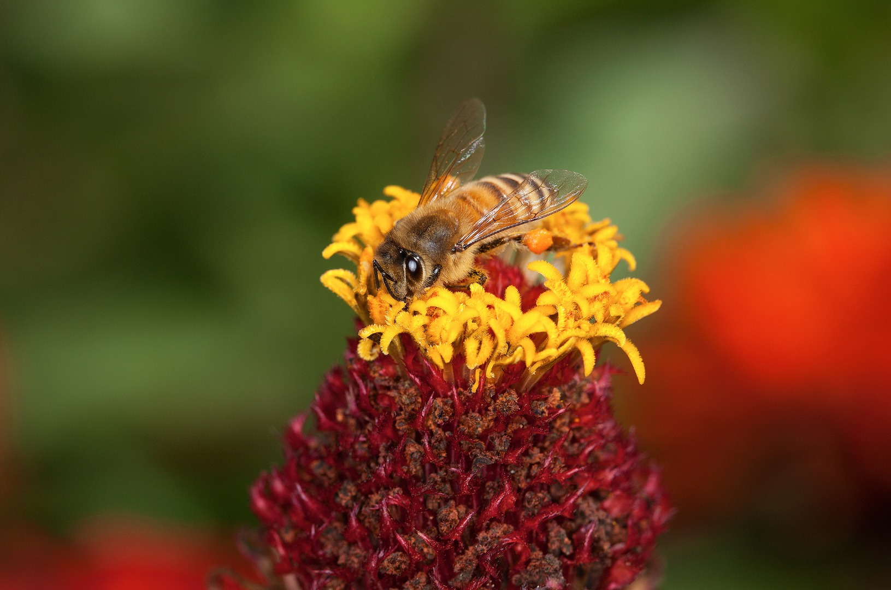
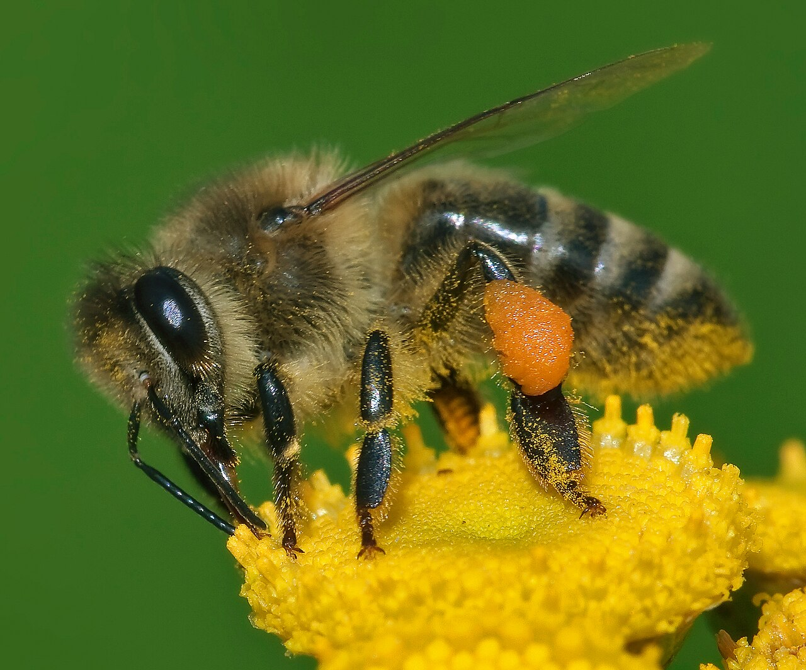
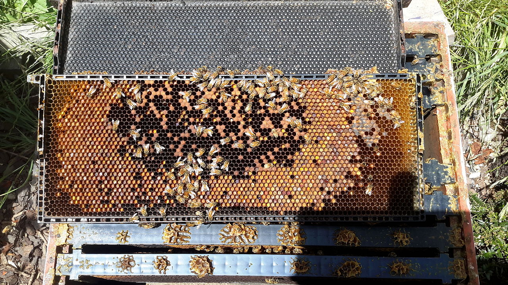
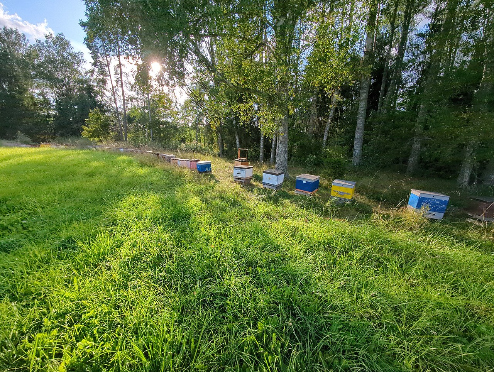
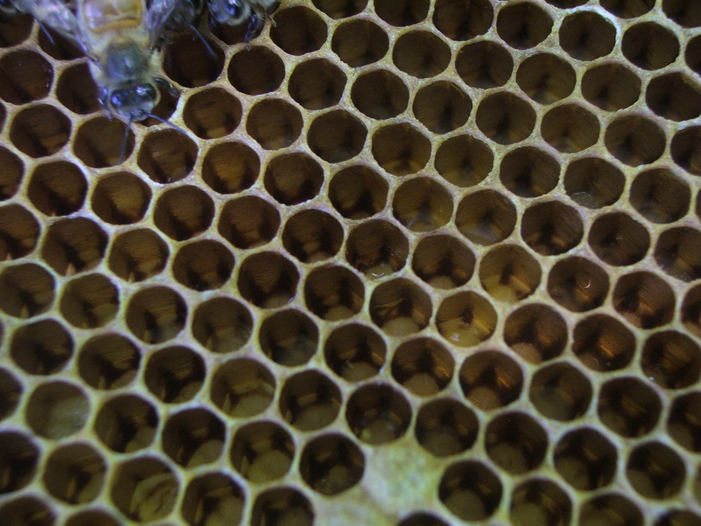
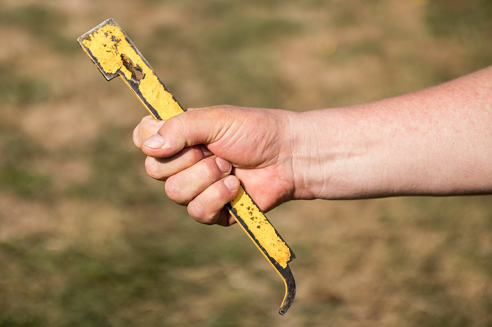
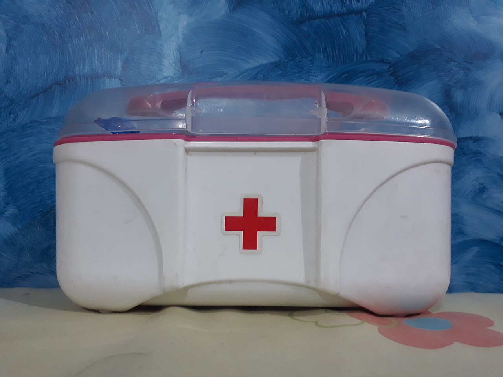

# Practical Beekeeping Handbook

**Foundations, Honey Bee Biology and Starting an Apiary**

**WORKING MANUSCRIPT — NOT A RELEASE OR A PRINT MASTER.**

Narrative revision (#228), image placement, pagination and format proof remain pending. Chapter numbers are global and unchanged. No final page count is claimed.

## Set navigation

| Edition | Chapters |
|---|---|
| [Complete digital edition](digital-complete.md) | 1–74 |
| [Foundations, Honey Bee Biology and Starting an Apiary](volume-01.md) | 1–23 |
| [Colony Management](volume-02.md) | 24–38 |
| [Bee Health](volume-03.md) | 39–46 |
| [Honey Production and Other Hive Products](volume-04.md) | 47–59 |
| [Business, Sustainability and Reference Material](volume-05.md) | 60–74 |

Complete References 75–85 are in Volume 5 and the complete digital edition. Chapter bibliographies and warnings remain within their chapters.

# Chapter 1 — Introduction to Beekeeping

## Introduction

Beekeeping, also called apiculture, is the practice of housing and managing honey bee colonies for their welfare, pollination services, hive products, reproduction, study, or a combination of these purposes.

It is an agricultural activity, but it is also a form of animal husbandry. The beekeeper manages a living colony whose population, food requirements, reproductive state, health, and behaviour change continuously with the season and the surrounding environment.

Modern beekeeping is not simply the ownership of a wooden box containing bees. It requires observation, planning, safe working methods, disease awareness, accurate records, suitable equipment, respect for neighbours, and compliance with local law.

Honey production may be the most visible result of beekeeping, but it is not the colony's purpose. Bees collect nectar and convert it into honey primarily as a food reserve. A responsible beekeeper removes only genuine surplus and manages the colony in a way that protects its long-term health.

This chapter introduces the basic language, responsibilities, rewards, limitations, and practical realities of becoming a beekeeper. Detailed subjects such as honey bee biology, equipment, inspections, feeding, disease control, honey harvesting, and business management are developed in later chapters.

---

## Learning Objectives

By the end of this chapter, the reader should be able to:

- define beekeeping, colony, hive, apiary, and beekeeper;
- explain the difference between the honey bee colony and the equipment that houses it;
- identify the main reasons people keep bees;
- describe the principal responsibilities of a beekeeper;
- recognise the main benefits, costs, risks, and uncertainties involved;
- assess whether personal circumstances are suitable for beginning beekeeping;
- understand why local training, mentorship, legislation, and bee-health guidance matter;
- describe the role of observation, records, and continuing education;
- explain why managed honey bees must be kept responsibly alongside wild pollinators.

---

## Essential Terms

### Beekeeping or Apiculture

**Beekeeping** is the practical management of bee colonies by people.

**Apiculture** is the formal term commonly used for the keeping and management of honey bees.

This handbook focuses primarily on managed honey bee colonies, especially the western honey bee, *Apis mellifera*. Other honey bee species are managed in some parts of the world, and local practices may differ substantially.

### Honey Bee Colony

A **colony** is the complete living social unit.

It normally includes:

- one queen;
- thousands of worker bees;
- drones during parts of the year;
- developing brood;
- stored honey;
- stored pollen;
- wax comb;
- a shared nest environment.

The colony should not be confused with the hive. The colony is alive. The hive is equipment.

### Hive

A **hive** is the structure provided for a colony.

It may contain components such as:

- a floor or bottom board;
- brood boxes;
- frames;
- comb or foundation;
- honey supers;
- covers;
- a roof;
- an entrance;
- ventilation or feeding components.

Hive designs vary by country, climate, management system, and local tradition.

### Apiary

An **apiary** is a managed location containing one or more bee colonies.

An apiary may be:

- rural;
- agricultural;
- woodland;
- suburban;
- urban, where lawful and appropriate;
- permanent;
- temporary;
- migratory.

A suitable apiary requires more than enough physical space for hives. Flight paths, access, forage, water, drainage, wind exposure, public safety, livestock, neighbours, theft, vandalism, vehicle access, and legal restrictions must also be considered.

### Beekeeper

A **beekeeper** is the person responsible for managing one or more colonies.

Ownership alone does not amount to responsible management. A beekeeper must be prepared to inspect colonies, recognise problems, act when action is required, avoid unnecessary disturbance, and seek qualified assistance when a situation exceeds personal competence.

---

## The Colony as a Managed Living System

A honey bee colony functions as an integrated biological unit. Individual bees perform specialised tasks, but survival depends on the coordinated activity of the whole colony.

The colony regulates:

- brood care;
- food collection;
- food storage;
- temperature;
- ventilation;
- defence;
- hygiene;
- reproduction;
- population replacement.

These processes are influenced by:

- queen condition;
- colony population;
- brood quantity;
- food reserves;
- forage availability;
- weather;
- pests and diseases;
- pesticide exposure;
- hive condition;
- beekeeper actions.

Because these factors interact, beekeeping cannot be reduced to a fixed sequence of actions performed on fixed calendar dates.

A management action that is appropriate for one colony may be unnecessary or harmful for another. The beekeeper must learn to observe conditions, interpret evidence, and choose a proportionate response.

---

## What Beekeeping Involves

Beekeeping combines several kinds of work.

### Observation

The beekeeper observes:

- flight activity;
- entrance behaviour;
- colony temperament;
- brood development;
- food reserves;
- queen performance;
- signs of swarming;
- disease symptoms;
- pest levels;
- seasonal changes;
- environmental conditions.

Observation should guide intervention. Opening a hive without a clear purpose creates disturbance and may increase the risk of crushing bees, chilling brood, damaging the queen, provoking robbing, or disrupting colony organisation.

### Physical Work

Beekeeping may involve:

- lifting boxes containing honey;
- bending and carrying equipment;
- standing on uneven ground;
- working in heat;
- transporting colonies;
- handling sticky or heavy frames;
- cleaning tools and equipment;
- maintaining the apiary site.

A full honey super can be heavy. Safer options include smaller boxes, fewer frames per box where the hive design permits, mechanical aids, and team lifting.

### Seasonal Work

The workload is not evenly distributed through the year.

Busy periods may include:

- spring colony assessment;
- swarm-control season;
- movement to pollination or forage;
- honey super management;
- harvesting;
- disease monitoring;
- treatment periods;
- autumn preparation;
- feeding;
- winter checks.

The timing differs with climate, altitude, latitude, forage, bee type, and local weather.

### Decision-Making

The beekeeper must decide:

- when to inspect;
- when not to inspect;
- whether food reserves are sufficient;
- whether the colony is queenright;
- whether brood appears healthy;
- whether additional space is needed;
- whether intervention is justified;
- whether treatment is legally authorised and biologically appropriate;
- whether expert or veterinary assistance is required.

### Record Keeping

Useful records may include:

- inspection date;
- weather;
- colony strength;
- brood condition;
- queen observations;
- food reserves;
- swarm signs;
- disease or pest findings;
- treatment name and batch details;
- feeding;
- honey yield;
- equipment changes;
- unusual behaviour;
- follow-up actions.

Memory alone becomes unreliable when several colonies are managed or when observations must be compared across seasons.

---

## Why People Become Beekeepers

People begin beekeeping for many reasons.

Common motivations include:

- fascination with honey bee biology;
- production of honey for personal use;
- production of beeswax or other hive products;
- pollination of crops or gardens;
- agricultural diversification;
- sale of colonies or queens;
- commercial pollination;
- education;
- scientific observation;
- environmental interest;
- connection with nature;
- family or community tradition.

Several motivations may exist at the same time.

A clear objective helps determine:

- how many colonies to begin with;
- what equipment is required;
- where the apiary should be placed;
- how much training is needed;
- whether extraction equipment is necessary;
- whether food-business registration may apply;
- whether commercial insurance is needed;
- how much time and money should be committed.

Beekeeping should not be presented as a guaranteed source of profit. Colony losses, poor weather, limited forage, pests, disease, equipment costs, product regulations, and fluctuating yields can change the financial result substantially.

---

## Benefits and Responsibilities

| Potential benefit | Corresponding responsibility |
|---|---|
| Honey and other hive products | Harvest only suitable, safe, lawful, and genuine surplus |
| Crop or garden pollination | Place and manage colonies without harming people, livestock, neighbouring apiaries, or other pollinators |
| Connection with nature | Avoid unnecessary disturbance and damage to habitats |
| Agricultural income | Maintain records, product safety, traceability, honest labelling, and legal compliance |
| Colony reproduction and sale | Prevent avoidable spread of pests and diseases |
| Educational value | Present accurate information and safe demonstrations |
| Personal satisfaction | Accept the need for regular work, continued learning, and occasional losses |
| Community involvement | Communicate responsibly with neighbours, landowners, associations, and authorities |

The benefits cannot be separated from the responsibilities.

---

## The Responsibilities of a Beekeeper

### Protect Colony Welfare

The beekeeper must provide or maintain conditions that allow the colony to function safely.

This includes attention to:

- suitable housing;
- weather protection;
- ventilation;
- food reserves;
- water access;
- colony strength;
- queen condition;
- disease and pest pressure;
- appropriate space;
- safe transport;
- seasonal preparation.

The goal is not to interfere constantly. The goal is to recognise when management is needed and when the colony should be left undisturbed.

### Monitor Bee Health

Managed colonies can carry and spread parasites and pathogens.

Responsible management includes:

- regular health assessment;
- recognition of abnormal brood;
- monitoring of important pests;
- lawful use of authorised veterinary treatments;
- cleaning and biosecurity;
- avoiding transfer of contaminated equipment;
- reporting notifiable disease where required;
- seeking specialist assistance when diagnosis is uncertain.

A visibly active colony is not necessarily healthy. Some serious problems develop before obvious collapse occurs.

### Prevent Starvation

Honey and pollen are colony food.

A beekeeper must evaluate reserves and seasonal risk before removing honey. Feeding may be necessary in some circumstances, but it is not a substitute for poor harvest decisions or unsuitable apiary planning.

The type, timing, quantity, and legality of feeding depend on:

- colony condition;
- season;
- climate;
- management objective;
- disease risk;
- intended honey harvest;
- local rules.

Detailed feeding guidance appears later in this handbook.

### Use Treatments Responsibly

Veterinary medicines and pest-control products must be used only as permitted.

The beekeeper must follow:

- the authorised product label;
- dose instructions;
- timing;
- withdrawal periods;
- temperature limits;
- application method;
- personal protective requirements;
- disposal rules;
- record-keeping requirements.

Improvised chemical treatments can harm bees, contaminate hive products, create residues, accelerate resistance, and breach the law.

### Protect Other Apiaries and Pollinators

Poorly managed colonies can affect more than their owner.

Beekeepers should:

- control transmissible pests and diseases;
- avoid careless movement of colonies and equipment;
- prevent robbing where possible;
- avoid overcrowding sites;
- support diverse forage;
- minimise unnecessary chemical exposure;
- recognise that managed honey bees are only part of the pollinator community.

Wild pollinators also contribute substantially to crop and wild-plant pollination. Responsible beekeeping should not describe the introduction of managed colonies as automatically beneficial in every habitat.

### Protect the Public

The beekeeper must consider:

- entrances facing paths or neighbouring property;
- flight height;
- aggressive colonies;
- swarming;
- water-seeking behaviour;
- livestock;
- children;
- visitors;
- road access;
- emergency access;
- signs or barriers where appropriate.

A technically good hive location may still be unsuitable if normal bee activity creates unreasonable risk or nuisance.

### Maintain Honest Product Standards

Honey and other hive products must not be:

- adulterated;
- contaminated;
- falsely labelled;
- sold with unsupported medical claims;
- represented as local when they are not;
- described as monofloral without a reasonable basis;
- handled in unsuitable conditions.

Product safety and legal sales requirements are addressed in later chapters.

---

## Safety Before Starting

**Warning:** Honey bee stings can cause severe allergic reactions, including life-threatening anaphylaxis.

A prospective beekeeper should understand:

- ordinary local pain and swelling can occur after a sting;
- previous mild reactions do not guarantee that future reactions will remain mild;
- breathing difficulty, throat or tongue swelling, collapse, confusion, widespread hives, or rapidly developing systemic symptoms require emergency medical assistance;
- a person with a known serious sting allergy should obtain personalised medical advice before working with bees;
- prescribed emergency medication must be used exactly as instructed by a qualified healthcare professional.

Do not work alone in a remote apiary when personal medical risk or local conditions make assistance difficult.

**Emergency:** When signs of anaphylaxis occur, contact the local emergency service immediately and follow the person's emergency medical plan. Do not rely on antihistamines as a substitute for urgent treatment prescribed for anaphylaxis.

Other important risks include:

- burns or fire from smokers;
- cuts from tools;
- lifting injuries;
- vehicle incidents;
- heat stress;
- falls;
- chemical exposure;
- defensive colonies;
- attacks on livestock;
- blocked public access;
- working in poor weather.

Detailed sting prevention, first aid, lifting, smoker safety, and emergency planning are covered in Chapter 23.

---

## Legal and Regional Requirements

Beekeeping law varies between countries and regions and may change.

Before acquiring bees, determine whether local rules require:

- registration as a beekeeper;
- registration of the apiary;
- landowner permission;
- planning or zoning permission;
- minimum distances from property boundaries or roads;
- disease notification;
- treatment records;
- colony movement documents;
- livestock or agricultural registration;
- identification of hives;
- insurance;
- food-business registration;
- honey labelling compliance;
- tax or business registration.

Do not assume that advice from another country applies locally.

Use current information from:

- the competent agriculture authority;
- the official veterinary authority;
- the national or regional food-safety authority;
- local government;
- recognised beekeeping associations;
- qualified bee-health inspectors;
- insurers;
- landowners.

**Note:** This handbook provides general educational information. It does not replace current local legislation, veterinary instructions, medical advice, or site-specific risk assessment.

---

## Time Commitment

The time required depends on:

- number of colonies;
- travel distance;
- season;
- colony health;
- local forage;
- management system;
- honey-production goals;
- equipment;
- experience;
- record-keeping;
- weather.

A small apiary may require limited routine time in quiet periods but urgent attention during:

- swarm season;
- food shortage;
- queen failure;
- disease suspicion;
- treatment windows;
- honey harvesting;
- storm damage;
- colony movement.

Bees cannot always be postponed until the next free weekend. Some problems become more difficult or irreversible when action is delayed.

---

## Financial Commitment

Starting costs may include:

- complete hives;
- frames and foundation;
- bees or nucleus colonies;
- protective clothing;
- gloves;
- smoker;
- hive tool;
- feeders;
- inspection and health-monitoring supplies;
- transport;
- stands;
- storage;
- spare equipment;
- honey-processing equipment;
- jars and labels;
- training;
- registration;
- insurance;
- veterinary treatments.

Beginners should also budget for replacement queens, colony losses, damaged equipment, feeding, and unexpected health problems.

Buying the cheapest available bees or used equipment without health information can create higher costs later.

Used equipment may carry wax moth, spores, residues, or infectious material. It should be acquired only after assessing its history, condition, and any applicable disease-control restrictions.

---

## Realistic Expectations

Beekeeping results vary.

A beginner should not assume that every colony will:

- survive winter;
- produce harvestable honey;
- remain gentle;
- avoid swarming;
- maintain a good queen;
- stay disease-free;
- develop at the same rate;
- respond identically to management.

Honey production depends on more than colony ownership. It requires suitable forage, weather, colony strength, health, timing, space, and correct harvest decisions.

The first season may be primarily a learning and establishment period.

Mistakes are likely. The objective is not perfection but safe learning, accurate observation, timely correction, and avoidance of preventable harm.

---

## Starting with Support

Practical mentorship can reduce serious beginner errors.

Useful sources of support include:

- a recognised beginner course;
- a local beekeeping association;
- an experienced and responsible mentor;
- an official bee-health inspector;
- an agricultural adviser;
- a veterinarian with relevant responsibility;
- evidence-based books and institutional guidance.

A mentor should not be followed uncritically. Practices should be compared with:

- current research;
- official guidance;
- authorised product instructions;
- local law;
- observed colony conditions.

Traditional experience is valuable, but age or popularity alone does not prove that a practice is safe or effective.

---

## How Many Colonies Should a Beginner Keep?

Starting with one colony may appear inexpensive, but it provides no direct comparison and no second colony from which limited resources may sometimes be transferred under appropriate management.

Starting with too many colonies can overwhelm a beginner.

For many beginners, a small number of colonies is more manageable than either one isolated colony or a large apiary. The correct number depends on:

- available time;
- physical ability;
- budget;
- apiary space;
- local forage;
- mentor support;
- transport;
- storage;
- legal limits;
- management purpose.

This is not a universal numerical rule. Regional conditions and personal capacity must guide the decision.

Do not increase colony numbers until the existing colonies can be managed competently.

---

## Choosing Bees Responsibly

Bees may be obtained as:

- a nucleus colony;
- a package;
- a full colony;
- a captured swarm;
- an artificial split;
- a purchased queen combined with bees from another source.

Each method carries different requirements and risks.

For a beginner, the source should provide reliable information about:

- colony health;
- queen status;
- temperament;
- age or origin of the queen where known;
- recent treatments;
- pest monitoring;
- brood condition;
- equipment compatibility;
- local adaptation;
- movement or certification requirements.

Do not acquire an unknown colony merely because it is cheap or free.

Swarm capture and colony installation are covered in later chapters.

---

## Apiary Suitability: Initial Questions

Before bringing bees to a site, ask:

1. Do I have legal permission to keep bees here?
2. Does the landowner agree in writing where appropriate?
3. Can I reach the site safely throughout the active season?
4. Is there enough stable, dry ground for hive stands?
5. Can hive entrances be directed away from paths and neighbours?
6. Can barriers or vegetation raise the flight path?
7. Is reliable water available without encouraging bees to visit neighbouring property?
8. Is forage sufficient and reasonably diverse?
9. Is the site exposed to flooding, fire, livestock, vandalism, or theft?
10. Can full hive boxes be carried or moved safely?
11. Can emergency services or another person reach me?
12. Is there adequate distance from people who may be especially vulnerable?
13. Can colonies be inspected without blocking access or creating nuisance?
14. Is there space for spare equipment and temporary colony expansion?

A full site-selection procedure appears in Chapter 15.

---

## Beginner Readiness Checklist

Before acquiring bees, confirm the following.

### Knowledge and Support

- [ ] I understand the difference between a colony, hive, and apiary.
- [ ] I have completed or arranged suitable beginner training.
- [ ] I have access to a responsible mentor or local association.
- [ ] I know whom to contact for suspected notifiable disease.
- [ ] I know where to obtain current local bee-health guidance.

### Safety

- [ ] I understand the risk of stings and anaphylaxis.
- [ ] I have considered my own health and physical limitations.
- [ ] I have appropriate protective clothing.
- [ ] I have a working telephone or communication plan at the apiary.
- [ ] I have planned safe smoker use and fire prevention.
- [ ] I can lift or divide the expected loads safely.
- [ ] I have an emergency and retreat plan.

### Legal and Social Requirements

- [ ] I have checked beekeeper and apiary registration requirements.
- [ ] I have permission to use the land.
- [ ] I have checked local planning, nuisance, and livestock rules.
- [ ] I have considered neighbours, paths, children, and animals.
- [ ] I have investigated suitable insurance.

### Equipment and Site

- [ ] I have selected one compatible hive system.
- [ ] I have complete hives and spare essential components.
- [ ] The site has stable stands, access, drainage, water, and suitable flight paths.
- [ ] I have secure storage for equipment.
- [ ] I have a method for transporting equipment and bees lawfully.

### Colony Management

- [ ] I have identified a reputable source of bees.
- [ ] I can inspect brood and food stores with assistance.
- [ ] I have a plan for pest monitoring.
- [ ] I understand that treatments must be authorised and recorded.
- [ ] I have a system for inspection records.
- [ ] I have time available during urgent seasonal periods.
- [ ] I have funds reserved for feeding, treatments, replacement equipment, and losses.

If several essential items remain incomplete, delay acquiring bees until the gaps have been addressed.

---

## Common Misconceptions

### “Bees Take Care of Themselves”

Wild-living honey bee colonies receive no direct human care, but managed colonies are placed, moved, multiplied, treated, harvested, and housed by people. These actions create responsibilities.

A beekeeper who owns a colony but does not monitor its food, queen status, pest burden, or disease risk may allow avoidable suffering and spread problems to other colonies.

### “More Inspections Always Mean Better Care”

Frequent unnecessary inspections can be disruptive.

Good management means inspecting with a purpose, recording the findings, and allowing the result to guide the next action.

### “Every Hive Produces Honey Every Year”

Honey harvest is not guaranteed.

A colony may need its stores for:

- growth;
- recovery;
- winter;
- drought;
- dearth;
- queen replacement;
- disease stress.

### “Keeping Honey Bees Automatically Protects Biodiversity”

Managed honey bees can provide pollination services, but biodiversity conservation also requires:

- diverse wild pollinators;
- nesting habitat;
- pesticide risk reduction;
- varied flowering plants;
- habitat continuity;
- careful decisions about colony density.

Adding more managed colonies is not a substitute for protecting habitat.

### “Natural Means Safe”

Natural substances may still:

- harm bees;
- contaminate honey;
- leave residues;
- injure the beekeeper;
- be ineffective;
- be unlawful;
- interact with temperature or colony condition.

Treatments and feeding practices must be evaluated by evidence and authorised instructions, not by the label “natural”.

### “Beekeeping Is Passive Income”

Colonies require skilled, seasonal, and sometimes urgent work. Profit, where achieved, normally depends on planning, scale, quality, market access, compliance, and cost control.

---

## Ethical Foundations

Ethical beekeeping is based on respect for:

- the colony;
- other pollinators;
- neighbouring beekeepers;
- landowners;
- consumers;
- public safety;
- the environment;
- scientific evidence;
- the law.

Practical ethical principles include:

1. Put colony survival and health before maximum harvest.
2. Avoid unnecessary disturbance.
3. Do not knowingly spread pests or disease.
4. Use medicines lawfully and responsibly.
5. Maintain genuine and safe hive products.
6. Do not make unsupported health claims.
7. Avoid aggressive colony placement near the public.
8. Protect wild-pollinator habitat.
9. Keep accurate records.
10. Correct mistakes openly and continue learning.

Ethics is not separate from technical skill. It determines how technical knowledge is applied.

---

## Observation Before Intervention

A central principle of this handbook is:

> Observe first, interpret second, intervene only with a clear reason.

Before opening or manipulating a colony, the beekeeper should be able to state:

- what question the inspection must answer;
- what evidence will be examined;
- what action may follow;
- what equipment is needed;
- whether weather conditions are suitable;
- what safety risks exist.

After the inspection, record:

- what was observed;
- what was done;
- why it was done;
- when the colony should be checked again.

This approach reduces random manipulation and supports consistent decision-making.

---

## Practical Exercise: Define Your Beekeeping Plan

Write brief answers to the following questions before buying equipment or bees.

### Purpose

- Why do I want to keep bees?
- Is my main objective education, honey, pollination, business, conservation interest, or another purpose?
- What would a successful first year realistically look like?

### Capacity

- How much time can I provide from spring to autumn?
- How much can I safely invest without depending on immediate honey sales?
- Can I lift hive components safely?
- Who can assist me if I am ill, injured, or away?

### Location

- Where will the colonies be placed?
- Who owns the land?
- What are the legal and neighbour-related constraints?
- Where will the bees obtain water?
- How will equipment and honey be transported?

### Learning

- What course will I take?
- Who can mentor me?
- Which official authority provides bee-health information?
- How will I record inspections and treatments?

### Risk

- What will I do if a colony becomes aggressive?
- What will I do if disease is suspected?
- What will I do if the colony is starving?
- What will I do if a swarm leaves?
- What is the emergency plan for serious stings or fire?

Keep these answers. Revisit them after the first season and revise the plan using real experience.

---

## What This Handbook Will Cover

The chapters that follow develop the subject in a structured sequence.

The handbook covers:

- the history and development of beekeeping;
- the importance of honey bees and other pollinators;
- hive products;
- honey bee anatomy and biology;
- colony organisation and behaviour;
- apiary planning;
- hive systems and equipment;
- safety and first aid;
- installing and inspecting colonies;
- feeding;
- swarm management;
- queen management;
- seasonal colony care;
- record keeping;
- pests and diseases;
- integrated pest management;
- honey and wax production;
- other hive products;
- food safety and traceability;
- business and marketing;
- legal requirements;
- sustainability;
- biodiversity;
- scientific research;
- reference material.

Reading provides the scientific and practical foundation, but competence also requires supervised experience with live colonies.

---

## Chapter Summary

Beekeeping is the responsible management of living honey bee colonies. The colony is the biological unit, the hive is its physical housing, and the apiary is the managed location where one or more colonies are kept.

People keep bees for honey, pollination, education, agricultural income, hive products, scientific interest, and personal satisfaction. Every potential benefit carries responsibilities involving colony health, public safety, disease control, environmental stewardship, legal compliance, honest product handling, and continued learning.

Beginning beekeeping requires more than buying a hive. The prospective beekeeper must assess training, mentorship, time, money, physical work, site suitability, emergency planning, equipment, local regulations, and the reliability of the bee source.

Honey yields and colony survival are never guaranteed. Successful management depends on observation, records, seasonal awareness, evidence-based action, and willingness to seek qualified help.

Managed honey bees can make valuable contributions to agriculture and society, but they exist within a wider pollinator community. Responsible beekeeping therefore supports colony welfare while respecting wild pollinators and their habitats.

---

## Key Takeaways

- Beekeeping is a form of animal husbandry and agricultural management.
- The colony is alive; the hive is equipment.
- Honey is colony food before it is a human product.
- Colony welfare must take priority over maximum harvest.
- Beekeeping requires time, money, physical work, knowledge, and emergency planning.
- Stings can cause life-threatening anaphylaxis.
- Local legal and veterinary requirements must be checked before bees are acquired.
- Managed colonies can spread pests and diseases when poorly managed.
- Wild pollinators remain essential and must also be protected.
- Observation should come before intervention.
- Records improve decisions and continuity of care.
- Practical mentorship is strongly recommended.
- Honey production and financial profit are not guaranteed.
- Continuing education is part of responsible beekeeping.

---

## Practical Checklist

Before moving to the next chapter, the reader should be able to confirm:

- [ ] I can define beekeeping, colony, hive, apiary, and beekeeper.
- [ ] I understand that honey is primarily a colony food reserve.
- [ ] I can describe the main responsibilities of a beekeeper.
- [ ] I recognise that colony health can affect neighbouring colonies.
- [ ] I understand the principal personal and public safety risks.
- [ ] I know that beekeeping laws vary by jurisdiction.
- [ ] I understand that managed honey bees are not the only important pollinators.
- [ ] I can identify my main reason for keeping bees.
- [ ] I have begun assessing my time, budget, location, training, and support.
- [ ] I understand why records and evidence-based decisions are necessary.

---

## References

1. Food and Agriculture Organization of the United Nations. *Bees and Their Role in Forest Livelihoods: A Guide to the Services Provided by Bees and the Sustainable Harvesting, Processing and Marketing of Their Products*. FAO, 2009. https://www.fao.org/4/i0842e/i0842e00.htm

2. Food and Agriculture Organization of the United Nations. *Beekeeping and Sustainable Livelihoods*. Second edition. FAO Diversification Booklet 1, 2011. https://openknowledge.fao.org/3/i2462e/i2462e.pdf

3. Food and Agriculture Organization of the United Nations. *Good Beekeeping Practices*. TECA, 2019. https://openknowledge.fao.org/handle/20.500.14283/ca4271en

4. Intergovernmental Science-Policy Platform on Biodiversity and Ecosystem Services. *The Assessment Report on Pollinators, Pollination and Food Production: Summary for Policymakers*. IPBES, 2016. https://files.ipbes.net/ipbes-web-prod-public-files/downloads/pdf/ipbes_4_19_annex_ii_spm_pollination_en.pdf

5. Intergovernmental Science-Policy Platform on Biodiversity and Ecosystem Services. *The Assessment Report on Pollinators, Pollination and Food Production*. IPBES, 2016. https://files.ipbes.net/ipbes-web-prod-public-files/downloads/pdf/individual_chapters_pollination_20170305.pdf

6. National Institute for Occupational Safety and Health. *A Date Palm Worker Dies After Being Stung by Bees*. California FACE Report 17CA003, 2018. https://www.cdc.gov/niosh/face/state/17CA003.pdf

---

# Chapter 2 — History of Beekeeping

## Introduction

The relationship between humans and bees began long before the construction of managed hives. People first collected honey and wax from wild nests. Over time, some communities learned to protect nesting sites, attract swarms, house colonies in manufactured containers, and harvest hive products without destroying every colony.

The history of beekeeping is not a single progression from a supposedly primitive past to one universal modern system. Honey hunting, fixed-comb beekeeping, movable-comb management, forest beekeeping, and technologically advanced apiculture have existed side by side in different regions. Some traditional systems remain productive and culturally important today.

Historical evidence is uneven. Archaeological remains, artwork, written sources, surviving equipment, oral traditions, and scientific publications each reveal only part of the story. Claims about the “first” beekeeper, hive, or invention should therefore be treated cautiously unless supported by clear evidence.

This chapter traces major developments that changed how humans understood and managed honey bee colonies. It also explains why those developments still matter to practical beekeeping.

---

## Learning Objectives

By the end of this chapter, the reader should be able to:

- distinguish honey hunting from beekeeping;
- describe the transition from wild-nest harvesting to managed colonies;
- identify important evidence from ancient Egypt, the Levant, Greece, and Rome;
- explain the historical importance of fixed-comb and movable-comb hives;
- recognise that beekeeping developed in many regions, not only Europe;
- describe how scientific investigation corrected earlier beliefs about colony biology;
- explain why movable frames, wax foundation, and centrifugal extraction changed colony management;
- identify several important contributors to nineteenth-century apiculture;
- distinguish a documented historical fact from an uncertain or repeated popular claim;
- connect historical developments with present-day practical and ethical decisions.

---

## Essential Historical Terms

### Honey Hunting

**Honey hunting** is the collection of honey or other products from wild or unmanaged bee nests.

The nest may be found in:

- a hollow tree;
- a rock cavity;
- a cave;
- a cliff;
- the ground;
- a building;
- an exposed branch or other open site.

Honey hunting does not necessarily involve the continued management of the colony. Some harvesting methods preserve the colony, while others remove most of the comb or kill many of the bees.

### Beekeeping

**Beekeeping** begins when people intentionally provide, protect, maintain, move, or otherwise manage nesting places or colonies.

The boundary between honey hunting and beekeeping is not always sharp. A person may protect a wild nesting site, mark it as personal property, harvest it repeatedly, or prepare an empty cavity to attract a swarm. Such practices form an intermediate stage between opportunistic collection and full colony management.

### Fixed-Comb Hive

In a **fixed-comb hive**, the bees attach their combs directly to the roof or walls of the hive.

Examples include many:

- clay tube hives;
- pottery hives;
- basket hives;
- straw skeps;
- bark hives;
- log hives;
- wall cavities.

Combs cannot normally be removed intact and returned individually. Inspection and harvesting may therefore require cutting comb.

### Movable-Comb Hive

A **movable-comb hive** allows individual combs to be removed and returned.

Some traditional top-bar and stick-supported systems enabled comb movement long before the widespread adoption of rectangular wooden frames.

### Movable-Frame Hive

A **movable-frame hive** holds combs inside separate frames. Correct spacing prevents the bees from attaching the frames extensively to one another or to the hive walls.

Movable frames permit:

- systematic brood inspection;
- queen assessment;
- disease examination;
- colony division;
- exchange of suitable combs;
- controlled honey removal;
- replacement of damaged comb;
- more detailed record keeping.

### Bee Space

**Bee space** is the range of clearance that honey bees normally leave as a passage rather than filling completely with comb or sealing with propolis.

Practical dimensions vary with bee population, hive construction, location within the hive, material tolerances, and environmental conditions. The concept is more important than treating one measurement as universally exact.

### Apiarian

An **apiarian** is a historical or formal term for a beekeeper or a person who studies beekeeping.

---

## How Historical Evidence Should Be Read

Historical accounts often repeat attractive stories as established facts. A careful reader should ask:

1. What type of evidence supports the claim?
2. When was the evidence created?
3. Was it produced by the society being described?
4. Does it show actual colony management or only the use of honey and wax?
5. Is the date secure?
6. Is the interpretation accepted or debated?
7. Does a later author repeat an older claim without new evidence?
8. Is an invention being confused with its later commercial adoption?

### Types of Evidence

| Evidence type | What it may show | Main limitation |
|---|---|---|
| Rock art | Honey collection, climbing, tools, interaction with bees | Dating and interpretation may be uncertain |
| Tomb or temple images | Hive forms, workers, processing methods | Images may be symbolic or incomplete |
| Archaeological hive remains | Hive construction, scale, location, residues | Organic materials often do not survive |
| Written agricultural texts | Contemporary observations and recommendations | Authors may repeat myths or elite practices |
| Legal and trade records | Ownership, taxation, product value, regulation | Often reveal little about daily technique |
| Surviving traditional practice | Possible continuity of methods | Present practice cannot automatically be projected into the distant past |
| Patents and books | Documented designs and claims | A patent does not prove sole invention or immediate adoption |
| Scientific papers | Experimental findings and changing knowledge | Later work may revise conclusions |

**Historical caution:** Evidence that a society used honey does not by itself prove that it practised organised beekeeping.

---

## From Wild Honey Collection to Colony Management

Humans probably consumed honey before written history. Honey offered concentrated carbohydrate, while brood, pollen, propolis, and wax could also be useful.

Collecting from wild colonies required knowledge of:

- bee flight;
- nesting habitats;
- flowering seasons;
- smoke;
- climbing;
- cutting tools;
- safe routes of retreat;
- storage and transport.

In some regions, hunters followed honeyguide birds or observed the flight direction of bees returning from water or forage. Other communities maintained customary ownership of bee trees or prepared cavities that could later be occupied.

The development of beekeeping did not require an immediate understanding of queen biology, mating, brood development, or disease. Early management could succeed through accumulated observation:

- swarms occupy suitable cavities;
- colonies return to productive locations;
- smoke can alter defensive behaviour;
- some harvest methods leave enough stores and comb for continued survival;
- flowering seasons affect colony productivity;
- colonies can be transported to new forage.

These observations formed practical knowledge long before experimental biology explained why the methods worked.

---

## Prehistoric Evidence

A well-known rock painting from the Cuevas de la Araña near Bicorp in eastern Spain shows a human figure apparently collecting material from a bee nest while surrounded by insects. The person appears to use a climbing aid or basket.

The image is frequently described as approximately 8,000 years old. However, prehistoric rock art can be difficult to date precisely, and interpretations vary. It is therefore safer to describe the scene as early evidence of honey collection rather than a precisely dated record of organised beekeeping.

Rock art and traditional honey-hunting practices in Africa, Asia, Australia, and other regions demonstrate that skilled wild-nest harvesting developed in many human cultures.

Early honey hunting could be destructive, but destruction was not inevitable. Harvesters might:

- take only accessible honey comb;
- leave brood comb;
- leave part of the food reserve;
- return to the same nesting place;
- protect a bee tree from other collectors;
- prepare a cavity for future occupation.

These practices created a gradual transition from collecting a resource to managing a recurring biological asset.

---

## Ancient Egypt

Ancient Egyptian images provide some of the clearest early evidence of organised beekeeping.

Scenes associated with the tomb of Rekhmire, an official of the Eighteenth Dynasty, show workers handling horizontal cylindrical hives and processing honey. The imagery indicates specialised work rather than accidental collection from wild nests.

Egyptian hives were commonly represented as tube-like containers arranged horizontally in rows or stacks. Comparable traditional hive forms have persisted in parts of the Mediterranean, North Africa, and the Middle East.

Honey and beeswax had many uses, including:

- food and sweetening;
- religious offerings;
- medicinal preparations;
- sealing;
- cosmetics;
- craftwork;
- preservation;
- administrative payments or valued goods.

The bee also appeared in royal and written symbolism. A bee sign could identify honey in Egyptian inscriptions, while royal titles linked the bee with Lower Egypt.

### Migratory Beekeeping on the Nile

It is often stated that Egyptian beekeepers transported hives by boat to follow flowering along the Nile. Seasonal colony movement is plausible and is described in later historical traditions, but specific claims should be matched to the quality and date of the supporting source.

The important practical point is that ancient beekeepers understood the relationship between:

- colony location;
- seasonal flowering;
- water;
- crop cycles;
- honey production.

### What the Evidence Demonstrates

Egyptian evidence supports the existence of:

- manufactured hives;
- apiary organisation;
- specialised honey processing;
- significant economic and cultural value;
- established colony management.

It does not prove that every Egyptian beekeeper used the same methods or possessed a modern understanding of honey bee biology.

---

## The Tel Rehov Apiary

Excavations at Tel Rehov in the Jordan Valley uncovered remains interpreted as a large apiary dating to approximately the tenth to early ninth centuries BCE.

The installation included rows of cylindrical clay hives. Researchers estimated that the complete apiary may once have contained many colonies, demonstrating production at a substantial scale.

The Tel Rehov discovery is especially important because the hives were found in place as part of an organised apiary rather than appearing only in an illustration or text.

Study of bee remains from the site also raised questions about the geographic origin of the managed bees. This suggests that ancient beekeeping may have included movement or trade in bee stocks, although interpretations should remain tied to the archaeological evidence.

### Practical Significance

The apiary demonstrates that ancient colony management could require:

- standardised hive construction;
- planned hive arrangement;
- access for harvesting;
- control of heat and ventilation;
- labour organisation;
- product storage;
- knowledge of local forage;
- management of many colonies in a settled environment.

It also shows that large apiaries near human settlements are not purely modern phenomena.

---

## Beekeeping in the Ancient Mediterranean

### Greece

Greek literature contains observations about bees, swarming, honey, and hive management.

Aristotle discussed bees in works on animal history and reproduction. He made careful observations but also repeated or developed conclusions that later science corrected.

Ancient writers struggled to explain:

- the sex of the queen;
- mating;
- egg production;
- the origin of drones;
- wax production;
- colony communication.

Their errors are historically important because they show the limits of observation when events such as queen mating occur away from the hive.

Greek beekeeping used several forms of pottery, basket, and other fixed-comb hive. Evidence from some regions also suggests the use of removable bars or extensions that permitted a degree of comb management.

Honey was valued in:

- food;
- fermented drink;
- medicine;
- religious practice;
- trade.

### Rome

Roman agricultural writers described apiary management in considerable detail.

Authors associated with this tradition include:

- Varro;
- Columella;
- Pliny the Elder;
- Virgil.

Their accounts discuss subjects recognisable to modern beekeepers:

- site selection;
- water;
- shelter;
- forage;
- swarming;
- hive materials;
- colony temperament;
- honey harvesting;
- protection from pests.

Some recommendations were practical observations, while others reflected the scientific misconceptions of the period.

Roman texts should not be treated as proof that every beekeeper throughout the empire followed the same system. They mainly represent written knowledge available to particular educated audiences.

---

## Other Early Beekeeping Traditions

The historical record is richer in some regions than others. Surviving European and Mediterranean texts have sometimes caused global beekeeping history to be told too narrowly.

### Africa

Africa contains great diversity in both honey bee populations and management traditions.

Historic and continuing practices include:

- log hives;
- bark hives;
- woven hives;
- clay hives;
- gourds;
- suspended hives;
- prepared tree cavities;
- honey hunting from cliffs and forests.

In some systems, hives are placed high in trees to attract swarms and protect colonies from people, livestock, fire, or predators.

The distinction between honey hunting and beekeeping may depend on whether the beekeeper prepared, owned, protected, and repeatedly managed the nesting place.

### Western and Central Asia

Clay and mud hives, wall hives, baskets, and log hives were used across parts of Western and Central Asia.

Trade routes enabled the exchange of:

- honey;
- wax;
- hive designs;
- bee stocks;
- practical knowledge.

### South Asia

South Asia has a long history of interaction with several honey bee species.

Not every honey bee species can be managed in the same type of enclosed movable-frame hive. Open-nesting species and cavity-nesting species require different harvesting and management approaches.

The later adoption of framed-hive systems did not erase older traditions of:

- forest honey collection;
- cliff honey hunting;
- wall beekeeping;
- log-hive management.

### East Asia

China and neighbouring regions developed long traditions of honey use and colony management. The eastern honey bee, *Apis cerana*, became an important managed species.

Local hive design and management evolved around the biology of regional bees, climate, forage, and agriculture.

### Indigenous Knowledge

Many communities developed detailed knowledge without producing surviving written manuals.

Historical study should recognise:

- oral transmission;
- ecological knowledge;
- seasonal knowledge;
- customary ownership;
- specialised climbing and harvesting skill;
- locally adapted hive materials.

Absence from written European records is not evidence that such knowledge did not exist.

---

## Forest Beekeeping

In forest beekeeping, people manage colonies living in natural or prepared cavities in standing trees.

The beekeeper may:

- enlarge a cavity;
- install internal supports;
- close openings;
- create an entrance;
- mark ownership;
- protect the tree;
- climb to inspect or harvest;
- leave brood and food for colony survival.

Forest beekeeping developed strongly in parts of northern and eastern Europe but also has parallels elsewhere.

Later, sections of hollow tree containing colonies were cut and moved closer to settlements. These log hives represented a transition from managing bees in living trees to keeping colonies in portable structures.

### Practical Legacy

Forest beekeeping contributed knowledge about:

- cavity size;
- insulation;
- entrance placement;
- colony occupation;
- swarm attraction;
- selective harvesting;
- long-term use of nesting sites.

It also reminds modern beekeepers that the thermal and spatial properties of a hive influence colony survival.

---

## Beekeeping in Medieval Europe

During medieval periods, honey and wax remained valuable agricultural products.

Honey was used as:

- a sweetener;
- an ingredient in preserved foods;
- a medicine;
- a component of fermented beverages;
- a trade product.

Beeswax was particularly valuable for:

- candles;
- seals;
- writing tablets;
- casting;
- waterproofing;
- polish;
- religious use.

Monasteries, estates, households, and rural communities kept bees, but knowledge was not preserved only by monasteries. Secular farmers, forest beekeepers, craft workers, merchants, and local specialists also maintained and transmitted practical skills.

### Skeps

A **skep** is a dome-shaped hive usually made from coiled straw, grass, wicker, or similar material.

Skeps offered several advantages:

- inexpensive local materials;
- good insulation when properly made;
- low weight;
- suitability for swarm housing.

Their limitations included:

- fixed comb;
- restricted internal inspection;
- difficult disease assessment;
- destructive or disruptive harvesting;
- limited ability to exchange combs.

The widespread claim that all skep beekeeping required killing the colony is too broad. Some harvest systems used additional chambers, partial comb removal, driving, uniting, or transfer methods. Nevertheless, fixed comb made non-destructive detailed management much more difficult than it is in a correctly constructed movable-frame hive.

### Bee Boles and Shelters

In some regions, hives were placed in recessed wall cavities called bee boles. Shelters protected hives from wind, rain, livestock, and theft.

The structure around a hive has always formed part of apiary management.

---

## Traditional Movable-Comb Systems

Movable comb did not begin suddenly in nineteenth-century North America.

In several traditional systems, bees built comb from removable bars, sticks, slats, or supports. Where spacing and attachment were controlled successfully, combs could be lifted or manipulated.

Examples of historical movable-comb principles are associated with parts of:

- Greece;
- the eastern Mediterranean;
- Africa;
- Asia.

These systems differed from the later rectangular movable-frame hive, but they demonstrate that beekeepers had long experimented with removable comb.

### Why Movable Comb Mattered

Movable comb allowed a beekeeper to:

- inspect part of the nest;
- remove selected honey comb;
- preserve brood;
- reorganise colony space;
- transfer comb;
- observe colony condition.

The practical challenge was preventing comb from being attached unpredictably to the hive walls or adjacent combs.

---

## The Growth of Scientific Observation

From the seventeenth century onward, developments in microscopy, experimental method, anatomical study, and printed communication changed the study of bees.

The shift was gradual. Traditional belief and experimental evidence continued to coexist.

### Jan Swammerdam

The Dutch naturalist Jan Swammerdam used dissection and microscopy to study insects.

His anatomical work helped demonstrate that the colony's principal reproductive individual was female, contradicting the old description of a “king bee”.

This correction changed the basic interpretation of colony organisation.

### René-Antoine Ferchault de Réaumur

Réaumur investigated insects and described bee behaviour, wax, colony activity, and hive observations.

He used observation hives and encouraged systematic study rather than dependence on inherited belief.

### François Huber

Swiss naturalist François Huber conducted influential experiments despite losing his sight.

He worked closely with assistants, particularly François Burnens, and used leaf-style observation hives that could be opened for examination.

Huber's investigations contributed to understanding of:

- queen mating;
- reproduction;
- queen rivalry;
- wax production;
- comb construction;
- colony behaviour.

Historical accounts should acknowledge the assistants whose observation and labour made this work possible.

### From Observation to Experiment

Scientific progress required more than watching colonies.

Researchers increasingly used:

- controlled comparison;
- repeated observation;
- dissection;
- microscopy;
- observation hives;
- written records;
- communication between investigators.

This approach remains fundamental to evidence-based beekeeping.

---

## Developments Before the Langstroth Hive

The history of the movable-frame hive involves several contributors.

### Petro Prokopovych

Ukrainian beekeeper Petro Prokopovych developed a framed hive system in the early nineteenth century, commonly dated to 1814.

His work is an important reminder that movable-frame development did not begin with one later American patent.

The design and adoption of hive technology occurred through multiple experiments in different countries.

### Johann Dzierżon

Polish beekeeper and priest Johann Dzierżon made major contributions to practical and biological apiculture.

He is associated with:

- movable-comb management;
- detailed colony observation;
- the theory that drones develop from unfertilised eggs;
- improved understanding of honey bee reproduction.

The principle of development from unfertilised eggs, later called parthenogenesis in this context, was controversial before receiving wider scientific confirmation.

### Other Hive Experiments

Many beekeepers experimented with:

- boxes;
- bars;
- leaf hives;
- side-opening hives;
- stacked chambers;
- removable comb supports;
- observation hives.

An invention may be important because it first introduced a concept, because it made the concept practical, or because it achieved widespread adoption. These are not always the same event.

---

## Langstroth and the Practical Movable-Frame Hive

Lorenzo Lorraine Langstroth patented a movable-frame hive in the United States in 1852 after developing the design in the preceding period.

Langstroth did not discover that bees require passageways in an absolute sense, and he was not the first person to use movable comb. His major achievement was applying controlled clearance around frames in a practical hive system that could be opened and manipulated efficiently.

### The Importance of Bee Space

When clearances are poorly designed, bees may:

- attach comb to neighbouring parts;
- extend comb into open gaps;
- seal narrow spaces heavily with propolis.

A correctly designed frame arrangement makes independent removal more reliable.

### What Movable Frames Changed

Movable frames allowed beekeepers to:

- inspect brood systematically;
- locate or assess the queen;
- detect visible disease signs;
- remove selected comb;
- divide colonies;
- combine colonies;
- rear queens;
- manage space;
- preserve drawn comb;
- harvest without destroying the brood nest.

This was a change in management capability, not only hive shape.

### Adoption Was Gradual

The existence of a patented design did not immediately replace:

- skeps;
- log hives;
- clay hives;
- local basket hives;
- other framed systems.

Cost, carpentry, manufacturing tolerances, tradition, local bees, climate, and access to equipment influenced adoption.

---

## Wax Foundation

Johannes Mehring introduced manufactured beeswax foundation in the 1850s.

Foundation provides a sheet bearing an embossed pattern on which bees can build comb.

Its adoption offered potential advantages:

- straighter comb;
- more predictable alignment;
- easier frame handling;
- some control over cell pattern;
- more efficient use of frames.

Foundation also changed the relationship between beekeeper and comb. Instead of allowing the colony to determine all comb placement and structure, the beekeeper increasingly prescribed where comb should be built.

Modern practice recognises both advantages and trade-offs. Foundation, starter strips, foundationless frames, and drawn comb each require appropriate management.

The detailed use of frames and foundation is covered in Chapter 19.

---

## The Centrifugal Honey Extractor

Franz Hruschka presented a centrifugal honey extractor in the 1860s.

The machine removed honey from uncapped comb by spinning the comb and using centrifugal force.

Before extraction, honey comb was often:

- crushed;
- pressed;
- cut and sold;
- drained;
- destroyed during removal.

The extractor allowed valuable drawn comb to be returned to colonies.

### Why Drawn Comb Matters

Producing wax requires colony resources and labour. Reusing intact comb can allow bees to store nectar without rebuilding every harvested comb.

Centrifugal extraction therefore changed:

- honey-processing efficiency;
- comb preservation;
- equipment design;
- apiary scale;
- commercial production.

The extractor worked especially well in combination with movable frames and reinforced comb.

---

## A Nineteenth-Century Technology System

Several developments reinforced one another:

| Development | Main effect |
|---|---|
| Practical movable frames | Enabled controlled comb removal and return |
| Standardised hive dimensions | Improved interchangeability of parts |
| Wax foundation | Encouraged straight comb construction |
| Comb reinforcement | Helped comb withstand handling and extraction |
| Centrifugal extractor | Removed honey while preserving comb |
| Queen excluder | Allowed optional separation of brood and honey-storage areas |
| Printed journals and books | Spread methods and debate rapidly |
| Rail and steam transport | Supported movement of equipment, bees, and products |

No single invention created modern beekeeping by itself. The combination formed a management and production system.

---

## Observation Hives and Public Education

Observation hives allowed people to view comb and colony activity through glass or removable panels.

They contributed to:

- scientific research;
- teaching;
- public demonstrations;
- behavioural observation;
- correction of myths.

Observation hives can alter temperature, light, space, and normal colony behaviour. Historical and modern observations therefore require careful interpretation.

Public exhibits also influenced how society understood bees. They helped transform beekeeping from an inherited rural craft into a subject of organised education and science.

---

## Standardisation and Beekeeping Associations

As manufactured equipment spread, standard dimensions became increasingly important.

Standardisation made it easier to:

- buy compatible parts;
- exchange frames;
- manufacture equipment;
- transport colonies;
- publish management instructions;
- scale commercial operations.

However, multiple standards developed. Langstroth, Dadant, National, Smith, Layens, and other systems continue to differ.

A hive standard is not automatically ideal for every:

- climate;
- bee population;
- physical ability;
- management objective;
- local market.

The historical dominance of a design may reflect manufacturing, trade, institutions, and custom as well as biological suitability.

Beekeeping associations, journals, exhibitions, and schools accelerated the exchange of knowledge. They also created forums in which claims could be questioned, compared, or standardised.

---

## Discovery of Honey Bee Communication

In the twentieth century, Karl von Frisch and other researchers investigated honey bee sensory biology and communication.

Experiments showed that returning foragers can communicate information related to food location through patterned movement commonly called the waggle dance.

This work changed understanding of:

- orientation;
- recruitment;
- sensory ability;
- colony-level foraging.

Later research refined and extended the interpretation of dance communication.

The historical lesson is that familiar behaviour may remain unexplained until it is tested through carefully designed experiments.

---

## Disease, Parasites, and Regulation

Movable frames improved the ability to inspect brood and recognise disease, but the expansion and transport of managed beekeeping also increased opportunities for pests and pathogens to spread.

Important historical developments included:

- recognition of distinct brood diseases;
- microscopic identification of pathogens;
- bee inspection services;
- quarantine rules;
- destruction or treatment requirements;
- veterinary medicines;
- residue controls;
- international movement restrictions.

The spread of *Varroa destructor* into new honey bee populations during the twentieth century transformed colony management across much of the world.

The mite demonstrated that modern equipment alone does not guarantee colony survival. Monitoring, biology, regional guidance, and coordinated action became essential.

Detailed disease and parasite management appears in Part V.

---

## Pollination as a Managed Agricultural Service

Beekeepers had long understood that bees visited flowers, but the commercial movement of colonies for crop pollination expanded strongly with specialised agriculture.

Transportable hives, vehicles, standard equipment, and contracts made it possible to move large colony numbers to flowering crops.

This development changed the economic role of some apiaries. Income could come from:

- honey;
- beeswax;
- colony sales;
- queen production;
- pollination services.

Large-scale pollination also introduced challenges involving:

- transport stress;
- nutrition;
- pesticide exposure;
- stocking density;
- disease transmission;
- timing;
- contract standards.

The history of pollination services shows how beekeeping became integrated into wider agricultural systems.

---

## Mechanisation and Commercial Expansion

During the nineteenth and twentieth centuries, manufacturers developed:

- extractors;
- uncapping equipment;
- pumps;
- settling tanks;
- wax-processing equipment;
- frame-making machinery;
- foundation mills;
- hive-loading equipment;
- queen-rearing systems.

Mechanisation allowed fewer workers to manage and process products from more colonies.

It also created dependence on:

- capital;
- fuel;
- transport;
- standardised equipment;
- storage;
- repair;
- markets.

The growth of commercial beekeeping did not eliminate small-scale beekeeping. Hobby, sideline, subsistence, forest, and commercial systems continue to coexist.

---

## Beekeeping Knowledge in the Modern Era

Modern apiculture combines:

- traditional observation;
- experimental biology;
- veterinary science;
- genetics;
- nutrition;
- ecology;
- engineering;
- food science;
- agricultural economics;
- data collection.

Electronic tools may measure:

- hive mass;
- internal temperature;
- humidity;
- sound;
- entrance activity;
- location;
- weather.

These systems can provide useful evidence but do not automatically explain colony condition. Sensor data must be interpreted alongside biology and direct examination.

The detailed practices and technologies of present-day apiculture belong primarily to Chapter 5, Modern Beekeeping.

---

## Cultural Heritage and Regional Identity

Beekeeping is also cultural heritage.

Regional traditions include:

- decorated hive fronts;
- distinctive hive architecture;
- communal apiaries;
- forest-beekeeping customs;
- specialised clothing and tools;
- honey festivals;
- customary laws;
- inherited terminology;
- local bee breeding.

In Slovenia, beekeeping traditions, knowledge, skills, and social practices have received international cultural recognition.

Historical preservation should not mean repeating every old management practice. A tradition can be documented and respected while harmful or ineffective elements are replaced.

---

## Women and Under-Recorded Contributors

Historical accounts often focus on named male authors, inventors, clergy, and commercial leaders because their work entered formal publications and patent records.

Many other contributors were less visible:

- women managing household apiaries;
- craftspeople making hives;
- labourers moving colonies;
- assistants performing experiments;
- Indigenous knowledge holders;
- farmers maintaining local bee stocks;
- processors and market sellers.

François Huber's work, for example, depended heavily on the direct observations and assistance of others.

A complete history should distinguish between the person whose name appeared on a publication and the larger network that produced practical knowledge.

---

## Timeline of Major Developments

Dates are approximate where historical evidence is uncertain.

| Period or date | Development | Historical importance |
|---|---|---|
| Prehistoric period | Honey collected from wild nests | Earliest human use of bee products |
| Prehistoric rock-art period | Images interpreted as honey hunting | Visual evidence of skilled collection |
| Second millennium BCE | Egyptian depictions of organised beekeeping and processing | Clear evidence of manufactured hives and specialised labour |
| Tenth–ninth centuries BCE | Large apiary at Tel Rehov | Archaeological evidence of organised, high-capacity beekeeping |
| Fourth century BCE | Aristotle records observations of bees | Influential early natural-history study |
| First century BCE–first century CE | Roman agricultural authors describe apiaries | Written practical management traditions |
| Medieval periods | Skeps, log hives, wall hives, forest beekeeping, and specialised wax production | Continuity and regional development |
| Seventeenth century | Swammerdam's anatomical investigations | Helped establish that the queen is female |
| Eighteenth century | Réaumur and Huber advance experimental observation | Improved understanding of colony biology |
| Early nineteenth century | Prokopovych develops a framed hive system | Important early movable-frame development |
| Mid-nineteenth century | Dzierżon advances movable-comb practice and reproductive theory | Major biological and practical contribution |
| 1851–1852 | Langstroth develops and patents a practical bee-space frame hive | Supports reliable independent frame removal |
| 1850s | Mehring introduces manufactured wax foundation | Encourages controlled comb construction |
| 1860s | Hruschka introduces centrifugal extraction | Allows honey removal while preserving comb |
| Late nineteenth century | Equipment manufacture, journals, associations, and standardisation expand | Accelerates adoption and knowledge exchange |
| Twentieth century | Genetics, behaviour, pathology, pollination services, and mechanisation grow | Beekeeping becomes a specialised scientific agricultural field |
| Late twentieth century | *Varroa destructor* spreads widely into managed *Apis mellifera* populations | Fundamentally changes bee-health management |
| Twenty-first century | Molecular research, selective breeding, digital monitoring, and ecological study expand | Adds new tools while creating new interpretation and sustainability questions |

---

## Invention, Discovery, and Adoption

These terms should not be treated as identical.

### Invention

An invention introduces or documents a device or method.

### Discovery

A discovery identifies or explains a natural phenomenon.

### Improvement

An improvement makes an existing idea more reliable, manufacturable, or useful.

### Adoption

Adoption occurs when a method becomes widely used.

A person may be credited historically because they:

- published clearly;
- secured a patent;
- manufactured equipment;
- promoted a system;
- made an older principle practical;
- reached a larger audience.

This does not always mean that no related idea existed earlier.

---

## Historical Practices That Should Not Be Copied Uncritically

Some past practices reflected the tools and knowledge available at the time.

They may now be:

- unnecessary;
- harmful;
- illegal;
- unsafe;
- ineffective;
- incompatible with food-safety requirements.

Examples can include:

- destroying colonies solely to harvest honey;
- transferring unknown comb without disease assessment;
- using unapproved chemicals;
- applying smoke or fire carelessly;
- feeding unsuitable substances;
- moving colonies without health controls;
- making unsupported medical claims for hive products.

**Practical rule:** Historical description is not a management recommendation.

Current colony care should follow:

- applicable law;
- official bee-health guidance;
- authorised medicine instructions;
- current scientific evidence;
- appropriate risk assessment.

---

## What Modern Beekeepers Can Learn from History

### Observe Before Acting

Many major advances began with careful observation of what bees actually did.

### Question Repeated Claims

A statement can be repeated for centuries and still be wrong.

### Preserve Useful Local Knowledge

Locally adapted hive materials, seasonal observations, and forage knowledge may remain valuable when assessed critically.

### Understand the Tool's Purpose

Movable frames, foundation, extractors, and sensors solve particular problems. None replaces biological understanding.

### Expect Change

Pests, climate, agriculture, law, and markets change. A successful method from one period or region may not remain appropriate.

### Record Evidence

Historical progress accelerated when observations were recorded, compared, and tested.

### Avoid False Simplicity

Modern beekeeping did not originate from one person, one country, or one hive.

### Protect the Colony

The long transition from destructive harvest toward repeatable colony management reinforces a central principle: hive products should be obtained without preventable loss of the colony.

---

## Practical Exercise: Evaluate a Historical Claim

Choose one historical claim about bees or beekeeping.

Examples:

- “Langstroth invented the first movable-frame hive.”
- “All medieval honey harvesting killed the colony.”
- “The Spanish rock painting is exactly 8,000 years old.”
- “Ancient Egyptians invented migratory beekeeping.”
- “One hive design is historically proven to be best.”

Evaluate it using the following worksheet:

| Question | Notes |
|---|---|
| What exactly is being claimed? | |
| What is the earliest source located? | |
| Is the source archaeological, written, visual, oral, or experimental? | |
| Does the evidence directly support the claim? | |
| Are dates precise or approximate? | |
| Are alternative interpretations recognised? | |
| Is invention being confused with improvement or adoption? | |
| How should the claim be rewritten accurately? | |

A responsible conclusion may be:

- well supported;
- supported with qualifications;
- plausible but unconfirmed;
- disputed;
- unsupported;
- contradicted by evidence.

---

## Common Historical Misconceptions

### “Beekeeping Began in One Civilisation”

Evidence survives unevenly. Many societies developed independent methods of obtaining and managing bee products.

### “Honey Hunting Is Always Beekeeping”

Honey hunting may involve no continuing colony management. The distinction depends on what people do before and after harvest.

### “Traditional Means Primitive”

Traditional systems may reflect detailed environmental knowledge and local adaptation. They should be evaluated by their actual function, not dismissed by age or material.

### “Langstroth Was the First Person to Use Movable Comb”

Movable-comb and framed systems existed earlier. Langstroth's importance lies principally in a highly practical application of controlled clearance in a movable-frame hive that became widely influential.

### “Movable Frames Made Beekeeping Automatically Sustainable”

Frames make inspection and non-destructive harvest possible. Poor management can still cause starvation, disease spread, queen loss, robbing, or colony death.

### “Every Old Practice Was Natural and Safe”

Historical treatments and harvest methods were not subject to present veterinary, residue, worker-safety, or food-safety standards.

### “Modern Technology Replaces Beekeeping Skill”

Technology changes what can be measured and mechanised, but interpretation still depends on knowledge of colony biology.

---

## Key Historical Figures

| Person | Period | Main historical contribution |
|---|---|---|
| Aristotle | Fourth century BCE | Influential written observations of bees, including both accurate observations and errors |
| Varro | First century BCE | Roman agricultural discussion of apiary practice |
| Columella | First century CE | Detailed Roman agricultural guidance including beekeeping |
| Jan Swammerdam | Seventeenth century | Anatomical and microscopic investigation of insects; evidence that the queen is female |
| René-Antoine Ferchault de Réaumur | Seventeenth–eighteenth centuries | Experimental observation of insects and bees |
| François Huber | Eighteenth–nineteenth centuries | Experimental studies of queen biology and colony behaviour |
| Petro Prokopovych | Eighteenth–nineteenth centuries | Early practical framed-hive development |
| Johann Dzierżon | Nineteenth century | Colony biology, reproductive theory, and movable-comb management |
| Lorenzo Lorraine Langstroth | Nineteenth century | Practical bee-space movable-frame hive |
| Johannes Mehring | Nineteenth century | Manufactured wax foundation |
| Franz Hruschka | Nineteenth century | Centrifugal honey extractor |
| Karl von Frisch | Twentieth century | Experimental study of honey bee sensory biology and communication |

This table is selective. It is not a complete list of the people and communities that shaped beekeeping.

---

## Chapter Summary

Human interaction with bees began with the collection of honey and wax from wild nests. In many regions, repeated harvesting, ownership of nesting sites, preparation of cavities, and swarm attraction gradually developed into organised beekeeping.

Ancient Egyptian depictions and the excavated apiary at Tel Rehov provide important evidence of structured colony management. Greek and Roman authors recorded observations and practical recommendations, although their work also preserved biological misconceptions.

Across Africa, Asia, Europe, and other regions, communities developed diverse fixed-comb, log, basket, clay, forest, and movable-comb systems. Much knowledge was transmitted orally and is under-represented in surviving written histories.

Scientific investigation from the seventeenth century onward corrected major errors about queen biology and reproduction. In the nineteenth century, developments associated with Prokopovych, Dzierżon, Langstroth, Mehring, Hruschka, and many other contributors made colony inspection and non-destructive honey extraction increasingly practical.

Modern beekeeping emerged from a combination of biological discovery, hive design, manufacturing, transport, disease control, education, and agricultural change. It was not the creation of one inventor or one country.

The main practical lesson is that progress depends on observation, evidence, critical examination of inherited claims, and respect for the colony as a continuing living system.

---

## Key Takeaways

- Honey hunting and beekeeping are related but distinct activities.
- Early evidence must be interpreted cautiously.
- Ancient Egypt provides strong visual evidence of organised beekeeping.
- Tel Rehov provides archaeological evidence of a large ancient apiary.
- Beekeeping developed in many regions and cultures.
- Fixed-comb hives limited inspection but did not always require total colony destruction.
- Movable-comb principles existed before the modern rectangular frame.
- Scientific study corrected long-standing beliefs about queen biology and reproduction.
- Prokopovych and Dzierżon made important contributions before Langstroth's hive became influential.
- Langstroth's major achievement was a practical application of controlled bee space around movable frames.
- Wax foundation and centrifugal extraction reinforced the usefulness of framed hives.
- Invention, improvement, publication, patenting, and widespread adoption are different historical events.
- Old practices should not be copied without modern health, safety, legal, and welfare assessment.
- Modern technology does not replace observation or biological knowledge.
- Historical description must be separated from practical recommendation.

---

## Knowledge Check

1. What distinguishes honey hunting from beekeeping?
2. Why must prehistoric rock-art dates be described cautiously?
3. What does the Tel Rehov apiary demonstrate?
4. What was the main limitation of fixed-comb hives?
5. Did movable-comb management begin with Langstroth? Explain.
6. How did Swammerdam and Huber change understanding of bees?
7. What was Prokopovych's contribution?
8. What reproductive principle is associated with Dzierżon?
9. Why was controlled bee space important in framed hives?
10. How did centrifugal extraction affect the value of drawn comb?
11. Why is a patent not necessarily proof of the first invention?
12. Name two ways in which commercial pollination changed beekeeping.
13. Why should traditional knowledge be neither accepted nor rejected automatically?
14. What is the main danger of copying a historical treatment?
15. Which historical lesson is most relevant to your own beekeeping plans?

---

## References

1. Bloch, G., Francoy, T. M., Wachtel, I., Panitz-Cohen, N., Fuchs, S., and Mazar, A. “Industrial Apiculture in the Jordan Valley during Biblical Times with Anatolian Honeybees.” *Proceedings of the National Academy of Sciences*, 107(25), 2010, pp. 11240–11244. https://doi.org/10.1073/pnas.1003265107

2. Crane, E. *The World History of Beekeeping and Honey Hunting*. Routledge, 1999.

3. Kritsky, G. *The Tears of Re: Beekeeping in Ancient Egypt*. Oxford University Press, 2015.

4. Food and Agriculture Organization of the United Nations. *Beekeeping and Sustainable Livelihoods*. Second edition, FAO Diversification Booklet 1, 2011. https://openknowledge.fao.org/3/i2462e/i2462e.pdf

5. Food and Agriculture Organization of the United Nations. *Bees and Their Role in Forest Livelihoods*. FAO, 2009. https://www.fao.org/4/i0842e/i0842e00.htm

6. Langstroth, L. L. *Langstroth on the Hive and the Honey-Bee: A Bee Keeper's Manual*. Hopkins, Bridgman, 1853. https://www.gutenberg.org/ebooks/24583

7. Huber, F. *New Observations on the Natural History of Bees*. Translated editions of the original work are available through historical and research libraries.

8. Aristotle. *History of Animals*. Relevant sections on bees should be read as historical natural philosophy rather than current biological guidance.

9. Columella. *On Agriculture*, Book IX. Historical descriptions of Roman apiary management.

10. The Metropolitan Museum of Art. “Fragment from a Jar with a Label Identifying the Contents as Honey.” Collection record. https://www.metmuseum.org/art/collection/search/551905

11. UNESCO. “Beekeeping in Slovenia, a Way of Life.” Representative List of the Intangible Cultural Heritage of Humanity, 2022. https://ich.unesco.org/en/RL/beekeeping-in-slovenia-a-way-of-life-01857

12. von Frisch, K. *The Dance Language and Orientation of Bees*. Harvard University Press, 1967.

13. Seeley, T. D. *The Wisdom of the Hive: The Social Physiology of Honey Bee Colonies*. Harvard University Press, 1995.

14. International Bee Research Association. Historical and scientific publications on apiculture. https://www.ibra.org.uk/

---

# Chapter 3 — Importance of Honey Bees

## Introduction

Honey bees are best known for producing honey, but their importance extends far beyond the products taken from a hive. Through flower visitation, managed honey bee colonies contribute to the pollination of agricultural crops, seed crops, orchards, gardens, and some wild plants. Beekeeping also supports rural livelihoods, specialised agricultural services, food processing, scientific research, education, and cultural traditions.

The Western honey bee, *Apis mellifera*, has become the most widely managed honey bee species. Colonies can contain many thousands of workers, survive for several years as social units, store food, communicate profitable forage locations, and be transported to flowering crops. These characteristics make them valuable managed pollinators.

Honey bees are not the only pollinators, and they should not be described as solely responsible for human food production or the survival of all terrestrial ecosystems. Wild bees, hoverflies, butterflies, moths, beetles, wasps, birds, bats, and other animals also pollinate plants. Some crops are mainly wind-pollinated, while some plants require pollinators with behaviours or body structures that honey bees do not provide effectively.

A responsible beekeeper must therefore understand two connected principles:

1. Healthy managed honey bee colonies can provide valuable agricultural, economic, educational, and social benefits.
2. Protecting honey bees must complement, rather than replace, the conservation of wild pollinators and natural habitats.

This chapter explains why honey bees matter, where their importance is sometimes overstated, and how beekeepers can contribute responsibly to agriculture and the wider environment.

---

## Learning Objectives

By the end of this chapter, the reader should be able to:

- explain pollination without confusing it with fertilisation;
- distinguish pollen collection from successful crop pollination;
- describe why honey bee colonies are useful as managed pollination units;
- distinguish pollinator-dependent crops from wind-pollinated staple crops;
- explain how pollination may affect yield, seed set, fruit shape, and quality;
- describe the economic importance of hive products and pollination services;
- explain the relationship between pollination, nutrition, and food security;
- recognise the contribution of wild pollinators;
- avoid unsupported claims about honey bees and global food production;
- identify possible benefits and risks of placing managed colonies in a landscape;
- describe major interacting pressures affecting colony health;
- identify practical actions that support both managed bees and wider pollinator diversity.

---

## Essential Terms

### Pollination

**Pollination** is the transfer of pollen from the pollen-producing structure of a flower to a receptive female structure of a flower of the same species.

Pollination may occur through:

- insects;
- other animals;
- wind;
- water;
- mechanical assistance;
- deliberate hand pollination;
- self-pollination within a flower or plant.

Pollination does not automatically guarantee fertilisation, seed formation, or marketable fruit. Compatibility, weather, plant condition, pollen viability, flower age, and later growing conditions also matter.

### Fertilisation

**Fertilisation** occurs when male and female reproductive cells unite after compatible pollen reaches the appropriate floral structure.

Pollination is therefore a step that may enable fertilisation, not a synonym for fertilisation.

### Pollinator

A **pollinator** is an animal that moves pollen between flowers in a way that may contribute to plant reproduction.

A flower visitor is not always an effective pollinator. Effectiveness depends on factors such as:

- where pollen attaches to the animal;
- whether it contacts the receptive floral structure;
- whether it moves between compatible flowers;
- visitation frequency;
- timing;
- behaviour on the flower.

### Pollination Service

A **pollination service** is the contribution of pollinators to plant reproduction or agricultural production.

The term may refer to:

- a natural ecosystem service;
- the contribution of resident wild pollinators;
- a managed agricultural service provided under agreement;
- movement of colonies to a crop during flowering.

### Managed Pollinator

A **managed pollinator** is maintained, housed, transported, propagated, or otherwise handled by people for production or pollination.

Managed honey bee colonies are among the most portable and numerous managed pollination units.

### Wild Pollinator

A **wild pollinator** lives and reproduces without being managed as a beekeeper's colony.

Wild pollinators include many:

- solitary bees;
- bumblebees;
- flies;
- butterflies;
- moths;
- beetles;
- wasps;
- birds;
- bats.

### Fruit Set

**Fruit set** is the proportion of flowers that begin developing into fruit.

Initial fruit set does not always equal final harvest because fruit may later abort or be damaged.

### Seed Set

**Seed set** describes the successful formation of seeds following pollination and fertilisation.

### Pollination Deficit

A **pollination deficit** occurs when insufficient suitable pollen transfer limits production compared with what the crop could achieve under adequate pollination and other favourable conditions.

Low yield alone does not prove a pollination deficit. Nutrition, water, temperature, disease, pruning, cultivar compatibility, and other factors must also be considered.

### Ecosystem Service

An **ecosystem service** is a benefit that people receive from ecological processes.

Pollination is one such service, but its value is ecological and social as well as financial.

---

*Photo 3.1 — Honey bee on a flower. The photograph shows a real foraging bee in floral contact; flower visitation can transfer loose pollen, but visitation alone does not guarantee successful pollination. Photo by Peggy Greb, USDA Agricultural Research Service; public domain.*

## How Flower Visitation Becomes Pollination

A worker honey bee usually visits flowers to collect nectar, pollen, water, or plant resins rather than to pollinate them deliberately.

Pollination occurs as an incidental result of foraging.

A simplified sequence is:

1. A forager lands on a flower.
2. Pollen grains contact hairs or other parts of her body.
3. Some pollen is groomed into the pollen baskets for transport to the colony.
4. Some loose pollen remains on the body.
5. The bee visits another compatible flower.
6. Pollen contacts the flower's receptive stigma.
7. Compatible pollen may germinate.
8. Fertilisation and seed development may follow.

Pollen packed tightly into the pollen baskets is often less available for pollination than loose pollen carried on the body.

A bee can therefore collect a large pollen load without transferring enough compatible pollen to every flower visited.

---

## Why Honey Bee Colonies Are Valuable Managed Pollination Units

Honey bees possess several characteristics that make colonies useful to agriculture.

### Large Colony Population

A strong colony may contain many thousands of workers during the active season. A substantial number can forage simultaneously when suitable flowers and weather are available.

### Colony-Level Recruitment

Successful foragers can influence the activity of nestmates through dance communication, odours, food exchange, and other colony processes.

This can concentrate foraging effort on abundant floral resources.

### Flower Constancy

During a foraging trip, a honey bee often continues visiting flowers of the same plant species.

This behaviour can improve the probability of transferring compatible pollen between flowers of that species.

Flower constancy is not absolute. It varies with floral abundance, competition, reward, distance, and the alternatives available.

### Portability

Colonies can be transported and positioned near crops during flowering.

This is a major reason honey bees are widely used in commercial pollination.

### Overwintering as a Colony

Unlike many insects that overwinter only as eggs, larvae, pupae, or individual queens, a honey bee colony normally survives winter as a social unit.

When properly managed, it can build a large foraging population relatively early in the season.

### Stored Food

Colonies store honey and pollen. These stores help sustain the colony when flowering is interrupted, although inadequate or poor-quality stores still cause nutritional stress.

### Manageability

Beekeepers can:

- inspect colonies;
- assess strength;
- monitor health;
- provide equipment;
- move colonies;
- divide colonies;
- replace queens;
- prepare colonies for pollination contracts.

These characteristics make the honey bee highly useful, but not necessarily the most effective pollinator for every flower or crop.

---

## Honey Bees Are Part of a Larger Pollinator Community

The importance of honey bees should not be explained by erasing the importance of other pollinators.

Different pollinators vary in:

- body size;
- tongue length;
- hair structure;
- daily activity;
- seasonal activity;
- temperature tolerance;
- flower-handling behaviour;
- flight distance;
- nesting requirements.

Some bees can perform buzz pollination, during which vibration releases pollen from specialised flowers. Honey bees generally do not perform this behaviour effectively.

Other pollinators may remain active:

- at lower temperatures;
- during light rain;
- earlier or later in the day;
- on flowers that honey bees visit infrequently;
- in habitats far from managed apiaries.

Research indicates that wild pollinator diversity can improve crop pollination even when managed honey bees are abundant.

### Complementary Activity

Different pollinators may complement one another by visiting:

- different parts of the crop;
- different flower varieties;
- different times of day;
- different weather conditions;
- flowers at different heights.

A resilient pollination system normally depends on habitat, plant diversity, suitable nesting sites, and multiple pollinator groups rather than a single managed species.

---

## Crops Differ in Their Need for Animal Pollination

Not all crops depend on animal pollination to the same degree.

The contribution can range from essential to minor.

### Highly Dependent Crops

For some crops or varieties, animal pollination is necessary or nearly necessary for commercial production.

### Strongly Benefiting Crops

Some crops can produce without animal pollination but achieve better:

- fruit set;
- seed set;
- uniformity;
- size;
- shape;
- oil content;
- market quality.

### Partially Benefiting Crops

Other crops receive a moderate or variable benefit depending on:

- cultivar;
- location;
- weather;
- pollinator community;
- planting arrangement;
- production objective.

### Predominantly Wind-Pollinated Crops

Major staple crops such as wheat, rice, and maize are predominantly wind-pollinated and do not depend mainly on honey bees for grain formation.

This distinction matters because statements such as “one in every three mouthfuls exists because of honey bees” are usually too simplified to function as precise scientific claims.

### Crop Examples

| Crop or crop group | General pollination relationship | Important qualification |
|---|---|---|
| Almond | Commercial production depends heavily on insect-mediated cross-pollination | Requirements vary by cultivar and orchard design |
| Apple | Usually benefits strongly from compatible cross-pollination | Cultivar compatibility and flowering overlap are critical |
| Pear | Often benefits from insect pollination | Flowers may provide relatively weak rewards for honey bees |
| Cherry | Many varieties benefit from insect-mediated cross-pollination | Self-fertility varies |
| Blueberry | Benefits from bee pollination | Other bee species may be particularly effective |
| Raspberry and blackberry | Bee visits may improve drupelet formation and fruit shape | Wild and managed pollinators may contribute |
| Cucumber | Insect visitation supports fruit formation in many production systems | Some protected-crop varieties are parthenocarpic |
| Pumpkin and squash | Usually require pollen transfer between separate male and female flowers | Adequate pollen deposition may require repeated visits |
| Melon | Bee visitation often supports fruit set and quality | Requirements vary among varieties and systems |
| Sunflower | Insect visitation may improve seed set and yield | Self-fertility and hybrid type vary |
| Oilseed rape or canola | Can set seed without insects but may benefit from insect visitation | Benefit depends on variety and environment |
| Clover seed crops | Often depend strongly on insect pollination | Different bee species vary in effectiveness |
| Tomato | Generally self-fertile, with pollen released effectively by vibration | Bumblebees are commonly used in protected crops |
| Wheat | Predominantly wind-pollinated | Honey bee visits are not central to grain production |
| Rice | Predominantly wind-pollinated | Animal pollination is not normally required |
| Maize | Predominantly wind-pollinated | Bees may collect pollen without providing the main pollination mechanism |

This table provides broad guidance, not a basis for calculating colony numbers for a particular farm.

Local crop advice should consider:

- cultivar;
- field size;
- resident pollinators;
- competing bloom;
- weather;
- colony strength;
- placement;
- grower objectives.

---

## Pollination and Crop Quality

Pollination may influence more than the number of fruits produced.

Depending on the crop, adequate compatible pollen transfer may affect:

- fruit shape;
- fruit size;
- symmetry;
- seed number;
- seed weight;
- oil content;
- ripening uniformity;
- storage quality;
- market grade.

### Example: Fruit Shape

Some fruits develop around multiple fertilised structures.

When sections receive inadequate compatible pollen, growth can become uneven, producing misshapen fruit.

### Example: Seed Production

A crop grown for seed requires successful flower reproduction even when the vegetative part of the same plant can be harvested without pollination.

For example, pollination may be important to produce seed for the next crop generation even when people normally eat leaves, stems, or roots.

### Pollination Is Only One Production Factor

Good pollination cannot compensate fully for:

- incompatible cultivars;
- frost damage;
- drought;
- nutrient deficiency;
- disease;
- poor soil;
- unsuitable pruning;
- waterlogging;
- heat damage;
- weak plants.

When a crop performs poorly, pollination should be investigated as one possible limiting factor rather than assumed to be the only cause.

---

## Measuring Pollination Success

Counting bees in a field is not enough to prove successful pollination.

A useful assessment may include:

- flower density;
- number of pollinator visits;
- pollinator identity;
- pollen deposited on stigmas;
- compatible pollen availability;
- initial fruit set;
- final fruit set;
- seed number;
- fruit shape;
- yield;
- comparison with controlled flowers.

### Possible Comparisons

Researchers or growers may compare:

- flowers open to all visitors;
- flowers protected from animal visitors;
- flowers hand-pollinated;
- areas near and far from colonies;
- fields with different habitat conditions.

Each method has limitations. Bags, cages, handling, and hand pollination may alter flower conditions.

### Practical Beekeeper Boundary

A beekeeper can report:

- number of colonies delivered;
- colony strength;
- arrival and removal dates;
- visible foraging activity;
- weather;
- colony health.

The beekeeper should not guarantee a specific crop yield unless the contractual method and all other production variables are clearly defined.

---

## Pollination Services as an Agricultural Activity

Under a pollination agreement, colonies are positioned to support a flowering crop.

This is different from placing colonies primarily for honey production.

### Responsibilities Commonly Requiring Agreement

The grower and beekeeper may need to agree on:

- number of colonies;
- minimum colony strength;
- delivery date;
- removal date;
- placement locations;
- access routes;
- water availability;
- pesticide communication;
- theft or damage risk;
- inspection method;
- payment;
- responsibility for crop or colony losses;
- emergency contact details.

### Colony Strength Matters

Ten weak colonies are not automatically equivalent to ten strong colonies.

Pollination value depends partly on:

- adult bee population;
- brood area;
- queen status;
- health;
- food reserves;
- number of active foragers;
- weather;
- distance to flowers.

### Placement Matters

Colonies should be placed where they can operate without creating unnecessary danger to:

- workers;
- livestock;
- roads;
- machinery;
- neighbouring properties;
- the public.

Entrances should not normally face directly into heavily used paths or work areas.

### Timing Matters

Colonies delivered too early may forage on competing plants or become exposed to crop treatments.

Colonies delivered too late may miss the period when flowers are receptive.

### Communication About Pesticides

The grower and beekeeper should exchange information before and during flowering.

They should follow:

- applicable pesticide labels;
- local law;
- pollinator-protection requirements;
- crop-specific professional guidance.

A beekeeper should not rely on an informal promise that a product is “bee safe” without identifying the product, use, timing, formulation, and label restrictions.

---

## Economic Importance of Honey Bees

Honey bee colonies contribute to economic activity through products, services, equipment, employment, and related businesses.

### Hive Products and Biological Material

| Product or service | Typical uses or markets | Important control |
|---|---|---|
| Honey | Food, beverages, baking, confectionery | Food hygiene, authenticity, moisture, labelling |
| Beeswax | Candles, cosmetics, polish, crafts, foundation | Clean handling and residue awareness |
| Propolis | Research, cosmetics, specialised products | Legal claims and contamination control |
| Pollen | Food or research markets | Hygiene, drying, storage, allergen awareness |
| Royal jelly | Specialised food and cosmetic markets | Cold chain, hygiene, legal labelling |
| Queen bees | Colony replacement and breeding | Health, genetics, transport rules |
| Nucleus colonies | Apiary expansion and sale | Disease assessment and legal movement controls |
| Package bees | Colony establishment in some regions | Health certification and transport welfare |
| Pollination services | Crop and seed production | Contracts, colony strength, health, pesticide coordination |
| Education | Courses, demonstrations, school visits | Safety, insurance, truthful information |
| Apiary experiences | Tourism and public engagement | Visitor protection and suitable site management |

Not every product is lawful or commercially practical in every jurisdiction.

Health claims for honey, propolis, pollen, royal jelly, or other products must not exceed the evidence or applicable law.

### Rural Livelihoods

Beekeeping can support:

- household income;
- small businesses;
- crop production;
- equipment manufacturing;
- queen breeding;
- transport;
- packaging;
- retail;
- research;
- training;
- tourism.

However, the existence of a market does not guarantee profit.

Profitability depends on:

- colony survival;
- yield;
- labour;
- equipment;
- transport;
- feed;
- treatments;
- rent;
- insurance;
- compliance;
- product losses;
- market access.

### Pollination Valuation

The economic value of pollination is often estimated by examining crop dependence, production value, and the contribution of animal pollination.

Such estimates should not be misrepresented as money directly earned by beekeepers.

The value added to agricultural production may be much greater than the pollination fee paid to the beekeeper.

---

## Honey Bees and Food Security

Food security exists when people have reliable access to sufficient, safe, and nutritious food.

Pollinators contribute especially to the production of many:

- fruits;
- nuts;
- vegetables;
- oilseeds;
- spices;
- stimulant crops;
- seed crops.

Many of these foods provide:

- vitamins;
- minerals;
- beneficial fats;
- dietary diversity;
- flavour;
- cultural value.

### Calories and Nutritional Diversity

The largest global calorie-producing staples are generally not dependent mainly on animal pollination.

Therefore, loss of animal pollination would not mean the immediate disappearance of all human food.

However, it could reduce:

- availability of many nutrient-rich foods;
- dietary diversity;
- crop quality;
- farmer income;
- agricultural resilience.

Pollination is consequently important to food security and nutrition without being the sole basis of food production.

### Indirect Contributions

Pollinators may also support:

- seed production for forage plants;
- livestock-feed systems;
- crop breeding;
- genetic diversity;
- wild plants used by communities;
- rural employment.

---

## Honey Bees and Biodiversity

Honey bees visit a wide range of flowering plants and may contribute to seed or fruit production in some wild species.

Those plants may provide:

- food for wildlife;
- nesting material;
- shelter;
- soil cover;
- structural habitat.

However, the ecological role of managed honey bees is context-dependent.

### Managed Honey Bees Are Not Automatically a Conservation Tool

Adding colonies to an area does not automatically increase biodiversity.

In some environments, high densities of managed colonies may create competition for nectar or pollen with wild flower visitors.

Possible effects depend on:

- colony density;
- floral abundance;
- season;
- habitat condition;
- local pollinator species;
- distance from the apiary;
- disease interactions;
- duration of colony placement.

### Conservation Areas

Before placing colonies in or near a protected area, the beekeeper should consult:

- land managers;
- conservation authorities;
- relevant law;
- local ecological guidance.

An apparently flower-rich area may already support specialist wild pollinators.

### Native Range and Introduced Range

The ecological context differs between places where a honey bee species is native and places where it has been introduced.

A statement about ecological benefit in one region cannot automatically be transferred to another.

### Responsible Principle

Managed honey bee health and wild pollinator conservation should be treated as related but distinct objectives.

Supporting both may require:

- more flowering habitat;
- reduced pesticide risk;
- nesting sites for wild species;
- disease control in managed colonies;
- appropriate apiary density;
- monitoring.

---

## Threats and Pressures Affecting Honey Bees

Colony health is usually affected by interacting pressures rather than one universal cause.

### Varroa Mites and Associated Viruses

*Varroa destructor* is among the most serious threats to many managed *Apis mellifera* populations.

The mite reproduces in brood cells and feeds on developing and adult bees. It also increases the transmission and impact of viruses.

Successful management normally requires:

- monitoring;
- timely action;
- approved controls;
- resistance awareness;
- post-treatment verification;
- regional guidance.

### Other Diseases and Parasites

Depending on region, important problems may include:

- American foulbrood;
- European foulbrood;
- chalkbrood;
- Nosema-related disease;
- viral infections;
- tracheal mites;
- small hive beetle;
- Tropilaelaps mites.

Diagnosis should not be based solely on one photograph or one symptom.

### Nutrition and Forage Gaps

Colonies require both energy and diverse nutrients.

Nutritional stress may occur when:

- flowering is scarce;
- forage is dominated by a narrow plant range;
- drought reduces nectar;
- colonies are overcrowded;
- stored pollen is inadequate;
- bad weather prevents flight.

Sugar feed can provide energy but does not reproduce the full nutritional role of diverse natural pollen.

### Pesticide Exposure

Risk depends on:

- active ingredient;
- formulation;
- dose;
- route of exposure;
- application method;
- timing;
- residues;
- repeated exposure;
- colony condition.

Possible routes include:

- spray droplets;
- contaminated pollen;
- contaminated nectar;
- dust;
- water;
- drift;
- treated surfaces.

A pesticide may be legal when used according to its label while still requiring careful risk reduction.

### Weather and Climate

Colony performance may be affected by:

- prolonged cold;
- extreme heat;
- drought;
- flooding;
- storms;
- unseasonal flowering;
- mismatches between colony development and bloom;
- interrupted foraging.

Climate effects differ by region and cannot be reduced to one global colony response.

### Habitat Change

Removal of hedgerows, flower-rich margins, woodland edges, gardens, and semi-natural habitat can reduce forage continuity.

A landscape may appear green while providing little usable nectar or pollen.

### Queen Problems

Poor mating, age, injury, disease, or genetic factors may reduce queen performance.

Queen failure can interact with other pressures and should not automatically be blamed on one environmental cause.

### Transport and Management Stress

Frequent movement may expose colonies to:

- heat;
- vibration;
- confinement;
- interrupted foraging;
- mixing with other colonies;
- altered forage;
- additional disease pressure.

Good transport preparation reduces, but does not eliminate, these risks.

### Invasive Predators and Pests

Regional threats may include predatory hornets, beetles, moths, ants, rodents, or other organisms.

Management must be species-specific and lawful.

---

## Honey Bees as Environmental Indicators

Honey bees interact with a large area around the apiary and can bring pollen, nectar, water, dust, and contaminants into the hive.

For this reason, colonies and hive materials may be studied in environmental monitoring.

Researchers may analyse:

- pollen diversity;
- pesticide residues;
- heavy metals;
- plant DNA;
- pathogens;
- seasonal forage.

However, a colony is not a simple measuring instrument.

Results are influenced by:

- foraging preference;
- colony strength;
- distance;
- weather;
- competing flowers;
- sample type;
- sampling method;
- laboratory method.

The presence or absence of a substance in a sample must therefore be interpreted scientifically.

---

## Cultural and Educational Importance

Honey bees have influenced:

- language;
- symbolism;
- religion;
- art;
- agriculture;
- architecture;
- medicine;
- trade;
- folklore;
- community identity.

Apiaries can support education about:

- insect biology;
- food systems;
- ecology;
- observation;
- seasonal change;
- responsible animal management.

### Public Demonstrations

Public education should use:

- safe barriers;
- controlled access;
- appropriate protective equipment;
- emergency planning;
- clear factual explanations;
- suitable observation colonies where appropriate.

Visitors should not be encouraged to approach active entrances without supervision.

### Avoiding Exaggeration

Education becomes less credible when promotional claims are presented as science.

Avoid absolute statements such as:

- “Humanity would survive only four years without bees.”
- “Honey bees pollinate every third bite of food.”
- “All plants need bees.”
- “Adding beehives always increases biodiversity.”
- “Natural products from a hive cure disease.”

Use qualified, evidence-based explanations instead.

---

## Comparing Common Claims with Better Explanations

| Oversimplified claim | Better explanation |
|---|---|
| Honey bees pollinate all our food | Honey bees pollinate or assist many crops, while major staples may be wind-pollinated and other animals also contribute |
| Without honey bees, humans would have no food | Food quantity, diversity, nutrition, price, and farming systems would be affected, but not all food production would cease |
| Every flower visit produces a fruit | A visit may or may not transfer enough compatible pollen, and later conditions also affect fruit development |
| More hives always mean better pollination | Benefit depends on colony strength, crop requirement, resident pollinators, habitat, placement, and possible competition |
| Honey bees are endangered everywhere | Status differs by species and region; managed colony numbers and wild pollinator conservation are separate questions |
| A green landscape is good bee habitat | Green vegetation may offer little nectar or pollen or may flower only briefly |
| Honey bee conservation protects all pollinators | Some measures benefit many species, while others help managed colonies without providing wild-pollinator nesting habitat |
| Pesticides are the only cause of colony loss | Pesticides can create risk, but colony losses commonly involve interacting parasites, pathogens, nutrition, weather, queens, and management |
| Sugar syrup replaces natural forage | Syrup provides carbohydrate but does not replace diverse pollen and the full range of natural forage |
| Pollination value equals beekeeper income | Economic crop value attributed to pollination is not the same as the fee received by the beekeeper |

---

## Practical Checklist: Supporting Managed Honey Bees

Before and during the active season:

- inspect colonies at suitable intervals;
- monitor Varroa using a recognised method;
- follow action thresholds and regional guidance where established;
- use only authorised treatments according to instructions;
- verify control effectiveness;
- ensure adequate food reserves;
- recognise forage gaps;
- provide clean water where appropriate;
- prevent robbing and drifting where possible;
- maintain serviceable equipment;
- replace unsafe or badly damaged comb appropriately;
- investigate unusual brood signs;
- keep treatment and inspection records;
- communicate with nearby growers;
- avoid unnecessary colony disturbance;
- transport colonies with adequate ventilation and secure equipment;
- seek qualified assistance for suspected notifiable disease.

---

## Practical Checklist: Supporting Wider Pollinator Diversity

Where appropriate and permitted:

- preserve existing flower-rich habitat;
- maintain hedgerows and field margins;
- provide flowering plants across multiple seasons;
- favour locally appropriate plant diversity;
- reduce unnecessary mowing during flowering;
- avoid contaminating open flowers with pesticides;
- retain some safe bare ground for ground-nesting insects;
- retain suitable hollow stems or dead wood where safe;
- avoid placing excessive numbers of managed colonies in sensitive habitat;
- consult conservation managers before using protected areas;
- support habitat at landscape scale rather than relying only on small decorative planting;
- avoid introducing invasive plant species;
- recognise that wild pollinators need nesting habitat as well as flowers.

---

## Apiary Placement and Landscape Assessment

Before placing colonies, examine more than the presence of visible flowers.

### Questions to Ask

1. What plants flower here?
2. When do they flower?
3. How long does each flowering period last?
4. Are there major gaps?
5. Is clean water available?
6. Are pesticides applied nearby?
7. Are many other apiaries present?
8. Is the area protected for conservation?
9. Could colonies create conflict with neighbours or the public?
10. Can vehicles access the apiary safely?
11. Is the site exposed to flooding, wind, livestock, vandalism, or fire?
12. Are local registration or landowner permissions required?

### Simple Forage Calendar

| Month or period | Main flowering plants | Nectar availability | Pollen availability | Known risk or gap |
|---|---|---|---|---|
| Early season | | | | |
| Mid-spring | | | | |
| Late spring | | | | |
| Early summer | | | | |
| Late summer | | | | |
| Autumn | | | | |
| Winter forage, if applicable | | | | |

This calendar should be based on local observation and updated each year.

---

## Practical Exercise: Map the Pollination Network Around an Apiary

Choose a potential or existing apiary.

Record:

- managed crops within likely foraging range;
- orchards;
- gardens;
- wildflower areas;
- woodland edges;
- hedgerows;
- water;
- pesticide-treated land;
- protected habitat;
- other apiaries;
- public access routes.

Then identify:

1. Which plants are likely to benefit from honey bee visits?
2. Which depend mainly on other pollinators or wind?
3. Where are the seasonal forage gaps?
4. Could colony density become excessive?
5. What habitat improvements would benefit multiple pollinator species?
6. Who must be contacted before colonies are placed?
7. What evidence would be needed to evaluate pollination success?

---

## Decision Guide: Should More Colonies Be Added?

Do not decide only from the number of flowers visible.

### Add Colonies Only After Considering

- crop pollination requirement;
- resident wild pollinator activity;
- strength of existing colonies;
- number of nearby managed colonies;
- forage quantity;
- forage continuity;
- conservation sensitivity;
- water;
- disease risk;
- public safety;
- grower agreement;
- transport practicality.

### Possible Conclusions

**Additional colonies may be justified** when a crop has a demonstrated requirement, current pollination is insufficient, forage can support them, and the colonies can be managed safely.

**Additional colonies may not be justified** when wild pollinators already provide adequate service, forage is limited, apiary density is high, protected species could be affected, or the site creates unacceptable risks.

**More information is required** when the crop, colony density, pollinator community, or flowering period has not been assessed.

---

## Limits of What a Beekeeper Can Claim

A beekeeper can reasonably state that:

- managed honey bees are important pollinators of many crops;
- healthy colonies can support agricultural production;
- hive products can support livelihoods;
- pollination contributes to food diversity and nutrition;
- bee health depends on multiple interacting factors.

A beekeeper should avoid claiming without specific evidence that:

- their colonies caused a particular increase in yield;
- all observed fruit resulted from honey bee activity;
- adding colonies improved biodiversity;
- one substance caused a colony loss;
- a hive product prevents or cures a disease;
- every flower within flying distance was pollinated by their bees.

Accurate claims protect:

- the reader;
- the customer;
- the beekeeper;
- the credibility of the handbook.

---

## Key Takeaways

- Pollination and fertilisation are related but different processes.
- Honey bees visit flowers primarily to obtain colony resources.
- Their large, perennial, transportable colonies make them valuable managed pollination units.
- Honey bees are not the only pollinators.
- Wild pollinator diversity can improve pollination even where managed honey bees are abundant.
- Crops differ greatly in their dependence on animal pollination.
- Major grain staples such as wheat, rice, and maize are mainly wind-pollinated.
- Pollination can affect yield, seed set, fruit shape, quality, and nutritional diversity.
- Good pollination cannot compensate for all other crop-production problems.
- Pollination services require strong colonies, correct timing, safe placement, communication, and clear agreements.
- The economic value attributed to pollination is not the same as beekeeper income.
- Managed colonies can contribute to wild-plant pollination, but adding hives does not automatically increase biodiversity.
- High apiary density may create competition in some landscapes.
- Honey bee health is affected by interacting parasites, diseases, nutrition, pesticides, weather, queens, habitat, and management.
- Supporting honey bees and conserving wild pollinators are related but distinct responsibilities.
- Scientific accuracy is more valuable than dramatic promotional claims.

---

## Chapter Summary

Honey bees are important because they provide much more than honey. Managed colonies contribute to the pollination of many agricultural crops, produce valuable hive products, support rural livelihoods, enable research and education, and form part of cultural traditions.

Their usefulness as managed pollinators comes from their large colony populations, social recruitment, flower constancy, stored food, portability, and the beekeeper's ability to inspect and prepare colonies.

Their importance must nevertheless be described accurately. Honey bees do not pollinate every crop, and they do not replace wild pollinators. Wheat, rice, and maize are primarily wind-pollinated, while many fruits, vegetables, nuts, oilseeds, and seed crops benefit to varying degrees from animal pollination.

Pollinator diversity increases resilience. Bumblebees, solitary bees, flies, butterflies, moths, beetles, birds, bats, and other animals contribute according to their biology and habitat.

Managed honey bee colonies also face interacting pressures, particularly Varroa mites and viruses, other diseases, nutritional limitations, pesticide exposure, extreme weather, habitat change, poor queen performance, transport, and management failures.

Responsible beekeeping therefore involves more than keeping colonies alive or collecting products. It requires evidence-based health management, suitable apiary density, communication with land managers and farmers, honest economic claims, protection of food safety, and respect for the wider pollinator community.

---

## Knowledge Check

1. What is the difference between pollination and fertilisation?
2. Why is a flower visitor not necessarily an effective pollinator?
3. Why are honey bee colonies useful as managed pollination units?
4. What is flower constancy?
5. Why does pollen packed in a bee's pollen baskets not necessarily provide effective pollination?
6. Name four groups of pollinators other than honey bees.
7. Why can wild pollinators remain important when managed honey bees are abundant?
8. Name three major crops that are predominantly wind-pollinated.
9. How can pollination affect crop quality as well as yield?
10. Why does poor fruit set not automatically prove a lack of bees?
11. What should a pollination agreement specify?
12. Why is colony strength more informative than colony count alone?
13. Why must pesticide communication include the exact product and timing?
14. What is the difference between the economic value of crop pollination and beekeeper income?
15. Why does adding managed colonies not automatically improve biodiversity?
16. What factors determine whether managed bees compete with wild pollinators?
17. Name five interacting pressures affecting colony health.
18. Why can sugar syrup not fully replace natural forage?
19. What should be checked before placing colonies near protected habitat?
20. Give one example of an exaggerated bee claim and rewrite it accurately.

---

## References

1. Intergovernmental Science-Policy Platform on Biodiversity and Ecosystem Services. *The Assessment Report on Pollinators, Pollination and Food Production*. IPBES, 2016.
   https://ipbes.net/assessment-reports/pollinators

2. Potts, S. G., Imperatriz-Fonseca, V. L., and Ngo, H. T., editors. *The Assessment Report on Pollinators, Pollination and Food Production: Summary for Policymakers*. IPBES, 2016.
   https://files.ipbes.net/ipbes-web-prod-public-files/downloads/pdf/ipbes_4_19_annex_ii_spm_pollination_en.pdf

3. Food and Agriculture Organization of the United Nations. “Global Action on Pollination Services for Sustainable Agriculture.”
   https://www.fao.org/pollination/en

4. Food and Agriculture Organization of the United Nations. *Why Bees Matter*. FAO, 2018.
   https://openknowledge.fao.org/handle/20.500.14283/i9527en

5. Food and Agriculture Organization of the United Nations. *Beekeeping and Sustainable Livelihoods*. Second edition, FAO Diversification Booklet 1, 2011.
   https://openknowledge.fao.org/3/i2462e/i2462e.pdf

6. Klein, A. M., Vaissière, B. E., Cane, J. H., Steffan-Dewenter, I., Cunningham, S. A., Kremen, C., and Tscharntke, T. “Importance of Pollinators in Changing Landscapes for World Crops.” *Proceedings of the Royal Society B*, 274, 2007, pp. 303–313.
   https://doi.org/10.1098/rspb.2006.3721

7. Garibaldi, L. A., Steffan-Dewenter, I., Winfree, R., et al. “Wild Pollinators Enhance Fruit Set of Crops Regardless of Honey Bee Abundance.” *Science*, 339, 2013, pp. 1608–1611.
   https://doi.org/10.1126/science.1230200

8. Garibaldi, L. A., Carvalheiro, L. G., Vaissière, B. E., et al. “Mutually Beneficial Pollinator Diversity and Crop Yield Outcomes in Small and Large Farms.” *Science*, 351, 2016, pp. 388–391.
   https://doi.org/10.1126/science.aac7287

9. Ollerton, J., Winfree, R., and Tarrant, S. “How Many Flowering Plants Are Pollinated by Animals?” *Oikos*, 120, 2011, pp. 321–326.
   https://doi.org/10.1111/j.1600-0706.2010.18644.x

10. Breeze, T. D., Bailey, A. P., Balcombe, K. G., and Potts, S. G. “Pollination Services in the UK: How Important Are Honeybees?” *Agriculture, Ecosystems & Environment*, 142, 2011, pp. 137–143.
    https://doi.org/10.1016/j.agee.2011.03.020

11. United States Department of Agriculture, Agricultural Research Service. “Honey Bee Health.”
    https://www.ars.usda.gov/oc/br/ccd/index/

12. United States Environmental Protection Agency. “Protecting Bees and Other Pollinators from Pesticides.”
    https://www.epa.gov/pollinator-protection

13. European Food Safety Authority. “Bee Health.”
    https://www.efsa.europa.eu/en/topics/topic/bee-health

14. World Organisation for Animal Health. “Diseases of Bees.”
    https://www.woah.org/en/disease/diseases-of-bees/

15. Seeley, T. D. *The Wisdom of the Hive: The Social Physiology of Honey Bee Colonies*. Harvard University Press, 1995.

16. Winston, M. L. *The Biology of the Honey Bee*. Harvard University Press, 1987.

17. Delaplane, K. S., Mayer, D. F., and Mayer, D. R. *Crop Pollination by Bees*. CABI Publishing, 2000.

18. Free, J. B. *Insect Pollination of Crops*. Second edition, Academic Press, 1993.

---

# Chapter 4 — Products of the Hive

## Introduction

A honey bee colony produces and collects several valuable substances. Honey is the best-known hive product, but beeswax, propolis, pollen, royal jelly, bee venom, queens, nucleus colonies, and package bees may also have practical or commercial value.

Each product originates from a different biological process within the colony. Some are collected from plants and transformed by the bees, while others are produced directly by specialised glands. Their quality depends on colony health, forage sources, harvesting methods, hygiene, storage conditions, and responsible processing.

For the beekeeper, hive products can provide food, materials, breeding stock, and additional sources of income. However, harvesting must never compromise the colony's nutritional needs or survival. Honey and pollen are essential food reserves, beeswax forms the structure of the nest, propolis contributes to colony hygiene, and royal jelly supports brood and queen development.

This chapter explains the main products and services obtained from managed honey bee colonies, including how they are produced, harvested, handled, stored, and used. It also highlights important safety, quality, legal, and ethical considerations.

---

## Learning Objectives

By the end of this chapter, the reader should be able to:

- identify the principal products and biological materials obtained from managed honey bee colonies;
- distinguish substances collected from plants from materials produced directly by bees;
- distinguish food products, technical materials, biological livestock, and agricultural services;
- explain the basic biological origin of honey, beeswax, propolis, pollen, royal jelly, and venom;
- recognise when harvesting could compromise colony food reserves or survival;
- assess honey maturity using more than the appearance of capped comb;
- explain why moisture, temperature, hygiene, and storage affect product quality;
- recognise major allergy and consumer-safety warnings;
- explain the importance of treatment records, batch identification, and traceability;
- identify contamination risks associated with wax, medicines, smoke, chemicals, equipment, and packaging;
- understand that medicinal or therapeutic claims require legal authority and reliable evidence;
- prepare a basic harvesting and product-handling checklist;
- identify which activities require specialist training or should not be attempted by beginners.

---

## Essential Terms

### Hive Product

A **hive product** is a substance collected, produced, stored, or modified by honey bees and harvested by a beekeeper.

Examples include:

- honey;
- beeswax;
- propolis;
- pollen;
- royal jelly;
- venom.

The term is sometimes used more broadly to include queens, colonies, and pollination services. These are economically connected to beekeeping but are not all physical substances produced by the hive.

### Biological Material

**Biological material** includes living bees or reproductive stock supplied by a beekeeper.

Examples include:

- queen bees;
- nucleus colonies;
- package bees;
- brood;
- semen used in specialist breeding programmes.

Living bees must be handled as livestock, not as ordinary packaged goods.

### Food Product

A **food product** is intended for human consumption.

Honey, pollen, and royal jelly may be regulated as foods or specialised foods, depending on jurisdiction and intended use.

### Technical Product

A **technical product** is used primarily as a material rather than consumed as food.

Beeswax used for candles, polish, foundation, modelling, or industrial processing is an example.

### Batch or Lot

A **batch** or **lot** is a defined quantity harvested or processed under sufficiently similar conditions to be identified and traced as one group.

A batch code allows the beekeeper to connect a container with:

- harvest date;
- apiary;
- colony group;
- extraction session;
- processing records;
- storage conditions;
- treatment history where relevant.

### Traceability

**Traceability** is the ability to follow a product from the apiary through harvesting, processing, storage, packaging, and sale.

### Food-Grade Equipment

**Food-grade equipment** is suitable for contact with food under its intended conditions of use.

Suitability depends on:

- material;
- cleanliness;
- condition;
- temperature;
- contact time;
- chemical compatibility.

### Adulteration

**Adulteration** is the addition, substitution, dilution, misrepresentation, or contamination of a product in a way that changes its identity, quality, or authenticity.

### Residue

A **residue** is a remaining quantity of a chemical, medicine, pesticide, cleaning agent, environmental contaminant, or other substance in a hive product or hive material.

### Organoleptic Characteristics

**Organoleptic characteristics** are qualities assessed through the senses, including:

- aroma;
- flavour;
- colour;
- texture;
- appearance.

Sensory assessment can identify some quality problems but cannot replace laboratory testing where testing is required.

---

## Overview of the Main Hive Products

| Product or Service | Origin | Main Uses |
|---|---|---|
| Honey | Nectar or honeydew transformed and stored by bees | Food, beverages, baking, direct sale |
| Beeswax | Secreted by worker bees | Comb foundation, candles, cosmetics, crafts |
| Propolis | Plant resins collected and modified by bees | Hive sealing, specialist products, research |
| Bee Pollen | Flower pollen collected by foragers | Colony nutrition, specialist food products |
| Royal Jelly | Produced by nurse bees | Queen rearing, specialist products |
| Bee Venom | Released through the worker's sting apparatus | Medical and scientific research |
| Queens | Reared from fertilised eggs | Colony replacement, breeding, apiary expansion |
| Nucleus Colonies | Small functioning colonies created by beekeepers | Starting or expanding apiaries |
| Package Bees | Adult bees supplied with a queen | Establishing colonies in suitable equipment |
| Pollination Services | Foraging activity of managed colonies | Agricultural crop pollination |

The value of each product varies between regions and markets. Before producing anything for sale, the beekeeper should investigate local demand, applicable food and veterinary regulations, processing requirements, labelling rules, insurance, and the equipment necessary to maintain consistent quality.

---

## Classifying Hive Products and Beekeeping Outputs

Hive-related outputs do not all have the same biological, legal, or commercial status.

| Category | Examples | Primary concern |
|---|---|---|
| Foods | Honey, pollen, royal jelly | Hygiene, allergens, composition, labelling, storage |
| Technical materials | Beeswax for candles, polish, crafts, foundation | Residues, purity, melting and fire safety |
| Resinous or specialist products | Propolis extracts and preparations | Allergies, solvents, contamination, legal claims |
| Research or specialist material | Bee venom | Severe allergy risk, specialist collection, legal use |
| Living biological stock | Queens, nucleus colonies, package bees | Health, welfare, genetics, transport and movement rules |
| Agricultural services | Pollination services | Colony strength, contracts, pesticides, transport and placement |
| Educational services | Courses, demonstrations, apiary visits | Public safety, insurance, factual claims |

A beekeeper should determine the legal category before producing, processing, advertising, transporting, or selling an item.

A substance may be treated differently depending on whether it is sold as:

- a food;
- a cosmetic ingredient;
- a medicine;
- an animal feed material;
- a technical material;
- a research sample.

---

## Honey

Honey is the primary product of the honey bee colony and has been valued by humans for thousands of years. It is a natural sweet substance produced by honey bees from floral nectar or, in some cases, from honeydew secreted by sap-feeding insects. Bees transform these raw materials through enzymatic activity, reduce their moisture content, and store the finished product in wax combs for future use.

### How Honey Is Produced

The process begins when foraging worker bees collect nectar from flowers using their proboscis. The nectar is stored in a specialised organ called the honey stomach, where enzymes begin breaking down complex sugars into simpler forms. After returning to the hive, the nectar is passed from bee to bee before being deposited into honeycomb cells.

Worker bees then fan their wings to circulate air through the hive. This airflow removes excess moisture from the nectar until its water content is low enough to prevent fermentation. Once the honey has reached the proper consistency, the bees seal each cell with a thin wax cap, preserving the honey until it is needed.

### Types of Honey

Honey varies considerably depending on the floral source, climate, geography, and season. Some of the most common categories include:

- Monofloral honey, produced mainly from the nectar of one plant species.
- Multifloral (wildflower) honey, collected from many flowering plants.
- Honeydew honey, produced from sugary secretions collected from trees rather than floral nectar.

Differences in nectar source influence colour, aroma, flavour, texture, mineral content, and the rate at which honey crystallises.

### Composition of Honey

Although the exact composition varies naturally, honey typically contains:

| Component | Approximate Content |
|---|---:|
| Natural sugars | 75–80% |
| Water | 15–20% |
| Organic acids | Small amounts |
| Enzymes | Present |
| Minerals | Trace amounts |
| Vitamins | Trace amounts |
| Amino acids | Trace amounts |
| Plant compounds and antioxidants | Naturally present in varying amounts |

Because honey is a natural product, its composition differs between harvests, regions, and floral sources.

### Harvesting Honey

Honey should only be harvested from healthy colonies that possess sufficient food reserves for their own survival. Frames selected for extraction should contain fully capped honey whenever possible, as capped honey usually has a moisture content suitable for long-term storage.

Harvesting typically involves the following steps:

1. Remove honey supers from the hive while minimising disturbance to the colony.
2. Brush or gently remove bees from the frames.
3. Uncap the sealed comb using an uncapping knife or fork.
4. Extract the honey using a centrifugal honey extractor.
5. Filter the honey to remove wax particles and other debris.
6. Allow the honey to settle so that air bubbles rise to the surface.
7. Package the honey in clean, food-grade containers.
8. Store the finished product in a cool, dry place away from direct sunlight.

Maintaining strict hygiene throughout the harvesting process helps preserve honey quality and reduces the risk of contamination.

### Honey Maturity and Moisture

Honey is considered sufficiently mature for harvesting when the bees have transformed the nectar or honeydew and reduced its water content enough for stable storage under suitable conditions.

Capping is a useful indicator, but it is not an absolute guarantee of moisture content.

Possible exceptions include:

- capped honey with moisture higher than expected;
- uncapped honey that is already sufficiently mature;
- humid weather that increases moisture absorption;
- partially ripened nectar mixed with mature honey;
- regional honeys that naturally behave differently.

A beekeeper who sells honey should consider measuring moisture with a calibrated honey refractometer.

### Using a Refractometer

A basic procedure is:

1. Clean and dry the measuring surface.
2. Calibrate the instrument according to its instructions.
3. Use a representative honey sample.
4. Place the required amount on the prism.
5. Allow temperature compensation where applicable.
6. Read and record the result.
7. Clean the instrument without scratching the optical surface.

Do not assume that one drop from one comb represents an entire extraction batch.

Where honey from different frames or colonies is combined, obtain a representative mixed sample.

### Fermentation Risk

Honey containing excessive water can support the growth of osmotolerant yeasts.

Possible signs of fermentation include:

- gas bubbles;
- foam;
- pressure in the container;
- sour or alcoholic odour;
- altered flavour;
- separation associated with fermentation.

Crystallisation alone is not fermentation.

Partially crystallised honey may create local areas with more available water in the liquid fraction, increasing fermentation risk when overall moisture is already high.

### Heating Honey

Controlled warming may be used to:

- liquefy crystallised honey;
- assist filtering;
- prepare honey for bottling.

Excessive or prolonged heating can:

- reduce aroma;
- alter flavour;
- darken honey;
- reduce enzyme activity;
- increase hydroxymethylfurfural, commonly abbreviated HMF.

HMF may increase with both heating and prolonged storage, especially at elevated temperatures.

A beekeeper should use the lowest practical temperature for the shortest practical time and follow the legal quality criteria applicable to the intended market.

### Consumer Safety: Infants

Honey must not be fed to children under 12 months of age because of the risk of infant botulism associated with spores of *Clostridium botulinum*.

This warning applies even when honey is:

- raw;
- pasteurised;
- local;
- organic;
- added to another food;
- used in a drink.

The warning concerns infants, not healthy older children or adults.

### Honey Is a Food, Not a Sterile Substance

Honey has properties that can limit the growth of many microorganisms, but it should not be described as sterile.

Harvesting and processing must still prevent contamination from:

- dirty equipment;
- dust;
- insects;
- animals;
- soil;
- water;
- hands;
- unsuitable containers;
- chemicals.

---

### Crystallisation

Crystallisation is a completely natural process and should not be regarded as a sign of spoilage or poor quality. Different types of honey crystallise at different rates depending on their natural sugar composition.

Factors influencing crystallisation include:

- Floral source.
- Glucose-to-fructose ratio.
- Storage temperature.
- Presence of tiny pollen or wax particles.
- Moisture content.

If desired, crystallised honey may be gently liquefied by warming the container in warm water. Excessive heating should be avoided because high temperatures may reduce aroma, alter flavour, and decrease the activity of naturally occurring enzymes.

### Storage

Proper storage helps preserve the quality of honey for extended periods.

Recommended storage conditions include:

- Clean, food-grade containers with tightly sealed lids.
- Protection from moisture.
- Protection from direct sunlight.
- Stable, cool storage temperatures.
- Good hygiene during handling and packaging.

Because honey naturally has low moisture content and high sugar concentration, it is remarkably resistant to microbial growth when stored correctly.

---

---

## Beeswax

Beeswax is a natural substance produced by young worker bees between approximately 12 and 18 days of age. Specialised wax glands located on the underside of the abdomen secrete tiny translucent wax scales. Worker bees remove these scales with their legs, chew them with their mandibles, and mould them into the hexagonal comb structure that forms the foundation of the colony.

Honeycomb serves multiple essential purposes. It provides storage space for honey and pollen, supports brood development, and contributes to the structural organisation of the hive. Producing beeswax requires considerable energy, as bees consume large amounts of honey to generate relatively small quantities of wax.

### Properties of Beeswax

Pure beeswax has several characteristics that make it valuable for many applications:

- Pleasant natural aroma.
- Low toxicity.
- Water-resistant properties.
- Plasticity when warmed.
- Long-term stability.
- Excellent burning qualities in candles.

The colour of beeswax varies naturally. Freshly produced wax is almost white, while older comb gradually becomes yellow, brown, or even dark black as it accumulates pollen residues, propolis, and brood cocoons.

### Harvesting Beeswax

Beeswax is commonly obtained from:

- Wax cappings removed during honey extraction.
- Old brood combs that require replacement.
- Burr comb and brace comb removed during inspections.
- Wax scraps produced during hive maintenance.

Collected wax is usually melted, filtered, and purified before being reused or sold. Clean cappings wax is generally considered the highest-quality source because it contains relatively few impurities.

### Uses of Beeswax

Beeswax has been used for thousands of years and remains an important hive product today.

Common applications include:

| Application | Description |
|---|---|
| Foundation sheets | Used to guide comb construction in movable-frame hives |
| Candles | Clean-burning candles with a pleasant natural scent |
| Cosmetics | Lip balms, creams, lotions, soaps, and skincare products |
| Pharmaceuticals | Ointments and medicinal preparations |
| Wood finishing | Natural wax polish for furniture and wood products |
| Food industry | Protective coating for certain foods |
| Arts and crafts | Sculpture, modelling, and decorative products |

Responsible beekeepers regularly replace old brood comb with fresh foundation. This practice improves colony hygiene, reduces the accumulation of contaminants, and provides a continuous supply of reusable beeswax.

---

### Wax Contamination and Residues

Beeswax can retain fat-soluble contaminants over time.

Possible sources include:

- veterinary treatments;
- agricultural pesticides;
- smoke contaminants;
- paint;
- fuel;
- lubricants;
- plastic degradation;
- unsuitable processing equipment;
- contaminated recycled wax.

Dark colour alone does not identify a specific contaminant, and clean-looking wax is not proof that residues are absent.

Wax intended for foundation or products that contact food or skin may require stricter sourcing and testing than wax used for decorative or technical purposes.

Maintain separation between:

- clean cappings wax;
- brood-comb wax;
- unknown purchased wax;
- wax suspected of chemical contamination;
- wax used only for technical products.

### Rendering and Fire Safety

Wax is combustible.

Safe rendering requires:

- controlled heat;
- supervision;
- ventilation;
- stable equipment;
- separation from flames;
- suitable protective clothing;
- a method to control a fire safely.

Do not heat wax directly over an uncontrolled open flame.

Water must not be thrown onto burning wax.

---

## Propolis

Propolis, often referred to as "bee glue," is a resinous material collected by worker bees from the buds, bark, and sap of various trees and shrubs. After gathering these plant resins, bees mix them with beeswax and enzymes to produce a versatile substance used throughout the hive.

### The Role of Propolis in the Colony

Honey bees use propolis primarily as a construction and defence material. It serves several important purposes:

- Sealing small cracks and gaps in the hive.
- Reducing unwanted air movement and moisture.
- Strengthening hive structures.
- Smoothing rough internal surfaces.
- Limiting the spread of microorganisms within the colony.
- Encapsulating small intruders that cannot be removed from the hive.

This extensive use of propolis helps maintain a cleaner and more stable internal hive environment.

### Composition

The exact composition of propolis varies depending on local vegetation, climate, and season. Although its chemical makeup differs between regions, propolis generally contains:

| Component | Source |
|---|---|
| Plant resins | Tree buds and bark |
| Beeswax | Produced by worker bees |
| Essential oils | Plant origin |
| Pollen | Collected during foraging |
| Natural organic compounds | Various plant sources |

Because of this natural variation, colour, aroma, and texture differ considerably between different apiaries.

### Harvesting Propolis

Commercial propolis is commonly collected using specially designed plastic propolis traps placed on top of hive frames. Bees naturally fill the narrow openings with propolis. Once the traps are filled, they are removed and cooled, allowing the hardened propolis to be separated easily.

Small quantities of propolis may also be scraped from hive components during routine maintenance, although this method generally produces material containing more impurities.

### Uses of Propolis

Propolis has attracted considerable scientific interest due to its complex natural composition. Around the world it is used in a variety of products, including:

- Cosmetic products.
- Oral hygiene products.
- Specialist food supplements.
- Traditional preparations in some cultures.
- Laboratory and scientific research.

The permitted uses and health claims associated with propolis vary between countries. Beekeepers intending to market propolis products should always comply with the food, veterinary, and labelling regulations applicable in their jurisdiction.

---

### Propolis Safety

Propolis can cause contact allergy or other allergic reactions in some people.

Risk may be relevant to:

- beekeepers handling raw propolis;
- workers preparing extracts;
- consumers using propolis products;
- people with existing sensitivities to resins or bee products.

Wear suitable gloves when repeated skin exposure causes irritation.

Solvent-based extracts introduce additional hazards.

Only suitable, lawful solvents should be used, and the final product must comply with the rules for its intended category.

Do not make claims that propolis prevents, treats, or cures disease unless the product is lawfully authorised for that purpose and the claim is supported by the required evidence.

---

## Bee Pollen

Bee pollen consists of tiny pollen grains collected by foraging worker bees from flowering plants. During foraging, bees moisten the pollen with small amounts of nectar and salivary secretions, forming compact pellets that are carried back to the hive in specialised structures on their hind legs known as pollen baskets (corbiculae).

### Importance Within the Colony

Pollen is the primary source of protein, fats, vitamins, minerals, and amino acids for a honey bee colony. It is essential for:

- Feeding developing larvae.
- Producing royal jelly.
- Supporting brood rearing.
- Maintaining the health of young worker bees.
- Sustaining colony growth during the active season.

Without adequate pollen supplies, brood production declines and the colony becomes weaker.

### Collection by Beekeepers

Bee pollen can be harvested using pollen traps installed at the hive entrance. As returning foragers pass through the trap, a small proportion of the pollen pellets is gently removed and collected in a tray below.

Responsible beekeepers should avoid collecting excessive amounts of pollen, particularly during periods of limited forage, because the colony depends on pollen for its own nutritional needs.

### Drying and Storage

Fresh pollen contains considerable moisture and should be processed promptly to preserve its quality.

General recommendations include:

- Remove debris and impurities.
- Dry the pollen under controlled conditions.
- Store it in clean, airtight containers.
- Protect it from heat, moisture, and direct sunlight.
- Refrigerate or freeze for long-term storage when appropriate.

Proper handling helps maintain quality and reduces the risk of spoilage.

### Uses of Bee Pollen

Bee pollen is marketed in many countries as a specialist natural product and may be found in:

- Food supplements.
- Smoothies and breakfast products.
- Health food stores.
- Scientific and nutritional research.

The composition of bee pollen varies naturally according to the plant species visited by the bees. Colour, flavour, nutritional composition, and pollen grain size therefore differ significantly between regions and seasons.

Individuals with pollen allergies should exercise caution when handling or consuming bee pollen products.

---

### Pollen Safety and Allergy

Bee-collected pollen can cause allergic reactions, including severe reactions, in susceptible people.

Risk cannot be eliminated simply because the pollen is:

- local;
- natural;
- dried;
- frozen;
- sold in small quantities.

Pollen may also be contaminated by:

- mould;
- excessive moisture;
- insects;
- environmental contaminants;
- pesticide residues;
- dirty traps;
- poor handling.

Collection equipment should be cleaned and managed so that trapped pollen is removed frequently enough for local temperature and humidity conditions.

Storage requirements depend on whether pollen is:

- fresh;
- frozen;
- dried;
- processed further.

A beekeeper should not invent a shelf life without validated processing, packaging, and storage evidence.

---

## Royal Jelly

Royal jelly is a nutrient-rich secretion produced by the hypopharyngeal and mandibular glands of young nurse bees. It is one of the most remarkable substances found within a honey bee colony because it determines whether a fertilised egg develops into a worker bee or a queen.

### Role in the Colony

During the first few days after hatching, all larvae receive royal jelly as food. After this initial period, most larvae are switched to a diet of honey and pollen. However, larvae selected to become queens continue to receive large quantities of fresh royal jelly throughout their development.

This exclusive diet enables the queen to develop reproductive organs, attain a much larger body size, and live significantly longer than worker bees.

Royal jelly is essential for:

- Queen development.
- Larval nutrition during early growth.
- Production of healthy replacement queens.
- Successful queen rearing programmes.

### Harvesting Royal Jelly

Royal jelly is harvested mainly by specialised queen breeders using artificial queen-rearing techniques.

The general process involves:

1. Preparing queenless cell-building colonies.
2. Grafting young larvae into artificial queen cups.
3. Allowing nurse bees to fill the cups with royal jelly.
4. Removing the larvae after several days.
5. Collecting the royal jelly using sterile tools.
6. Storing it immediately under refrigerated or frozen conditions.

Because harvesting is labour-intensive and requires specialised knowledge, royal jelly is generally produced only by experienced beekeepers.

### Storage

Royal jelly is highly perishable and must be handled carefully.

Recommended storage practices include:

- Protecting it from light.
- Using sterile containers.
- Refrigerating immediately after harvest.
- Freezing for long-term storage.
- Avoiding repeated thawing and refreezing.

### Uses

Royal jelly is used in several industries, including:

| Industry | Examples |
|---|---|
| Queen breeding | Feeding developing queen larvae |
| Food supplements | Specialist nutritional products |
| Cosmetics | Skin-care and beauty products |
| Scientific research | Nutrition and bee biology studies |

Because regulations differ between countries, beekeepers intending to market royal jelly should comply with all applicable food safety, veterinary, and labelling requirements.

---

### Royal Jelly Safety and Cold Chain

Royal jelly is a perishable biological material.

Quality can deteriorate through:

- heat;
- light;
- oxygen;
- microbial contamination;
- repeated temperature changes;
- unsuitable containers.

Collection tools and queen-cell cups must be clean and suitable for the intended product.

The cold chain should begin promptly after collection and continue through:

- temporary apiary storage;
- transport;
- processing;
- packaging;
- retail storage.

Royal jelly can cause allergic reactions, including severe reactions.

Products must not be promoted as cures or treatments without appropriate legal authorisation and evidence.

---

## Bee Venom

Bee venom is a colourless liquid produced by the venom glands of worker bees. It is injected through the sting as part of the colony's defence mechanism against predators and other threats. Although each worker bee produces only a very small quantity of venom, it contains a complex mixture of biologically active compounds that have been the subject of extensive scientific research.

### Function Within the Colony

The primary purpose of bee venom is defence. When a worker bee stings, venom is injected into the target while alarm pheromones are released, encouraging nearby guard bees to respond to the threat.

Honey bees generally sting only when they perceive danger to themselves or their colony. During normal foraging, they are typically non-aggressive and avoid unnecessary confrontation.

### Venom Collection

Commercial venom collection uses specialised collection devices placed at the hive entrance or inside the hive. These devices deliver a very mild electrical stimulus that encourages bees to sting a glass collection plate.

The venom dries on the glass surface and is later carefully scraped off, purified, and stored.

This procedure should be carried out only by experienced beekeepers using suitable equipment, as improper collection may stress colonies or increase the risk of stings.

### Uses of Bee Venom

Bee venom has applications primarily in research and specialised industries, including:

- Scientific and medical research.
- Pharmaceutical studies.
- Specialist cosmetic products.
- Controlled apitherapy research in jurisdictions where permitted.

The effectiveness and safety of bee venom therapies remain subjects of ongoing scientific investigation. Regulations vary between countries, and beekeepers should avoid making unsupported medical claims.

### Safety Considerations

Bee venom can cause severe allergic reactions in susceptible individuals, including life-threatening anaphylaxis. Anyone working with bees should be aware of this risk and take appropriate precautions.

Good practice includes:

- Wearing appropriate protective clothing.
- Knowing the signs of allergic reactions.
- Having an emergency plan when working in remote apiaries.
- Seeking immediate medical attention if a serious allergic reaction occurs.

Understanding bee venom helps the beekeeper appreciate both its biological role within the colony and the importance of safe hive management.

---

### Specialist Boundary for Bee Venom

Bee-venom collection is not a suitable routine activity for an untrained beginner.

The risks include:

- stings;
- airborne or surface contamination;
- accidental exposure of workers or visitors;
- severe allergic reaction;
- anaphylaxis;
- distress to colonies;
- unsuitable electrical equipment;
- legal restrictions;
- unsafe medical claims.

Collection should be undertaken only with:

- specialist knowledge;
- suitable equipment;
- controlled access;
- documented cleaning procedures;
- emergency planning;
- appropriate insurance;
- lawful end use.

Bee venom must never be administered as a treatment by an unqualified beekeeper.

A person who develops breathing difficulty, facial or throat swelling, collapse, confusion, or rapidly worsening symptoms after a sting requires emergency medical assistance.

---

## Queens, Nucleus Colonies, and Package Bees

In addition to physical hive products, many beekeepers generate income by producing and selling live bees. These biological products play an important role in expanding apiaries, replacing colony losses, and improving bee genetics.

### Queen Bees

The queen is the only fully fertile female in a normal honey bee colony and is responsible for laying nearly all fertilised and unfertilised eggs. A healthy, productive queen is essential for colony strength, brood production, and long-term survival.

Experienced breeders rear queens by selecting colonies with desirable characteristics such as:

- Gentle temperament.
- High honey production.
- Good overwintering ability.
- Strong brood pattern.
- Disease tolerance.
- Low swarming tendency.

Quality queen breeding requires careful selection, controlled mating where possible, and rigorous record keeping.

### Nucleus Colonies (Nucs)

A nucleus colony, commonly called a "nuc," is a small but fully functioning honey bee colony. It normally contains:

- A laying queen.
- Worker bees of different ages.
- Developing brood.
- Honey and pollen stores.
- Several frames of drawn comb.

Nucleus colonies are widely used by beginners starting beekeeping and by experienced beekeepers wishing to expand their apiaries or replace winter losses.

### Package Bees

Package bees consist of a measured quantity of adult worker bees supplied together with a queen in a ventilated transport cage. Unlike a nucleus colony, a package contains no brood or drawn comb.

After installation into a prepared hive, the bees gradually establish a new colony by accepting the queen, building comb, and raising brood.

Package bees are commonly used in some countries where large-scale colony production and long-distance transport are practical.

### Responsible Production

The production of queens, nucleus colonies, and package bees should always prioritise colony health and animal welfare. Strong breeding colonies, careful disease monitoring, accurate record keeping, and responsible transport practices help ensure healthy bees and satisfied customers.

For many commercial beekeepers, the sale of breeding stock represents an important source of income alongside honey and other hive products.

---

### Living Bees Are Not Ordinary Merchandise

Queens, nucleus colonies, and package bees are living biological stock.

Their sale requires attention to:

- disease status;
- parasite levels;
- queen quality;
- colony strength;
- genetics;
- transport ventilation;
- temperature;
- food;
- secure containment;
- delivery time;
- legal movement controls.

The seller should describe accurately what is supplied.

For a nucleus colony, this may include:

- number and type of frames;
- approximate brood coverage;
- food frames;
- queen status;
- hive system;
- health checks;
- collection or delivery conditions.

Avoid guarantees that cannot be verified, such as guaranteed future honey yield or permanent freedom from all disease.

---

## Quality, Hygiene, and Legal Considerations

Regardless of which hive product is harvested, maintaining high standards of hygiene and quality is essential. Consumers expect bee products to be safe, authentic, and free from contamination. Good beekeeping practices begin in the apiary and continue through harvesting, processing, storage, packaging, and transport.

### Good Hygiene Practices

Every beekeeper should:

- Harvest products only from healthy colonies.
- Use clean, food-grade equipment.
- Wash hands and maintain personal hygiene during processing.
- Protect products from dust, insects, and animals.
- Store products in clean, dry, sealed containers.
- Prevent contamination by chemicals, fuels, paints, or pesticides.
- Regularly clean extraction and processing equipment.

Poor hygiene can reduce product quality and may make products unsuitable for sale or consumption.

### Product Quality

High-quality hive products should retain their natural characteristics.

General quality principles include:

| Product | Quality Indicators |
|---|---|
| Honey | Properly ripened, clean, low moisture, natural aroma |
| Beeswax | Clean, filtered, free from excessive impurities |
| Propolis | Free from excessive wood, wax, or debris |
| Bee Pollen | Clean, properly dried, correctly stored |
| Royal Jelly | Fresh, refrigerated promptly, hygienically collected |
| Queen Bees | Healthy, well-mated, actively laying |

Maintaining accurate records of harvest dates, apiary locations, treatments, and storage conditions also helps ensure traceability.

### Legal Responsibilities

Food safety and beekeeping regulations vary between countries. Before selling hive products, beekeepers should become familiar with the laws that apply in their region. These may include requirements for:

- Food hygiene.
- Product labelling.
- Veterinary medicines.
- Traceability.
- Business registration.
- Packaging standards.
- Export certification where applicable.

Complying with legal requirements protects both consumers and beekeepers while supporting confidence in bee products.

---

## Harvesting Decision Checklist

Before removing a hive product, confirm:

- the colony is sufficiently healthy for the planned activity;
- the harvest will not remove food required for colony survival;
- the product is suitable for harvest;
- required withdrawal periods for veterinary medicines have been respected;
- the source and treatment history are known;
- equipment is clean and suitable;
- containers are available and correctly labelled;
- the weather allows safe handling;
- robbing risk can be controlled;
- products can be transferred promptly to suitable storage;
- a batch record has been prepared;
- the harvesting method is lawful;
- required personal protective equipment is available.

Stop the harvest when:

- brood disease is suspected;
- contamination is suspected;
- the identity of a chemical treatment is unknown;
- the colony lacks adequate food;
- the product has abnormal odour or appearance that cannot be explained;
- equipment becomes contaminated;
- weather or bee behaviour creates unacceptable risk.

---

## Processing-Room Checklist

Before processing:

- clean and inspect all food-contact surfaces;
- remove chemicals unrelated to processing;
- prevent access by pets, pests, and unauthorised people;
- prepare clean containers and lids;
- verify batch identification;
- separate clean and dirty work areas;
- inspect filters, pumps, extractors, knives, and settling tanks;
- check for corrosion, cracking, lubricant leaks, or damaged seals;
- wash and dry hands;
- cover cuts with suitable waterproof dressings;
- use clean clothing;
- control condensation and water;
- record the start of the processing session.

During processing:

- keep containers covered when practical;
- prevent cross-contamination between batches;
- do not place tools on the floor;
- remove broken glass or damaged packaging from the area;
- record unusual observations;
- keep rejected material separated;
- avoid uncontrolled heating.

After processing:

- close and identify containers;
- record quantity and storage location;
- clean equipment;
- inspect for product remaining in inaccessible areas;
- dispose of waste appropriately;
- update traceability records.

---

## Traceability and Batch Records

A basic batch record may include:

| Record field | Example information |
|---|---|
| Batch code | Unique code assigned by the beekeeper |
| Product | Honey, wax, pollen, propolis, royal jelly |
| Apiary | Registered name, number, or internal code |
| Harvest date | Date or defined harvest period |
| Colonies or group | Individual colony numbers or apiary group |
| Floral claim | Only when evidence supports the description |
| Veterinary treatments | Product, active ingredient, date, colony, withdrawal information |
| Processing date | Extraction, melting, drying, filtering, or packing date |
| Measurements | Moisture, weight, temperature, or other relevant result |
| Containers | Number, size, packaging lot where relevant |
| Storage | Location and conditions |
| Sales destination | Customer, retailer, market, or internal transfer |
| Corrective action | Rejection, reprocessing, isolation, recall, or investigation |

Do not combine batches in records after the product has already been sold under separate identities.

If batches are mixed, create a new record identifying all contributing batches.

---

## Product Separation and Contamination Control

Keep separate:

- food products and technical wax;
- edible honey and honey intended only for bee feed;
- clean cappings and old brood comb;
- treated and untreated colonies where relevant;
- approved food containers and reused non-food containers;
- clean equipment and equipment awaiting washing;
- accepted material and rejected material;
- allergen-containing specialist products and unrelated foods.

Potential contamination sources include:

- veterinary medicines;
- pesticides;
- fuel;
- smoke;
- ash;
- lubricants;
- paint;
- rust;
- cleaning chemicals;
- glass;
- metal fragments;
- wood splinters;
- pests;
- dust;
- dirty water;
- unsuitable plastics.

Food-grade does not mean indestructible. Containers must also be intact, clean, and used within their intended temperature and chemical limits.

---

## Allergy and Consumer Warning Summary

| Product or exposure | Important warning |
|---|---|
| Honey | Do not feed to infants under 12 months |
| Pollen | Can cause serious allergic reactions |
| Propolis | Can cause contact allergy or other allergic reactions |
| Royal jelly | Can cause severe allergic reactions in susceptible people |
| Bee venom and stings | Can cause anaphylaxis and medical emergency |
| Smoke and processing dust | May irritate eyes and respiratory system |
| Solvent extracts | Require lawful solvents, ventilation, and category-specific controls |

“Natural” does not mean risk-free.

A previous history of consuming one bee product safely does not guarantee that another bee product will be tolerated safely.

---

## Marketing and Claims

Product descriptions should be:

- accurate;
- measurable where appropriate;
- traceable;
- lawful;
- not misleading.

Avoid unsupported terms such as:

- pure, when composition has not been protected or verified;
- organic, without the required certification;
- medicinal;
- antibiotic;
- antiviral;
- detoxifying;
- guaranteed allergy relief;
- chemical-free;
- pesticide-free, without adequate evidence;
- raw, when the term is undefined or misleading in the intended market;
- monofloral, without sufficient supporting evidence.

A beekeeper may describe verified characteristics such as:

- harvest location;
- harvest season;
- measured net weight;
- storage instructions;
- batch code;
- floral source when adequately supported;
- crystallised or creamed presentation;
- processing method when accurately stated.

---

## Product Quality Investigation

When a defect or complaint is reported:

1. Identify the batch.
2. Stop further sale where necessary.
3. Isolate remaining containers.
4. Record the complaint accurately.
5. Inspect storage and processing records.
6. Review treatments and possible contamination.
7. Compare retained samples where available.
8. Obtain laboratory testing when appropriate.
9. Inform authorities when legally required.
10. Document the decision and corrective action.

Do not destroy records simply because a batch has a problem.

Good records protect consumers and allow the beekeeper to identify the cause.

---

## Knowledge Check

1. What is the difference between a hive product and living biological stock?
2. Which major hive products originate mainly from plant material?
3. Which hive products are produced directly through bee glands?
4. Why does capped honey not always guarantee a particular moisture level?
5. What instrument is commonly used to measure honey moisture?
6. Why should a sample represent the complete extraction batch?
7. What conditions increase the risk of honey fermentation?
8. How can excessive heating affect honey?
9. Why must honey not be fed to children under 12 months?
10. Why should honey not be described as sterile?
11. Why can beeswax accumulate residues?
12. Why should cappings wax and old brood-comb wax be kept separate?
13. What is the principal fire hazard when rendering wax?
14. What allergy risk is associated with propolis?
15. Why does pollen require rapid and hygienic handling?
16. Why should a beekeeper not invent a shelf life for pollen?
17. Why is a cold chain important for royal jelly?
18. Why is bee-venom collection unsuitable for an untrained beginner?
19. What information should accompany the sale of a nucleus colony?
20. What is the purpose of a batch code?
21. What should happen when two existing product batches are mixed?
22. Name five possible contamination sources in a processing area.
23. Why is the term “natural” not a safety guarantee?
24. What is wrong with making unsupported medicinal claims?
25. What are the first actions after receiving a serious product complaint?

---

## References

1. Codex Alimentarius Commission. *Standard for Honey, CXS 12-1981*. Codex Alimentarius.

2. European Union. Council Directive 2001/110/EC relating to honey, as amended.

3. Food and Agriculture Organization of the United Nations. *Value-Added Products from Beekeeping*. FAO Agricultural Services Bulletin 124, 1996.

4. Food and Agriculture Organization of the United Nations. *Beekeeping and Sustainable Livelihoods*. Second edition, FAO Diversification Booklet 1, 2011.

5. Bogdanov, S. “Honey Composition.” In *The Honey Book*, Bee Product Science.

6. Bogdanov, S. “Beeswax: Quality Issues Today.” *Bee World*, 85(3), 2004, pp. 46–50.

7. International Honey Commission. *Harmonised Methods of the International Honey Commission*.

8. World Health Organization. Guidance and information concerning infant botulism and honey exposure.

9. Centers for Disease Control and Prevention. “Botulism Prevention: Honey and Infants.”

10. European Food Safety Authority. Scientific information concerning bee products, food allergens, contaminants, and bee health.

11. European Medicines Agency. Veterinary medicinal product information and residue requirements applicable to food-producing animals.

12. National Research Council. *Status of Pollinators in North America*. National Academies Press, 2007.

13. Krell, R. *Value-Added Products from Beekeeping*. Food and Agriculture Organization of the United Nations, 1996.

14. Crane, E. *Bees and Beekeeping: Science, Practice and World Resources*. Heinemann Newnes, 1990.

15. Graham, J. M., editor. *The Hive and the Honey Bee*. Dadant & Sons.

16. Winston, M. L. *The Biology of the Honey Bee*. Harvard University Press, 1987.

17. Food Safety Authority of Ireland. Guidance for food businesses concerning hygiene, allergens, traceability, labelling, and food recalls.

18. European Commission. General Food Law, food hygiene, food information, traceability, and official-control resources.

19. World Organisation for Animal Health. Standards and technical information concerning diseases of bees and movement of live bees.

20. International Organization for Standardization. ISO 22000 food-safety management principles, where applicable.

---

## Chapter Summary

Honey bee colonies provide far more than honey. Beeswax, propolis, pollen, royal jelly, bee venom, queens, nucleus colonies, package bees, and pollination services all contribute to the importance of modern beekeeping.

Each product has its own method of production, harvesting, processing, storage, and commercial use. Successful beekeepers understand not only how these products are obtained but also how to preserve their quality through good hygiene, careful handling, and responsible management.

Whether beekeeping is practised as a hobby or as a commercial enterprise, maintaining healthy colonies and producing safe, high-quality hive products should always remain the primary objective.

# Chapter 5 — Modern Beekeeping

## Introduction

Modern beekeeping combines traditional knowledge with organised colony management, scientific observation, improved equipment, disease control, record keeping, food-safety practices, and increasingly, digital tools. The central purpose has not changed: the beekeeper must provide conditions in which colonies can remain healthy, reproduce normally, store sufficient food, and produce useful hive products without being subjected to unnecessary stress.

Technology can make apiary work faster and more precise, but it does not replace observation. A scale can show that a colony is gaining weight, yet it cannot confirm whether the brood pattern is healthy. A temperature sensor can warn of unusual conditions, yet it cannot identify the cause. Modern beekeeping therefore works best when instruments support, rather than replace, careful inspections and sound judgement.

This chapter explains the main features of contemporary beekeeping, the differences between hobby, sideline, and commercial operations, the role of standardisation, the growing importance of colony-health management, and the practical value of modern tools.

---

## From Traditional Practice to Managed Apiculture

For much of history, people collected honey from wild nests or kept bees in fixed-comb hives. These systems could produce honey, but they offered limited control over brood, queens, swarming, disease, and comb renewal. The development of movable-frame hives transformed beekeeping because individual combs could be removed, examined, rearranged, and replaced without destroying the colony.

Modern managed beekeeping is built on several practical principles:

- Combs should be removable for inspection.
- Colonies should be monitored throughout the active season.
- Space should be added or removed according to colony strength.
- Disease and parasite risks should be controlled before serious damage occurs.
- Hive products should be harvested hygienically and stored correctly.
- Records should be kept so that decisions are based on evidence rather than memory.
- Management should be adapted to local climate, forage, laws, and bee populations.

The modern hive is therefore not simply a box for bees. It is a management system that allows the beekeeper to observe and influence colony development.

---

## The Three Main Scales of Beekeeping

Modern beekeeping can be practised at several levels. The number of colonies is less important than the purpose, labour organisation, and degree of standardisation.

| Type of Operation | Typical Purpose | Main Characteristics |
|---|---|---|
| Hobby | Interest, household honey, learning | Few colonies, flexible schedule, limited mechanisation |
| Sideline | Supplementary income | More structured records, some specialised equipment, planned sales |
| Commercial | Primary business | Large colony numbers, standardised equipment, hired labour, transport, processing and marketing systems |

### Hobby Beekeeping

Hobby beekeepers usually manage a small number of colonies. Their greatest advantage is the time available for close observation. They can inspect individual colonies carefully, experiment with hive styles, and learn seasonal behaviour in detail.

The main risk is inconsistency. A small apiary still requires timely action. Swarm prevention, feeding, queen problems, and parasite control cannot always wait until the next free weekend.

### Sideline Beekeeping

A sideline beekeeper operates beyond the household level but may still have another main occupation. At this stage, efficiency becomes more important. Standard hive parts, organised storage, batch feeding, clearer records, and planned sales reduce wasted time.

Sideline operations often represent the point where beekeeping changes from a pastime into a managed enterprise.

### Commercial Beekeeping

Commercial beekeepers must manage colonies as biological production units while also controlling transport, labour, equipment, cash flow, food safety, traceability, and market access. Colonies may be moved for crop pollination or nectar flows, and tasks are often carried out in batches.

Commercial success depends heavily on standardisation. Interchangeable boxes, frames, roofs, feeders, and transport equipment save labour and reduce errors. Even so, commercial systems must still respect the biological needs of each colony.

---

## Standardisation and Interchangeable Equipment

One of the most important features of modern beekeeping is the use of compatible equipment. When hive parts follow one chosen format, boxes and frames can be moved between colonies without modification.

Standardisation provides several advantages:

- Faster inspections and repairs.
- Easier replacement of damaged parts.
- Simpler storage and transport.
- Reduced need for multiple tools and spare components.
- More efficient honey extraction.
- Easier colony equalisation and making of splits.

A beginner should avoid buying several incompatible hive systems unless there is a clear reason. A mixed apiary can become expensive and confusing because frames, supers, covers, feeders, and queen excluders may not fit one another.

Standardisation does not mean that one hive type is universally best. It means that the beekeeper selects a system suitable for the local conditions and then uses it consistently.

---

## Modern Colony Management

Modern beekeeping is proactive rather than reactive. The beekeeper tries to recognise developing problems before they become emergencies.

### Planned Inspections

An inspection should have a purpose. Opening a hive without a clear question can disturb the colony without producing useful information.

Common inspection objectives include:

- Confirming that the colony is queenright.
- Assessing the brood pattern.
- Estimating food stores.
- Checking available space.
- Looking for signs of disease or parasites.
- Evaluating swarm preparation.
- Confirming acceptance of a new queen.
- Determining whether a colony is strong enough for splitting or honey production.

Inspection frequency depends on the season and colony condition. During rapid spring growth and the swarm period, shorter intervals may be necessary. During cold or forage-poor periods, colonies should be disturbed only when there is a genuine need.

### Preventive Management

A modern apiary programme includes prevention, not only treatment. Important preventive measures include:

- Maintaining strong, well-fed colonies.
- Replacing failing queens.
- Renewing old or damaged comb.
- Avoiding the transfer of contaminated equipment.
- Cleaning tools when disease is suspected.
- Monitoring parasite levels.
- Preventing robbing.
- Storing comb so that wax moths and rodents cannot destroy it.
- Keeping accurate treatment and feeding records.

Good management lowers risk but does not eliminate it. Colonies must still be monitored because problems can develop rapidly.

---

## Integrated Pest and Disease Management

Colony health is one of the defining challenges of modern beekeeping. Parasites, pathogens, poor nutrition, pesticide exposure, weather extremes, queen failure, and management stress can act together.

Integrated pest management uses several methods in combination. It generally follows this sequence:

1. Monitor the colony or apiary.
2. Identify the problem correctly.
3. Evaluate whether action is required.
4. Select an effective and legally permitted control.
5. Apply it at the correct time and dose.
6. Record the action.
7. Check whether the treatment worked.

This approach is especially important for *Varroa destructor*. Treating according to habit or calendar alone can fail if infestation levels, brood conditions, resistance patterns, or product instructions differ.

Medicines must be used responsibly. Only products authorised for honey bees in the relevant jurisdiction should be used, and withdrawal periods, dosage instructions, temperature restrictions, and honey-super requirements must be followed.

Improvised chemical use can harm bees, contaminate hive products, expose the beekeeper, and contribute to resistance.

---

## Queen Management and Selective Breeding

Modern beekeeping gives greater attention to queen quality. The queen influences colony population, temperament, productivity, swarming tendency, disease tolerance, and winter survival.

A beekeeper should evaluate queens through colony performance rather than appearance alone. Useful indicators include:

- Brood pattern.
- Colony build-up.
- Temperament.
- Swarming tendency.
- Honey production.
- Winter survival.
- Hygienic behaviour where measured.
- Performance under local forage and climate conditions.

Replacing an old or failing queen can restore colony performance, but routine replacement should not become automatic without observation. Some older queens remain productive, while some young queens fail early.

Selective breeding should favour colonies that perform well locally. Importing queens may introduce useful genetics, but local adaptation, disease risk, mating control, and legal restrictions must be considered.

---

## Migratory Beekeeping and Pollination Services

Some modern beekeepers move colonies to follow nectar flows or provide crop pollination. This can increase production and diversify income, but it also introduces additional risks.

Before moving colonies, the beekeeper must consider:

- Legal registration and movement requirements.
- Secure hive fastening.
- Adequate ventilation.
- Safe loading and unloading.
- Travel temperature.
- Water availability at the destination.
- Pesticide use on the crop.
- Access for vehicles.
- Theft and vandalism risk.
- Contact with other apiaries and the resulting disease risk.

Pollination contracts should define colony strength, delivery dates, placement, access, pesticide communication, payment, and removal dates.

A hive present in a field is not automatically a strong pollination unit. Colony population and brood condition matter.

---

## Mechanisation in the Apiary and Honey House

As colony numbers increase, lifting, transport, feeding, extraction, and cleaning become major labour demands.

Modern equipment may include:

- Hive trolleys and lifting devices.
- Pallets and mechanical loaders.
- Bulk feeders.
- Uncapping machines.
- Motorised extractors.
- Pumps and settling tanks.
- Wax-processing equipment.
- Temperature-controlled storage.

Mechanisation should solve a real problem. Expensive equipment that is used only once a year may not be economical for a small apiary. Cooperative ownership, equipment rental, or shared processing facilities can be more practical.

Ergonomics is also important. Full honey supers are heavy, and repeated lifting can cause injury. Smaller supers, correct lifting technique, stable hive stands, and planned vehicle access can reduce physical strain.

---

## Digital Tools and Remote Monitoring

Digital technology is becoming more common in beekeeping.

Available tools include:

- Electronic hive scales.
- Temperature and humidity sensors.
- Acoustic monitoring.
- GPS tracking.
- Digital inspection records.
- Weather stations.
- Apiary-management software.
- Remote cameras and security devices.

### What Sensors Can Do Well

A hive scale can show nectar-flow gains, food consumption, sudden losses, or possible swarming events.

Temperature data may indicate brood-nest stability or unusual colony conditions.

GPS devices may help recover stolen hives.

Digital records can reveal patterns that are difficult to remember across many colonies.

### What Sensors Cannot Confirm

Remote data cannot reliably confirm every biological condition.

A weight loss may result from:

- Swarming.
- Honey removal.
- Robbing.
- Rainwater changes.
- Equipment movement.
- Sensor error.

A temperature change may reflect:

- Weather.
- Colony size.
- Brood reduction.
- Ventilation.
- Failing equipment.

Every alert must therefore be interpreted in context and, when necessary, confirmed by direct inspection.

### Practical Rule for Beginners

A beginner should first learn to recognise normal colony conditions manually.

Technology should be added when it:

- Saves time.
- Improves records.
- Protects equipment.
- Answers a specific management question.

---

## Record Keeping and Traceability

Reliable records are one of the simplest modern tools and one of the most neglected.

Notes do not need to be complex, but they should be consistent.

A useful colony record may include:

- Colony identification.
- Inspection date.
- Queen status and year, if known.
- Brood condition.
- Food stores.
- Colony strength.
- Swarm signs.
- Disease or parasite observations.
- Feeding.
- Treatments.
- Supers added or removed.
- Honey harvested.
- Required follow-up action.

For product traceability, records may also include:

- Harvest date.
- Apiary.
- Batch number.
- Processing date.
- Storage container.
- Packaging details.

The most important part of any record is the next action.

A note such as “check queen acceptance in seven days” is more useful than a long description with no follow-up.

---

## Food Safety and Quality Control

Modern beekeeping treats honey and other hive products as food, not merely as substances taken from a hive.

Clean handling begins before harvest.

Basic principles include:

- Use clean, food-grade equipment.
- Prevent contamination from fuel, chemicals, smoke residues, animals, soil, and dirty surfaces.
- Do not harvest unripe honey with excessive moisture.
- Protect extracted honey from dust and insects.
- Store honey in sealed food-grade containers.
- Keep processing areas clean and dry.
- Separate veterinary medicines and cleaning chemicals from food equipment.
- Label and trace batches according to local requirements.

Quality cannot be restored after contamination.

Good practice must therefore continue from the apiary to the final container.

---

## Sustainability and Responsible Beekeeping

Modern beekeeping is not sustainable merely because it involves bees.

Poorly managed colonies can:

- Spread disease.
- Compete for limited forage.
- Disturb neighbours.
- Create food-safety risks.

Responsible practice includes:

- Matching colony numbers to available forage.
- Providing water where necessary.
- Avoiding unnecessary chemical use.
- Protecting surrounding habitats.
- Communicating with landowners and neighbours.
- Preventing abandoned or neglected colonies.
- Controlling swarming where unmanaged swarms would create problems.
- Replacing equipment responsibly.
- Recycling wax where appropriate.
- Respecting local wild pollinators and biodiversity.

Sustainability also includes the beekeeper.

An apiary that requires more time, lifting, travel, or money than the beekeeper can provide will eventually be neglected.

A manageable number of healthy colonies is better than a larger number receiving inadequate care.

---

## A Practical Modern Apiary System

A beginner can apply modern principles without buying expensive technology.

### Essential Foundation

1. Select one compatible hive system.
2. Number every colony.
3. Keep a simple inspection record.
4. Establish a parasite-monitoring routine.
5. Store feed, medicines, and honey equipment separately.
6. Prepare spare boxes, frames, and feeders before they are needed.
7. Review each inspection and write the next required action.

### Useful Upgrades

Once the basic system is working, the beekeeper may add:

- A weatherproof apiary box for records and small tools.
- A digital scale for one representative colony.
- Spreadsheet or app-based records.
- Security marking or GPS tracking.
- Improved lifting equipment.
- A dedicated clean honey-processing area.

The best upgrade is the one that removes a repeated weakness from the operation.

---

## Beginner Checklist

Before calling an apiary “modern”, confirm that the following foundations are in place:

- [ ] Hive parts are compatible and clearly organised.
- [ ] Every colony has an identification number.
- [ ] Inspections have a defined purpose.
- [ ] Queen condition and brood pattern are monitored.
- [ ] Food stores are checked seasonally.
- [ ] Parasites are measured rather than guessed.
- [ ] Treatments follow legal instructions.
- [ ] Follow-up actions are recorded.
- [ ] Honey-contact equipment is food grade.
- [ ] Harvest batches can be traced.
- [ ] Spare equipment is ready before emergencies occur.
- [ ] Technology is used to support, not replace, observation.

---

## Common Misconceptions

### “Modern equipment guarantees healthy colonies”

Equipment can improve efficiency, but colony health still depends on nutrition, queen quality, disease control, timing, and skilled management.

### “More inspections mean better management”

Frequent unnecessary inspections disturb colonies and consume time.

Better management means opening a hive when there is a useful reason and acting on what is found.

### “An app can diagnose the colony”

Software can organise information and identify unusual data, but most diagnoses require biological knowledge and direct examination.

### “Commercial methods are always best for beginners”

Commercial techniques are designed for scale and labour efficiency.

A beginner should adopt only the methods that fit the number of colonies, physical ability, climate, and goals.

### “Traditional methods are obsolete”

Many traditional observations remain valuable.

Modern beekeeping improves them through removable equipment, measurement, hygiene, traceability, and evidence-based health management.

---

## Chapter Summary

Modern beekeeping is a structured system of colony care.

Its strongest features are:

- Movable and standardised equipment.
- Planned inspections.
- Preventive health management.
- Responsible medicine use.
- Queen evaluation.
- Record keeping.
- Hygienic processing.
- Traceability.
- Appropriate use of technology.

The most advanced apiary is not necessarily the one with the most electronics.

It is the one in which the beekeeper:

- Knows the condition of the colonies.
- Acts at the correct time.
- Keeps reliable records.
- Protects product quality.
- Can maintain the system consistently.

---

## Review Questions

1. Why did movable-frame hives change beekeeping practice?
2. What is the difference between reactive and preventive colony management?
3. Why is equipment standardisation important?
4. What are the limits of remote hive sensors?
5. Which records are most useful after an inspection?
6. Why must treatment effectiveness be checked?
7. How does food safety begin before honey extraction?
8. What makes an apiary sustainable for both bees and the beekeeper?

---

## References and Further Reading

- Food and Agriculture Organization of the United Nations, Apimondia, Chinese Academy of Agricultural Sciences, and Istituto Zooprofilattico Sperimentale del Lazio e della Toscana. *Good Beekeeping Practices for Sustainable Apiculture*. FAO, 2021.
- Food and Agriculture Organization of the United Nations and Istituto Zooprofilattico Sperimentale del Lazio e della Toscana. *Responsible Use of Antimicrobials in Beekeeping*. FAO, 2022.
- European Food Safety Authority. *Insect Pollinator Health*. EFSA topic and scientific resources.

These references provide general guidance.

Beekeepers must also follow current national and local rules on:

- Hive registration.
- Colony movement.
- Veterinary medicines.
- Food production.
- Labelling.
- Sales.

# Chapter 6 — Bee Anatomy

## Introduction

A thorough understanding of honey bee biology is one of the foundations of successful beekeeping. Every management decision, from inspecting colonies and controlling swarming to rearing queens and preparing hives for winter, is influenced by the biology of the honey bee.

The Western honey bee (*Apis mellifera*) is a highly organised social insect that has evolved to live in large colonies. Unlike solitary insects, individual bees cannot survive for long without the colony. Each member performs specialised tasks that contribute to the survival of the entire colony.

Honey bees have developed remarkable adaptations that enable them to collect nectar and pollen, regulate hive temperature, communicate food sources, defend their nest, and reproduce successfully. Their anatomy is closely linked to these functions, making every body structure important for daily survival.

This chapter explains the external anatomy, internal organs, sensory systems, and biological adaptations of honey bees. Understanding how a bee is built and how its body functions helps beekeepers recognise healthy colonies, interpret bee behaviour, and make better management decisions throughout the year.

---

## Classification of the Honey Bee

Honey bees belong to the order Hymenoptera, which also includes ants, wasps, and sawflies. Within this order, the Western honey bee (*Apis mellifera*) is the species most widely managed for honey production and crop pollination.

The scientific classification of the honey bee is shown below.

| Taxonomic Rank | Classification |
|---|---|
| Kingdom | Animalia |
| Phylum | Arthropoda |
| Class | Insecta |
| Order | Hymenoptera |
| Family | Apidae |
| Tribe | Apini |
| Genus | *Apis* |
| Species | *Apis mellifera* |

Several subspecies of *Apis mellifera* exist throughout Europe, Africa, and parts of Asia. Over many centuries, natural selection and selective breeding have produced honey bee populations adapted to different climates, forage conditions, and management practices.

Although subspecies may differ in colour, temperament, honey production, or winter survival, they all share the same basic anatomy, life cycle, and social organisation described throughout this handbook.

---

## External Anatomy

The body of a honey bee is divided into three main sections: the head, thorax, and abdomen. Although each section has specialised structures, they work together to enable the bee to forage, communicate, defend the colony, regulate temperature, and reproduce.

### Overview of the Body

| Body Region | Primary Functions |
|---|---|
| Head | Sensory perception, feeding, communication |
| Thorax | Movement, flight, walking |
| Abdomen | Digestion, respiration, wax production, reproduction, defence |

### The Head

The head contains the brain, mouthparts, antennae, compound eyes, and simple eyes (ocelli). It acts as the control centre of the bee, processing information received from the environment.

#### Compound Eyes

Worker bees possess two large compound eyes, each consisting of thousands of tiny lenses called ommatidia. These eyes are highly effective at detecting movement and enable bees to navigate while flying.

Honey bees can also perceive ultraviolet light, allowing them to identify floral patterns that are invisible to humans.

#### Ocelli

Between the compound eyes are three simple eyes known as ocelli. These organs detect changes in light intensity and help stabilise flight and orientation.

#### Antennae

The antennae are among the bee's most important sensory organs.

They detect:

- Odours.
- Pheromones.
- Taste.
- Air movement.
- Humidity.
- Temperature.
- Vibrations.

Bees constantly move their antennae while exploring flowers, communicating with nestmates, and inspecting the hive environment.

#### Mouthparts

Honey bees possess specialised mouthparts adapted for collecting liquid nectar and manipulating wax.

The main structures include:

- Proboscis for sucking nectar.
- Mandibles for shaping wax, handling pollen, feeding larvae, and manipulating hive materials.

These mouthparts allow honey bees to exploit floral resources efficiently while also carrying out essential colony maintenance tasks.

---

### The Thorax

The thorax is the central body region of the honey bee and is responsible for movement. It is composed of three segments, each bearing one pair of legs. The second and third segments also support the two pairs of wings.

Strong flight muscles occupy much of the thorax. These muscles allow the wings to beat rapidly, enabling bees to fly long distances, carry nectar and pollen, ventilate the hive, and regulate colony temperature.

#### Wings

Honey bees have two pairs of wings:

- One larger forewing on each side.
- One smaller hindwing on each side.

During flight, tiny hooks called hamuli connect each hindwing to the forewing, allowing both wings on each side to function as a single surface.

The wings are used not only for flight but also for:

- Ventilating the hive.
- Evaporating water from nectar.
- Cooling the brood nest.
- Distributing pheromones.
- Producing sounds and vibrations during communication.

#### Legs

Honey bees have six jointed legs. Each pair is adapted for different tasks.

The front legs are used for:

- Cleaning the antennae.
- Handling food.
- Grooming the head and eyes.

The middle legs assist with:

- Walking.
- Transferring pollen.
- Cleaning the body.

The hind legs of worker bees are highly specialised for collecting and transporting pollen. Important structures include:

- Pollen baskets, or corbiculae.
- Pollen combs.
- Pollen presses.
- Rows of stiff hairs used for grooming.

Queens and drones do not possess fully developed pollen baskets because they do not forage for pollen.

#### Claws and Adhesive Pads

At the end of each leg are claws and soft adhesive pads. These structures allow bees to grip rough surfaces, walk across smooth materials, cling to flowers, and move securely across wax comb.

The thorax therefore acts as the bee's movement centre, combining powerful muscles, wings, legs, and specialised structures needed for flight, foraging, hive work, and communication.

---

### The Abdomen

The abdomen is the largest section of the honey bee's body and contains many of the organs essential for survival. It houses most of the digestive, respiratory, circulatory, reproductive, and excretory systems. In worker bees, it also contains the wax glands and the sting apparatus.

The abdomen is composed of overlapping segments connected by flexible membranes. This design allows the bee to bend, expand while feeding, and move freely during flight and hive activities.

#### Digestive System

The digestive system enables the bee to collect, transport, process, and utilise food.

Its main components include:

- Mouth and oesophagus.
- Honey stomach (crop), used to transport nectar.
- Proventriculus, which regulates food movement.
- Midgut, where digestion and nutrient absorption occur.
- Hindgut, where water is reabsorbed before waste is expelled.

The honey stomach is separate from the true digestive stomach, allowing foragers to transport nectar back to the hive without digesting it.

#### Wax Glands

Worker bees possess four pairs of wax glands located on the underside of the abdomen. These glands are most active in young adult workers.

Wax is secreted as tiny transparent scales that are removed with the legs, chewed, and moulded into honeycomb.

Producing wax requires considerable energy, making honeycomb construction one of the colony's most demanding tasks.

#### Sting Apparatus

The sting is a specialised defensive organ found in worker bees and queens.

Worker bees use the sting primarily to defend the colony. The sting is barbed, which usually causes it to remain embedded in the skin of mammals after stinging. As the bee flies away, the sting apparatus is torn from the abdomen, causing the worker bee to die shortly afterwards.

Queens also possess a sting, but it is smoother and is mainly used against rival queens rather than for colony defence.

The sting apparatus includes:

- The sting itself.
- Venom glands.
- Venom sac.
- Associated muscles that control venom delivery.

The abdomen therefore performs many vital functions beyond defence, supporting digestion, wax production, respiration, and numerous processes necessary for the survival of both the individual bee and the colony.

---

## Internal Organ Systems

Although a honey bee is only a few centimetres long, its body contains highly specialised organ systems that work together to maintain life and support colony activities.

### Circulatory System

Honey bees possess an open circulatory system. Instead of blood circulating through closed blood vessels, a fluid called **haemolymph** flows freely around the internal organs.

Haemolymph performs several important functions:

- Transports nutrients throughout the body.
- Carries hormones.
- Removes metabolic waste.
- Supports the immune system.
- Helps regulate internal pressure during moulting and wing expansion.

A long tubular heart located along the upper side of the abdomen pumps haemolymph forward into the body cavity.

### Respiratory System

Honey bees do not breathe through lungs. Instead, oxygen enters the body through tiny external openings called **spiracles**, located along the thorax and abdomen.

Air passes through an extensive network of tubes called **tracheae**, which deliver oxygen directly to tissues and muscles while removing carbon dioxide.

This highly efficient system provides the oxygen required for sustained flight, during which the flight muscles consume large amounts of energy.

### Nervous System

The nervous system coordinates movement, behaviour, learning, and communication.

Its principal components include:

- The brain.
- A ventral nerve cord.
- Numerous sensory nerves distributed throughout the body.

Although the bee's brain is very small, it is capable of remarkable tasks, including:

- Learning floral locations.
- Recognising colours and odours.
- Navigating over long distances.
- Remembering profitable food sources.
- Interpreting waggle dances.
- Processing complex sensory information.

### Excretory System

Waste products are removed primarily by **Malpighian tubules**, which function in a manner similar to kidneys in vertebrates.

These structures filter waste from the haemolymph and transfer it into the digestive tract for elimination.

Efficient waste removal helps maintain the bee's internal chemical balance and overall health.

Together, these organ systems enable honey bees to perform the demanding physical activities required for foraging, brood care, hive construction, communication, and colony defence.

---

## Sensory Systems

Honey bees possess highly developed sensory organs that enable them to navigate, locate flowers, communicate with nestmates, detect predators, and maintain normal colony activities. Their senses differ significantly from those of humans and are specialised for survival in their environment.

### Vision

Honey bees rely heavily on vision during flight and foraging. Their two compound eyes provide a wide field of view and are particularly effective at detecting movement.

Unlike humans, honey bees can perceive ultraviolet (UV) light. Many flowers display ultraviolet patterns that guide bees toward nectar and pollen, even though these markings are invisible to the human eye.

The three simple eyes (ocelli) detect changes in light intensity and help maintain orientation during flight.

### Smell

The sense of smell is one of the bee's most important senses. Thousands of sensory receptors located on the antennae allow bees to detect:

- Floral scents.
- Queen pheromones.
- Alarm pheromones.
- Colony odours.
- Nestmate recognition signals.
- Food sources.

Odour recognition plays a central role in communication, colony defence, and foraging.

### Taste

Honey bees possess taste receptors on their mouthparts, antennae, and feet. These receptors help them evaluate nectar quality, detect sugar concentration, and assess food sources before collecting them.

### Touch

Numerous tiny sensory hairs distributed across the body detect physical contact, air currents, and vibrations. These receptors help bees navigate inside the dark hive, communicate with nestmates, and perform delicate tasks such as brood care and comb construction.

### Orientation and Navigation

Honey bees are exceptional navigators. They combine information from several sources, including:

- The position of the sun.
- Patterns of polarised light.
- Visual landmarks.
- Memory of previous flights.
- Colony odours.

This combination of sensory information enables foragers to travel several kilometres from the hive and return accurately, often after visiting hundreds of flowers during a single foraging trip.

The remarkable efficiency of these sensory systems is one of the reasons honey bees have become such successful pollinators and social insects.

---

## Differences Between the Queen, Worker, and Drone

Although all honey bees belong to the same species, the three castes within a colony have distinct anatomical features and biological roles. These differences allow the colony to function as a highly organised superorganism in which each caste performs specialised tasks.

| Characteristic | Queen | Worker | Drone |
|---|---|---|---|
| Sex | Female | Female | Male |
| Primary Role | Egg laying | Colony maintenance | Mating with a queen |
| Fertility | Fully fertile | Normally infertile | Fertile |
| Average Lifespan | 2–5 years | 4–6 weeks in summer; several months in winter | A few weeks to several months |
| Sting | Present, mainly used against rival queens | Present, used for colony defence | Absent |
| Pollen Baskets | No | Yes | No |
| Wax Glands | Poorly developed | Well developed | Absent |
| Proboscis | Shorter | Well developed | Short |
| Eyes | Medium-sized | Medium-sized | Very large |

### The Queen

The queen is the largest bee in the colony and the only female capable of laying large numbers of fertilised eggs. Under favourable conditions, a healthy queen may lay well over one thousand eggs per day during the active season.

In addition to reproduction, the queen produces pheromones that help maintain colony organisation, regulate worker behaviour, and suppress the development of new queens under normal conditions.

### The Worker

Worker bees are sterile females that perform nearly all tasks required for colony survival. Their duties change with age and include cleaning cells, feeding larvae, producing wax, building comb, guarding the hive, ventilating the colony, collecting water, nectar, pollen, and propolis, and processing honey.

Workers possess specialised structures such as pollen baskets, wax glands, and a barbed sting, making them uniquely adapted for their many responsibilities.

### The Drone

Drones are male honey bees whose primary biological function is to mate with virgin queens. They do not forage, produce wax, collect pollen, or participate in hive maintenance.

Their large compound eyes improve their ability to locate queens during mating flights, while their strong flight muscles help them pursue queens in the air. Drones lack a sting and are generally tolerated within the colony only during the active breeding season.

The physical and behavioural differences between the three castes illustrate the remarkable division of labour that allows honey bee colonies to function so efficiently.

---

## Practical Importance for the Beekeeper

Understanding honey bee biology is far more than an academic exercise. Every practical beekeeping activity is influenced by the anatomy and physiology of the bees. A beekeeper who understands how bees function is better equipped to interpret colony behaviour, recognise problems early, and make informed management decisions.

### Examples of Biology Applied in Beekeeping

| Biological Knowledge | Practical Application |
|---|---|
| Queen biology | Evaluating egg laying and recognising queen failure |
| Worker life cycle | Planning inspections and seasonal management |
| Drone development | Monitoring colony reproduction and swarming |
| Wax production | Knowing when colonies are capable of building comb |
| Sensory systems | Reducing unnecessary disturbance during inspections |
| Flight muscles | Understanding weather conditions suitable for foraging |
| Pollen collection | Assessing forage availability and colony nutrition |
| Sting behaviour | Working safely and calmly around colonies |

### Recognising Healthy Bees

Healthy bees generally display the following characteristics:

- Active and purposeful movement.
- Clean, undamaged wings.
- Normal body shape.
- Bright body hairs.
- Consistent foraging activity during suitable weather.
- Calm behaviour when colonies are not disturbed.
- Strong brood production in season.

Abnormal behaviour, such as trembling, inability to fly, deformed wings, crawling near the hive entrance, or unusually high mortality, may indicate disease, parasites, poisoning, nutritional stress, or queen problems. Early recognition allows timely investigation and appropriate action.

### Continuous Learning

Honey bee biology remains an active field of scientific research. New discoveries continue to improve our understanding of genetics, nutrition, communication, disease resistance, behaviour, and colony health.

For this reason, successful beekeepers continue learning throughout their careers by combining practical experience with reliable scientific information. A solid understanding of honey bee biology provides the foundation upon which all other beekeeping skills are built.

---

## Chapter Summary

The honey bee is a highly specialised social insect whose anatomy and biology enable it to perform the complex tasks required for colony survival. Its body is divided into the head, thorax, and abdomen, each containing structures adapted for feeding, movement, communication, defence, and reproduction.

The internal organ systems, sensory organs, and specialised adaptations allow honey bees to navigate, collect food, regulate hive conditions, and cooperate as members of a highly organised colony. Differences between queens, workers, and drones ensure an efficient division of labour that supports colony growth and reproduction.

A sound understanding of honey bee biology enables beekeepers to recognise healthy colonies, interpret bee behaviour, diagnose problems more effectively, and make informed management decisions throughout the beekeeping season.

---

## Practical Anatomy Checklist

During an inspection, the beekeeper does not normally examine the microscopic anatomy of individual bees. However, visible anatomical features can provide important information about colony health.

Use this checklist when unusual bees are seen:

- [ ] Wings are normally formed and held correctly.
- [ ] Bees can walk and fly normally.
- [ ] Legs and antennae are intact.
- [ ] The abdomen has a normal shape.
- [ ] Body hairs are present and not excessively worn.
- [ ] No large numbers of trembling or crawling bees are present.
- [ ] No bees with shortened or deformed wings are observed.
- [ ] Workers are carrying pollen normally.
- [ ] Drones appear only in numbers appropriate to the season.
- [ ] The queen, when seen, has a normally developed abdomen and moves steadily across the comb.
- [ ] Dead or abnormal bees are investigated rather than immediately attributed to a single cause.

Anatomical abnormalities alone do not always identify a disease. Similar symptoms may result from viruses, parasites, poisoning, starvation, chilling, injury, old age, or developmental problems. Observations should be combined with brood examination, colony history, parasite monitoring, and local veterinary guidance where necessary.

---

## Anatomy-Based Inspection Guide

| Observation | Possible Meaning | Appropriate Response |
|---|---|---|
| Deformed or shortened wings | Possible viral damage associated with high Varroa pressure | Assess the whole colony and measure Varroa infestation promptly |
| Large numbers of crawling bees | Disease, poisoning, chilling, starvation, or wing damage | Examine brood, food stores, recent treatments, weather, and pesticide exposure |
| Hairless, dark, shiny workers | Age-related wear, robbing activity, or possible disease symptoms | Compare several bees and assess colony behaviour before drawing conclusions |
| Damaged antennae or legs on isolated bees | Normal injury or wear | Monitor; isolated injuries usually do not indicate a colony-wide problem |
| Queen with a small abdomen and poor brood pattern | Queen failure, poor mating, disease, or food shortage | Confirm eggs and brood pattern, then evaluate whether requeening is required |
| Workers unable to extend the proboscis normally | Injury, contamination, or severe illness | Investigate recent chemical exposure and colony condition |
| Numerous dead drones outside the hive in autumn | Seasonal drone eviction | Usually normal if the colony is otherwise healthy |
| Pollen baskets consistently empty during suitable weather | Limited forage, poor weather, or colony disruption | Check flowering plants, weather conditions, brood demand, and food reserves |

This table is a diagnostic aid, not a substitute for a complete colony examination.

---

## Important Anatomical Terms

| Term | Meaning |
|---|---|
| Abdomen | Rear body region containing major digestive, reproductive, respiratory, wax-producing, and defensive structures |
| Antenna | Paired sensory organ used for smell, taste, touch, temperature, humidity, and communication |
| Compound eye | Eye formed from many visual units, specialised for movement detection and navigation |
| Corbicula | Smooth pollen basket on the hind leg of a worker bee |
| Crop | Expandable honey stomach used to transport nectar and water |
| Haemolymph | Circulating body fluid of insects |
| Hamuli | Small hooks joining the forewing and hindwing during flight |
| Mandibles | Paired mouthparts used for handling wax, food, brood, and hive materials |
| Ocellus | One of three simple eyes that detect light intensity |
| Proboscis | Feeding structure used to collect liquid food |
| Spiracle | External opening through which air enters the tracheal system |
| Thorax | Middle body region containing the legs, wings, and flight muscles |
| Trachea | Air tube that carries oxygen directly to body tissues |
| Wax gland | Abdominal gland that produces wax scales in worker bees |

---

## Common Misconceptions

### “The honey stomach is the bee’s digestive stomach”

The crop, commonly called the honey stomach, is primarily a transport and temporary storage organ. Nectar carried in the crop is largely kept separate from the food passing into the midgut for digestion.

### “All female bees can reproduce like the queen”

Workers and queens are both female, but their reproductive systems develop differently. Worker ovaries are normally suppressed by colony conditions and pheromonal signals. In a hopelessly queenless colony, some workers may lay unfertilised eggs, which develop only into drones.

### “A bee breathes through its mouth”

Honey bees obtain oxygen through spiracles connected to a network of tracheae. Their mouthparts are used for feeding and manipulating materials, not for lung-like breathing.

### “A bee has only two wings”

A honey bee has two pairs of wings. During flight, the forewing and hindwing on each side connect through the hamuli and work together.

### “The sting is simply a sharp needle”

The sting is a specialised apparatus involving lancets, muscles, venom glands, a venom sac, and associated structures. In workers, the barbed sting commonly remains in mammalian skin.

### “Large eyes mean that drones see everything better”

Drone eyes are particularly adapted to detecting and following queens during mating flights. This does not mean drones are superior to workers in every form of vision or navigation.

---

## Safety Note

Bee anatomy is directly relevant to safe sting management. A worker sting may continue injecting venom after the bee has departed because muscles attached to the detached sting apparatus continue operating briefly.

Remove an embedded sting promptly. Speed is generally more important than whether it is scraped or pinched. Avoid squeezing the venom sac unnecessarily, wash the area, and observe for symptoms of a serious allergic reaction.

Difficulty breathing, swelling of the tongue or throat, dizziness, collapse, confusion, or widespread rapidly developing symptoms require emergency medical assistance.

Detailed sting first aid and allergic-reaction procedures are covered in the dedicated safety chapter.

---

## Review Questions

1. What are the three principal body regions of a honey bee?
2. Which structures are found on the bee’s head?
3. How do compound eyes differ from ocelli?
4. What sensory information can the antennae detect?
5. How are the forewings and hindwings connected during flight?
6. Which structures allow worker bees to collect and transport pollen?
7. What is the function of the crop or honey stomach?
8. How does oxygen reach the bee’s internal tissues?
9. What is haemolymph?
10. Why are the large compound eyes of drones important?
11. Which anatomical features distinguish workers from queens and drones?
12. Why does a worker bee commonly die after stinging a mammal?
13. What visible abnormalities may indicate that a colony requires investigation?
14. Why should anatomical symptoms not be used alone to diagnose disease?
15. How can knowledge of bee anatomy improve practical colony management?

---

## References and Further Reading

- Carreck, N. L., Andree, M., Brent, C. S., Cox-Foster, D., Dade, H. A., Ellis, J. D., Hatjina, F., and van Englesdorp, D. “Standard Methods for Apis mellifera Anatomy and Dissection.” *Journal of Apicultural Research*, 52(4), 2013.
- Chapman, R. F. *The Insects: Structure and Function*. Cambridge University Press.
- Dade, H. A. *Anatomy and Dissection of the Honeybee*. International Bee Research Association.
- Goodman, L. J. *Form and Function in the Honey Bee*. International Bee Research Association.
- Snodgrass, R. E. *Anatomy of the Honey Bee*. United States Department of Agriculture.
- Winston, M. L. *The Biology of the Honey Bee*. Harvard University Press.

These sources provide detailed anatomical and biological information. Diagnostic and treatment decisions should additionally follow current local veterinary, regulatory, and laboratory guidance.

# Chapter 7 — Honey Bee Life Cycle

## Introduction

Every honey bee begins life as an egg laid by a queen. From that egg, the bee passes through a complete transformation involving four principal stages:

1. Egg.
2. Larva.
3. Pupa.
4. Adult.

This process is called complete metamorphosis.

Queens, workers, and drones pass through the same general developmental stages, but they do not develop at the same speed or under identical conditions. Their sex, nutrition, cell type, genetics, and the care provided by nurse bees determine what type of adult emerges.

Understanding the honey bee life cycle is essential for practical beekeeping. It allows the beekeeper to estimate when brood was produced, recognise queen failure, plan colony divisions, evaluate queen cells, anticipate worker emergence, understand Varroa reproduction, and avoid destroying developing queens through poor timing.

The life cycle of an individual bee must also be understood within the wider seasonal cycle of the colony. A colony expands, reproduces, stores food, reduces brood production, and survives winter as a coordinated social organism.

---

## Complete Metamorphosis

Honey bees undergo complete metamorphosis, meaning that the immature stages look and function very differently from the adult.

The four stages are:

| Stage | Main Characteristics |
|---|---|
| Egg | Embryonic development takes place inside the egg |
| Larva | Rapid feeding and body growth |
| Pupa | Adult body structures form inside a sealed cell |
| Adult | Bee emerges and begins caste-specific duties |

The larva does not resemble an adult bee. It has no functional wings, adult legs, sting, pollen baskets, or compound eyes. These structures develop mainly during the pupal stage.

The brood remains inside wax cells throughout development. Worker bees regulate brood temperature, provide food, clean cells, seal mature larvae, and remove abnormal or dead brood when hygienic behaviour is functioning properly.

---

## Fertilised and Unfertilised Eggs

The queen can normally control whether an egg is fertilised as it passes through her reproductive tract.

Fertilised eggs usually develop into females:

- Workers.
- Queens.

Unfertilised eggs develop into males:

- Drones.

This reproductive system is called haplodiploidy.

Female bees receive genetic material from both the queen and a drone. Drones develop from unfertilised eggs and receive genetic material only from their mother.

The queen stores sperm in a specialised organ called the spermatheca after mating. A successfully mated queen may use stored sperm for several years.

When laying in worker-sized cells, the queen normally releases sperm to fertilise the egg. When laying in larger drone cells, she normally lays an unfertilised egg.

Errors can occur. A failing queen may lay an increasing number of unfertilised eggs in worker cells. Laying workers also produce unfertilised eggs, resulting only in drones.

---

## The Egg Stage

A freshly laid honey bee egg is small, white, elongated, and slightly curved. It is attached upright to the bottom of the cell.

As development progresses, the egg gradually tilts:

- First day: usually upright.
- Second day: increasingly inclined.
- Third day: nearly horizontal before hatching.

This change can help a beekeeper estimate egg age, although exact positioning should not be treated as a perfect clock.

The egg stage lasts approximately three days for queens, workers, and drones.

### Practical Importance of Eggs

The presence of eggs usually shows that a queen or laying worker was active within the previous three days.

However, eggs alone do not prove that a colony has a healthy queen.

The beekeeper should examine:

- Number of eggs per cell.
- Egg position.
- Whether eggs are centred at the bottom of cells.
- Brood pattern.
- Presence of worker or drone brood.
- Behaviour of the colony.
- Presence of queen cells.

A properly laying queen usually places one egg near the centre of each prepared cell.

Laying workers often produce:

- Several eggs in one cell.
- Eggs attached to cell walls.
- Irregularly distributed eggs.
- Drone brood in worker-sized cells.

A newly mated queen may initially lay more than one egg in a cell while developing a stable laying pattern. Diagnosis should therefore use several signs rather than one observation.

---

## The Larval Stage

After approximately three days, the egg hatches into a small, white, legless larva.

The larva lies in a curved position at the bottom of the cell. Nurse bees feed it frequently, and it grows extremely rapidly.

During the larval stage, the bee sheds its outer covering several times as its body increases in size.

### Feeding Young Larvae

Very young larvae receive glandular secretions produced by nurse bees. These secretions are commonly referred to as brood food or royal jelly, depending on composition and use.

All female larvae receive rich glandular food during early development. Larvae selected to become queens continue receiving abundant royal jelly throughout their larval development.

Worker larvae later receive a diet that includes glandular secretions, pollen-derived nutrients, and carbohydrates.

Drone larvae are also fed by nurse bees but develop in larger cells and require more food than worker larvae.

### Importance of Nutrition

The difference between a queen and a worker is not caused by the egg being genetically female in one case and male in another. Both queens and workers develop from fertilised female eggs.

The developmental difference is produced mainly by:

- Larval nutrition.
- Amount and continuity of food.
- Queen-cell structure.
- Hormonal and gene-expression changes.

A female larva continuously supplied with abundant royal jelly in a queen cell develops:

- Fully functional ovaries.
- A larger reproductive system.
- Different body proportions.
- A shorter development time.
- A much longer potential lifespan.

A female larva raised in a worker cell develops as a worker with normally inactive ovaries and structures adapted for colony labour.

---

## Cell Capping

Near the end of the feeding period, worker bees seal the brood cell with a porous wax covering.

The capping allows gas exchange while protecting the developing bee.

After capping:

1. The mature larva spins a cocoon.
2. It straightens within the cell.
3. It enters a prepupal stage.
4. It transforms into a pupa.
5. Adult structures develop.
6. The adult chews through the capping and emerges.

Brood cappings differ in appearance.

Worker brood is usually covered with relatively flat or gently raised cappings.

Drone brood is normally more strongly domed because drones develop in larger cells.

Queen cells are elongated and hang vertically or at an angle from the comb.

---

## The Pupal Stage

During pupation, the bee undergoes major internal and external transformation.

Adult structures develop, including:

- Head.
- Compound eyes.
- Antennae.
- Mouthparts.
- Legs.
- Wings.
- Thorax.
- Abdomen.
- Internal organs.
- Reproductive structures.
- Sting apparatus in females.

A newly formed pupa is pale. As development progresses:

- Eyes darken.
- Body pigmentation develops.
- Hairs appear.
- Wings and appendages mature.
- The cuticle hardens.

The bee remains vulnerable during this stage. Chilling, overheating, disease, parasites, starvation of the colony, pesticide exposure, or physical damage to the comb can prevent normal emergence.

---

## Development Times

Development times are approximate. Temperature, colony condition, genetics, disease, nutrition, and other factors can cause variation.

| Caste | Egg | Open Larval Period | Cell Capped Around | Adult Emerges Around |
|---|---:|---:|---:|---:|
| Queen | 3 days | About 5–6 days | Day 8–9 | Day 16 |
| Worker | 3 days | About 6 days | Day 9 | Day 21 |
| Drone | 3 days | About 6–7 days | Day 10 | Day 24 |

These values are generally counted from the day the egg is laid.

### Key Timings to Remember

- Egg stage: about 3 days.
- Queen emergence: about day 16.
- Worker emergence: about day 21.
- Drone emergence: about day 24.

These timings are fundamental for practical apiary planning.

---

## Queen Development

Queen development is faster than worker or drone development.

A queen develops in a specialised queen cell supplied with abundant royal jelly.

Queen cells may be produced under several circumstances:

- Swarming.
- Emergency queen replacement.
- Supersedure.
- Managed queen rearing.

### Swarm Cells

Swarm cells are commonly built along the lower edges or margins of combs, although location alone does not prove their purpose.

They are normally produced when a strong colony prepares to reproduce by swarming.

### Emergency Queen Cells

Emergency queen cells are built around existing young worker larvae after the colony unexpectedly loses its queen.

Workers enlarge suitable worker cells and redirect the larvae toward queen development.

The age of the selected larva strongly affects queen quality. Younger larvae generally provide more time for full queen development under queen-rearing nutrition.

### Supersedure Cells

Supersedure cells are produced when workers replace an ageing, injured, or failing queen without normal swarm preparation.

They may be fewer in number and may be located on the comb face.

These descriptions are common patterns, not absolute rules. The beekeeper must evaluate the whole colony.

---

## Timing Queen Cells

Correctly estimating queen-cell age is essential.

Approximate queen development:

| Developmental Event | Approximate Day |
|---|---:|
| Egg laid | Day 0 |
| Egg hatches | Day 3 |
| Queen cell capped | Day 8–9 |
| Queen emerges | Around day 16 |
| Orientation and maturation period | Several days after emergence |
| Mating flights | Commonly during suitable weather after maturation |
| Egg laying begins | Often about 2–3 weeks after emergence, but variable |

Weather can delay mating.

Poor conditions may include:

- Low temperature.
- Strong wind.
- Heavy rain.
- Lack of mature drones.
- Extended confinement.

A newly emerged queen should not be declared a failure too quickly. At the same time, excessive delay increases the risk of unsuccessful mating or queen loss.

---

## Worker Development

Worker bees emerge approximately 21 days after the egg is laid.

Their duties generally change as they age, although colony needs can modify the sequence.

Typical worker roles include:

| Approximate Adult Age | Common Activities |
|---|---|
| First days | Cleaning cells and warming brood |
| Young nurse stage | Feeding larvae and attending the queen |
| Middle age | Wax production, comb building, food processing and ventilation |
| Later hive stage | Guarding, receiving nectar and maintaining the nest |
| Older worker stage | Foraging for nectar, pollen, water and propolis |

This pattern is called age-related division of labour or temporal polyethism.

It is flexible rather than rigid.

If a colony loses many foragers, younger bees may begin foraging earlier.

If nurse bees are lost, older workers may reactivate brood-food glands and return to nursing activities.

---

## Drone Development

Drones emerge approximately 24 days after the egg is laid.

They develop from unfertilised eggs in larger cells.

After emergence, drones require time to reach sexual maturity. They consume food supplied by workers or feed directly from stored honey.

Mature drones leave the hive during suitable weather and fly to drone congregation areas, where they may attempt to mate with virgin queens.

Drones do not:

- Collect nectar.
- Collect pollen.
- Produce wax.
- Guard the entrance.
- Possess a sting.

Their principal biological role is reproduction.

Drone production usually increases during spring and the main reproductive season. In temperate climates, drones are often expelled from colonies when forage declines and winter approaches.

---

## Brood Pattern and Developmental Health

A healthy queen in a strong colony commonly produces a compact brood pattern with brood of similar ages grouped together.

However, a perfect solid pattern is not always possible. Empty cells may contain pollen or nectar, and workers may remove unhealthy brood.

A scattered brood pattern may result from:

- Failing queen.
- Poor mating.
- Inbreeding.
- Disease.
- Varroa infestation.
- Chilled brood.
- Nutritional shortage.
- Worker removal of affected brood.
- Interrupted egg laying.
- Insufficient nurse bees.
- Damaged comb.

The brood pattern must be interpreted together with:

- Egg pattern.
- Larval appearance.
- Cappings.
- Colony population.
- Food reserves.
- Queen age.
- Seasonal conditions.
- Parasite levels.

---

## Recognising Healthy Brood

Healthy worker larvae are generally:

- Pearly white.
- Moist and glossy.
- Curled normally in the cell.
- Surrounded by adequate brood food when young.
- Consistent in appearance with neighbouring larvae of similar age.

Healthy capped brood generally has:

- Intact cappings.
- A reasonably even pattern.
- No widespread sunken, perforated, greasy, or discoloured appearance.
- Normal emergence at the expected time.

Warning signs include:

- Discoloured larvae.
- Dry or twisted larvae.
- Melted appearance.
- Unusual odour.
- Sunken cappings.
- Multiple irregular holes.
- Dead pupae.
- Deformed emerging bees.
- Brood remaining after neighbouring bees have emerged.

These signs require investigation. The beekeeper should not diagnose a brood disease solely from one photograph or one symptom.

---

## Brood Temperature

Honey bee brood develops best within a narrow temperature range maintained by the colony.

Workers regulate temperature by:

- Clustering over brood.
- Producing heat through muscle activity.
- Ventilating with their wings.
- Collecting water.
- Spreading droplets for evaporative cooling.
- Adjusting colony density around the brood nest.

Brood is commonly maintained near 34–35°C during active development, although local and temporary variation occurs.

Excessive chilling can delay development, kill brood, or produce abnormal adults.

Overheating can also damage developing bees.

### Practical Consequences

The beekeeper should:

- Avoid prolonged inspections in cold weather.
- Keep brood frames together.
- Avoid leaving brood exposed to wind.
- Prepare equipment before opening the hive.
- Avoid placing small colonies in excessive space.
- Provide shade or ventilation where local heat conditions require it.
- Transport colonies with adequate airflow.

---

## Nutrition and Brood Production

Brood rearing requires substantial resources.

The colony needs:

- Carbohydrates from honey or nectar.
- Protein from pollen.
- Lipids.
- Vitamins.
- Minerals.
- Water.

Pollen quality and diversity influence nurse-bee health and brood-food production.

A colony may reduce brood rearing when:

- Pollen is scarce.
- Nectar flow stops.
- Stored food declines.
- Drought reduces forage.
- Cold weather limits flight.
- Disease affects nurse bees.
- The colony prepares for winter.

Feeding sugar syrup can provide carbohydrates but does not replace pollen or nutritionally complete natural forage.

Protein supplements may be useful in some management systems, but they vary in quality and cannot fully reproduce diverse natural pollen.

---

## Varroa and the Brood Cycle

The Varroa mite, *Varroa destructor*, reproduces inside capped brood cells.

A mature female mite enters a brood cell shortly before capping. After the cell is sealed, the mite reproduces while feeding on the developing bee.

Drone brood is especially attractive for Varroa reproduction because:

- Drone cells remain capped longer.
- The longer developmental period can allow more mite offspring to mature.

This is why drone brood may contain higher mite levels than worker brood.

The brood cycle affects treatment timing. Some Varroa controls act mainly on mites present on adult bees and have limited effect on mites protected inside capped cells.

A colony with large amounts of capped brood may therefore require different timing or methods from a broodless colony.

Varroa treatment must follow:

- Current local authorisation.
- Product instructions.
- Temperature limitations.
- Dose requirements.
- Honey-harvest restrictions.
- Resistance-management principles.

---

## The Adult Life Cycle of Workers

Worker lifespan changes greatly with season and workload.

Summer workers may live only several weeks because:

- Foraging causes wing and body wear.
- Flight consumes energy.
- Workers face weather, predators, accidents, and pesticides.
- Colony activity is intense.

Winter workers may live for several months.

Winter bees develop physiological characteristics that allow them to:

- Store greater nutrient reserves.
- Survive longer.
- Maintain the winter cluster.
- Begin brood rearing before new spring workers emerge.

The difference between summer and winter workers is not simply temperature exposure. It is linked to brood-rearing conditions, nutrition, hormones, and colony needs.

---

## Queen Adult Life Cycle

After emergence, a virgin queen commonly:

1. Matures within the colony.
2. Takes orientation flights.
3. Takes one or more mating flights.
4. Mates with multiple drones.
5. Stores sperm in the spermatheca.
6. Begins laying eggs.
7. Maintains colony reproduction through egg laying and pheromone production.

Queens may live for several years, but productive performance can decline earlier.

Queen replacement may be necessary when there is:

- Poor brood pattern.
- Excessive drone brood.
- Persistent aggression linked to genetics.
- Repeated swarming tendency.
- Physical injury.
- Low colony growth.
- Failed mating.
- Disease concern.
- Unexplained brood interruption.

Queen quality should be judged by colony performance, not age alone.

---

## Drone Adult Life Cycle

After reaching maturity, drones fly from the hive during suitable weather.

Those that mate successfully die during mating.

Drones that do not mate may return to their own colony or enter other colonies where drones are accepted.

At the end of the reproductive season, workers often reduce drone feeding and remove drones from the colony.

Drone eviction conserves winter stores.

Finding drones in winter may indicate:

- A mild climate.
- A strong colony retaining drones.
- A queen problem.
- Laying workers.
- Abnormal colony conditions.

The entire colony must be assessed before interpreting winter drone presence.

---

## Seasonal Colony Cycle

The individual bee life cycle operates within the annual cycle of the colony.

### Late Winter and Early Spring

The queen begins increasing egg laying as:

- Day length changes.
- Pollen becomes available.
- Temperatures improve.
- Colony resources permit expansion.

The colony may initially contain more brood than the adult population can safely cover during severe cold.

### Spring Expansion

Brood production increases rapidly.

The colony produces:

- More workers.
- Drones.
- New comb.
- Queen cells when reproductive conditions develop.

This is the main swarm-risk period in many climates.

### Summer Production

The colony may reach maximum population.

Workers collect nectar and pollen, regulate temperature, rear brood, and store honey.

Brood production may decline during drought or forage gaps.

### Autumn Reduction

The queen reduces laying.

The colony:

- Produces long-lived winter workers.
- Expels many drones.
- Reduces brood area.
- Consolidates stores.
- Prepares the winter nest.

### Winter

In cold climates, the colony forms a cluster.

Brood production may stop temporarily or continue at a low level depending on:

- Climate.
- Bee genetics.
- Food reserves.
- Colony strength.
- Queen condition.

The colony survives winter as a group. Individual bees cannot maintain sufficient heat alone.

---

## Using Development Time in Apiary Management

Development timing allows the beekeeper to make practical estimates.

### Estimating Recent Queen Activity

- Eggs indicate laying within approximately three days.
- Young larvae indicate laying several days earlier.
- Sealed worker brood may remain visible for about twelve days before emergence.

A colony without visible eggs may still have a queen that recently stopped laying or has not yet begun.

### Planning Colony Splits

A split made with eggs and very young larvae may rear an emergency queen.

Approximate timing includes:

- Queen cell construction.
- Queen emergence.
- Maturation.
- Mating.
- Start of laying.
- Egg development.
- Worker emergence.

It may therefore take several weeks before new workers emerge from a naturally reared replacement queen.

During this period, the original adult population declines.

### Checking Queen Introduction

After introducing a queen, inspections should be timed to avoid unnecessary disturbance.

The beekeeper should verify:

- Queen release.
- Presence of eggs.
- Brood pattern later.
- Colony acceptance.

### Predicting Worker Emergence

A frame of sealed worker brood can strengthen a colony as adults emerge.

However, transferring brood also transfers:

- Varroa mites.
- Possible pathogens.
- Colony odours.
- Nutritional demands.

Frames should not be moved between colonies without considering disease and parasite risk.

---

## Practical Brood-Age Guide

| What the Beekeeper Sees | Approximate Interpretation |
|---|---|
| Upright egg | Recently laid, usually about first day |
| Inclined egg | Roughly second day |
| Egg lying lower or nearly flat | Near hatching, roughly third day |
| Tiny larva in brood food | Recently hatched |
| Larger curled larva | Several days into larval feeding |
| Cell being capped | Larval feeding period ending |
| Flat or gently raised capped worker brood | Worker pupal development |
| Domed capped drone brood | Drone pupal development |
| Opened cap with emerging bee | Development nearly complete |
| Empty polished cell | May soon receive an egg |

These signs provide estimates, not exact laboratory measurements.

---

## Practical Inspection Checklist

When examining brood, check:

- [ ] Eggs are present where expected.
- [ ] Most cells contain one egg.
- [ ] Eggs are positioned normally.
- [ ] Young larvae are white, moist, and well fed.
- [ ] Larvae of similar age are grouped together.
- [ ] Brood cappings are intact and reasonably even.
- [ ] Worker and drone brood appear in seasonally appropriate proportions.
- [ ] No widespread sunken or perforated cappings are present.
- [ ] No unusual brood odour is detected.
- [ ] Emerging workers have normal wings and bodies.
- [ ] Brood area matches colony population and food availability.
- [ ] Varroa monitoring is current.
- [ ] Queen cells are interpreted before being removed.
- [ ] The next inspection is scheduled according to the biological timeline.

---

## Brood Timeline Decision Guide

| Situation | Biological Fact | Practical Decision |
|---|---|---|
| No eggs but young larvae present | Queen laid within the previous several days | Do not immediately declare the colony queenless |
| Eggs present but no capped brood | Queen may be newly laying or brood cycle was interrupted | Reinspect after sufficient development time |
| Sealed queen cell present | Queen may emerge near day 16 from egg laying | Avoid damaging the cell and estimate age carefully |
| Newly emerged virgin queen present | She needs maturation and suitable mating weather | Avoid repeated disturbance |
| No eggs shortly after queen emergence | Normal mating delay may be occurring | Allow reasonable time while monitoring colony condition |
| Mostly drone brood in worker cells | Failing queen or laying workers may be present | Confirm egg pattern and queen status |
| Patchy brood with deformed adults | Parasites or disease may be involved | Measure Varroa and investigate brood health |
| Strong colony with many queen cells | Swarm preparation may be advanced | Apply a complete swarm-management plan |
| Split made with young brood | Emergency queen production requires several weeks before new workers emerge | Ensure adequate bees, food, and follow-up timing |

---

## Common Mistakes

### Destroying Every Queen Cell

Queen cells may indicate swarming, supersedure, or emergency queen replacement.

Removing all queen cells without finding and evaluating the existing queen can leave the colony hopelessly queenless.

### Inspecting Too Early After Queen Emergence

Repeatedly opening the colony can disturb a virgin queen during maturation, orientation, or mating.

### Assuming No Eggs Means No Queen

A queen may temporarily stop laying because of:

- Weather.
- Nectar shortage.
- Swarming.
- Recent emergence.
- Recent mating.
- Transport.
- Colony disturbance.
- Seasonal brood reduction.

### Moving Brood Without Considering Disease

Brood frames can strengthen weak colonies but can also spread Varroa mites and pathogens.

### Allowing Brood to Chill

Brood frames should not remain exposed unnecessarily, especially in wind or low temperatures.

### Confusing Drone Brood with Disease

Normal drone brood is strongly domed and commonly grouped together.

Scattered drone brood in worker cells may instead indicate a reproductive problem.

### Judging Queen Quality Too Quickly

A newly mated queen may need time to develop a stable laying pattern.

Persistent poor performance should be evaluated over an appropriate interval, unless urgent disease or colony-survival risks exist.

---

## Common Misconceptions

### “A queen is born from a special queen egg”

Queens and workers normally develop from the same type of fertilised female egg. Nutrition and rearing conditions produce the major developmental difference.

### “All capped brood emerges at the same time”

Queen, worker, and drone brood have different developmental periods.

Brood of different ages may also be present on the same frame.

### “Every hole in capped brood proves disease”

Empty cells may contain food, may have been skipped by the queen, or may have been cleared by workers. The pattern must be evaluated in context.

### “A sealed queen cell means the queen will emerge immediately”

A queen cell is sealed around day eight or nine, but emergence normally occurs around day sixteen.

### “Sugar syrup alone guarantees brood production”

Brood production also requires protein, lipids, micronutrients, water, nurse bees, suitable temperature, and a functioning queen.

---

## Chapter Summary

Honey bees develop through complete metamorphosis:

- Egg.
- Larva.
- Pupa.
- Adult.

Eggs hatch after approximately three days.

Queens normally emerge around day sixteen, workers around day twenty-one, and drones around day twenty-four.

Queens and workers both develop from fertilised eggs. Their different adult forms are produced primarily through differences in larval nutrition and rearing conditions.

Drones develop from unfertilised eggs.

The colony controls brood development through:

- Feeding.
- Temperature regulation.
- Cell construction.
- Hygiene.
- Population organisation.

Understanding development times helps the beekeeper:

- Assess queen status.
- Interpret brood.
- Manage queen cells.
- Plan splits.
- Time inspections.
- Predict emergence.
- Manage Varroa.
- Avoid unnecessary intervention.

The beekeeper should use biological timelines as practical guides while allowing for variation caused by weather, nutrition, genetics, disease, and colony condition.

---

## Review Questions

1. What are the four stages of complete metamorphosis?
2. How long does the egg stage normally last?
3. What determines whether an egg becomes male or female?
4. How do queens and workers develop from similar fertilised eggs?
5. Why does royal jelly matter in queen development?
6. At approximately what age is a queen cell capped?
7. When does a queen normally emerge?
8. When does a worker normally emerge?
9. When does a drone normally emerge?
10. Why is drone brood attractive to Varroa mites?
11. What signs indicate healthy larvae?
12. What factors can produce a scattered brood pattern?
13. Why should a colony not be declared queenless immediately when eggs are absent?
14. How can brood age help plan colony splits?
15. Why is brood temperature important?
16. What is the difference between swarm, emergency, and supersedure queen cells?
17. Why may a newly emerged queen require several weeks before worker brood is visible?
18. What changes occur in worker duties as they age?
19. Why do winter workers live longer than summer workers?
20. How does the individual bee life cycle relate to the seasonal colony cycle?

---

## References and Further Reading

- Caron, D. M., and Connor, L. J. *Honey Bee Biology and Beekeeping*. Wicwas Press.
- Seeley, T. D. *The Wisdom of the Hive: The Social Physiology of Honey Bee Colonies*. Harvard University Press.
- Snodgrass, R. E. *Anatomy of the Honey Bee*. United States Department of Agriculture.
- Winston, M. L. *The Biology of the Honey Bee*. Harvard University Press.
- Sammataro, D., and Avitabile, A. *The Beekeeper’s Handbook*. Cornell University Press.
- Food and Agriculture Organization of the United Nations. *Good Beekeeping Practices for Sustainable Apiculture*. FAO.
- Dietemann, V., Ellis, J. D., and Neumann, P., editors. *The COLOSS BEEBOOK: Standard Methods for Apis mellifera Research*. Journal of Apicultural Research.

Development periods and colony behaviour can vary with genetics, climate, nutrition, disease, and management. Beekeepers should combine standard biological timelines with direct colony observation and current local veterinary guidance.

# Chapter 8 — The Queen

## Introduction

The queen is the principal reproductive female of the honey bee colony. A healthy colony normally contains one laying queen, thousands of workers, and a seasonally changing number of drones.

The queen is often described as the “leader” of the colony, but this description can be misleading. She does not consciously command the workers or make every colony decision. Instead, colony organisation emerges through the combined behaviour of thousands of bees, chemical communication, brood needs, food availability, temperature, season, genetics, and the queen’s reproductive activity.

The queen performs two central functions:

1. She lays the eggs from which future workers, drones, and queens develop.
2. She produces pheromones that influence colony organisation and reproductive stability.

A productive queen supports colony growth, brood continuity, worker replacement, honey production, and winter survival. A failing, poorly mated, injured, diseased, or absent queen can cause rapid colony decline.

For the beekeeper, understanding queen biology is essential for:

- Assessing colony health.
- Recognising queenlessness.
- Evaluating brood patterns.
- Managing swarming.
- Requeening colonies.
- Making splits.
- Raising replacement queens.
- Avoiding unnecessary queen loss during inspections.

---

## Queen Anatomy

The queen has the same basic body regions as workers and drones:

- Head.
- Thorax.
- Abdomen.

However, her anatomy is specialised for reproduction.

### External Characteristics

A mature laying queen commonly has:

- A long, tapered abdomen.
- A thorax slightly larger than that of a worker.
- Legs that appear longer and more widely spaced.
- A body that moves steadily across the comb.
- Wings that cover a smaller proportion of the abdomen than in workers.
- A relatively smooth sting used mainly against rival queens.

The queen’s abdomen may extend well beyond the tips of her wings.

Her appearance changes according to:

- Age.
- Mating status.
- Egg-laying activity.
- Season.
- Nutrition.
- Genetics.

A virgin queen is usually smaller and faster-moving than a mature laying queen. Her abdomen enlarges after successful mating and the start of egg production.

### Internal Reproductive System

The queen possesses:

- Two highly developed ovaries.
- Numerous ovarioles.
- Paired oviducts.
- A common oviduct.
- A vagina.
- A spermatheca.
- Glands associated with sperm maintenance and egg laying.

The ovaries produce eggs continuously during active brood rearing.

The spermatheca stores sperm received during mating flights. A successfully mated queen can retain viable sperm for years and use it gradually when laying fertilised eggs.

---

## Development of a Queen

Queens and workers both develop from fertilised female eggs.

The major difference is not the egg itself, but the rearing environment.

A queen develops when a very young female larva is:

- Raised in a specially constructed queen cell.
- Supplied continuously with abundant royal jelly.
- Exposed to different nutritional and hormonal conditions.
- Allowed to develop a fully functional reproductive system.

### Approximate Queen Development Timeline

| Event | Approximate Day |
|---|---:|
| Egg laid | Day 0 |
| Egg hatches | Day 3 |
| Queen cell capped | Day 8–9 |
| Pupal development | Days 9–15 |
| Queen emerges | Around day 16 |

These times are approximate and may vary slightly with genetics, temperature, nutrition, and colony condition.

### Importance of Larval Age

The age of the larva selected for queen rearing strongly influences queen quality.

The best queens are generally produced from:

- Fertilised eggs.
- Very young larvae.
- Strong colonies.
- Abundant nurse bees.
- Adequate pollen and nectar.
- Stable brood temperature.

Older worker larvae have already experienced worker-directed development. Although bees may still build emergency queen cells around them, the resulting queen may be less fully developed than one raised from a younger larva.

---

## Types of Queen Cells

Queen cells are built for different biological reasons.

The three main categories are:

1. Swarm cells.
2. Supersedure cells.
3. Emergency queen cells.

### Swarm Cells

Swarm cells are produced when a colony prepares to reproduce by swarming.

Common features may include:

- Multiple queen cells.
- Cells along lower comb edges.
- Cells along frame margins.
- A crowded brood nest.
- A strong adult population.
- Reduced laying space.
- A nectar flow or rapid spring expansion.

Location alone is not enough to confirm swarming.

A colony may swarm before the first virgin queen emerges, often around the time queen cells are capped.

### Supersedure Cells

Supersedure cells are produced when workers replace a queen that is:

- Ageing.
- Injured.
- Poorly mated.
- Laying poorly.
- Producing inadequate pheromonal signals.
- Declining in reproductive quality.

Supersedure may occur without normal swarm preparation.

There may be only one or a few cells, often on the comb face, but these patterns are not absolute.

The old queen and new queen may coexist temporarily.

### Emergency Queen Cells

Emergency queen cells are produced after sudden queen loss.

Workers select young female larvae and enlarge their existing worker cells.

Emergency cells may be scattered across the brood area because they are built wherever suitable larvae are available.

The quality of emergency queens depends heavily on:

- Age of selected larvae.
- Colony strength.
- Nurse-bee population.
- Nutrition.
- Number of suitable larvae.
- Weather and mating conditions.

---

## Queen Emergence

A queen normally emerges around sixteen days after the egg was laid.

She cuts through the tip or side of the queen-cell capping using her mandibles.

A newly emerged virgin queen is:

- Smaller than a laying queen.
- Highly active.
- Often difficult to locate.
- Capable of moving quickly across combs.
- Not yet ready to lay fertilised eggs.

### Rival Queens

When several queen cells exist, the first queen to emerge may:

- Search for other queen cells.
- Sting unemerged rivals through the cell wall.
- Fight other emerged queens.
- Leave with a secondary swarm under some conditions.

Workers may influence whether rival queens are released, protected, or eliminated.

The outcome depends on the colony’s reproductive condition.

---

## Virgin Queen Maturation

A virgin queen does not normally mate immediately after emergence.

She requires several days for:

- Physical maturation.
- Flight-muscle development.
- Orientation.
- Behavioural preparation.
- Suitable weather.

During this period, the queen may take one or more orientation flights around the apiary.

These flights help her learn the location of the hive.

Repeated disturbance during this stage can increase the risk of queen loss or delayed mating.

---

## Mating Flights

Virgin queens normally mate in flight.

They fly to areas where mature drones gather, commonly called drone congregation areas.

A queen may mate with multiple drones during one or more mating flights.

### Conditions Affecting Mating

Successful mating depends on:

- Suitable temperature.
- Low or moderate wind.
- Dry weather.
- Adequate daylight.
- Mature drones.
- Safe flight conditions.
- Queen health.
- Landscape and apiary location.

Poor weather can delay mating.

A queen that cannot mate successfully within the appropriate period may become:

- A drone-laying queen.
- Poorly mated.
- Permanently infertile.
- Lost during flight.

### Multiple Mating

Mating with multiple drones increases genetic diversity within the colony.

This diversity can improve:

- Division of labour.
- Disease resistance.
- Brood viability.
- Temperature regulation.
- Foraging flexibility.
- Colony resilience.

After mating, sperm is stored in the spermatheca and maintained for future egg fertilisation.

---

## Beginning Egg Laying

A newly mated queen usually begins laying after her reproductive system matures and stored sperm is organised within the spermatheca.

Egg laying may begin approximately two to three weeks after queen emergence, but timing varies.

The beekeeper should consider:

- Weather delays.
- Mating opportunity.
- Queen age.
- Colony condition.
- Availability of polished cells.
- Food supply.
- Time since the old queen disappeared.

A colony should not be declared queenless too quickly after a virgin queen emerges.

### First Brood Pattern

A newly laying queen may initially:

- Lay a limited number of eggs.
- Lay more than one egg in a cell.
- Produce an uneven early pattern.
- Expand her laying area gradually.

This can improve over several days.

Persistent irregular laying should be investigated.

---

## Egg Fertilisation

The queen normally controls egg fertilisation during laying.

When laying into worker-sized cells, she usually releases sperm from the spermatheca.

The fertilised eggs develop into females:

- Workers.
- Queens.

When laying into drone-sized cells, she normally does not release sperm.

These unfertilised eggs develop into males:

- Drones.

The process is influenced by cell size and sensory information received through the queen’s legs and abdomen.

---

## Egg-Laying Capacity

During strong colony expansion, a healthy queen may lay well over one thousand eggs per day.

Exceptional queens under favourable conditions may lay a number of eggs approaching or exceeding their own body weight in a day.

Actual egg production depends on:

- Season.
- Colony population.
- Nurse-bee availability.
- Food stores.
- Pollen supply.
- Nectar flow.
- Brood-space availability.
- Queen genetics.
- Queen age.
- Colony health.
- Temperature.

The queen does not determine brood production alone.

Workers regulate egg laying indirectly by:

- Preparing cells.
- Feeding the queen.
- Controlling brood-nest conditions.
- Removing eggs or brood.
- Adjusting colony resources.

---

## The Queen’s Retinue

A laying queen is commonly surrounded by a group of attendant workers known as the queen’s retinue.

These workers:

- Feed the queen.
- Groom her.
- Touch her with their antennae.
- Receive pheromones from her body.
- Distribute chemical signals through the colony.
- Remove waste.
- Monitor her condition.

The retinue changes continuously as workers join and leave.

This interaction helps spread queen-associated pheromones throughout the colony.

---

## Queen Pheromones

The queen produces several chemical signals.

The best known is queen mandibular pheromone, but queen signalling involves multiple glands and compounds.

Queen pheromones help influence:

- Worker attraction.
- Retinue behaviour.
- Colony cohesion.
- Suppression of worker ovary development.
- Queen-cell construction.
- Swarming behaviour.
- Recognition of queen presence.
- Reproductive organisation.

Queen pheromones do not act as absolute commands.

Their effect depends on:

- Queen condition.
- Colony population.
- Distribution through the worker network.
- Brood pheromones.
- Season.
- Worker age.
- Colony crowding.
- Genetics.

A large colony may receive weaker queen signals at its outer edges even when the queen is present, especially during swarm preparation.

---

## Queen Recognition by the Beekeeper

Finding the queen can be difficult, especially in large colonies.

The beekeeper should search systematically.

### Useful Visual Signs

Look for:

- A longer abdomen.
- Workers facing toward one bee.
- A moving retinue.
- A temporary clearing around the queen.
- A bee moving steadily into empty cells.
- Recently laid eggs.
- A compact brood pattern.

### Systematic Search Method

1. Work calmly.
2. Use minimal smoke near the brood nest.
3. Remove an outer frame first.
4. Create working space.
5. Examine each brood frame carefully.
6. Hold the frame over the open hive.
7. Check both sides.
8. Pay special attention to areas with eggs.
9. Return frames in their original order.
10. Avoid prolonged exposure of brood.

The queen may move away from light or smoke.

She may also cross onto the hive wall, bottom board, or an adjacent frame.

---

## Finding the Queen Without Seeing Her

It is often unnecessary to locate the queen directly.

Evidence of recent queen activity includes:

- Single eggs centred in cells.
- Young larvae.
- A normal brood pattern.
- Calm colony behaviour.
- No emergency queen-cell development.
- Normal worker brood.

Eggs show that a queen or laying worker was active within approximately three days.

Young larvae extend that evidence further back.

However, the beekeeper must still distinguish a healthy laying queen from laying workers.

---

## Marking the Queen

A marked queen is easier to find.

Marking may indicate:

- Queen age.
- Queen origin.
- Breeding line.
- Management status.

### International Colour Sequence

A commonly used five-year colour sequence is:

| Year Ending In | Colour |
|---:|---|
| 1 or 6 | White |
| 2 or 7 | Yellow |
| 3 or 8 | Red |
| 4 or 9 | Green |
| 5 or 0 | Blue |

The beekeeper should verify local practice before relying on colour alone.

### Safe Marking Principles

- Use a queen-safe marking pen or paint.
- Apply a small mark to the thorax.
- Do not cover the head, wings, spiracles, or abdomen.
- Restrain the queen gently.
- Allow the mark to dry.
- Avoid strong odours or excessive paint.
- Return her carefully to the colony.

Clipping wings and marking queens are different procedures.

Wing clipping does not prevent swarm preparation and may result in queen loss if swarming occurs.

---

## Queen Assessment

Queen quality should be evaluated through colony performance rather than appearance alone.

### Indicators of a Productive Queen

- Regular worker-brood pattern.
- Appropriate egg numbers.
- Single eggs placed normally.
- Strong colony growth.
- Seasonal brood expansion.
- Normal proportion of worker brood.
- Calm movement across comb.
- No persistent emergency queen cells.
- Adequate colony population.

### Warning Signs

- Scattered brood pattern.
- Excessive drone brood.
- Unfertilised eggs in worker cells.
- Long brood interruptions.
- Repeated supersedure attempts.
- Poor colony growth.
- Physical damage.
- Persistent abnormal behaviour.
- Failure to produce worker brood after reasonable mating time.

A poor brood pattern may also result from:

- Disease.
- Varroa.
- Chilled brood.
- Inbreeding.
- Malnutrition.
- Old comb.
- Limited laying space.
- Worker removal of diseased brood.

The queen should not be blamed automatically.

---

## Brood Pattern Evaluation

A good brood pattern is generally compact, with brood of similar ages grouped together.

Small empty spaces may be normal because cells may contain:

- Pollen.
- Nectar.
- Recently emerged bees.
- Eggs not easily visible.
- Brood removed by hygienic workers.

### Possible Queen-Related Problems

A queen may be failing if the colony shows:

- Persistent patchiness.
- Increasing drone brood in worker cells.
- Low egg output during favourable conditions.
- Repeated supersedure.
- Poor sperm use.
- Long unexplained brood gaps.

Evaluation should include at least one complete brood cycle when conditions permit, unless the colony faces immediate risk.

---

## Queen Age

Queens may live for several years.

However, biological lifespan and useful production lifespan are not the same.

Queen performance may decline due to:

- Reduced stored sperm.
- Ageing ovaries.
- Disease.
- injury.
- Poor nutrition.
- Heat stress.
- Chemical exposure.
- Genetic factors.

Some beekeepers replace queens routinely every one or two years.

Others replace queens only when performance declines.

The best strategy depends on:

- Climate.
- Colony purpose.
- Swarm tendency.
- Honey-production system.
- Queen availability.
- Breeding goals.
- Apiary size.
- Record quality.

---

## Queen Failure

Queen failure can be sudden or gradual.

### Possible Causes

- Poor mating.
- Insufficient mature drones.
- Unfavourable weather.
- Age.
- Disease.
- Physical injury.
- Accidental crushing.
- Pesticide exposure.
- Heat stress.
- Transport stress.
- Genetic defects.
- Depletion of stored sperm.
- Rejection after introduction.

### Common Signs

- No eggs.
- No young larvae.
- Increased colony agitation.
- Emergency queen cells.
- Roaring sound after opening.
- Scattered brood.
- Drone brood in worker cells.
- Declining population.
- Multiple eggs from laying workers.

No single sign is conclusive.

---

## Queenless Colonies

A colony may become queenless because of:

- Swarming.
- Failed supersedure.
- Inspection accident.
- Failed queen introduction.
- Mating-flight loss.
- Disease.
- Predation.
- Transport.
- Natural queen death.

### Early Queenlessness

Soon after queen loss, the colony may:

- Become restless.
- Produce a distinct sound.
- Begin emergency queen cells.
- Show reduced retinue behaviour.
- Retain eggs and young larvae from the old queen.

### Prolonged Queenlessness

Over time:

- Worker brood disappears.
- Only capped brood remains.
- Then all brood may disappear.
- Worker ovaries may activate.
- Laying workers may develop.
- Colony population declines.
- Recovery becomes more difficult.

A queenless colony with suitable young brood can often raise a replacement queen.

A colony without suitable larvae cannot raise a queen without assistance.

---

## Laying Workers

When queenlessness persists, some workers may develop active ovaries.

Laying workers produce only unfertilised eggs, which become drones.

### Signs of Laying Workers

- Multiple eggs in cells.
- Eggs attached to cell walls.
- Eggs scattered irregularly.
- Drone brood in worker cells.
- Bulging cappings.
- No normal worker brood.
- No normal laying queen.

A newly mated queen may also lay multiple eggs briefly, so diagnosis must consider the full pattern.

### Why Correction Is Difficult

A laying-worker colony may reject an introduced queen because it no longer behaves like a normally queenless colony.

Common corrective strategies include:

- Combining with a queenright colony.
- Adding frames of open brood repeatedly.
- Introducing a nucleus colony.
- Shaking bees away from the original hive in some systems.
- Rebuilding the colony under controlled conditions.

Methods vary in reliability and depend on colony strength, season, disease risk, and queen availability.

---

## Drone-Laying Queens

A drone-laying queen is a queen that produces mostly or only unfertilised eggs.

Possible causes include:

- Failed mating.
- Insufficient mating.
- Depleted sperm stores.
- Injury.
- Reproductive disease.
- Advanced age.

Unlike laying workers, a drone-laying queen often places:

- One egg per cell.
- Eggs centrally at the cell bottom.
- Eggs in a more organised pattern.

However, the resulting brood is drone brood, often in worker-sized cells.

A confirmed drone-laying queen normally requires replacement.

---

## Supersedure

Supersedure is the natural replacement of a failing queen.

The colony may raise one or more daughter queens while the old queen is still present.

Possible signs include:

- A small number of queen cells.
- Cells on the comb face.
- Poor or declining brood.
- An older queen.
- No clear swarm congestion.
- Continued presence of the old queen.

The beekeeper should avoid destroying supersedure cells automatically.

Removing them repeatedly may leave the colony with a failing queen and no replacement.

---

## Swarming and the Queen

Before a primary swarm leaves:

- Workers may reduce feeding of the queen.
- Her abdomen may become lighter.
- Egg laying may decrease.
- Queen cells are prepared.
- Colony congestion increases.
- The queen regains improved flight ability.

The old queen commonly leaves with the primary swarm.

One or more virgin queens remain associated with the parent colony.

Swarm control requires more than removing queen cells.

The underlying conditions must also be addressed.

These may include:

- Crowding.
- Lack of brood space.
- Colony strength.
- Age of queen.
- Genetics.
- Nectar flow.
- Brood-nest congestion.

---

## Requeening

Requeening means replacing the colony’s existing queen.

Reasons include:

- Poor brood pattern.
- Aggressive genetics.
- Excessive swarming tendency.
- Old queen.
- Drone-laying queen.
- Disease-management strategy.
- Breeding improvement.
- Colony standardisation.

### Basic Requeening Principles

1. Confirm the colony’s queen status.
2. Locate and remove the old queen when required.
3. Allow the colony to recognise queenlessness.
4. Introduce the new queen using a controlled method.
5. Prevent premature direct contact.
6. Check acceptance later.
7. Avoid unnecessary disturbance.
8. Confirm eggs and brood after release.

Queen introduction methods are covered fully in the dedicated requeening chapter.

---

## Queen Introduction Risks

A colony may reject a new queen because of:

- Existing queen.
- Virgin queen.
- Queen cells.
- Laying workers.
- Strong colony odour differences.
- Aggressive handling.
- Incompatible introduction timing.
- Nectar shortage.
- Robbing.
- Poor queen condition.
- Premature release.

Before introduction, the beekeeper should confirm that no competing queen or queen cell remains unless using a method designed for that situation.

---

## Handling the Queen

The queen is vulnerable to:

- Crushing.
- Dropping.
- Overheating.
- Chilling.
- Direct smoke.
- Paint contamination.
- Injury to legs.
- Damage to the abdomen.
- Prolonged confinement.
- Dehydration.

### Safe Handling Rules

- Work over the open hive.
- Keep movements slow.
- Avoid squeezing the abdomen.
- Handle by the thorax only when trained.
- Use a queen clip or marking cage when appropriate.
- Keep her out of direct sunlight.
- Do not leave her unattended.
- Avoid strong smoke.
- Return her promptly.

A queen dropped onto the ground may be difficult to find and may be attacked when returned if contaminated with foreign odours.

---

## Accidental Queen Loss During Inspection

Queens can be lost when:

- Frames are placed on the ground.
- Bees are shaken carelessly.
- The queen falls outside the hive.
- Frames are crushed together.
- Burr comb is removed without checking.
- The queen is trapped beneath equipment.
- Supers are set on vegetation.
- The hive remains open too long.

### Prevention Checklist

- [ ] Create space before lifting brood frames.
- [ ] Keep brood frames over the open hive.
- [ ] Inspect frame edges before replacing them.
- [ ] Lower frames slowly.
- [ ] Avoid crushing bees between frame shoulders.
- [ ] Check removed burr comb.
- [ ] Keep boxes on a clean surface.
- [ ] Close the hive promptly.
- [ ] Record whether the queen was seen.
- [ ] Recheck suspicious colonies at the correct biological interval.

---

## Introducing a Queen to a Split

A split may receive:

- A purchased mated queen.
- A virgin queen.
- A ripe queen cell.
- Eggs and young larvae for natural queen rearing.

Each option has a different timeline.

| Method | Main Advantage | Main Limitation |
|---|---|---|
| Mated queen | Fastest return to egg laying | Greater purchase cost and rejection risk |
| Virgin queen | Lower cost and useful genetics | Requires successful mating |
| Ripe queen cell | Simple and economical | Queen must emerge, mate, and return |
| Natural emergency queen | No purchased queen required | Longest delay and variable queen quality |

A split must contain:

- Adequate workers.
- Food.
- Brood where appropriate.
- Suitable temperature control.
- Correct queen status.
- Protection from robbing.

---

## Queen Records

Good queen records help the beekeeper distinguish biological problems from memory errors.

Record:

- Queen age.
- Marking colour.
- Source.
- Breeding line.
- Date introduced.
- Date accepted.
- First eggs observed.
- Brood-pattern quality.
- Swarming tendency.
- Temperament.
- Honey production.
- Supersedure attempts.
- Replacement date.
- Cause of removal.

A queen that appears excellent in one season may perform differently after winter.

Long-term records improve breeding and replacement decisions.

---

## Practical Queen Assessment Table

| Observation | Possible Interpretation | Recommended Action |
|---|---|---|
| Single eggs centred in cells | Normal laying pattern | Continue routine monitoring |
| Compact worker brood | Productive queen and healthy colony conditions | Record performance |
| Multiple eggs during first laying days | Newly mated queen may be stabilising | Reinspect after several days |
| Multiple eggs on cell walls | Possible laying workers | Confirm queen status and brood type |
| One egg per cell but drone brood in worker cells | Possible drone-laying queen | Confirm and plan replacement |
| No eggs but young larvae present | Queen was active recently | Avoid immediate queenless diagnosis |
| Emergency queen cells | Recent queen loss or perceived queen failure | Determine whether a queen is present |
| A few queen cells with declining queen performance | Possible supersedure | Avoid destroying replacement cells automatically |
| Many queen cells in strong crowded colony | Possible swarm preparation | Apply complete swarm management |
| Poor brood pattern with high Varroa | Queen may not be the primary cause | Address parasite pressure and reassess |
| Virgin queen recently emerged | Normal pre-mating stage | Minimise disturbance |
| No eggs after extended suitable mating period | Possible failed mating or queen loss | Reassess and provide a replacement plan |

---

## Queen Status Decision Guide

### Situation 1: Eggs Are Present

Check:

- Are eggs single?
- Are they centred?
- Is worker brood developing normally?
- Is the pattern improving or declining?

Do not disturb the queen unnecessarily if the colony is progressing normally.

### Situation 2: No Eggs, but Young Larvae Are Present

The queen was active within the previous several days.

Possible explanations include:

- Temporary pause.
- Swarming.
- Queen injury.
- Recent queen loss.
- Colony disturbance.

Reinspect according to brood age and colony condition.

### Situation 3: No Eggs or Young Larvae, but Queen Cells Are Present

Determine:

- Whether cells are open or capped.
- Whether the old queen is present.
- Whether the colony swarmed.
- Whether cells are emergency, supersedure, or swarm related.
- Estimated queen emergence date.

Avoid destroying all cells without a complete plan.

### Situation 4: No Queen, No Eggs, No Young Brood, and No Queen Cells

The colony cannot raise a queen without assistance.

Possible actions include:

- Add a frame containing eggs and young larvae.
- Introduce a queen.
- Introduce a queen cell.
- Combine with another colony.

### Situation 5: Drone Brood Dominates Worker Cells

Determine whether the cause is:

- Drone-laying queen.
- Laying workers.
- Normal drone brood on drone comb.

Use egg position, number, brood pattern, and queen presence to distinguish them.

---

## Common Beginner Mistakes

### Searching for the Queen at Every Inspection

The queen does not need to be found during every visit.

Eggs, young larvae, brood pattern, and colony behaviour often provide enough information.

### Destroying All Queen Cells

This may leave the colony permanently queenless.

### Requeening Without Finding the Old Queen

A colony with an existing queen may kill the introduced queen.

### Opening the Colony Repeatedly During Mating

Frequent disturbance may interfere with a virgin queen’s orientation and mating period.

### Blaming Every Poor Brood Pattern on the Queen

Disease, nutrition, parasites, comb condition, and chilling can produce similar signs.

### Holding the Queen by the Abdomen

Pressure can damage her reproductive organs.

### Assuming a Marked Queen Is the Original Queen

Colonies may supersede marked queens. An unmarked queen may replace her unnoticed.

### Waiting Too Long to Correct a Hopelessly Queenless Colony

As worker population declines and laying workers develop, recovery becomes more difficult.

---

## Common Misconceptions

### “The queen rules the colony”

The colony operates as a decentralised social system. The queen is essential for reproduction and chemical communication, but she does not consciously direct all worker activity.

### “A queen lays continuously all year”

Egg laying varies with season, forage, temperature, colony population, and management.

### “A large queen is always a good queen”

Size alone does not prove mating quality, sperm storage, genetics, health, or productive performance.

### “Every queen cell means the colony will swarm”

Queen cells may be produced for swarming, supersedure, or emergency replacement.

### “A new queen should lay immediately after emergence”

A virgin queen needs time to mature, orient, mate, and begin laying.

### “A colony with eggs must have a normal queen”

Eggs may also be produced by laying workers or a drone-laying queen.

---

## Practical Queen Inspection Checklist

- [ ] Confirm the colony identity and previous queen record.
- [ ] Observe colony behaviour before opening.
- [ ] Use smoke lightly.
- [ ] Create working space.
- [ ] Search frames systematically if the queen must be found.
- [ ] Keep brood frames over the hive.
- [ ] Examine eggs and young larvae.
- [ ] Assess brood compactness.
- [ ] Compare worker and drone brood.
- [ ] Look for queen cells.
- [ ] Determine whether cells are open, capped, emerged, or torn down.
- [ ] Evaluate food reserves.
- [ ] Check for disease and Varroa-related signs.
- [ ] Record whether the queen was seen.
- [ ] Record whether eggs were seen.
- [ ] Avoid removing queen cells without a complete diagnosis.
- [ ] Schedule the next inspection according to the biological timeline.

---

## Chapter Summary

The queen is the colony’s principal reproductive female.

She:

- Develops from a fertilised egg.
- Is raised in a queen cell.
- Receives continuous royal jelly.
- Emerges around day sixteen.
- Matures before mating.
- Mates with multiple drones.
- Stores sperm in the spermatheca.
- Lays fertilised and unfertilised eggs.
- Produces pheromones that influence colony organisation.

Queen quality should be evaluated through colony performance, especially:

- Egg placement.
- Brood pattern.
- Worker-brood production.
- Colony growth.
- Swarm tendency.
- Repeated supersedure.
- Seasonal consistency.

The beekeeper must distinguish between:

- A healthy laying queen.
- A virgin queen.
- A drone-laying queen.
- Laying workers.
- Supersedure.
- Emergency queen replacement.
- Swarm preparation.

Correct queen management depends on biological timing, careful observation, accurate records, and avoiding unnecessary intervention.

---

## Review Questions

1. What are the queen’s two principal colony functions?
2. How does a queen differ anatomically from a worker?
3. What is the spermatheca?
4. How do queens and workers develop from similar fertilised eggs?
5. Why is larval age important in queen rearing?
6. Around what day does a queen normally emerge?
7. What are the three principal types of queen cells?
8. How do emergency queen cells develop?
9. Why does a virgin queen require a maturation period?
10. What conditions influence mating success?
11. Why does a queen mate with multiple drones?
12. How does the queen determine whether an egg is fertilised?
13. What is the queen’s retinue?
14. What are queen pheromones?
15. Why is it not necessary to find the queen at every inspection?
16. What signs may indicate queen failure?
17. How can a drone-laying queen be distinguished from laying workers?
18. Why should supersedure cells not be destroyed automatically?
19. What are the main risks when introducing a new queen?
20. Why are queen records important?

---

## References and Further Reading

- Caron, D. M., and Connor, L. J. *Honey Bee Biology and Beekeeping*. Wicwas Press.
- Laidlaw, H. H., and Page, R. E. *Queen Rearing and Bee Breeding*. Wicwas Press.
- Ribbands, C. R. *The Behaviour and Social Life of Honeybees*. Dover Publications.
- Seeley, T. D. *The Wisdom of the Hive: The Social Physiology of Honey Bee Colonies*. Harvard University Press.
- Snodgrass, R. E. *Anatomy of the Honey Bee*. United States Department of Agriculture.
- Winston, M. L. *The Biology of the Honey Bee*. Harvard University Press.
- Graham, J. M., editor. *The Hive and the Honey Bee*. Dadant & Sons.
- Dietemann, V., Ellis, J. D., and Neumann, P., editors. *The COLOSS BEEBOOK: Standard Methods for Apis mellifera Research*. *Journal of Apicultural Research*.

Queen development, mating, performance, and replacement timing vary according to genetics, weather, colony strength, forage, climate, and management. Beekeepers should combine biological principles with direct colony observation and current local veterinary guidance.

# Chapter 9 — Worker Bees

## Introduction

Worker bees form the great majority of the adult population in a healthy honey bee colony. They are female bees that normally do not mate and do not reproduce under queenright colony conditions.

Although the queen provides most of the colony’s eggs, workers perform nearly every activity required for survival. They raise brood, build comb, process food, regulate temperature, defend the nest, maintain hygiene, communicate information, and collect resources from the environment.

A colony may contain several thousand workers during winter and tens of thousands during the main season. Their number changes according to climate, forage, queen performance, disease pressure, swarming, and management.

Worker bees do not follow a perfectly fixed schedule. Their duties generally change with age, but colony needs can accelerate, delay, or reverse those changes.

Understanding worker biology helps the beekeeper interpret colony strength, brood development, foraging activity, defensive behaviour, food processing, seasonal population changes, and signs of stress.

---

## Development of a Worker Bee

A worker develops from a fertilised egg laid in a worker-sized cell.

The main stages are:

1. Egg.
2. Larva.
3. Prepupa.
4. Pupa.
5. Adult.

The complete development period is approximately twenty-one days from egg laying to adult emergence.

| Developmental Event | Approximate Timing |
|---|---:|
| Egg laid | Day 0 |
| Egg hatches | Around day 3 |
| Cell capped | Around day 9 |
| Pupal development | Approximately days 10–20 |
| Adult worker emerges | Around day 21 |

Development time may vary slightly because of genetics, temperature, nutrition, disease, and colony conditions.

### Larval Feeding

Young worker larvae receive glandular food produced by nurse bees.

As worker larvae develop, their diet changes and includes nutrients derived from:

- Worker glandular secretions.
- Pollen.
- Nectar or honey.
- Water.
- Microbial and enzymatic processing within the colony.

Adequate larval nutrition affects:

- Adult body size.
- Gland development.
- Immune function.
- Lifespan.
- Ability to nurse brood.
- Ability to forage.

Poor nutrition during development cannot always be fully corrected after emergence.

---

## Worker Anatomy and Specialised Structures

Worker anatomy is adapted for the many tasks performed inside and outside the hive.

### Head

The worker’s head contains:

- Two compound eyes.
- Three ocelli.
- Two antennae.
- Mandibles.
- A proboscis.
- Sensory structures.
- Glands associated with brood food and communication.

The antennae detect:

- Odours.
- Taste.
- Touch.
- Humidity.
- Temperature.
- Air movement.
- Chemical signals.

The mandibles are used for:

- Manipulating wax.
- Cleaning cells.
- Handling brood.
- Removing debris.
- Working propolis.
- Biting intruders.
- Opening flowers or plant material in some circumstances.

The proboscis allows workers to collect and transfer liquid food.

### Thorax

The thorax supports:

- Three pairs of legs.
- Two pairs of wings.
- Powerful flight muscles.

The forewings and hindwings connect during flight through small hooks called hamuli.

### Legs

Worker legs are specialised for different tasks.

The front legs help clean the antennae.

The middle legs assist in handling pollen and transferring materials.

The hind legs contain structures used for collecting and transporting pollen, including the corbicula, commonly called the pollen basket.

*Photo 9.1 — Worker carrying pollen. A visible corbicular pollen load illustrates how workers transport collected pollen on the hind legs. Photo by Andreas Trepte, CC BY-SA 2.5.*

### Abdomen

The worker abdomen contains:

- Digestive organs.
- Wax glands.
- Scent glands.
- Respiratory openings.
- Reproductive organs that are normally inactive.
- Venom apparatus.
- Sting.

Worker wax glands are most active during the young adult period, especially when the colony is well fed and needs new comb.

---

## The Worker Sting

Worker bees possess a barbed sting connected to venom glands and a venom sac.

The sting is primarily defensive.

When a worker stings elastic mammalian skin, the barbs may prevent withdrawal. The sting apparatus can tear from the bee’s abdomen, and the bee usually dies later.

Workers may sometimes sting other insects without losing the sting because the sting can be withdrawn from less elastic tissue.

### Practical Safety

A sting embedded in skin should be removed promptly.

Speed is generally more important than the exact removal method.

The beekeeper should:

- Move away calmly if many bees are attacking.
- Remove embedded stings promptly.
- Wash the affected area.
- Monitor for allergic symptoms.
- Seek emergency assistance for breathing difficulty, throat swelling, collapse, confusion, or rapidly spreading systemic symptoms.

Detailed sting first aid is covered in the dedicated safety chapter.

---

## Adult Worker Maturation

A newly emerged worker is pale, soft-bodied, and not yet fully mature.

During the first hours and days:

- The cuticle hardens.
- Body colour deepens.
- Glands develop.
- Flight muscles mature.
- Behavioural responsibilities begin.

Newly emerged workers commonly remain close to the brood nest.

They are initially less capable of flying, defending the colony, or performing demanding outside work.

---

## Age-Related Division of Labour

Worker duties generally change with age. This is called temporal polyethism.

The sequence is flexible rather than absolute.

| Approximate Adult Age | Common Duties |
|---|---|
| Days 1–3 | Cleaning cells, warming brood, self-maintenance |
| Days 3–10 | Feeding older larvae and attending brood |
| Days 6–12 | Producing brood food and feeding young larvae |
| Days 8–16 | Attending the queen, processing food, cleaning |
| Days 10–18 | Wax production, comb building, nectar handling |
| Days 12–20 | Ventilation, food storage, undertaker work |
| Days 15–25 | Guarding and orientation flights |
| Later life | Foraging for nectar, pollen, water, and propolis |

These ranges overlap.

Workers may perform several tasks during the same day.

---

## Flexibility of Worker Roles

The colony can reorganise labour when circumstances change.

Examples include:

- Young workers beginning to forage early after heavy forager loss.
- Older workers returning to nursing when nurse bees are scarce.
- More workers ventilating during heat.
- More workers guarding during robbing pressure.
- Workers abandoning brood care when food becomes critically scarce.
- Foragers switching from nectar to water collection during overheating.

This flexibility makes the colony resilient, but it has limits.

Severe population imbalance can still cause:

- Poor brood care.
- Inadequate defence.
- Failure to regulate temperature.
- Weak food collection.
- Colony decline.

---

## Cell Cleaning

One of the first jobs performed by young workers is cleaning cells.

Cells must be prepared before the queen lays again.

Cleaning workers remove:

- Cocoons and waste from previous brood.
- Debris.
- Damaged material.
- Dead brood.
- Contaminants.

A queen often inspects a cell before laying.

Poorly cleaned or damaged cells may be rejected.

Clean, polished cells in the brood nest can indicate that workers are preparing space for egg laying.

---

## Brood Care

Nurse bees feed and care for larvae.

Their brood-food glands are especially active when workers are young and well nourished.

Brood-care activities include:

- Feeding larvae.
- Inspecting cells.
- Regulating brood temperature.
- Cleaning brood cells.
- Removing unhealthy brood.
- Capping mature larvae.
- Attending newly emerged bees.

A single larva is visited repeatedly during development.

The colony adjusts brood production according to the number and condition of available nurse bees.

### Nurse-Bee Nutrition

Nurse bees require protein-rich food, especially pollen.

Poor pollen availability can reduce:

- Brood-food production.
- Larval growth.
- Worker longevity.
- Immune function.
- Colony expansion.

A colony may possess honey stores but still be unable to rear brood normally if protein is insufficient.

---

## Attending the Queen

Workers surrounding the queen form a changing retinue.

Retinue workers:

- Feed her.
- Groom her.
- Touch her with their antennae.
- Receive pheromones.
- Distribute chemical signals.
- Remove waste.
- Monitor her condition.

Workers influence queen activity by controlling food, cell preparation, and the colony environment.

The queen is therefore reproductively central but depends continuously on worker support.

---

## Wax Production

Worker bees produce wax from glands on the underside of the abdomen.

Wax appears as small scales.

Workers manipulate the scales with their legs and mandibles before incorporating them into comb.

Wax production is favoured by:

- Young wax-producing workers.
- Warm colony conditions.
- Strong population.
- Abundant carbohydrate intake.
- A need for storage or brood space.
- Nectar flow or feeding.

Comb building requires substantial energy.

Bees are less likely to draw foundation or build natural comb when:

- Temperatures are low.
- Colony population is weak.
- Food is scarce.
- The colony has no immediate need for space.
- Wax-producing workers are insufficient.

---

## Comb Construction

Workers build comb for:

- Brood rearing.
- Honey storage.
- Pollen storage.
- Drone production.
- Queen-cell construction.
- Colony organisation.

Comb is not merely storage furniture. It is part of the colony’s communication, thermal, reproductive, and food-management system.

Workers may build irregular comb when:

- Frame spacing is incorrect.
- The hive is not level.
- Empty space is excessive.
- Foundation is damaged.
- Frames are missing.
- Bee space is violated.
- The colony is forced to bridge gaps.

Correct equipment spacing reduces burr comb and cross-combing.

---

## Receiving and Processing Nectar

Returning nectar foragers transfer nectar to receiver bees.

Receiver bees may:

- Taste the nectar.
- Transfer it between bees.
- Add enzymes.
- place it in cells.
- Move it between cells.
- expose it to airflow.
- reduce its water content.

Honey ripening is a colony process, not simply the act of a forager placing nectar in a cell.

Workers cap honey when it has reached an appropriate condition for storage, although moisture content should still be checked before harvesting in humid climates.

---

## Pollen Collection and Storage

Pollen foragers collect pollen and pack it into the pollen baskets on their hind legs.

Inside the hive, pollen is deposited into cells.

Workers process and compact it, often adding nectar or glandular secretions.

Stored pollen is commonly called bee bread.

Pollen provides:

- Protein.
- Lipids.
- Vitamins.
- Minerals.
- Other nutrients.

It is especially important for nurse bees and developing brood.

Different pollen sources vary in nutritional quality.

Floral diversity generally supports more balanced nutrition than reliance on a single poor-quality source.

---

## Water Collection

Workers collect water for:

- Cooling the colony.
- Diluting stored honey.
- Preparing brood food.
- Supporting metabolism.
- Maintaining humidity.

Water demand increases during:

- Hot weather.
- Intense brood rearing.
- Dry conditions.
- Feeding with solid sugar.
- Overheating risk.

A safe water source should be available before bees establish habits at undesirable locations such as swimming pools, livestock troughs, or neighbours’ gardens.

---

## Propolis Collection

Some workers collect plant resins that become propolis.

Propolis is used to:

- Seal small cracks.
- Reduce unwanted openings.
- smooth internal surfaces.
- reinforce structures.
- coat contaminated objects.
- contribute to the colony’s antimicrobial environment.

Colonies vary genetically in propolis collection.

Excessive removal of all propolis during every inspection is unnecessary and may interfere with the colony’s natural nest maintenance.

---

## Ventilation

Workers ventilate the hive by fanning their wings.

Ventilation helps:

- Remove excess moisture.
- Cool the colony.
- Ripen nectar.
- Exchange air.
- distribute odours.
- regulate internal conditions.

Fanning bees may position themselves:

- At the entrance.
- Between frames.
- Near nectar stores.
- Around overheated brood.

Bearding outside the hive during hot weather does not automatically mean the colony will swarm. Bees may leave the crowded interior temporarily to improve ventilation.

---

## Thermoregulation

Workers maintain brood temperature within a narrow range, commonly near 34–35°C during active brood rearing.

They warm brood by:

- Clustering.
- Contracting flight muscles.
- Occupying empty cells near brood.
- Reducing heat loss.

They cool brood by:

- Fanning.
- Collecting water.
- Spreading droplets.
- Increasing evaporation.
- Moving away from crowded internal areas.

A colony with too few workers may be unable to cover all brood.

Chilled brood can result when:

- The hive is opened too long in cold weather.
- Brood frames are separated.
- Adult population falls suddenly.
- Excessive space is added.
- A split is made too weak.
- Cold wind enters the nest.

---

## Guarding the Entrance

Guard bees inspect incoming bees and potential intruders.

They use odour and behaviour to distinguish:

- Nestmates.
- Drifting bees.
- Robbers.
- Wasps.
- Other insects.
- Mammalian threats.

Guarding intensity increases with:

- Robbing pressure.
- Nectar shortage.
- Colony disturbance.
- Predators.
- Genetics.
- Alarm pheromone.
- Strong odours.
- Rough handling.

A colony may become temporarily defensive without possessing permanently aggressive genetics.

---

## Alarm Communication

When threatened, workers release alarm pheromones.

One important alarm odour is associated with the sting apparatus.

Alarm pheromone:

- Recruits defenders.
- Marks the threat.
- Increases defensive attention.
- Can escalate repeated stinging.

Crushing bees during inspection can release alarm odours.

Good handling reduces escalation by:

- Working smoothly.
- Avoiding impacts.
- Preventing frame crushing.
- Using appropriate smoke.
- Closing the colony promptly.

---

## Hygienic Behaviour

Hygienic workers detect, uncap, and remove dead or diseased brood.

This behaviour can reduce the spread or reproduction of some brood diseases and parasites.

Hygienic behaviour involves:

1. Detection of abnormal brood.
2. Uncapping the cell.
3. Removing affected material.
4. Cleaning the cell.

Colonies differ genetically in hygienic ability.

A scattered brood pattern can sometimes reflect effective removal of unhealthy brood rather than poor queen laying alone.

Hygienic behaviour is valuable but does not make a colony immune to disease or Varroa.

---

## Undertaker Behaviour

Workers remove dead bees and debris from the colony.

Undertaker bees may:

- Carry corpses away.
- Drag them to the entrance.
- Drop them outside.
- Remove diseased brood.
- Attempt to isolate objects too large to remove.

A small number of dead bees near the entrance can be normal.

Large or increasing numbers may indicate:

- Poisoning.
- Disease.
- starvation.
- Chilling.
- Heat stress.
- Treatment error.
- Robbing.
- Heavy Varroa-related losses.

---

## Orientation Flights

Young workers perform orientation flights before becoming regular foragers.

During these flights, bees often:

- Face the hive.
- Fly in widening arcs.
- Circle the apiary.
- Learn landmarks.
- Memorise entrance position.

Large numbers of bees flying near the entrance on a warm afternoon may be orientation activity rather than swarming or robbing.

Orientation flights are usually calm and organised.

Robbing tends to involve:

- Erratic flight.
- Fighting.
- Bees searching cracks.
- Torn wax.
- Increased defensiveness.
- Frantic entrance activity.

---

## Foraging

Foragers collect four principal external resources:

- Nectar.
- Pollen.
- Water.
- Propolis.

A forager may specialise temporarily according to colony need and resource availability.

Foraging exposes workers to:

- Weather.
- Predators.
- Traffic.
- Pesticides.
- Exhaustion.
- Navigation errors.
- Competing colonies.
- Poor nutrition.

Foraging is normally the most dangerous phase of worker life.

---

## Navigation

Workers use several information sources for navigation:

- Sun position.
- Polarised light.
- Landmarks.
- Odours.
- Visual patterns.
- Spatial memory.
- Magnetic and environmental cues.

Bees can return over considerable distances, but longer flights require more energy and reduce foraging efficiency.

Apiaries should therefore be placed near reliable forage where possible.

Moving a hive a short distance can confuse returning foragers because they navigate to the memorised location.

---

## Communication About Food Sources

Successful foragers communicate resource information through movement, odour, food exchange, and recruitment behaviour.

The waggle dance can communicate:

- Direction.
- Approximate distance.
- Resource profitability.

The round dance is commonly associated with nearby resources, although bee communication is more complex than a strict two-dance system.

Workers also evaluate:

- Nectar sugar concentration.
- Collection difficulty.
- Travel distance.
- Competition.
- Colony demand.
- Receiver-bee availability.

Detailed dance communication is covered in the chapter on communication inside the colony.

---

## Worker Lifespan

Worker lifespan varies greatly.

### Summer Workers

Summer workers may live only several weeks.

Their lives are shortened by:

- Heavy foraging.
- Wing wear.
- High metabolic demand.
- Brood-rearing effort.
- Predators.
- Weather.
- Pesticides.
- Disease.

### Winter Workers

Winter workers may survive for several months.

They generally possess:

- Greater internal nutrient reserves.
- Higher levels of storage proteins.
- Reduced foraging wear.
- Different hormonal conditions.
- Adaptation to maintaining the winter cluster.

Winter bees support the colony until spring brood produces replacement workers.

---

## Worker Reproduction

Workers are female and possess ovaries, but their ovaries normally remain inactive in a queenright colony.

Suppression is influenced by:

- Queen pheromones.
- Brood pheromones.
- Worker policing.
- Colony organisation.

During prolonged queenlessness, some workers may activate their ovaries.

Laying workers produce unfertilised eggs, which develop only into drones.

Workers may remove eggs laid by other workers. This is called worker policing.

---

## Drifting

A worker may enter a neighbouring hive instead of returning to her own.

Drifting is encouraged by:

- Hives arranged in straight identical rows.
- Similar entrances.
- Strong wind.
- Poor landmarks.
- Crowded apiaries.
- Hive movement.
- Orientation errors.

Drifting can spread:

- Varroa mites.
- Pathogens.
- Treatments or residues.
- Genetic material through colony mixing.

Reducing drift may involve:

- Varying hive orientation.
- Using visual landmarks.
- Increasing spacing.
- Avoiding perfectly uniform rows.
- Distinguishing entrances.

---

## Robbing

Robbing occurs when workers steal honey from another colony.

It is common during forage shortages.

Signs include:

- Bees searching cracks and joints.
- Fighting at the entrance.
- Torn wax.
- Frantic flight.
- Dead bees.
- Rapid loss of stores.
- Defensiveness.
- Weak colonies being overwhelmed.

### Preventing Robbing

- Avoid spilling syrup or honey.
- Do not leave comb exposed.
- Reduce entrances on weak colonies.
- Feed carefully.
- Avoid prolonged inspections during dearth.
- Repair hive gaps.
- Keep extracted supers inaccessible.
- Work quickly.

Once severe robbing begins, stopping it can be difficult.

---

## Worker Population Balance

A successful colony needs an appropriate balance among:

- Nurse bees.
- Hive bees.
- Guards.
- Foragers.
- Brood.
- Food reserves.

A colony can appear populous but still be poorly balanced.

Examples include:

- Many older foragers but too few nurses.
- Large brood area but insufficient adults to cover it.
- Strong adult population with little brood.
- Heavy forager loss after pesticide exposure.
- Too many bees removed during splitting.

Population balance should be considered before transferring brood or making divisions.

---

## Interpreting Worker Behaviour

| Observation | Possible Interpretation | Practical Response |
|---|---|---|
| Calm bees covering brood | Normal colony activity | Continue inspection gently |
| Many young bees on brood | Strong nursing population | Assess food and brood expansion |
| Heavy fanning at entrance | Cooling, ventilation, odour orientation, or nectar processing | Check heat, airflow, and colony conditions |
| Bearding outside hive | Heat or crowding | Assess ventilation and swarm signs |
| Fighting at entrance | Robbing, drifting, or intruders | Reduce entrance and investigate |
| Crawling bees unable to fly | Disease, poisoning, chilling, or wing damage | Examine colony and recent exposures |
| Workers with deformed wings | Possible Varroa-associated viral damage | Measure Varroa promptly |
| Large orientation flights | Young bees learning hive location | Usually normal |
| Excessive defensive pursuit | Genetics, queenlessness, weather, robbing, or disturbance | Identify cause before requeening |
| Workers removing brood | Hygiene, disease, chilling, or starvation | Inspect brood health and resources |
| Few bees covering brood | Population shortage or sudden adult loss | Reduce space and investigate cause |
| Pollen foragers returning steadily | Active brood demand and available forage | Record forage conditions |

---

## Practical Worker-Bee Inspection Checklist

During an inspection, check:

- [ ] Adult population matches hive size.
- [ ] Brood is adequately covered by workers.
- [ ] Young nurse bees are present.
- [ ] Workers move normally.
- [ ] Wings and bodies appear normally formed.
- [ ] Pollen foragers are active when conditions permit.
- [ ] No unusual number of crawling bees is present.
- [ ] Entrance activity is organised rather than frantic.
- [ ] No serious robbing is occurring.
- [ ] Fanning and bearding are interpreted in context.
- [ ] Food stores support the worker population.
- [ ] Brood temperature has not been disrupted.
- [ ] Dead bees and debris are not accumulating abnormally.
- [ ] Varroa monitoring is current.
- [ ] Colony temperament is recorded.
- [ ] Population changes are compared with previous inspections.

---

## Common Beginner Mistakes

### Assuming Every Worker Performs Every Task

Worker duties depend on age, physiology, experience, and colony need.

### Opening the Hive During Heavy Robbing Conditions

Exposed honey can trigger or intensify robbing.

### Adding Too Much Space to a Weak Colony

A small worker population may be unable to defend, heat, and maintain excessive hive volume.

### Separating Brood Frames

Brood should normally remain grouped so workers can regulate temperature efficiently.

### Judging Temperament from One Inspection

Weather, queenlessness, nectar shortage, robbing, and rough handling can temporarily increase defensiveness.

### Ignoring Crawling or Deformed Workers

These signs can indicate serious disease, Varroa pressure, poisoning, or developmental damage.

### Removing All Propolis

Propolis contributes to nest sealing and colony hygiene.

### Confusing Orientation Flights with Swarming

Orientation flights usually involve young bees circling calmly near the entrance.

---

## Common Misconceptions

### “Worker bees are sterile”

Workers usually do not reproduce in a queenright colony, but they possess ovaries and may lay unfertilised eggs during prolonged queenlessness.

### “Workers have fixed jobs”

Worker roles are flexible and can change according to colony need.

### “All workers live six weeks”

Summer lifespan is often measured in weeks, but winter workers may live for several months.

### “Bearding always means swarming”

Bearding may result from heat, crowding, ventilation needs, or internal nectar processing.

### “Foragers make honey alone”

Honey production involves foragers, receiver bees, food-processing workers, ventilating workers, and storage workers.

### “Aggressive workers always indicate bad genetics”

Genetics matter, but temporary conditions can also produce defensive behaviour.

---

## Practical Importance for the Beekeeper

Worker bees determine much of the colony’s visible performance.

The beekeeper should evaluate workers not merely by total number, but by function.

Important questions include:

- Are enough workers covering brood?
- Are nurse bees adequately fed?
- Are foragers returning with pollen?
- Is the colony regulating temperature?
- Are workers defending the entrance normally?
- Are abnormal bees present?
- Is the population increasing or declining?
- Are behaviour changes temporary or persistent?
- Is the worker population balanced for a split or honey flow?

Management decisions should protect the workforce.

Actions that remove or endanger too many workers can have delayed consequences because replacement workers require approximately twenty-one days to develop.

---

## Chapter Summary

Worker bees are the operational workforce of the honey bee colony.

They develop from fertilised eggs and normally emerge around twenty-one days after egg laying.

Their duties include:

- Cleaning cells.
- Feeding brood.
- Attending the queen.
- Producing wax.
- Building comb.
- Processing nectar.
- Storing pollen.
- Collecting water and propolis.
- Regulating temperature.
- Ventilating the nest.
- Guarding the entrance.
- Removing dead or diseased material.
- Foraging.
- Communicating resource information.

Worker roles generally change with age but remain flexible.

Worker lifespan varies from several weeks during intensive summer work to several months in winter.

A productive colony depends on a balanced worker population, good nutrition, healthy brood, low parasite pressure, suitable forage, and careful management.

---

## Review Questions

1. From what type of egg does a worker develop?
2. How long does worker development normally take?
3. Which worker structures are adapted for pollen collection?
4. What is temporal polyethism?
5. Why are worker duties flexible?
6. What are the main responsibilities of nurse bees?
7. Why is pollen important for brood care?
8. Under what conditions is wax production strongest?
9. How do workers convert nectar into stored honey?
10. Why do workers collect water?
11. What is the function of propolis?
12. How do workers regulate brood temperature?
13. What causes alarm recruitment?
14. What is hygienic behaviour?
15. How can orientation flights be distinguished from robbing?
16. Which resources do foragers collect?
17. Why do summer and winter workers have different lifespans?
18. Under what conditions can workers begin laying eggs?
19. Why is drifting important in disease control?
20. How should a beekeeper assess worker population balance?

---

## References and Further Reading

- Caron, D. M., and Connor, L. J. *Honey Bee Biology and Beekeeping*. Wicwas Press.
- Graham, J. M., editor. *The Hive and the Honey Bee*. Dadant & Sons.
- Ribbands, C. R. *The Behaviour and Social Life of Honeybees*. Dover Publications.
- Seeley, T. D. *The Wisdom of the Hive: The Social Physiology of Honey Bee Colonies*. Harvard University Press.
- Seeley, T. D. *The Lives of Bees*. Princeton University Press.
- Snodgrass, R. E. *Anatomy of the Honey Bee*. United States Department of Agriculture.
- Winston, M. L. *The Biology of the Honey Bee*. Harvard University Press.
- Dietemann, V., Ellis, J. D., and Neumann, P., editors. *The COLOSS BEEBOOK: Standard Methods for Apis mellifera Research*. *Journal of Apicultural Research*.
- Food and Agriculture Organization of the United Nations. *Good Beekeeping Practices for Sustainable Apiculture*. FAO.

Worker behaviour, development, lifespan, and division of labour vary according to genetics, climate, forage, colony condition, disease pressure, and management. Practical decisions should combine biological principles with direct observation and current local guidance.

# Chapter 10 — Drones

## Introduction

Drones are the male members of the honey bee colony.

They are produced from unfertilised eggs and are biologically specialised for reproduction. Their principal role is to mate with virgin queens from other colonies, thereby contributing genetic material to future generations.

Drones do not collect nectar or pollen, produce wax, feed larvae, defend the entrance with a sting, or perform the wide range of tasks carried out by workers. This has led to the mistaken belief that they are useless.

In reality, drones are essential to honey bee reproduction and genetic diversity.

A colony that produces healthy drones demonstrates that it possesses sufficient population, food, comb space, and reproductive capacity to invest in males.

The number of drones changes greatly during the year. Strong colonies may produce hundreds or thousands during the reproductive season, then reduce or eliminate them when forage declines and winter approaches.

Understanding drone biology helps the beekeeper:

- Assess colony seasonality.
- Interpret drone brood.
- Recognise queen problems.
- Plan queen rearing.
- Evaluate mating conditions.
- Understand Varroa reproduction.
- Avoid unnecessary destruction of healthy drone populations.
- Distinguish normal drone production from drone-laying disorders.

---

## Biological Origin of Drones

Drones develop from unfertilised eggs.

This reproductive system is called haplodiploidy.

Female bees, including workers and queens, normally develop from fertilised eggs and receive genetic material from both a queen and a drone.

Drones receive genetic material only from their mother.

They are therefore haploid, meaning that they possess one set of chromosomes rather than the paired sets found in female bees.

A queen usually lays unfertilised eggs in larger drone cells.

She assesses cell size through contact with the comb and normally withholds sperm from the spermatheca when laying into a drone cell.

---

## Drone Development

Drone development follows complete metamorphosis:

1. Egg.
2. Larva.
3. Prepupa.
4. Pupa.
5. Adult.

The complete developmental period is approximately twenty-four days from egg laying to emergence.

| Developmental Event | Approximate Timing |
|---|---:|
| Egg laid | Day 0 |
| Egg hatches | Around day 3 |
| Drone cell capped | Around day 10 |
| Pupal development | Approximately days 11–23 |
| Adult drone emerges | Around day 24 |

Development times may vary slightly because of genetics, brood temperature, nutrition, disease, and colony condition.

Drones remain capped longer than workers and queens.

This longer capped period has important consequences for Varroa reproduction.

---

## Drone Cells and Drone Comb

Drone cells are larger than worker cells.

Capped drone brood is usually recognised by its strongly domed appearance.

Worker brood cappings are normally flatter or only gently raised.

Drone brood may be produced:

- In dedicated areas of drone comb.
- Along the lower edges of worker comb.
- In damaged or irregular comb.
- In naturally built comb.
- In spaces where foundation is missing.
- In specialised drone frames used for management.

A normal colony often maintains some drone comb because producing males is part of its reproductive strategy.

The presence of drone comb alone does not indicate a problem.

---

## Drone Anatomy

Drones have the same three principal body regions as other adult honey bees:

- Head.
- Thorax.
- Abdomen.

However, their anatomy differs substantially from that of queens and workers.

### Head and Eyes

Drone compound eyes are very large and meet near the top of the head.

This adaptation improves the ability to detect and track queens during mating flights.

Drones also possess:

- Three ocelli.
- Large antennae.
- Strong sensory systems.
- Mouthparts capable of taking liquid food.

Their eyes are especially adapted for flight, movement detection, and queen pursuit.

### Thorax and Flight Muscles

The drone thorax is broad and powerful.

It contains large flight muscles needed for:

- Rapid flight.
- Acceleration.
- Manoeuvring.
- Pursuit of queens.
- Repeated flights to congregation areas.

Drone wings are large in relation to body size.

### Abdomen

The drone abdomen is broad and rounded.

It contains the male reproductive organs.

Drones do not possess:

- A worker-type sting.
- Wax glands used for comb building.
- Pollen baskets.
- Worker brood-food glands.

Their reproductive apparatus becomes functional after a maturation period following emergence.

---

## Distinguishing Drones from Workers and Queens

| Feature | Drone | Worker | Queen |
|---|---|---|---|
| Sex | Male | Female | Female |
| Egg origin | Unfertilised | Fertilised | Fertilised |
| Body shape | Broad and rounded | Smaller and compact | Long abdomen |
| Eyes | Very large | Smaller | Smaller |
| Sting | Absent | Present | Present |
| Pollen baskets | Absent | Present | Absent |
| Main role | Reproduction | Colony labour | Egg laying and pheromonal function |
| Development time | About 24 days | About 21 days | About 16 days |

A drone is usually larger and more robust than a worker but shorter and broader than a mature laying queen.

---

## Emergence and Early Adult Life

A newly emerged drone is not immediately ready to mate.

During the first days of adult life:

- The cuticle hardens.
- Flight muscles mature.
- Reproductive organs complete development.
- Sperm moves through the reproductive system.
- Orientation behaviour begins.
- Feeding and social integration occur.

Young drones spend much of their time inside the hive.

They commonly rest on brood combs and areas containing food.

---

## Feeding and Energy Requirements

Drones consume honey and nectar-derived carbohydrates.

Young drones may receive food from workers.

Older drones can also feed directly from open honey cells.

Drone development and flight require substantial energy.

A colony normally produces large numbers of drones only when it has adequate resources.

Drone production may decline when:

- Pollen becomes scarce.
- Nectar flow ends.
- The colony is weak.
- Brood rearing contracts.
- Winter approaches.
- Disease reduces colony capacity.

Drones do not collect their own food outside the hive.

---

## Sexual Maturation

Drones commonly require approximately one to two weeks after emergence to become sexually mature, although timing varies.

Maturation includes:

- Completion of reproductive development.
- Sperm migration.
- Increased flight ability.
- Orientation learning.
- Development of mating behaviour.

Drone age strongly influences mating readiness.

Very young drones present in a colony do not necessarily provide immediate mating capacity for virgin queens.

This is important when planning queen rearing.

Drone production must begin early enough for mature males to be available when queens take mating flights.

---

## Orientation Flights

Before regular mating flights, drones perform orientation flights.

These flights help them learn:

- Hive position.
- Surrounding landmarks.
- Return routes.
- Apiary layout.

Drone orientation activity often occurs during suitable afternoon weather.

Drones may appear to move more heavily and noisily than workers.

Their flight sound is commonly deeper because of their larger bodies and wing activity.

---

## Drone Congregation Areas

Mature drones commonly fly to locations known as drone congregation areas.

These are aerial zones where drones from many colonies gather.

Congregation areas may persist in similar landscape positions across multiple years.

Their formation may be influenced by:

- Topography.
- Tree lines.
- Valleys.
- Open spaces.
- Visual landmarks.
- Wind patterns.
- Landscape structure.

Drones from different colonies gather in the same areas, reducing the likelihood that a queen mates only with close relatives from her own hive.

---

## Mating Flights

Virgin queens and mature drones mate in flight.

A queen commonly mates with multiple drones during one or more flights.

Drones compete to locate and reach the queen.

Only a small proportion of drones successfully mate.

A successful mating event results in death of the drone because part of the reproductive apparatus is torn from the body during separation.

Drones that do not mate may return to their own colony or enter another colony.

---

## The Importance of Multiple Mating

A queen normally mates with several drones.

This produces a colony containing groups of workers with different fathers.

These paternal groups are called patrilines.

Genetic diversity within the colony can improve:

- Division of labour.
- Disease resistance.
- Temperature control.
- Foraging flexibility.
- Colony stability.
- Brood viability.
- Response to environmental change.

Healthy drone populations therefore contribute directly to the quality of future colonies.

---

## Drone Genetics

Because drones develop from unfertilised eggs, they carry only genetic material received from their mother.

Each sperm cell produced by a drone carries the same basic haploid genetic complement, except for changes that may arise through mutation.

A drone transmits genetic material originating from his mother to daughters produced by the queen he mates with.

In breeding programmes, drone-producing colonies are therefore extremely important.

A beekeeper who selects only the mother queen but ignores surrounding drones controls only part of the mating genetics.

---

## Drone-Producing Colonies

Colonies selected to produce drones should be:

- Healthy.
- Strong.
- Well nourished.
- Low in Varroa.
- Free of serious disease.
- Genetically desirable.
- Managed early enough to produce mature drones.
- Located where mating conditions are favourable.

Drone production requires substantial food and nurse-bee effort.

Weak or diseased colonies should not be used as intentional drone producers.

---

## Seasonal Drone Production

Drone production is closely linked to the colony’s reproductive season.

### Spring

Colonies begin producing drones as they expand.

Drone brood often appears before peak swarm season.

### Early and Midsummer

Drone numbers may reach their highest level.

Mating opportunities are usually greatest when:

- Colonies are strong.
- Weather is suitable.
- Virgin queens are present.
- Forage supports continued reproduction.

### Late Summer and Autumn

Drone production declines as resources decrease.

Workers may stop feeding drones and begin removing them.

### Winter

In temperate regions, few or no drones normally remain.

However, drones may persist in:

- Mild climates.
- Exceptionally strong colonies.
- Colonies with reproductive disorders.
- Colonies with laying workers.
- Colonies with drone-laying queens.

---

## Drone Eviction

Drone eviction is the seasonal removal of males from the colony.

Workers may:

- Refuse to feed drones.
- Push them away from food.
- Drag them toward the entrance.
- Prevent them from re-entering.
- Remove developing drone brood.

Drone eviction conserves resources when mating opportunities decline.

Large numbers of drones outside the hive in late season may therefore be normal.

The beekeeper should interpret this in relation to:

- Season.
- Weather.
- Colony strength.
- Food reserves.
- Queen status.
- Presence of worker brood.
- Local climate.

---

## Drones and Varroa

The parasitic mite *Varroa destructor* reproduces inside capped brood cells.

Drone brood is especially attractive to Varroa because drone cells remain capped longer than worker cells.

The longer capped period can allow more mite offspring to mature.

As a result, drone brood may contain a higher proportion of reproducing mites.

This makes drone brood important in:

- Varroa monitoring.
- Integrated pest management.
- Understanding seasonal mite growth.
- Assessing colony risk.

### Drone Brood Removal

Some beekeepers use dedicated drone comb as a trapping method.

The basic principle is:

1. Provide space for drone comb.
2. Allow the queen to lay drone eggs.
3. Wait until brood is capped.
4. Remove the capped drone brood before emergence.
5. Freeze or destroy the brood and mites.
6. Return the cleaned frame if the method continues.

This method can reduce mite reproduction but must be managed carefully.

If the capped brood is allowed to emerge, the method can increase the mite population instead of reducing it.

Drone brood removal should not be the only Varroa control measure.

---

## Inspecting Drone Brood for Varroa

Capped drone brood may be opened selectively to look for mites.

The beekeeper can:

- Remove a sample of capped drone pupae.
- Examine the pupae and cell walls.
- Count visible mites.
- Record the proportion of infested cells.
- Combine findings with recognised monitoring methods.

Opening a few cells provides only limited information.

Reliable Varroa assessment should also use methods such as:

- Alcohol wash.
- Sugar roll where locally recommended.
- Approved sticky-board monitoring.
- Other validated local protocols.

---

## Normal Drone Brood

Normal drone brood is usually:

- Grouped in larger cells.
- Covered with domed cappings.
- Present during the reproductive season.
- Associated with a healthy worker-brood pattern.
- Proportional to colony strength and season.

The colony may build drone brood at comb edges or in irregular spaces.

This does not automatically indicate queen failure.

---

## Abnormal Drone Brood

Drone brood becomes concerning when it appears:

- Extensively in worker-sized cells.
- In a scattered pattern throughout the brood nest.
- Without normal worker brood.
- During prolonged queenlessness.
- In association with multiple eggs per cell.
- During winter in a declining colony.
- In a colony with no normal laying queen.

Possible causes include:

- Drone-laying queen.
- Laying workers.
- Failed mating.
- Depleted queen sperm stores.
- Queen injury.
- Reproductive disease.
- Severe colony disorder.

---

## Drone-Laying Queens

A drone-laying queen produces mostly or only unfertilised eggs.

Possible causes include:

- Failed mating.
- Insufficient mating.
- Loss of stored sperm.
- Advanced age.
- Reproductive injury.
- Disease.
- Poor mating weather.

A drone-laying queen often places:

- One egg per cell.
- Eggs at the cell bottom.
- Eggs in a more organised pattern than laying workers.

However, the brood becomes male, including in worker-sized cells.

A confirmed drone-laying queen usually needs replacement.

---

## Laying Workers and Drone Brood

In a colony queenless for an extended period, some workers may activate their ovaries.

Laying workers produce unfertilised eggs.

Common signs include:

- Several eggs in one cell.
- Eggs on cell walls.
- Irregular egg placement.
- Drone brood in worker cells.
- Bulging cappings.
- Absence of normal worker brood.
- No normal queen.

A newly mated queen may briefly lay more than one egg per cell, so diagnosis must use the complete pattern.

---

## Diagnostic Comparison

| Observation | Normal Drone Brood | Drone-Laying Queen | Laying Workers |
|---|---|---|---|
| Egg number | Usually one | Usually one | Often several |
| Egg position | Bottom of drone cell | Usually bottom of cell | Often walls or irregular positions |
| Worker brood | Present | Little or absent | Absent after existing brood emerges |
| Pattern | Grouped and seasonal | Organised but male | Irregular and scattered |
| Queen present | Normal queen | Failing or poorly mated queen | Usually no functional queen |
| Cell type | Mainly drone cells | Worker and drone cells | Often worker cells |
| Recommended response | Usually none | Confirm and replace queen | Apply queenless-colony correction |

---

## Drones Inside the Hive

Drones are often seen:

- On brood frames.
- Near honey.
- In warm parts of the nest.
- At the hive entrance.
- Moving between colonies.

They may contribute indirectly to colony thermal mass, although their primary biological role remains reproduction.

Drones are generally tolerated by queenright colonies during the reproductive season.

They can enter colonies other than their own more readily than workers.

This movement may also contribute to parasite and pathogen transfer.

---

## Drone Drift

Drones commonly drift between colonies.

They are often accepted at foreign entrances, especially during the reproductive season.

Drone drift can increase:

- Genetic mixing.
- Contact between apiaries.
- Movement of Varroa mites.
- Transmission opportunities for pathogens.

Apiaries used for controlled breeding require careful location and mating management because surrounding drone populations influence queen mating.

---

## Drone Longevity

Drone lifespan varies.

Many drones live for several weeks.

Their survival depends on:

- Season.
- Food availability.
- Mating success.
- Weather.
- Disease.
- Predation.
- Colony acceptance.
- Drone eviction.

A drone that mates successfully dies immediately after mating.

Others may survive until resource shortages or seasonal eviction.

---

## Flight Weather

Drone flight requires suitable weather.

Factors affecting flight include:

- Temperature.
- Wind.
- Rain.
- Light.
- Time of day.
- Landscape.
- Drone age.
- Colony condition.

Poor weather can reduce mating opportunities for virgin queens even when drones are present.

A beekeeper raising queens should consider both drone abundance and actual flight conditions.

---

## Drones and Queen-Rearing Timing

Queen rearing should not begin solely because queen cells can be produced.

Mature drones must be available when virgin queens are ready to mate.

Planning should account for:

- Approximately twenty-four days of drone development.
- Additional time for sexual maturation.
- Queen development of approximately sixteen days.
- Queen maturation before mating.
- Local weather.
- Seasonal forage.
- Neighbouring drone populations.

Drone production should generally be encouraged before or at the beginning of queen-rearing preparations.

---

## Encouraging Drone Production

Drone production may be encouraged by:

- Providing drone comb.
- Maintaining strong colonies.
- Ensuring adequate food.
- Supporting good pollen availability.
- Reducing serious Varroa pressure.
- Selecting healthy breeder colonies.
- Starting preparations early.

Encouraging drones without controlling Varroa can increase mite reproduction.

Drone management must therefore be integrated with parasite monitoring.

---

## Limiting Excessive Drone Comb

Some drone comb is normal.

However, excessive irregular drone comb may reduce useful worker-brood or honey-storage space.

Possible causes include:

- Damaged foundation.
- Missing frames.
- Excessive gaps.
- Incorrect spacing.
- Old comb.
- Natural-comb construction without guides.
- Lack of suitable worker comb.

Management may involve:

- Correcting frame spacing.
- Replacing damaged comb.
- Providing appropriate foundation.
- Maintaining bee space.
- Using comb guides.
- Removing badly cross-built comb at a suitable time.

The goal is not to eliminate all drones.

---

## Drone Brood in Natural Comb

Colonies allowed to build natural comb often create a larger proportion of drone cells than colonies restricted to worker foundation.

This reflects natural reproductive investment.

The beekeeper should decide how much drone comb is compatible with:

- Colony purpose.
- Queen rearing.
- Honey production.
- Varroa management.
- Comb-honey production.
- Natural beekeeping goals.

Management should be deliberate rather than based on the assumption that all drone comb is waste.

---

## Drones and Colony Health Assessment

Drone production can reveal useful information.

### Strong Seasonal Drone Production May Indicate

- Adequate food.
- Strong nurse population.
- Healthy reproductive expansion.
- Sufficient colony size.
- Swarm-season development.

### Unexpected Absence of Drones May Indicate

- Weak colony.
- Food shortage.
- Poor brood rearing.
- Disease.
- Late season.
- Queen limitation.
- Colony stress.

### Unexpected Drone Presence May Indicate

- Mild climate.
- Delayed autumn.
- Strong colony.
- Laying workers.
- Drone-laying queen.
- Queen failure.

Drone observations should always be combined with a full brood inspection.

---

## Practical Drone Inspection Checklist

During an inspection, check:

- [ ] Drone brood is seasonally appropriate.
- [ ] Drone brood is mainly located in drone-sized cells.
- [ ] Normal worker brood is present.
- [ ] Eggs are placed normally.
- [ ] Drone cappings are intact.
- [ ] No widespread dead or abnormal drone brood is present.
- [ ] Adult drones appear normally formed.
- [ ] Drone wings are not deformed.
- [ ] Varroa monitoring is current.
- [ ] Dedicated drone trapping frames are removed before emergence.
- [ ] Drone-producing colonies are healthy and well fed.
- [ ] Mature drones will be available before queen mating.
- [ ] Autumn drone eviction is interpreted in context.
- [ ] Winter drone presence triggers a queen-status assessment.
- [ ] Drone observations are recorded.

---

## Practical Interpretation Table

| Observation | Possible Meaning | Practical Response |
|---|---|---|
| Grouped domed brood in spring | Normal drone production | Continue normal monitoring |
| Many mature drones during queen rearing | Good mating potential | Confirm health and weather |
| No drones when virgin queens are expected | Poor mating preparation | Delay or reconsider queen-rearing schedule |
| Drone brood in worker cells | Drone-laying queen or laying workers | Examine egg pattern and queen status |
| Multiple eggs on cell walls | Likely laying workers | Apply queenless-colony diagnosis |
| One egg per cell but only drone brood | Possible drone-laying queen | Confirm and replace queen |
| Dead drones outside in autumn | Seasonal eviction | Usually normal |
| Drones retained through winter | Mild climate or reproductive disorder | Inspect brood and queen status |
| Deformed-wing drones | Varroa-associated viral damage possible | Measure Varroa promptly |
| Heavy mite presence in drone brood | High reproductive mite pressure | Apply integrated control plan |
| Drone trapping frame allowed to emerge | Mite population may increase | Correct timing immediately |
| Excessive irregular drone comb | Spacing or foundation problem | Correct equipment and comb arrangement |

---

## Common Beginner Mistakes

### Believing Drones Are Useless

Drones are essential for queen mating and colony genetics.

### Destroying All Drone Brood

This can reduce local mating quality and does not replace a complete Varroa-control programme.

### Using Drone Brood Removal Without Timing

If capped drone brood emerges before removal, mites also emerge and reproduce successfully.

### Confusing Normal Drone Brood with a Queen Problem

Grouped drone brood in large cells is normal during the reproductive season.

### Ignoring Drone Availability During Queen Rearing

Virgin queens require mature drones, not merely newly emerged males.

### Assuming Every Winter Drone Means Queen Failure

Climate and colony strength must also be considered.

### Ignoring Varroa in Drone Brood

Drone brood is a major site of mite reproduction.

### Allowing Excessive Cross-Comb

Poor spacing can encourage unwanted irregular drone comb.

---

## Common Misconceptions

### “Drones do nothing”

Drones provide the male genetic contribution required for reproduction.

### “Every drone belongs permanently to one hive”

Drones commonly drift and may be accepted by other colonies.

### “Drones mate with queens inside the hive”

Normal mating occurs in flight.

### “A queen mates with only one drone”

Queens commonly mate with multiple drones.

### “All drones die at the end of summer”

Many are evicted seasonally, but timing varies with climate and colony conditions.

### “Drone brood causes Varroa”

Drone brood does not create Varroa, but its longer capped period favours mite reproduction.

### “Removing all drone comb eliminates Varroa”

It may reduce some reproduction but cannot control the entire mite population alone.

---

## Practical Importance for the Beekeeper

Drone biology connects queen mating, colony reproduction, breeding, seasonality, and Varroa management.

The beekeeper should ask:

- Are drones present at the correct season?
- Are they mature when virgin queens need to mate?
- Is drone brood normal or a sign of reproductive failure?
- Is Varroa reproducing heavily in drone brood?
- Are drone frames managed on time?
- Are breeder colonies producing healthy males?
- Is excessive drone comb caused by equipment problems?
- Does winter drone presence require queen assessment?

Drones should be managed as biologically important colony members, not treated automatically as wasted resources.

---

## Chapter Summary

Drones are male honey bees produced from unfertilised eggs.

They:

- Develop in approximately twenty-four days.
- Mature after emergence.
- Possess large eyes and strong flight muscles.
- Do not have a sting.
- Do not collect nectar or pollen.
- Gather in drone congregation areas.
- Mate with virgin queens in flight.
- Die after successful mating.
- Contribute genetic diversity to future colonies.

Drone numbers rise during the reproductive season and commonly decline before winter.

Drone brood is highly important in Varroa biology because its longer capped period favours mite reproduction.

The beekeeper must distinguish normal drone production from:

- Drone-laying queens.
- Laying workers.
- Failed mating.
- Seasonal abnormalities.
- Excessive irregular comb.

Healthy drone management supports successful queen mating, breeding quality, genetic diversity, and informed Varroa control.

---

## Review Questions

1. From what type of egg does a drone develop?
2. What does haploid mean?
3. How long does drone development normally take?
4. Why are drone brood cappings strongly domed?
5. Which anatomical features help drones locate queens?
6. Why do drones require a maturation period?
7. What is a drone congregation area?
8. Why do drones from many colonies gather together?
9. Why does a drone die after successful mating?
10. Why does a queen mate with multiple drones?
11. What is a patriline?
12. Why are drone-producing colonies important in breeding?
13. What causes seasonal drone eviction?
14. Why is drone brood attractive to Varroa?
15. How does drone brood removal work?
16. What happens if a drone-trapping frame is left until emergence?
17. How can a drone-laying queen be distinguished from laying workers?
18. Why may drones remain in a colony during winter?
19. When should drone production begin for queen rearing?
20. Why should beekeepers avoid eliminating all drone comb?

---

## References and Further Reading

- Caron, D. M., and Connor, L. J. *Honey Bee Biology and Beekeeping*. Wicwas Press.
- Graham, J. M., editor. *The Hive and the Honey Bee*. Dadant & Sons.
- Koeniger, G., Koeniger, N., Ellis, J., and Connor, L. *Mating Biology of Honey Bees*. Wicwas Press.
- Ribbands, C. R. *The Behaviour and Social Life of Honeybees*. Dover Publications.
- Seeley, T. D. *The Wisdom of the Hive: The Social Physiology of Honey Bee Colonies*. Harvard University Press.
- Snodgrass, R. E. *Anatomy of the Honey Bee*. United States Department of Agriculture.
- Winston, M. L. *The Biology of the Honey Bee*. Harvard University Press.
- Dietemann, V., Ellis, J. D., and Neumann, P., editors. *The COLOSS BEEBOOK: Standard Methods for Apis mellifera Research*. *Journal of Apicultural Research*.
- Food and Agriculture Organization of the United Nations. *Good Beekeeping Practices for Sustainable Apiculture*. FAO.

Drone development, maturity, flight, mating success, and seasonal survival vary with genetics, climate, food availability, colony health, parasite pressure, and management. Practical decisions should combine biological principles with direct observation and current local guidance.

# Chapter 11 — Communication Inside the Colony

## Introduction

A honey bee colony functions as a highly organised biological society.

Thousands of individual bees must coordinate brood care, foraging, defence, temperature regulation, food storage, reproduction, queen maintenance, nest construction, and responses to danger. No individual bee directs the colony as a central commander. Coordination emerges through continuous exchanges of chemical, tactile, acoustic, vibrational, visual, and behavioural information.

Communication inside the colony allows bees to:

- Recognise members of their colony.
- Maintain contact with the queen.
- Regulate worker tasks.
- Recruit nestmates to food and water.
- Coordinate defence.
- Identify queenlessness.
- Prepare for swarming.
- Select a new nest site.
- Distribute food and chemical information.
- Regulate brood temperature.
- Respond to disease, parasites, and other disturbances.
- Adjust activity to changing environmental conditions.

Some signals carry relatively specific information. Others alter the probability that another bee will perform a particular behaviour. Communication therefore does not operate like human language. It is a biological system in which signals, cues, physiological state, colony conditions, and environmental context interact.

Understanding colony communication helps the beekeeper interpret behaviour more accurately. It also reduces the risk of treating normal colony responses as signs of aggression, queen failure, disease, or impending swarming.

---

## Learning Objectives

After studying this chapter, the reader should be able to:

1. Explain why communication is essential to colony organisation.
2. Distinguish between a signal and a cue.
3. Describe the principal communication channels used by honey bees.
4. Explain how pheromones influence colony behaviour.
5. Describe the functions of queen, brood, worker, and alarm pheromones.
6. Explain how food and chemical information move through trophallaxis.
7. Interpret the waggle dance and round dance correctly.
8. Describe tactile, acoustic, and vibrational communication.
9. Explain how communication changes during queen loss and swarming.
10. Apply knowledge of communication during practical colony inspections.

---

## The Colony as a Communication Network

A colony may contain tens of thousands of adult bees together with developing brood.

Each bee has access to only a small part of the colony at any moment. A worker cannot directly inspect every comb, food cell, larva, entrance guard, and forager. Instead, bees obtain information through repeated local interactions.

A worker may learn about colony conditions by:

- Contacting the queen or bees that recently contacted her.
- Receiving food from another worker.
- Detecting odours on comb or nestmates.
- Inspecting brood cells.
- Feeling vibrations transmitted through comb.
- Following recruitment dances.
- Observing traffic near the entrance.
- Encountering returning nectar or pollen foragers.
- Detecting alarm pheromone.
- Experiencing nest temperature or humidity.
- Receiving antennal contact from other bees.

No single interaction provides a complete description of colony condition. However, large numbers of local interactions allow the colony to respond as an integrated unit.

This decentralised organisation is sometimes described as collective intelligence or swarm intelligence. The term does not imply conscious group planning. It describes coordinated outcomes that emerge from the behaviour of many individuals responding to shared information.

---

## Signals and Cues

A useful distinction exists between biological signals and environmental cues.

### Signals

A signal is a trait or behaviour that has evolved partly because it influences the behaviour or physiology of another organism.

Examples include:

- Queen mandibular pheromone.
- Alarm pheromone released during defence.
- Waggle dances performed by returning foragers.
- Brood pheromones that influence worker behaviour.
- Vibrational signals transmitted through the comb.

### Cues

A cue provides useful information but may not have evolved specifically to communicate that information.

Examples include:

- The smell of exposed honey.
- Comb temperature.
- Increased congestion inside the nest.
- The physical presence of uncapped nectar.
- Odours carried on a returning forager.
- Vibrations caused by heavy movement at the entrance.

The distinction is scientifically useful, although practical colony behaviour often depends on signals and cues at the same time.

For example, a worker evaluating a nectar source may respond to:

- The waggle dance.
- Floral odour on the dancer.
- A sample of nectar.
- The dancer’s excitement.
- Previous experience with the site.
- Current demand for nectar receivers inside the hive.

Communication rarely depends on one isolated message.

---

## Principal Communication Channels

Honey bees communicate through several interacting channels.

| Communication Channel | Typical Examples | Main Functions |
|---|---|---|
| Chemical | Queen pheromones, brood pheromones, alarm pheromones, orientation odours | Recognition, reproduction, defence, task regulation, orientation |
| Tactile | Antennal contact, body contact, pushing, shaking | Individual interaction, food exchange, recruitment, task activation |
| Trophallactic | Transfer of liquid food between bees | Food distribution, odour transfer, chemical information |
| Visual | Dance orientation, landmarks, colour, light direction | Foraging navigation and recruitment |
| Acoustic | Wing vibration, piping, buzzing | Defence, swarming, queen interactions, activity changes |
| Vibrational | Waggle-run vibration, shaking signal, stop signal | Recruitment, inhibition, task activation, colony coordination |
| Thermal and physical | Comb temperature, airflow, congestion | Brood regulation, ventilation, clustering, space assessment |

These channels are not independent.

A dancing forager may simultaneously provide:

- A directional movement pattern.
- Comb vibrations.
- Floral odours.
- Nectar samples.
- Antennal contacts.
- Sound generated by body and wing movement.

The receiving bee integrates these sources of information before responding.

---

## Chemical Communication

Chemical communication is one of the most important information systems in the colony.

Honey bees produce chemical substances from several glands. These substances may be released onto the body, comb, air, food, or another bee.

A chemical signal may:

- Attract bees.
- Repel or alarm bees.
- Suppress or stimulate physiological development.
- Identify reproductive status.
- Mark an entrance or location.
- Influence task performance.
- Maintain colony cohesion.
- Affect queen rearing.
- Coordinate defence.
- Help workers recognise brood and nestmates.

Chemical signals used between members of the same species are commonly called pheromones.

---

## Understanding Pheromones

A pheromone is a chemical substance released by one individual that affects the behaviour or physiology of another member of the same species.

Pheromones may act in different ways.

### Releaser Effects

A releaser pheromone produces a relatively rapid behavioural response.

Examples include:

- Guard bees responding to alarm pheromone.
- Workers orienting towards the entrance after detecting Nasonov pheromone.
- Workers forming a retinue around the queen.

### Primer Effects

A primer pheromone produces slower physiological or developmental effects.

Examples include:

- Queen pheromones influencing worker ovarian development.
- Brood pheromones affecting worker task allocation.
- Colony chemical conditions influencing queen-cell construction.

Some pheromones can produce both immediate behavioural effects and longer-term physiological effects.

The response depends on:

- Concentration.
- Colony condition.
- Age and role of the receiving bee.
- Presence of brood.
- Queen status.
- Season.
- Temperature.
- Other odours and pheromones.
- Previous experience.
- Distance from the source.

A pheromone should therefore not be treated as an automatic command. It modifies behaviour within a wider biological context.

---

## The Colony Odour

Each colony develops a characteristic odour profile.

This odour is influenced by:

- Genetic relationships.
- Wax and propolis.
- Stored nectar and pollen.
- Environmental odours.
- Contact between nestmates.
- Food exchange.
- Queen and brood pheromones.
- Microbial communities.
- Materials inside the hive.

Guard bees use odour information when assessing bees that approach the entrance.

However, nestmate recognition is not perfectly rigid. Acceptance may change with:

- Nectar flow.
- Colony strength.
- Robbing pressure.
- The amount of food carried by the arriving bee.
- Age and behaviour of the arriving bee.
- Disturbance at the entrance.
- Queen status.
- Smoke.
- The colony’s defensive condition.

Drones may move between colonies more readily than workers. Workers carrying nectar may also be accepted more readily than bees attempting to enter without food.

The idea that every colony possesses one fixed and unchanging smell is therefore an oversimplification.

---

## Queen Pheromones

The queen produces a complex mixture of chemical signals from several glands and body surfaces.

These signals contribute to:

- Queen recognition.
- Retinue formation.
- Colony cohesion.
- Regulation of worker ovarian development.
- Inhibition of unnecessary queen rearing.
- Swarm organisation.
- Mating behaviour.
- Worker attraction.
- Information about queen presence and reproductive condition.

The queen does not control the colony through a single chemical command. Her pheromonal influence depends on the quantity, composition, distribution, and perception of several substances.

---

## Queen Mandibular Pheromone

Queen mandibular pheromone, often abbreviated as QMP, is produced mainly by the queen’s mandibular glands.

It contains several biologically active compounds rather than one single substance.

QMP contributes to:

- Attraction of workers to the queen.
- Formation of the queen retinue.
- Suppression of worker ovary activation.
- Reduction of emergency queen-cell construction when a functioning queen is present.
- Attraction of drones during mating.
- Colony organisation.
- Swarm cohesion.

The composition and output of queen pheromones can vary with:

- Queen age.
- Mating status.
- Reproductive condition.
- Genetics.
- Health.
- Nutrition.
- Season.
- Colony condition.

Workers do not assess queen quality from QMP alone. They also respond to egg laying, brood pattern, physical contact, other queen-produced compounds, and colony needs.

---

## The Queen Retinue

Workers frequently form a temporary circle around the queen.

This group is called the queen retinue.

Retinue workers may:

- Face towards the queen.
- Touch her with their antennae.
- Lick her body.
- Feed her.
- Groom her.
- receive queen pheromones.
- Move away and contact other workers.

Retinue membership changes continuously. A worker may remain near the queen briefly and then move elsewhere.

This behaviour helps distribute queen-produced chemical information through the colony.

---

## Distribution of Queen Pheromones

Queen pheromones spread through more than one pathway.

They may be distributed by:

- Direct contact with the queen.
- Contact with retinue workers.
- Trophallaxis.
- Movement of workers across comb.
- Transfer through grooming.
- Contact with contaminated body surfaces.
- Airborne dispersal over short distances.

Physical contact is especially important.

In a strong colony, thousands of workers do not need to touch the queen directly every day. Information can pass through chains of contact between nestmates.

Distribution may become less effective when:

- The colony is extremely populous.
- Comb space is congested.
- The queen is old or unhealthy.
- The queen produces reduced pheromone quantities.
- The queen is physically isolated.
- The nest is divided by equipment or comb arrangement.
- Workers have limited access to the queen.
- Swarming preparations alter worker behaviour.

Reduced pheromonal distribution may contribute to queen-cell construction, but queen rearing is not determined by pheromone concentration alone.

---

## Queen Presence and Queen Quality

Beekeepers sometimes assume that workers either detect a queen or do not detect her.

In reality, the colony assesses several aspects of queen condition.

These may include:

- Presence of queen pheromones.
- Pheromone composition.
- Egg-laying rate.
- Brood pattern.
- Quantity and age distribution of brood.
- Physical condition of the queen.
- Frequency of queen contact.
- Colony population.
- Season and forage conditions.
- Availability of young larvae suitable for queen rearing.

A colony may possess a living queen and still begin supersedure if workers assess her as inadequate.

A colony may also behave temporarily as though queenless when:

- The queen has recently been removed.
- Pheromone distribution has been interrupted.
- The queen is caged.
- The queen is present in a separated section of the hive.
- The colony has been divided.
- A virgin queen is present but producing a different pheromonal profile.
- A newly introduced queen has not yet been fully accepted.

The absence of eggs alone does not prove queenlessness. The queen may be unmated, recently introduced, temporarily not laying, failing, or affected by season and colony condition.

---

## Queenlessness Communication

When a functioning queen is removed or lost, workers gradually detect the change.

Responses may include:

- Increased movement across the comb.
- Distinctive searching behaviour.
- Increased fanning.
- Changes in sound.
- Reduced retinue behaviour.
- Construction of emergency queen cells.
- Altered worker interactions.
- Later activation of worker ovaries if queenlessness persists.

Beekeepers often describe a queenless colony as producing a louder or higher-pitched roar when opened.

This observation can be useful, but it is not a definitive diagnostic test. Similar agitation may result from:

- Rough handling.
- Cold weather.
- Heavy smoke.
- Predators.
- Robbing.
- Strong vibration.
- Recent colony movement.
- Disease or pesticide stress.
- Disturbance during poor flying conditions.

Queen status should be assessed using several forms of evidence.

### Practical Queen-Status Evidence

| Observation | Possible Meaning | Important Limitation |
|---|---|---|
| Fresh eggs present | A queen was laying within approximately the previous three days | The queen may no longer be present |
| Very young larvae present | A queen was laying recently | Does not confirm present queen quality |
| Queen seen | Queen is physically present | Does not prove that she is mated or laying normally |
| Emergency queen cells | Colony may have lost queen influence | Cells may have been started for another reason |
| No eggs | Queen may be absent or not laying | Weather, season, introduction, or mating delay may explain absence |
| Multiple eggs in cells | Laying workers or inexperienced queen possible | Newly laying queens may occasionally make errors |
| Colony roar | Queenlessness possible | Disturbance can produce similar sound |
| Calm behaviour | Queenright condition possible | Some queenless colonies remain calm |

A beekeeper should avoid destroying queen cells or introducing another queen until the colony’s condition has been assessed carefully.

---

## Brood Pheromones

Developing brood produces chemical signals that influence adult workers.

Brood-related chemical information helps workers determine:

- Whether larvae are present.
- Approximate brood age.
- Feeding demand.
- Need for nurse activity.
- Need for pollen collection.
- Need for cell cleaning.
- Need for brood warming or cooling.
- Whether brood is healthy or abnormal.

Brood pheromones contribute to colony-level regulation of labour.

A colony containing large amounts of young brood generally requires:

- More nurse-bee activity.
- Greater pollen intake.
- More brood-food production.
- More temperature regulation.
- More cell preparation.
- Increased water use during hot conditions.

Workers respond not only to brood pheromones but also to direct contact, larval movement, food demand, cell condition, temperature, and colony nutrition.

---

## Brood Ester Pheromone

One important brood-related blend is commonly called brood ester pheromone.

It is associated especially with developing larvae and can influence:

- Nurse-bee behaviour.
- Pollen foraging.
- Age-related division of labour.
- Brood recognition.
- Feeding activity.
- Worker physiology.

The effect depends on the amount and age of brood and on the condition of the adult population.

A strong brood signal without adequate food does not create food resources. It increases demand, which the colony can satisfy only when sufficient pollen, nectar, stored food, and suitable foraging conditions exist.

---

## Brood Recognition and Hygienic Behaviour

Workers inspect brood cells repeatedly.

They use chemical and physical information to distinguish between:

- Healthy brood.
- Dead brood.
- Diseased brood.
- Parasitised brood.
- Chilled brood.
- Damaged brood.
- Empty or improperly prepared cells.

Colonies with strong hygienic behaviour can detect and remove some abnormal brood before a problem spreads further.

The exact signals involved may include changes in:

- Brood odour.
- Cell odour.
- Cuticular chemicals.
- Metabolic products.
- Movement.
- Temperature.
- Capping condition.

Detection does not guarantee complete disease resistance. Hygienic behaviour varies among colonies and does not eliminate the need for disease inspection, Varroa monitoring, and appropriate management.

---

## Worker-Produced Pheromones

Workers produce several pheromones used in orientation, defence, recruitment, recognition, and colony organisation.

Important worker-produced signals include:

- Nasonov pheromone.
- Alarm pheromones.
- Footprint or trail-associated chemicals.
- Chemicals associated with foraging and food transfer.
- Cuticular hydrocarbons involved in recognition.
- Glandular compounds associated with brood care and task development.

The same worker may produce or respond to different signals during her life as her age, physiology, and tasks change.

---

## Nasonov Pheromone

The Nasonov gland is located near the upper surface of the worker’s abdomen.

A worker exposes the gland by raising her abdomen and bending the tip downward. She often fans her wings at the same time.

This behaviour disperses Nasonov pheromone into the air.

The pheromone can help:

- Guide displaced workers towards the colony entrance.
- Assemble bees during swarming.
- Mark a newly occupied nest site.
- Recruit bees towards a water source.
- Maintain group cohesion.
- Orient bees after disturbance.

A fanning worker displaying the Nasonov gland should not automatically be interpreted as overheating the hive. Ventilation fanning and scent-fanning can appear similar, but abdominal posture and context differ.

---

## Nasonov Fanning at the Entrance

Nasonov fanning may be observed when:

- A colony has been moved.
- Bees are returning after a disturbance.
- A swarm enters a new hive.
- The entrance has been altered.
- Bees have been shaken from frames.
- Young bees are orienting.
- Colony odour has been disrupted.
- Workers are assembling around a queen.

During installation of a package or swarm, scent-fanning near the entrance often indicates that workers are helping nestmates locate the new home.

This can be a normal and useful sign.

---

## Alarm Pheromones

Alarm pheromones help coordinate colony defence.

One important alarm odour is associated with the sting apparatus. Isoamyl acetate is a major component of this alarm blend and is often described as having a banana-like odour.

Alarm pheromone may be released when:

- A worker extends or uses her sting.
- A bee is crushed.
- A guard detects a threat.
- The colony is disturbed roughly.
- A predator attacks.
- Defensive workers accumulate near the entrance.

Alarm pheromone can:

- Attract defensive workers.
- Direct attacks towards a marked location.
- Increase alertness.
- Promote stinging.
- Intensify an existing defensive response.

A sting left in skin can continue releasing alarm odour while its muscles and venom apparatus remain active.

**Caution:** Remove a honey bee sting promptly by scraping or pulling it out without delaying to choose a particular technique. Speed is more important than the exact removal method. Move away from the colony if defensive activity is increasing.

---

## Alarm Pheromone and Beekeeper Behaviour

The beekeeper can reduce escalation by:

- Moving calmly.
- Avoiding crushing bees.
- Using cool smoke appropriately.
- Replacing frames gently.
- Avoiding impacts against hive components.
- Keeping dark hair and sensitive skin covered when colonies are defensive.
- Removing stings promptly.
- Washing gloves and clothing that retain alarm odour.
- Ending the inspection when defence becomes excessive.
- Avoiding inspections during unsuitable weather or nectar dearth unless necessary.

Smoke can interfere with alarm communication and encourage bees to move away or begin consuming honey. However, excessive smoke can increase disturbance, contaminate hive products, overheat bees, and obscure useful colony behaviour.

Smoke should support careful handling rather than compensate for rough handling.

---

## Mandibular Alarm Pheromone

Workers can also release alarm-related substances from the mandibular glands.

These signals may contribute to:

- Alerting nearby bees.
- Repelling or marking threats.
- Defensive interactions.
- Guard behaviour.

Colony defence results from multiple stimuli, including:

- Alarm odours.
- Movement.
- Vibration.
- Dark colours.
- Mammalian breath.
- Hair and fur.
- Sudden impact.
- Previous disturbance.
- Weather.
- Genetics.
- Queen condition.
- Food availability.
- Robbing pressure.

Defensive behaviour should therefore not be attributed to one pheromone alone.

---

## Sting-Site Marking

When a worker stings a target, the sting apparatus and associated odour can mark that location.

Other defensive workers may then focus on the same area.

For the beekeeper, this explains why repeated stings may occur:

- Around an exposed wrist.
- At an ankle gap.
- Near the face.
- On a glove already containing stings.
- On clothing where bees have been crushed.

Sealing clothing gaps and removing embedded stings can reduce repeated targeting.

---

## Trophallaxis

Trophallaxis is the direct transfer of liquid food or glandular secretions from one bee to another.

A donor bee offers food from her mouthparts, and a receiver accepts it.

Trophallaxis contributes to:

- Distribution of nectar and honey.
- Feeding of nestmates.
- Feeding of the queen.
- Feeding of drones.
- Movement of colony odours.
- Transfer of chemical information.
- Assessment of food quality.
- Regulation of foraging activity.
- Distribution of some pathogens or contaminants.

Food exchange links bees into a colony-wide nutritional and informational network.

---

## Information Carried During Food Exchange

A food sample may provide information about:

- Sugar concentration.
- Floral source.
- Odour.
- Water content.
- Availability of forage.
- Presence of contaminants.
- Demand for food receivers.
- Current colony food-processing capacity.

A returning nectar forager usually transfers nectar to receiver bees rather than storing every load personally.

The speed with which receivers accept nectar can influence the forager’s future activity.

Rapid unloading may indicate:

- Strong demand.
- Available receiver bees.
- Available storage or processing capacity.
- A valuable forage source.

Long unloading delays may reduce recruitment or encourage the forager to change activity.

Thus, colony regulation can occur through waiting time and interaction frequency without any central authority.

---

## Trophallaxis and Pheromone Distribution

Chemical substances can move through food exchange or mouth-to-mouth contact.

This may help distribute:

- Queen-associated compounds.
- Brood-associated compounds.
- Food odours.
- Colony odours.
- Physiological information.

However, not every chemical signal is distributed principally through trophallaxis. Direct body contact, grooming, air movement, and comb contact are also important.

---

## Practical Observation of Trophallaxis

During an inspection, trophallaxis may appear as two bees facing one another with their mouthparts in contact.

The beekeeper should not confuse this with:

- Fighting.
- Antennal inspection.
- Grooming.
- Removal of debris.
- Robbing confrontation.

Normal trophallaxis is usually calm and brief.

Fighting bees may:

- Bite legs or wings.
- Pull one another.
- Curl their abdomens.
- Attempt to sting.
- Tumble on the landing board.
- Produce rapid defensive movement.

---

## Contact Through the Antennae

The antennae are essential sensory and communication organs.

Workers use them to detect:

- Odours.
- Taste.
- Air movement.
- Humidity.
- Temperature.
- Surface texture.
- Vibration.
- Body position.
- Contact with other bees.

Antennal contact occurs during:

- Food exchange.
- Queen retinue behaviour.
- Dance following.
- Guard inspection.
- Brood care.
- Grooming.
- Conflict.
- Task recruitment.

A bee following a waggle dancer uses close antennal contact to remain positioned near the dancer’s body and obtain information in the darkness of the hive.

---

## Tactile Communication

Inside the hive, light is limited or absent.

Touch is therefore especially important.

Tactile communication may include:

- Antennal tapping.
- Pushing.
- Pulling.
- Body contact.
- Leg contact.
- Head contact.
- Shaking.
- Grasping.
- Grooming.
- Contact with moving comb.

These interactions can:

- Activate a resting bee.
- Direct attention towards a dancer.
- Encourage movement.
- Assess identity.
- Transfer food.
- Maintain queen contact.
- Coordinate work in crowded areas.
- Regulate task performance.

The meaning of a tactile interaction depends on context and cannot always be identified from one brief observation.

---

## The Shaking Signal

The shaking signal is performed when one worker grasps or contacts another bee and rapidly vibrates or shakes her body.

It is also called the dorso-ventral abdominal vibration signal in scientific literature.

The signal may be directed towards:

- Workers.
- The queen.
- Drones.
- Queen cells.

It is associated with increased activity and may help adjust the behaviour of recipients to changing colony needs.

Possible functions include:

- Activating relatively inactive workers.
- Increasing responsiveness.
- Preparing the queen for movement before swarming.
- Coordinating changes in task performance.
- Modifying activity during colony reorganisation.

The shaking signal does not carry one fixed instruction. Its effect depends on the identity and condition of the receiving bee and on colony context.

---

## The Stop Signal

The stop signal is a brief vibrational signal delivered by one bee to another, commonly involving head contact with a dancer or forager.

It may reduce or interrupt recruitment.

A bee may produce stop signals after experiencing:

- Danger at a food source.
- Competition.
- Predation.
- Conflict with bees from another colony.
- Excessive recruitment to a contested location.
- A need to reduce attention to one site.

The stop signal helps balance positive recruitment.

Without inhibitory signals, recruitment could continue even when a location becomes dangerous or no longer profitable.

This illustrates an important principle: colony communication includes both activation and inhibition.

---

## Acoustic and Vibrational Communication

Sound and vibration are not identical.

Sound travels as pressure waves through air. Vibration can travel through solid materials such as comb, wood, and hive components.

Inside a colony, many signals involve substrate-borne vibrations transmitted through the wax comb.

Bees can detect vibrations through sensory organs in their legs and other mechanoreceptors.

Acoustic and vibrational communication occurs during:

- Recruitment dances.
- Queen piping.
- Swarming.
- Defence.
- Tremble dancing.
- Stop signalling.
- Shaking signals.
- Worker activity changes.
- Heating and ventilation.
- Disturbance.

Hive sounds may provide useful information, but sound alone rarely proves a specific condition.

---

## Comb as a Communication Surface

Wax comb is not only a structure for brood rearing and food storage.

It is also a surface through which movement and vibration travel.

Signal transmission can be influenced by:

- Comb attachment.
- Cell construction.
- Wax thickness.
- Frame design.
- Contact between comb and hive components.
- Number and activity of bees on the comb.
- Temperature.
- Frequency and strength of the vibration.

Natural comb, framed comb, and heavily propolised equipment may transmit vibrations differently, but practical interpretation remains complex.

The beekeeper should avoid assuming that every audible vibration has one easily identifiable meaning.

---

## Queen Piping

Queens can produce distinctive vibrational and acoustic signals commonly called piping.

Piping is especially associated with:

- Virgin queens.
- Queen cells.
- Swarming.
- Competition between queens.
- Timing of queen emergence.
- Colony decisions about secondary swarms.

Two commonly described forms are:

- Tooting.
- Quacking.

A free virgin queen may produce tooting signals. Queens still confined within capped queen cells may respond with quacking-like signals.

These interactions may help the colony coordinate queen emergence and afterswarm behaviour.

Queen piping does not mean that every colony will swarm. Interpretation depends on:

- Presence of queen cells.
- Colony population.
- Recent swarm history.
- Season.
- Weather.
- Availability of queens.
- Condition of the mother queen.
- Space and congestion.

---

## Worker Buzzing

Workers produce buzzing through wing and flight-muscle activity.

Buzzing may occur during:

- Flight.
- Ventilation.
- Defence.
- Heating.
- Disturbance.
- Recruitment.
- Swarming.
- Orientation.
- Grooming or body vibration.

The sound heard by a beekeeper reflects thousands of overlapping activities.

A sudden increase in sound after opening a colony may indicate disturbance but does not identify its exact cause.

Possible causes include:

- Queenlessness.
- Rough handling.
- Exposure of brood.
- Cooling.
- Alarm pheromone.
- Heavy smoke.
- Vibration.
- Crushing of bees.
- Removal of comb.
- Separation of bees from the queen.
- Robbing activity.

Sound observations should be combined with brood, queen, food, disease, and behavioural evidence.

---

## Practical Use of Colony Sound

Listening can help a beekeeper notice changes before frames are removed.

Useful observations include:

- Whether the colony is unusually quiet.
- Whether sound increases sharply after opening.
- Whether workers are striking the veil defensively.
- Whether piping is audible.
- Whether ventilation fanning is intense.
- Whether scratching or gnawing noises come from pests.
- Whether clustered bees respond to a gentle external disturbance.

However, opening, tapping, or repeatedly disturbing colonies merely to provoke a sound response is not recommended.

**Caution:** Do not strike hive walls forcefully to test colony sound. Strong vibration can disturb clustering bees, dislodge them during cold conditions, provoke defence, and stress the colony.

---

## Part 1 Checkpoint

This first part established that colony communication depends on interacting chemical, tactile, trophallactic, acoustic, and vibrational systems.

It covered:

- The colony as a decentralised communication network.
- Signals and environmental cues.
- Queen pheromones and queen-retinue behaviour.
- Detection of queenlessness.
- Brood pheromones and brood recognition.
- Nasonov and alarm pheromones.
- Trophallaxis.
- Antennal and tactile contact.
- The shaking and stop signals.
- Queen piping.
- Acoustic and comb-borne vibration.

---

## Recruitment Communication

Honey bee foragers communicate information about useful resources to other workers.

Resources may include:

- Nectar.
- Pollen.
- Water.
- Propolis.
- Potential nest sites.

Recruitment does not force every receiving bee to visit the advertised location. A worker may follow a dance but remain inside the hive, inspect another dancer, return to a previously known site, or begin a different task.

The final response depends on:

- Colony demand.
- Resource quality.
- Distance.
- Weather.
- Previous foraging experience.
- Availability of receiver bees.
- Competition.
- Predation.
- Individual worker condition.
- Information from other dances.

Recruitment is therefore a flexible decision-making process rather than a rigid command system.

---

## The Dance Communication System

Returning foragers may perform dances on the comb.

The principal dance forms commonly described are:

- The round dance.
- The waggle dance.
- Transitional dance forms.
- The tremble dance.

Dance behaviour communicates information through:

- Direction of movement.
- Duration of the waggle run.
- Repetition rate.
- Body vibration.
- Sound.
- Antennal contact.
- Resource odour.
- Food samples.
- Enthusiasm or persistence.

The dance is normally performed on vertical comb in darkness. Followers remain close to the dancer and obtain information through touch, vibration, sound, smell, and movement.

---

## The Round Dance

A forager may perform a round dance when a profitable resource is relatively close to the colony.

The dancer moves in small circles, repeatedly reversing direction.

The round dance generally communicates:

- A useful resource is nearby.
- Search should occur relatively close to the hive.
- Floral odour or food samples can help identify the target.

The dance does not provide a precise directional instruction in the same way as the waggle dance.

Followers may use:

- Odour carried by the dancer.
- Nectar samples.
- Familiarity with local forage.
- Search flights near the hive.
- Other environmental information.

The distance at which round dancing changes into waggle dancing is not fixed universally. It varies with bee population, landscape, forage conditions, and experimental interpretation.

---

## The Waggle Dance

The waggle dance communicates information about a resource located farther from the colony.

A typical dance circuit contains:

1. A straight waggle run.
2. A return loop.
3. Another waggle run.
4. A return loop on the opposite side.

The dancer repeats these circuits several times.

The waggle run contains the most important directional and distance information.

The dance may recruit workers to:

- Nectar sources.
- Pollen sources.
- Water.
- Propolis.
- Potential nest sites during swarming.

---

## Direction in the Waggle Dance

On a vertical comb, the angle of the waggle run relative to upward represents the direction of the resource relative to the sun.

The general relationship is:

- Straight upward means fly approximately towards the sun.
- Straight downward means fly approximately away from the sun.
- An angle to the right of vertical means fly by a similar angle to the right of the sun’s direction.
- An angle to the left means fly by a similar angle to the left of the sun’s direction.

Bees compensate for the apparent movement of the sun during the day.

They can use:

- Direct sunlight.
- Patterns of polarised light in the sky.
- Learned landscape information.
- Their internal time sense.

Cloud cover does not always prevent orientation because ultraviolet-sensitive vision can detect polarisation patterns unavailable to human vision.

---

## Distance in the Waggle Dance

Distance is communicated mainly through the duration of the waggle run.

In general:

- Shorter waggle runs indicate shorter travel distances.
- Longer waggle runs indicate greater travel distances.

The relationship is approximate rather than perfectly fixed.

Dance distance can be influenced by:

- Energy required for the journey.
- Wind.
- Slopes.
- Obstacles.
- Landscape texture.
- Flight path.
- Forager experience.
- Bee population.
- Resource profitability.

Bees appear to measure journey cost partly through visual motion experienced during flight.

Flying through a visually complex landscape may generate a different distance estimate from flying across open water or a visually uniform surface.

For the beekeeper, the essential principle is that waggle duration represents experienced travel effort, not simply a perfectly measured straight-line distance.

---

## Resource Quality and Dance Enthusiasm

A forager from a highly profitable resource may:

- Begin dancing quickly.
- Perform more dance circuits.
- Produce more persistent waggle runs.
- Return to the source repeatedly.
- Offer nectar samples.
- Attract more followers.

Dance intensity can be influenced by:

- Sugar concentration.
- Quantity of available forage.
- Ease of collection.
- Distance.
- Wind.
- Competition.
- Predators.
- Colony need.
- Time required to unload nectar.
- Availability of storage space.

A rich source may receive stronger recruitment than a poorer source, but colony needs can change the response.

For example, water may receive intense recruitment during hot weather even though it provides no sugar.

---

## Floral Odour and Nectar Samples

Dance followers do not rely on geometric information alone.

A returning forager may carry:

- Floral scent on her body.
- Nectar odour.
- Pollen odour.
- Environmental odours from the location.

She may also offer small nectar samples through trophallaxis.

These cues help recruits recognise the advertised resource after reaching the general area.

Once near the destination, recruits may use:

- Floral scent.
- Flower colour.
- Shape.
- Landmark patterns.
- Other foragers.
- Local odour plumes.
- Previous memory.

The dance directs recruits towards an area. Sensory cues help them locate the precise source.

---

## Dance Followers

Dance followers position themselves near the dancer.

They may:

- Touch the dancer with their antennae.
- Follow one or more dance circuits.
- Change position around the dancer.
- Receive food samples.
- Detect vibrations.
- Leave the hive to search.
- Follow several different dancers before choosing a site.

A follower does not need to observe every circuit.

Experienced foragers may require less information because they already know the surrounding landscape.

Some recruits return to previously visited sites rather than decode a completely new location.

---

## Experienced and Unemployed Foragers

Recruitment can involve different categories of workers.

### Experienced Foragers

These bees have previously collected a resource.

They may be reactivated when:

- A known floral source becomes profitable again.
- Odour from that source enters the colony.
- Another forager dances for the same location.
- Colony demand increases.

### Unemployed or Inactive Foragers

These bees have foraging experience but are not currently committed to a source.

They may follow dances and begin visiting a newly advertised site.

### Novice Foragers

Young workers beginning outdoor activity may also respond to recruitment, although orientation experience and learning are required.

The dance system therefore works with memory and prior experience as well as new information.

---

## The Tremble Dance

A nectar forager may perform a tremble dance when unloading nectar takes too long.

The dancer moves irregularly across the comb while trembling or shaking her body.

This behaviour can help increase the number of workers engaged in nectar reception and processing.

Long unloading delays may mean:

- Too few receiver bees are available.
- Incoming nectar exceeds processing capacity.
- Storage space is limited.
- Colony labour must be reallocated.

The tremble dance can therefore reduce continued forager recruitment while increasing nectar-processing activity.

This is another example of feedback-based regulation.

---

## Stop Signals and Conflicting Information

A colony may receive recruitment dances for several locations at the same time.

Resources may differ in:

- Quality.
- Distance.
- Risk.
- Type.
- Duration.
- Reliability.

Positive signals promote recruitment.

Stop signals and reduced dancing inhibit recruitment.

This interaction allows the colony to shift attention when:

- A source becomes depleted.
- A predator appears.
- Competition increases.
- Weather changes.
- Another resource becomes more valuable.
- Nectar receivers become overloaded.

Colony decisions emerge from the balance between competing information streams.

---

## Communicating Water Sources

Water collectors may recruit nestmates when colony demand rises.

Water is required for:

- Diluting stored honey.
- Preparing brood food.
- Cooling the nest.
- Maintaining humidity.
- Metabolic needs.

During hot weather, workers may spread water droplets and increase evaporative cooling.

A reliable water source should be:

- Close enough to reduce energy cost.
- Continuously available.
- Protected from drowning hazards.
- Free from pesticides and harmful contamination.
- Positioned to reduce conflict with neighbours or livestock.

Workers may use dances, odour, memory, and Nasonov pheromone during water-source recruitment.

---

## Pollen Recruitment

Pollen foragers can also perform recruitment dances.

Pollen quality varies with:

- Protein content.
- Amino-acid balance.
- Lipids.
- Micronutrients.
- Digestibility.
- Plant species.
- Contamination.

Colonies with large amounts of brood may increase pollen foraging.

Brood pheromones and pollen-store conditions help influence this response.

A pollen forager may carry visible pollen loads while dancing, but odour and contact remain important to followers.

---

## Propolis Recruitment

Workers collect resins from plants and transport them as propolis materials.

Recruitment to resin sources is less conspicuous to beekeepers than nectar recruitment, but workers can communicate useful collection sites.

Propolis is used to:

- Seal gaps.
- Smooth internal surfaces.
- Reduce entrance size.
- Coat surfaces.
- Isolate some foreign material.
- Contribute to the nest’s antimicrobial environment.

Demand varies among colonies and bee populations.

Some colonies collect large quantities, while others use relatively little.

---

## Orientation Communication

Bees must recognise and return to the correct colony.

Orientation depends on:

- Sun position.
- Polarised light.
- Landmarks.
- Odours.
- Entrance appearance.
- Hive position.
- Flight experience.
- Nasonov pheromone.
- Spatial memory.

Young workers perform orientation flights before regular foraging.

They face the hive and fly in widening arcs while learning the entrance and surrounding landmarks.

Orientation flights commonly occur during suitable daylight conditions and may involve many young bees at once.

This activity can resemble robbing or swarming to an inexperienced observer.

---

## Distinguishing Orientation Flights from Robbing

| Observation | Orientation Flights | Robbing |
|---|---|---|
| Bee movement | Smooth arcs facing the hive | Rapid, erratic searching |
| Main location | In front of the home entrance | Cracks, joints, roof edges, entrance |
| Fighting | Usually absent | Often present |
| Debris | Usually absent | Wax particles may appear |
| Bee condition | Calm learning flights | Urgent, nervous activity |
| Timing | Often periodic in suitable weather | Common during nectar scarcity |
| Entry behaviour | Normal entrance use | Attempts through weak points |
| Colony response | Generally calm | Defensive guards and fighting |

Orientation flights usually decline after a limited period.

Robbing may intensify rapidly and spread between colonies.

---

## Drifting Between Colonies

Drifting occurs when bees enter a colony other than their own.

It is encouraged by:

- Hives placed in straight identical rows.
- Entrances with similar appearance.
- Strong crosswinds.
- Poor landmarks.
- Colonies placed very close together.
- Returning bees carrying food.
- Uneven colony strength.
- Movement of equipment.

Drifting can spread:

- Varroa mites.
- Pathogens.
- Chemical residues.
- Genetic material through drones.

Apiary design can reduce drifting by using:

- Irregular hive arrangement.
- Different entrance orientations.
- Visible landmarks.
- Colour or pattern differences.
- Adequate spacing where practical.
- Avoidance of long identical rows.

Colour alone is not sufficient because bees use several orientation cues.

---

## Communication During Swarming

Swarming is a colony-level reproductive process.

Communication during swarm preparation and departure includes:

- Queen pheromonal changes.
- Worker contact with the queen.
- Shaking signals.
- Queen piping.
- Changes in feeding.
- Dance communication.
- Nest congestion.
- Queen-cell development.
- Scout activity.
- Nasonov pheromone.
- Vibrational signals.

Before departure, workers may reduce the queen’s feeding so that she becomes lighter and better able to fly.

Workers may also shake or harass the queen, increasing her activity.

The swarm does not depart because of one signal alone. Departure depends on interacting colony, queen, brood, weather, and environmental conditions.

---

## Swarm Assembly

After leaving the original colony, bees commonly gather in a temporary cluster.

The cluster may form on:

- A tree branch.
- A fence.
- A wall.
- Vegetation.
- A structure.
- The ground in unusual cases.

Nasonov fanning helps assemble bees around the queen and cluster location.

The swarm cluster is usually temporary.

Scout bees leave to search for potential nest cavities.

---

## Nest-Site Selection

Scout bees inspect possible nest sites and return to the swarm cluster.

They communicate site information through waggle dances.

A site may be evaluated according to:

- Cavity volume.
- Entrance size.
- Entrance position.
- Height.
- Dryness.
- Protection from weather.
- Absence of serious disturbance.
- Internal condition.
- Distance from the swarm.
- Previous comb or bee odour.
- Competition.

Different scouts may advertise different sites.

High-quality sites receive stronger and more persistent dances.

Other scouts visit advertised sites and independently assess them.

---

## Reaching a Swarm Decision

Nest-site selection develops through competition and recruitment.

The process may include:

1. Scouts discover several sites.
2. Scouts dance for the sites they judge suitable.
3. Other scouts follow dances and inspect those sites.
4. Better sites gain more supporters.
5. Poorer-site dances gradually decline.
6. Scout numbers at one site reach a decision threshold.
7. Signals prepare the swarm for departure.
8. The swarm flies to the selected cavity.

This process is often described as consensus decision-making.

It does not require every bee in the swarm to inspect the site.

A relatively small number of scouts collect and compare the necessary information.

---

## Scout Quorum

A quorum is reached when enough scouts are present at a candidate nest site.

The scouts appear to assess the number of other bees at the site through encounters and local activity.

Quorum detection helps prevent departure before sufficient independent confirmation has occurred.

After quorum is reached, scouts return to the swarm and help initiate departure.

The final decision is not simply the result of one unusually enthusiastic dancer.

---

## Preparing the Swarm for Flight

Before swarm departure, workers may produce signals that increase activity and warm the cluster.

Flight muscles must reach a suitable temperature for coordinated take-off.

Workers may:

- Buzz.
- Run through the cluster.
- Vibrate their bodies.
- Contact inactive bees.
- Increase general movement.

Once the swarm becomes airborne, scout bees help guide movement towards the selected site.

Nasonov fanning may assist final entry and assembly at the cavity.

---

## Communication During Queen Rearing

When queen influence declines or disappears, workers can begin queen rearing from suitable young female larvae.

Communication and assessment involve:

- Queen pheromone levels.
- Brood age.
- Brood pheromones.
- Colony population.
- Worker contact.
- Cell location.
- Swarm or supersedure conditions.
- Presence of existing queens or queen cells.

Queen-cell type may provide context:

- Emergency cells are often built around existing young worker larvae after sudden queen loss.
- Swarm cells are commonly associated with colony reproduction.
- Supersedure cells are associated with replacement of an inadequate queen.

Cell position alone does not provide a perfectly reliable diagnosis.

The colony’s full condition must be assessed.

---

## Communication Between Queens

Virgin queens may interact through:

- Piping.
- Vibration.
- Direct contact.
- Worker-mediated responses.
- Attempts to destroy rival queen cells.

A first-emerged virgin queen may:

- Search for other queen cells.
- Sting rival queens through the cell wall.
- Fight with another emerged virgin.
- Depart with an afterswarm under some conditions.

Workers may protect or release queens depending on colony state.

Queen interactions are therefore partly influenced by worker decisions and swarm conditions.

---

## Communication and Colony Defence

Defence begins before stinging.

Guard bees assess:

- Odour.
- Movement.
- Vibration.
- Carbon dioxide from breath.
- Hair or fur.
- Entrance disturbance.
- Behaviour of arriving insects.
- Colony alarm state.

Defensive communication can progress through:

1. Increased guard attention.
2. Antennal inspection.
3. Threat postures.
4. Short flights around the intruder.
5. Bumping or head-butting.
6. Alarm pheromone release.
7. Stinging.
8. Recruitment of additional defenders.

A beekeeper who recognises early warning behaviour can end or modify an inspection before defence escalates.

---

## Defensive Warning Signs

Possible signs include:

- Guards facing the beekeeper.
- Bees following hands or tools.
- Repeated impacts against the veil.
- Increased high-energy flight near the face.
- Raised abdomens.
- Exposed stings.
- Strong alarm odour.
- Rapid movement across top bars.
- Large numbers leaving the entrance.
- Persistent pursuit away from the hive.

A few defensive bees do not necessarily indicate an unsuitable colony.

Defence varies with:

- Genetics.
- Weather.
- Nectar availability.
- Queen status.
- Colony size.
- Time of day.
- Previous disturbance.
- Predators.
- Robbing.
- Handling technique.

Persistent excessive defensiveness may justify queen replacement using suitable local stock.

---

## Communication During Robbing

Robbing begins when bees discover accessible honey in another colony or exposed equipment.

Information can spread through:

- Odour.
- Successful forager recruitment.
- Returning robbers.
- Visible bee traffic.
- Alarm and defensive activity.
- Open honey or damaged comb.

Robbing can escalate quickly because successful bees recruit additional workers.

The beekeeper should prevent communication opportunities by:

- Avoiding exposed honey.
- Covering supers and comb.
- Reducing weak-colony entrances.
- Repairing hive gaps.
- Working efficiently during nectar dearth.
- Avoiding syrup spills.
- Feeding without leakage.
- Not leaving wet extraction equipment open near colonies.

**Caution:** Opening a weak colony during active robbing can intensify attack. Close exposed comb promptly, reduce access points, and avoid creating additional honey odour.

---

## Communication and Thermoregulation

Brood must be maintained within a suitable thermal range.

Workers coordinate heating and cooling through local cues.

### Heating Behaviour

Workers may:

- Cluster over brood.
- Contract flight muscles without flying.
- Enter empty cells near brood.
- Reduce ventilation.
- Adjust cluster density.

### Cooling Behaviour

Workers may:

- Fan at the entrance.
- Fan within the nest.
- Collect water.
- Spread water droplets.
- Reduce clustering.
- Form a beard outside the hive.

No individual worker measures the entire colony.

Each worker responds to local temperature, humidity, brood condition, and interaction with nestmates.

---

## Bearding and Communication

Bearding occurs when many bees gather outside the hive, commonly around the entrance.

It may occur because of:

- High temperature.
- High humidity.
- Crowding.
- Strong nectar processing.
- Limited internal ventilation.
- Swarm preparation.
- Disturbance.
- Temporary evening congestion.

Bearding alone does not prove that a colony will swarm.

The beekeeper should assess:

- Queen cells.
- Brood-nest congestion.
- Available comb space.
- Nectar flow.
- Weather.
- Ventilation.
- Colony strength.
- Duration of the behaviour.

---

## Communication During Brood Care

Nurse bees repeatedly inspect larvae.

Larval needs are communicated through:

- Chemical signals.
- Larval movement.
- Cell condition.
- Food presence.
- Brood age.
- Temperature.
- Contact frequency.

Workers adjust:

- Feeding frequency.
- Food composition.
- Cell cleaning.
- Brood warming.
- Brood cooling.
- Capping.
- Removal of abnormal brood.

Brood care is distributed across many workers rather than assigned permanently to one nurse per larva.

---

## Task Allocation Inside the Colony

Worker tasks change with age, physiology, colony demand, and experience.

Common task categories include:

- Cell cleaning.
- Brood feeding.
- Queen care.
- Comb construction.
- Food reception.
- Nectar processing.
- Guarding.
- Ventilation.
- Undertaking.
- Foraging.

Age influences task tendency, but the sequence is flexible.

Workers may begin foraging earlier when older foragers are lost.

Older workers may return to internal tasks under some conditions.

Communication and local demand help regulate these changes.

---

## Response Thresholds

Workers differ in their sensitivity to stimuli.

One worker may respond quickly to:

- Brood hunger.
- Dead brood.
- Heat.
- Alarm odour.
- Nectar demand.
- Dance signals.

Another worker may require a stronger stimulus.

Variation in response thresholds contributes to division of labour.

The colony benefits because not every worker responds to every small change at the same time.

---

## Communication and Disease

Disease can change communication by affecting:

- Odour.
- Movement.
- feeding.
- Dance performance.
- Flight ability.
- Grooming.
- Brood signals.
- Worker lifespan.
- Queen pheromone production.

Workers may detect some diseased or parasitised brood and remove it.

Sick adult bees may leave the colony or alter their social interactions.

However, communication can also spread hazards through:

- Trophallaxis.
- Drifting.
- Robbing.
- Contact.
- Shared food.
- Contaminated equipment.

Understanding communication does not replace disease-control procedures.

---

## Parasites That Exploit Colony Communication

Parasites and pests may exploit colony odours and social contact.

For example:

- Varroa mites move between adult bees.
- Mites can spread through drifting and robbing.
- Wax moths respond to hive odours.
- Small hive beetles exploit colony resources and hive conditions where present.
- Pathogens can spread through food exchange and brood care.

Strong social organisation provides major benefits but can also create efficient transmission routes.

Colony health depends on balancing cooperation with hygienic and immune defences.

---

## Pesticides and Communication

Sublethal pesticide exposure may interfere with:

- Orientation.
- Learning.
- Memory.
- Odour detection.
- Dance performance.
- Flight.
- Food exchange.
- Foraging decisions.
- Return to the colony.

The effects depend on:

- Chemical.
- Dose.
- Exposure route.
- Duration.
- Bee age.
- Colony condition.
- Mixtures with other stressors.

A sudden reduction in returning foragers, disoriented crawling bees, or abnormal flight may require investigation.

Such signs are not proof of pesticide poisoning because disease, starvation, weather, and other causes can produce similar symptoms.

---

## Communication During an Inspection

Opening a hive changes the communication environment.

The beekeeper may introduce:

- Light.
- Air movement.
- Smoke.
- Vibration.
- Foreign odours.
- Temperature change.
- Comb separation.
- Queen isolation.
- Brood exposure.
- Alarm pheromone.

Bees respond to the beekeeper’s actions as a colony disturbance.

Careful technique preserves more natural behaviour and makes observations more reliable.

---

## Practical Inspection Sequence

To interpret colony communication during an inspection:

1. Observe the entrance before touching the hive.
2. Note flight direction, pollen entry, fanning, guarding, fighting, and unusual debris.
3. Listen to the colony before opening.
4. Apply only the amount of smoke required.
5. Open the hive gently.
6. Pause briefly and observe top-bar behaviour.
7. Remove frames without crushing bees.
8. Watch for queen-retinue behaviour, trophallaxis, fanning, dancing, piping, and defensive escalation.
9. Assess brood, queen status, food, space, disease signs, and colony strength.
10. Reassemble the hive in the original order unless management requires a planned change.
11. Avoid trapping bees between boxes or frames.
12. Record significant observations.

Successful completion means that the colony has been assessed with minimal disruption and that behavioural observations are interpreted together with physical evidence.

---

## Entrance Observations

Before opening the hive, observe:

- Number of returning workers.
- Pollen loads.
- Orientation flights.
- Guard activity.
- Dead bees.
- Drones.
- Fanning.
- Bearding.
- Fighting.
- Robbing attempts.
- Wasps or predators.
- Water carriers.
- Abnormal crawling.
- Traffic imbalance.

Entrance observations can identify priorities but do not provide a complete diagnosis.

A colony may appear active while suffering from queen failure or high Varroa levels.

Another colony may appear quiet because of cool weather rather than disease.

---

## Interpreting Fanning

Fanning may support:

- Ventilation.
- Nectar dehydration.
- Temperature control.
- Odour dispersal.
- Entrance orientation.
- Swarm assembly.

Interpretation requires observing:

- Abdominal posture.
- Whether the Nasonov gland is exposed.
- Bee orientation.
- Location.
- Weather.
- Hive condition.
- Recent disturbance.

Fanning is not automatically a sign of overheating.

---

## Interpreting Colony Agitation

Agitation may follow:

- Queen loss.
- Queen isolation.
- Rough handling.
- Prolonged opening.
- Excessive smoke.
- Cold exposure.
- Robbing.
- Predator activity.
- Comb damage.
- Bee crushing.
- Strong vibration.
- Disease or poisoning.

Do not diagnose queenlessness solely from agitation.

Confirm with brood age, eggs, queen cells, queen sighting, and colony history.

---

## Using a Test Frame

When queen status remains uncertain, a beekeeper may provide a frame containing eggs and very young worker larvae from a healthy colony, where disease-control practices and local regulations permit movement of brood.

The recipient colony may begin emergency queen cells if it lacks adequate queen influence.

### Procedure

1. Confirm that the donor colony is healthy.
2. Select a brood frame containing eggs and very young larvae.
3. Ensure the donor queen is not on the frame.
4. Transfer the frame carefully.
5. Mark or record its position.
6. Reinspect after several days.
7. Look for emergency queen-cell construction.
8. Interpret the result with other evidence.

### Interpretation

- Emergency queen cells suggest inadequate queen influence.
- No queen cells may indicate a queen, virgin queen, unsuitable larvae, queen-cell failure, or another condition.

A test frame is useful but not infallible.

**Caution:** Moving brood between colonies can spread disease and parasites. Do not transfer brood from colonies with uncertain health status.

---

## Communication During Queen Introduction

A newly introduced queen carries an unfamiliar pheromonal profile.

Workers require time to adjust.

Acceptance depends on:

- Colony queenlessness.
- Absence of rival queens.
- Absence of laying workers.
- Queen condition.
- Introduction method.
- Colony temperament.
- Nectar flow.
- Brood condition.
- Duration of queenlessness.
- Worker age distribution.

Aggressive worker behaviour towards a queen cage may include:

- Biting.
- Pulling.
- Attempting to sting.
- Tight clustering.
- Persistent agitation.

More favourable behaviour may include:

- Calm antennal contact.
- Feeding through the cage.
- Loose worker distribution.
- Normal colony movement.

Visual interpretation is useful but does not guarantee acceptance after release.

---

## Communication After Colony Uniting

When colonies are united, odour profiles and social organisation must merge.

Temporary changes may include:

- Increased antennal inspection.
- Fighting.
- Queen rivalry.
- Reorganisation of workers.
- Redistribution of food.
- Changes in guard behaviour.

Methods that slow direct contact can allow odour mixing before full integration.

The beekeeper must confirm:

- Which queen will remain.
- Disease compatibility.
- Adequate ventilation.
- Secure equipment.
- Absence of serious fighting.
- Legal and biosecurity requirements.

---

## Common Interpretation Errors

### Assuming Every Loud Colony Is Queenless

Sound is only one clue.

### Assuming Fanning Always Means Overheating

Workers may be spreading orientation pheromone.

### Assuming Every Cluster Outside the Hive Is a Swarm

Bearding, orientation, robbing, or temporary congestion may appear similar.

### Assuming Dance Direction Can Be Read Casually

Dance interpretation requires knowing comb orientation, sun position, and dancer movement.

### Assuming Queen Pheromone Completely Controls Workers

Queen influence interacts with brood, colony condition, season, and worker responses.

### Assuming Bees Communicate Like Humans

Bee signals alter behaviour probabilities and do not form human-style sentences.

### Assuming One Signal Has One Meaning

Many signals are context-dependent.

### Assuming Calm Behaviour Proves Queenrightness

Some queenless colonies remain calm.

### Assuming Aggression Is Always Genetic

Weather, nectar dearth, robbing, queen loss, and handling also affect defence.

### Assuming Smoke Makes Bees Passive

Smoke modifies communication but can also cause disturbance when overused.

---

## Common Management Mistakes

### Crushing Bees During Frame Replacement

Crushed bees release alarm odour and intensify defence.

### Leaving Honey Exposed

Odour can recruit robbers.

### Using Too Much Smoke

Excess smoke disrupts behaviour and may obscure useful observations.

### Opening Colonies for Too Long

Brood temperature, queen contact, and colony organisation are disturbed.

### Separating the Queen Unintentionally

Placing the queen in an isolated box can alter colony behaviour.

### Destroying Queen Cells Without Diagnosis

The colony may be queenless or replacing a failing queen.

### Ignoring Entrance Behaviour

Important signs may be visible before opening.

### Relying on Sound Alone

Sound must be combined with direct evidence.

### Rearranging Frames Without Purpose

Unnecessary rearrangement changes brood organisation and worker movement.

### Inspecting During Active Robbing

Opening the hive may intensify attack.

---

## Practical Communication Checklist

Before inspection:

- Observe weather and forage conditions.
- Watch the entrance.
- Look for robbing.
- Note orientation flights.
- Listen before opening.
- Prepare tools to minimise inspection time.

During inspection:

- Use smoke sparingly.
- Avoid crushing bees.
- Observe defensive escalation.
- Look for retinue behaviour.
- Notice trophallaxis and fanning.
- Listen for piping.
- Inspect brood age and pattern.
- Assess queen status using several indicators.
- Keep brood covered when possible.
- Maintain frame order unless a planned change is required.

After inspection:

- Reassemble the hive carefully.
- Close gaps.
- Avoid syrup or honey spills.
- Observe entrance recovery.
- Record behavioural changes.
- Plan follow-up only when evidence justifies it.

---

## Scientific Notes

### Communication Is Multimodal

Honey bees frequently combine several channels at once.

A waggle dance may involve:

- Movement.
- Vibration.
- Sound.
- Odour.
- Food exchange.
- Tactile contact.

Studying only one channel can miss important information.

### Colony-Level Behaviour Emerges from Local Rules

Individual workers respond to local stimuli.

Repeated interactions produce coordinated colony outcomes.

### Signal Meaning Is Context-Dependent

The same behaviour may have different practical significance under different colony conditions.

### Communication Includes Positive and Negative Feedback

Recruitment increases activity.

Stop signals, unloading delays, and declining dance persistence reduce activity.

### Communication Changes with Colony State

Queenlessness, swarming, brood demand, nectar flow, disease, and season alter communication patterns.

---

## Key Takeaways

- Honey bee colonies operate without a central commander.
- Chemical communication is fundamental to queen recognition, brood care, defence, and orientation.
- Queen pheromones influence workers but do not control every colony decision.
- Trophallaxis distributes both food and information.
- Waggle dances communicate resource direction and approximate travel effort.
- Resource odour and food samples help recruits locate the precise source.
- Stop signals and tremble dances regulate excessive or unsafe recruitment.
- Nasonov pheromone helps orientation and group assembly.
- Alarm pheromones can rapidly intensify defence.
- Comb carries important vibrational signals.
- Swarm nest-site selection develops through scout recruitment and quorum formation.
- Colony sounds and visible behaviours must be interpreted in context.
- Careful handling preserves natural communication and improves inspection accuracy.

---

## Chapter Summary

Honey bee communication coordinates the work of the colony.

Bees exchange information through:

- Pheromones.
- Food transfer.
- Touch.
- Dance.
- Sound.
- Comb vibrations.
- Temperature.
- Odour.
- Local environmental cues.

Queen pheromones support queen recognition, retinue formation, reproductive regulation, and colony cohesion.

Brood pheromones influence nursing, pollen collection, food demand, and hygienic behaviour.

Worker-produced pheromones support orientation, assembly, defence, and recognition.

Trophallaxis distributes nectar, food, odours, and chemical information.

The round dance advertises nearby resources.

The waggle dance communicates direction relative to the sun and approximate journey cost.

Tremble dances, stop signals, and unloading delays help regulate recruitment.

During swarming, scouts inspect nest sites, advertise them through dances, and build support for the best available option. Quorum formation helps confirm the decision before departure.

Communication also regulates defence, thermoregulation, brood care, queen replacement, task allocation, and responses to disease.

For the beekeeper, behaviour is most useful when interpreted together with brood condition, queen status, food reserves, season, weather, colony strength, and management history.

No single sound, odour, dance, or movement should be used as the only basis for a major management decision.

---

## Review Questions

1. Why does a honey bee colony not require a central commander?
2. What is the difference between a biological signal and an environmental cue?
3. Which communication channels are used by honey bees?
4. What is a pheromone?
5. What is the difference between a releaser effect and a primer effect?
6. How is queen pheromone distributed through the colony?
7. What is the queen retinue?
8. Why does the presence of a living queen not always prevent supersedure?
9. Which observations may suggest queenlessness?
10. Why is colony sound alone insufficient for diagnosing queenlessness?
11. How do brood pheromones influence worker activity?
12. What is the function of Nasonov pheromone?
13. How can scent-fanning be distinguished from ventilation fanning?
14. How does alarm pheromone coordinate colony defence?
15. Why should a sting be removed promptly?
16. What is trophallaxis?
17. Which types of information may be carried during food exchange?
18. What is the shaking signal?
19. What is the stop signal?
20. How does the stop signal balance recruitment?
21. How does the round dance differ from the waggle dance?
22. How is resource direction represented in a waggle dance?
23. How is distance represented in a waggle dance?
24. Why is dance distance not a perfect straight-line measurement?
25. How do floral odours assist recruited foragers?
26. What does the tremble dance indicate?
27. How do young workers learn the location of their hive?
28. How can orientation flights be distinguished from robbing?
29. Which apiary arrangements can increase drifting?
30. How do scout bees advertise potential nest sites?
31. What is a scout quorum?
32. How does a swarm reach agreement on a nest site?
33. What role does Nasonov pheromone play during swarming?
34. What warning behaviours may occur before bees begin stinging?
35. How can the beekeeper reduce defensive escalation?
36. What information regulates heating and cooling behaviour?
37. Why does bearding not automatically indicate swarming?
38. How does colony communication influence worker task allocation?
39. How may pesticides interfere with communication?
40. Why must behavioural observations be combined with physical colony evidence?

---

## References and Further Reading

- Breed, M. D. “Nestmate Recognition in Honey Bees.” *Animal Behaviour*.
- Caron, D. M., and Connor, L. J. *Honey Bee Biology and Beekeeping*. Wicwas Press.
- Dyer, F. C. “The Biology of the Dance Language.” *Annual Review of Entomology*.
- Free, J. B. *Pheromones of Social Bees*. Chapman and Hall.
- Graham, J. M., editor. *The Hive and the Honey Bee*. Dadant & Sons.
- Hepburn, H. R. *Honeybees and Wax: An Experimental Natural History*. Springer.
- Lindauer, M. *Communication Among Social Bees*. Harvard University Press.
- Nieh, J. C. “The Stop Signal of Honey Bees.” *Journal of Comparative Physiology A*.
- Seeley, T. D. *Honeybee Democracy*. Princeton University Press.
- Seeley, T. D. *The Wisdom of the Hive: The Social Physiology of Honey Bee Colonies*. Harvard University Press.
- Seeley, T. D., and Visscher, P. K. Research on quorum sensing and nest-site selection in honey bee swarms.
- von Frisch, K. *The Dance Language and Orientation of Bees*. Harvard University Press.
- Winston, M. L. *The Biology of the Honey Bee*. Harvard University Press.
- Dietemann, V., Ellis, J. D., and Neumann, P., editors. *The COLOSS BEEBOOK: Standard Methods for Apis mellifera Research*. *Journal of Apicultural Research*.
- Food and Agriculture Organization of the United Nations. *Good Beekeeping Practices for Sustainable Apiculture*. FAO.

Communication behaviour varies with genetics, colony strength, queen status, brood condition, season, forage availability, weather, landscape, disease pressure, pesticide exposure, hive structure, and management. Practical conclusions should combine recognised biological principles with direct colony evidence and reliable local guidance.

# Chapter 12 — Bee Behaviour

## Introduction

Honey bee behaviour is the visible expression of colony biology.

A beekeeper does not manage isolated insects. The practical unit is the colony: a changing society in which thousands of individuals respond to brood, food, weather, queen condition, disease, predators, nest space, season, and one another.

The same visible action may have different meanings in different contexts.

Bees gathered at the entrance may be:

- Cooling the nest.
- Orienting to the hive.
- Preparing to swarm.
- Defending against robbers.
- Waiting for better flight conditions.
- Resting outside because the interior is crowded.

A loud colony may be:

- Temporarily disturbed.
- Queenless.
- Cold.
- Defensive.
- Reacting to smoke.
- Responding to the separation of hive boxes.

Behaviour must therefore be interpreted together with physical evidence.

A useful behavioural assessment combines:

- What the bees are doing.
- Where they are doing it.
- When it occurs.
- Weather conditions.
- Forage conditions.
- Colony strength.
- Brood condition.
- Queen status.
- Food reserves.
- Recent management history.

Experienced beekeepers do not merely look inside a hive. They observe patterns before, during, and after the inspection.

---

## Learning Objectives

After completing this chapter, the reader should be able to:

- Explain how individual bee behaviour contributes to colony survival.
- Recognise the principal behavioural stages of workers.
- Understand behavioural flexibility rather than treating worker roles as fixed.
- Interpret orientation flights, cleansing flights, foraging, guarding, fanning, bearding, clustering, and robbing.
- Recognise common queen, worker, and drone behaviours.
- Distinguish normal seasonal behaviour from warning signs.
- Understand grooming, hygienic behaviour, and social immunity.
- Identify behavioural signs associated with queenlessness, swarming, starvation, disease, and pesticide exposure.
- Reduce defensive behaviour through suitable handling.
- Use entrance observations as part of practical colony assessment.
- Avoid common beginner errors when interpreting bee behaviour.
- Record behavioural observations in a useful and repeatable way.

---

## Behaviour at Individual and Colony Level

An individual worker performs limited actions based on local information.

She does not know the complete condition of the colony.

She may respond to:

- Hunger signals from larvae.
- Empty cells.
- Nectar offered by a forager.
- Temperature near the brood.
- Queen pheromones.
- Alarm pheromone.
- The presence of dead or diseased brood.
- Contact with nestmates.
- Vibrations in the comb.
- Light entering the hive.
- Odour from a food source.
- Congestion at the entrance.

Thousands of local responses create organised colony-level outcomes.

These outcomes include:

- Brood care.
- Thermoregulation.
- Food storage.
- Comb construction.
- Defence.
- Foraging.
- Swarming.
- Queen replacement.
- Winter clustering.
- Removal of diseased brood.

The colony may appear to act as one organism even though coordination emerges from interactions among many individuals.

---

## Behaviour Is Flexible

Worker behaviour is often described as an age-related sequence:

1. Cell cleaning.
2. Brood care.
3. Queen attendance.
4. Comb work.
5. Food processing.
6. Guarding.
7. Foraging.

This sequence is useful, but it is not a rigid timetable.

Workers can alter tasks according to colony need.

Examples include:

- Young workers beginning to forage early after major forager losses.
- Older workers returning to brood-care duties.
- Additional workers becoming nectar receivers during a strong nectar flow.
- More workers collecting water during hot weather.
- Workers increasing guarding during robbing pressure.
- Workers changing from nectar to pollen collection when brood demand rises.

Task flexibility allows the colony to recover from changing conditions.

---

## Age-Related Worker Behaviour

Worker development after emergence is influenced by:

- Age.
- Gland development.
- Hormones.
- Nutrition.
- Colony population.
- Brood quantity.
- Forage availability.
- Season.
- Queen condition.
- Disease.
- Individual variation.

The following table describes broad tendencies rather than fixed limits.

| Approximate worker stage | Common behavioural tendencies |
|---|---|
| Newly emerged | Cell cleaning, warming brood, consuming pollen |
| Young nurse stage | Feeding larvae, attending brood, queen care |
| Middle-age worker | Comb work, food reception, nectar processing, ventilation |
| Pre-foraging stage | Entrance activity, guarding, orientation flights |
| Foraging stage | Collecting nectar, pollen, water, resin, or scouting |
| Flexible or emergency response | Any suitable task according to colony need |

A bee may perform several tasks during the same day.

---

## Cell-Cleaning Behaviour

A newly emerged worker often begins by cleaning cells.

Cell-cleaning involves:

- Removing debris.
- Polishing cell walls.
- Preparing cells for eggs.
- Preparing cells for nectar or pollen.
- Inspecting cell contents.
- Removing damaged material.

A queen normally examines a cell before laying.

Poorly cleaned cells may be rejected.

Cell cleaning contributes to:

- Brood hygiene.
- Food storage.
- Disease resistance.
- Efficient use of comb.

Heavy debris, excessive mould, diseased brood remains, or damaged comb can exceed the cleaning capacity of the workers.

---

## Nursing Behaviour

Nurse bees care for developing larvae.

They repeatedly inspect brood cells and provide food according to:

- Larval age.
- Larval signals.
- Food already present.
- Temperature.
- Colony nutrition.
- Brood density.
- Worker availability.

Young larvae receive glandular secretions produced mainly by nurse bees.

Older worker and drone larvae receive food containing increasing amounts of honey and pollen-derived material.

Queen-destined larvae receive abundant royal jelly throughout development.

Nursing behaviour is influenced by pollen supply. A colony with insufficient protein may reduce brood rearing even when honey is available.

---

## Queen-Attendance Behaviour

Workers surrounding the queen form a retinue.

Retinue workers may:

- Face the queen.
- Touch her with their antennae.
- Groom her.
- Feed her.
- Remove waste.
- Receive and distribute queen pheromones.

The retinue changes continuously as workers enter and leave.

A strong retinue may indicate that workers are responding normally to the queen, but it does not prove that she is fertile or productive.

A poorly mated, injured, diseased, or ageing queen may remain alive while the colony prepares to supersede her.

---

## Comb-Building Behaviour

Workers produce wax from abdominal wax glands.

Wax production is encouraged by:

- Strong nectar intake.
- Warm temperatures.
- A suitable population of young workers.
- The need for storage space.
- Colony expansion.
- Swarm establishment.

Workers manipulate wax scales with their legs and mandibles.

They construct:

- Worker cells.
- Drone cells.
- Queen cups.
- Queen cells.
- Brace comb.
- Burr comb.
- Repairs around damaged areas.

Comb construction often follows available space.

Poor spacing can lead to irregular comb.

Correct bee space helps guide construction while allowing movement between surfaces.

---

## Food-Reception Behaviour

Returning nectar foragers transfer nectar to receiver bees.

A forager may:

- Enter the hive.
- Search for an available receiver.
- Offer nectar by trophallaxis.
- Dance if the source is profitable.
- Groom.
- Rest briefly.
- Return to the source.

Receiver bees may:

- Pass nectar to other workers.
- Deposit droplets in cells.
- expose nectar to airflow.
- Move nectar between cells.
- Add enzymes.
- Participate in dehydration.

Long unloading delays can reduce continued recruitment and stimulate tremble-dance behaviour.

---

## Nectar-Processing Behaviour

Nectar becomes honey through:

- Enzymatic modification.
- Repeated handling.
- Water evaporation.
- Movement between cells.
- Ventilation.
- Final storage and capping.

Workers may place small amounts of nectar over a wider comb area to increase evaporation.

As moisture content decreases, the material is consolidated.

Ripe honey is capped when sufficiently processed, although capping behaviour varies with colony conditions and honey type.

Capped honey is not automatically safe from fermentation if it was stored with excessive moisture.

---

## Pollen-Handling Behaviour

Pollen foragers carry pollen pellets on the corbiculae of their hind legs.

Inside the hive, the forager normally places the pollen directly into a cell rather than transferring the entire load to a receiver bee.

House bees may:

- Pack the pollen.
- Add nectar or honey.
- Mix material within the cell.
- Cover the pollen with a thin layer of honey.

Stored pollen undergoes chemical and microbial changes and is commonly called bee bread.

Pollen is usually stored near brood because nurses require it.

---

## Water-Collection Behaviour

Water collectors become important when the colony requires water for:

- Brood-food preparation.
- Honey dilution.
- Cooling.
- Humidity control.
- Metabolism.

Water foragers may repeatedly visit the same source.

A safe apiary water source should:

- Be reliable.
- Be present before bees establish habits elsewhere.
- Provide landing surfaces.
- Minimise drowning.
- Avoid pesticide contamination.
- Avoid creating conflict with neighbours.

Floating wood, stones, cork, gravel, or rough surfaces can provide safe access.

---

## Resin and Propolis Collection

Some workers collect plant resins.

Resin loads are transported on the hind legs and can be difficult to remove.

Nestmates may help unload them.

Propolis is used to:

- Seal cracks.
- Reduce unwanted openings.
- Smooth rough surfaces.
- Coat internal areas.
- Stabilise hive components.
- Isolate material that cannot be removed.
- Contribute to the nest’s antimicrobial environment.

Different colonies show strong differences in propolis behaviour.

---

## Orientation Flights

Young workers perform orientation flights before becoming regular foragers.

During an orientation flight, bees may:

- Face the entrance.
- Hover in front of the hive.
- Fly in arcs.
- Circle progressively farther away.
- Study landmarks.
- Return repeatedly to the entrance.

Many young bees may orient at the same time.

This can create a cloud of bees in front of the hive.

Orientation flights are usually:

- Calm.
- Concentrated near the entrance.
- Free from fighting.
- Periodic.
- Common during suitable daylight and weather.

They may be mistaken for swarming or robbing.

---

## Cleansing Flights

Bees normally avoid defecating inside the nest.

During prolonged cold or confinement, waste accumulates in the hindgut.

When suitable weather returns, bees may leave in large numbers for cleansing flights.

Cleansing flights may produce:

- Yellow or brown spots near the hive.
- Brief intense flight activity.
- Rapid return to the entrance.

Some spotting after confinement can be normal.

Heavy faecal staining on the entrance, combs, or inside surfaces may indicate:

- Prolonged confinement.
- Poor-quality stores.
- Dysentery.
- Disease.
- Excess moisture.
- Other stress.

Faecal staining alone does not prove Nosema infection.

Laboratory or microscopic examination may be required for diagnosis.

---

## Foraging Behaviour

Foragers collect resources required by the colony.

Main foraging categories include:

- Nectar.
- Pollen.
- Water.
- Resin.
- Salt or mineral-containing moisture in some circumstances.

Foragers may specialise temporarily.

A nectar forager often returns to the same plant species and location while it remains profitable.

This temporary flower constancy improves pollination because pollen is transferred between flowers of the same species.

Foraging decisions depend on:

- Resource quality.
- Distance.
- Wind.
- Temperature.
- Rain.
- Sunlight.
- Competition.
- Predators.
- Colony need.
- Previous experience.
- Recruitment information.

---

## Nectar Foraging

A nectar forager evaluates:

- Sugar concentration.
- Floral abundance.
- Handling time.
- Travel cost.
- Competition.
- Accessibility.
- Risk.

A nearby weak nectar source may be less profitable than a richer source farther away.

Foragers can adjust recruitment according to profitability.

During a nectar flow, a colony may show:

- Heavy entrance traffic.
- Rapid weight gain.
- Wax production.
- White new comb.
- Strong fanning.
- Nectar glistening in cells.
- Reduced interest in exposed syrup or honey.
- Increased need for storage space.

---

## Pollen Foraging

Pollen foraging is strongly connected to brood rearing.

Pollen foragers can often be identified by coloured pellets on their hind legs.

Pollen colours vary by plant source.

The presence of incoming pollen often suggests active brood rearing, but it does not prove that the colony has a normal laying queen.

Queenless colonies or colonies with laying workers may also collect pollen.

Pollen diversity generally supports better nutrition than dependence on one poor-quality source.

---

## Flower Constancy

A forager often continues visiting the same flower species during one trip.

Benefits include:

- Faster handling.
- Improved recognition.
- Efficient route learning.
- Effective transfer of compatible pollen.
- Reduced time spent evaluating unfamiliar flowers.

Flower constancy is not permanent.

A bee may change sources when:

- Flowers close.
- Nectar declines.
- Weather changes.
- A better source is advertised.
- Colony demand changes.

---

## Route Learning and Traplining

Some foragers learn repeated routes between profitable flowers or patches.

This behaviour is sometimes described as traplining.

A forager may:

- Visit several known locations.
- Learn replenishment times.
- Adjust the sequence of visits.
- Avoid depleted flowers.
- Return later when nectar has renewed.

Route learning reduces unnecessary searching.

---

## Resting and Sleeping Behaviour

Honey bees have periods of reduced activity and sleep-like behaviour.

Resting bees may:

- Remain motionless.
- Lower the head.
- Flex the legs.
- Show reduced antennal movement.
- Respond more slowly to disturbance.

Sleep supports:

- Learning.
- Memory.
- Navigation.
- Dance communication.
- General nervous-system function.

Not every motionless bee is sick.

Location and context matter.

A motionless bee outside the hive in cold weather may be chilled, while a quiet bee inside the nest may simply be resting.

---

## Grooming Behaviour

Grooming removes dust, pollen, parasites, and foreign material.

### Auto-Grooming

A bee cleans herself using:

- Legs.
- Mandibles.
- Antennal cleaners.
- Body movements.

### Allogrooming

One bee grooms another.

Allogrooming may help remove parasites from body areas that are difficult for the individual to reach.

Grooming contributes to colony health but does not by itself control Varroa destructor.

Some bee populations show stronger grooming responses than others.

---

## Hygienic Behaviour

Hygienic workers detect, uncap, and remove abnormal brood.

The sequence may include:

1. Detection of altered brood odour or condition.
2. Uncapping of the cell.
3. Inspection.
4. Removal of affected brood.
5. Cleaning of the cell.

Hygienic behaviour can reduce the development or spread of some brood diseases and parasites.

It is associated with resistance to:

- American foulbrood.
- Chalkbrood.
- Some effects of Varroa reproduction.

Varroa-sensitive hygiene is a more specific response involving detection and removal of brood cells associated with reproducing mites.

Hygienic behaviour is valuable but does not eliminate the need for monitoring and integrated pest management.

---

## Undertaking Behaviour

Dead bees and unsuitable material are removed from the nest.

Undertaker workers may carry out:

- Dead adult bees.
- Dead brood.
- Wax debris.
- Mummified larvae.
- Foreign objects.
- Damaged pupae.

Material at the entrance can provide diagnostic clues.

Examples include:

- White or grey mummies suggesting chalkbrood.
- Partially developed pupae possibly associated with brood damage, chilling, disease, or Varroa-related removal.
- Wax particles possibly associated with robbing or comb damage.
- Large numbers of dead adults possibly associated with poisoning, starvation, weather, disease, or management error.

Entrance debris should be interpreted carefully.

---

## Guarding Behaviour

Guard bees monitor the entrance.

They evaluate arriving bees through:

- Odour.
- Antennal contact.
- Behaviour.
- Flight pattern.
- Whether the arriving bee carries food.
- Colony alarm state.

Guards may admit drifting workers more readily when those workers carry nectar.

They may challenge:

- Robbers.
- Wasps.
- Other insects.
- Unfamiliar bees.
- Small animals.
- Beekeepers.

Guarding intensity changes with:

- Nectar dearth.
- Robbing pressure.
- Colony genetics.
- Queen status.
- Weather.
- Colony strength.
- Recent disturbance.

---

## Defensive Behaviour

Defence is a colony-protection response.

The sequence may progress from:

- Increased guard attention.
- Antennal examination.
- Threat posture.
- Short warning flights.
- Bumping.
- Following.
- Alarm pheromone release.
- Stinging.
- Recruitment of additional defenders.

Defensive behaviour should not automatically be described as aggression.

The bees are protecting brood, food, queen, and nest.

Defensiveness is influenced by:

- Genetics.
- Nectar availability.
- Weather.
- Time of day.
- Colony size.
- Queen status.
- Robbing.
- Predators.
- Vibration.
- Strong odours.
- Rough handling.
- Crushing bees.
- Prolonged inspections.

---

## Behavioural Warning Signs During Inspection

The colony may signal escalating defence through:

- Bees facing the beekeeper.
- Rapid movement across top bars.
- Repeated contact with gloves.
- Bees striking the veil.
- Persistent flight around the face.
- Raised abdomens.
- Exposed stings.
- Strong alarm odour.
- Increasing numbers leaving the entrance.
- Pursuit away from the hive.

When defence escalates:

1. Remain controlled.
2. Avoid crushing bees.
3. Use a small amount of cool smoke if appropriate.
4. Reassemble frames carefully.
5. Close the hive.
6. Move away without running into people or animals.
7. Record the circumstances.
8. Reassess the colony under better conditions.

---

## Factors That Increase Defensive Behaviour

Defensive behaviour may be temporarily increased by:

- Cold weather.
- Wind.
- Thunderstorms.
- Rain.
- Nectar dearth.
- Robbing.
- Queenlessness.
- Strong alarm odour.
- Repeated disturbance.
- Night inspection.
- Mowing or machinery near the hive.
- Dark, rough, or animal-textured clothing.
- Strong perfumes.
- Alcohol odour.
- Breath directed onto bees.
- Sudden movements.

Persistent excessive defensiveness across suitable inspection conditions may have a strong genetic component.

Requeening with suitable locally adapted stock may improve manageability.

---

## Stinging Behaviour

A worker sting is barbed.

When a worker stings elastic mammalian skin, the sting apparatus may remain embedded.

The detached apparatus can continue pumping venom.

The sting site also carries alarm odour that can attract other defenders.

A sting should be removed promptly.

Speed matters more than whether it is scraped or pinched, provided removal is immediate.

After a sting:

- Move calmly.
- Remove the sting quickly.
- Avoid crushing additional bees.
- Move away if multiple bees are attacking.
- Follow appropriate first-aid procedures.

Severe allergic reactions require emergency medical assistance.

---

## Smoke and Behaviour

Smoke affects colony behaviour in several ways.

It may:

- Interfere with alarm-pheromone communication.
- Encourage bees to move away from the smoke.
- Stimulate some workers to fill their crops with honey.
- Create temporary confusion.
- Reduce immediate defensive coordination.

Smoke does not make bees unconscious.

Correct smoke should be:

- Cool.
- Clean.
- Controlled.
- Used in small quantities.

Excessive hot or acrid smoke can:

- Injure bees.
- Contaminate honey.
- Cause agitation.
- Drive the queen.
- Obscure useful observations.
- Increase the duration of inspection.

---

## Fanning Behaviour

Workers fan their wings while remaining largely stationary.

Fanning can support:

- Ventilation.
- Nectar dehydration.
- Temperature regulation.
- Humidity control.
- Carbon-dioxide exchange.
- Distribution of orientation pheromone.

Interpret fanning according to:

- Worker posture.
- Direction faced.
- Location.
- Weather.
- Exposed Nasonov gland.
- Colony condition.

Entrance fanners facing inward may be drawing air through the hive.

Other bees may face outward as part of airflow patterns.

Workers exposing the Nasonov gland while fanning may be broadcasting orientation scent.

---

## Thermoregulatory Behaviour

Honey bees regulate the brood nest within a relatively narrow temperature range.

Workers respond locally rather than through a central controller.

### Heating Behaviour

Workers may:

- Cluster over brood.
- Press their thoraces against cells.
- Contract flight muscles without flying.
- Enter empty cells between brood areas.
- Reduce ventilation.
- Increase cluster density.

### Cooling Behaviour

Workers may:

- Fan at the entrance.
- Fan inside the nest.
- Spread water droplets.
- Collect additional water.
- Move away from brood surfaces.
- Form a beard outside.
- Increase airflow through the hive.

Temperature regulation consumes energy.

Weak, starving, diseased, or pesticide-affected colonies may regulate brood temperature poorly.

---

## Bearding

Bearding occurs when bees gather outside the hive, often below or around the entrance.

Possible causes include:

- High temperature.
- High humidity.
- Crowding.
- Nectar processing.
- Limited internal space.
- Strong colony population.
- Temporary evening congestion.
- Swarm preparation.
- Disturbance.

Bearding alone does not confirm swarm preparation.

Check for:

- Queen cells.
- Brood-nest congestion.
- Available comb.
- Nectar flow.
- Hive weight.
- Ventilation.
- Duration.
- Weather.
- Colony strength.

Normal bearding may disappear when temperature falls.

---

## Clustering Behaviour

Bees cluster to conserve heat and maintain contact.

A winter cluster contains:

- A warmer central region.
- A denser outer shell.
- Continuous worker movement.
- Access routes towards stored food.

Workers change positions over time.

Bees from the colder outer region move inward, while warmer bees move outward.

The cluster shifts through the hive as stores are consumed.

A colony can starve while honey remains elsewhere if:

- The cluster cannot reach it during cold weather.
- Stores are separated from the cluster.
- The colony is too small.
- Prolonged cold prevents movement.
- Honey is crystallised or otherwise difficult to use.

---

## Winter Behaviour

Winter does not mean complete inactivity.

During winter, the colony may:

- Maintain a thermoregulatory cluster.
- Consume honey.
- Move gradually across comb.
- Rear limited brood.
- Take cleansing flights during suitable weather.
- Remove dead bees.
- Respond to moisture.
- Defend the entrance.

Winter disturbance should be minimised.

Unnecessary opening can:

- Break propolis seals.
- Release heat.
- Separate the cluster.
- Expose brood.
- Cause food consumption.
- Crush bees.

External checks, hive weight assessment, entrance observation, and appropriate monitoring are often preferable during unsuitable weather.

---

## Summer Behaviour

During warm productive periods, colonies may show:

- High foraging traffic.
- Heavy brood rearing.
- Rapid comb construction.
- Nectar dehydration.
- Increased water collection.
- Drone production.
- Swarm preparation.
- Strong ventilation.
- Bearding.
- Expanded guarding.

Management must respond to:

- Space requirements.
- Swarm risk.
- Water availability.
- Varroa monitoring.
- Honey storage.
- Heat.
- Queen condition.

---

## Robbing Behaviour

Robbing occurs when bees steal honey or syrup from another colony or exposed equipment.

Robbing behaviour may include:

- Bees searching cracks and joints.
- Erratic flight.
- Attempts to enter away from the main entrance.
- Fighting.
- Dead bees.
- Wax fragments.
- Rapid entry and exit.
- Bees leaving with distended abdomens.
- Increased guard activity.
- Escalation across multiple colonies.

Robbing often begins during nectar scarcity.

A small leak, open feeder, exposed comb, or weak colony can trigger it.

---

## Orientation Flights Compared with Robbing

| Feature | Orientation flights | Robbing |
|---|---|---|
| Flight pattern | Smooth arcs and hovering | Fast, erratic searching |
| Bee direction | Often facing the hive | Searching all surfaces |
| Fighting | Usually absent | Often present |
| Wax debris | Usually absent | May be present |
| Timing | Often periodic and brief | Can continue and intensify |
| Entry | Normal entrance | Cracks, gaps, roof edges |
| Colony mood | Usually calm | Defensive and disturbed |
| Main bees involved | Young home-colony workers | Foragers from other colonies |

When uncertain, observe without opening the hive.

Opening a weak colony during active robbing may worsen the attack.

---

## Preventing Robbing Behaviour

Preventive measures include:

- Do not leave honey exposed.
- Cover removed supers.
- Avoid spilling syrup.
- Use leak-free feeders.
- Reduce weak-colony entrances.
- Seal unnecessary gaps.
- Avoid prolonged inspections during nectar dearth.
- Return wet equipment at suitable times and according to local practice.
- Do not place open extracted comb near the apiary.
- Unite or protect colonies too weak to defend themselves.
- Maintain suitable apiary hygiene.

Once severe robbing begins, management becomes more difficult.

Prevention is more effective than intervention.

---

## Drifting Behaviour

Drifting occurs when a bee enters a colony other than her own.

Drifting is encouraged by:

- Identical hives in straight rows.
- Entrances facing the same direction.
- Few landmarks.
- Strong crosswinds.
- Dense apiary arrangement.
- Uneven colony positions.
- Returning bees carrying food.
- Movement of colonies.

Drones drift more freely than workers.

Drifting can spread:

- Varroa mites.
- Pathogens.
- Chemical residues.
- Robbing pressure.

Apiary design can reduce drifting through:

- Irregular placement.
- Different entrance directions.
- Landmarks.
- Distinct patterns.
- Suitable spacing.
- Avoidance of long identical rows.

---

## Absconding Behaviour

Absconding is the abandonment of a nest by the entire colony.

It differs from reproductive swarming because the colony does not normally leave behind a functioning parent colony with brood and developing queens.

Possible causes include:

- Severe disturbance.
- Starvation.
- Overheating.
- Flooding.
- Persistent predators.
- Heavy parasite pressure.
- Serious nest damage.
- Repeated management disruption.
- Unsuitable cavity conditions.

Absconding behaviour varies among honey bee populations and climates.

In temperate European beekeeping, complete absconding is less common than swarming but can occur under severe stress.

---

## Swarming Behaviour

Swarming is the natural reproductive process of the colony.

A primary swarm normally includes:

- The old queen.
- A large group of workers.
- Food carried in worker crops.

The parent colony retains:

- Brood.
- Food.
- Queen cells.
- Workers.
- Drones during the reproductive season.

Swarm preparation may involve:

- Queen-cell construction.
- Reduced queen feeding.
- Reduced queen laying.
- Brood-nest congestion.
- Increased scout activity.
- Changes in worker behaviour.
- Bearding.
- Large adult population.
- Reduced wax-building space.
- Seasonal and forage influences.

No single sign proves that a swarm will leave.

---

## Queen Cups and Queen Cells

Queen cups are small cup-shaped structures often present on comb.

An empty queen cup does not automatically indicate swarm preparation.

A developing queen cell contains:

- An egg.
- A larva.
- Royal jelly.
- Later, a capped queen pupa.

Queen cells may be associated with:

- Swarming.
- Supersedure.
- Emergency queen replacement.

Cell position is useful but not perfectly diagnostic.

The beekeeper must consider:

- Number of cells.
- Development stage.
- Presence of eggs.
- Queen condition.
- Colony congestion.
- Season.
- Previous management.
- Whether the queen is present.

Destroying queen cells without diagnosis can leave a colony hopelessly queenless.

---

## Swarm Departure Behaviour

Before departure:

- Workers may reduce feeding of the queen.
- The queen may become lighter.
- Worker excitement increases.
- Bees may run through the nest.
- Flight activity may become intense.
- The swarm leaves rapidly and gathers nearby.

The temporary cluster may form on:

- A branch.
- A fence.
- A wall.
- Vegetation.
- A structure.

Scout bees search for new cavities while the swarm remains clustered.

The swarm may stay for minutes, hours, or several days.

---

## Nest-Site Selection Behaviour

Scout bees evaluate potential nest sites.

Important features may include:

- Cavity volume.
- Entrance size.
- Entrance position.
- Height.
- Dryness.
- Protection.
- Internal space.
- Previous comb odour.
- Distance.
- Disturbance.
- Competition.

Scouts advertise sites through waggle dances.

Better sites generally receive stronger and more persistent support.

Other scouts inspect advertised cavities.

A quorum at one site helps trigger the final swarm decision.

---

## Queen Behaviour

The queen’s principal behaviours include:

- Egg laying.
- Cell inspection.
- Movement across brood comb.
- Receiving food.
- Grooming by workers.
- Releasing pheromonal signals.
- Piping in specific circumstances.
- Fighting rival queens.
- Mating flights as a virgin.
- Swarm flight.

A laying queen usually moves deliberately across brood areas.

Before laying, she may:

1. Insert her head into a cell.
2. Inspect the cell.
3. Turn.
4. Lower her abdomen.
5. deposit one egg on the cell base.

Egg-laying rate changes with:

- Season.
- Brood space.
- Food.
- Worker population.
- Queen age.
- Genetics.
- Disease.
- Temperature.

---

## Virgin Queen Behaviour

A virgin queen may:

- Move rapidly across comb.
- Hide from light.
- Be difficult to find.
- Pipe.
- Fight rival queens.
- Take orientation flights.
- Take mating flights.
- Delay laying while reproductive organs mature.

A newly emerged virgin queen does not begin laying immediately.

Weather may delay mating.

Repeated disruptive inspections can interfere with mating success or increase the risk of queen loss.

A colony with a virgin queen may appear queenless because it has no eggs.

Management decisions should consider the timeline since queen emergence.

---

## Queen Mating Behaviour

A virgin queen normally mates during flight.

She may mate with multiple drones in drone congregation areas.

Successful mating depends on:

- Suitable weather.
- Mature drones.
- Flight ability.
- Queen health.
- Landscape.
- Predator risk.
- Timing.
- Drone availability.

After mating, the queen returns to the colony and later begins laying.

A queen that fails to mate successfully may:

- Remain non-laying.
- Lay unfertilised eggs.
- Produce only drones.
- Be superseded.

---

## Supersedure Behaviour

Supersedure is replacement of a queen while the colony remains in the same nest.

Workers may supersede a queen because of:

- Reduced pheromone production.
- Poor brood pattern.
- Low egg-laying rate.
- Injury.
- Disease.
- Age.
- Inadequate mating.
- Genetic or physiological problems.

The old and new queens may coexist briefly.

A beekeeper should not automatically destroy supersedure cells.

The colony may be correcting a genuine queen problem.

---

## Worker Laying Behaviour

Workers possess ovaries but normally do not lay eggs in a queenright colony.

When queen and brood pheromonal influence is absent for an extended period, some workers may activate their ovaries.

Laying-worker signs may include:

- Multiple eggs in cells.
- Eggs on cell walls.
- Scattered drone brood in worker cells.
- Bullet-shaped cappings.
- Irregular brood pattern.
- No normal worker brood.
- Difficult queen introduction.

Multiple eggs are not absolute proof of laying workers.

A newly laying queen may temporarily place more than one egg in a cell, but her eggs are usually positioned more regularly as she gains experience.

---

## Drone Behaviour

Drones are male honey bees.

Their main reproductive behaviour is mating with virgin queens.

Drones may:

- Feed themselves from open stores.
- Receive food from workers.
- Rest on comb.
- Move between colonies.
- Fly to drone congregation areas.
- Participate indirectly in heat production.
- Be expelled when no longer supported by colony conditions.

Drones do not normally:

- Collect nectar.
- Collect pollen.
- Produce wax.
- Guard the entrance.
- Sting.

Healthy drone populations are important for queen mating at the wider population level.

---

## Drone Flight Behaviour

Drone flights usually occur during suitable weather and time periods that vary with region and season.

Mature drones may repeatedly visit congregation areas.

They orient using:

- Landscape features.
- Light.
- Odour.
- Flight experience.
- Other environmental cues.

Drones can travel between apiaries and colonies.

This movement contributes to genetic exchange but can also contribute to parasite movement.

---

## Drone Eviction

As forage declines or winter approaches, workers may reduce support for drones.

Drone eviction may involve:

- Restricting access to food.
- Pulling drones from comb.
- Biting or dragging.
- Preventing re-entry.
- Dead or weakened drones near the entrance.

Drone eviction is often normal seasonal behaviour.

Unexpected heavy drone eviction during an active season may indicate:

- Food shortage.
- Colony stress.
- Sudden weather change.
- Reduced reproductive conditions.

---

## Brood-Care Behaviour

Brood care includes:

- Cell inspection.
- Feeding.
- Cleaning.
- Warming.
- Cooling.
- Capping.
- Uncapping abnormal brood.
- Removing dead brood.

Brood pattern reflects the combined effects of:

- Queen laying.
- Egg fertility.
- Larval survival.
- Nurse availability.
- Nutrition.
- Temperature.
- Disease.
- Parasites.
- Comb condition.

A poor brood pattern is not a diagnosis by itself.

The beekeeper must identify the cause.

---

## Cannibalism of Brood

Workers may consume eggs or larvae.

Brood cannibalism can occur because of:

- Protein shortage.
- Food shortage.
- Chilled brood.
- Damaged brood.
- Disease.
- Parasite detection.
- Colony contraction.
- Excess brood relative to nursing capacity.

Recycled nutrients may help support remaining brood.

Occasional brood removal can be normal.

Extensive brood disappearance requires investigation.

---

## Brood-Balancing Behaviour

The colony adjusts brood rearing to available resources.

When food and worker capacity are high:

- The queen receives strong support.
- Egg laying may increase.
- Nurses maintain more larvae.
- Pollen foraging rises.

When resources decline:

- Egg laying may fall.
- Eggs may be removed.
- Larvae may be cannibalised.
- Drone brood may be reduced.
- Brood area contracts.

Brood rearing is therefore regulated by the entire colony, not by the queen alone.

---

## Festooning

Festooning occurs when workers hang from one another in chains or curtains.

It is often observed near comb-building areas.

Possible functions include:

- Measuring space.
- Organising construction.
- Transferring wax.
- Maintaining worker position.
- Supporting comb-building activity.

Festooning is normal during wax production.

It should not be mistaken for inactivity or a problem.

---

## Shimmering and Wave-Like Defence

Some honey bee populations perform coordinated wave-like movements across exposed comb or the nest entrance.

Workers rapidly lift and lower their abdomens, producing a visible shimmering effect.

This behaviour may deter predators such as wasps or hornets.

Its expression varies strongly by honey bee species and population.

It should not be assumed to occur equally in all managed European honey bee colonies.

---

## Washboarding Behaviour

Washboarding involves workers standing on the hive surface and making repeated rocking or scraping movements.

It is commonly seen near the entrance or on the landing board.

The exact function is not fully resolved.

Possible associations include:

- Surface cleaning.
- Colony odour.
- Age-related worker activity.
- Seasonal conditions.
- Entrance maintenance.

Washboarding is generally considered normal.

It is not usually a sign of disease.

---

## Trembling, Shaking, and Vibration

Different movements may have different meanings.

### Shaking Signal

A worker grasps or contacts another bee and vibrates her body.

This can increase the activity of the receiving bee.

### Tremble Dance

A nectar forager moves irregularly while trembling, often when unloading is delayed.

This can recruit more nectar-processing workers.

### Worker Vibration

Workers may vibrate comb or nestmates in task regulation, queen interactions, swarm preparation, or defence.

Context is essential.

Not every shaking bee is diseased or poisoned.

---

## Sound and Behaviour

A colony produces sound through:

- Wing movement.
- Thoracic vibration.
- Running.
- Piping.
- Fanning.
- Defensive activity.
- Swarm preparation.
- General worker movement.

Sound can provide useful information, but it is not a complete diagnostic method.

Colony sound changes with:

- Population.
- Hive material.
- Weather.
- Temperature.
- Queen status.
- Time of day.
- Inspection disturbance.
- Swarming.
- Ventilation.

Electronic acoustic monitoring may support observation but should not replace inspections and health assessments.

---

## Queen Piping

Queens may produce piping signals.

These can occur:

- Before swarming.
- During queen emergence.
- Between emerged and unemerged queens.
- During rivalry among virgin queens.

Piping may involve:

- Tooting by an emerged queen.
- Quacking-like responses from queens inside cells.

The exact behaviour and terminology vary among observations.

Hearing piping suggests queen-related activity but does not by itself identify the final outcome.

---

## Behaviour During Queenlessness

Possible queenless-colony behaviour includes:

- Increased agitation.
- A distinctive sustained roar after disturbance.
- Disorganised movement.
- Reduced retinue behaviour.
- Emergency queen-cell construction.
- Absence of eggs after an appropriate interval.
- Reduced brood progression.
- Later development of laying workers.

However, some queenless colonies remain calm.

Some queenright colonies become noisy during inspection.

Queenlessness should be confirmed through several forms of evidence.

---

## Practical Queen-Status Evidence

| Evidence | Possible interpretation | Limitation |
|---|---|---|
| Fresh eggs | A laying queen was recently present | The queen may since have been lost |
| Very young larvae | Recent normal laying activity | Does not confirm current queen presence |
| Queen sighted | Queen physically present | Does not prove mating quality |
| Compact worker brood | Usually effective laying and brood care | Pattern may later deteriorate |
| Emergency queen cells | Reduced queen influence | May follow queen injury or manipulation |
| Multiple irregular eggs | Possible laying workers | A young queen may briefly lay irregularly |
| Queen piping | Queen-related activity | Does not identify full colony status |
| Calm behaviour | May suggest queenright condition | Some queenless colonies remain calm |
| Loud agitation | May suggest disturbance or queen loss | Not diagnostic alone |

---

## Starvation Behaviour

A starving colony may show:

- Reduced flight.
- Weak clustering.
- Dead bees head-first in cells.
- Empty honey comb near the cluster.
- Brood cannibalism.
- Abandoned brood.
- Dying bees on the floor.
- Reduced defence.
- Little response when opened.
- Sudden colony collapse during cold weather.

Starvation can occur even when honey remains elsewhere in the hive.

A colony may be unable to cross empty comb during cold weather.

Emergency feeding methods depend on:

- Temperature.
- Colony position.
- Available equipment.
- Local practice.
- Food safety.
- Disease risk.

---

## Overheating Behaviour

Possible signs include:

- Heavy bearding.
- Intense fanning.
- Strong water collection.
- Bees spread thinly across surfaces.
- Reduced brood-area clustering.
- Extreme agitation.
- Comb softening.
- Queen or worker distress.
- In severe cases, colony abandonment.

Overheating risk increases with:

- Direct sun.
- Inadequate ventilation.
- Closed entrances.
- Transport.
- Overcrowding.
- Dark hive surfaces.
- Insufficient water.
- Poor hive design.

Transported colonies require especially careful ventilation.

---

## Chilled-Brood Behaviour

Brood may become chilled when:

- Frames remain exposed.
- Colony population is too small.
- Brood is spread excessively.
- Cold wind enters the hive.
- Boxes are rearranged poorly.
- The cluster is divided.
- Inspection is prolonged.

Workers may attempt to:

- Cover exposed brood.
- Increase heat production.
- Abandon peripheral brood to save central brood.
- Remove dead larvae later.

Beekeepers should keep brood frames together and minimise exposure in unsuitable weather.

---

## Disease-Associated Behaviour

Disease and parasites can alter:

- Flight.
- Orientation.
- Grooming.
- Brood care.
- Feeding.
- Defecation.
- Worker lifespan.
- Queen performance.
- Defensive response.
- Comb occupancy.

Possible abnormal signs include:

- Crawling bees.
- Trembling bees.
- Deformed wings.
- Hairless dark bees.
- Inability to fly.
- Heavy faecal staining.
- Spotty brood.
- Unusual brood odour.
- Dead pupae.
- Reduced population.
- Abnormal queen performance.

Behavioural signs overlap among many conditions.

Diagnosis should combine:

- Brood inspection.
- Adult-bee inspection.
- Varroa monitoring.
- Colony records.
- Laboratory testing where needed.
- Local veterinary or regulatory guidance.

---

## Varroa-Associated Behaviour

Varroa destructor affects behaviour directly and through virus transmission.

Possible colony effects include:

- Reduced worker lifespan.
- Premature foraging.
- Poor orientation.
- Increased drifting.
- Deformed wings.
- Weak brood emergence.
- Brood removal.
- Reduced winter survival.

Some workers detect and remove mite-affected brood.

Nevertheless, apparently normal behaviour does not prove that mite levels are low.

Routine monitoring is essential.

---

## Pesticide-Associated Behaviour

Possible pesticide-exposure signs include:

- Large numbers of dead bees.
- Trembling.
- Spinning.
- Disorientation.
- Crawling.
- Inability to fly.
- Sudden forager loss.
- Abnormal entrance clustering.
- Reduced return flights.
- Queen or brood effects.

These signs are not specific.

Similar behaviour can result from:

- Viruses.
- Starvation.
- Cold.
- Heat.
- Toxic plants.
- Fermented feed.
- Other chemicals.
- Physical damage.

When poisoning is suspected:

- Record date and time.
- Photograph signs.
- Preserve suitable samples.
- Note nearby agricultural activity.
- Contact the relevant authority or laboratory.
- Follow local evidence-handling requirements.

---

## Predator Response

Honey bees may respond to predators through:

- Guard recruitment.
- Alarm pheromone.
- Balling.
- Biting.
- Stinging.
- Entrance clustering.
- Reduced flight.
- Shimmering in some populations.
- Propolis use.
- Entrance narrowing.

Predators may include:

- Wasps.
- Hornets.
- Birds.
- Mammals.
- Reptiles in some regions.
- Ants.
- Spiders.
- Other insects.

Management must be appropriate to the local predator and legal framework.

---

## Balling Behaviour

Workers may form a dense ball around:

- A predator.
- An intruding queen.
- A rejected introduced queen.
- A rival insect.

Within the ball, bees may:

- Bite.
- Sting.
- Generate heat.
- Restrict movement.
- Alter gas concentrations.

A queen trapped in a worker ball may be injured or killed.

During queen introduction, a tight aggressive ball on the cage can indicate poor acceptance.

Calm workers feeding and loosely surrounding the cage are generally more favourable.

---

## Behaviour During Queen Introduction

A new queen is unfamiliar to the colony.

Acceptance depends on:

- True queenlessness.
- Absence of virgin queens.
- Absence of queen cells.
- Duration of queenlessness.
- Laying-worker development.
- Colony temperament.
- Queen condition.
- Introduction method.
- Brood state.
- Nectar flow.

Favourable cage behaviour may include:

- Calm contact.
- Feeding through the mesh.
- Loose worker distribution.
- Normal movement.

Unfavourable behaviour may include:

- Biting the cage.
- Attempting to sting.
- Tight balling.
- Persistent agitation.

Visual behaviour improves judgement but does not guarantee acceptance.

---

## Behaviour During Colony Uniting

Uniting combines two colony odour profiles and social systems.

Possible temporary responses include:

- Antennal inspection.
- Fighting.
- Increased movement.
- Guarding.
- Queen rivalry.
- Food redistribution.
- Reorganisation of workers.

Successful uniting requires:

- A clear queen plan.
- Compatible health status.
- Adequate ventilation.
- Gradual contact where suitable.
- Correct hive assembly.
- Follow-up observation.

Never unite a diseased colony with a healthy colony as a way of hiding or diluting disease.

---

## Behaviour During Hive Movement

Bees learn the position of their entrance and surrounding landmarks.

After a short move within the same apiary, returning foragers may fly to the old location.

Behaviour after movement can include:

- Clustering at the former position.
- Searching flights.
- Increased orientation.
- Drifting into neighbouring colonies.
- Temporary entrance confusion.

Moving strategies depend on distance, timing, season, and apiary layout.

Branches or visual obstructions placed near the entrance may encourage reorientation, but they do not guarantee that every bee will reset her location memory.

---

## Behaviour After Installing a Swarm

A newly installed swarm may:

- Cluster around the queen.
- Begin comb construction rapidly.
- Take orientation flights.
- Collect water and forage.
- Fan at the entrance.
- Inspect the cavity.
- Attempt to leave if conditions are unsuitable.

Factors supporting settlement include:

- Suitable cavity size.
- Correct ventilation.
- Protection from overheating.
- Queen presence.
- Absence of serious disturbance.
- Appropriate food conditions.
- A small amount of suitable brood comb where legally and hygienically appropriate.

A queen excluder placed temporarily below the brood box is sometimes used to discourage departure, but it can create problems and should not trap a virgin queen that must mate.

---

## Behaviour After Installing a Package

Package bees may initially:

- Cluster around the caged queen.
- Search the hive.
- Fan orientation scent.
- Consume feed.
- Begin wax construction.
- Take orientation flights.
- Show temporary agitation.

Queen acceptance and food availability are critical.

Package installation practices vary by region and supplier.

The beekeeper must follow instructions suitable for the queen cage, climate, and package condition.

---

## Behaviour After a Split

A split may contain:

- A laying queen.
- A virgin queen.
- Queen cells.
- Eggs and young larvae for emergency queen rearing.
- No viable queen pathway if made incorrectly.

After splitting, bees may:

- Reorient.
- Return to the original site.
- Build emergency queen cells.
- Become temporarily agitated.
- Reduce foraging.
- Rebalance worker tasks.
- Defend weakly.

The beekeeper must understand which unit received:

- The old queen.
- The flying bees.
- Brood.
- Food.
- Queen-rearing resources.

---

## Behaviour at the Hive Entrance

The entrance provides information before the hive is opened.

Observe:

- Traffic volume.
- Pollen entry.
- Fanning.
- Guarding.
- Fighting.
- Dead bees.
- Debris.
- Drones.
- Orientation flights.
- Crawling bees.
- Wasps or predators.
- Water carriers.
- Robbing attempts.
- Bees returning heavily loaded.
- Unusual odours.

Entrance observation should last long enough to detect a pattern rather than a single event.

---

## A Five-Minute Entrance Assessment

### Minute 1 — General Traffic

Observe:

- Number of departures and arrivals.
- Smooth or erratic flight.
- Whether traffic matches weather conditions.

### Minute 2 — Loads and Resources

Look for:

- Pollen pellets.
- Water collectors.
- Distended nectar foragers.
- Resin loads.

### Minute 3 — Defence and Orientation

Look for:

- Guards.
- Fighting.
- Orientation arcs.
- Searching robbers.
- Predator pressure.

### Minute 4 — Health and Debris

Look for:

- Crawling bees.
- Deformed wings.
- Dead brood.
- Wax particles.
- Faecal staining.
- Dead adults.

### Minute 5 — Ventilation and Colony Condition

Observe:

- Fanning.
- Bearding.
- Nasonov scenting.
- Heat-related activity.
- Entrance obstruction.

Record unusual findings before opening the colony.

---

## Behaviour During a Routine Inspection

Opening the hive introduces:

- Light.
- Air movement.
- Vibration.
- Temperature change.
- Smoke.
- Foreign odours.
- Comb separation.
- Brood exposure.
- Alarm signals.

A practical inspection sequence is:

1. Observe the entrance.
2. Listen before touching the hive.
3. Apply limited smoke if required.
4. Remove the cover gently.
5. Pause and observe.
6. Create working space.
7. Lift frames vertically.
8. Avoid rolling or crushing bees.
9. Keep brood protected.
10. Observe behaviour alongside physical evidence.
11. Restore frame spacing.
12. Close the hive carefully.
13. Watch entrance recovery.
14. Record findings.

---

## Reading the Bees on the Top Bars

Immediately after opening, observe whether workers:

- Remain calm.
- Move down between frames.
- Run rapidly.
- Fly upward.
- Raise abdomens.
- Fan.
- Expose Nasonov glands.
- Face the beekeeper.
- Produce strong alarm odour.
- Cluster tightly.
- Roar.

These observations help determine handling pace.

They do not replace inspection of brood, food, queen status, and disease signs.

---

## Calm-Colony Behaviour

A calm colony may show:

- Workers remaining on comb.
- Smooth movement.
- Limited flight.
- Normal feeding and grooming.
- Minimal pursuit.
- Easy frame handling.
- Rapid recovery after manipulation.

Calm behaviour is desirable for management.

However, extreme weakness may also appear calm.

Always assess population and vitality.

---

## Running Behaviour

Some colonies run rapidly across comb when exposed to light.

Running behaviour may be influenced by:

- Genetics.
- Queen status.
- Disturbance.
- Weather.
- Smoke.
- Comb orientation.
- Previous handling.

Excessive running makes queen location and brood assessment difficult.

It may also increase bee crushing.

Requeening may be considered when persistent running behaviour seriously affects safe management.

---

## Bee Space and Movement Behaviour

Correct bee space allows bees to move while limiting unwanted comb construction.

When a gap is too small, bees may seal it with propolis.

When a gap is too large, bees may build comb.

Irregular spacing can alter:

- Worker movement.
- Comb construction.
- Ventilation.
- Queen travel.
- Inspection ease.
- Crushing risk.

Hive design and frame spacing influence behaviour.

---

## Horizontal and Vertical Colony Movement

In vertical hives, colonies commonly expand upward into available comb when conditions are suitable.

During winter, clusters may move upward through stores.

In horizontal hives, colony expansion and food movement occur laterally.

Behaviour is affected by:

- Hive geometry.
- Entrance position.
- Heat distribution.
- Comb continuity.
- Food placement.
- Population.
- Season.

Management must suit the hive system rather than assuming all colonies move identically.

---

## Behaviour Around Foundation

Workers may:

- Accept foundation.
- Draw worker-sized cells.
- Build drone comb.
- Ignore foundation.
- Chew foundation.
- Build cross-comb.
- Build parallel natural comb.
- Attach comb incompletely.

Acceptance depends on:

- Nectar flow.
- Colony strength.
- Wax quality.
- Foundation age.
- Temperature.
- Frame spacing.
- Hive level.
- Existing comb guides.
- Bee population.

Foundation is most readily drawn when the colony has both need and resources.

---

## Natural Comb Behaviour

Without full foundation, bees build comb according to:

- Gravity.
- Comb guides.
- Available space.
- Colony need.
- Heat.
- Existing comb direction.
- Entrance and cavity geometry.

Natural comb may contain:

- Worker cells.
- Drone cells.
- Honey-storage cells.
- Transitional cell sizes.

Frames or guides must remain level side-to-side where required by the system.

Tilting can contribute to curved or cross-attached comb.

---

## Behaviour and Space

Space affects colony behaviour.

Too little usable space can contribute to:

- Congestion.
- Reduced nectar storage.
- Swarm preparation.
- Poor ventilation.
- Queen restriction.
- Increased bearding.

Too much space can contribute to:

- Heat loss.
- Poor defence.
- Wax-moth pressure in weak colonies.
- Difficulty regulating brood temperature.
- Slow comb occupation.

The correct amount of space depends on:

- Colony strength.
- Season.
- Weather.
- Nectar flow.
- Hive type.
- Comb condition.

---

## Behaviour During Nectar Dearth

During nectar scarcity, colonies may show:

- Increased guarding.
- Robbing attempts.
- Reduced comb building.
- Reduced brood rearing.
- Greater interest in exposed honey.
- Irritability.
- Drone eviction.
- Search behaviour around equipment.
- Longer foraging flights.
- Increased competition at water or feed sources.

Inspections should be efficient.

Honey and syrup must not remain exposed.

---

## Behaviour During a Major Nectar Flow

During a strong flow, colonies may show:

- Heavy entrance traffic.
- Strong scent from incoming nectar.
- Rapid weight gain.
- White wax.
- Large storage areas.
- Active fanning.
- Reduced robbing interest.
- Extended foraging hours.
- Rapid super occupation.
- Queen restriction if the brood nest becomes nectar-bound.

The beekeeper must provide storage space before the colony becomes congested.

---

## Behaviour During Rain and Wind

Bad weather changes visible activity.

During rain or strong wind:

- Foraging declines.
- Bees remain inside.
- Entrance traffic falls.
- Defensive behaviour may increase.
- Nectar processing may continue.
- Internal crowding increases.
- Swarm departure may be delayed.

A quiet entrance in poor weather does not necessarily indicate a weak colony.

Inspection conditions should be considered before diagnosis.

---

## Behaviour During Drought

Drought may cause:

- Reduced nectar.
- Reduced pollen.
- Increased water demand.
- Robbing.
- Defensive colonies.
- Brood reduction.
- Cannibalism of brood.
- Early drone eviction.
- Long-distance foraging.
- Competition at limited resources.

Supplementary feeding may be appropriate only after assessing colony needs, honey-production status, local regulations, and contamination risk.

---

## Behavioural Differences Between Colonies

Colonies vary naturally in:

- Defensiveness.
- Swarm tendency.
- Propolis use.
- Comb building.
- Brood pattern.
- Hygienic behaviour.
- Grooming.
- Foraging intensity.
- Winter clustering.
- Drone production.
- Robbing tendency.
- Calmness on comb.

Differences arise from:

- Genetics.
- Queen mating.
- Colony age structure.
- Disease.
- Nutrition.
- Hive condition.
- Local environment.
- Management history.

Behavioural selection can be part of a breeding programme.

---

## Selecting for Useful Behaviour

Desirable traits may include:

- Calmness.
- Low tendency to sting.
- Good brood pattern.
- Hygienic behaviour.
- Suitable swarm control.
- Winter survival.
- Efficient food use.
- Local adaptation.
- Productive foraging.
- Low disease susceptibility.
- Manageability on comb.

Selection should use records across time.

One inspection is insufficient to judge a colony’s genetics.

A productive but dangerously defensive colony may create unacceptable risks.

---

## Anthropomorphism and Bee Behaviour

Human descriptions can be useful but misleading.

Bees do not behave from human motives such as:

- Loyalty.
- Revenge.
- Laziness.
- Cruelty.
- Moral intention.

A bee that stings is not angry in the human sense.

A worker removing brood is not behaving cruelly.

A colony replacing a queen is responding to biological signals.

Using neutral behavioural language improves management decisions.

---

## Common Behavioural Misinterpretations

### “The Bees Are Attacking for No Reason”

There is usually a trigger, even if the beekeeper has not identified it.

### “Pollen Entering Means the Queen Is Present”

Pollen collection can continue without a normal laying queen.

### “Bearding Means the Colony Will Swarm”

Bearding may result from heat, humidity, congestion, or nectar processing.

### “A Loud Colony Is Definitely Queenless”

Sound alone is not diagnostic.

### “Multiple Eggs Always Mean Laying Workers”

A new queen may temporarily lay irregularly.

### “A Queen Cell Must Be Destroyed”

The colony may be superseding a failing queen or replacing a lost queen.

### “No Flying Bees Means the Colony Is Dead”

Weather, temperature, and time of day may suppress flight.

### “Many Bees Flying Means Robbing”

Young bees may be performing orientation flights.

### “Calm Bees Mean a Healthy Colony”

A weak, poisoned, or starving colony can appear unusually quiet.

### “Drones Are Useless”

Drones are necessary for queen mating and population genetics.

---

## Common Management Mistakes

- Opening colonies without first observing the entrance.
- Inspecting during unsuitable weather.
- Crushing bees between boxes.
- Using excessive smoke.
- Leaving honey exposed.
- Destroying queen cells without diagnosis.
- Rearranging brood frames unnecessarily.
- Expanding a weak colony too rapidly.
- Ignoring behavioural changes recorded over time.
- Treating one sign as a complete diagnosis.
- Moving colonies without considering orientation.
- Assuming every colony should behave identically.
- Working without protective clothing because a colony was calm previously.
- Standing in the main flight path.
- Breathing directly onto exposed bees.
- Failing to manage highly defensive genetics.

---

## Practical Behavioural Assessment Checklist

### Before Opening

- Check weather.
- Observe flight traffic.
- Look for pollen.
- Look for robbing.
- Note fanning and bearding.
- Watch guards.
- Check for dead or crawling bees.
- Listen to the hive.
- Smell for unusual odours.
- Review previous records.

### During Opening

- Use limited smoke.
- Observe top-bar response.
- Avoid crushing.
- Watch movement on comb.
- Note defensive escalation.
- Look for queen retinue.
- Observe brood coverage.
- Look for hygienic removal.
- Notice queen cells.
- Assess food handling.
- Listen for piping.
- Maintain brood warmth.

### Before Closing

- Confirm frame order.
- Confirm bee space.
- Check queen safety where possible.
- Avoid trapping bees.
- Replace covers securely.
- Remove exposed honey.
- Record findings.

### After Closing

- Observe entrance recovery.
- Note continued pursuit.
- Watch for robbing.
- Clean spills.
- Update colony records.
- Schedule follow-up only when justified.

---

## Behavioural Observation Record

A useful record may include:

| Field | Example observation |
|---|---|
| Date and time | 15 May, 14:30 |
| Weather | Warm, light wind, dry |
| Forage | Strong hawthorn bloom |
| Entrance traffic | Heavy and organised |
| Pollen entry | Frequent yellow and orange loads |
| Orientation | Moderate young-bee flights |
| Guarding | Normal |
| Robbing | None observed |
| Fanning | Moderate at entrance |
| Bearding | None |
| Temperament | Calm on comb |
| Queen evidence | Eggs and young larvae |
| Brood behaviour | Well covered |
| Swarm signs | Two empty queen cups |
| Health behaviour | Some uncapping; investigate Varroa |
| Action | Perform mite monitoring |
| Follow-up | Seven days |

Records make behavioural changes visible across time.

---

## Decision Guide: Bees Flying Heavily at the Entrance

Ask:

1. Are bees flying in smooth arcs while facing the hive?
   - Likely orientation flights.

2. Are bees searching cracks and fighting?
   - Possible robbing.

3. Is a dense cloud forming with bees pouring from the entrance?
   - Possible swarm departure.

4. Are bees returning with pollen?
   - Normal foraging and likely brood demand.

5. Is weather suddenly warm after confinement?
   - Possible cleansing flights.

6. Are many bees crawling or unable to fly?
   - Possible disease, poisoning, chilling, or other stress.

Do not open the hive until the entrance pattern is understood.

---

## Decision Guide: Bees Gathered Outside

Ask:

1. Is the weather hot or humid?
2. Is the colony heavily populated?
3. Is nectar processing intense?
4. Is the cluster calm and attached below the entrance?
5. Are queen cells present?
6. Is there fighting?
7. Are bees unable to enter because the entrance is blocked?
8. Is ventilation restricted?
9. Has the hive recently been disturbed?
10. Are bees preparing to abscond because of severe stress?

External clustering must be assessed in context.

---

## Decision Guide: Colony Suddenly Defensive

Investigate:

- Weather.
- Nectar dearth.
- Robbing.
- Queen status.
- Recent manipulation.
- Crushed bees.
- Alarm odour.
- Predator disturbance.
- Machinery or vibration.
- Strong personal odours.
- Colony genetics.
- Disease or stress.
- Time of day.
- Brood exposure.

If conditions are unsafe, close the colony and reassess later.

---

## Safety Around Behaviour

Bee behaviour can change rapidly.

Safety principles include:

- Wear suitable protective clothing.
- Keep the veil securely closed.
- Do not work alone in high-risk situations.
- Keep other people and animals away.
- Maintain a clear retreat route.
- Avoid blocking public paths.
- Keep emergency contact access available.
- Know the signs of anaphylaxis.
- Carry prescribed adrenaline auto-injectors when medically required.
- Seek emergency help for severe reactions.
- Do not manage dangerously defensive colonies in unsuitable locations.
- Follow local placement, livestock, public-safety, and insurance requirements.

Behavioural knowledge improves safety but does not eliminate risk.

---

## Scientific Notes

### Behaviour Emerges from Interactions

Colony organisation arises through repeated local responses rather than central direction.

### Age Polyethism Is Flexible

Worker age influences task probability, but colony need can change the sequence.

### Behaviour Has Genetic Components

Defence, hygiene, grooming, swarming, and propolis use can be influenced by genetics.

### Environment Changes Behaviour

Temperature, forage, pesticide exposure, landscape, and weather alter colony activity.

### Behavioural Signs Are Rarely Unique

One sign may have several possible causes.

### Observation Requires Context

Behaviour becomes meaningful when combined with location, timing, colony evidence, and history.

### Normal Behaviour Includes Variation

Colonies do not all react identically.

### Social Behaviour Creates Benefits and Risks

Food exchange and contact support colony organisation but can also spread pathogens and parasites.

---

## Key Takeaways

- The colony is the practical behavioural unit.
- Individual workers respond to local signals and conditions.
- Worker task progression is flexible rather than fixed.
- Entrance observation provides valuable information before inspection.
- Orientation flights are commonly mistaken for robbing or swarming.
- Bearding does not automatically mean swarm preparation.
- Defensive behaviour is influenced by genetics, conditions, and handling.
- Smoke modifies communication but should be used sparingly.
- Hygienic and grooming behaviour contribute to colony health.
- Normal pollen collection does not prove that a colony has a healthy queen.
- Queen behaviour must be interpreted with brood evidence and colony history.
- Drones are essential to queen mating and population genetics.
- Swarming is natural colony reproduction.
- Robbing is easier to prevent than to stop.
- Behavioural signs associated with disease or poisoning are often non-specific.
- One sign should never be the sole basis for a major intervention.
- Accurate records allow behavioural patterns to be compared over time.

---

## Chapter Summary

Honey bee behaviour reflects the combined condition of workers, queen, drones, brood, food, nest, weather, season, disease pressure, and environment.

Young workers commonly clean cells and nurse brood. Middle-age workers process food, build comb, ventilate the hive, and guard. Older workers commonly forage. These roles are flexible, allowing the colony to respond to changing labour demands.

Foragers collect nectar, pollen, water, and resin. They learn locations, evaluate profitability, and may maintain temporary flower constancy. Inside the hive, workers receive and process nectar, pack pollen, regulate temperature, care for brood, groom nestmates, and remove unsuitable material.

Orientation flights allow young bees to learn the entrance and surrounding landmarks. Cleansing flights allow waste release after confinement. Both can produce intense flight activity without indicating a swarm or robbing.

Defence begins with guard inspection and may escalate through warning flights, alarm pheromone, and stinging. Genetics influence defensiveness, but weather, nectar shortage, queen status, robbing, vibration, odour, and beekeeper handling also matter.

Fanning may support ventilation, cooling, nectar dehydration, or orientation scenting. Bearding may result from heat, humidity, crowding, or strong nectar processing. Neither behaviour has only one meaning.

Swarming is colony reproduction. Workers prepare queen cells, modify queen feeding, organise departure, and participate in nest-site selection. Absconding differs because the colony abandons the nest rather than leaving a functioning parent colony.

Queens inspect cells, lay eggs, receive care, release pheromones, mate during flight, and may fight rivals. Virgin queens may remain non-laying for a period. Drones contribute through mating and genetic exchange.

Grooming, hygienic behaviour, undertaking, and brood removal contribute to social immunity. These defences reduce some risks but do not replace disease surveillance, Varroa monitoring, or integrated pest management.

The most important practical rule is to interpret behaviour in context. The beekeeper should combine entrance observations, comb evidence, brood condition, food reserves, queen status, weather, season, colony history, and health monitoring before making management decisions.

---

## Review Questions

1. Why is the colony considered the practical behavioural unit?
2. How do local worker responses create organised colony behaviour?
3. Why should worker roles not be treated as a fixed timetable?
4. Which tasks are commonly performed by newly emerged workers?
5. What factors influence nursing behaviour?
6. What is the queen retinue?
7. Which conditions encourage wax production?
8. How do receiver bees participate in honey production?
9. How is pollen handled after a forager returns?
10. Why do colonies collect water?
11. What is propolis used for?
12. What are the main features of an orientation flight?
13. How can orientation flights be distinguished from robbing?
14. What is a cleansing flight?
15. Why does faecal staining not prove Nosema infection?
16. What resources are collected by foragers?
17. What is flower constancy?
18. What is traplining?
19. What is the difference between auto-grooming and allogrooming?
20. What is hygienic behaviour?
21. How does undertaking behaviour provide diagnostic information?
22. How do guards assess arriving bees?
23. Which factors influence defensive behaviour?
24. What warning signs may appear before colony defence escalates?
25. Why should a sting be removed promptly?
26. How does smoke modify colony behaviour?
27. Which different functions can fanning perform?
28. How do workers heat the brood nest?
29. How do workers cool the colony?
30. Why does bearding not automatically mean swarming?
31. How does a winter cluster move through food stores?
32. How can a colony starve while honey remains in the hive?
33. Which behaviours are common during robbing?
34. How can beekeepers reduce robbing risk?
35. What is drifting?
36. How may apiary design reduce drifting?
37. What is the difference between swarming and absconding?
38. Which signs may occur during swarm preparation?
39. Why should queen cells not be destroyed without diagnosis?
40. How do scout bees participate in nest-site selection?
41. Which behaviours are typical of a laying queen?
42. Why may a colony with a virgin queen appear queenless?
43. Which factors influence successful queen mating?
44. What is supersedure?
45. Which signs may suggest laying workers?
46. Why are multiple eggs not absolute proof of laying workers?
47. What are the principal behaviours of drones?
48. Why are drones important?
49. What is drone eviction?
50. Why may workers cannibalise brood?
51. What is festooning?
52. What is washboarding?
53. What behavioural evidence may suggest queenlessness?
54. Why is colony sound alone insufficient for diagnosis?
55. Which signs may suggest starvation?
56. Which behaviours may indicate overheating?
57. How can brood become chilled?
58. Which abnormal behaviours may be associated with disease?
59. Why can apparently normal behaviour coexist with high Varroa levels?
60. What evidence should be recorded when pesticide poisoning is suspected?
61. What is balling behaviour?
62. Which worker behaviour may indicate poor queen acceptance?
63. What changes may occur after moving a hive?
64. What behaviour may occur after installing a swarm?
65. Why can a split become temporarily disorganised?
66. Which entrance observations should be recorded?
67. What should a beekeeper observe immediately after opening a hive?
68. Why can an unusually calm colony still require investigation?
69. How does bee space influence behaviour?
70. Which factors influence foundation acceptance?
71. How do bees organise natural comb?
72. How can excessive hive space harm a weak colony?
73. Which behaviours become common during nectar dearth?
74. Which behaviours may indicate a strong nectar flow?
75. How does poor weather change entrance activity?
76. Why do colonies show behavioural differences?
77. Which traits may be selected in a breeding programme?
78. Why should anthropomorphic explanations be avoided?
79. What are common mistakes when interpreting bearding?
80. Why should major decisions rely on multiple forms of evidence?

---

## References and Further Reading

- Caron, D. M., and Connor, L. J. *Honey Bee Biology and Beekeeping*. Wicwas Press.
- Winston, M. L. *The Biology of the Honey Bee*. Harvard University Press.
- Seeley, T. D. *The Wisdom of the Hive: The Social Physiology of Honey Bee Colonies*. Harvard University Press.
- Seeley, T. D. *Honeybee Democracy*. Princeton University Press.
- Seeley, T. D. *The Lives of Bees*. Princeton University Press.
- von Frisch, K. *The Dance Language and Orientation of Bees*. Harvard University Press.
- Graham, J. M., editor. *The Hive and the Honey Bee*. Dadant & Sons.
- Free, J. B. *The Social Organization of Honeybees*. Edward Arnold.
- Free, J. B. *Pheromones of Social Bees*. Chapman and Hall.
- Lindauer, M. *Communication Among Social Bees*. Harvard University Press.
- Robinson, G. E. Research on regulation of division of labour in insect societies.
- Beshers, S. N., and Fewell, J. H. Research on models of division of labour in social insects.
- Rothenbuhler, W. C. Foundational research on hygienic behaviour in honey bees.
- Spivak, M., and Gilliam, M. Research on hygienic behaviour and disease resistance.
- Spivak, M., and Reuter, G. S. Research on hygienic honey bee colonies.
- Harbo, J. R., and Harris, J. W. Research on Varroa-sensitive hygienic behaviour.
- Büchler, R., and collaborating researchers. Research on breeding for Varroa resistance and colony survival.
- Danka, R. G., and collaborators. Research on Varroa-sensitive hygiene.
- Breed, M. D. Research on nestmate recognition and guard behaviour.
- Moore, D., and collaborators. Research on honey bee sleep, learning, and time memory.
- Tautz, J. *The Buzz About Bees: Biology of a Superorganism*. Springer.
- Hepburn, H. R. *Honeybees and Wax: An Experimental Natural History*. Springer.
- Crane, E. *Bees and Beekeeping: Science, Practice and World Resources*. Cornell University Press.
- Sammataro, D., and Avitabile, A. *The Beekeeper’s Handbook*. Cornell University Press.
- Dietemann, V., Ellis, J. D., and Neumann, P., editors. *The COLOSS BEEBOOK: Standard Methods for Apis mellifera Research*. *Journal of Apicultural Research*.
- Food and Agriculture Organization of the United Nations. *Good Beekeeping Practices for Sustainable Apiculture*. FAO.
- International Bee Research Association. Research and technical resources on honey bee biology and behaviour.
- National and regional beekeeping authorities. Current guidance on colony health, pesticide incidents, movement, and reportable disease.

Bee behaviour varies with subspecies, genetics, climate, forage, season, colony strength, queen condition, parasite pressure, disease, pesticide exposure, hive design, and management. Practical decisions should combine recognised biological principles with direct evidence, colony records, local conditions, and current veterinary or regulatory guidance.

# Chapter 13 — Colony Structure

## Introduction

A honey bee colony is not simply a large number of insects living in the same box.

It is an organised biological society composed of:

- One reproductive queen under normal conditions.
- Thousands of female workers.
- A seasonally variable population of male drones.
- Developing brood.
- Stored food.
- Living comb.
- Microbial communities.
- A controlled nest environment.
- Continuous flows of information, labour, heat, food, and pheromones.

The colony functions as an integrated system.

Each individual bee performs only a limited set of actions, yet the combined activity of thousands of bees produces:

- Brood rearing.
- Food collection.
- Thermoregulation.
- Nest construction.
- Defence.
- Disease resistance.
- Queen replacement.
- Swarming.
- Winter survival.

Understanding colony structure allows a beekeeper to interpret what is seen during an inspection.

The arrangement of brood, pollen, nectar, honey, bees, queen cells, empty comb, and drone brood provides information about:

- Colony strength.
- Queen performance.
- Food availability.
- Seasonal development.
- Swarm risk.
- Disease.
- Space requirements.
- Management needs.

A colony should therefore be examined as a complete living system rather than as a collection of unrelated frames.

---

## Learning Objectives

After completing this chapter, the reader should be able to:

- Describe the biological components of a honey bee colony.
- Explain the roles of queen, workers, drones, brood, comb, and food stores.
- Understand why the colony is often described as a superorganism.
- Recognise the normal spatial organisation of brood, pollen, nectar, and honey.
- Interpret the structure of the brood nest.
- Understand how colony population changes through the year.
- Distinguish worker, drone, and queen brood.
- Estimate colony strength using frames of bees and brood.
- Recognise structural signs of congestion, starvation, queen failure, and disease.
- Understand how vertical and horizontal hive geometry affects colony organisation.
- Preserve colony structure during inspections.
- Use colony-structure observations to guide practical management.

---

## The Colony as a Superorganism

A superorganism is a group of closely integrated individuals that functions in many respects like one larger organism.

In a honey bee colony:

- The queen provides most reproduction.
- Workers perform maintenance, feeding, defence, construction, and foraging.
- Drones contribute to reproduction at the population level.
- Comb acts as nest structure, nursery, food store, communication surface, and thermal framework.
- Food stores function as an energy reserve.
- Collective thermoregulation maintains the brood environment.
- Swarming acts as colony-level reproduction.

No individual bee can survive and reproduce normally in isolation for long.

The colony depends on cooperation.

The superorganism comparison is useful because colony-level functions resemble those of a body:

| Colony component | Functional comparison |
|---|---|
| Queen and drones | Reproductive system |
| Worker population | Labour, defence, maintenance, and regulation |
| Comb | Skeleton, nursery, storage system, and communication surface |
| Trophallaxis | Food and information distribution |
| Foraging network | Resource-acquisition system |
| Ventilation and water use | Cooling and environmental regulation |
| Hygienic behaviour | Social immune defence |
| Swarming | Reproduction of the colony unit |

The comparison has limits.

A colony is not literally one animal, and individual bees retain independent behaviour.

---

## Principal Components of a Colony

A complete colony normally contains:

- A queen.
- Adult workers.
- Drones during suitable seasons.
- Eggs.
- Larvae.
- Pupae.
- Worker comb.
- Drone comb.
- Honey stores.
- Pollen stores.
- Empty cells.
- Propolis.
- Microorganisms.
- Air spaces and movement routes.

The proportions of these components change continuously.

A spring colony may contain extensive brood and limited stores.

A summer colony may contain large numbers of foragers, drones, brood, and incoming nectar.

An autumn colony may reduce brood while accumulating winter stores.

A winter colony may contain no drones and only a small brood area.

---

## The Queen Within Colony Structure

A normal colony usually has one queen.

The queen contributes to colony structure through:

- Egg production.
- Pheromonal influence.
- Genetic continuity.
- Worker organisation.
- Brood-nest expansion.
- Colony cohesion.

The queen is usually found:

- On brood comb.
- Near eggs or young larvae.
- In areas with polished empty cells.
- Surrounded intermittently by a retinue.

She may also be found:

- On food comb.
- On hive walls.
- Between boxes.
- Near the entrance.
- In a honey super if no queen excluder is present.
- In unusual locations after disturbance.

The queen’s physical presence does not guarantee normal colony function.

Her quality must be assessed through:

- Egg placement.
- Worker-brood pattern.
- Brood quantity.
- Seasonal context.
- Colony population.
- Supersedure behaviour.
- Disease status.

---

## Worker Population

Workers form the majority of the adult colony.

Their population may range from a few thousand in a weak or winter colony to tens of thousands in a strong colony during peak season.

Worker roles include:

- Cell cleaning.
- Brood feeding.
- Queen attendance.
- Comb construction.
- Food reception.
- Nectar processing.
- Ventilation.
- Guarding.
- Undertaking.
- Water collection.
- Pollen collection.
- Nectar collection.
- Resin collection.
- Scouting.

The worker population is not uniform.

It contains bees of different:

- Ages.
- Physiological states.
- Experience.
- Task tendencies.
- Disease status.
- Genetic ancestry because the queen mates with multiple drones.

This diversity improves flexibility.

---

## Drone Population

Drones are male honey bees.

Their primary biological function is mating with virgin queens.

Drone numbers vary with:

- Season.
- Colony strength.
- Food supply.
- Queen genetics.
- Swarm preparation.
- Available drone comb.
- Local climate.

Strong colonies commonly rear drones during the reproductive season.

Drone brood is often located:

- At the lower margins of the brood nest.
- Along outer brood areas.
- In irregular comb.
- In dedicated drone foundation.
- In broken or enlarged worker cells.

Drones consume colony resources but contribute to reproduction and genetic diversity across the wider bee population.

The absence of drones during winter in temperate climates is usually normal.

---

## Brood as the Future Colony

Brood includes:

- Eggs.
- Larvae.
- Pupae.

Brood is not only the future adult population.

It also influences present colony behaviour through chemical and physical signals.

Brood affects:

- Nurse activity.
- Pollen collection.
- Food consumption.
- Thermoregulation.
- Worker distribution.
- Queen laying.
- Hygienic behaviour.
- Colony growth.

A colony with extensive brood requires:

- Sufficient nurses.
- Pollen.
- Honey or nectar.
- Heat.
- Water.
- Clean cells.
- Disease control.

Brood creates both growth potential and immediate cost.

---

## Comb as Living Infrastructure

Comb is the physical foundation of colony organisation.

It serves as:

- Nursery.
- Food store.
- Walking surface.
- Communication surface.
- Heat-transfer structure.
- Queen-laying area.
- Drone-rearing area.
- Winter-cluster pathway.
- Framework for social contact.

Comb is built from beeswax.

Cells may contain:

- Eggs.
- Larvae.
- Pupae.
- Pollen.
- Nectar.
- Honey.
- Water temporarily.
- Nothing.
- Debris or disease material under abnormal conditions.

The condition and arrangement of comb strongly influence colony function.

---

## Worker Comb

Worker comb contains cells designed primarily for worker brood and food storage.

Worker cells are smaller than drone cells.

A queen lays fertilised eggs in normal worker cells.

These develop into female workers.

Worker comb usually forms the central structure of the brood nest.

Good worker comb allows:

- Compact brood patterns.
- Efficient brood warming.
- Predictable frame arrangement.
- Easier inspection.
- Reduced drone overproduction.
- Better use of space.

Very old worker comb may become dark because of:

- Repeated brood cycles.
- Cocoon accumulation.
- Propolis.
- Pollen residues.
- Debris.
- Environmental contamination.

Comb-renewal practices vary by management system and region.

---

## Drone Comb

Drone cells are larger than worker cells.

The queen normally lays unfertilised eggs in drone cells.

Drone comb may appear:

- Along frame bottoms.
- At brood-nest edges.
- In gaps.
- In foundation-free areas.
- On dedicated drone frames.
- In brace comb.

Capped drone brood has raised, rounded cappings.

It should not be confused with abnormal drone brood in worker cells.

A normal colony may produce substantial drone brood during reproductive periods.

Drone brood can also attract Varroa mites because of its longer capped period.

---

## Queen Cells

Queen cells are larger and vertically oriented.

They may be built for:

- Swarming.
- Supersedure.
- Emergency queen replacement.

A queen cup is an empty cup-shaped beginning.

A developed queen cell contains:

- An egg.
- A larva in royal jelly.
- A capped queen pupa.

Queen cells form part of colony structure during reproductive or queen-replacement events.

They should never be destroyed automatically.

The beekeeper must assess:

- Queen presence.
- Egg and larval age.
- Colony congestion.
- Number of cells.
- Cell position.
- Season.
- Swarm history.
- Queen quality.

---

## The Brood Nest

The brood nest is the central region in which brood is reared.

A well-organised brood nest often contains:

- Eggs and young larvae near the centre.
- Older larvae around them.
- Capped brood farther outward.
- Pollen near brood.
- Nectar outside pollen.
- Honey above and around the brood.

This arrangement is not perfectly symmetrical.

It changes with:

- Season.
- Hive type.
- Queen movement.
- Food flow.
- Temperature.
- Colony strength.
- Comb condition.
- Management.

*Photo 13.1 — Brood-nest organisation on a real frame. Brood occupies the central region, pollen is stored nearby, and honey/stores occur farther outward. This is a useful example of normal spatial organisation, not a rigid pattern that every healthy frame must reproduce exactly. Photo by John Pons, CC BY-SA 4.0.*

---

## Brood-Nest Shape

On an individual frame, brood often appears roughly oval or circular.

Across several frames, the brood nest forms a three-dimensional volume.

The largest brood areas are commonly found on central frames.

Brood areas become smaller towards the outer edges.

This shape supports:

- Heat conservation.
- Efficient nurse movement.
- Compact food access.
- Queen movement.
- Brood protection.

A fragmented brood nest requires more worker coverage and may be harder to regulate.

---

## Brood-Nest Centre

The brood-nest centre usually contains:

- The youngest brood.
- Recently polished cells.
- Empty cells prepared for laying.
- High nurse density.
- Frequent queen movement.
- Warm stable conditions.

During expansion, the queen may lay in cells from which workers have recently emerged.

This creates repeated brood cycles in central comb.

---

## Brood-Nest Edge

The brood-nest edge is a transition zone.

It may contain:

- Older brood.
- Pollen.
- Nectar.
- Drone brood.
- Empty cells.
- Queen cups.
- Partially filled food cells.

The edge changes rapidly with colony development.

During expansion, brood replaces stored food.

During contraction, food may replace brood.

---

## The Pollen Band

Pollen is commonly stored near brood.

It may form a partial band around brood areas.

This location allows nurses rapid access to protein and lipids.

The pollen band may vary in:

- Width.
- Colour.
- Continuity.
- Cell depth.
- Plant diversity.

A large pollen band can indicate abundant forage.

However, excessive pollen occupying central laying space may contribute to queen restriction under some conditions.

A complete absence of pollen during brood rearing may indicate nutritional risk.

---

## Nectar and Uncapped Stores

Fresh nectar is often stored outside the immediate brood area.

It may appear as:

- Clear liquid.
- Glistening droplets.
- Partially filled cells.
- Cells spread across a large area during dehydration.

During a strong nectar flow, workers may place nectar:

- Above brood.
- Beside brood.
- In recently emerged brood cells.
- In supers.
- In any available comb.

If nectar occupies too much brood-nest space, the queen may become restricted.

This condition is often called a nectar-bound brood nest.

---

## Capped Honey

Capped honey is generally stored:

- Above brood.
- In outer frames.
- In upper boxes.
- Behind the winter cluster.
- Along the upper corners of brood frames.

The honey arch above brood is especially important in cool climates.

It provides nearby energy for:

- Brood heating.
- Nurse bees.
- Winter clustering.
- Emergency weather periods.

The location of stores can be as important as the total quantity.

---

## Empty Cells

Empty cells are essential.

They provide:

- Queen-laying space.
- Temporary nectar storage.
- Worker movement.
- Thermal buffering.
- Space for future food.
- Areas for brood emergence and renewal.

A strong colony with no empty cells may become congested.

A weak colony with excessive empty comb may struggle to defend and regulate the hive.

Empty space must be matched to colony strength and season.

---

## Spatial Organisation on a Frame

A typical brood frame may contain zones.

From centre outward:

1. Eggs and young larvae.
2. Older larvae.
3. Capped brood.
4. Pollen.
5. Nectar.
6. Capped honey.

Real colonies often depart from this ideal.

Possible reasons include:

- Interrupted laying.
- Nectar flow.
- Disease.
- Old comb.
- Chilled brood.
- Queen failure.
- Worker removal.
- Frame manipulation.
- Seasonal contraction.

The pattern should be interpreted in context.

---

## Spatial Organisation Across Frames

In a vertical hive, the brood nest commonly occupies central frames in the lower or middle part of the occupied cavity.

Food is commonly found:

- Above brood.
- On outer frames.
- In supers.

In a horizontal hive, brood commonly occupies a compact central or entrance-associated section, with stores extending laterally.

The exact arrangement depends on:

- Entrance position.
- Heat flow.
- Colony history.
- Comb orientation.
- Hive geometry.
- Beekeeper manipulation.

---

## Vertical Hive Structure

In a vertical hive, boxes are stacked.

Common structural tendencies include:

- Brood concentrated in lower boxes.
- Honey accumulated above brood.
- Upward colony expansion during strong growth.
- Upward winter-cluster movement through stores.
- Vertical heat movement.
- Use of queen excluders between brood boxes and honey supers.

Advantages may include:

- Natural upward storage tendency.
- Modular expansion.
- Efficient honey-super management.
- Compact ground footprint.

Challenges include:

- Heavy lifting.
- Separation of colony layers during inspection.
- Queen isolation between boxes.
- Risk of crushing bees.
- Access difficulties for some beekeepers.

---

## Horizontal Hive Structure

In a horizontal hive, frames or combs extend laterally within one long body.

Common structural tendencies include:

- Lateral brood-nest expansion.
- Food storage on either side or above brood.
- Minimal box lifting.
- Easier access to individual frames.
- Long internal travel distances.
- Potential heat differences along the hive.

Advantages may include:

- Reduced lifting.
- Ground-level access.
- Simple frame-by-frame expansion.
- Suitability for some mobility limitations.

Challenges include:

- Maintaining a compact brood nest.
- Preventing excessive unused volume.
- Managing winter food placement.
- Avoiding lateral separation of brood and stores.
- Greater ground footprint.

Neither geometry is automatically superior.

Management must suit the structure.

---

## Natural Nest Structure

In a natural cavity, bees build parallel combs.

The nest commonly includes:

- Brood centrally.
- Honey above.
- Pollen near brood.
- Drone comb near lower or peripheral areas.
- Entrance-associated traffic paths.
- Propolis at cracks and rough surfaces.
- Controlled openings.

Natural cavities vary greatly.

They may be:

- Tree hollows.
- Wall cavities.
- Roof spaces.
- Rock cavities.
- Abandoned structures.

Managed hives imitate some natural features while allowing inspection and harvest.

---

## Bee Space

Bee space is the gap bees normally leave open for movement.

If a gap is too narrow, bees tend to seal it with propolis.

If a gap is too wide, bees tend to build comb in it.

Correct bee space supports:

- Frame removal.
- Worker movement.
- Reduced brace comb.
- Predictable nest organisation.
- Lower crushing risk.

Bee-space requirements vary slightly with bee population and equipment standards.

Frames and boxes should belong to compatible systems.

---

## Inter-Frame Space

The gap between comb faces allows:

- Worker movement.
- Queen movement.
- Feeding.
- Heating.
- Ventilation.
- Brood care.
- Communication.

Frames pushed too far apart may encourage:

- Thick comb.
- Brace comb.
- Irregular brood areas.
- Excess honey storage between frames.

Frames pressed too tightly or misaligned may:

- Crush bees.
- Restrict movement.
- Damage queen cells.
- Distort comb.

Correct spacing should be restored before closing the hive.

---

## Colony Population Structure

The adult population contains:

- Newly emerged workers.
- Nurses.
- Middle-age house bees.
- Guards.
- Foragers.
- Drones.
- The queen.

The brood population contains:

- Eggs.
- Open larvae.
- Capped pupae.

Population balance matters.

A colony with much sealed brood but few adults may soon expand rapidly.

A colony with many adults but little brood may decline unless queen function improves.

A colony with extensive open brood but too few nurses may fail to feed or heat brood adequately.

---

## Open Brood and Sealed Brood

Open brood includes eggs and larvae before capping.

Sealed brood contains pupae developing beneath cappings.

Open brood requires:

- Frequent feeding.
- Close temperature regulation.
- High nurse activity.
- Protein supply.

Sealed brood requires:

- Stable heat.
- Protection.
- Time for development.

A frame of sealed brood represents future adult population.

However, it can also contain:

- Varroa mites.
- Viral infection.
- Diseased pupae.
- Chilled or dead brood.

Sealed brood should be assessed for pattern and capping condition.

---

## Worker-Brood Pattern

A healthy worker-brood pattern is commonly:

- Compact.
- Continuous.
- Appropriate to season.
- Surrounded by younger brood.
- Free from excessive sunken, perforated, or discoloured cappings.

A scattered pattern may result from:

- Poor queen mating.
- Queen age.
- Disease.
- Varroa.
- Chilled brood.
- Inbreeding.
- Nutrition.
- Worker hygienic removal.
- Comb defects.
- Pesticide effects.

The pattern alone does not identify the cause.

---

## Drone-Brood Pattern

Normal drone brood is commonly grouped in larger-cell areas.

Abnormal drone brood may appear:

- Scattered in worker cells.
- In a patchy worker-brood pattern.
- As bullet-shaped cappings.
- With multiple eggs.
- Without normal worker brood.

Possible causes include:

- Drone-laying queen.
- Laying workers.
- Damaged worker comb.
- Seasonal drone production.
- Queen beginning to fail.

The beekeeper must identify whether the cells themselves are drone-sized.

---

## Brood Cappings

Normal worker-brood cappings are generally:

- Slightly raised or nearly flat.
- Dry-looking.
- Tan to brown.
- Relatively uniform.

Drone-brood cappings are more domed.

Warning signs may include:

- Sunken cappings.
- Perforated cappings.
- Greasy appearance.
- Irregular colour.
- Unusual odour.
- Dead larvae beneath cappings.

Small numbers of perforations can occur during normal hygienic inspection.

Extensive abnormal cappings require investigation.

---

## Estimating Frames of Bees

A frame of bees is a practical estimate of adult colony strength.

A fully covered frame has bees densely covering both sides.

The estimate should be made:

- In suitable weather.
- Before too many bees fly.
- Consistently between inspections.
- With awareness of frame size.

Possible categories include:

- Less than one-quarter covered.
- One-quarter covered.
- Half covered.
- Three-quarters covered.
- Fully covered.

A colony occupying ten frames lightly is not necessarily stronger than one occupying six frames densely.

---

## Estimating Frames of Brood

Frames of brood estimate reproductive strength.

A frame with a small brood patch should not be counted as a full brood frame.

A more accurate method estimates the proportion of each side covered by brood.

For example:

- One frame with brood covering half of both sides equals approximately one full frame side-pair equivalent.
- Two frames each containing one-quarter coverage may together equal half a full brood-frame equivalent.

Consistency matters more than false precision.

---

## Population Forecasting

Colony structure allows rough forecasting.

### Large Amount of Sealed Brood

Likely result:

- Rapid population increase within days.
- Greater space need.
- Higher future food demand.
- Possible swarm pressure.

### Large Amount of Eggs and Young Larvae

Likely result:

- Continued brood demand over several weeks.
- Need for pollen and nurse bees.
- Future sealed-brood expansion.

### Few Eggs but Much Sealed Brood

Possible interpretations:

- Temporary laying interruption.
- Queen restriction.
- Recent queen loss.
- Nectar-bound brood nest.
- Seasonal decline.

### Many Adults but Little Brood

Possible interpretations:

- Queen failure.
- Virgin queen.
- Swarm aftermath.
- Seasonal brood reduction.
- Disease.
- Recent brood emergence.

---

## Colony Strength Categories

A practical classification may include:

### Very Weak

- Covers few frames.
- Limited brood.
- Poor defence.
- High risk from cold, robbing, and pests.

### Weak

- Small but organised brood nest.
- Limited reserve population.
- May need reduced space and support.

### Moderate

- Balanced brood and adults.
- Suitable for routine growth.
- Able to defend normal hive space.

### Strong

- Dense adult coverage.
- Multiple brood frames.
- Strong foraging.
- Rapid expansion potential.

### Very Strong

- Heavy bee population.
- Extensive brood.
- Strong storage activity.
- Possible congestion and swarm risk.

Strength must always be judged relative to:

- Season.
- Climate.
- Hive size.
- Bee type.
- Management objective.

---

## Brood-to-Adult Balance

A balanced colony has enough adults to:

- Cover brood.
- Feed larvae.
- Process nectar.
- Guard.
- Forage.
- Regulate temperature.

An excessive brood-to-adult ratio can occur after:

- Splitting.
- Adding brood frames.
- Forager loss.
- Pesticide exposure.
- Chilling.
- Poor manipulation.

Signs may include:

- Uncovered brood.
- Chilled brood.
- Weak defence.
- Reduced food processing.
- Slow development.

Brood should not be added to a colony beyond its capacity to care for it.

---

## Food-to-Population Balance

Food requirements depend on:

- Adult population.
- Brood quantity.
- Weather.
- Flight opportunity.
- Temperature.
- Season.

A strong colony can consume large amounts during:

- Brood expansion.
- Cold weather.
- Rain.
- Nectar gaps.
- Swarm preparation.

A colony with extensive brood and little stored food may face emergency starvation quickly.

A colony with abundant food but too few bees may be unable to defend the stores.

---

## The Honey Arch

The honey arch is the band of stored honey above brood.

It provides:

- Immediate energy.
- Thermal buffering.
- Food during poor weather.
- Winter-cluster access.

A very thick honey arch may restrict upward brood expansion.

A missing honey arch may expose brood rearing to food shortage.

The beekeeper should avoid unnecessarily destroying this structural reserve.

---

## The Pollen Arc

Pollen may form an arc between brood and honey.

This arrangement allows nurse bees to obtain pollen without leaving the brood area.

A healthy pollen arc may contain many colours.

A solid wall of old pollen can sometimes restrict laying.

Pollen availability should be interpreted with:

- Brood quantity.
- Incoming pollen.
- Season.
- Colony nutrition.
- Mould or fermentation.

---

## Nest Congestion

Congestion occurs when bees, brood, nectar, pollen, and stores compete for limited usable space.

Signs may include:

- Brood frames filled with nectar.
- Queen restricted to small laying areas.
- Heavy adult population.
- Multiple occupied boxes.
- Swarm cells.
- Bearding.
- Limited empty comb.
- Rapid storage in central brood cells.
- Reduced egg-laying despite strong conditions.

Congestion is not simply “many bees.”

It is a shortage of correctly located usable space.

---

## Nectar-Bound Brood Nest

A brood nest becomes nectar-bound when incoming nectar occupies cells needed for egg laying.

Possible signs include:

- Nectar in central brood frames.
- Small islands of brood.
- Reduced egg area.
- Strong nectar flow.
- Heavy hive weight.
- Queen present but laying space limited.
- Swarm preparation.

Management may include:

- Adding drawn comb.
- Adding supers.
- Repositioning suitable empty comb carefully.
- Harvesting only when appropriate.
- Avoiding brood-nest fragmentation.

Foundation alone may not provide immediate laying space because it must first be drawn.

---

## Pollen-Bound Brood Nest

A pollen-bound condition occurs when excessive stored pollen occupies much of the queen’s laying area.

Possible signs include:

- Thick pollen bands.
- Central pollen-filled frames.
- Reduced empty worker cells.
- Limited brood expansion.
- Strong pollen flow.

Not all heavy pollen storage is harmful.

The condition matters when it restricts brood development.

Management must preserve sufficient pollen while restoring laying space.

---

## Swarm Structure

When a colony prepares to swarm, structure changes.

Possible structural signs include:

- Increased queen cups.
- Charged queen cells.
- Brood-nest congestion.
- Large adult population.
- Reduced empty cells.
- Drone brood.
- Honey and pollen accumulation.
- Queen laying reduction.
- Bees occupying all available comb.

After a primary swarm leaves, the parent colony may contain:

- Reduced adult population.
- Extensive sealed brood.
- Queen cells.
- No laying queen temporarily.
- Significant stores.

This structure can confuse beginners who expect eggs immediately.

---

## Post-Swarm Colony Structure

After swarming:

- The old queen is usually gone with the swarm.
- Queen cells remain.
- Sealed brood continues emerging.
- Adult population may initially appear reduced.
- A virgin queen emerges.
- Mating takes time.
- Egg laying resumes later if mating succeeds.

The colony may pass through a normal broodless interval.

Unnecessary intervention during this period can:

- Damage queen cells.
- Kill a virgin queen.
- Disrupt mating.
- Cause further queen loss.

The beekeeper should understand the biological timeline.

---

## Queenless Colony Structure

A recently queenless colony may contain:

- Eggs laid before queen loss.
- Young larvae.
- Sealed brood.
- Emergency queen cells.
- Normal adult population.

Later, it may contain:

- No eggs.
- No young larvae.
- Declining sealed brood.
- Mature queen cells or a virgin queen.
- Increasing honey storage in former brood cells.

Long-term queenlessness may lead to:

- No worker brood.
- Laying workers.
- Scattered drone brood.
- Population decline.
- Reduced organisation.

---

## Laying-Worker Colony Structure

A laying-worker colony may show:

- Multiple eggs.
- Eggs on cell walls.
- Scattered drone brood.
- Drone brood in worker cells.
- Bullet-shaped cappings.
- No compact worker brood.
- Reduced population.
- Strong resistance to introduced queens.

The condition develops after prolonged absence of queen and brood pheromones.

Introducing a queen directly into a strongly laying-worker colony often fails.

---

## Supersedure Structure

During supersedure, the colony may contain:

- The old queen.
- One or several queen cells.
- Normal brood.
- No major congestion.
- Continued foraging.
- A developing replacement queen.

The old and new queen may coexist temporarily.

Destroying supersedure cells can force the colony to retain an inadequate queen.

---

## Emergency Queen-Rearing Structure

Emergency queen cells are built around suitable young worker larvae after sudden queen loss.

They may appear:

- Across brood-frame faces.
- Around damaged cell edges.
- In irregular positions.
- In multiple ages if queen loss was not detected immediately.

The colony requires sufficiently young larvae.

If only old larvae or sealed brood remain, successful queen rearing may be impossible.

---

## Seasonal Colony Structure

Colony structure changes through the year.

The timing differs by climate and forage.

### Late Winter

- Small or expanding brood nest.
- Winter cluster near stores.
- Rising food consumption.
- Limited pollen.

### Spring

- Rapid brood expansion.
- Increasing nurse population.
- Strong pollen demand.
- Drone production.
- Possible swarm preparation.

### Summer

- Peak adult population.
- Large foraging force.
- Honey storage.
- Variable brood depending on forage and heat.

### Autumn

- Brood contraction.
- Drone eviction.
- Winter-bee production.
- Store consolidation.
- Reduced population.

### Winter

- Clustered adults.
- Little or no drone population.
- Limited brood.
- Reliance on stored honey.
- Minimal external activity.

---

## Winter-Bees

Workers reared for winter differ physiologically from short-lived summer workers.

Winter bees commonly have:

- Larger nutrient reserves.
- Longer lifespan.
- Developed fat bodies.
- Greater capacity to survive confinement.
- Roles in restarting brood rearing.

Their development depends on:

- Nutrition.
- Low disease pressure.
- Varroa control.
- Adequate pollen.
- Suitable late-season brood conditions.

A colony may appear populous in autumn but still have poor winter prospects if the workers are heavily parasitised.

---

## The Winter Cluster

The winter cluster is a dynamic structure.

It contains:

- A dense outer shell.
- A warmer inner region.
- Continuous worker movement.
- The queen near the centre.
- Brood when present.
- Contact with accessible honey.

The cluster expands when warm and contracts when cold.

It moves gradually through stores.

Critical risks include:

- Isolation from food.
- Excess moisture.
- Small population.
- Disease.
- Queen loss.
- Prolonged cold.
- Poor store placement.

---

## Spring Expansion

Spring expansion begins when:

- Day length increases.
- Pollen becomes available.
- Temperature improves.
- The queen increases laying.
- Winter bees nurse new brood.

Population may initially decline before increasing because old winter bees die while new brood develops.

This creates a vulnerable period.

A colony with large brood areas but few adults may be at risk during cold weather.

---

## Peak Population

Peak population is reached when:

- Brood emergence exceeds worker mortality.
- Forage supports expansion.
- The queen lays strongly.
- Disease remains controlled.
- Space is available.

A very strong colony requires:

- Storage space.
- Ventilation.
- Swarm management.
- Water.
- Health monitoring.
- Structural stability.

Peak size varies greatly between colonies.

---

## Autumn Contraction

During autumn:

- Queen laying decreases.
- Brood area contracts.
- Drones are reduced.
- Honey is consolidated.
- The cluster area becomes more defined.
- Empty space may increase.

Management should support:

- Adequate stores.
- Healthy winter bees.
- Varroa control.
- Queen assessment.
- Reduced robbing risk.
- Suitable hive volume.

---

## Colony Structure and Temperature

Brood structure is shaped by heat.

A compact brood nest is easier to warm than scattered brood.

Heat is produced by:

- Worker metabolism.
- Flight-muscle contraction.
- Dense clustering.
- Reduced ventilation.

Heat is lost through:

- Hive walls.
- Openings.
- Wind.
- Excessive empty space.
- Inspection.
- Separated brood frames.

Colony structure should not be disturbed unnecessarily during cold periods.

---

## Colony Structure and Humidity

Humidity is influenced by:

- Respiration.
- Nectar evaporation.
- External weather.
- Ventilation.
- Water use.
- Hive insulation.
- Colony population.

Excess moisture can contribute to:

- Mould.
- Chilled bees.
- Wet comb.
- Poor winter conditions.
- Equipment damage.

Very low humidity can affect brood and egg viability.

Bees regulate humidity through ventilation and water distribution.

---

## Colony Structure and Airflow

Airflow passes through:

- Entrance openings.
- Inter-frame spaces.
- Box gaps.
- Ventilation openings where used.
- Fanning zones.

Incorrect hive assembly may create:

- Unwanted drafts.
- Condensation.
- Heat loss.
- Uneven nectar drying.
- Entrance congestion.

The beekeeper should maintain equipment without assuming that maximum ventilation is always best.

---

## Colony Structure and Disease

Disease can alter structure.

Possible effects include:

- Spotty brood.
- Reduced population.
- Abandoned brood.
- Excess dead bees.
- Brood removal.
- Reduced food processing.
- Empty patches.
- Queen failure.
- Collapsing adult population.

Some diseases are visible mainly through brood structure.

Others affect adults while brood initially appears normal.

Structural observation must be combined with diagnostic methods.

---

## Varroa and Colony Structure

Varroa mites reproduce in capped brood.

Colonies with extensive brood may support rapid mite reproduction.

Drone brood is especially attractive because of its longer capped period.

High Varroa levels may produce:

- Patchy brood.
- Deformed emerging bees.
- Reduced adult lifespan.
- Premature foraging.
- Weak winter population.
- Sudden autumn collapse.

A large colony is not automatically a healthy colony.

Routine monitoring remains necessary.

---

## Old Comb and Colony Structure

Old brood comb becomes darker after repeated cycles.

Possible concerns include:

- Accumulated cocoons.
- Reduced cell diameter.
- Residues.
- Pathogen contamination.
- Damaged cells.
- Increased pesticide retention.

Comb renewal should be planned gradually.

Removing too much brood comb at once can:

- Reduce laying space.
- Disrupt brood structure.
- Increase foundation demand.
- Lower colony growth.

A rotational replacement system is generally more practical.

---

## Damaged Comb

Damaged comb may contain:

- Torn cells.
- Collapsed wax.
- Cross-comb.
- Excess drone comb.
- Mould.
- Rodent damage.
- Wax-moth damage.
- Fermented stores.
- Old pollen.

The beekeeper must decide whether to:

- Repair.
- Reposition.
- Remove.
- Replace.
- Melt down.
- Isolate for disease reasons.

Comb from diseased colonies must be handled according to legal and veterinary requirements.

---

## Mould Within the Hive

Mould often develops on:

- Unoccupied outer combs.
- Damp surfaces.
- Weak-colony equipment.
- Poorly ventilated boxes.
- Dead colonies.

A strong colony may clean light surface mould.

Heavy mould may indicate:

- Excess hive volume.
- Moisture.
- Weak population.
- Poor winter conditions.
- Equipment failure.

The cause should be corrected rather than treating only the visible mould.

---

## Propolis Structure

Bees use propolis to:

- Seal cracks.
- Narrow openings.
- Smooth surfaces.
- Stabilise frames.
- Coat cavity walls.
- Reduce air leaks.
- Isolate foreign material.

Heavy propolisation can make inspections difficult but may support nest hygiene.

Propolis use varies genetically.

Removing all propolis is usually unnecessary.

Operational surfaces should remain manageable.

---

## Entrance Structure

The entrance is part of colony organisation.

It affects:

- Defence.
- Ventilation.
- Flight traffic.
- Robbing risk.
- Predator access.
- Orientation.
- Dead-bee removal.

A strong colony can defend a larger entrance.

A weak colony may require a reduced entrance.

Entrance size should reflect:

- Population.
- Season.
- Temperature.
- Robbing pressure.
- Transport conditions.
- Local pests.

---

## Multiple Entrances

Some hive systems use more than one entrance.

Possible benefits include:

- Reduced traffic congestion.
- Access to upper boxes.
- Ventilation.
- Shorter routes.

Possible risks include:

- Harder defence.
- Robbing.
- Drafts.
- Queen movement into undesired areas.
- Increased confusion.

Multiple entrances require deliberate management.

---

## Queen Excluders and Colony Structure

A queen excluder allows workers to pass while restricting the queen and most drones.

It is commonly placed between:

- Brood boxes.
- Honey supers.

Its purpose is to keep brood out of harvest supers.

Possible benefits:

- Brood-free honey supers.
- Easier harvest.
- Clearer brood-nest boundary.

Possible problems:

- Worker reluctance to cross.
- Congestion below.
- Drone trapping.
- Queen injury.
- Poor placement.
- Reduced movement during weak flows.

A queen excluder does not create space.

The colony still needs usable drawn comb.

---

## Brood-Box Organisation

Brood boxes should support:

- Compact brood.
- Food access.
- Worker movement.
- Queen movement.
- Correct bee space.
- Inspection.

Unnecessary frame rearrangement can fragment the nest.

Frames should be moved only for a clear reason, such as:

- Correcting severe congestion.
- Replacing damaged comb.
- Making a controlled split.
- Disease management.
- Supporting a weak colony.
- Creating laying space.

---

## Super Organisation

Honey supers are used for surplus storage.

They may contain:

- Foundation.
- Drawn comb.
- Partly filled comb.
- Uncapped honey.
- Capped honey.

Super placement strategies vary.

A beekeeper may add supers:

- Above existing supers.
- Directly above the brood nest.
- Below partially filled supers in some management systems.

The best method depends on:

- Nectar flow.
- Comb availability.
- Colony strength.
- Hive system.
- Labour capacity.
- Climate.

---

## Drawn Comb Versus Foundation

Drawn comb provides immediate usable space.

Foundation requires workers to produce wax and draw cells.

Drawn comb is especially valuable during:

- Nectar flow.
- Swarm prevention.
- Queen-laying expansion.
- Emergency storage needs.

Foundation is useful for:

- Comb renewal.
- Standard cell alignment.
- New equipment.
- Wax management.

A box of foundation should not be treated as equal to a box of drawn comb.

---

## Colony Structure During Inspection

An inspection temporarily disrupts colony structure.

The beekeeper may:

- Separate brood.
- Expose larvae.
- Move the queen.
- Break food arches.
- Release heat.
- Crush bees.
- Damage queen cells.
- Alter frame spacing.

A good inspection obtains necessary information while minimising structural disturbance.

---

## Preserving Frame Order

Frame order often reflects colony organisation.

Unless there is a specific management reason, frames should be returned:

- In the same sequence.
- In the same orientation.
- With correct spacing.

Reversing or separating frames may:

- Split brood.
- Move stores away.
- Expose brood edges.
- Create empty gaps.
- Alter winter access.

Small planned changes may be beneficial, but random rearrangement is harmful.

---

## Avoiding Brood-Nest Fragmentation

Brood-nest fragmentation occurs when brood frames are separated by:

- Empty foundation.
- Honey frames.
- Pollen frames.
- Large gaps.
- Cold comb.
- Incorrect box arrangement.

Fragmentation may:

- Increase heating cost.
- Expose brood.
- Reduce nurse efficiency.
- Slow queen movement.
- Cause chilled brood.

New beekeepers should not place undrawn foundation in the centre of a small brood nest during cool weather.

---

## Adding Empty Comb

Empty drawn comb can provide laying space.

It may be placed:

- At the brood-nest edge.
- Within a strong expanding brood nest under suitable conditions.
- Above brood for storage.
- In a super.

The correct position depends on:

- Temperature.
- Colony strength.
- Nectar flow.
- Swarm pressure.
- Brood coverage.

A weak colony should not have brood divided by cold empty comb.

---

## Adding Foundation

Foundation is best drawn when:

- Nectar or feed is available.
- Temperatures are suitable.
- Young wax-producing bees are present.
- The colony needs space.
- Frames are correctly positioned.

Foundation placed too far from the bee cluster may be ignored.

Foundation placed inappropriately inside brood may fragment the nest.

---

## Reversing Brood Boxes

Some vertical-hive systems use brood-box reversal.

The purpose may be to:

- Provide upward expansion.
- Move empty comb above brood.
- Reduce perceived congestion.

Risks include:

- Splitting brood.
- Separating the queen.
- Exposing brood.
- Disrupting food placement.
- Chilling.

Reversal should not be automatic.

It requires assessment of actual brood distribution and weather.

---

## Equalising Colonies

Equalisation transfers resources between colonies.

Possible transfers include:

- Sealed brood.
- Young bees.
- Food frames.
- Empty comb.

Benefits may include:

- Supporting weak colonies.
- Reducing extreme strength differences.
- Preparing production colonies.

Risks include:

- Disease spread.
- Queen transfer.
- Brood chilling.
- Overloading a weak colony.
- Weakening a donor.
- Disturbing natural balance.

Only healthy colonies should be used.

---

## Structural Signs of a Strong Colony

A strong colony may show:

- Dense adult coverage.
- Compact brood.
- Brood of all stages.
- Active queen laying.
- Adequate pollen.
- Honey stores.
- Strong entrance traffic.
- Good defence.
- Drawn comb.
- Space demand.
- Active thermoregulation.

Strength should be measured, not assumed from flight alone.

---

## Structural Signs of a Weak Colony

A weak colony may show:

- Few frames covered.
- Small brood area.
- Poor brood coverage.
- Limited stores.
- Low entrance activity.
- Reduced defence.
- Mould on unused comb.
- Wax-moth activity.
- Small cluster.
- Slow comb use.

Weakness may result from:

- Queen failure.
- Disease.
- Varroa.
- Starvation.
- Recent splitting.
- Swarming.
- Pesticide loss.
- Poor wintering.

---

## Structural Signs of Starvation Risk

Warning signs include:

- Little or no honey near brood.
- Light hive weight.
- Large brood area with limited stores.
- Empty outer frames.
- Bees consuming emergency feed rapidly.
- Cluster separated from food.
- Dead bees head-first in cells.
- Brood cannibalism.

Food quantity and location must both be assessed.

---

## Structural Signs of Overcrowding

Possible signs include:

- Bees covering every frame.
- Bees hanging beneath frames.
- Heavy bearding.
- Nectar in brood cells.
- Limited empty comb.
- Queen cells.
- Congested entrance.
- Brood in every available area.
- Brace comb in gaps.

Overcrowding should be distinguished from temporary high population with adequate space.

---

## Structural Signs of Queen Failure

Possible signs include:

- Declining brood area.
- Irregular egg placement.
- Drone brood in worker cells.
- Patchy brood.
- Multiple supersedure cells.
- Low worker emergence.
- Queen present but poor pattern.
- Colony population decline.

Disease and comb defects can produce similar signs.

Queen replacement should follow diagnosis.

---

## Structural Signs of Disease

Possible signs include:

- Spotty brood.
- Sunken cappings.
- Perforated cappings.
- Dead larvae.
- Mummified brood.
- Unusual scales.
- Abnormal odour.
- Deformed adults.
- Faecal staining.
- Sudden population loss.

Reportable diseases require compliance with local regulations.

---

## A Practical Colony-Structure Inspection

### Step 1 — Observe the Entrance

Record:

- Traffic.
- Pollen.
- Fanning.
- Fighting.
- Dead bees.
- Robbing.
- Drones.

### Step 2 — Assess Box Occupancy

Before removing frames, note:

- Number of seams filled with bees.
- Upper-box occupation.
- Bearding.
- Empty space.

### Step 3 — Locate the Brood Nest

Identify:

- Central brood frames.
- Brood-nest size.
- Brood shape.
- Frame continuity.

### Step 4 — Assess Brood Stages

Look for:

- Eggs.
- Young larvae.
- Older larvae.
- Sealed worker brood.
- Drone brood.
- Queen cells.

### Step 5 — Assess Food Structure

Record:

- Pollen band.
- Nectar.
- Honey arch.
- Outer food frames.
- Empty comb.

### Step 6 — Assess Adult Coverage

Determine whether adults adequately cover:

- Open brood.
- Sealed brood.
- Food.
- Hive volume.

### Step 7 — Check Structural Problems

Look for:

- Congestion.
- Fragmentation.
- Mould.
- Damaged comb.
- Cross-comb.
- Disease signs.
- Excess unused space.

### Step 8 — Restore Structure

Return frames:

- In correct order.
- In correct orientation.
- With correct spacing.
- Without crushing bees.

---

## Colony-Structure Record

A useful record can include:

| Field | Observation |
|---|---|
| Frames covered with bees | 8 |
| Frames containing brood | 6 |
| Full brood-frame equivalent | 4.5 |
| Eggs present | Yes |
| Young larvae present | Yes |
| Sealed worker brood | Compact |
| Drone brood | Moderate lower edges |
| Queen cells | Two empty cups |
| Pollen | Good band |
| Honey | Two outer frames plus arch |
| Empty drawn comb | Limited |
| Foundation | One frame partly drawn |
| Congestion | Moderate |
| Disease signs | None visible |
| Varroa monitoring | Required this week |
| Action | Add drawn super |
| Follow-up | Seven days |

Records should use the same estimation method each time.

---

## Common Structural Interpretation Errors

### Counting Boxes Instead of Bees

A colony in two boxes may be weaker than a densely occupied single-box colony.

### Counting Frames With Tiny Brood Patches as Full Brood Frames

Estimate actual coverage.

### Assuming Capped Honey Is Always Accessible

Winter clusters may be separated from stores.

### Assuming a Large Adult Population Means a Good Queen

The adults may be survivors from earlier brood.

### Assuming Empty Queen Cups Mean Swarming

Empty cups are common.

### Assuming All Drone Brood Is Abnormal

Seasonal drone production is normal.

### Assuming Foundation Provides Immediate Space

Foundation must be drawn first.

### Assuming a Visible Queen Is a Good Queen

Assess brood and population.

### Assuming Every Spotty Pattern Is Queen Failure

Disease, Varroa, chilling, and comb defects can also cause it.

### Assuming More Hive Volume Is Always Better

Weak colonies may be harmed by excessive volume.

---

## Common Management Mistakes

- Splitting the brood nest with foundation.
- Separating brood from food.
- Adding too much space to a weak colony.
- Delaying space addition during a strong flow.
- Destroying queen cells without diagnosis.
- Failing to distinguish worker and drone cells.
- Returning frames in random order.
- Reversing frame orientation unnecessarily.
- Crushing bees by incorrect spacing.
- Leaving gaps that encourage brace comb.
- Moving diseased brood between colonies.
- Estimating strength only from entrance traffic.
- Ignoring food location.
- Treating all hive geometries the same.
- Removing too much old comb at once.
- Failing to monitor Varroa in strong colonies.

---

## Decision Guide: Does the Colony Need More Space?

Ask:

1. Are most existing frames densely covered?
2. Is there substantial sealed brood due to emerge?
3. Is nectar entering strongly?
4. Is empty drawn comb limited?
5. Is nectar filling brood cells?
6. Are bees building brace comb?
7. Are queen cells developing?
8. Is the weather suitable for expansion?
9. Can the colony defend and regulate additional space?

Add space when the colony can use it.

---

## Decision Guide: Is the Brood Nest Too Restricted?

Look for:

- Small egg area despite a healthy queen.
- Nectar in central cells.
- Thick pollen barriers.
- Few empty cells.
- Strong forage.
- Large adult population.
- Queen cells.
- Rapid weight gain.

Possible responses include:

- Adding drawn comb.
- Adding supers.
- Carefully repositioning suitable comb.
- Preventing further congestion.
- Monitoring swarm status.

---

## Decision Guide: Is the Colony Too Weak for Its Hive?

Look for:

- Many unoccupied frames.
- Mould.
- Poor defence.
- Small brood area.
- Wax-moth activity.
- Limited adult coverage.
- Inability to regulate temperature.
- Robbing pressure.

Possible actions include:

- Reducing space.
- Reducing entrance size.
- Correcting queen problems.
- Feeding when appropriate.
- Managing disease.
- Uniting under suitable health conditions.

---

## Safety While Assessing Colony Structure

Structural inspections require frame handling.

Safety measures include:

- Wear suitable protective clothing.
- Use smoke carefully.
- Maintain stable footing.
- Avoid lifting beyond personal capacity.
- Use mechanical aids where possible.
- Keep boxes balanced.
- Do not place heavy boxes where they may fall.
- Keep public and animals away.
- Avoid exposing honey during robbing.
- Know emergency procedures for stings.
- Follow biosecurity rules.

Vertical hive management can involve heavy supers.

Lifting technique and equipment choice are part of beekeeping safety.

---

## Scientific Notes

### Colony Structure Is Dynamic

No arrangement remains fixed.

Brood, food, and bees shift daily.

### Structure Reflects Resource Allocation

The colony allocates cells among brood, pollen, nectar, and honey according to need.

### Structure Influences Efficiency

Compact brood and nearby food reduce movement and heating costs.

### Structure Influences Disease

Brood density, comb age, population, and movement affect parasite and pathogen transmission.

### Hive Design Alters Organisation

Vertical and horizontal hives create different spatial constraints.

### Management Can Help or Disrupt

Frame movement can restore space or fragment the brood nest.

### Strength Is Multidimensional

Adult population, brood, queen quality, food, health, and season all matter.

---

## Key Takeaways

- A colony consists of queen, workers, drones, brood, comb, food, and a regulated nest environment.
- The colony can be understood as a superorganism.
- Comb is living infrastructure, not merely a honey container.
- The brood nest is normally compact and three-dimensional.
- Pollen is commonly stored near brood.
- Honey is commonly stored above and outside brood.
- Empty cells are essential for laying and temporary storage.
- Worker, drone, and queen brood must be distinguished correctly.
- Frames of bees and brood should be estimated by actual coverage.
- Sealed brood predicts future population growth.
- Large brood areas require sufficient nurses, food, and heat.
- A colony can starve even when honey remains elsewhere.
- Congestion means insufficient correctly located usable space.
- Foundation is not equivalent to drawn comb.
- Vertical and horizontal hives require different structural management.
- Frame order and orientation should be preserved unless a planned intervention requires change.
- Brood-nest fragmentation can cause chilling and inefficiency.
- Strong colonies can still carry high Varroa levels.
- Structural signs should be interpreted with season, weather, history, and health evidence.
- Colony records improve management decisions.

---

## Chapter Summary

The honey bee colony is a highly organised biological system.

Its principal components are the queen, workers, drones, brood, comb, food stores, propolis, microorganisms, and the regulated nest environment.

The queen provides most colony reproduction and pheromonal influence. Workers perform brood care, food processing, construction, defence, thermoregulation, and foraging. Drones contribute to queen mating and wider population genetics.

Comb provides the physical infrastructure for brood, food, movement, communication, and heat regulation. Worker comb, drone comb, and queen cells have different biological functions.

The brood nest commonly forms a compact three-dimensional region. Young brood is generally central, older brood lies farther outward, pollen is stored near brood, and honey is stored above and around it. This arrangement changes with season, forage, colony strength, hive geometry, and management.

A colony’s population includes adults of different ages and brood of different stages. Open brood creates immediate nursing and nutritional demand. Sealed brood represents future adult population. The relationship between adults, brood, food, and available space determines whether the colony can expand safely.

Vertical hives commonly encourage upward expansion and honey storage above brood. Horizontal hives organise brood and stores laterally. Neither system eliminates the need to preserve compact brood, accessible food, correct bee space, and manageable hive volume.

Congestion occurs when bees, brood, nectar, pollen, and honey compete for limited usable space. Nectar-bound or pollen-bound brood nests can restrict the queen. Foundation does not provide immediate space because it must be drawn.

Weak colonies may be harmed by excessive hive volume, large entrances, and fragmented brood. Strong colonies may require rapid addition of drawn comb and supers. Strength must be evaluated using adult coverage, brood quantity, food, queen performance, disease status, and season.

During inspection, the beekeeper should observe the entrance, assess occupied frames, locate the brood nest, identify brood stages, examine food placement, recognise structural problems, and restore frame order before closing.

Colony structure is always changing. Good management supports the colony’s natural organisation without imposing unnecessary disturbance.

---

## Review Questions

1. What are the principal biological components of a honey bee colony?
2. Why is the colony described as a superorganism?
3. What are the limits of the superorganism comparison?
4. How does the queen contribute to colony structure?
5. Why does seeing the queen not prove that she is productive?
6. Which functions are performed by workers?
7. Why does the worker population contain behavioural diversity?
8. What is the biological role of drones?
9. Where is drone brood commonly located?
10. How does brood influence present colony behaviour?
11. Which resources are required to rear brood?
12. Why is comb considered living infrastructure?
13. What is worker comb used for?
14. How does drone comb differ from worker comb?
15. What are the three principal reasons colonies build queen cells?
16. What is the normal general arrangement of a brood nest?
17. Why is the brood nest three-dimensional?
18. What is commonly found in the brood-nest centre?
19. What is commonly found at the brood-nest edge?
20. Why is pollen stored near brood?
21. How may a pollen band restrict brood expansion?
22. Where is fresh nectar commonly stored?
23. What is a nectar-bound brood nest?
24. Where is capped honey commonly stored?
25. Why is the honey arch important?
26. Why are empty cells necessary?
27. What is the typical arrangement of brood and food on a frame?
28. How does vertical hive structure influence colony organisation?
29. How does horizontal hive structure influence colony organisation?
30. What is bee space?
31. What happens when gaps are too narrow?
32. What happens when gaps are too wide?
33. Why is correct inter-frame spacing important?
34. What population categories exist within the adult colony?
35. What is the difference between open and sealed brood?
36. What does a compact worker-brood pattern suggest?
37. Which problems may produce a scattered brood pattern?
38. How does normal drone brood differ from abnormal drone brood in worker cells?
39. Which capping abnormalities require investigation?
40. How should frames of bees be estimated?
41. Why should tiny brood patches not be counted as full brood frames?
42. What future change may be predicted from extensive sealed brood?
43. What may many adults but little brood indicate?
44. Why is the brood-to-adult balance important?
45. Why is food location as important as food quantity?
46. What is the pollen arc?
47. What is colony congestion?
48. Why is congestion not simply a large number of bees?
49. What are signs of a nectar-bound brood nest?
50. What are signs of a pollen-bound brood nest?
51. How does colony structure change during swarm preparation?
52. What remains in the parent colony after a primary swarm?
53. Why can a post-swarm colony have a normal broodless period?
54. How does recently queenless colony structure change over time?
55. What structural signs may indicate laying workers?
56. What is the structural difference between supersedure and emergency queen rearing?
57. How does colony structure change from winter to spring?
58. What are winter bees?
59. How does the winter cluster access food?
60. Why is early spring a vulnerable period?
61. Which conditions support peak population?
62. What happens during autumn contraction?
63. Why is compact brood easier to heat?
64. How does humidity affect colony structure?
65. How can hive assembly alter airflow?
66. How may disease alter brood structure?
67. Why can a strong colony still be at high Varroa risk?
68. Why should old comb be replaced gradually?
69. What may heavy mould indicate?
70. How does propolis contribute to nest structure?
71. How should entrance size relate to colony strength?
72. What are the benefits and risks of multiple entrances?
73. What is the purpose of a queen excluder?
74. Why does a queen excluder not create additional space?
75. What is the difference between drawn comb and foundation?
76. How can inspections disrupt colony structure?
77. Why should frame order normally be preserved?
78. What is brood-nest fragmentation?
79. When may empty drawn comb be added within or near brood?
80. Why should foundation not be placed randomly in a small brood nest?
81. What are the risks of reversing brood boxes?
82. Which risks accompany colony equalisation?
83. What structural signs suggest a strong colony?
84. What structural signs suggest a weak colony?
85. What structural signs suggest starvation risk?
86. What structural signs suggest overcrowding?
87. What structural signs may indicate queen failure?
88. What structural signs may indicate disease?
89. What steps form a practical colony-structure inspection?
90. Why are standardised colony records valuable?

---

## References and Further Reading

- Winston, M. L. *The Biology of the Honey Bee*. Harvard University Press.
- Seeley, T. D. *The Wisdom of the Hive: The Social Physiology of Honey Bee Colonies*. Harvard University Press.
- Seeley, T. D. *The Lives of Bees*. Princeton University Press.
- Tautz, J. *The Buzz About Bees: Biology of a Superorganism*. Springer.
- Graham, J. M., editor. *The Hive and the Honey Bee*. Dadant & Sons.
- Caron, D. M., and Connor, L. J. *Honey Bee Biology and Beekeeping*. Wicwas Press.
- Sammataro, D., and Avitabile, A. *The Beekeeper’s Handbook*. Cornell University Press.
- Crane, E. *Bees and Beekeeping: Science, Practice and World Resources*. Cornell University Press.
- Free, J. B. *The Social Organization of Honeybees*. Edward Arnold.
- Hepburn, H. R. *Honeybees and Wax: An Experimental Natural History*. Springer.
- Dade, H. A. *Anatomy and Dissection of the Honeybee*. International Bee Research Association.
- Snodgrass, R. E. *Anatomy of the Honey Bee*. Cornell University Press.
- Seeley, T. D., and collaborators. Research on nest architecture, colony organisation, and collective decision-making.
- Southwick, E. E. Research on honey bee colony thermoregulation.
- Heinrich, B. Research on insect thermoregulation and honey bee energetics.
- Jones, J. C., and Oldroyd, B. P. Research on nest thermoregulation in social insects.
- Hepburn, H. R., Pirk, C. W. W., and Duangphakdee, O. *Honeybee Nests: Composition, Structure, Function*. Springer.
- Dietemann, V., Ellis, J. D., and Neumann, P., editors. *The COLOSS BEEBOOK: Standard Methods for Apis mellifera Research*. *Journal of Apicultural Research*.
- Food and Agriculture Organization of the United Nations. *Good Beekeeping Practices for Sustainable Apiculture*. FAO.
- International Bee Research Association. Research resources on colony biology, nest architecture, and beekeeping.
- National veterinary and beekeeping authorities. Current guidance on disease, Varroa monitoring, colony movement, and biosecurity.

Colony structure varies with genetics, climate, forage, season, queen condition, colony strength, parasite pressure, disease, hive design, comb condition, and management. Practical decisions should combine established biological principles with direct colony evidence, consistent records, and current local veterinary or regulatory guidance.

# Chapter 14 — Seasonal Colony Development

## Introduction

A honey bee colony changes continuously throughout the year.

Its population, brood area, food consumption, foraging force, drone numbers, disease pressure, swarm tendency, and winter-survival capacity are all seasonal.

The colony does not follow a calendar in the human sense.

It responds to:

- Day length.
- Temperature.
- Rainfall.
- Wind.
- Pollen availability.
- Nectar availability.
- Stored food.
- Queen condition.
- Worker population.
- Varroa pressure.
- Disease.
- Local plant cycles.
- Hive environment.
- Management.

The same month can produce very different colony conditions in two regions.

Even colonies in the same apiary may develop at different rates.

Seasonal management must therefore be based on colony evidence rather than date alone.

A useful beekeeper asks:

- What stage of development is this colony in?
- What resources are available now?
- What will emerge from the brood nest during the next three weeks?
- What risks are approaching?
- Does the colony need space, food, protection, treatment, or restraint?

Understanding seasonal development allows the beekeeper to act before problems become emergencies.

---

## Learning Objectives

After completing this chapter, the reader should be able to:

- Explain the annual cycle of a honey bee colony.
- Identify the biological drivers of seasonal development.
- Recognise late-winter, spring, summer, autumn, and winter colony conditions.
- Understand the relationship between brood, adult population, food, and forage.
- Anticipate population growth from brood structure.
- Recognise the spring population bottleneck.
- Understand swarm-season development.
- Interpret nectar-flow and dearth conditions.
- Understand the production of winter bees.
- Recognise seasonal Varroa risks.
- Adjust hive space to colony strength.
- Distinguish calendar-based assumptions from evidence-based management.
- Use seasonal records to prepare future management decisions.

---

## The Annual Colony Cycle

In temperate climates, the colony commonly passes through five broad phases:

1. Winter survival.
2. Late-winter brood initiation.
3. Spring expansion.
4. Peak population and reproduction.
5. Autumn contraction and winter preparation.

These phases overlap.

They also vary according to:

- Latitude.
- Altitude.
- Maritime or continental climate.
- Local forage.
- Bee genetics.
- Hive insulation.
- Weather extremes.
- Management.

In tropical and subtropical regions, development may follow rainfall and floral cycles rather than a cold winter.

The principles remain similar: colonies expand when resources permit and contract when resources become unreliable.

---

## Seasonal Development Is Resource-Driven

A colony expands when it can support more brood and adults.

Expansion requires:

- A functioning queen.
- Nurse bees.
- Pollen.
- Carbohydrate.
- Water.
- Suitable temperature.
- Clean brood cells.
- Manageable disease pressure.
- Adequate space.

Brood rearing slows when one or more limiting factors become inadequate.

Possible limiting factors include:

- Lack of pollen.
- Lack of nectar or honey.
- Cold weather.
- Drought.
- Queen failure.
- High Varroa levels.
- Disease.
- Too few adult bees.
- Excessive hive space.
- Repeated disturbance.

The beekeeper should identify the limiting factor rather than assuming that feeding or adding boxes will solve every problem.

---

## Day Length

Increasing day length is associated with the transition from winter survival towards spring development.

Day length influences:

- Queen laying.
- Worker physiology.
- Foraging opportunity.
- Plant development.
- Drone rearing.
- Swarm timing.

However, day length does not act alone.

A colony may begin brood rearing while outside temperatures remain low.

This can increase food consumption and expose the colony to starvation risk.

---

## Temperature

Temperature affects:

- Flight.
- Pollen collection.
- Nectar collection.
- Brood warming.
- Queen laying.
- Wax construction.
- Mating flights.
- Nectar ripening.
- Winter-cluster movement.

Short warm periods can stimulate activity.

A later cold period may then trap the colony with expanding brood and high food demand.

Spring weather instability is therefore a major management challenge.

---

## Pollen Availability

Pollen supplies protein, lipids, vitamins, minerals, and other nutrients.

It supports:

- Nurse-bee gland development.
- Larval feeding.
- Worker longevity.
- Brood expansion.
- Drone production.
- Winter-bee development.

The presence of stored honey does not compensate for severe pollen shortage.

Early pollen sources can strongly influence spring development.

However, pollen quality varies among plant species.

Diversity is generally preferable to dependence on one poor source.

---

## Nectar and Carbohydrate Availability

Nectar and honey provide energy for:

- Adult metabolism.
- Brood heating.
- Wax production.
- Flight.
- Ventilation.
- Water evaporation.
- Winter survival.

A colony may consume large amounts of stored honey during spring expansion before a major nectar flow begins.

This creates the spring starvation paradox:

- The colony appears stronger.
- Brood increases.
- Food demand rises.
- Stores may fall rapidly.
- Bad weather prevents foraging.
- Starvation risk becomes greater than during deep winter.

---

## The Role of Stored Food

Stored food bridges gaps between forage periods.

The most important factors are:

- Quantity.
- Quality.
- Accessibility.
- Location.
- Colony population.
- Brood demand.
- Weather.

A colony may have honey but still starve if the cluster cannot reach it.

A colony with brood can consume stores very quickly during cold weather.

Food assessment should therefore be repeated throughout the year.

---

## Population Momentum

Colony development has momentum because brood takes time to become adult bees.

Worker development from egg to emergence takes approximately three weeks.

A management action today may not affect adult population immediately.

Examples:

- A brood frame added today produces adults later.
- Queen failure may remain hidden while sealed brood continues emerging.
- A strong sealed-brood population predicts rapid expansion.
- Forager loss may be followed by a delayed population imbalance.
- Varroa reproduction in sealed brood may affect adult quality weeks later.

The beekeeper should think ahead rather than evaluate only current adult numbers.

---

## Population Growth Model

A growing colony has:

- High egg production.
- Adequate nurse population.
- Good brood survival.
- More emerging workers than dying adults.

A declining colony has:

- Reduced laying.
- Poor brood survival.
- High adult mortality.
- Insufficient replacement workers.

The balance can be represented conceptually as:

**Future adult population = emerging brood minus adult losses**

This is not a precise field calculation, but it is a useful way to interpret brood structure.

---

## Late-Winter Colony Condition

Late winter is a transition period.

The colony may still be clustered, but brood rearing often begins or expands.

Common features include:

- Small brood nest.
- Queen near the centre of the cluster.
- Rising food consumption.
- Limited external flight.
- Cleansing flights during warm periods.
- Increasing water demand.
- Few or no drones.
- Accumulated dead bees.
- Possible condensation.

The colony may look quiet while consuming significant stores.

---

## Late-Winter Risks

Major risks include:

- Starvation.
- Isolation from food.
- Excess moisture.
- Small cluster.
- Queen loss.
- Varroa-related weakness.
- Nosema or other adult disease.
- Chilled brood.
- Rodent damage.
- Blocked entrance.

External checks should include:

- Hive weight.
- Entrance condition.
- Dead-bee accumulation.
- Water damage.
- Signs of animal disturbance.
- Abnormal odour.
- Flight on suitable days.

The hive should not be opened unnecessarily in cold weather.

---

## Brood Initiation

Brood initiation may occur before reliable forage becomes available.

The colony supports the first brood using:

- Stored pollen.
- Stored honey.
- Winter-bee reserves.
- Limited early forage.
- Internal heat production.

Brood initiation creates a rapid increase in energy demand.

The queen’s laying rate depends partly on the number of workers able to feed and warm brood.

A small colony cannot safely maintain a brood nest larger than its adult population can cover.

---

## The Spring Population Bottleneck

The spring population bottleneck occurs when old winter bees die faster than new workers emerge.

During this period:

- Brood may be expanding.
- Adult population may temporarily decline.
- Nurse demand rises.
- Food consumption increases.
- Cold weather remains possible.

The colony can appear weaker before becoming stronger.

A beekeeper who expands hive volume too early may worsen heat loss.

A beekeeper who delays support too long may allow starvation.

---

## Early Spring Expansion

As pollen and temperature improve:

- Queen laying increases.
- Brood area expands.
- Nurse numbers rise.
- Pollen collection increases.
- Empty winter cells are reused.
- Adult coverage grows.
- Drone brood may begin.

Spring expansion is often uneven.

A colony may expand rapidly for several days and then pause during bad weather.

The brood nest should remain compact.

---

## First Full Spring Inspection

A full spring inspection should wait for suitable conditions.

The inspection should assess:

- Queen evidence.
- Brood pattern.
- Brood stages.
- Adult coverage.
- Food stores.
- Pollen.
- Disease signs.
- Varroa status.
- Mould.
- Comb condition.
- Dead space.
- Entrance condition.

The purpose is not to perform every possible manipulation.

The purpose is to identify the colony’s real condition.

---

## Spring Food Demand

Spring brood rearing can consume food faster than beginners expect.

Food demand increases because:

- Larvae are fed.
- Nurses are active.
- Brood is heated.
- Foragers fly farther.
- Wax may be produced.
- Weather may interrupt nectar collection.

The beekeeper should not assume that flowering plants guarantee usable nectar.

Flowers may produce little nectar because of:

- Cold.
- Drought.
- Wind.
- Rain.
- Soil conditions.
- Time of day.
- Plant variety.

---

## Early Pollen Sources

Early pollen sources may include:

- Willow.
- Hazel.
- Alder.
- Maple.
- Dandelion.
- Fruit blossoms.
- Ornamental plants.
- Regionally specific trees and shrubs.

The exact sequence differs locally.

A beekeeper should create a forage calendar for the apiary.

This is more useful than relying on a general national calendar.

---

## Drone Brood in Spring

Drone production commonly begins as the colony approaches reproductive strength.

Drone rearing indicates that the colony has:

- Sufficient resources.
- A strong worker population.
- Reproductive potential.

However, drone brood alone does not prove that swarming is imminent.

Drone brood also increases Varroa reproductive opportunity.

---

## Spring Equalisation

Some beekeepers equalise colony strength during spring.

Possible transfers include:

- Sealed brood.
- Food.
- Young bees.
- Empty drawn comb.

Equalisation may support weak colonies or reduce extreme differences.

Risks include:

- Disease transmission.
- Queen transfer.
- Brood chilling.
- Weakening strong colonies.
- Creating unnatural brood-to-adult ratios.
- Masking poor queens.

Equalisation should not be used to preserve chronically failing colonies without diagnosis.

---

## Spring Expansion of Hive Space

Space should be added according to colony use.

Signs that more space may be needed include:

- Dense bee coverage.
- Extensive sealed brood.
- Rapid nectar intake.
- Limited empty comb.
- White wax.
- Queen restriction.
- Early swarm cells.

Adding space too early may:

- Increase heat loss.
- Reduce defence.
- Encourage wax moths in weak colonies.
- Slow development.

Adding space too late may:

- Increase congestion.
- Restrict the queen.
- Accelerate swarm preparation.
- Reduce honey storage efficiency.

---

## Drawn Comb in Spring

Drawn comb is especially valuable in spring because it provides immediate:

- Laying space.
- Nectar storage.
- Worker movement.
- Expansion capacity.

Foundation requires:

- Warmth.
- Young wax-producing workers.
- Food.
- Time.

A box of foundation does not provide the same immediate relief as drawn comb.

---

## Spring Swarm Development

Swarm preparation commonly develops as the colony approaches peak strength.

Contributing factors include:

- Large adult population.
- Extensive brood.
- Limited laying space.
- Strong nectar and pollen.
- Queen age.
- Colony genetics.
- Seasonal timing.
- Congestion.
- Reduced queen-pheromone distribution.
- Drone presence.

Swarming is not caused by one factor.

It is a colony-level reproductive process.

---

## Early Swarm Signs

Possible early signs include:

- Increased queen cups.
- Drone brood.
- Dense adult population.
- Reduced empty comb.
- Nectar in brood cells.
- Bearding.
- Queen laying reduction.
- Increased scout activity.

These signs indicate risk but not certainty.

---

## Charged Queen Cells

A charged queen cell contains:

- An egg.
- A larva.
- Royal jelly.

The presence of charged cells is stronger evidence of active queen rearing than empty cups.

Capped swarm cells indicate advanced preparation.

Destroying cells without correcting the cause often delays rather than prevents swarming.

---

## Swarm Timing

Swarm timing depends on:

- Queen-cell development.
- Weather.
- Colony population.
- Queen condition.
- Forage.
- Genetics.

A primary swarm often leaves around the time queen cells are capped, but timing varies.

Bad weather may delay departure.

The old queen may remain temporarily after cells are capped.

---

## Post-Swarm Development

After a primary swarm:

- Adult population drops.
- The old queen is usually absent.
- Queen cells remain.
- Sealed brood continues emerging.
- A virgin queen emerges.
- Mating flights occur later.
- Egg laying resumes if mating succeeds.

The parent colony may have a broodless interval.

This can temporarily reduce Varroa reproduction, but it does not eliminate mites.

---

## Summer Peak Population

A strong colony may reach peak population in late spring or summer.

At peak:

- Adult numbers are high.
- Brood may occupy many frames.
- Foraging traffic is intense.
- Nectar processing increases.
- Water demand rises.
- Ventilation increases.
- Honey storage expands.
- Swarm risk may remain.

The timing depends on local forage.

---

## Major Nectar Flow

A major nectar flow changes colony structure rapidly.

Signs may include:

- Strong floral odour.
- Rapid hive-weight gain.
- Nectar glistening in cells.
- White wax.
- Heavy flight.
- Entrance fanning.
- Extended foraging hours.
- Fast super occupation.
- Reduced interest in exposed syrup.

Storage space must be available before the peak flow.

---

## Nectar Flow and Brood Space

During a heavy flow, workers may store nectar in cells from which brood has emerged.

This can:

- Restrict queen laying.
- Compress the brood nest.
- Increase congestion.
- Promote swarm pressure.
- Shift colony investment towards storage.

Adding drawn supers may redirect storage.

Foundation may be too slow if the flow is already strong.

---

## Honey Super Development

Super occupation commonly progresses from:

- Worker exploration.
- Wax cleaning.
- Nectar droplets.
- Wider nectar storage.
- Ripening.
- Capping.

A super containing a few bees is not necessarily in active use.

The beekeeper should assess:

- Comb occupancy.
- Nectar.
- Wax.
- Weight.
- Capping.

---

## Summer Brood Patterns

Summer brood patterns vary with:

- Nectar flow.
- Heat.
- Drought.
- Queen quality.
- Swarming.
- Disease.
- Varroa.
- Pollen supply.

Brood may contract during extreme heat or dearth even in midsummer.

Calendar season does not guarantee colony expansion.

---

## Summer Heat

Heat affects colony activity.

Possible responses include:

- Bearding.
- Fanning.
- Water collection.
- Reduced midday flight.
- Brood-area redistribution.
- Nectar dehydration at night.
- Increased ventilation.

Heat management includes:

- Reliable water.
- Suitable hive position.
- Ventilation appropriate to the hive.
- Avoiding blocked entrances.
- Transport precautions.

Maximum ventilation is not always the correct solution.

---

## Summer Water Demand

Water demand rises during:

- High heat.
- Brood rearing.
- Dry weather.
- Honey dilution.
- Evaporative cooling.

A water source should be established before drought.

Bees may otherwise visit:

- Animal troughs.
- Neighbouring gardens.
- Swimming pools.
- Drains.
- Contaminated water.

Once bees establish a water habit, relocation can be difficult.

---

## Summer Dearth

A summer dearth is a period when nectar becomes scarce.

Possible signs include:

- Reduced hive-weight gain.
- Increased robbing.
- Irritable colonies.
- Reduced wax building.
- Brood contraction.
- Greater interest in exposed honey.
- Longer searching flights.
- Drone eviction in severe cases.
- Increased wasp pressure.

A dearth can occur even when flowers are visible.

---

## Robbing Season

Robbing risk often increases during dearth.

Weak colonies are most vulnerable.

Preventive measures include:

- Reduced entrances.
- No exposed honey.
- Leak-free feeding.
- Covered supers.
- Efficient inspections.
- Sealed hive gaps.
- Avoiding open wet comb near the apiary.

Severe robbing can destroy a colony quickly.

---

## Summer Varroa Development

Varroa populations often increase during sustained brood rearing.

Mite numbers can rise even when the colony appears strong.

A colony may contain:

- Many bees.
- Large brood area.
- Good honey production.
- Dangerous mite levels.

Visual appearance is not a reliable Varroa measurement.

Monitoring must be performed using recognised methods.

---

## The Varroa Population Curve

Varroa reproduction occurs in sealed brood.

During colony expansion:

- Bee brood increases.
- Mite reproduction increases.
- Mite numbers accumulate.

Later, when brood contracts:

- More mites are concentrated on fewer adult bees and brood cells.
- Virus transmission risk rises.
- Winter-bee quality may be damaged.

This makes late-summer Varroa control especially important in many temperate regions.

---

## Honey Harvest and Seasonal Development

Honey harvest changes colony resources and space.

The beekeeper must consider:

- Remaining food.
- Upcoming forage.
- Dearth.
- Colony strength.
- Brood demand.
- Winter requirements.
- Legal food-handling rules.

Removing all harvestable-looking honey can leave the colony vulnerable.

The colony’s needs come before surplus removal.

---

## Late-Summer Transition

Late summer is often a critical transition.

The colony may begin:

- Brood contraction.
- Drone reduction.
- Winter-bee production.
- Store consolidation.
- Reduced wax building.
- Increased robbing defence.
- Varroa concentration.

The colony can still appear large while biological decline has begun.

---

## Winter-Bee Production

Winter bees are physiologically adapted for longer life.

They commonly have:

- Greater nutrient reserves.
- More developed fat bodies.
- Longer lifespan.
- Reduced immediate foraging demand.
- Capacity to support early spring brood.

Winter-bee quality depends on:

- Low Varroa pressure.
- Good pollen.
- Adequate food.
- Healthy brood.
- Effective queen.
- Low disease pressure.

A colony cannot replace damaged winter bees easily once brood rearing declines.

---

## Importance of Late-Summer Pollen

Late-summer and autumn pollen supports:

- Winter-bee development.
- Fat-body reserves.
- Brood rearing.
- Immune function.
- Spring restart.

A colony with abundant honey but poor pollen may enter winter with weak physiology.

Supplementary pollen feeding requires careful assessment because substitutes vary in quality and may introduce management risks.

---

## Autumn Brood Contraction

As resources and temperatures decline:

- Queen laying decreases.
- Brood nest shrinks.
- Adult population falls.
- Drones are expelled.
- Stores become more concentrated.
- The winter cluster area develops.

The rate of contraction varies.

Some colonies maintain brood late into autumn.

Others become broodless earlier.

---

## Drone Eviction

Drone eviction commonly occurs when colonies reduce reproductive investment.

Workers may:

- Restrict feeding.
- Pull drones from comb.
- Prevent re-entry.
- Drag drones from the hive.

Drone eviction is usually normal in temperate autumn.

Unexpected early eviction may indicate:

- Severe food shortage.
- Drought.
- Colony stress.
- Sudden forage collapse.

---

## Autumn Feeding

Autumn feeding may be required when winter stores are inadequate.

Before feeding, assess:

- Hive weight.
- Existing honey.
- Colony strength.
- Weather.
- Robbing risk.
- Feed type.
- Time remaining for processing.
- Local regulations.

Feeding too late may leave:

- Unprocessed syrup.
- Excess moisture.
- Poorly positioned stores.
- Bees unable to access feed.

Feeding must be completed according to local climate and management system.

---

## Store Placement for Winter

Winter stores should be:

- Sufficient.
- Accessible.
- Properly distributed.
- Free from fermentation.
- Appropriate to local conditions.

In vertical hives, stores are commonly placed above and around the cluster.

In horizontal hives, stores must be arranged so that the cluster can move safely through them.

Large food reserves located beyond empty cold comb may remain inaccessible.

---

## Autumn Hive Volume

Hive volume should match colony strength.

Excess volume may contribute to:

- Heat loss.
- Moisture.
- Poor defence.
- Wax moths.
- Mould.
- Robbing.

Insufficient volume may:

- Compress stores.
- Restrict cluster position.
- Create poor food distribution.

Unused boxes should not remain automatically.

---

## Entrance Reduction in Autumn

Entrance reduction may help:

- Defence.
- Robbing prevention.
- Wasp control.
- Cold-wind reduction.
- Rodent exclusion when combined with suitable guards.

Entrance reduction must not block:

- Ventilation.
- Dead-bee removal.
- Flight.
- Moisture escape.

The correct size depends on colony strength and local conditions.

---

## Autumn Queen Assessment

A colony entering winter needs a viable queen.

Assessment may include:

- Presence of eggs where seasonally expected.
- Brood pattern.
- Queen age.
- Supersedure signs.
- Population trend.
- Disease status.

Late queen replacement carries risks if:

- Mating weather is poor.
- Queens are unavailable.
- Acceptance fails.
- Drones are absent.

Queen problems should ideally be identified earlier.

---

## Autumn Varroa Management

Late-season Varroa management aims to protect winter bees.

A treatment applied after winter bees have already been heavily parasitised may be too late to restore their quality.

Management should consider:

- Monitoring results.
- Brood status.
- Treatment legality.
- Product label.
- Temperature.
- Honey-super status.
- Resistance management.
- Withdrawal periods.

No treatment should be improvised.

---

## Broodless Periods

Broodless periods can improve the effectiveness of some Varroa-control approaches because fewer mites are protected inside sealed cells.

Broodlessness may occur:

- Naturally in winter.
- After swarming.
- After queen loss.
- Through controlled management.

The beekeeper must confirm actual brood status.

Assuming broodlessness without inspection can lead to poor treatment timing.

---

## Winter Preparation

Winter preparation includes:

- Adequate food.
- Healthy winter bees.
- Viable queen.
- Controlled Varroa.
- Suitable hive volume.
- Sound equipment.
- Secure roof.
- Managed entrance.
- Moisture control.
- Protection from animals.
- Apiary drainage.
- Stable hive stands.

Winter survival is determined months before the coldest weather.

---

## Winter Cluster Formation

As temperatures fall, bees cluster.

The cluster:

- Contracts in cold.
- Expands in warmth.
- Generates heat.
- Moves through stores.
- Protects the queen.
- Maintains brood when present.

The outer shell is cooler and denser.

The centre is warmer.

Workers exchange positions.

---

## Winter Food Consumption

Winter consumption varies with:

- Colony size.
- Brood.
- Temperature.
- Hive insulation.
- Disturbance.
- Food type.
- Cluster movement.
- Moisture.

Very mild winters do not always reduce consumption.

Bees may remain active longer and rear more brood.

---

## Winter Brood

Some colonies maintain brood during winter.

Winter brood increases:

- Food consumption.
- Heat demand.
- Varroa reproduction.
- Water demand.

A broodless winter period may be beneficial for Varroa management, but not all colonies become broodless.

---

## Winter Moisture

Moisture originates from:

- Respiration.
- Honey metabolism.
- External humidity.
- Rain entry.
- Temperature differences.

Condensation becomes dangerous when water drips onto the cluster.

Management depends on hive design and climate.

The objective is not to make the hive completely dry, but to prevent harmful condensation and water entry.

---

## Winter Disturbance

Winter disturbance may cause:

- Cluster breakage.
- Increased food use.
- Queen injury.
- Brood exposure.
- Heat loss.
- Defensive stress.

External assessments are preferred when possible.

These may include:

- Hive weight.
- Entrance observation.
- Listening.
- Thermal imaging where available.
- Debris monitoring.
- Dead-bee checks.

None of these methods alone provides a complete diagnosis.

---

## Seasonal Development in Mild Climates

In mild maritime climates:

- Brood may continue for much of the year.
- Flight may occur during winter.
- Moisture can be a greater problem than extreme cold.
- Varroa may reproduce for longer.
- Food consumption may remain high.
- Dearth can occur during wet weather.

The beekeeper must not copy continental winter methods without adaptation.

---

## Seasonal Development in Continental Climates

Continental climates may produce:

- Cold winters.
- Rapid spring expansion.
- Strong short nectar flows.
- Hot dry summers.
- Early autumn contraction.

Timing can be compressed.

Management may require rapid decisions.

---

## Seasonal Development in Tropical Climates

In tropical regions, colony cycles may follow:

- Wet and dry seasons.
- Floral pulses.
- Drought.
- Monsoon.
- Migration of forage.
- Predator pressure.

Colonies may brood year-round.

Swarming or absconding may occur during different seasonal triggers.

Winter-based calendars are not appropriate.

---

## Microclimate

Colonies within the same apiary can experience different microclimates.

Differences may result from:

- Sun exposure.
- Shade.
- Wind.
- Ground moisture.
- Entrance direction.
- Elevation.
- Vegetation.
- Nearby walls.
- Hive colour.

Microclimate affects development timing.

---

## Urban Seasonal Development

Urban colonies may benefit from:

- Diverse ornamental plants.
- Longer flowering seasons.
- Warmer microclimates.
- Irrigated gardens.

They may also face:

- Irregular forage.
- Public conflict.
- Water-source problems.
- Pesticides.
- Heat from buildings.
- Limited apiary access.

Urban colonies should be assessed individually.

---

## Agricultural Seasonal Development

Agricultural colonies may experience:

- Very strong short nectar flows.
- Long dearths.
- Monoculture pollen.
- Pesticide exposure.
- Movement for pollination.
- Competition among colonies.

A large crop bloom may create rapid expansion followed by sudden food shortage.

---

## Seasonal Colony Imbalance

A colony becomes seasonally imbalanced when one component changes faster than others.

Examples include:

- Too much brood for the adult population.
- Many adults but no laying queen.
- Strong nectar flow but insufficient comb.
- Large hive volume but weak population.
- Heavy stores but poor winter bees.
- Good brood but dangerous Varroa levels.

Management should restore balance rather than maximise one component blindly.

---

## Spring Imbalance

Common spring imbalances include:

- Brood expansion beyond food reserves.
- Too much empty hive volume.
- Weak adults covering large brood areas.
- Nectar filling brood cells.
- Poor queen hidden by emerging winter brood.
- Rapid Varroa increase.

---

## Summer Imbalance

Common summer imbalances include:

- Excess population with insufficient space.
- Strong nectar flow with no drawn comb.
- Heat and limited water.
- Brood contraction during dearth.
- High Varroa hidden by strong population.
- Weak colonies exposed to robbing.

---

## Autumn Imbalance

Common autumn imbalances include:

- Large colony with inadequate stores.
- Heavy stores with too few healthy bees.
- Late brood with high Varroa.
- Excessive hive volume.
- Failing queen.
- Poor pollen.
- Incomplete feeding.

---

## Winter Imbalance

Common winter imbalances include:

- Cluster separated from stores.
- Too much moisture.
- Small colony in large equipment.
- Queenless cluster.
- Excess brood and high food demand.
- Blocked entrance.
- Rodent damage.

---

## Seasonal Inspection Frequency

Inspection frequency should reflect:

- Colony stage.
- Weather.
- Swarm risk.
- Queen status.
- Disease monitoring.
- Management purpose.

During active swarm season, inspections may need to be more frequent.

During winter, full inspections should be rare.

Opening a hive without a specific question adds disturbance without benefit.

---

## Evidence-Based Seasonal Management

A seasonal decision should be based on:

- Current colony condition.
- Expected brood emergence.
- Food trend.
- Weather forecast.
- Forage stage.
- Queen status.
- Varroa monitoring.
- Hive space.
- Local history.

The calendar provides context, not command.

---

## Forage Calendar

A forage calendar records:

- Plant species.
- Flowering start.
- Flowering peak.
- Flowering end.
- Nectar value.
- Pollen value.
- Weather sensitivity.
- Dearth periods.

A local forage calendar improves:

- Super timing.
- Feeding decisions.
- Swarm preparation.
- Water planning.
- Harvest timing.
- Winter preparation.

---

## Colony Weight Records

Hive weight records can reveal:

- Winter consumption.
- Nectar-flow start.
- Nectar-flow end.
- Dearth.
- Robbing.
- Feeding uptake.
- Sudden loss.

Methods include:

- Full scales.
- Hive scales.
- Rear lifting.
- Side lifting.
- Mechanical or electronic sensors.

Consistency is more important than false precision.

---

## Brood Records

Brood records should include:

- Frames with brood.
- Estimated brood coverage.
- Eggs.
- Young larvae.
- Sealed brood.
- Drone brood.
- Queen cells.
- Pattern quality.

These records help predict:

- Population growth.
- Swarm pressure.
- Queen decline.
- Brood breaks.
- Seasonal contraction.

---

## Varroa Records

Varroa records should include:

- Monitoring method.
- Sample size.
- Result.
- Date.
- Brood status.
- Treatment.
- Product.
- Follow-up result.

Treatment without monitoring can lead to:

- Unnecessary chemical use.
- Poor timing.
- Resistance.
- False confidence.
- Colony damage.

---

## Seasonal Development Table

| Seasonal phase | Colony condition | Main opportunities | Main risks |
|---|---|---|---|
| Late winter | Small cluster, brood restarting | Early support, assessment | Starvation, moisture |
| Early spring | Brood expansion | Build population | Cold setbacks, food shortage |
| Late spring | Rapid growth, drones | Increase space, swarm management | Congestion, swarming |
| Early summer | Peak population | Honey production | Heat, swarm loss |
| Midsummer | Flow or dearth | Harvest or support | Robbing, Varroa |
| Late summer | Brood contraction begins | Protect winter-bee production | High mite pressure |
| Autumn | Store consolidation | Feeding, queen and health checks | Poor stores, weak winter bees |
| Winter | Clustered survival | Minimal disturbance | Starvation, moisture, queen loss |

---

## Practical Seasonal Inspection Sequence

### Step 1 — Define the Seasonal Question

Examples:

- Does the colony have enough food?
- Is expansion justified?
- Is swarm preparation active?
- Is the nectar flow beginning?
- Is brood contraction normal?
- Are winter bees protected?

### Step 2 — Observe the Entrance

Check:

- Flight.
- Pollen.
- Drones.
- Robbing.
- Fanning.
- Dead bees.
- Water collection.

### Step 3 — Assess Hive Weight

Determine whether weight is:

- Increasing.
- Stable.
- Declining.
- Critically low.

### Step 4 — Assess Adult Population

Record:

- Frames covered.
- Cluster density.
- Upper-box occupation.
- Brood coverage.

### Step 5 — Assess Brood

Record:

- Eggs.
- Larvae.
- Sealed brood.
- Drone brood.
- Queen cells.
- Pattern.

### Step 6 — Assess Food

Check:

- Pollen.
- Nectar.
- Honey.
- Accessibility.
- Location.

### Step 7 — Assess Health

Check:

- Varroa monitoring.
- Disease signs.
- Deformed bees.
- Abnormal brood.
- Adult mortality.

### Step 8 — Make One Clear Plan

Choose actions based on evidence.

Avoid unnecessary simultaneous manipulations.

---

## Decision Guide: Is Spring Expansion Safe?

Expansion is safer when:

- Adult population is dense.
- Brood is well covered.
- Food is adequate.
- Weather is improving.
- Pollen is available.
- Queen is effective.
- Drawn comb is needed.
- Disease pressure is controlled.

Delay or limit expansion when:

- Adults are sparse.
- Cold weather persists.
- Food is low.
- Brood is uncovered.
- Queen status is uncertain.
- Hive volume is already excessive.

---

## Decision Guide: Is Swarm Pressure Rising?

Look for:

- Dense bees.
- Limited empty comb.
- Strong sealed brood.
- Drone brood.
- Charged queen cells.
- Nectar in brood cells.
- Reduced queen laying.
- Bearding.
- Seasonal timing.

One sign is insufficient.

Charged and capped queen cells carry greater weight than empty cups.

---

## Decision Guide: Is a Dearth Beginning?

Look for:

- Reduced hive-weight gain.
- Less fresh nectar.
- Reduced wax building.
- More searching bees.
- Increased robbing.
- Irritable colonies.
- Brood contraction.
- Increased interest in exposed honey.

Respond before weak colonies are attacked.

---

## Decision Guide: Is the Colony Ready for Winter?

A winter-ready colony should have:

- Adequate accessible stores.
- Healthy winter bees.
- Acceptable Varroa levels.
- Viable queen.
- Suitable population.
- Sound equipment.
- Correct hive volume.
- Controlled entrance.
- Moisture management.
- Stable stand.

No single feature guarantees survival.

---

## Common Seasonal Interpretation Errors

### Following the Calendar Instead of the Colony

Dates do not account for weather or forage.

### Assuming Spring Flowers Mean Food Is Abundant

Flowers may produce little nectar.

### Adding Space Too Early

Weak colonies may be chilled or unable to defend it.

### Adding Space Too Late

Strong colonies may become congested and swarm.

### Assuming a Large Summer Colony Is Healthy

Varroa can be dangerously high.

### Harvesting Without Assessing Remaining Stores

The colony may starve during dearth.

### Treating After Winter Bees Are Already Damaged

Timing matters.

### Assuming Mild Winter Means Low Food Use

Brood and flight may increase consumption.

### Ignoring Pollen

Honey alone does not support brood physiology.

### Using Another Region’s Calendar Unchanged

Local climate and forage must guide management.

---

## Common Management Mistakes

- Opening colonies during unsuitable weather.
- Expanding weak colonies prematurely.
- Failing to weigh or estimate stores.
- Ignoring the spring population bottleneck.
- Delaying swarm checks.
- Providing only foundation during a major flow.
- Leaving honey exposed during dearth.
- Failing to reduce entrances for weak colonies.
- Monitoring Varroa too late.
- Treating without checking brood status.
- Harvesting excessive honey.
- Feeding too late for safe processing.
- Leaving oversized hive volume in autumn.
- Failing to assess queen condition before winter.
- Disturbing winter clusters unnecessarily.
- Copying a rigid calendar without local evidence.

---

## Seasonal Management Checklist

### Late Winter

- Check weight.
- Check entrance.
- Check moisture.
- Confirm signs of life.
- Provide emergency feed only when needed.
- Avoid unnecessary opening.

### Early Spring

- Assess queen and brood.
- Check food.
- Check pollen.
- Reduce excess space.
- Begin Varroa monitoring.
- Repair equipment.

### Late Spring

- Monitor swarm pressure.
- Add usable space.
- Maintain water.
- Assess queen cells.
- Record brood expansion.

### Summer

- Monitor nectar flow.
- Add supers.
- Manage heat.
- Prevent robbing.
- Monitor Varroa.
- Harvest responsibly.

### Late Summer

- Reassess food.
- Protect winter-bee production.
- Control Varroa appropriately.
- Reduce robbing risk.
- Assess queen.

### Autumn

- Complete feeding.
- Arrange stores.
- Reduce excess volume.
- Secure entrances.
- Confirm colony health.
- Prepare equipment.

### Winter

- Minimise disturbance.
- Monitor weight.
- Check storm damage.
- Maintain entrance.
- Review records.
- Plan next season.

---

## Scientific Notes

### Colony Development Is Nonlinear

Population does not increase at a constant rate.

### Brood Creates Delayed Effects

Today’s brood becomes future workers.

### Seasonal Timing Is Local

Plant and weather cycles differ among apiaries.

### Strong Colonies Can Hide Disease

Large population does not prove low parasite pressure.

### Winter Survival Begins in Summer

Winter-bee quality is determined before winter.

### Food Quantity and Accessibility Differ

Stored honey can remain unreachable.

### Management Alters Seasonal Trajectory

Feeding, splitting, harvesting, requeening, and treatment can shift colony development.

---

## Key Takeaways

- Seasonal development is driven by colony biology, weather, and forage.
- The calendar provides context but should not replace inspection evidence.
- Spring brood expansion greatly increases food demand.
- The spring population bottleneck can temporarily weaken colonies.
- Drawn comb provides immediate space; foundation does not.
- Swarming is associated with reproductive strength and congestion.
- A strong nectar flow can restrict brood space.
- Summer dearth increases robbing and brood contraction.
- Varroa populations often rise during sustained brood rearing.
- Late-summer mite pressure can damage winter bees.
- Winter-bee quality depends on nutrition and parasite control.
- Autumn preparation must include food, queen, health, equipment, and hive volume.
- Winter colonies can starve while honey remains elsewhere.
- Mild winters may increase brood and food consumption.
- Local forage calendars and colony records improve timing.
- Seasonal decisions should anticipate future population, not only current bee numbers.

---

## Chapter Summary

The annual colony cycle is a dynamic response to day length, temperature, forage, stored food, queen condition, population, disease, and hive environment.

During late winter, brood rearing often begins while flight remains limited. This raises food consumption and creates starvation risk.

In spring, brood expands as pollen and temperature improve. The colony may pass through a population bottleneck while old winter bees die before new workers emerge.

As the colony grows, drone brood appears, adult coverage increases, and space demand rises. Late spring often brings swarm pressure. Drawn comb, timely inspections, and correction of congestion are important.

During a major nectar flow, colonies redirect labour towards storage and processing. Nectar may fill brood cells if usable space is limited.

Summer may bring either continued production or dearth. Heat increases water and ventilation needs. Dearth increases robbing, defensive behaviour, and brood contraction.

Varroa populations often rise during extended brood rearing. The colony can appear strong while mite pressure becomes dangerous.

Late summer and autumn are critical for winter-bee production. Healthy long-lived workers require good nutrition and low parasite pressure.

Autumn preparation includes food assessment, Varroa management, queen evaluation, store placement, entrance management, equipment repair, and matching hive volume to colony size.

During winter, bees survive as a thermoregulatory cluster. Food accessibility, moisture, population, and queen condition determine survival.

The most effective seasonal management is evidence-based. The beekeeper should combine brood records, colony weight, forage observation, weather, queen status, Varroa monitoring, and local history.

---

## Review Questions

1. Which factors drive seasonal colony development?
2. Why should management not rely only on calendar dates?
3. What are the principal phases of the annual colony cycle?
4. Which resources are required for colony expansion?
5. How does day length influence development?
6. Why can warm late-winter weather increase risk?
7. Why is pollen essential for brood expansion?
8. How does spring brood rearing affect honey consumption?
9. Why can a colony starve while flowers are present?
10. What is population momentum?
11. Why do management actions have delayed effects?
12. What is the spring population bottleneck?
13. Why may a colony appear weaker before becoming stronger?
14. What should be assessed during the first spring inspection?
15. Why is drawn comb valuable in spring?
16. Why can foundation fail to relieve congestion immediately?
17. Which factors contribute to swarm preparation?
18. What is the difference between a queen cup and a charged queen cell?
19. Why does destroying queen cells not necessarily prevent swarming?
20. What happens to the parent colony after a primary swarm?
21. Why may a post-swarm colony have no eggs?
22. Which signs indicate a major nectar flow?
23. How can nectar restrict the brood nest?
24. What is a summer dearth?
25. Why does robbing risk rise during dearth?
26. Why can a strong colony still have dangerous Varroa levels?
27. How does brood contraction increase Varroa risk to individual bees?
28. Why is late summer important for winter-bee production?
29. What distinguishes winter bees physiologically?
30. Why is late-season pollen important?
31. What changes occur during autumn brood contraction?
32. Why are drones expelled in autumn?
33. Which factors should be assessed before autumn feeding?
34. Why is store placement important?
35. How can excessive hive volume harm a colony?
36. Why should queen condition be assessed before winter?
37. Why may late Varroa treatment fail to protect winter bees?
38. Why can broodless periods improve some Varroa-control strategies?
39. What forms the winter cluster?
40. Why can mild winters increase food consumption?
41. How does moisture threaten winter colonies?
42. Why should winter disturbance be minimised?
43. How does seasonal development differ in maritime climates?
44. How does it differ in continental climates?
45. Why are winter-based calendars unsuitable for tropical apiaries?
46. What is a microclimate?
47. How can urban conditions change colony development?
48. Which seasonal risks are common in agricultural landscapes?
49. What is seasonal colony imbalance?
50. Which spring imbalances are common?
51. Which summer imbalances are common?
52. Which autumn imbalances are common?
53. Which winter imbalances are common?
54. How should inspection frequency change through the year?
55. What information should a forage calendar contain?
56. What can hive-weight records reveal?
57. Which brood observations help forecast population?
58. Which information should be recorded during Varroa monitoring?
59. How can a beekeeper determine whether spring expansion is safe?
60. Which signs indicate rising swarm pressure?
61. Which signs suggest that a dearth is beginning?
62. What defines a winter-ready colony?
63. Why is a large adult population not enough for winter readiness?
64. Why should another region’s management calendar not be copied unchanged?
65. What is the most important principle of seasonal management?

---

## References and Further Reading

- Winston, M. L. *The Biology of the Honey Bee*. Harvard University Press.
- Seeley, T. D. *The Wisdom of the Hive: The Social Physiology of Honey Bee Colonies*. Harvard University Press.
- Seeley, T. D. *The Lives of Bees*. Princeton University Press.
- Graham, J. M., editor. *The Hive and the Honey Bee*. Dadant & Sons.
- Caron, D. M., and Connor, L. J. *Honey Bee Biology and Beekeeping*. Wicwas Press.
- Sammataro, D., and Avitabile, A. *The Beekeeper’s Handbook*. Cornell University Press.
- Crane, E. *Bees and Beekeeping: Science, Practice and World Resources*. Cornell University Press.
- Free, J. B. *The Social Organization of Honeybees*. Edward Arnold.
- Tautz, J. *The Buzz About Bees: Biology of a Superorganism*. Springer.
- Seeley, T. D., and Visscher, P. K. Research on colony growth, swarming, and collective decision-making.
- Southwick, E. E. Research on colony thermoregulation and energy use.
- Heinrich, B. Research on insect thermoregulation.
- Mattila, H. R., and Otis, G. W. Research on pollen, brood rearing, and worker longevity.
- Amdam, G. V., and collaborators. Research on honey bee fat bodies, vitellogenin, and winter-bee physiology.
- Döke, M. A., Frazier, M., and Grozinger, C. M. Research on overwintering honey bee colonies.
- van Dooremalen, C., and collaborators. Research on winter survival, Varroa, and colony health.
- Fries, I., and collaborators. Research on Varroa population dynamics.
- Rosenkranz, P., Aumeier, P., and Ziegelmann, B. Research on Varroa biology and control.
- Dietemann, V., Ellis, J. D., and Neumann, P., editors. *The COLOSS BEEBOOK: Standard Methods for Apis mellifera Research*. *Journal of Apicultural Research*.
- Food and Agriculture Organization of the United Nations. *Good Beekeeping Practices for Sustainable Apiculture*. FAO.
- International Bee Research Association. Research resources on colony development, seasonal management, and bee health.
- National and regional veterinary, agricultural, and beekeeping authorities. Current guidance on forage, feeding, disease, Varroa treatments, honey harvest, movement, and winter preparation.

Seasonal colony development varies with climate, latitude, altitude, forage, bee genetics, queen quality, colony strength, disease, Varroa pressure, hive design, microclimate, and management. Practical decisions should combine established biological principles with current colony evidence, local weather, forage records, and applicable veterinary or regulatory guidance.

# Chapter 15 — Choosing an Apiary Location

## Introduction

The location of an apiary influences nearly every part of beekeeping.

A suitable site supports:

- Healthy colony development.
- Reliable access to forage.
- Safe flight paths.
- Adequate water.
- Efficient inspections.
- Easy transport of equipment.
- Reduced conflict with neighbours.
- Protection from wind, flooding, livestock, theft, and vandalism.
- Compliance with local laws and land-use requirements.

A poor site can turn good colonies and good equipment into a difficult or unsafe operation.

Common site problems include:

- Persistent shade and dampness.
- Flooding.
- Strong wind.
- No safe water source.
- Difficult vehicle access.
- Bees crossing public paths at head height.
- Hives placed too close to homes, animals, schools, or roads.
- Poor forage.
- Heavy pesticide exposure.
- Repeated disturbance.
- Theft.
- Inability to expand.
- Inability to remove honey safely.

Choosing an apiary location is therefore not only a question of finding empty land.

It is a structured risk assessment.

The beekeeper must consider the needs of:

- The colonies.
- The beekeeper.
- Neighbours.
- Landowners.
- Visitors.
- Livestock.
- Wildlife.
- The surrounding environment.
- Future business operations.

A site that works for two colonies may not work for twenty.

A location that is excellent in spring may become unsuitable in winter or during harvest.

The strongest apiary decisions are based on repeated observation rather than one brief visit.

*Photo 15.1 — Apiary-site context. This real apiary shows useful features to inspect in the field, including workable open ground, hive spacing, access space and surrounding vegetation. A photograph cannot prove drainage, forage continuity, legal suitability, safe flight paths or year-round wind exposure; assess those separately on site. Photo by Mr-L4PSA, CC BY 4.0.*

---

## Learning Objectives

After completing this chapter, the reader should be able to:

- Identify the biological and operational requirements of an apiary site.
- Assess forage quantity, quality, diversity, and seasonal continuity.
- Evaluate water availability and water-related conflict risks.
- Understand the effects of sun, shade, wind, drainage, altitude, and microclimate.
- Design safe flight paths.
- Assess access for inspections, feeding, transport, and honey removal.
- Recognise legal, planning, tenancy, insurance, and landowner requirements.
- Reduce risks to neighbours, livestock, workers, and the public.
- Compare urban, suburban, rural, orchard, agricultural, woodland-edge, and rooftop sites.
- Identify pesticide, flooding, theft, fire, and biosecurity risks.
- Estimate the number of colonies a location can support.
- Conduct a structured apiary-site assessment.
- Create a written agreement with a landowner.
- Decide whether to accept, modify, test, or reject a site.

---

## The Apiary as a Working Environment

An apiary is both:

- A biological habitat for colonies.
- A workplace for the beekeeper.

The site must allow bees to function while also allowing humans to work safely.

A location may provide excellent flowers but still be unsuitable because:

- Heavy boxes cannot be carried safely.
- The ground becomes inaccessible after rain.
- There is no space to turn a vehicle.
- The public passes directly in front of the entrances.
- The site cannot be secured.
- The beekeeper cannot inspect without disturbing livestock.
- Honey supers cannot be removed hygienically.
- Emergency services cannot reach the location.

Biological suitability and operational suitability must be assessed together.

---

## Start with the Beekeeping Objective

Before choosing a site, define the purpose of the apiary.

Possible objectives include:

- Learning with one or two colonies.
- Producing honey.
- Producing comb honey.
- Raising queens.
- Producing nucleus colonies.
- Pollination.
- Capturing swarms.
- Maintaining breeding stock.
- Urban education.
- Research.
- Commercial migratory beekeeping.
- Supporting biodiversity.

Different objectives require different sites.

A queen-rearing apiary may require:

- Controlled mating conditions.
- Strong drone populations.
- Isolation from undesirable stock.
- Frequent access.

A honey-production site may require:

- Strong nectar flows.
- Vehicle access.
- Space for supers.
- Secure storage and loading.

A teaching site requires:

- Controlled visitor access.
- Emergency planning.
- Safe observation areas.
- Toilets or welfare facilities where appropriate.
- Strong public-liability arrangements.

---

## Legal Permission Comes First

Never assume that unused land can be used for beekeeping.

Permission may be required from:

- The landowner.
- A tenant with lawful control.
- A local authority.
- A housing association.
- A building manager.
- A planning authority.
- An environmental authority.
- An agricultural authority.
- A forestry authority.
- A school or institutional board.
- An insurer.

Requirements differ by country and locality.

Possible legal considerations include:

- Apiary registration.
- Livestock or agricultural registration.
- Planning restrictions.
- Residential tenancy rules.
- Food-business requirements.
- Disease reporting.
- Movement controls.
- Protected habitats.
- Watercourse protection.
- Public-liability obligations.
- Fire restrictions.
- Road-access rules.

Permission should be documented in writing.

---

## Landowner Agreement

A written agreement reduces misunderstanding.

It should identify:

- Names and contact details.
- Exact location.
- Number of colonies permitted.
- Access times.
- Vehicle routes.
- Gate and key arrangements.
- Payment or honey rent.
- Duration.
- Notice period.
- Responsibility for fencing.
- Responsibility for vegetation.
- Water provision.
- Liability.
- Insurance.
- Damage reporting.
- Chemical-use notification.
- Biosecurity.
- Removal of colonies at termination.
- Emergency access.
- Rights to expand.
- Rights to place signs, stands, or storage.

Verbal permission can be withdrawn or misunderstood.

A clear agreement protects both parties.

---

## Site Ownership and Tenancy

The person offering the site may not be the legal owner.

Confirm whether the person has authority to permit beekeeping.

Examples include:

- A tenant requiring landlord approval.
- A farm manager requiring owner approval.
- A company employee requiring corporate approval.
- A community garden requiring committee approval.
- An apartment resident requiring management approval.
- A public-land user requiring a licence.

Do not invest in stands, fencing, or colonies until authority is confirmed.

---

## Insurance

Insurance needs may include:

- Public liability.
- Product liability.
- Employer liability.
- Vehicle and trailer cover.
- Equipment and theft cover.
- Landowner indemnity.
- Educational activity cover.
- Commercial honey-production cover.

The insurer should know:

- Number of colonies.
- Site type.
- Public access.
- Commercial activity.
- Teaching activity.
- Employees or volunteers.
- Products sold.
- Migratory movement.

Do not assume that household insurance covers an off-site apiary.

---

## Forage Is More Than Visible Flowers

A site with many flowers may still provide poor forage.

Forage assessment must consider:

- Nectar production.
- Pollen production.
- Flower density.
- Flowering duration.
- Weather sensitivity.
- Distance.
- Competition.
- Plant diversity.
- Pesticide exposure.
- Seasonal gaps.

Some showy flowers produce little usable nectar.

Some excellent forage plants bloom only briefly.

A colony requires resources across much of the active season.

---

## Foraging Range

Honey bees can travel several kilometres when necessary.

However, long-distance foraging costs:

- Time.
- Energy.
- Worker lifespan.
- Reduced net food return.
- Greater exposure to weather and hazards.

Nearby forage is generally more efficient than distant forage.

A useful site has substantial resources within the nearest part of the foraging landscape, not only at its outer limits.

---

## Mapping the Foraging Landscape

Assess the surrounding area in zones.

### Immediate Zone

Within and around the apiary:

- Water.
- Trees.
- Hedgerows.
- Gardens.
- Shelter.
- Pesticide use.
- Flight obstacles.

### Near Forage Zone

The area most efficiently used by colonies:

- Orchards.
- Woodland edges.
- Flower-rich grassland.
- Crops.
- Gardens.
- Road verges.
- Parks.
- Wetlands.
- Hedgerows.

### Wider Forage Zone

Resources that may be used during scarcity:

- Large crop areas.
- Distant woodland.
- Urban planting.
- Moorland.
- Coastal vegetation.

A map should record both opportunities and hazards.

---

## Seasonal Forage Continuity

A good apiary has a sequence of resources.

The sequence may include:

- Early tree pollen.
- Spring flowers.
- Fruit blossom.
- Hedgerow plants.
- Summer crops.
- Wildflower areas.
- Late ivy or other regional autumn sources.

A strong spring flow followed by a long summer gap can produce:

- Rapid colony growth.
- Swarm pressure.
- Sudden food shortage.
- Robbing.
- Brood contraction.

The beekeeper should identify:

- First major pollen.
- First nectar flow.
- Main production flow.
- Summer gap.
- Late flow.
- End of reliable forage.

---

## Forage Diversity

Diverse forage can improve resilience.

Benefits include:

- Longer flowering periods.
- Reduced dependence on one crop.
- More varied pollen.
- Better recovery after weather damage.
- Lower risk when one species fails.

A monoculture may produce a strong but brief flow.

After flowering ends, the landscape may become a forage desert.

---

## Colony Density and Competition

A landscape can support only a limited number of colonies.

Competition may come from:

- The beekeeper’s own colonies.
- Other managed apiaries.
- Wild or feral colonies.
- Bumble bees and solitary bees.
- Other pollinators.

Excessive colony density may cause:

- Lower honey yield.
- Longer foraging flights.
- Nutritional stress.
- Robbing.
- Disease transmission.
- Conflict with other beekeepers.

There is no universal number of colonies per site.

Carrying capacity changes with:

- Season.
- Rainfall.
- crops.
- Wild plants.
- Colony strength.
- Competing apiaries.

---

## Estimating Site Capacity

Start conservatively.

A new location may initially receive:

- One or two colonies for learning.
- A small test group for commercial evaluation.
- Fewer colonies than the apparent maximum.

Monitor:

- Weight gain.
- Pollen intake.
- Brood.
- Robbing.
- Honey yield.
- Dearth.
- Colony comparison.
- Nearby beekeeper reports.

Expansion should follow evidence.

---

## Pesticide Risk

Pesticide exposure may arise from:

- Arable crops.
- Orchards.
- Amenity spraying.
- Golf courses.
- Roadside vegetation control.
- Garden insecticides.
- Mosquito control.
- Seed treatments.
- Contaminated water.
- Veterinary chemicals around livestock.

The beekeeper should identify:

- Nearby land users.
- Crops grown.
- Spray periods.
- Contractor contact details.
- Notification systems.
- Alternative water sources.
- High-risk flowering periods.

A site beside excellent forage may still be unsuitable if chemical communication is poor.

---

## Agricultural Communication

Build relationships with farmers and land managers.

Discuss:

- Crop plans.
- Flowering dates.
- Spray schedules.
- Product labels.
- Application time.
- Drift risk.
- Buffer areas.
- Water contamination.
- Emergency contacts.

The beekeeper should not assume that every crop treatment is illegal or avoidable.

The objective is practical risk reduction and timely communication.

---

## Water Requirements

Bees need water for:

- Brood-food preparation.
- Honey dilution.
- Cooling.
- Humidity regulation.
- Metabolism.

A site should have a reliable safe water source.

Without one, bees may establish habits at:

- Neighbouring taps.
- Swimming pools.
- Animal troughs.
- drains.
- Wet laundry.
- Garden ponds.
- Industrial runoff.

This can create conflict.

---

## Providing Water

A managed water source should be:

- Available before colonies arrive.
- Reliable.
- Clean enough for use.
- Protected from pesticide contamination.
- Accessible without drowning.
- Maintained during drought.

Landing surfaces may include:

- Stones.
- Gravel.
- Cork.
- Floating wood.
- Rough mesh.
- Aquatic plants.

Deep open containers without landing surfaces can drown bees.

---

## Water Competition and Livestock

Bees may gather around livestock troughs.

Risks include:

- Stings to animals or handlers.
- Bees being crushed.
- Veterinary chemical contamination.
- Conflict with the landowner.
- Water interruption.

Provide a more attractive source closer to the apiary.

---

## Sun Exposure

Morning sun can encourage earlier flight and help dry the hive exterior.

Potential benefits include:

- Earlier activity.
- Reduced dampness.
- Improved spring warming.
- Easier winter drying.

Full intense sun can create heat stress in hot climates.

The ideal balance depends on:

- Climate.
- Hive material.
- Colony strength.
- Ventilation.
- Water.
- Roof insulation.

---

## Shade

Shade can be useful during extreme heat.

However, permanent deep shade may contribute to:

- Dampness.
- Mould.
- Slow morning activity.
- Cold spring conditions.
- Vegetation growth.
- Difficult access.

Deciduous trees can provide:

- Sun during winter.
- Shade during summer.

Branches must not threaten the hives.

---

## Wind Protection

Strong wind affects:

- Flight.
- Landing.
- heat loss.
- Rain entry.
- Hive stability.
- inspections.
- Forage efficiency.

Shelter can be provided by:

- Hedgerows.
- Fences.
- Buildings.
- Trees.
- Terrain.
- Artificial screens.

A solid barrier may create turbulence.

A partially permeable windbreak often reduces wind more gradually.

---

## Avoiding Wind Tunnels

Buildings, walls, valleys, and gates can concentrate wind.

Inspect the site during:

- Different wind directions.
- Storms.
- Winter.
- Leaf-off conditions.

A location that feels sheltered in summer may be exposed after leaves fall.

---

## Drainage

Hives should not stand in water.

Poor drainage can cause:

- Damp equipment.
- Rot.
- unstable stands.
- difficult access.
- cold microclimate.
- mould.
- flooding.

Check:

- Soil type.
- Slope.
- Ditches.
- Water marks.
- Nearby streams.
- Historical flooding.
- Vehicle rutting.
- Winter saturation.

---

## Flood Risk

Flooding can kill colonies rapidly.

Risks include:

- Rivers.
- drainage channels.
- coastal surge.
- flash floods.
- blocked culverts.
- low fields.
- reservoirs.
- irrigation systems.

Do not rely only on current dry appearance.

Ask the landowner about the worst recorded conditions.

---

## Ground Surface

The ground should support:

- Stable stands.
- Safe walking.
- Vehicle access where required.
- Honey handling.
- Inspections in wet conditions.

Possible surfaces include:

- Gravel.
- Firm grass.
- Concrete.
- Compacted stone.
- Raised platforms.

Long wet grass can:

- Block entrances.
- increase dampness.
- hide pests.
- make inspections difficult.

---

## Hive Stands

Stands should be:

- Stable.
- Level side-to-side.
- Correctly sloped if the hive design requires it.
- Resistant to rot.
- High enough for comfortable work.
- Low enough for safe lifting.
- Strong enough for full honey supers.

Individual stands reduce the risk of multiple hives falling together.

Long shared stands may transmit vibration.

---

## Ergonomics

Poor apiary ergonomics can cause injury.

Consider:

- Working height.
- Lifting distance.
- box weight.
- turning space.
- vehicle proximity.
- uneven ground.
- mud.
- overhead branches.
- gate width.

Honey supers can become very heavy.

The apiary should allow:

- Safe lifting.
- use of a trolley.
- two-person handling.
- mechanical assistance where needed.

---

## Vehicle Access

Vehicle access may be required for:

- Colonies.
- supers.
- feed.
- water.
- equipment.
- honey harvest.
- emergency removal.

Assess:

- Gate width.
- road condition.
- turning area.
- parking.
- wet-weather access.
- locked gates.
- low branches.
- bridge limits.
- livestock barriers.

A site accessible only in dry summer weather may become unusable during autumn feeding or winter emergencies.

---

## Walking Access

Small apiaries may be reached on foot.

Consider:

- Distance.
- slope.
- mud.
- steps.
- carrying load.
- darkness.
- personal safety.
- locked paths.
- public access.

A short path becomes difficult when carrying:

- A full super.
- feeder syrup.
- hive bodies.
- captured swarm.
- injured equipment.

---

## Flight Paths

Bee entrances should direct flight away from:

- Doors.
- windows.
- public paths.
- gardens in active use.
- livestock handling areas.
- roads.
- play areas.
- washing lines.
- neighbouring balconies.

Bees often leave the entrance at low height before climbing.

The immediate flight corridor is therefore critical.

---

## Raising the Flight Path

A barrier in front of the apiary can encourage bees to rise.

Possible barriers include:

- Hedge.
- fence.
- wall.
- screen.
- tall vegetation.

The barrier should not:

- block ventilation.
- trap bees.
- create excessive shade.
- prevent inspections.
- collapse onto hives.

A barrier reduces risk but does not make an unsuitable site automatically safe.

---

## Entrance Direction

Entrance direction can influence:

- Sun exposure.
- Wind.
- flight route.
- drifting.
- access.
- rain entry.

There is no universal perfect compass direction.

A practical direction should:

- avoid prevailing wind.
- avoid public activity.
- receive suitable light.
- provide clear take-off space.
- reduce drifting.

Different entrance directions can help bees distinguish colonies.

---

## Roads and Traffic

Sites near roads require special caution.

Risks include:

- Bee collisions.
- vehicle accidents.
- beekeeper parking danger.
- public exposure.
- exhaust.
- theft visibility.
- access restrictions.

Entrances should not direct bees across a busy road at low height.

---

## Railways and Industrial Sites

Industrial locations may offer security and unused land, but risks include:

- Chemicals.
- machinery.
- vibration.
- vehicle movements.
- restricted access.
- fire.
- contaminated water.
- shutdown rules.
- employee exposure.

Formal permission and site-specific risk assessment are essential.

---

## Neighbours

Good neighbour relations are part of apiary management.

Before installation, consider:

- Distance.
- property boundaries.
- allergies.
- children.
- pets.
- gardens.
- water sources.
- noise and access.
- fear of bees.
- honey harvest activity.

Do not promise that bees will never sting.

Explain realistic risk controls.

---

## Privacy and Discretion

A hidden apiary may reduce theft and public disturbance.

However, secrecy must not replace:

- Permission.
- registration.
- safety.
- insurance.
- emergency access.

An apiary should be discreet, not unlawfully concealed.

---

## Public Safety

Avoid placing colonies where unprotected people can approach entrances.

Use:

- Controlled access.
- fencing.
- warning signs where appropriate.
- locked gates.
- supervised visitor routes.
- flight barriers.
- emergency procedures.

Signs should not invite vandalism unnecessarily.

The balance depends on the site.

---

## Children and Schools

Educational apiaries require:

- Institutional approval.
- trained supervision.
- secure fencing.
- safe viewing distance.
- protective clothing.
- allergy procedures.
- emergency communication.
- suitable colony temperament.
- clear access control.

Colonies should not be placed where unsupervised children can reach them.

---

## Livestock

Livestock may:

- knock over hives.
- rub against stands.
- damage fences.
- be stung.
- block access.
- contaminate water.
- attract machinery.

Use fencing strong enough for the species present.

Electric fencing may be appropriate where lawful and safely managed.

---

## Horses

Horses can react dangerously to stings.

Apiaries near horses require:

- Significant separation.
- secure fencing.
- flight paths away from paddocks.
- communication with owners.
- emergency planning.
- calm colonies.

Avoid sites near:

- gates.
- feeding points.
- riding arenas.
- loading areas.

---

## Pets

Dogs and other pets may investigate hives.

Repeated stinging can be dangerous.

The apiary should be separated from areas where pets roam.

---

## Wildlife

Wildlife risks may include:

- Bears.
- badgers.
- rodents.
- ants.
- wasps.
- hornets.
- birds.
- reptiles in some regions.

Protection must be:

- Legal.
- species-appropriate.
- maintained.
- safe for people and livestock.

---

## Security

Apiary theft may involve:

- Complete colonies.
- queens.
- honey supers.
- equipment.
- vehicles.
- metal parts.

Security measures may include:

- Hidden location.
- locked gate.
- discreet hive marking.
- branding.
- records.
- cameras where lawful.
- tracking devices.
- neighbour observation.
- insurance.

Do not publish precise apiary coordinates publicly without a reason.

---

## Vandalism

Vandalism risk rises at:

- public paths.
- abandoned land.
- visible roadside sites.
- recreational areas.
- unsecured rooftops.

A low-profile site with controlled access is preferable.

---

## Fire Risk

Apiaries may face wildfire, grass fire, arson, or smoker-related fire.

Assess:

- dry vegetation.
- fuel storage.
- vehicle access.
- water.
- local fire restrictions.
- emergency evacuation.
- smoker use.
- firebreaks.

Never leave a lit smoker unattended.

Extinguish it completely.

---

## Overhead Hazards

Check for:

- Dead branches.
- unstable trees.
- power lines.
- roofs.
- falling masonry.
- construction.
- crane operations.

Do not place hives beneath dangerous limbs.

---

## Underground and Ground Hazards

Check for:

- Cables.
- pipes.
- drains.
- septic systems.
- unstable ground.
- hidden holes.
- sharp metal.
- contaminated soil.

These matter when installing:

- Posts.
- fences.
- anchors.
- sheds.
- concrete pads.

---

## Biosecurity Between Apiaries

A location should allow hygienic work.

Consider:

- distance from unknown colonies.
- drifting.
- robbing.
- abandoned hives.
- shared equipment.
- access for inspection.
- isolation of sick colonies.
- cleaning facilities.
- movement controls.

Dense apiary clusters can increase parasite and disease exchange.

---

## Drifting Risk

Drifting is increased by:

- Straight identical rows.
- same-colour hives.
- entrances facing the same direction.
- few landmarks.
- crosswinds.
- close spacing.

Reduce drifting through:

- irregular arrangement.
- varied entrance direction.
- landmarks.
- patterns.
- spacing where practical.

---

## Robbing Risk

A site may be especially vulnerable when:

- Many apiaries are nearby.
- forage gaps are severe.
- weak colonies are common.
- honey processing occurs nearby.
- feed spills occur.
- abandoned hives exist.

The layout should permit entrance reduction and rapid intervention.

---

## Quarantine and Isolation Sites

A separate site may be needed for:

- Newly acquired colonies.
- swarms of uncertain origin.
- disease observation.
- treatment evaluation.
- imported queens or stock where lawful.

An isolation site should not expose healthy apiaries unnecessarily.

Local disease rules take priority.

---

## Urban Apiaries

Urban sites may offer:

- Diverse gardens.
- long flowering periods.
- warm microclimates.
- reduced exposure to some agricultural chemicals.
- educational value.

Challenges include:

- neighbours.
- balconies.
- rooftops.
- limited access.
- public liability.
- water conflict.
- overheating.
- swarm recovery.
- lifting equipment through buildings.

Urban placement requires especially careful flight-path design.

---

## Balcony Apiaries

Balconies can be unsuitable because of:

- close neighbours.
- low flight paths.
- limited escape routes.
- difficult colony removal.
- structural loading.
- wind.
- heat.
- landlord rules.
- falling objects.
- public exposure.
- swarm management.

A balcony should not be used simply because it is hidden.

Formal permission, structural safety, access, flight control, and emergency removal are essential.

---

## Rooftop Apiaries

Rooftops may provide:

- Security.
- open flight.
- urban forage access.
- reduced contact with pedestrians.

Risks include:

- extreme wind.
- overheating.
- difficult lifting.
- roof damage.
- no water.
- dangerous access.
- structural loading.
- emergency evacuation.
- falling equipment.
- building management restrictions.

Professional structural and safety assessment may be required.

---

## Suburban Gardens

A garden apiary can work when:

- The garden is sufficiently large.
- entrances face away from people.
- barriers raise flight.
- neighbours are informed appropriately.
- water is provided.
- swarm management is reliable.
- colonies are calm.
- access is controlled.

Small gardens may be unsuitable for multiple colonies.

---

## Rural Apiaries

Rural sites may offer:

- space.
- forage.
- vehicle access.
- fewer neighbours.
- expansion potential.

Risks include:

- livestock.
- theft.
- pesticides.
- flooding.
- difficult roads.
- machinery.
- remote emergencies.
- seasonal forage gaps.

“Rural” does not automatically mean suitable.

---

## Orchards

Orchards may provide valuable spring forage and pollination work.

Assess:

- spray programme.
- flowering duration.
- post-bloom forage.
- vehicle operations.
- mowing.
- frost treatment.
- hive movement.
- pollination contracts.

An orchard may support rapid spring expansion but little food after bloom.

---

## Arable Farmland

Arable sites may provide large flows from flowering crops.

They may also present:

- pesticide exposure.
- monoculture nutrition.
- short forage windows.
- bare-land dearth.
- machinery.
- crop rotation.

Ask what will be planted in future years.

---

## Woodland Edges

Woodland-edge sites may offer:

- shelter.
- early tree forage.
- shade.
- diverse plants.
- privacy.

Risks include:

- deep shade.
- dampness.
- falling branches.
- difficult access.
- wildlife.
- limited summer forage.
- forestry operations.

---

## Wetlands and River Valleys

Potential benefits include:

- water.
- diverse plants.
- shelter.

Risks include:

- flooding.
- dampness.
- mosquitoes.
- inaccessible ground.
- protected-area restrictions.
- cold-air drainage.

---

## Coastal Sites

Coastal apiaries may experience:

- strong wind.
- salt exposure.
- mild winters.
- long flowering seasons.
- limited shelter.
- storm surge.
- corrosion.

Equipment and stands require additional protection.

---

## High-Altitude Sites

High-altitude locations may have:

- shorter seasons.
- delayed flowering.
- strong ultraviolet exposure.
- wind.
- rapid weather changes.
- difficult winter access.

Colony development and harvest windows may be compressed.

---

## Migratory Apiaries

Migratory beekeeping requires sites that support:

- vehicle access.
- loading.
- night work.
- ventilation.
- temporary placement.
- water.
- permits.
- communication with farmers.
- secure stands.

Additional risks include:

- transport overheating.
- colony loss.
- queen injury.
- pesticide exposure.
- theft.
- legal movement restrictions.
- spread of disease.

---

## Commercial Apiary Layout

Commercial sites require enough space for:

- vehicle movement.
- pallets.
- lifting equipment.
- empty supers.
- full supers.
- feeding.
- temporary storage.
- safe turning.
- fire access.

Rows should not create excessive drifting.

The layout should reduce worker walking distance.

---

## Apiary Expansion

Before selecting a site, ask whether it can support future growth.

Consider:

- Additional stands.
- Vehicle access.
- storage.
- water.
- neighbour tolerance.
- landowner permission.
- forage capacity.
- security.
- labour.

A beginner may start with two colonies and later need space for splits and captured swarms.

---

## Temporary Test Placement

A new site can be tested with a small number of colonies.

Monitor for at least one meaningful seasonal period.

Record:

- Colony weight.
- brood growth.
- honey yield.
- pollen.
- robbing.
- temperament.
- water use.
- pesticide incidents.
- access problems.
- flooding.
- theft pressure.
- neighbour complaints.

A successful spring does not prove year-round suitability.

---

## Observing the Site Before Installation

Visit the site:

- Morning.
- Midday.
- Evening.
- After rain.
- During wind.
- During winter.
- During vegetation growth.
- During agricultural work.

Look for conditions that a single dry-day inspection would miss.

---

## Site Assessment Equipment

Useful tools include:

- Map.
- compass.
- phone camera.
- notebook.
- measuring tape.
- level.
- soil probe.
- weather records.
- flood maps.
- forage list.
- access checklist.
- contact list.

A formal site record helps compare locations objectively.

---

## Apiary Site Scoring

A simple score can compare candidate locations.

Score each category from 0 to 5:

| Category | 0 | 5 |
|---|---|---|
| Legal permission | None | Written and secure |
| Forage | Very poor | Diverse and continuous |
| Water | Unsafe or absent | Reliable and managed |
| Access | Dangerous | All-weather vehicle access |
| Public safety | High conflict | Controlled and separated |
| Wind | Highly exposed | Well sheltered |
| Drainage | Flood-prone | Dry and stable |
| Security | High theft risk | Controlled and discreet |
| Pesticide risk | Unknown or high | Low and communicated |
| Expansion | None | Adequate future capacity |

A high score does not override a fatal defect such as flooding or lack of permission.

---

## Fatal Site Defects

Some problems justify immediate rejection.

Examples include:

- No legal permission.
- Regular flooding.
- Unsafe public flight path.
- No emergency access.
- unstable roof or balcony.
- unavoidable severe pesticide exposure.
- dangerous livestock interaction.
- inability to remove colonies.
- repeated vandalism.
- no safe working area.
- protected land where placement is prohibited.

Do not try to solve a fundamentally unsuitable site with improvised concealment.

---

## Modifiable Site Problems

Some problems can be corrected.

Examples include:

- Wind exposure.
- lack of stands.
- vegetation.
- insufficient flight barrier.
- limited water.
- weak fencing.
- poor hive orientation.
- minor drainage.
- entrance congestion.

Each modification should be completed before colonies arrive.

---

## Locating Individual Hives

Individual hives should be positioned to allow:

- rear or side inspection.
- frame removal.
- box placement.
- clear entrances.
- vegetation control.
- safe beekeeper movement.
- stable stands.
- roof removal.
- colony identification.

Do not pack hives so tightly that one colony cannot be opened without disturbing another.

---

## Working Space

Allow enough space for:

- Standing behind the hive.
- placing the roof.
- placing removed boxes.
- manipulating frames.
- using a trolley.
- walking without crossing entrances.
- emergency retreat.

The working area should remain usable when vegetation grows.

---

## Hive Identification

Colonies should be identifiable through:

- Number.
- code.
- colour pattern.
- map position.
- electronic record.

Identification supports:

- Records.
- disease control.
- queen tracking.
- theft reporting.
- treatment records.
- traceability.

---

## Entrance Height

Entrances should not be blocked by:

- Grass.
- snow.
- debris.
- mud.
- dead bees.
- flooding.

Stand height should account for local conditions.

---

## Hive Stability

Hives may be destabilised by:

- Wind.
- livestock.
- uneven ground.
- soft soil.
- vandals.
- animals.
- heavy supers.
- transport straps left loose.

Use straps or securing systems where appropriate.

---

## Vegetation Management

Vegetation can provide:

- Shelter.
- forage.
- privacy.
- flight barriers.

It can also:

- Block entrances.
- retain moisture.
- hide pests.
- obstruct access.
- increase fire risk.
- damage hives.

Manage vegetation without contaminating colonies.

Avoid herbicide drift around entrances.

---

## Apiary Storage

On-site storage may be useful for:

- Spare roofs.
- empty boxes.
- stands.
- feeders.
- tools.

However, storage can attract:

- Theft.
- wax moths.
- rodents.
- robbers.
- moisture.
- contamination.

Food-contact equipment should be stored hygienically.

---

## Honey Removal

A production site should allow full supers to be:

- Covered immediately.
- removed without exposure.
- loaded safely.
- protected from dust and rain.
- transported hygienically.
- kept away from robbing bees.

The harvest route should be planned before the honey flow.

---

## Feeding Operations

Feeding requires:

- Leak-free transport.
- stable access.
- no public exposure.
- rapid placement.
- spill cleanup.
- robbing prevention.

Remote apiaries can make emergency feeding difficult.

---

## Emergency Access

Emergency access may be needed for:

- Severe allergic reaction.
- fire.
- flooding.
- vandalism.
- fallen trees.
- livestock damage.
- colony collapse.
- urgent removal.

Record:

- Coordinates.
- gate instructions.
- key location.
- landowner contact.
- nearest safe meeting point.

---

## Working Alone

Remote apiaries create personal-safety risks.

Use:

- Charged phone.
- location sharing.
- check-in plan.
- first-aid kit.
- water.
- suitable clothing.
- safe vehicle.
- known return time.

Do not rely on mobile coverage without testing it.

---

## Communication Coverage

Check phone signal at the apiary.

Poor coverage can affect:

- Emergencies.
- navigation.
- electronic records.
- security cameras.
- remote hive scales.
- weather alerts.

---

## Apiary Signage

Signs may state:

- Authorised access only.
- Beekeeping activity.
- Emergency contact.
- Biosecurity instruction.

Signs must comply with local rules.

Avoid unnecessary information that advertises valuable equipment.

---

## Landowner Benefits

Possible benefits to the landowner include:

- Pollination.
- Honey share.
- land stewardship.
- education.
- biodiversity interest.
- monitoring of flowering.
- managed presence on remote land.

Do not exaggerate pollination benefits for crops that do not depend strongly on honey bees.

---

## Honey Rent

Some landowners accept:

- Honey.
- A fixed fee.
- Pollination services.
- land maintenance.
- No payment.

Any arrangement should be recorded.

Honey given as rent must still meet applicable food-safety requirements if supplied for consumption.

---

## Relationship Management

Maintain the site relationship through:

- Advance notice of visits.
- Gate discipline.
- clean access.
- no litter.
- rapid damage reporting.
- respectful parking.
- chemical communication.
- honey delivery as agreed.
- seasonal updates.

A good site can be lost through poor communication.

---

## Site Review After Installation

Reassess the apiary regularly.

Conditions may change because of:

- New neighbours.
- new roads.
- tree removal.
- crop change.
- pesticide programme.
- flooding.
- construction.
- theft.
- forage decline.
- land sale.
- livestock change.

Permission should not be treated as permanent without review.

---

## When to Relocate an Apiary

Relocation may be necessary after:

- Repeated complaints.
- serious stinging incidents.
- flooding.
- pesticide poisoning.
- landowner withdrawal.
- development.
- theft.
- forage collapse.
- dangerous access.
- wildfire risk.
- disease-control order.

Move colonies using correct legal and biological procedures.

---

## Site Comparison Table

| Site type | Main advantages | Main risks |
|---|---|---|
| Urban rooftop | Security and open flight | Wind, heat, lifting, structural load |
| Suburban garden | Convenient access | Neighbours, pets, limited space |
| Rural field edge | Space and access | Pesticides, livestock, theft |
| Orchard | Strong spring forage | Sprays and short forage period |
| Woodland edge | Shelter and privacy | Dampness and falling branches |
| Coastal site | Mild climate | Wind, salt, storm surge |
| Industrial site | Security and unused land | Chemicals, machinery, permissions |
| Community garden | Education and forage | Public access and governance |
| Balcony | Close access | High conflict and emergency-removal risk |
| Migratory crop site | Strong temporary flow | Transport, pesticides, short duration |

---

## Practical Apiary-Site Assessment

### Step 1 — Confirm Authority

Identify:

- Owner.
- tenant.
- manager.
- legal restrictions.
- insurance requirements.

### Step 2 — Define the Objective

Identify:

- Colony number.
- production goal.
- teaching or commercial activity.
- expansion plan.

### Step 3 — Map Forage

Record:

- Main plants.
- flowering periods.
- gaps.
- competing apiaries.
- pesticide risks.

### Step 4 — Assess Water

Confirm:

- Reliability.
- quality.
- landing surfaces.
- neighbour conflict.

### Step 5 — Assess Microclimate

Observe:

- Sun.
- shade.
- wind.
- frost.
- drainage.
- flooding.
- humidity.

### Step 6 — Assess Safety

Map:

- Flight paths.
- public routes.
- houses.
- livestock.
- roads.
- emergency access.

### Step 7 — Assess Operations

Check:

- Vehicle access.
- lifting.
- working space.
- honey removal.
- storage.
- mobile coverage.

### Step 8 — Assess Security

Check:

- Visibility.
- fencing.
- gates.
- theft history.
- vandalism.

### Step 9 — Score the Site

Record strengths, defects, and required modifications.

### Step 10 — Decide

Choose one result:

- Accept.
- Accept after modification.
- Test with limited colonies.
- Reject.

---

## Decision Guide: Accept or Reject

### Accept

Choose the site when:

- Permission is secure.
- safety is manageable.
- forage is suitable.
- access is reliable.
- water is controlled.
- flood and pesticide risks are acceptable.
- operations are practical.

### Accept After Modification

Choose this when correctable problems include:

- fencing.
- windbreak.
- water.
- stands.
- entrance orientation.
- vegetation.
- flight barrier.

### Test with Limited Colonies

Choose this when uncertain about:

- forage capacity.
- seasonal access.
- dearth.
- pesticide communication.
- honey yield.

### Reject

Reject when there is:

- No permission.
- severe public risk.
- flooding.
- unavoidable poisoning risk.
- unsafe structure.
- no colony-removal route.
- repeated vandalism.
- unacceptable livestock conflict.

---

## Apiary Location Checklist

### Permission and Law

- Written permission obtained.
- Owner authority confirmed.
- Registration requirements checked.
- Planning rules checked.
- Insurance checked.
- Access terms documented.

### Forage

- Early pollen identified.
- Main nectar sources identified.
- Summer gap identified.
- Late forage identified.
- Competing apiaries considered.
- Pesticide exposure assessed.

### Water

- Reliable source provided.
- Landing surfaces installed.
- Contamination risk assessed.
- Neighbour conflict reduced.

### Microclimate

- Morning sun assessed.
- Summer heat assessed.
- Wind shelter present.
- Drainage adequate.
- Flood history checked.
- Branch hazards removed.

### Safety

- Flight paths directed safely.
- Public access controlled.
- Livestock excluded.
- Emergency route available.
- Mobile signal checked.
- First-aid plan prepared.

### Operations

- Vehicle or walking access suitable.
- Working space adequate.
- Lifting route safe.
- Honey-removal route planned.
- Expansion space available.
- Vegetation manageable.

### Security

- Gate controlled.
- Hives discreet.
- Equipment identified.
- Theft history checked.
- Storage secure.

---

## Common Site-Selection Errors

### Choosing Only by Visible Flowers

Flower continuity and nectar value matter more than appearance.

### Ignoring Winter Conditions

A summer visit may hide flooding, wind, and dampness.

### Assuming Rural Means Safe

Rural sites may involve pesticides, livestock, theft, and poor access.

### Placing Entrances Towards Open Space Used by People

Bees may fly at head height.

### Adding Too Many Colonies Immediately

The site’s carrying capacity is unknown.

### Relying on a Verbal Agreement

Permission can be misunderstood.

### Ignoring Water

Bees may create conflict at neighbouring properties.

### Hiding Hives Without Permission

Discretion is not legal authority.

### Choosing a Rooftop Without a Lifting Plan

Full supers and emergency removals become dangerous.

### Ignoring Future Expansion

Splits and swarm captures require additional space.

---

## Common Management Mistakes After Placement

- Allowing entrances to become blocked.
- Failing to maintain water.
- Letting vegetation obstruct work.
- Leaving gates open.
- Parking on crops or soft ground.
- Exposing honey during harvest.
- Ignoring landowner spray plans.
- Increasing colony number without approval.
- Failing to update insurance.
- Failing to inspect after storms.
- Leaving unstable empty equipment.
- Publishing precise location details.
- Ignoring complaints.
- Failing to reassess forage after land-use change.

---

## Scientific Notes

### Forage Quality Is Spatial and Seasonal

Distance alone does not describe resource value.

### Microclimate Alters Colony Development

Temperature, wind, and moisture affect brood and flight.

### Colony Density Affects Competition

Adding colonies can reduce returns for all colonies.

### Human Safety Is Part of Apiary Biology

Flight-path conflict and disturbance alter colony behaviour.

### Site Suitability Changes

Land use, vegetation, climate, and ownership are dynamic.

### No Site Is Perfect

The objective is to identify unacceptable risks and manage correctable limitations.

---

## Key Takeaways

- Legal permission is required before installing colonies.
- A good apiary supports both bee biology and safe human work.
- Visible flowers do not guarantee continuous forage.
- Nearby diverse forage is generally more efficient than distant forage.
- Reliable water should be provided before colonies arrive.
- Morning sun, wind shelter, drainage, and suitable shade influence microclimate.
- Flight paths should avoid people, animals, roads, windows, and doors.
- Vehicle and lifting access become critical during feeding and harvest.
- Rural, urban, rooftop, orchard, and woodland sites each have distinct risks.
- Pesticide communication can determine whether an agricultural site is acceptable.
- Hive number should increase only after the site’s capacity is observed.
- Written landowner agreements prevent disputes.
- Security, biosecurity, fire, flood, and emergency access must be planned.
- Some defects can be modified; others require rejection.
- Site suitability should be reassessed after installation and whenever land use changes.

---

## Chapter Summary

Choosing an apiary location is a structured decision involving law, biology, safety, access, and long-term management.

The site must have secure permission. Ownership, tenancy, planning, registration, insurance, and access rights should be confirmed before equipment is installed.

Forage should be assessed across the full season. A brief major crop may support rapid growth but leave colonies without food afterward. Diversity and continuity are important.

Water should be reliable and managed before bees establish habits at neighbouring properties or livestock troughs.

Microclimate influences development. Morning sun, wind protection, drainage, suitable shade, and freedom from flooding support colony function and equipment durability.

Flight paths must be directed away from public paths, doors, windows, livestock, roads, and active garden areas. Barriers can raise flight but cannot correct a fundamentally unsafe site.

Operational access matters. The beekeeper must be able to carry feed, equipment, colonies, and full honey supers safely during both dry and wet conditions.

Urban, suburban, rural, orchard, woodland, coastal, rooftop, balcony, industrial, and migratory sites each require a different risk assessment.

Pesticide communication, livestock fencing, theft prevention, fire planning, biosecurity, and emergency access are essential parts of site selection.

A new site should often be tested with limited colony numbers. Records of weight, brood, forage, yield, dearth, robbing, access, and conflict can guide expansion.

The best site is not necessarily the location with the most flowers. It is the location where healthy colonies can be managed safely, legally, efficiently, and sustainably.

---

## Review Questions

1. Why is apiary location a biological and operational decision?
2. Which beekeeping objectives may require different site characteristics?
3. Why should legal permission be obtained in writing?
4. What should a landowner agreement contain?
5. Why may the person offering land lack authority to approve an apiary?
6. Which forms of insurance may be relevant?
7. Why do visible flowers not prove good forage?
8. What factors determine forage value?
9. Why is nearby forage generally preferable?
10. How can the foraging landscape be mapped?
11. Why is seasonal forage continuity important?
12. What risks follow a strong crop bloom and sudden dearth?
13. How does forage diversity improve resilience?
14. Why is there no universal colony capacity for a site?
15. How should a new location be tested?
16. Which pesticide sources should be considered?
17. Why is communication with farmers important?
18. What functions does water serve in a colony?
19. Why should water be available before colonies arrive?
20. Which landing surfaces reduce drowning?
21. How can livestock water create conflict?
22. What are possible benefits of morning sun?
23. When can shade be beneficial or harmful?
24. How does wind affect colonies and management?
25. Why should a site be observed after leaves fall?
26. Which signs indicate poor drainage?
27. Why is historical flood information important?
28. What makes a hive stand safe?
29. How does ergonomics influence apiary suitability?
30. Which vehicle-access details should be checked?
31. Why can short walking access still be difficult?
32. Which areas should bee flight paths avoid?
33. How can a barrier raise the flight path?
34. Why is compass direction not the only entrance consideration?
35. Which risks occur near roads?
36. What additional controls may be needed at industrial sites?
37. Which neighbour factors should be considered?
38. Why should a beekeeper not promise that bees will never sting?
39. What is the difference between discretion and unlawful concealment?
40. How should public access be controlled?
41. Which controls are essential for a school apiary?
42. Why must livestock be fenced away?
43. Why are horses a special concern?
44. Which wildlife risks may require management?
45. How can theft risk be reduced?
46. Why should exact apiary coordinates not always be public?
47. What fire risks exist in an apiary?
48. Which overhead hazards should be assessed?
49. How can dense apiaries increase disease transmission?
50. Which layout features increase drifting?
51. When may a quarantine site be useful?
52. What are the advantages and risks of urban apiaries?
53. Why can balconies be unsuitable?
54. What structural issues affect rooftop apiaries?
55. Which controls help a suburban garden apiary?
56. Why does a rural location still require detailed assessment?
57. What are the main orchard risks?
58. How can crop rotation change an arable apiary?
59. What are the advantages and risks of woodland edges?
60. Why are river valleys not automatically ideal?
61. Which problems occur at coastal sites?
62. How does altitude affect the season?
63. Which requirements are specific to migratory apiaries?
64. What extra space does a commercial apiary require?
65. Why should future expansion be considered?
66. Which conditions should be observed before installation?
67. How can a scoring system help compare sites?
68. Why can a fatal defect override a high total score?
69. Which problems are usually modifiable?
70. How much working space is needed around a hive?
71. Why should colonies be individually identifiable?
72. How can vegetation be both beneficial and harmful?
73. Which risks accompany on-site equipment storage?
74. Why should the honey-removal route be planned in advance?
75. Which details belong in an emergency-access plan?
76. What precautions help a beekeeper working alone?
77. Why should mobile coverage be checked?
78. Which benefits may a landowner receive?
79. What is honey rent?
80. How should the landowner relationship be maintained?
81. Why must a site be reassessed after installation?
82. Which events may require relocation?
83. What are the ten principal steps in site assessment?
84. When should a site be accepted after modification?
85. When is limited test placement appropriate?
86. Which defects justify rejection?
87. Why is water management part of neighbour relations?
88. Why should colony number not be increased automatically?
89. Why should sites be inspected in several seasons?
90. What is the most important principle in choosing an apiary location?

---

## References and Further Reading

- Caron, D. M., and Connor, L. J. *Honey Bee Biology and Beekeeping*. Wicwas Press.
- Sammataro, D., and Avitabile, A. *The Beekeeper’s Handbook*. Cornell University Press.
- Graham, J. M., editor. *The Hive and the Honey Bee*. Dadant & Sons.
- Winston, M. L. *The Biology of the Honey Bee*. Harvard University Press.
- Seeley, T. D. *The Lives of Bees*. Princeton University Press.
- Seeley, T. D. *The Wisdom of the Hive*. Harvard University Press.
- Crane, E. *Bees and Beekeeping: Science, Practice and World Resources*. Cornell University Press.
- Delaplane, K. S. *First Lessons in Beekeeping*. Dadant & Sons.
- Hooper, T. *Guide to Bees and Honey*. Northern Bee Books.
- Blackiston, H. *Beekeeping for Dummies*. Wiley.
- National and regional beekeeping associations. Current apiary siting and neighbour guidance.
- National veterinary and agricultural authorities. Current colony-registration, movement, disease, and biosecurity requirements.
- Local planning authorities. Current land-use and building requirements.
- National environmental authorities. Guidance on protected habitats, pesticides, watercourses, and pollinator protection.
- Food and Agriculture Organization of the United Nations. *Good Beekeeping Practices for Sustainable Apiculture*. FAO.
- International Bee Research Association. Research resources on foraging, apiary density, colony health, and bee behaviour.
- COLOSS. Research and technical resources on honey bee health, losses, monitoring, and good practice.
- European Food Safety Authority and corresponding national regulators. Current pesticide risk and pollinator-protection resources where applicable.
- Insurance providers and recognised beekeeping organisations. Current public-liability, product-liability, and apiary-risk guidance.

Apiary-location requirements vary with country, land ownership, tenancy, planning law, climate, forage, hive number, colony genetics, public access, livestock, pesticides, disease regulations, insurance, and management purpose. The beekeeper must verify current local requirements before installing colonies.

# Chapter 16 — Planning the Apiary

## Introduction

Choosing a suitable location answers the question:

**Where can colonies be kept safely and productively?**

Planning the apiary answers a different question:

**How should the site be organised so that colonies, equipment, people, vehicles, records, hygiene, security, and future growth can be managed efficiently?**

A good location can still become a poor apiary if it is arranged badly.

Common planning failures include:

- Hives packed too tightly.
- Entrances facing public paths.
- No working space behind colonies.
- No route for carrying full honey supers.
- Stands that become unstable in wet weather.
- No water system.
- No quarantine area.
- No room for splits or captured swarms.
- Equipment stored where it attracts robbing.
- Vehicle access blocked by vegetation.
- No emergency route.
- Colony numbering that changes repeatedly.
- Treatments and queen histories recorded inconsistently.
- Expansion beyond the capacity of the beekeeper or the forage landscape.

Apiary planning should begin before the first colony arrives.

The plan does not need to be expensive or complicated.

It does need to be:

- Safe.
- Practical.
- Adaptable.
- Documented.
- Appropriate to the number of colonies.
- Appropriate to the beekeeper’s physical capacity.
- Appropriate to the site and local regulations.

A well-planned apiary reduces wasted movement, lifting, bee disturbance, drifting, robbing, disease transmission, public conflict, and emergency risk.

---

## Learning Objectives

After completing this chapter, the reader should be able to:

- Define the purpose and intended scale of an apiary.
- Calculate realistic colony numbers and future expansion space.
- Design safe hive rows, groups, and working areas.
- Reduce drifting through layout and entrance orientation.
- Select stable hive stands and practical working heights.
- Plan vehicle, pedestrian, lifting, and honey-removal routes.
- Integrate water, feeding, equipment storage, hygiene, quarantine, and waste handling.
- Design an identification and record-keeping system.
- Plan for captured swarms, splits, weak colonies, and emergencies.
- Understand workload and labour limits.
- Develop an apiary budget and phased expansion plan.
- Adapt planning principles to urban, suburban, rural, rooftop, horizontal-hive, and commercial operations.
- Create a written apiary plan before installation.
- Review and improve the apiary after each season.

---

## Define the Apiary Purpose

The first planning decision is the purpose of the apiary.

Possible purposes include:

- Beginner education.
- Family honey production.
- Commercial honey production.
- Comb honey.
- Queen rearing.
- Nucleus-colony production.
- Swarm capture.
- Pollination.
- Breeding.
- Research.
- Conservation.
- Public education.
- Therapeutic or community activity.

Purpose determines:

- Colony number.
- Hive type.
- Inspection frequency.
- Equipment volume.
- Storage requirements.
- Labour.
- Security.
- Visitor access.
- Queen-management needs.
- Record detail.
- Transport requirements.

An apiary designed for two learning colonies is not automatically suitable for forty production colonies.

---

## Define the Initial Colony Number

Beginners commonly benefit from starting with more than one colony.

Two colonies allow comparison.

A beekeeper can compare:

- Brood development.
- Food stores.
- Queen performance.
- Temperament.
- Foraging.
- Disease signs.
- Seasonal progress.

One colony provides no direct local comparison.

However, too many colonies can overwhelm a beginner.

The correct starting number depends on:

- Time.
- Budget.
- Physical ability.
- Access.
- Mentor support.
- Forage.
- Storage.
- Equipment.
- Legal limits.

---

## Plan for More Colonies Than You Buy

Colony numbers can increase through:

- Splits.
- Captured swarms.
- Purchased nuclei.
- Queen rearing.
- Recovery of colonies from structures where lawful.
- Temporary quarantine.
- Combining and later redividing colonies.

A person starting with two colonies may need space for four or five before the season ends.

Planning should include:

- Spare stands.
- Spare floors and roofs.
- Spare brood boxes.
- Nucleus boxes.
- Feeders.
- Temporary isolation space.

Do not place every stand in use on the first day.

Reserve capacity is part of responsible planning.

---

## Maximum Apiary Size

Maximum apiary size is limited by more than physical ground area.

Limits include:

- Forage carrying capacity.
- Beekeeper labour.
- Inspection time.
- Vehicle capacity.
- Storage.
- Honey-processing capacity.
- Disease risk.
- Neighbour tolerance.
- Water.
- Security.
- Queen-management capacity.
- Seasonal access.
- Legal permission.

A site may physically fit one hundred hives but biologically or operationally support far fewer.

---

## Workload per Colony

Colony workload is not constant.

Time demand increases during:

- Swarm season.
- Queen problems.
- Feeding.
- Varroa monitoring.
- Treatment.
- Splitting.
- Honey harvest.
- Winter preparation.
- Disease investigation.

A colony requiring ten minutes during a routine inspection may require much longer during a management problem.

Planning should include peak workload, not only average workload.

---

## Labour Capacity

Ask:

- How many colonies can be inspected safely in one day?
- How many full supers can be lifted?
- Is help available during harvest?
- Can colonies be fed quickly?
- Can emergency visits be made?
- Can the beekeeper continue during illness or injury?
- Who can care for the colonies during travel?

Expansion without labour planning can cause neglect.

---

## Apiary Master Plan

A simple master plan should show:

- Site boundaries.
- Entrances and gates.
- Vehicle route.
- Parking.
- Hive positions.
- Entrance directions.
- Working spaces.
- Water.
- Storage.
- Quarantine.
- Waste area.
- Flight barriers.
- Fencing.
- Livestock areas.
- Neighbouring buildings.
- Roads and paths.
- Fire access.
- Emergency meeting point.

The plan may be drawn on paper or digitally.

It should use measurements rather than memory.

---

## Survey the Available Space

Measure:

- Total length.
- Total width.
- Slope.
- Gate width.
- vehicle turning area.
- Distance to neighbours.
- Distance to water.
- Distance to storage.
- Distance to public paths.
- Distance to livestock.

Mark areas that cannot be used because of:

- Flooding.
- Shade.
- roots.
- underground services.
- overhead cables.
- unstable ground.
- protected vegetation.
- drainage.
- legal boundaries.

---

## Hive Arrangement Options

Common arrangements include:

- Straight rows.
- Staggered rows.
- Small groups.
- Semicircles.
- Irregular clusters.
- Individual dispersed stands.
- Pallet groups.
- Horizontal lines.
- Rooftop zones.

No arrangement is ideal for every apiary.

The layout should balance:

- Access.
- Drifting.
- Space.
- vehicle movement.
- labour.
- security.
- terrain.

---

## Straight Rows

Straight rows are simple to build and inspect.

Advantages include:

- Efficient use of space.
- Easy mowing.
- Simple colony numbering.
- Easy vehicle alignment.

Disadvantages include:

- Increased drifting.
- Similar entrances.
- Repeated flight paths.
- Greater visual exposure.
- Disease and mite transfer between colonies.

Long identical rows should be modified using:

- Different entrance directions.
- varied colours or patterns.
- landmarks.
- staggered positions.
- spacing.

---

## Staggered Rows

Staggered rows provide clearer visual differences.

Possible benefits include:

- Reduced direct flight overlap.
- Improved colony recognition.
- Better working access.
- Reduced drifting.

They require more ground area.

---

## Small Hive Groups

Hives may be arranged in groups of two, three, or four.

Benefits include:

- Easier colony comparison.
- Reduced long-row drifting.
- Flexible use of terrain.
- Easier expansion by group.

Risks include:

- Shared vibration.
- crowded working zones.
- confusing entrances if grouped too closely.

---

## Irregular Layouts

Irregular layouts can use:

- Trees.
- hedges.
- rocks.
- slope.
- buildings.
- natural landmarks.

They often reduce drifting but may complicate:

- mowing.
- vehicle access.
- numbering.
- inspection order.

A map becomes especially important.

---

## Palletised Layouts

Commercial apiaries may place several colonies on one pallet.

Advantages include:

- Mechanical handling.
- rapid movement.
- standardised transport.
- compact layout.

Disadvantages include:

- close entrances.
- drifting.
- shared vibration.
- harder individual access.
- dependence on machinery.

Pallet systems require deliberate colony identification.

---

## Hive Spacing

There is no universal spacing requirement.

Spacing should allow:

- Safe frame removal.
- Box placement.
- Working behind the hive.
- entrance access.
- vegetation control.
- individual hive identification.
- emergency movement.

Very tight spacing can cause:

- Bee crushing.
- beekeeper obstruction.
- drifting.
- defensive disturbance between colonies.
- difficult queen work.

Excessive spacing increases walking and land use.

---

## Working Space Behind Hives

The beekeeper normally needs space to:

- Stand.
- use a smoker.
- remove the roof.
- place boxes.
- inspect frames.
- retreat safely.
- operate a trolley.

The ground should remain usable during rain.

Do not place hives directly against:

- Walls.
- fences.
- dense vegetation.
- steep drops.
- machinery.
- stored materials.

---

## Space Between Rows

Rows should allow:

- Two beekeepers to pass.
- Equipment movement.
- trolley use.
- box placement.
- vegetation management.
- emergency access.

Vehicle routes should not require driving directly through active flight paths where avoidable.

---

## Entrance Orientation

Entrances may face:

- One common direction.
- Alternating directions.
- Different directions within groups.
- Away from the work route.
- Towards a flight barrier.

Orientation should consider:

- Wind.
- sun.
- public routes.
- drifting.
- neighbouring property.
- livestock.
- beekeeper access.

Different directions can improve colony recognition.

---

## Numbering the Apiary

Every colony should have a stable identification code.

A useful system might include:

- Site code.
- Stand number.
- Colony number.

Example:

- DUB-A01
- DUB-A02
- DUB-B01

The code should remain associated with the colony record, not only the wooden box.

If colonies exchange equipment, the biological colony identity should remain clear.

---

## Physical Labels

Labels may include:

- Painted numbers.
- weatherproof tags.
- engraved plates.
- QR codes.
- barcodes.
- electronic tags.

Labels should be:

- Durable.
- readable.
- positioned consistently.
- difficult to remove accidentally.
- recorded on the site map.

Do not rely only on hive colour.

---

## Colony Map

The apiary map should record:

- Hive position.
- entrance direction.
- colony code.
- stand.
- quarantine area.
- spare stands.
- water.
- access routes.

Update the map after moving colonies.

An outdated map creates errors during:

- Treatment.
- queen checks.
- feeding.
- disease tracing.
- harvest.

---

## Record-Keeping System

Records may be:

- Paper.
- digital.
- spreadsheet-based.
- application-based.
- combined.

Each colony record should include:

- Colony identification.
- queen age and origin.
- inspection date.
- eggs and brood.
- food.
- temperament.
- queen cells.
- disease signs.
- Varroa monitoring.
- treatment.
- feeding.
- supers.
- harvest.
- movement.
- losses.
- replacement actions.

---

## Apiary-Level Records

Apiary-level records should include:

- Site permission.
- landowner contact.
- insurance.
- map.
- pesticide contacts.
- water maintenance.
- weather events.
- theft.
- complaints.
- disease incidents.
- hive count.
- equipment inventory.
- emergency plan.

---

## Hive Stands

Hive stands support:

- Stability.
- Working height.
- ventilation.
- protection from ground moisture.
- entrance clearance.
- equipment alignment.

A stand should withstand:

- Full honey weight.
- wind.
- soft ground.
- rain.
- frost.
- animals.
- accidental contact.

---

## Individual Stands

Individual stands reduce shared vibration.

They allow:

- Separate levelling.
- independent hive movement.
- easier irregular layout.
- less risk of multiple hives falling together.

They require more materials and setup time.

---

## Shared Stands

Shared stands are economical and easy to align.

Risks include:

- Vibration transmitted to several colonies.
- multiple hives affected by failure.
- harder levelling.
- limited spacing changes.
- difficult removal of one colony.

Shared stands must be strong enough for maximum seasonal weight.

---

## Stand Height

Stand height should balance:

- Back comfort.
- lifting height.
- wind stability.
- entrance clearance.
- snow or vegetation.
- access for wheelchair or limited mobility where relevant.

A high stand reduces bending but increases super-lifting height.

A low stand improves stability but can strain the back.

---

## Stand Level

Most framed hives should be level side-to-side.

Some systems may use a slight front slope for drainage.

Incorrect levelling can contribute to:

- Irregular natural comb.
- unstable boxes.
- pooled water.
- difficult frame handling.

---

## Ground Preparation

Ground preparation may include:

- Gravel.
- compacted stone.
- paving slabs.
- weed membrane.
- drainage.
- raised platforms.
- concrete pads.

Avoid systems that create:

- standing water.
- slippery surfaces.
- hidden trip hazards.
- pesticide contamination.

---

## Vegetation Plan

Vegetation management should define:

- Mowing area.
- hand-cutting area.
- protected forage.
- flight barrier.
- firebreak.
- access route.
- herbicide restrictions.

Plan for full summer growth, not only bare winter ground.

---

## Water Station Planning

Water stations should be:

- Installed before colonies.
- Close enough to attract bees.
- Far enough from the work area to avoid obstruction.
- protected from livestock.
- maintained.
- stable.
- accessible in drought.

Multiple water points may be required in a large apiary.

---

## Water Maintenance Schedule

The plan should define:

- Who refills water.
- How often it is cleaned.
- How algae are managed.
- How drowning is prevented.
- How freezing is handled.
- How contamination is detected.

An empty water system can push bees towards neighbours.

---

## Feeding Area

Feeding operations should be designed to prevent:

- Spills.
- robbing.
- contamination.
- public access.
- unstable containers.

Syrup should be transported in sealed containers.

Feed preparation should normally occur away from open colonies.

---

## Apiary Storage

On-site storage may contain:

- Spare roofs.
- floors.
- boxes.
- feeders.
- stands.
- straps.
- signs.
- emergency materials.

Do not store exposed:

- Honey.
- wet supers.
- syrup.
- wax scraps.
- diseased comb.
- pesticide products.

---

## Clean and Dirty Equipment Zones

A planned apiary may separate:

### Clean Equipment

- Prepared boxes.
- clean feeders.
- unused frames.
- protective equipment.

### In-Use Equipment

- spare hive parts.
- active feeders.
- inspection tools.

### Dirty or Suspect Equipment

- dead-colony parts.
- diseased material.
- waste wax.
- contaminated tools.

Separation reduces cross-contamination.

---

## Tool Hygiene

Tools may transfer:

- Honey.
- wax.
- propolis.
- spores.
- pathogens.
- chemical residues.

The plan should include:

- Cleaning materials.
- disinfectant appropriate to the risk.
- water where lawful and practical.
- disposable gloves when needed.
- separate tools for quarantine colonies.

Biosecurity methods must match local disease guidance.

---

## Quarantine Area

A quarantine area may be used for:

- Purchased colonies.
- swarms of uncertain origin.
- colonies from unknown apiaries.
- suspect disease.
- equipment under assessment.

The quarantine area should be:

- Separated from the main colonies where possible.
- clearly marked.
- accessed after healthy colonies, not before.
- supplied with separate tools where needed.
- recorded.

Quarantine does not guarantee disease containment, especially for flying bees.

---

## Inspection Order

A practical inspection order may be:

1. Healthy production colonies.
2. Nucleus colonies.
3. Weak colonies.
4. Newly acquired colonies.
5. Suspect or quarantine colonies.

Tools and gloves should be cleaned appropriately between risk groups.

---

## Isolation Stand

Reserve at least one stand for:

- A captured swarm.
- queen introduction.
- a weak colony.
- emergency separation.
- temporary equipment failure.
- disease investigation.

Without spare space, emergency decisions become improvised.

---

## Swarm-Capture Capacity

A beekeeper who intends to capture swarms should keep ready:

- A complete hive.
- nucleus box.
- floor.
- roof.
- frames.
- foundation or suitable comb.
- feeder.
- strap.
- transport mesh.
- identification tag.

Captured swarms should not automatically enter the main apiary without health assessment.

---

## Space for Splits

A split creates a new colony unit.

The plan should identify:

- Spare stand.
- entrance direction.
- new colony code.
- queen status.
- food.
- brood.
- equipment.
- record.

Temporary placement should not become permanent disorder.

---

## Weak-Colony Area

Some apiaries group weak colonies for easier support.

This may simplify:

- Feeding.
- entrance reduction.
- observation.
- queen management.

However, grouping weak colonies can increase:

- Robbing.
- disease concentration.
- drifting.
- wasp pressure.

The location must be secure and closely managed.

---

## Drone-Contributing Colonies

Queen-rearing apiaries may plan selected colonies for drone production.

These colonies require:

- Strong nutrition.
- healthy stock.
- sufficient drone comb.
- Varroa control.
- mating-season timing.

Drone colonies should not be allowed to become unmanaged mite reservoirs.

---

## Queen-Rearing Area

Queen rearing may require space for:

- Cell builders.
- mating nuclei.
- breeder colonies.
- drone colonies.
- queen banks.
- equipment.

Mating nuclei should be individually identifiable.

Layout should reduce drifting of virgin queens.

---

## Honey-Super Flow

Plan the movement of supers through four stages:

1. Clean empty supers enter the apiary.
2. Supers are placed on colonies.
3. Full supers are removed and covered.
4. Extracted supers are stored or returned under controlled conditions.

The route should avoid:

- Open honey.
- dirt.
- livestock.
- public access.
- robbing.
- rain.

---

## Full-Super Handling

Full supers can be very heavy.

Planning should include:

- Trolleys.
- barrows.
- lifting aids.
- vehicle proximity.
- two-person lifting.
- reduced-depth supers where appropriate.
- stable temporary platforms.

Do not design a system that depends on lifting beyond personal capacity.

---

## Temporary Box Placement

During inspections, boxes and roofs need clean stable placement.

Use:

- Spare covers.
- hive stands.
- purpose-built supports.
- clean mats.

Do not place food-contact surfaces directly on:

- Mud.
- manure.
- contaminated ground.
- chemical-treated surfaces.

---

## Vehicle Route

The vehicle route should:

- Avoid low flight paths.
- remain usable after rain.
- allow turning.
- avoid blocking emergency access.
- avoid damaging crops.
- avoid livestock escape.
- avoid soft ground.

Plan parking before hive placement.

---

## Pedestrian Route

The beekeeper should approach from:

- Behind.
- Side.
- A route away from entrances.

The route should be:

- Clear.
- stable.
- wide enough for equipment.
- free from low branches.
- free from hidden holes.

---

## Visitor Route

If visitors are permitted, define:

- Entry point.
- parking.
- briefing area.
- protective-equipment area.
- safe viewing position.
- emergency exit.
- restricted zones.

Visitors should not wander among colonies unsupervised.

---

## Emergency Retreat Route

Every apiary should have a clear route away from defensive bees.

Do not position hives so that the only exit passes directly in front of all entrances.

The route should lead to:

- Vehicle.
- building.
- gate.
- protected area.

---

## Emergency Plan

The emergency plan should address:

- Severe allergic reaction.
- Fire.
- flooding.
- storm damage.
- livestock entry.
- vandalism.
- theft.
- vehicle failure.
- mass colony defence.
- suspected poisoning.
- reportable disease.
- urgent colony relocation.

---

## Emergency Information

Keep accessible:

- Site coordinates.
- Landowner number.
- emergency-services access instructions.
- gate code or key information.
- nearest hospital or emergency point.
- beekeeper contact.
- insurance contact.
- veterinary or bee-inspector contact.
- pesticide-incident contact.
- spare protective equipment.

---

## First-Aid Station

A first-aid kit should be:

- Accessible.
- protected from weather.
- regularly checked.
- appropriate to the operation.

It may include:

- Sting-removal aid.
- cold pack.
- wound materials.
- eye wash.
- emergency contact card.

Prescribed medicines remain the responsibility of the individual.

---

## Fire Planning

Fire planning should include:

- Smoker extinguishing.
- Safe fuel storage.
- dry-vegetation control.
- vehicle access.
- water or extinguisher where appropriate.
- local fire restrictions.
- no unattended smoker.
- no ash disposal while hot.

---

## Flood Planning

Flood planning should identify:

- Warning signs.
- alternative high ground.
- vehicle route.
- transport equipment.
- order of colony removal.
- landowner contact.
- safe relocation site.

A flood-prone site should normally be rejected rather than managed through emergency evacuation alone.

---

## Storm Planning

Secure hives against:

- Wind.
- falling branches.
- roof loss.
- stand collapse.
- water entry.

Possible measures include:

- Straps.
- weights.
- anchors.
- windbreaks.
- stand repair.
- branch management.

---

## Security Plan

The security plan may include:

- Controlled gate.
- discreet position.
- colony identification.
- equipment marking.
- cameras where lawful.
- tracking devices.
- insurance.
- neighbour observation.
- inventory.
- photographs.

Security should not obstruct emergency access.

---

## Inventory System

Maintain an inventory of:

- Complete hives.
- brood boxes.
- supers.
- floors.
- roofs.
- frames.
- feeders.
- queen excluders.
- nucleus boxes.
- stands.
- protective equipment.
- tools.

The inventory should record:

- Condition.
- location.
- use.
- repair needs.
- contamination status.

---

## Spare-Equipment Ratio

There is no universal ratio, but every apiary should have enough spare equipment for predictable events.

At minimum, consider capacity for:

- One emergency colony.
- One split.
- One swarm.
- One damaged roof or floor.
- additional supers during a strong flow.

Commercial operations require larger reserves.

---

## Equipment Standardisation

Using compatible equipment simplifies:

- Frame exchange.
- box replacement.
- super management.
- emergency repairs.
- transport.
- inventory.

Mixing incompatible hive systems increases:

- Storage.
- errors.
- unused parts.
- lifting complexity.
- queen-management mistakes.

Specialist systems can still be used, but their purpose should be clear.

---

## Horizontal-Hive Planning

Horizontal hives require:

- Longer ground footprint.
- side access.
- roof-opening clearance.
- lateral frame movement.
- protection from uneven settlement.

Benefits include reduced box lifting.

The plan should preserve enough working space along the full hive length.

---

## Vertical-Hive Planning

Vertical hives require:

- Safe super lifting.
- stable stands.
- box-staging area.
- overhead clearance.
- access for stacked equipment.
- wind security.

A hive that becomes very tall may require:

- Step platform.
- lifting aid.
- shorter supers.
- different management.

---

## Rooftop Planning

Rooftop planning requires:

- Structural approval.
- safe stairs or lift.
- edge protection.
- wind assessment.
- load distribution.
- water.
- heat protection.
- honey-removal system.
- emergency evacuation.
- building permission.

No full super should be carried on an unsafe ladder.

---

## Balcony Planning

Balcony planning must address:

- Structural load.
- immediate neighbours.
- flight path.
- water.
- swarm capture.
- emergency colony removal.
- wind.
- heat.
- landlord permission.
- safe working area.

Many balconies are unsuitable.

Discretion does not remove the risks.

---

## Urban Apiary Planning

Urban planning should prioritise:

- Calm stock.
- swarm prevention.
- water.
- flight barriers.
- public access.
- roof and gate security.
- limited colony numbers.
- rapid complaint response.
- emergency removal.

---

## Rural Apiary Planning

Rural planning should prioritise:

- Vehicle access.
- livestock fencing.
- pesticide communication.
- theft.
- all-weather roads.
- water.
- fire.
- remote-working safety.
- crop rotation.

---

## Commercial Apiary Planning

Commercial planning requires:

- Standardised hive systems.
- pallet or row strategy.
- mechanical handling.
- bulk feeding.
- harvest logistics.
- queen-replacement plan.
- staff safety.
- treatment records.
- traceability.
- vehicle loading.
- storage capacity.
- backup sites.

---

## Apiary Budget

The apiary budget should separate:

### Initial Costs

- Hives.
- bees.
- protective clothing.
- tools.
- stands.
- fencing.
- water system.
- transport.
- registration.
- insurance.

### Seasonal Costs

- Feed.
- treatments.
- queens.
- foundation.
- replacement equipment.
- fuel.
- storage.
- jars or packaging where relevant.

### Expansion Costs

- Splits.
- supers.
- extractor capacity.
- larger vehicle.
- storage.
- labour.

---

## Budget Reserve

Keep a reserve for:

- Queen failure.
- emergency feed.
- storm damage.
- theft.
- disease testing.
- replacement boxes.
- transport.
- treatment.

A plan that uses the entire budget on bees and leaves no reserve is fragile.

---

## Phased Development

A phased plan may be:

### Phase 1 — Establishment

- Permission.
- stands.
- water.
- two colonies.
- basic records.
- spare emergency hive.

### Phase 2 — Stabilisation

- Evaluate forage.
- improve access.
- add storage.
- develop Varroa monitoring.
- establish swarm equipment.

### Phase 3 — Expansion

- Add colonies gradually.
- increase supers.
- improve honey-removal equipment.
- formalise inventory.

### Phase 4 — Commercialisation

- Processing.
- traceability.
- insurance.
- branding.
- labour.
- transport.
- regulatory compliance.

---

## Do Not Expand by Emotion

Expansion often occurs because:

- A swarm is available.
- A nucleus is cheap.
- The beekeeper enjoys acquiring colonies.
- Empty equipment is present.

Expansion should occur only when there is sufficient:

- Time.
- forage.
- equipment.
- money.
- storage.
- health-management capacity.
- queen-management capacity.

---

## Apiary Operating Procedure

A simple operating procedure may define:

- Arrival sequence.
- Protective clothing.
- smoker area.
- inspection order.
- record method.
- tool hygiene.
- feeding.
- honey handling.
- waste handling.
- departure checks.
- gate security.

Standard procedures reduce forgotten tasks.

---

## Arrival Checklist

On arrival:

- Park safely.
- Close gates.
- Check livestock.
- Check storm damage.
- Observe entrances.
- Prepare tools.
- Confirm colony list.
- Review the day’s objectives.

---

## Departure Checklist

Before leaving:

- All hives closed.
- roofs secure.
- entrances clear.
- feed spills cleaned.
- smoker extinguished.
- tools collected.
- records saved.
- water checked.
- gates secured.
- waste removed.

---

## Seasonal Apiary Planning

The physical plan should support work throughout the year.

### Spring

- Space for inspections.
- spare boxes.
- swarm equipment.
- safe muddy access.

### Summer

- supers.
- water.
- heat management.
- harvest route.
- vegetation control.

### Autumn

- bulk feed movement.
- reduced entrances.
- treatment.
- equipment removal.

### Winter

- storm access.
- entrance checks.
- hive-weight assessment.
- minimal disturbance.

---

## Mud and Wet-Weather Planning

Wet ground can prevent:

- Feeding.
- treatment.
- emergency access.
- honey removal.
- colony transport.

Possible solutions include:

- Gravel.
- drainage.
- reinforced tracks.
- alternative parking.
- footpaths.
- raised stands.

---

## Snow Planning

In snowy regions, plan for:

- Entrance clearance.
- hive visibility.
- roof load.
- access route.
- snow drift.
- winter sun.
- emergency feeding.

---

## Heat Planning

In hot regions, plan for:

- Shade.
- roof insulation.
- reliable water.
- airflow.
- fire control.
- transport ventilation.
- safe midday work.

---

## Biosecurity Station

A larger apiary may have a designated biosecurity point containing:

- Clean gloves.
- tool-cleaning materials.
- disinfectant.
- waste bags.
- separate quarantine tools.
- record forms.

It should not contaminate food-contact equipment.

---

## Waste Management

Waste may include:

- Wax scrap.
- dead bees.
- damaged frames.
- treatment packaging.
- feed containers.
- diseased material.
- disposable gloves.

Waste should be handled according to:

- Disease rules.
- chemical labels.
- local disposal law.
- food hygiene.

Do not leave wax or honey waste exposed.

---

## Dead-Colony Procedure

The plan should define what happens when a colony dies.

Steps may include:

1. Close the entrance.
2. Prevent robbing.
3. record the colony.
4. assess likely cause.
5. preserve samples if required.
6. contact authorities if disease is suspected.
7. separate equipment.
8. clean or destroy equipment appropriately.
9. update inventory.
10. review management history.

---

## Complaint Procedure

If a neighbour complains:

- Respond promptly.
- Record the complaint.
- identify the behaviour.
- inspect the colony.
- check water.
- check swarming.
- check flight path.
- assess temperament.
- apply a practical correction.
- follow up.

Do not dismiss concerns automatically.

---

## Inspection Workflow

Arrange colonies so inspections can follow a consistent order.

A typical workflow may be:

- Start with healthy low-risk colonies.
- Continue through production colonies.
- inspect weak colonies later.
- inspect quarantine colonies last.
- clean tools.
- complete records before leaving.

---

## Reducing Unnecessary Walking

Place frequently used resources near the work route:

- Tools.
- spare boxes.
- record station.
- clean covers.

Keep honey and feed secured.

Efficient layout reduces fatigue.

---

## Reducing Unnecessary Lifting

Use:

- Correct stand height.
- trolleys.
- smaller supers.
- staging platforms.
- mechanical lifters.
- vehicle access.
- two-person work.

Planning for physical sustainability is essential.

---

## Colony Visibility

The beekeeper should be able to see:

- Entrances.
- fallen roofs.
- bearding.
- robbing.
- livestock damage.
- vandalism.

Dense vegetation may hide important problems.

---

## Apiary Capacity Review

Review capacity using:

- Honey yield.
- brood development.
- pollen.
- dearth.
- robbing.
- Varroa reinvasion.
- workload.
- storage.
- complaints.
- water.
- travel time.

Do not expand when average colony performance declines because of competition or workload.

---

## Annual Plan Review

At the end of each season, review:

- Colony losses.
- queen failures.
- swarm events.
- equipment shortages.
- access problems.
- water failures.
- lifting injuries.
- theft.
- complaints.
- honey handling.
- treatment timing.
- forage gaps.

Modify the physical plan before the next season.

---

## Apiary Planning Table

| Planning area | Questions |
|---|---|
| Purpose | Why does the apiary exist? |
| Scale | How many colonies now and later? |
| Layout | Can colonies be inspected safely? |
| Forage | Can the landscape support expansion? |
| Access | Can equipment and full supers be moved? |
| Water | Is supply reliable and maintained? |
| Biosecurity | Are clean, dirty, and quarantine areas separated? |
| Records | Can every colony be identified and traced? |
| Security | Can theft and vandalism be reduced? |
| Emergency | Can people and colonies be reached quickly? |
| Labour | Can peak seasonal work be completed? |
| Budget | Is there money for emergencies and replacement? |

---

## Practical Apiary-Planning Sequence

### Step 1 — Define Purpose and Scale

Write:

- Initial colony number.
- Maximum intended number.
- Main products or activities.
- Expected expansion.

### Step 2 — Measure the Site

Record:

- Boundaries.
- access.
- slope.
- obstacles.
- public areas.
- working space.

### Step 3 — Draw the Master Plan

Include:

- Hive positions.
- entrances.
- routes.
- water.
- quarantine.
- storage.
- fencing.

### Step 4 — Plan Colony Identification

Create:

- Site code.
- colony numbering.
- map.
- record system.

### Step 5 — Plan Physical Infrastructure

Install:

- Stands.
- drainage.
- water.
- barriers.
- fencing.
- paths.

### Step 6 — Plan Equipment Flow

Define:

- Clean equipment.
- used equipment.
- full supers.
- feed.
- waste.

### Step 7 — Plan Biosecurity

Define:

- Inspection order.
- quarantine.
- tool hygiene.
- dead-colony procedure.

### Step 8 — Plan Emergencies

Record:

- Contacts.
- routes.
- first aid.
- fire.
- flood.
- removal sites.

### Step 9 — Install Limited Colonies

Test the plan with fewer colonies.

### Step 10 — Review and Expand

Expand only after evidence shows sufficient capacity.

---

## Decision Guide: Is the Apiary Ready?

The apiary is closer to ready when:

- Permission is documented.
- Stands are stable.
- flight paths are safe.
- water is operating.
- access is usable.
- records are prepared.
- spare equipment exists.
- quarantine space exists.
- emergency contacts exist.
- the beekeeper can manage the workload.

Delay installation when:

- Water is not ready.
- stands are unstable.
- public access is uncontrolled.
- no spare equipment exists.
- the site is flooded or inaccessible.
- records and identification are absent.
- legal permission is uncertain.

---

## Decision Guide: Should the Apiary Expand?

Expansion is justified when:

- Current colonies are healthy.
- Forage remains adequate.
- workload is manageable.
- equipment is available.
- storage exists.
- records are current.
- Varroa management is effective.
- queen management is reliable.
- landowner permission allows it.
- neighbours and safety controls remain stable.

Do not expand when:

- Inspections are missed.
- colonies are starving.
- treatments are late.
- equipment is improvised.
- robbing is severe.
- disease is unresolved.
- complaints are increasing.
- the beekeeper is physically overloaded.

---

## Common Planning Errors

### Planning Only for Current Colony Numbers

Splits and swarms create rapid expansion.

### Placing Hives Before Designing Access

The final layout becomes difficult to correct.

### No Spare Stands

Emergency colonies are placed randomly.

### No Stable Numbering

Records become unreliable.

### Storing Wet Supers Openly

Robbing begins.

### No Quarantine Procedure

Unknown colonies enter the production apiary immediately.

### Ignoring Peak Workload

The apiary becomes unmanageable during swarm season.

### Planning for Maximum Colony Density

Forage and labour become limiting.

### No Honey-Removal Route

Harvest becomes unsafe and unhygienic.

### No Emergency Retreat

A defensive incident becomes more dangerous.

---

## Common Operational Mistakes

- Leaving gates open.
- Blocking vehicle access.
- Allowing grass to cover entrances.
- Failing to refill water.
- Mixing clean and suspect tools.
- Losing colony identity after moving boxes.
- Forgetting spare roofs and floors.
- Leaving syrup spills.
- Leaving smokers hot.
- Failing to secure roofs.
- Failing to update the map.
- Expanding without budget.
- Keeping failing colonies only to increase colony count.
- Ignoring physical injury and lifting limits.

---

## Apiary Planning Checklist

### Purpose and Scale

- Purpose defined.
- Initial colony number defined.
- Maximum planned number defined.
- Expansion phases documented.
- Workload assessed.

### Layout

- Site measured.
- Master plan created.
- Entrances oriented safely.
- Drifting reduction considered.
- Working space adequate.
- Spare stands reserved.

### Infrastructure

- Stable stands installed.
- Ground prepared.
- Water operating.
- vegetation plan established.
- fencing installed where needed.
- access route prepared.

### Records

- Site code created.
- Colony codes created.
- map prepared.
- inspection records prepared.
- inventory prepared.
- emergency contacts recorded.

### Equipment

- Spare hive available.
- swarm box available.
- nucleus equipment available.
- feeders available.
- supers available.
- transport straps available.
- lifting aids available.

### Biosecurity

- Quarantine area identified.
- inspection order defined.
- clean and dirty zones separated.
- dead-colony procedure prepared.
- waste procedure prepared.

### Safety

- First-aid kit present.
- emergency retreat available.
- fire controls prepared.
- flood risk reviewed.
- mobile signal checked.
- working-alone procedure established.

### Operations

- Honey-removal route planned.
- feeding route planned.
- vehicle turning area available.
- visitor access controlled.
- departure checklist used.

---

## Scientific Notes

### Apiary Layout Influences Drifting

Visual similarity and entrance arrangement affect colony recognition.

### Colony Density Influences Competition

Physical capacity does not equal biological capacity.

### Human Workload Influences Colony Health

Delayed inspections and treatments can become biological problems.

### Infrastructure Influences Biosecurity

Equipment flow and inspection order affect contamination risk.

### Planning Must Remain Flexible

Colonies, land use, forage, and beekeeper capacity change.

### Efficiency Improves Safety

Reducing unnecessary carrying and lifting lowers accident risk.

---

## Key Takeaways

- Apiary planning begins before colonies arrive.
- Purpose, colony number, labour, forage, access, and budget must be considered together.
- Plan for splits, swarms, and emergencies, not only purchased colonies.
- Stable colony identification and maps are essential.
- Layout should reduce drifting and provide safe working space.
- Stands must support full seasonal weight.
- Water should operate before bees arrive.
- Equipment flow should separate clean, in-use, suspect, and food-contact items.
- Quarantine and spare stands should be included.
- Vehicle, pedestrian, visitor, honey, and emergency routes should be planned.
- Workload during swarm season and harvest determines realistic apiary size.
- Expansion should follow evidence, not enthusiasm.
- Records, inventory, emergency planning, and annual review are part of apiary design.
- A well-planned apiary is safer, faster to manage, more biosecure, and easier to expand.

---

## Chapter Summary

Planning the apiary converts a suitable location into a functioning beekeeping system.

The plan begins with purpose and scale. A learning apiary, production apiary, queen-rearing yard, pollination site, and teaching apiary require different layouts and equipment.

The site should be measured and mapped before hive installation. Hive positions, entrances, work routes, vehicle access, water, storage, quarantine, fencing, flight barriers, and emergency routes should be documented.

Colony numbers should be realistic. Beginners benefit from comparison between colonies but can become overwhelmed by excessive expansion. Splits and swarms create new colony units quickly, so spare stands and equipment are essential.

Layout affects drifting, efficiency, safety, and disease movement. Long identical rows can increase drifting. Staggered rows, varied entrance directions, groups, and landmarks can improve orientation.

Hive stands must remain stable under full seasonal weight. Their height should reduce back strain without making supers dangerously high.

The apiary requires reliable water, controlled feeding, secure equipment, hygienic honey removal, waste management, tool hygiene, and quarantine procedures.

Every colony needs a permanent identification code and traceable record. Apiary-level records should include permission, maps, inventory, pesticide contacts, emergency plans, and site incidents.

Operational routes should be planned for the beekeeper, vehicle, visitors, feed, supers, waste, and emergencies. Full honey supers should never depend on unsafe carrying or lifting.

Expansion should occur only when current colonies are healthy, forage is adequate, treatments and records are current, storage and labour are sufficient, and permission allows growth.

The plan should be reviewed after every season. Colony losses, swarm events, injuries, shortages, access failures, water problems, complaints, and harvest difficulties reveal where the apiary design must improve.

---

## Review Questions

1. What is the difference between choosing a location and planning an apiary?
2. Why should planning begin before colonies arrive?
3. How does apiary purpose influence layout?
4. Why are two colonies often more useful than one for learning?
5. Why should a beginner avoid starting with too many colonies?
6. How can colony numbers increase unexpectedly?
7. Which factors limit maximum apiary size?
8. Why should workload be assessed during peak season?
9. What should an apiary master plan contain?
10. Why should the site be measured?
11. What are the advantages and disadvantages of straight rows?
12. How can drifting be reduced in rows?
13. What are the benefits of staggered layouts?
14. What are the advantages of small hive groups?
15. Why can irregular layouts require better maps?
16. What are the benefits and risks of palletised layouts?
17. What should hive spacing allow?
18. Why is working space behind hives important?
19. Which factors influence entrance direction?
20. Why should every colony have a stable identification code?
21. What is the difference between colony identity and box identity?
22. Which information belongs in a colony record?
23. Which information belongs in an apiary-level record?
24. What functions do hive stands provide?
25. What are the advantages of individual stands?
26. What are the risks of shared stands?
27. How should stand height balance ergonomics and lifting?
28. Why should hives be level side-to-side?
29. Which ground-preparation methods may be used?
30. Why should vegetation be planned for full summer growth?
31. Why should water be installed before colonies?
32. What should a water-maintenance schedule include?
33. Why should feed preparation occur away from open colonies?
34. What may be stored safely at the apiary?
35. Why should clean and dirty equipment be separated?
36. How can tools transmit disease?
37. What is the purpose of a quarantine area?
38. Why should suspect colonies be inspected last?
39. Why should an isolation stand be reserved?
40. Which equipment is needed for swarm-capture readiness?
41. Why should captured swarms not automatically enter the main apiary?
42. What planning is required for splits?
43. What risks occur when weak colonies are grouped?
44. Why do queen-rearing apiaries need specialised space?
45. What are the four main stages of honey-super flow?
46. How can full-super handling be made safer?
47. Why should temporary box-placement surfaces be clean?
48. What should a vehicle route avoid?
49. Why should pedestrian access approach from behind or beside hives?
50. What controls are required for visitors?
51. Why is an emergency retreat route necessary?
52. Which events should an emergency plan address?
53. Which information should be available to emergency responders?
54. Why is smoker control part of fire planning?
55. Why should flood-prone sites normally be rejected?
56. How can hives be secured against storms?
57. What may an apiary security plan contain?
58. Why is an equipment inventory useful?
59. Which spare equipment should be available?
60. How does equipment standardisation help management?
61. What special space is required for horizontal hives?
62. Which lifting problems occur with vertical hives?
63. Why do rooftops require structural and access assessment?
64. Why are many balconies unsuitable?
65. What priorities apply to urban apiaries?
66. What priorities apply to rural apiaries?
67. Which additional systems are required commercially?
68. What are the three main budget categories?
69. Why is an emergency budget reserve important?
70. What are the benefits of phased development?
71. Why should expansion not be driven by emotion?
72. What should an apiary operating procedure define?
73. What belongs on an arrival checklist?
74. What belongs on a departure checklist?
75. How does seasonal work influence the physical plan?
76. Why must wet-weather access be considered?
77. Which controls are required in very hot climates?
78. What is the purpose of a biosecurity station?
79. How should apiary waste be managed?
80. What should happen immediately after colony death?
81. How should neighbour complaints be handled?
82. Why should healthy colonies be inspected before suspect colonies?
83. How can unnecessary walking be reduced?
84. How can unnecessary lifting be reduced?
85. Why should hive entrances remain visible?
86. Which evidence should be used before expanding the apiary?
87. Why should the plan be reviewed annually?
88. What are the ten steps in practical apiary planning?
89. Which signs indicate that an apiary is not ready?
90. Which signs indicate that expansion should be delayed?

---

## References and Further Reading

- Caron, D. M., and Connor, L. J. *Honey Bee Biology and Beekeeping*. Wicwas Press.
- Sammataro, D., and Avitabile, A. *The Beekeeper’s Handbook*. Cornell University Press.
- Graham, J. M., editor. *The Hive and the Honey Bee*. Dadant & Sons.
- Winston, M. L. *The Biology of the Honey Bee*. Harvard University Press.
- Seeley, T. D. *The Lives of Bees*. Princeton University Press.
- Seeley, T. D. *The Wisdom of the Hive*. Harvard University Press.
- Crane, E. *Bees and Beekeeping: Science, Practice and World Resources*. Cornell University Press.
- Delaplane, K. S. *First Lessons in Beekeeping*. Dadant & Sons.
- Hooper, T. *Guide to Bees and Honey*. Northern Bee Books.
- Food and Agriculture Organization of the United Nations. *Good Beekeeping Practices for Sustainable Apiculture*. FAO.
- Dietemann, V., Ellis, J. D., and Neumann, P., editors. *The COLOSS BEEBOOK: Standard Methods for Apis mellifera Research*. *Journal of Apicultural Research*.
- International Bee Research Association. Research and technical resources on apiary management, drifting, colony health, and hive design.
- National and regional veterinary authorities. Current rules for apiary registration, disease control, movement, quarantine, treatment records, and biosecurity.
- National beekeeping associations. Current apiary-planning, insurance, neighbour, safety, and record-keeping guidance.
- Occupational-safety authorities. Current manual-handling, working-at-height, fire, chemical, and lone-working guidance.
- Local planning, land-use, building-management, and environmental authorities. Current requirements for physical apiary infrastructure.
- Insurance providers. Current public-liability, product-liability, theft, education, employee, and commercial-use conditions.

Apiary planning must be adapted to local laws, hive systems, climate, terrain, colony number, beekeeping purpose, landowner requirements, public access, workforce, physical ability, forage, disease risk, and available equipment. The plan should be reviewed whenever the site, operation, or colony number changes.

# Chapter 17 — Hive Types

## Introduction

A beehive is an artificial nest designed to house a honey bee colony while allowing the beekeeper to inspect, manage, move, divide, protect, and harvest from it.

The hive does not create a healthy colony by itself.

Colony health still depends on:

- A viable queen.
- Adequate workers.
- Suitable forage.
- Accessible food.
- Disease and parasite control.
- Appropriate management.
- A safe apiary location.
- Correct seasonal decisions.

Hive design influences how easily these needs can be supported.

Different hive types organise colony space in different ways.

Some expand vertically.

Others expand horizontally.

Some use movable rectangular frames.

Others use top bars or fixed comb.

Some are designed primarily for honey production.

Others are designed for:

- Low lifting.
- Queen rearing.
- Nucleus colonies.
- Observation.
- Comb honey.
- Pollination.
- Transport.
- Cold climates.
- Hot climates.
- Traditional local practice.

There is no universally perfect hive.

A hive should be chosen according to:

- Local bee biology.
- Climate.
- Availability of equipment.
- Beekeeper strength and mobility.
- Intended products.
- Colony-management method.
- Extraction equipment.
- Transport needs.
- Legal requirements.
- Budget.
- Availability of replacement parts.
- Compatibility with nearby beekeepers.

The best hive type is usually the one that can be managed correctly, repaired locally, expanded when needed, and kept compatible across the apiary.

---

## Learning Objectives

After completing this chapter, the reader should be able to:

- Explain the difference between vertical and horizontal hive systems.
- Identify the principal components shared by most modern hives.
- Compare Langstroth, National, Dadant, Warré, top-bar, long, Layens, traditional, observation, nucleus, mating, and specialist hives.
- Understand the importance of movable comb.
- Evaluate hive dimensions and equipment compatibility.
- Compare deep, medium, and shallow boxes.
- Understand how hive geometry affects brood, honey storage, lifting, inspection, and winter movement.
- Identify benefits and limitations of insulated and lightweight hives.
- Evaluate wood, polystyrene, polyurethane, and composite hive bodies.
- Understand foundation-based and foundationless management.
- Select a hive system appropriate to climate, mobility, products, budget, and physical ability.
- Avoid common errors caused by mixing incompatible equipment.
- Plan standardisation before expanding an apiary.

---

## What All Functional Hives Must Provide

Regardless of design, a functional hive should provide:

- A protected cavity.
- Correct internal spacing.
- A defendable entrance.
- Space for brood.
- Space for food storage.
- Access for colony movement.
- Weather protection.
- Ventilation appropriate to the climate and colony.
- Structural stability.
- Inspection access where movable-comb management is required.
- Protection from water entry.
- A roof or cover.
- A stable floor or base.

The hive must remain usable when it contains:

- Tens of thousands of bees.
- Brood.
- Pollen.
- Nectar.
- Capped honey.
- Heavy supers.
- Propolis.
- Wax.
- Moisture.

A hive that is light when empty may become extremely heavy during a nectar flow.

---

## Movable Comb

Movable comb is one of the foundations of modern beekeeping.

It allows the beekeeper to:

- Inspect brood.
- Find the queen.
- Detect disease.
- Monitor food.
- Control swarming.
- Make splits.
- Replace comb.
- Harvest without destroying the entire nest.
- Move brood and food between compatible colonies.

Movable comb may be held by:

- Full rectangular frames.
- Top bars.
- Special cassettes.
- Section systems.

Comb must be removable without tearing adjacent comb.

---

## Fixed-Comb Hives

Fixed-comb systems contain comb that cannot be removed individually without cutting or breaking it.

Traditional examples include:

- Skeps.
- Log hives.
- Clay hives.
- Wall cavities.
- Simple box hives.

Fixed-comb systems may have cultural and historical importance.

However, they limit:

- Disease inspection.
- Queen assessment.
- Brood examination.
- Varroa management.
- Controlled feeding.
- Legal compliance in some jurisdictions.
- Non-destructive harvesting.

Modern beginners should normally choose a movable-comb system.

---

## Bee Space and Hive Type

Correct bee space allows bees to move without filling the gap completely with wax or propolis.

If a space is too narrow, bees may seal it.

If it is too wide, bees may build brace comb.

Hive systems depend on consistent bee space around:

- Frame sides.
- Frame ends.
- Top bars.
- Bottom bars.
- Box joints.
- Covers.

Mixing equipment with different spacing systems often creates:

- Crushed bees.
- Propolis buildup.
- Cross-comb.
- Difficult inspections.
- Unstable stacks.

---

## Vertical Hives

Vertical hives expand by adding boxes above or sometimes below the occupied nest.

Typical vertical systems include:

- Langstroth.
- British National.
- Commercial.
- Dadant.
- Modified Dadant.
- Smith.
- Rose.
- Warré.
- Regional frame hives.

Vertical hives commonly reflect the natural tendency of colonies to store honey above brood.

---

## Advantages of Vertical Hives

Potential advantages include:

- Modular expansion.
- Efficient honey-super production.
- Compact ground footprint.
- Compatibility with extraction equipment.
- Easy addition or removal of boxes.
- Common commercial availability.
- Standard transport methods.
- Strong support from books and associations.

---

## Limitations of Vertical Hives

Potential limitations include:

- Heavy lifting.
- Repeated box removal to reach lower brood.
- Tall unstable stacks.
- Crushing bees between boxes.
- Difficulty for beekeepers with back or shoulder problems.
- More equipment handling.
- Need for compatible box dimensions.

A full deep honey box may be too heavy for one person.

---

## Horizontal Hives

Horizontal hives expand laterally.

Examples include:

- Long Langstroth hives.
- Layens hives.
- Horizontal National hives.
- Long Dadant hives.
- Top-bar hives.
- Regional trough hives.

Frames or combs are usually managed at one working height.

---

## Advantages of Horizontal Hives

Potential benefits include:

- Reduced lifting of full boxes.
- Easier access for people with limited mobility.
- Single-level frame management.
- Stable low profile.
- Simple lateral expansion.
- Possibility of integrated insulation.

---

## Limitations of Horizontal Hives

Possible limitations include:

- Larger ground footprint.
- Longer internal travel distances.
- More difficult honey segregation.
- Less compatibility with standard supering methods.
- Greater need to manage unused volume.
- Special transport requirements.
- Limited local equipment availability.
- Difficulty using standard radial or tangential extraction if frames differ.

---

## Langstroth Hive

The Langstroth hive is one of the most widely used modern hive systems.

It uses:

- Movable frames.
- Standardised boxes.
- Correct bee space.
- Separate brood and honey boxes.
- Removable floors and roofs.

Variants differ by country.

A Langstroth-labelled frame or box is not automatically compatible with every other Langstroth product.

Dimensions must be checked.

---

## Langstroth Box Depths

Common categories include:

- Deep.
- Medium.
- Shallow.

Terminology varies by region.

Deep boxes are often used for brood.

Medium or shallow boxes are often used for honey.

Some beekeepers use one box depth throughout the entire apiary.

---

## Single-Size Langstroth Systems

Using one frame and box depth throughout provides:

- Full compatibility.
- Easier inventory.
- Brood-frame movement.
- Simpler storage.
- Fewer ordering errors.
- Easier emergency replacement.

The compromise is that the chosen box may not be ideal for every task.

Medium boxes reduce individual lifting weight but require more boxes and frames.

---

## Deep Brood Boxes

Deep boxes provide:

- Large uninterrupted brood combs.
- Fewer boxes in the brood nest.
- Large food areas around brood.

Their disadvantages include:

- Heavy honey-filled frames.
- Heavy boxes.
- Greater strain during movement.
- More difficult handling for some beekeepers.

---

## Medium Boxes

Medium boxes provide:

- Lower lifting weight.
- Full interchangeability when used universally.
- Flexible brood and honey management.

They require:

- More frames.
- More joints between boxes.
- More equipment pieces.
- More time during large inspections.

---

## Shallow Supers

Shallow supers are primarily used for honey.

Benefits include:

- Reduced lifting weight.
- Faster capping under some conditions.
- Easier harvest handling.

Limitations include:

- More boxes.
- More frames.
- More storage space.
- Limited brood-use compatibility if brood boxes are deeper.

---

## British National Hive

The British National hive is widely used in the United Kingdom and Ireland.

It commonly uses:

- Square boxes.
- Short-lug frames.
- Separate brood boxes and supers.
- Standard National dimensions.

Advantages may include:

- Strong regional equipment availability.
- Familiarity among local beekeepers.
- Readily available frames and foundation.
- Compatibility with regional training.

Limitations may include:

- Brood-box capacity that some strong colonies outgrow.
- Need for double-brood or brood-and-a-half management in some cases.
- Incompatibility with Langstroth equipment.

---

## National Brood Management

A National colony may be managed using:

- One brood box.
- Double brood.
- Brood and a half.
- Larger-format brood variants.

Each system affects:

- Queen space.
- Inspection time.
- frame compatibility.
- swarm management.
- lifting.
- winter configuration.

Brood and a half creates two brood-frame sizes, which reduces interchangeability.

---

## Commercial Hive

The Commercial hive uses larger brood frames than the standard National.

Potential benefits include:

- Large brood area.
- Fewer brood boxes.
- Strong colony capacity.

Possible limitations include:

- Heavy frames.
- Different brood-frame dimensions.
- Less common equipment in some areas.
- Compatibility problems.

Some Commercial systems use National-size supers above the brood box.

---

## Dadant Hive

Dadant-type hives use large brood frames and often shallower honey supers.

Potential strengths include:

- Large continuous brood nest.
- Reduced need for multiple brood boxes.
- Strong colony capacity.
- Efficient separation between brood and honey.

Potential drawbacks include:

- Heavy brood frames.
- Large equipment.
- regional variation.
- limited compatibility with other systems.
- transport difficulty.

---

## Modified Dadant Systems

Modified Dadant versions differ by:

- Frame length.
- frame depth.
- box width.
- lug design.
- bee-space position.

The beekeeper must verify the exact standard before purchasing.

The word “Dadant” alone is not enough to guarantee compatibility.

---

## Smith Hive

The Smith hive is associated particularly with Scotland.

It uses shorter frame lugs than the British National.

Potential advantages include:

- Simple box construction.
- compact external dimensions.
- regional suitability.

Possible disadvantages include:

- reduced availability outside its main region.
- incompatible frame lugs.
- fewer commercial suppliers.

---

## Rose Hive

The Rose system commonly uses one box depth throughout.

Potential advantages include:

- Complete box and frame compatibility.
- flexible brood expansion.
- no distinction between brood boxes and supers.

Potential disadvantages include:

- More boxes and frames.
- specialised local availability.
- management methods unfamiliar to many beekeepers.

---

## Warré Hive

The Warré hive is a vertical top-bar or framed system inspired by a smaller natural cavity.

Traditional Warré management often adds boxes below the colony.

Potential advantages include:

- Compact design.
- relatively light individual boxes.
- natural-comb possibilities.
- reduced inspection philosophy.

Potential limitations include:

- Difficult lower-box addition.
- comb attachment.
- limited inspection access in traditional versions.
- incompatibility with common extractors.
- specialist management.
- disease-inspection challenges.

Framed Warré variants improve comb removability.

---

## Top-Bar Hive

A top-bar hive usually contains a horizontal cavity with removable top bars.

Bees build one comb from each bar.

Potential benefits include:

- Low-cost construction.
- no heavy supers.
- natural comb.
- simple individual-comb access.
- suitability for crush-and-strain honey or comb honey.

---

## Top-Bar Hive Limitations

Challenges include:

- Fragile unsupported comb.
- cross-comb.
- weather sensitivity.
- difficult transport.
- limited interchangeability.
- careful frame orientation.
- lower compatibility with extractors.
- risk of comb collapse in heat.

Fresh natural comb must be handled vertically.

Tilting it sideways can tear it from the bar.

---

## Top-Bar Comb Guides

Comb guides may include:

- Wooden ridges.
- waxed strips.
- triangular guides.
- starter strips.

A guide encourages straight comb but does not guarantee it.

The beekeeper must correct cross-comb early.

---

## Long Langstroth Hive

A long Langstroth hive uses standard Langstroth frames in a horizontal body.

Potential benefits include:

- Standard frames.
- reduced box lifting.
- extractor compatibility.
- easy frame transfer from vertical Langstroth colonies.
- horizontal brood expansion.

Potential limitations include:

- Large footprint.
- long heavy hive body.
- specialised roof.
- need to manage unused volume.
- different honey-management workflow.

---

## Horizontal National Hive

A horizontal National hive uses National frames in a long body.

Potential benefits include:

- Local frame compatibility.
- reduced lifting.
- familiar foundation.
- easy brood transfer.

Its limitations resemble those of other long hives:

- large footprint.
- specialist construction.
- lateral store management.
- reduced standard supering unless designed for supers.

---

## Layens Hive

The Layens hive is a horizontal hive using deep frames.

It is designed around a large vertical comb area.

Potential advantages include:

- Deep continuous brood and food comb.
- reduced box lifting.
- strong insulation options.
- suitability for some continental climates.
- large winter food area.

Potential disadvantages include:

- Very large heavy frames.
- limited equipment compatibility.
- specialist extraction.
- difficult frame handling when full.
- limited local supplier availability in some countries.

---

## Deep Horizontal Frames

Deep frames can support:

- Large brood areas.
- vertical winter movement within one comb.
- substantial honey above brood.

They also create challenges:

- Fragile heavy comb.
- difficult uncapping.
- extractor-size requirements.
- storage.
- handling strain.

---

## Traditional Skeps

Skeps are woven basket hives.

They are historically important.

In many modern jurisdictions, they are unsuitable as primary managed hives because comb cannot be inspected individually.

Limitations include:

- Fixed comb.
- poor disease access.
- difficult queen management.
- destructive or difficult harvesting.
- limited Varroa management.
- possible legal restrictions.

Skeps may be used for demonstrations or temporary swarm collection where lawful and appropriate.

---

## Log Hives

Log hives imitate tree cavities.

They may have:

- Fixed comb.
- removable sections.
- observation panels.
- traditional designs.

Their value may be:

- Cultural.
- educational.
- conservation-oriented.
- experimental.

They are usually less practical for intensive inspection and production.

---

## Clay and Wall Hives

Traditional warm-climate systems may use:

- Clay tubes.
- masonry cavities.
- horizontal cylinders.
- wall recesses.

These designs may suit local materials and climate.

However, fixed comb and limited inspection remain major concerns for modern health management.

---

## Observation Hives

Observation hives have transparent panels.

They may be used for:

- Education.
- research.
- public display.
- behaviour observation.

They are not simply normal hives with glass walls.

They require:

- Secure bee access outdoors.
- controlled temperature.
- darkness covers.
- escape prevention.
- ventilation.
- public barriers.
- emergency planning.

---

## Observation-Hive Risks

Risks include:

- Overheating.
- chilling.
- light disturbance.
- crowding.
- queen loss.
- blocked entrance tube.
- public exposure.
- indoor escape.
- starvation.

Observation colonies often require close management.

---

## Nucleus Hives

A nucleus hive is a small hive designed for a small colony.

It may be used for:

- Purchased nuclei.
- splits.
- queen introduction.
- swarm housing.
- backup queens.
- overwintering small colonies.
- colony recovery.

Nucleus hives may contain:

- Three frames.
- Four frames.
- Five frames.
- Six frames.
- Other regional formats.

---

## Nucleus-Hive Advantages

Potential benefits include:

- Small defendable volume.
- easy transport.
- efficient queen management.
- lower equipment cost.
- useful reserve colonies.

---

## Nucleus-Hive Limitations

Potential problems include:

- Rapid congestion.
- swarm risk.
- low food reserves.
- overheating.
- chilling.
- limited expansion.
- instability.
- starvation during bad weather.

A nucleus colony may require frequent monitoring.

---

## Mating Nuclei

Mating nuclei are small colonies used to support virgin queens during mating.

They may use:

- Miniature frames.
- divided standard boxes.
- small custom compartments.
- full-size frames.

Advantages of miniature systems include:

- Fewer bees required.
- compact queen production.

Disadvantages include:

- rapid starvation.
- absconding.
- overheating.
- difficult overwintering.
- incompatible frames.
- frequent management.

---

## Queen-Banking Hives

Queen banks temporarily hold caged queens within a strong colony.

They are not a separate hive type in every operation, but the colony must provide:

- Adequate workers.
- food.
- temperature.
- queenless or suitably managed conditions.
- regular monitoring.

Queen banking requires specialised knowledge.

---

## Flow-Style Hives

Flow-style hives use special honey frames designed to release honey through channels when operated.

The brood nest remains conventional.

The system does not eliminate:

- Brood inspection.
- swarm management.
- Varroa control.
- disease monitoring.
- feeding.
- queen assessment.
- seasonal management.

Only part of the honey-harvest process changes.

---

## Flow-Frame Limitations

Potential limitations include:

- High cost.
- proprietary components.
- incomplete capping.
- fermentation risk if honey is unripe.
- leakage.
- robbing.
- limited comb flexibility.
- cleaning requirements.
- reduced visual assessment of internal honey readiness.

Honey must still be mature before harvest.

---

## Comb-Honey Hives

Comb honey can be produced using:

- Standard shallow frames.
- section boxes.
- cassette systems.
- foundationless frames.
- special rings or containers.

Hive choice influences:

- Comb thickness.
- section size.
- queen exclusion.
- handling.
- market presentation.

Comb-honey production requires strong colonies and good nectar flow.

---

## Beehaus and Composite Horizontal Hives

Some modern horizontal hives use insulated moulded bodies.

Potential benefits include:

- reduced lifting.
- weather resistance.
- integrated stands.
- insulation.
- accessible working height.

Potential limitations include:

- proprietary parts.
- high initial cost.
- difficult repair.
- transport size.
- compatibility issues.
- plastic ageing.

---

## Polyurethane Hives

Polyurethane hive bodies provide:

- High insulation.
- lower weight than thick timber.
- resistance to rot.
- moulded precision.

Potential concerns include:

- Damage from tools.
- UV degradation.
- repair difficulty.
- chemical sensitivity.
- fire behaviour.
- disposal.
- proprietary dimensions.

Food-contact suitability and manufacturer instructions must be verified.

---

## Expanded Polystyrene Hives

Expanded polystyrene hives are lightweight and highly insulated.

Potential advantages include:

- Reduced heat loss.
- lower lifting weight.
- resistance to moisture absorption when properly coated.
- rapid spring development in some climates.

Potential disadvantages include:

- Physical damage.
- chewing by animals.
- tool damage.
- wind instability.
- painting requirements.
- difficult repairs.
- reduced fire resistance.
- disposal concerns.

They must be secured against wind.

---

## Homemade Polystyrene Hives

Unprotected building insulation board should not automatically be used inside a hive.

Potential problems include:

- Bee damage.
- moisture entry.
- exposed particles.
- unsuitable adhesives.
- unknown coatings.
- poor bee space.
- structural weakness.
- contamination risk.

Any internal coating must be suitable for hive use and allowed to cure completely.

Improvised cement cloth or fibreglass systems add weight and may crack or expose fibres if poorly made.

---

## Fibreglass and Resin Hives

Composite hives can be:

- Strong.
- weather resistant.
- washable.
- moulded to precise dimensions.

Potential risks include:

- Uncured resin.
- internal odour.
- heat buildup.
- difficult repair.
- fibre exposure after damage.
- unknown food-contact suitability.
- high cost.

Only fully cured appropriate materials should contact the hive interior.

---

## Plastic Hives

Plastic hive components may include:

- Floors.
- roofs.
- boxes.
- frames.
- feeders.
- foundation.

Benefits may include:

- Washability.
- durability.
- precision.
- moisture resistance.

Limitations may include:

- heat deformation.
- UV damage.
- condensation.
- proprietary compatibility.
- recycling difficulty.
- variable acceptance by bees.

---

## Wooden Hives

Wood remains widely used because it is:

- Repairable.
- available.
- familiar.
- structurally strong.
- modifiable.
- biodegradable.

Common woods vary by region.

The timber should be:

- Dry.
- stable.
- free from harmful treatment.
- suitable for outdoor exposure.
- accurately cut.

---

## Timber Thickness

Thicker timber may provide:

- Greater insulation.
- stronger joints.
- longer service life.

It also increases:

- Weight.
- cost.
- drying time.
- storage volume.

Thin timber may require:

- better weather protection.
- stronger joinery.
- additional insulation in some climates.

---

## Exterior Hive Finishes

Exterior finishes may include:

- Suitable paint.
- breathable coating.
- oil-based systems.
- wax-resin coatings.
- manufacturer-approved coatings.

The finish should:

- Protect the material.
- resist weather.
- cure fully.
- avoid contaminating bees.
- remain maintainable.

Interior brood surfaces are often left untreated in wooden hives.

---

## Interior Painting

Interior painting is generally unnecessary for standard wooden brood boxes.

Potential concerns include:

- Odour.
- uncured chemicals.
- flaking.
- contamination.
- trapped moisture.

Specialist materials may require manufacturer-approved interior coatings.

Do not use unknown household products inside occupied hives.

---

## Insulated Hives

Insulation can reduce rapid temperature change.

Potential benefits include:

- Lower winter heat loss.
- reduced summer heat gain when designed correctly.
- less condensation on warm internal surfaces.
- more stable brood temperature.

Insulation does not remove the need for:

- Ventilation.
- moisture management.
- food.
- healthy bees.
- suitable entrances.

---

## Double-Walled Hives

Double-walled hives may contain:

- Air gap.
- natural insulation.
- foam.
- removable panels.

Potential advantages include thermal stability.

Potential disadvantages include:

- Increased size.
- weight.
- hidden moisture.
- pest nesting.
- difficult repair.
- reduced compatibility.

---

## Hive Colour

Hive colour can influence:

- Solar heating.
- colony recognition.
- appearance.
- neighbourhood acceptance.

Light colours reduce solar gain in hot climates.

Darker colours may absorb more heat.

Different entrance patterns may reduce drifting.

Colour alone does not replace landmarks and spacing.

---

## Bottom Bee Space and Top Bee Space

Hive systems place bee space primarily:

- Above the frames.
- Below the frames.
- Split between boxes.

Mixing top-bee-space and bottom-bee-space equipment can create:

- Excess gaps.
- brace comb.
- crushed bees.
- poor box fit.

Compatibility requires more than matching external width.

---

## Frame Lug Types

Frame lugs may be:

- Long.
- short.
- self-spacing.
- plain.

Differences affect:

- Box rebates.
- handling.
- spacing.
- compatibility.
- frame-rest design.

Frames should match the box and intended spacing method.

---

## Self-Spacing Frames

Self-spacing frames use shaped side bars or spacing features.

Benefits include:

- Consistent spacing.
- rapid box assembly.
- reduced need for separate spacers.

Limitations include:

- propolis.
- fixed spacing.
- difficulty adjusting brood spacing.
- compatibility differences.

---

## Hoffman Frames

Hoffman-style frames have widened upper side bars that create self-spacing.

They are widely used in many systems.

The widened contact surfaces can become heavily propolised.

---

## Castellated Spacers

Castellated spacers hold frames at fixed positions.

They are often used in honey supers.

Benefits include:

- Consistent spacing.
- fewer frames for thicker honey comb.
- reduced frame movement.

Limitations include:

- difficult frame removal.
- unsuitable flexibility in brood boxes.
- sharp metal edges.
- fixed configuration.

---

## Foundation-Based Hives

Foundation provides a starting sheet with cell impressions.

Potential benefits include:

- Straight comb.
- predictable cell direction.
- extractor support.
- reduced cross-comb.
- controlled frame filling.

Potential limitations include:

- Cost.
- contamination risk from poor wax.
- dependence on suppliers.
- wax adulteration.
- imposed cell pattern.
- storage damage.

---

## Foundationless Hives

Foundationless frames use guides rather than full sheets.

Potential benefits include:

- Natural comb.
- lower foundation cost.
- reduced reliance on commercial wax.
- flexible cell construction.
- suitability for comb honey.

Potential limitations include:

- Cross-comb.
- fragile new comb.
- drone-cell expansion.
- extractor breakage.
- need for level hives.
- more careful management.

---

## Wired Frames

Wire supports wax foundation and comb during extraction.

Common arrangements include:

- Horizontal wire.
- vertical wire.
- embedded wire.
- stainless wire.
- tinned wire.

Poorly tensioned wire can:

- sag.
- distort comb.
- injure bees.
- interfere with extraction.

---

## Plastic Foundation

Plastic foundation may provide:

- Strength.
- extractor durability.
- consistent dimensions.
- resistance to wax-moth damage of the base.

Possible limitations include:

- Poor acceptance without sufficient wax coating.
- warping.
- scraping damage.
- plastic ageing.
- proprietary dimensions.

---

## Natural Comb and Extraction

Natural comb can be extracted if:

- It is fully attached.
- mature.
- supported.
- handled carefully.
- placed in a suitable extractor.

New warm comb can collapse.

Crush-and-strain harvesting avoids centrifugal stress but destroys the comb.

---

## Hive Entrances

Hive types may use:

- Bottom entrances.
- top entrances.
- side entrances.
- round entrances.
- multiple entrances.
- adjustable entrances.

Entrance design affects:

- Defence.
- ventilation.
- traffic.
- winter debris.
- robbing.
- transport.

No entrance design solves all management problems.

---

## Solid Floors

Solid floors are traditional and simple.

Potential benefits include:

- Reduced drafts.
- easy debris observation in some systems.
- low cost.
- structural strength.

Potential limitations include:

- Moisture accumulation.
- difficult cleaning.
- reduced monitoring access.

---

## Mesh Floors

Mesh floors may support:

- Ventilation.
- Varroa-drop monitoring.
- debris removal.
- transport airflow.

Potential limitations include:

- Excess airflow in exposed sites.
- inaccurate mite interpretation without trays.
- wax-moth access.
- cold drafts.
- lost hive debris information.

Mesh floors are a management component, not a complete Varroa control.

---

## Roof Types

Roofs may be:

- Flat.
- telescoping.
- pitched.
- metal-covered.
- insulated.
- migratory.

A roof should:

- Exclude rain.
- resist wind.
- avoid trapping harmful moisture.
- remain secure.
- allow inspection.

Flat roofs may allow temporary equipment placement but can hold water if poorly built.

---

## Crownboards and Inner Covers

An inner cover may provide:

- Bee-space control.
- feeder access.
- insulation support.
- separation from the roof.
- ventilation options.

Design varies by hive system.

Openings should not be added without understanding their seasonal effect.

---

## Queen Excluder Compatibility

Queen excluders must match:

- Box dimensions.
- bee-space position.
- colony strength.
- intended honey area.

Poorly fitted excluders may:

- leave queen gaps.
- crush bees.
- trap drones.
- create brace comb.
- obstruct movement.

---

## Feeder Compatibility

Different hives support different feeders:

- Contact feeders.
- frame feeders.
- top feeders.
- division-board feeders.
- entrance feeders.
- internal troughs.

Feeding equipment should fit without creating:

- Robbing.
- leaks.
- drowned bees.
- exposed gaps.
- inaccessible syrup.

---

## Hive Type and Climate

Climate affects hive suitability.

Important factors include:

- Winter temperature.
- summer heat.
- humidity.
- rainfall.
- wind.
- length of forage season.
- drought.
- storm intensity.

A design successful in one region may require modification elsewhere.

---

## Hive Type and Wintering

Wintering considerations include:

- Food placement.
- cluster movement.
- insulation.
- moisture.
- entrance clearance.
- wind resistance.
- colony size.
- internal volume.

Vertical colonies commonly move upward through stores.

Horizontal colonies move laterally and vertically within frames.

Store arrangement must match the hive geometry.

---

## Hive Type and Hot Climates

Hot-climate considerations include:

- Shade.
- roof insulation.
- water.
- ventilation.
- comb support.
- wax softening.
- hive colour.
- fire risk.

Unsupported natural comb is more vulnerable to collapse during extreme heat.

---

## Hive Type and Honey Production

High-volume honey production often favours systems with:

- Standard supers.
- extractor compatibility.
- rapid box addition.
- mechanical handling.
- interchangeable frames.
- strong supplier support.

A hive designed for low-intervention natural comb may not be the most efficient commercial extraction system.

---

## Hive Type and Comb Honey

Comb-honey production benefits from:

- Thin foundation or foundationless sections.
- appropriate super depth.
- strong nectar flow.
- straight clean comb.
- careful handling.
- controlled brood exclusion.

Top-bar and foundationless systems naturally produce cut comb, but presentation and consistency require skill.

---

## Hive Type and Queen Rearing

Queen rearing benefits from:

- Compatible frames.
- nucleus options.
- mating nuclei.
- controlled cell placement.
- easy brood transfer.
- reliable colony identification.

Mini-frame systems reduce bee requirements but increase equipment complexity.

---

## Hive Type and Pollination

Pollination operations may favour:

- Stackable hives.
- secure entrances.
- pallet compatibility.
- transport ventilation.
- standard loading.
- durable equipment.

Long horizontal hives are more difficult to load in large numbers.

---

## Hive Type and Moving Colonies

Movable colonies require:

- Secure floors.
- secure roofs.
- ventilation.
- straps.
- manageable weight.
- stable frames.
- entrance closure.
- vehicle compatibility.

Fragile unsupported comb increases transport risk.

---

## Hive Type and Physical Ability

A beekeeper with limited lifting ability may prefer:

- Horizontal hives.
- smaller supers.
- medium boxes.
- mechanical lifting.
- waist-height stands.
- fewer colonies.

The hive should be chosen before injury occurs, not after the system becomes unmanageable.

---

## Hive Type and Accessibility

Accessible apiaries may use:

- Side-opening or long hives.
- reduced lifting.
- wheelchair-compatible paths.
- adjustable stands.
- tool tables.
- clear frame-handling space.

Accessibility must include the entire workflow, including honey removal.

---

## Hive Type and Budget

Initial price is only one cost.

Total cost includes:

- Hive bodies.
- frames.
- foundation.
- feeders.
- roofs.
- floors.
- excluders.
- supers.
- extractors.
- spare parts.
- transport.
- repair.
- storage.

A cheap unusual hive may become expensive if replacement parts are unavailable.

---

## Local Equipment Availability

Before selecting a hive, identify whether local suppliers stock:

- Frames.
- foundation.
- boxes.
- roofs.
- floors.
- queen excluders.
- feeders.
- nucleus boxes.
- replacement parts.

Shipping large hive components can be expensive.

---

## Compatibility with Other Beekeepers

Using a common local standard can help with:

- Buying nuclei.
- emergency brood transfer.
- borrowing equipment.
- mentoring.
- selling colonies.
- extractor use.
- spare parts.

This does not mean an uncommon hive is wrong.

It means the beekeeper must accept the logistical consequences.

---

## Standardising the Apiary

Standardisation reduces:

- Ordering errors.
- storage complexity.
- emergency shortages.
- incompatible frames.
- unused equipment.
- inspection delays.

A standardised apiary may still use specialist nucleus or mating equipment.

The main production system should remain coherent.

---

## Mixing Hive Types

Mixing systems may be justified for:

- Comparison.
- research.
- specialist queen rearing.
- accessibility.
- cultural preservation.

However, it increases:

- Inventory.
- errors.
- storage.
- supplier dependence.
- frame incompatibility.
- training requirements.

Beginners should normally avoid operating many unrelated systems.

---

## Converting Between Hive Types

Conversion may involve:

- Shook swarm.
- frame adapters.
- temporary conversion boxes.
- cutting comb.
- transferring brood.
- allowing brood to emerge.
- moving the queen onto new frames.

Conversion carries risks:

- Chilled brood.
- queen loss.
- cross-comb.
- disease spread.
- starvation.
- colony disruption.

It should be planned for suitable weather and colony strength.

---

## Frame Adapters

Adapters may allow one frame type to hang temporarily inside another box.

They can help during conversion.

They may also create:

- Irregular bee space.
- brace comb.
- poor inspection access.
- unstable frames.

Adapters are transitional tools, not always good permanent solutions.

---

## Homemade Hives

Homemade hives can reduce cost and support local materials.

They must maintain:

- Accurate dimensions.
- bee space.
- square boxes.
- frame compatibility.
- weather resistance.
- structural strength.
- safe materials.

Small dimensional errors multiply when boxes are stacked.

---

## Recycled Materials

Recycled timber or panels may be usable if they are:

- Structurally sound.
- dry.
- uncontaminated.
- free from harmful treatments.
- accurately cut.

Avoid materials contaminated by:

- Chemicals.
- oil.
- heavy metals.
- preservatives.
- mould.
- unknown industrial residues.

---

## Chipboard and MDF

Standard chipboard and MDF are generally poor hive-body materials because they can:

- Swell.
- delaminate.
- absorb moisture.
- lose fastener strength.
- contain unsuitable resins.
- become extremely heavy.

Exterior structural panels require careful assessment and sealing.

---

## Plywood Hives

Exterior-grade plywood can be used in some designs.

It requires:

- Protected edges.
- suitable adhesive class.
- weather coating.
- strong joints.
- moisture control.

Thin plywood alone may provide limited insulation.

---

## Hive Maintenance

Maintenance includes:

- Roof repair.
- paint renewal.
- joint tightening.
- floor cleaning.
- stand levelling.
- entrance repair.
- frame replacement.
- crack sealing.
- pest damage repair.
- identification renewal.

Maintenance should occur before equipment fails under full colony weight.

---

## Expected Service Life

Hive life depends on:

- Material.
- climate.
- coating.
- storage.
- stand design.
- roof quality.
- handling.
- pests.
- repair.

A well-maintained wooden hive may last many years.

A lightweight hive can also last well if protected from damage and sunlight according to manufacturer guidance.

---

## Used Hives

Used equipment can reduce cost.

Risks include:

- American foulbrood spores.
- other pathogens.
- wax moth.
- chemical residues.
- damaged dimensions.
- incompatible frames.
- hidden rot.

Used equipment should be obtained from a trusted source and handled according to local disease guidance.

---

## Buying Complete Colonies in Used Hives

When buying a colony, assess:

- Hive type.
- equipment condition.
- frame compatibility.
- queen.
- brood.
- Varroa.
- disease.
- food.
- legal movement requirements.
- treatment history.

A cheap colony in an incompatible hive may create substantial later cost.

---

## Beginner Selection Criteria

A beginner hive should ideally have:

- Local mentor familiarity.
- available replacement parts.
- movable frames.
- legal suitability.
- manageable lifting.
- extractor compatibility if honey is intended.
- available nuclei on matching frames.
- clear instructions.
- expansion capacity.

---

## Decision Guide: Vertical or Horizontal

Choose a vertical system when priorities include:

- Standard honey supers.
- compact footprint.
- common commercial equipment.
- migratory handling.
- widespread local support.

Choose a horizontal system when priorities include:

- Reduced box lifting.
- single-level access.
- stable low profile.
- custom stationary management.

The choice must also consider frame availability and harvest method.

---

## Decision Guide: Wood or Insulated Material

Wood may be preferable when:

- Local repair is important.
- standard equipment is available.
- durability and modification matter.
- fire and tool damage are concerns.

Insulated moulded materials may be preferable when:

- Low weight is important.
- thermal stability is valuable.
- manufacturer support is reliable.
- the beekeeper can protect them from physical damage.

---

## Decision Guide: Foundation or Foundationless

Foundation may be preferable when:

- Straight comb is essential.
- extraction is frequent.
- beginner simplicity is important.
- standard frames are used.

Foundationless management may be suitable when:

- Natural comb is desired.
- comb honey is intended.
- the beekeeper can inspect frequently.
- the hive can remain level.
- comb fragility is understood.

---

## Hive-Type Comparison Table

| Hive type | Expansion | Main strength | Main limitation |
|---|---|---|---|
| Langstroth | Vertical | Global availability and modularity | Heavy boxes |
| British National | Vertical | Strong UK and Irish support | Limited brood space for some colonies |
| Commercial | Vertical | Large brood frame | Heavy and less universal |
| Dadant | Vertical | Large continuous brood nest | Heavy specialist equipment |
| Rose | Vertical | One box size | More boxes and specialist supply |
| Warré | Vertical | Compact natural-comb approach | Inspection and compatibility limits |
| Top-bar | Horizontal | Low lifting and natural comb | Fragile comb and cross-comb |
| Long Langstroth | Horizontal | Standard frames without box lifting | Large footprint |
| Layens | Horizontal | Deep wintering frames | Very large heavy frames |
| Observation hive | Specialist | Education and research | Intensive environmental control |
| Nucleus hive | Specialist | Splits and queen support | Rapid congestion |
| Mating nucleus | Specialist | Efficient queen mating | High management frequency |
| Flow-style hive | Vertical specialist | Simplified honey outlet | Does not simplify colony health management |

---

## Practical Hive-Selection Process

### Step 1 — Define the Purpose

Decide whether the hive will be used for:

- Learning.
- honey.
- comb honey.
- pollination.
- queen rearing.
- breeding.
- observation.
- low-lifting management.

### Step 2 — Assess Local Standards

Identify:

- Common local hive.
- available nuclei.
- local mentors.
- suppliers.
- extractor compatibility.

### Step 3 — Assess Physical Capacity

Estimate:

- Safe lifting weight.
- reach.
- mobility.
- transport.
- working height.

### Step 4 — Assess Climate

Consider:

- Heat.
- cold.
- wind.
- moisture.
- storm risk.
- forage season.

### Step 5 — Assess Equipment Compatibility

Verify exact:

- Frame length.
- frame depth.
- lug.
- box dimensions.
- bee-space position.
- feeder size.
- excluder size.

### Step 6 — Calculate Total Cost

Include:

- Brood equipment.
- supers.
- frames.
- foundation.
- feeders.
- spare parts.
- extractor.
- transport.
- maintenance.

### Step 7 — Choose One Main Standard

Avoid unnecessary system mixing.

### Step 8 — Buy or Build Spare Equipment

Prepare for:

- Growth.
- swarms.
- splits.
- damage.
- honey flow.

### Step 9 — Test Before Large Expansion

Manage a small number through a full season.

### Step 10 — Review

Assess:

- Lifting.
- colony performance.
- harvest.
- maintenance.
- compatibility.
- cost.

---

## Common Hive-Selection Errors

### Choosing by Appearance

A decorative hive may be operationally unsuitable.

### Choosing Only by Initial Price

Replacement parts and extraction may cost more later.

### Assuming Names Guarantee Compatibility

Regional dimensions differ.

### Choosing Deep Boxes Without Testing Lifting

Full boxes may become unsafe.

### Choosing Foundationless Management Without Frequent Inspection

Cross-comb can become severe.

### Choosing an Uncommon Hive Without Spare Parts

Emergency repairs become difficult.

### Mixing Several Systems Immediately

Inventory becomes confusing.

### Assuming a Flow-Style Super Eliminates Inspections

Brood management remains essential.

### Using Construction Foam Without Protection

Bees and tools can damage it.

### Copying Another Climate Unchanged

Ventilation and insulation needs differ.

---

## Common Construction Errors

- Incorrect bee space.
- warped boxes.
- misaligned frame rests.
- weak handles.
- leaking roof.
- unstable floor.
- untreated exposed end grain.
- unsuitable internal paint.
- toxic reclaimed materials.
- inaccurate frame spacing.
- insufficient stand strength.
- no ventilation during transport.
- incompatible queen excluder.
- feeder gaps that cause robbing.

---

## Hive-Type Inspection Checklist

Before buying or building, verify:

### Dimensions

- Box length.
- box width.
- box depth.
- frame length.
- frame depth.
- lug dimensions.
- bee-space position.

### Handling

- Empty weight.
- expected full weight.
- handles.
- grip.
- working height.
- transport method.

### Compatibility

- Frames locally available.
- foundation available.
- feeders available.
- excluders available.
- nucleus hives available.
- extractor fits.

### Climate

- Roof suitable.
- material protected.
- ventilation manageable.
- insulation appropriate.
- hive stable in wind.
- entrance suitable.

### Management

- Brood inspection possible.
- Varroa monitoring possible.
- feeding possible.
- swarm management possible.
- comb replacement possible.
- honey harvest suitable.

### Expansion

- Spare boxes available.
- spare frames available.
- swarm equipment available.
- split equipment available.
- supplier reliable.

---

## Scientific Notes

### Hive Type Influences Management, Not Bee Species

The bees retain the same biological needs.

### Geometry Influences Store Movement

Vertical and horizontal nests create different winter pathways.

### Thermal Mass and Insulation Differ

Materials change the speed of temperature exchange.

### Movable Comb Improves Health Management

Inspection access supports diagnosis and intervention.

### Standardisation Reduces Operational Error

Compatible equipment improves emergency response.

### Natural Comb Requires Active Management

Foundationless does not mean management-free.

---

## Key Takeaways

- No hive type is universally best.
- The hive must support bee biology and practical management.
- Movable comb is essential for modern inspection and disease control.
- Vertical hives provide modular supering but require lifting.
- Horizontal hives reduce box lifting but require more ground space.
- Exact dimensions matter more than general hive names.
- British National, Langstroth, Commercial, Dadant, and other systems are not automatically compatible.
- One box size can simplify inventory.
- Deep boxes provide large combs but become heavy.
- Top-bar hives require careful management of fragile natural comb.
- Long hives combine horizontal access with standard frames.
- Nucleus and mating hives are specialist tools, not permanent substitutes for sufficient colony space.
- Flow-style equipment changes honey removal, not colony-health management.
- Insulated hives can improve thermal stability but must be protected from damage.
- Homemade hives require precise bee space and safe materials.
- Beginners benefit from locally common equipment and mentor support.
- Standardising one main apiary system reduces cost and mistakes.
- The full lifecycle cost matters more than the empty-hive purchase price.

---

## Chapter Summary

A hive is a managed cavity that protects a colony and allows the beekeeper to inspect, support, divide, move, and harvest from it.

Modern systems rely primarily on movable comb. Full frames provide strong comb support and broad compatibility. Top bars allow natural comb but require careful alignment and handling.

Vertical hives such as Langstroth, British National, Commercial, Dadant, Rose, and Warré expand through stacked boxes. They use little ground area and support efficient supering, but they require lifting.

Horizontal hives such as long Langstroth, horizontal National, top-bar, and Layens systems expand laterally. They reduce box lifting but use more space and require different honey and store management.

Hive dimensions differ between countries and manufacturers. A familiar name does not guarantee that boxes, frames, feeders, excluders, roofs, or floors will fit together.

Wood is repairable and widely available. Polystyrene, polyurethane, plastic, and composite hives may offer low weight and insulation but require protection, correct coatings, secure anchoring, and manufacturer-compatible parts.

Foundation supports straight comb and extraction. Foundationless frames allow natural comb but increase the need for level hives, early correction, and careful handling.

Specialist systems include observation hives, nucleus hives, mating nuclei, queen banks, comb-honey equipment, and flow-style honey frames. Each solves a limited management problem and does not replace routine colony care.

The best hive for a beginner is usually a movable-frame system that is locally common, physically manageable, supported by nearby suppliers, compatible with available bees, and suitable for the intended harvest method.

---

## Review Questions

1. What functions must every beehive provide?
2. Why is movable comb important?
3. What are the main limitations of fixed-comb hives?
4. What is bee space?
5. How do vertical and horizontal hives differ?
6. What are the main advantages of vertical hives?
7. What are their main lifting limitations?
8. What are the benefits of horizontal hives?
9. Why do horizontal hives require more ground space?
10. What are the principal features of the Langstroth hive?
11. Why are all Langstroth products not automatically compatible?
12. What are deep, medium, and shallow boxes commonly used for?
13. What are the benefits of using one box size?
14. Why can deep boxes become unsafe?
15. What are the benefits of shallow supers?
16. Why is the British National common in the United Kingdom and Ireland?
17. What is brood-and-a-half management?
18. Why does brood and a half reduce compatibility?
19. What distinguishes Commercial brood frames?
20. What are the strengths and limitations of Dadant hives?
21. Why must Modified Dadant dimensions be checked?
22. What is distinctive about the Smith hive?
23. What is the main principle of the Rose system?
24. How does traditional Warré management differ?
25. What are the advantages of a top-bar hive?
26. Why is new top-bar comb fragile?
27. What is the purpose of a comb guide?
28. What is a long Langstroth hive?
29. What benefits come from using standard frames in a long hive?
30. What distinguishes the Layens hive?
31. Why are very deep frames difficult to extract?
32. Why are skeps unsuitable for routine modern health management?
33. What are observation hives used for?
34. Which risks affect observation hives?
35. What is a nucleus hive?
36. Why can a nucleus colony become congested quickly?
37. What is a mating nucleus?
38. What are the main weaknesses of miniature mating systems?
39. What does a flow-style hive change?
40. Which management tasks remain necessary in a flow-style hive?
41. What are the risks of harvesting unripe honey?
42. Which systems can produce comb honey?
43. What benefits may moulded horizontal hives offer?
44. What are the advantages of polyurethane?
45. What are the limitations of expanded polystyrene?
46. Why should construction foam not remain exposed internally?
47. What risks occur with improperly cured resin?
48. What are the advantages of wooden hives?
49. Why is timber thickness a compromise?
50. Why is interior painting generally unnecessary in wooden brood boxes?
51. What can insulation improve?
52. Why does insulation not eliminate moisture management?
53. How can hive colour affect temperature and drifting?
54. What is top bee space?
55. Why should top- and bottom-bee-space equipment not be mixed?
56. How do frame lug types affect compatibility?
57. What are Hoffman frames?
58. What are castellated spacers commonly used for?
59. What are the advantages of foundation?
60. What are the risks of foundationless management?
61. Why are frames wired?
62. What are the benefits and limitations of plastic foundation?
63. When can natural comb be extracted?
64. What functions does the hive entrance influence?
65. How do solid and mesh floors differ?
66. What must a roof provide?
67. What functions can an inner cover provide?
68. Why must queen excluders fit correctly?
69. Which feeder types may be used?
70. How does climate influence hive choice?
71. How does winter movement differ in vertical and horizontal hives?
72. Why is natural comb vulnerable in hot weather?
73. Which hive features benefit commercial honey production?
74. Which features benefit comb-honey production?
75. Which features support queen rearing?
76. Why are horizontal hives less convenient for migratory pollination?
77. How should physical ability influence hive choice?
78. Why should total cost be calculated rather than purchase price alone?
79. Why is local equipment availability important?
80. How does a common local standard help beginners?
81. Why should an apiary be standardised?
82. When might mixing hive types be justified?
83. Which risks accompany conversion between hive types?
84. What is a frame adapter?
85. What must homemade hives reproduce accurately?
86. Why may reclaimed industrial timber be unsafe?
87. Why are chipboard and MDF usually poor hive materials?
88. Which precautions apply to plywood?
89. What should hive maintenance include?
90. Which questions should be answered before selecting a hive system?

---

## References and Further Reading

- Langstroth, L. L. *Langstroth on the Hive and Honey Bee*.
- Dadant, C. P., and successors. Works on Dadant hive design and management.
- Warré, É. *Beekeeping for All*.
- Layens, G. de. Works on horizontal deep-frame hive management.
- Graham, J. M., editor. *The Hive and the Honey Bee*. Dadant & Sons.
- Caron, D. M., and Connor, L. J. *Honey Bee Biology and Beekeeping*. Wicwas Press.
- Sammataro, D., and Avitabile, A. *The Beekeeper’s Handbook*. Cornell University Press.
- Hooper, T. *Guide to Bees and Honey*. Northern Bee Books.
- Delaplane, K. S. *First Lessons in Beekeeping*. Dadant & Sons.
- Winston, M. L. *The Biology of the Honey Bee*. Harvard University Press.
- Seeley, T. D. *The Lives of Bees*. Princeton University Press.
- Tautz, J. *The Buzz About Bees*. Springer.
- Crane, E. *Bees and Beekeeping: Science, Practice and World Resources*. Cornell University Press.
- International Bee Research Association. Technical resources on hive design, comb, colony management, and bee space.
- Food and Agriculture Organization of the United Nations. *Good Beekeeping Practices for Sustainable Apiculture*. FAO.
- National and regional beekeeping associations. Current equipment standards and locally recommended hive systems.
- National veterinary authorities. Current requirements for inspectable comb, disease control, hive movement, and used equipment.
- Hive and frame manufacturers. Exact current product dimensions, material instructions, coatings, repair methods, and compatibility information.

Hive dimensions, terminology, legal requirements, materials, and regional standards differ. Beekeepers must verify exact measurements and current local requirements before purchasing, building, converting, transporting, or combining hive equipment.

# Chapter 18 — Hive Components

## Introduction

A hive is not one indivisible object.

It is a system of components that work together to provide:

- Shelter.
- Movable comb.
- Brood space.
- Food-storage space.
- Entrances.
- Ventilation.
- Weather protection.
- Feeding access.
- Inspection access.
- Transport security.
- Seasonal flexibility.

Understanding each component helps the beekeeper avoid several common mistakes:

- Buying incompatible equipment.
- Creating incorrect bee space.
- Using the wrong box for the intended task.
- Leaving gaps that encourage robbing.
- Installing a poorly fitted queen excluder.
- Using a feeder that leaks.
- Leaving entrances too large for weak colonies.
- Failing to secure roofs in wind.
- Allowing stands to collapse under full honey weight.
- Combining top-bee-space and bottom-bee-space equipment incorrectly.
- Treating optional accessories as substitutes for proper management.

Different hive systems use different dimensions and terminology.

A brood box in one system may not fit the floor, roof, frames, feeder, or queen excluder of another.

The beekeeper should therefore understand both:

- The function of each component.
- Its exact compatibility with the selected hive standard.

This chapter describes the principal parts of modern hives and explains how to select, inspect, maintain, and use them safely.

---

## Learning Objectives

After completing this chapter, the reader should be able to:

- Identify the main components of vertical and horizontal hives.
- Explain the function of floors, boxes, frames, covers, roofs, entrances, feeders, and stands.
- Distinguish brood boxes from honey supers.
- Understand top bee space, bottom bee space, and component compatibility.
- Compare solid and mesh floors.
- Select and use entrance reducers, mouse guards, and robbing screens.
- Understand frame rests, lugs, spacers, and foundation support.
- Evaluate queen excluders and their limitations.
- Use crownboards, inner covers, insulation, and ventilation components appropriately.
- Compare internal and external feeding systems.
- Recognise the uses of dummy boards, follower boards, division boards, and vertical dividers.
- Understand escape boards, pollen traps, observation windows, and other optional equipment.
- Inspect components for damage, contamination, wear, and poor fit.
- Establish a maintenance and replacement schedule.
- Avoid mixing incompatible hive parts.

---

## The Hive as a Modular System

A modular hive allows components to be:

- Added.
- Removed.
- Replaced.
- Cleaned.
- Repaired.
- Transported.
- Exchanged between compatible colonies.

Modularity supports seasonal management.

Examples include:

- Adding a super before a nectar flow.
- Removing unused boxes before winter.
- Replacing a damaged floor.
- Adding a feeder during food shortage.
- installing a queen excluder for a specific production objective.
- replacing an old roof before storms.
- moving a colony onto a clean stand.
- adding a divider to reduce unused horizontal space.

Modularity is useful only when components fit correctly.

---

## Compatibility Comes Before Appearance

Two boxes may look almost identical and still be incompatible.

Compatibility depends on:

- External length.
- external width.
- internal dimensions.
- frame length.
- frame depth.
- frame-lug design.
- frame-rest position.
- bee-space position.
- box-wall thickness.
- rebate design.
- floor lip.
- roof clearance.
- feeder dimensions.
- queen-excluder dimensions.

The beekeeper should record the exact standard used in the apiary.

---

## Top Bee Space

In a top-bee-space hive, the principal movement space is above the frame top bars.

Correctly matched boxes preserve this space when stacked.

If an incompatible component creates excessive space, bees may build brace comb.

If the gap becomes too small, bees may be crushed or the boxes may not close correctly.

---

## Bottom Bee Space

In a bottom-bee-space hive, the principal movement space is below the frame bottom bars.

Mixing a bottom-bee-space brood box with a top-bee-space super can create:

- Excessive internal gaps.
- brace comb.
- crushed bees.
- unstable stacking.
- difficult inspections.

The bee-space system should remain consistent throughout the hive.

---

## The Hive Floor

The floor supports the colony and defines the lower boundary of the hive.

A floor commonly includes:

- A landing area.
- entrance opening.
- rear or side access where applicable.
- solid board or mesh.
- supporting rails.
- removable tray in some systems.

The floor must support the entire weight of the hive.

---

## Floor Requirements

A functional floor should be:

- Strong.
- square.
- weather resistant.
- correctly matched to the box.
- free from large gaps.
- easy to inspect.
- stable on the stand.
- suitable for transport where required.

A warped floor can create:

- Robbing gaps.
- rain entry.
- ant access.
- instability.
- poor box alignment.

---

## Solid Floors

A solid floor creates a closed lower surface.

Potential benefits include:

- Simplicity.
- structural strength.
- reduced direct airflow.
- protection in exposed climates.
- easy observation of debris during inspection.

Potential limitations include:

- Moisture accumulation.
- debris buildup.
- more difficult mite-drop monitoring.
- need for periodic cleaning.

---

## Mesh Floors

A mesh floor uses a screened section beneath the colony.

Potential benefits include:

- Increased lower ventilation.
- natural debris fall.
- Varroa-drop monitoring when used with a tray.
- improved transport airflow.
- easier observation of some hive debris.

Potential limitations include:

- Excess airflow in exposed sites.
- cold drafts.
- inaccurate interpretation without a tray.
- wax-moth or pest access if damaged.
- debris accumulation beneath the hive.
- corrosion or sagging mesh.

A mesh floor does not control Varroa adequately by itself.

---

## Monitoring Trays

A monitoring tray fits beneath a mesh floor.

It may be used to observe:

- Natural mite fall.
- wax debris.
- brood cappings.
- pollen.
- ant activity.
- moisture.
- evidence of robbing.

The tray must be inserted and removed consistently if results are to be compared.

Natural mite fall has limitations and should not be treated as the only Varroa-monitoring method.

---

## Floor Cleaning

Floor cleaning may involve:

- Scraping debris.
- washing appropriate materials.
- disinfecting according to disease risk.
- replacing damaged mesh.
- clearing blocked corners.
- removing dead bees.

Cleaning methods should follow local veterinary guidance when disease is suspected.

---

## The Entrance

The entrance allows:

- Worker traffic.
- drone traffic.
- queen exit during swarming or mating where relevant.
- ventilation.
- debris removal.
- colony defence.

Entrance size affects the colony’s ability to defend the hive.

---

## Bottom Entrances

Bottom entrances are common in modular vertical hives.

Benefits include:

- Natural debris removal.
- conventional flight route.
- simple entrance reduction.
- compatibility with common floors.

Possible limitations include:

- blockage by grass, snow, mud, or dead bees.
- rain exposure.
- rodent access.
- robbing pressure.

---

## Top Entrances

Top entrances may be used for:

- Alternative winter access.
- ventilation.
- snow conditions.
- honey-super traffic.
- specific regional management.

Potential limitations include:

- Increased heat loss.
- uncontrolled drafts.
- robbing.
- rain entry.
- confusion during transport.

A top entrance should be deliberate, not an accidental gap.

---

## Multiple Entrances

Some systems use more than one entrance.

Possible purposes include:

- Divided colonies.
- queen rearing.
- improved traffic.
- ventilation.
- separate compartments.

Multiple entrances can also increase:

- Robbing risk.
- drifting.
- difficulty defending.
- transport complexity.

---

## Entrance Reducers

An entrance reducer decreases the opening.

It may help:

- Weak colonies defend themselves.
- reduce robbing.
- reduce wasp pressure.
- control cold wind.
- organise traffic.
- protect newly installed nuclei.

It should not block ventilation or trap bees.

---

## Selecting Entrance Size

Entrance size should reflect:

- Colony strength.
- season.
- robbing pressure.
- wasps or hornets.
- transport.
- ventilation.
- local climate.
- dead-bee removal.
- nectar-flow traffic.

A strong colony during a major flow may require more traffic capacity than a weak nucleus in dearth.

---

## Mouse Guards

Mouse guards restrict rodent entry while allowing bee movement.

They are commonly used when:

- temperatures fall.
- field food becomes scarce.
- entrances are large.
- rodents are common.

A mouse guard should be installed before rodents enter.

---

## Mouse-Guard Limitations

Possible problems include:

- Dead-bee blockage.
- pollen loss.
- sharp edges.
- poor fit.
- trapped drones.
- reduced traffic.
- corrosion.

The guard should be checked during winter.

---

## Robbing Screens

A robbing screen changes the path into the hive.

Resident bees learn the new route.

Robbing bees often continue searching at the original entrance position.

A robbing screen may help protect:

- Weak colonies.
- nucleus colonies.
- recently combined colonies.
- colonies under wasp pressure.

It should not be used as a substitute for correcting exposed honey, feed leaks, or oversized entrances.

---

## Landing Boards

A landing board provides a surface outside the entrance.

Potential benefits include:

- easier landing in wind.
- observation.
- assisted return of loaded foragers.
- easier movement of queens during some events.

Many colonies function well without a large landing board.

Large boards may collect:

- rain.
- snow.
- debris.
- predators.
- pesticide residues.

---

## Brood Boxes

A brood box contains the main brood nest.

It must hold:

- Frames.
- brood.
- pollen.
- honey.
- adult bees.
- queen movement.

Brood boxes are generally deeper than honey supers in many systems, but not all.

---

## Brood-Box Capacity

Capacity depends on:

- Frame number.
- frame depth.
- comb area.
- colony genetics.
- season.
- queen laying rate.
- local management.

An undersized brood area can contribute to congestion.

An oversized volume can challenge a weak colony.

---

## Single-Brood Management

Single-brood management keeps the primary brood nest in one box.

Advantages include:

- Simpler inspection.
- fewer brood frames.
- less lifting of brood boxes.
- easier queen location.

Limitations may include:

- Insufficient space for strong colonies.
- higher congestion risk.
- greater reliance on timely management.

---

## Double-Brood Management

Double-brood management uses two brood boxes.

Potential advantages include:

- More laying space.
- larger food area.
- reduced brood compression.
- flexible frame movement.

Potential limitations include:

- Longer inspections.
- heavier manipulation.
- queen location difficulty.
- more equipment.
- greater risk of disrupting brood structure.

---

## Brood and a Half

Brood and a half uses one standard brood box plus one shallower box for brood.

It can increase space without using two full brood boxes.

Its main disadvantage is the creation of two brood-frame depths.

This reduces full frame interchangeability.

---

## Honey Supers

A honey super provides storage space above or beside the brood nest.

Supers may be:

- Deep.
- medium.
- shallow.
- section-comb boxes.
- cassettes.
- horizontal honey compartments.

The selected super should match:

- Hive standard.
- intended harvest.
- lifting ability.
- extractor.
- frame availability.

---

## Super Weight

A full super can be extremely heavy.

Weight depends on:

- Box depth.
- frame number.
- comb thickness.
- honey density.
- wood or plastic weight.
- moisture.

Beekeepers should evaluate full weight rather than empty weight.

---

## Super Handles

Handles should allow secure lifting.

Poor handles increase:

- Finger strain.
- dropping risk.
- back injury.
- crushed bees.
- damaged boxes.

Recessed handles, cleats, and external grips each have advantages and limitations.

---

## Brood Box and Super Compatibility

A super should align with:

- Brood-box walls.
- bee-space system.
- roof.
- queen excluder.
- frames.
- feeder.

Even small misalignment can produce:

- rain channels.
- bee gaps.
- brace comb.
- unstable stacks.

---

## Frames

Frames support movable comb.

A full frame commonly includes:

- Top bar.
- side bars.
- bottom bar.
- lugs or ears.
- foundation or comb.
- wire or reinforcement where used.

The frame must remain square.

---

## Frame Top Bars

The top bar supports the hanging frame.

It may include:

- Groove.
- wedge.
- starter strip.
- comb guide.
- foundation fixing point.

A weak top bar may fail when the frame is full of honey.

---

## Frame Side Bars

Side bars determine:

- Frame depth.
- spacing.
- comb width.
- structural strength.

Self-spacing side bars create standard gaps between frames.

---

## Frame Bottom Bars

Bottom bars may be:

- Solid.
- split.
- grooved.
- open.
- removable.

Their design affects foundation installation and cleaning.

---

## Frame Lugs

Frame lugs rest on the box rebates or frame rests.

They may be:

- Long.
- short.
- plastic.
- wooden.
- reinforced.

Lug length must match the hive box.

---

## Frame Rests

Frame rests support the lugs.

They may be:

- Wooden rebates.
- metal strips.
- plastic rails.
- moulded ledges.

Metal rests reduce wear but can:

- become sharp.
- loosen.
- trap propolis.
- conduct moisture.

---

## Frame Spacing

Correct spacing supports:

- Worker movement.
- straight comb.
- brood organisation.
- honey-comb thickness.
- inspection.

Spacing may be controlled through:

- Hoffman side bars.
- plastic spacers.
- metal ends.
- castellated spacers.
- manual spacing.

---

## Brood-Frame Spacing

Brood frames are normally kept at a spacing appropriate to natural brood comb.

Excessive spacing may encourage:

- Brace comb.
- irregular comb.
- excessive drone comb.
- difficult brood inspection.

Fixed wide spacing is usually better suited to honey supers than brood boxes.

---

## Super-Frame Spacing

Honey frames may sometimes be spaced farther apart after comb is fully drawn.

This can encourage thicker honey comb.

Potential benefits include:

- Easier uncapping.
- fewer frames per box.
- thicker cappings.

Foundation should normally be drawn at standard spacing before frames are widened.

---

## Castellated Spacers

Castellated spacers hold frames in fixed slots.

They are useful for:

- Honey supers.
- transport stability.
- fixed frame counts.

They are less flexible in brood boxes.

Removing the first frame can also be more difficult.

---

## Foundation

Foundation guides bees to build straight comb.

It may be:

- Beeswax.
- plastic.
- wax-coated plastic.
- wired wax.
- unwired wax.
- thin comb-honey foundation.

Foundation must match the frame size.

---

## Wax Foundation

Wax foundation is familiar to bees and can be worked rapidly during suitable conditions.

Quality concerns include:

- Adulteration.
- contamination.
- brittleness.
- storage damage.
- wax-moth damage.
- incorrect cell pattern.

Foundation should come from a trusted source.

---

## Plastic Foundation

Plastic foundation provides strong mechanical support.

Potential benefits include:

- Durability.
- extractor resistance.
- ease of scraping.
- stable dimensions.

Potential limitations include:

- Poor acceptance if wax coating is inadequate.
- warping.
- UV damage.
- plastic fragments after damage.
- proprietary frame systems.

---

## Foundationless Frames

Foundationless frames use a comb guide.

Potential benefits include:

- Natural comb.
- reduced purchased wax.
- easy cut-comb production.
- less dependence on foundation suppliers.

Potential limitations include:

- Cross-comb.
- fragile comb.
- increased drone comb.
- collapse during extraction.
- need for level hives.
- greater inspection frequency during construction.

---

## Frame Wiring

Wire reinforces foundation and comb.

It may run:

- Horizontally.
- vertically.
- diagonally in specialist systems.

Wire should be:

- Properly tensioned.
- corrosion resistant.
- safely terminated.
- embedded correctly.

Loose wire can distort comb.

---

## Foundation Fixing

Foundation may be fixed using:

- Wedge bars.
- melted wax.
- wire embedding.
- clips.
- grooves.
- manufacturer systems.

Poor fixing can cause:

- Sagging.
- detached sheets.
- crooked comb.
- collapsed comb.

---

## Queen Excluders

A queen excluder allows workers to pass while restricting the queen.

It is commonly placed between:

- Brood box.
- honey supers.

Its main purpose is to reduce brood in harvest comb.

---

## Types of Queen Excluder

Common types include:

- Metal wire.
- punched metal.
- moulded plastic.
- framed excluders.
- flexible sheets.

Each type differs in:

- Rigidity.
- bee-space fit.
- durability.
- cleaning.
- sharpness.
- cost.

---

## Queen-Excluder Limitations

A queen excluder does not:

- Prevent swarming.
- create more brood space.
- guarantee honey production.
- correct a weak colony.
- solve congestion.
- replace inspections.

Poorly fitted excluders may:

- Trap drones.
- allow queen passage.
- crush bees.
- obstruct traffic.
- create brace comb.

---

## When to Use a Queen Excluder

Use depends on:

- Hive type.
- colony strength.
- honey-production method.
- comb-honey production.
- queen-rearing plan.
- beekeeper preference.
- regional practice.

A colony should have adequate usable super space.

---

## Drone Escape

If drones emerge above an excluder, they may become trapped.

Possible prevention includes:

- Avoiding brood frames above the excluder.
- providing an upper exit where appropriate.
- checking supers.
- removing accidental brood before drone emergence.

---

## Crownboards and Inner Covers

A crownboard or inner cover separates the upper box from the roof.

It may provide:

- Correct bee space.
- feeder access.
- insulation support.
- ventilation options.
- clearer roof removal.
- protection from crushing.

---

## Crownboard Openings

Openings may be used for:

- Feeders.
- bee escapes.
- ventilation.
- access.

Unused openings should be managed deliberately.

An uncontrolled opening may cause:

- Drafts.
- heat loss.
- robbing.
- bee access into the roof space.

---

## Transparent Inner Covers

Transparent covers may help observe:

- Colony position.
- feeder use.
- upper-box occupancy.
- condensation.

They reduce some disturbance but do not replace full inspection when brood or disease must be assessed.

---

## Cloth Covers

Some horizontal and traditional hives use cloth or flexible covers.

Potential benefits include:

- Flexible access.
- low cost.
- reduced propolis cracking.
- local construction.

Potential limitations include:

- Moisture absorption.
- chewing.
- poor sealing.
- contamination.
- difficult cleaning.

---

## The Roof

The roof protects the colony from:

- Rain.
- snow.
- direct sun.
- wind.
- falling debris.
- rapid temperature change.

A roof must remain secure during the worst expected weather.

---

## Flat Roofs

Flat roofs are common in modular hives.

Potential advantages include:

- Easy stacking.
- temporary tool or box placement.
- compact transport.
- simple construction.

Potential limitations include:

- Standing water.
- heat gain.
- wind uplift.
- seam leakage.

A flat roof should shed water even if it appears horizontal.

---

## Pitched Roofs

Pitched roofs provide strong water shedding.

Potential benefits include:

- Rain runoff.
- snow shedding.
- insulation space.
- traditional appearance.

Potential limitations include:

- Bulky transport.
- difficult stacking.
- higher cost.
- wind exposure if poorly secured.

---

## Telescoping Roofs

A telescoping roof overlaps the upper box.

It provides protection from wind-driven rain.

It must not bind tightly against warped boxes.

---

## Migratory Covers

Migratory covers are flat and often align with box walls.

They support close pallet placement and transport.

They usually provide less overhang than telescoping roofs.

---

## Metal Roof Coverings

Metal protects wood from water and sunlight.

Potential problems include:

- Sharp edges.
- heat gain.
- corrosion.
- noise.
- loose corners.

Edges should be folded or covered safely.

---

## Roof Insulation

Roof insulation can reduce:

- Summer heat gain.
- winter heat loss.
- condensation on cold surfaces.
- rapid temperature change.

Insulation should remain:

- Dry.
- protected.
- pest resistant.
- securely enclosed.
- removable where inspection is necessary.

---

## Ventilation Components

Ventilation may be provided through:

- Entrances.
- mesh floors.
- top vents.
- roof gaps.
- ventilated inner covers.
- screened holes.

More ventilation is not always better.

The objective is to support colony regulation without creating uncontrolled drafts.

---

## Moisture Management

Moisture control includes:

- Watertight roofing.
- warm upper surfaces.
- correct hive slope where required.
- appropriate ventilation.
- dry insulation.
- sound box joints.
- adequate colony strength.

Ventilation cannot compensate for a leaking roof.

---

## Feeders

Feeders provide controlled access to syrup, fondant, or other authorised feed.

A suitable feeder should:

- Fit the hive.
- minimise drowning.
- prevent leakage.
- limit robbing.
- allow practical filling.
- use suitable materials.
- be cleanable.

---

## Contact Feeders

Contact feeders release syrup through small holes while inverted.

Potential benefits include:

- Simple design.
- placement above the cluster.
- relatively controlled access.
- protection inside the hive.

Potential limitations include:

- Leakage.
- vacuum failure.
- difficult refilling.
- chilling if placed poorly.
- limited capacity.

---

## Frame Feeders

Frame feeders occupy the position of one or more frames.

Potential benefits include:

- Internal warmth.
- close colony access.
- suitability for nucleus colonies.

Potential limitations include:

- Drowning.
- lost comb space.
- difficult filling.
- syrup spills.
- queen or bee entrapment.

Floats or ladders should be used where designed.

---

## Top Feeders

Top feeders sit above the colony.

Potential benefits include:

- Large capacity.
- easy filling.
- minimal brood disturbance.
- efficient autumn feeding.

Potential limitations include:

- Leaks.
- condensation.
- robbing through poor seals.
- dead bees.
- heavy lifting when full.

---

## Entrance Feeders

Entrance feeders are visible and easy to monitor.

They often increase:

- Robbing.
- wasp access.
- temperature exposure.
- leakage risk.

They are generally unsuitable in many dearth or multi-colony situations.

---

## Division-Board Feeders

Division-board feeders resemble wide internal frames.

They can provide substantial internal capacity.

They require:

- Bee ladders.
- correct sealing.
- careful filling.
- enough colony strength to use them safely.

---

## Fondant and Solid-Feed Supports

Solid feed may be placed using:

- Bags.
- trays.
- feeder rims.
- specialised boards.
- direct placement over the cluster where appropriate.

The component must preserve access and avoid crushing bees.

---

## Feeder Rims and Ekes

An eke is a shallow spacer placed between hive components.

It may create room for:

- Fondant.
- treatments.
- insulation.
- specialised equipment.

An eke should not remain without purpose because excessive space encourages brace comb.

---

## Dummy Boards

A dummy board occupies the space of a frame but contains no comb.

It helps create a clear working gap.

Potential uses include:

- Easier first-frame removal.
- protecting the outer comb.
- reducing crushing.
- improving inspection access.

It does not divide the hive completely unless specially designed.

---

## Follower Boards

Follower boards are commonly used in horizontal hives.

They reduce the occupied cavity and help manage:

- Colony volume.
- lateral expansion.
- heat retention.
- empty space.

They should fit closely enough to function without trapping bees.

---

## Division Boards

Division boards separate hive compartments.

They may be used for:

- Two colonies in one body.
- mating units.
- queen rearing.
- temporary separation.
- controlled introductions.

A true division board must prevent:

- Queen passage.
- worker passage where complete separation is intended.
- shared entrances.
- scent confusion beyond the intended design.

---

## Double-Screen Boards

A double-screen board separates two colony units while allowing some heat or odour exchange.

It may be used in:

- Queen introduction.
- increase methods.
- temporary queen separation.
- overwintering support.
- swarm-control systems.

Correct entrance orientation is essential.

---

## Snelgrove-Type Boards

A Snelgrove-type board contains controlled entrances and screens.

It can support advanced swarm-control methods.

It requires:

- Correct timing.
- entrance management.
- queen awareness.
- accurate records.
- repeated follow-up.

It is not beginner-proof equipment.

---

## Bee Escapes

A bee escape allows bees to move in one direction from a honey super toward the brood nest.

It may be fitted into:

- Escape board.
- inner cover.
- special clearing board.

Common designs include:

- Porter escape.
- maze escape.
- triangular escape.
- cone escape.

---

## Escape-Board Use

An escape board is placed beneath supers before harvest.

Successful use requires:

- No brood in the super.
- No alternative entrance above.
- correct orientation.
- adequate time.
- no blocked passages.
- suitable weather.

If brood is present, nurse bees may remain.

---

## Escape-Board Risks

Possible problems include:

- Robbing.
- overheated supers.
- trapped drones.
- bees remaining because of brood.
- incorrect installation.
- wax moths if left too long.
- honey exposure through gaps.

---

## Pollen Traps

Pollen traps remove part of the pollen load from returning workers.

Components may include:

- Grid.
- collection drawer.
- ventilation.
- entrance system.
- weather protection.

Pollen trapping directly affects colony nutrition.

---

## Responsible Pollen-Trap Use

Pollen traps should not be operated continuously without assessment.

Consider:

- Brood demand.
- local pollen availability.
- weather.
- colony strength.
- contamination.
- storage hygiene.
- drone traffic.
- queen movement.

The collection drawer must remain dry and clean.

---

## Propolis Screens

Propolis screens contain narrow gaps that bees fill with propolis.

They may be chilled or flexed for collection.

Use requires:

- Clean material.
- appropriate placement.
- hygienic storage.
- protection from contaminants.
- food-product compliance where sold.

---

## Comb-Honey Components

Comb-honey equipment may include:

- Section boxes.
- cassettes.
- rings.
- thin foundation.
- starter strips.
- special supers.
- separators.
- packaging supports.

Dimensions must produce marketable comb without crushing or excessive empty space.

---

## Observation Windows

Horizontal hives may include covered observation windows.

Potential uses include:

- Watching comb occupancy.
- locating the cluster.
- checking construction.
- education.

The window should remain covered when not in use.

Continuous light can disturb the colony.

---

## Inspection Windows and Limitations

A window cannot reliably show:

- Queen quality.
- brood disease.
- Varroa level.
- food on hidden comb.
- queen cells between combs.

It is an observation aid, not a full diagnostic tool.

---

## Hive Stands

Hive stands support the hive above ground.

They should provide:

- Stability.
- working height.
- entrance clearance.
- reduced ground moisture.
- resistance to animals.
- safe weight distribution.

A full hive can weigh far more than expected.

---

## Individual Stands

Individual stands offer:

- Independent levelling.
- reduced shared vibration.
- easier hive movement.
- lower risk of multiple-hive collapse.

They require more materials.

---

## Shared Stands

Shared stands can support several hives.

Benefits include:

- Lower construction cost.
- easier alignment.
- efficient use of materials.

Risks include:

- Shared vibration.
- progressive collapse.
- limited hive spacing.
- more difficult individual movement.

---

## Stand Materials

Stands may be built from:

- Timber.
- concrete blocks.
- steel.
- masonry.
- recycled structural materials.
- purpose-made platforms.

Materials should be:

- Sound.
- stable.
- uncontaminated.
- weather resistant.
- appropriate for the load.

---

## Stand Height

Stand height affects:

- Back position.
- super-lifting height.
- wind stability.
- snow or vegetation clearance.
- wheelchair access.
- inspection comfort.

There is no universal perfect height.

---

## Anchors and Securing Systems

Hives may be secured using:

- Ratchet straps.
- ropes.
- clips.
- roof weights.
- ground anchors.
- pallet bands.

Securing systems protect against:

- Wind.
- livestock.
- transport movement.
- accidental impact.
- vandalism.

---

## Ratchet Straps

Ratchet straps provide strong adjustable compression.

They should be:

- UV resistant.
- correctly routed.
- free from cuts.
- tensioned without crushing components.
- checked after storms.

Metal ratchets should not obstruct entrances or inspection access.

---

## Hive Clips

Clips can connect:

- Floor to brood box.
- boxes to each other.
- roof to box.

They are useful for transport and exposed sites.

Poorly positioned clips may interfere with stacking or bee space.

---

## Roof Weights

Weights may hold roofs in wind.

Potential options include:

- Blocks.
- stones.
- purpose-made weights.

Loose objects can fall and cause injury.

Straps are often more secure than improvised weights.

---

## Insulation Boards

Insulation boards may be placed:

- Above the crownboard.
- inside a protected roof.
- beside a reduced cavity.
- around specialist hive bodies.

Insulation should not:

- Absorb water.
- expose harmful particles.
- obstruct bee movement.
- interfere with ventilation unintentionally.
- provide rodent nesting space.

---

## Quilt Boxes

A quilt box contains moisture-buffering or insulating material.

It is associated with some traditional systems.

Potential benefits include:

- Moisture buffering.
- upper insulation.
- reduced cold-surface condensation.

Potential limitations include:

- Wet material.
- mould.
- pests.
- fire risk.
- increased hive height.
- difficult inspection.

---

## Windbreak and Shade Accessories

Apiary-level accessories may include:

- Wind screens.
- shade cloth.
- roof shades.
- reflective covers.
- rain shields.

These should not obstruct:

- Flight.
- ventilation.
- inspection.
- emergency access.

---

## Transport Screens

Transport screens provide ventilation while entrances are closed.

They may be fitted:

- Above the hive.
- over the entrance.
- into a specialised lid.
- beneath the hive.

They must be strong enough to prevent bee escape.

---

## Entrance Closures

Entrance closures may use:

- Foam.
- mesh.
- wooden blocks.
- sliding gates.
- metal screens.

For transport, closures must provide:

- Escape prevention.
- ventilation.
- resistance to vibration.
- rapid removal at destination.

Solid closure without ventilation can overheat a colony.

---

## Frame Spacers During Transport

Frames may swing during movement.

Transport stability can be improved through:

- Self-spacing frames.
- tight packing.
- spacers.
- follower boards.
- correct hive orientation.
- straps.

Unsupported natural comb is especially vulnerable.

---

## Hive Scales

Hive scales may be:

- Full-platform.
- single-side.
- rear-lift.
- mechanical.
- electronic.

They help monitor:

- Nectar flow.
- food consumption.
- feeding.
- robbing.
- sudden loss.

A scale should not destabilise the stand.

---

## Sensors

Optional sensors may measure:

- Weight.
- temperature.
- humidity.
- sound.
- hive movement.
- entrance traffic.

Sensors can support observation.

They do not replace physical inspection when intervention is required.

---

## Sensor Installation

Sensors should not:

- Block bee space.
- crush bees.
- create water entry.
- interfere with frames.
- contaminate comb.
- prevent normal inspection.

Data should be interpreted in context.

---

## Component Materials

Hive components may be made from:

- Wood.
- steel.
- aluminium.
- stainless steel.
- plastic.
- polystyrene.
- polyurethane.
- fibreglass.
- resin composites.
- fabric.
- food-grade elastomers.

Material suitability depends on:

- Location.
- food contact.
- heat.
- cold.
- UV.
- cleaning.
- chemical resistance.
- structural load.

---

## Food-Contact Considerations

Components contacting:

- Honey.
- wax.
- feed.
- comb.
- bees.

should use suitable materials.

Avoid:

- Unknown industrial coatings.
- uncured resin.
- lead paint.
- contaminated reclaimed material.
- rusting surfaces.
- brittle plastics that shed fragments.

---

## Component Cleaning

Cleaning intensity depends on the component.

Examples include:

- Scraping propolis from boxes.
- washing feeders.
- brushing roofs.
- cleaning monitoring trays.
- removing dead bees from floors.
- disinfecting equipment after disease risk.
- replacing contaminated porous materials.

Local veterinary rules take priority.

---

## Propolis Buildup

Propolis can:

- Seal drafts.
- stabilise components.
- restrict frame movement.
- block bee escapes.
- jam feeders.
- glue boxes together.
- close ventilation openings.

Remove only what interferes with function.

Excessive cleaning can remove useful colony sealing.

---

## Wax Buildup

Brace comb may develop where bee space is incorrect.

Common locations include:

- Above frames.
- below frames.
- around feeders.
- beside narrow frames.
- under excluders.
- inside empty ekes.
- between incompatible boxes.

Repeated brace comb indicates a dimensional or management problem.

---

## Corrosion

Metal components may corrode because of:

- Moisture.
- propolis acids.
- salt air.
- damaged coatings.
- cleaning chemicals.
- feed spills.

Inspect:

- Mesh.
- screws.
- roof metal.
- frame rests.
- excluders.
- clips.
- straps.

Sharp rusted metal should be replaced.

---

## Plastic Damage

Plastic components may suffer:

- UV degradation.
- warping.
- cracking.
- chewing.
- heat deformation.
- chemical damage.

Damaged plastic can create:

- Bee gaps.
- sharp edges.
- contamination.
- feeder leaks.

---

## Timber Damage

Wooden components may develop:

- Rot.
- splits.
- warped joints.
- loose handles.
- damaged rebates.
- woodpecker damage.
- rodent damage.
- fungal growth.

Repair should occur before the component carries full seasonal weight.

---

## Component Inspection Schedule

Components should be reviewed:

- Before installation.
- during routine inspections.
- before transport.
- before major nectar flows.
- before winter.
- after storms.
- after livestock or vandalism damage.
- after colony death.
- before reusing stored equipment.

---

## Pre-Season Inspection

Before the active season, check:

- Floors.
- entrances.
- brood boxes.
- supers.
- frames.
- foundation.
- roofs.
- feeders.
- excluders.
- stands.
- straps.
- spare equipment.

Repairs are easier before colonies expand.

---

## Mid-Season Inspection

During the active season, check:

- Super capacity.
- box alignment.
- frame damage.
- queen-excluder position.
- feeder removal.
- roof security.
- water entry.
- stand stability.
- transport readiness.

---

## Pre-Winter Inspection

Before winter, check:

- Roof integrity.
- entrance size.
- mouse guard.
- hive stability.
- straps.
- unused box removal.
- insulation.
- crownboard fit.
- food accessibility.
- ventilation strategy.

---

## Stored-Equipment Inspection

Stored equipment should be checked for:

- Wax moth.
- rodents.
- mould.
- moisture.
- foundation sagging.
- rust.
- contamination.
- theft.
- stacking damage.

Food-contact equipment should remain protected.

---

## Repair or Replace

Repair may be appropriate when:

- Damage is local.
- dimensions can be restored.
- material remains sound.
- contamination is absent.
- repair cost is reasonable.

Replacement is safer when:

- Structural strength is lost.
- disease contamination cannot be managed.
- plastic is brittle.
- resin is exposed.
- mesh is severely corroded.
- feeder leaks cannot be corrected.
- bee space cannot be restored.

---

## Spare Components

Every apiary should maintain spare:

- Floor.
- roof.
- brood box.
- super.
- frames.
- feeder.
- entrance reducer.
- mouse guard.
- queen excluder where used.
- straps.
- nucleus equipment.

Spare components allow rapid response without improvisation.

---

## Labelling Components

Labels can identify:

- Hive standard.
- box depth.
- colony restriction.
- quarantine status.
- treatment-only equipment.
- comb-honey equipment.
- food-contact status.
- repair need.

Clear labels reduce incompatible assembly.

---

## Colour Coding

Colour may help distinguish:

- Brood boxes.
- supers.
- quarantine equipment.
- frame depths.
- site ownership.
- repair status.

Colour coding should supplement, not replace, written identification.

---

## Component Inventory

An inventory should record:

- Component type.
- quantity.
- hive standard.
- condition.
- storage location.
- repair status.
- contamination status.
- purchase date where useful.

This helps plan expansion and avoid unnecessary purchases.

---

## Standardisation

Standardising components improves:

- Emergency replacement.
- frame exchange.
- super management.
- storage.
- ordering.
- transport.
- training.
- resale.

The main production apiary should use as few incompatible standards as practical.

---

## Mixed Equipment Problems

Mixing equipment can create:

- Incorrect bee space.
- frame gaps.
- unstable stacks.
- inaccessible feeders.
- excluder leaks.
- roof mismatch.
- extraction problems.
- storage confusion.
- inspection delays.

Adapters can help temporarily but should not become uncontrolled permanent systems.

---

## Components in Horizontal Hives

Horizontal hives may use:

- Fixed long body.
- movable frames or top bars.
- follower boards.
- side entrances.
- observation windows.
- hinged roof.
- internal feeders.
- honey section.
- dividers.

Because the body is not modular vertically, internal partitions become especially important.

---

## Components in Vertical Hives

Vertical hives commonly use:

- Floor.
- brood box.
- additional brood box where needed.
- queen excluder.
- supers.
- crownboard.
- feeder.
- insulation.
- roof.

The order may change according to management.

---

## Components in Nucleus Hives

Nucleus hives commonly use:

- Small floor.
- reduced entrance.
- limited frame box.
- feeder.
- roof.
- divider in some systems.

Because volume is small, component fit is especially important.

A feeder leak can overwhelm a nucleus rapidly.

---

## Components in Mating Nuclei

Mating units may include:

- Mini frames.
- tiny feeder.
- ventilation.
- queen entrance.
- compartment divider.
- individual colour markings.
- secure roof.

Small errors can lead to:

- Starvation.
- queen drifting.
- absconding.
- overheating.

---

## Components in Observation Hives

Observation hives require:

- Transparent panels.
- removable dark covers.
- secure entrance tube.
- ventilation.
- escape prevention.
- stable stand.
- public barrier.
- emergency closure.

Every connection must be escape-proof.

---

## Decision Guide: Solid or Mesh Floor

A solid floor may be suitable when:

- The site is exposed.
- lower drafts are undesirable.
- simple construction is preferred.
- monitoring is performed through other methods.

A mesh floor may be suitable when:

- ventilation is useful.
- transport airflow is required.
- drop monitoring is part of the programme.
- the site is not excessively exposed.

The decision should reflect climate and management.

---

## Decision Guide: Entrance Size

Use a smaller entrance when:

- Colony population is low.
- robbing pressure is high.
- wasps are attacking.
- a nucleus is newly installed.
- cold wind is severe.

Use more entrance capacity when:

- Colony strength is high.
- nectar traffic is heavy.
- ventilation demand is high.
- transport equipment requires airflow.

---

## Decision Guide: Queen Excluder

Use an excluder when:

- Brood-free harvest comb is required.
- the colony is strong enough to occupy supers.
- the equipment fits correctly.
- management includes inspection above and below it.

Delay or remove it when:

- The colony is weak.
- bees are not entering the super.
- brood configuration requires correction.
- drones are trapped.
- incorrect spacing creates brace comb.

---

## Decision Guide: Feeder Type

Choose a top feeder when:

- Large-volume feeding is needed.
- easy external filling is important.
- the hive can support the weight.

Choose a frame feeder when:

- Internal warmth is useful.
- a nucleus requires close access.
- drowning protection is effective.

Choose a contact feeder when:

- Controlled internal feeding is needed.
- capacity is sufficient.
- seals are reliable.

Avoid exposed entrance feeding when robbing risk is significant.

---

## Component Selection Table

| Component | Main purpose | Principal risk |
|---|---|---|
| Floor | Supports hive and entrance | Warping, debris, poor ventilation |
| Entrance reducer | Improves defence | Blockage or restricted traffic |
| Mouse guard | Prevents rodents | Dead-bee blockage |
| Brood box | Holds brood nest | Wrong capacity or incompatibility |
| Super | Stores harvest honey | Excessive lifting weight |
| Frame | Supports movable comb | Warping and wrong dimensions |
| Foundation | Guides comb | Contamination or poor acceptance |
| Queen excluder | Restricts queen movement | Congestion or poor fit |
| Crownboard | Controls upper bee space | Unmanaged openings |
| Roof | Weather protection | Leakage or wind loss |
| Feeder | Supplies feed | Leakage, drowning, robbing |
| Dummy board | Creates working gap | Mistaken for full divider |
| Follower board | Reduces horizontal cavity | Poor seal or trapped bees |
| Escape board | Clears honey supers | Incorrect placement |
| Pollen trap | Collects pollen | Nutritional stress |
| Stand | Supports full hive | Collapse or poor ergonomics |
| Strap | Secures components | UV damage or poor tension |

---

## Practical Component Inspection

### Step 1 — Identify the Standard

Confirm:

- Hive type.
- box dimensions.
- frame dimensions.
- bee-space system.

### Step 2 — Inspect Structural Strength

Check:

- Cracks.
- rot.
- corrosion.
- loose joints.
- failed handles.
- warped surfaces.

### Step 3 — Check Fit

Assemble:

- Floor.
- box.
- excluder.
- super.
- crownboard.
- roof.

Look for gaps and instability.

### Step 4 — Check Food-Contact Surfaces

Reject components with:

- Unknown coatings.
- contamination.
- uncured resin.
- flaking paint.
- severe corrosion.

### Step 5 — Check Moving Parts

Test:

- Sliding entrances.
- feeder covers.
- bee escapes.
- clips.
- observation covers.
- dividers.

### Step 6 — Check Seasonal Suitability

Confirm readiness for:

- Nectar flow.
- feeding.
- transport.
- winter.
- swarm control.

### Step 7 — Label and Record

Mark:

- Ready.
- repair.
- quarantine.
- destroy or dispose according to rules.

---

## Common Component Errors

### Assuming Similar Dimensions Are Compatible

Small differences can destroy bee space.

### Using a Queen Excluder as Swarm Control

It does not correct congestion or colony reproduction.

### Leaving Empty Ekes in Place

Bees build brace comb.

### Using Entrance Feeders During Robbing

They advertise food to other colonies.

### Installing Mouse Guards Too Late

Rodents may already be inside.

### Ignoring Full-Super Weight

The lifting system becomes unsafe.

### Leaving Wet Insulation Above the Colony

Moisture and mould increase.

### Using Observation Windows as Disease Inspection

Hidden comb remains unexamined.

### Allowing Spare Equipment to Deteriorate

Emergency components fail when needed.

### Mixing Top and Bottom Bee Space

Brace comb and crushing become likely.

---

## Common Maintenance Mistakes

- Painting over wet timber.
- using uncured coatings.
- leaving sharp metal edges.
- failing to replace damaged mesh.
- storing wet supers openly.
- leaving syrup in feeders.
- ignoring UV-damaged straps.
- failing to clean bee escapes.
- leaving pollen drawers damp.
- failing to level stands.
- using cracked roofs.
- reusing suspect equipment without assessment.
- failing to record component standards.
- keeping unusable equipment because it might be needed.

---

## Hive-Component Checklist

### Floor and Entrance

- Floor square and strong.
- mesh intact where fitted.
- tray clean.
- entrance clear.
- reducer fits.
- mouse guard available.
- robbing screen available where needed.

### Boxes

- Correct standard.
- joints sound.
- handles secure.
- no major warping.
- bee space correct.
- surfaces uncontaminated.

### Frames and Foundation

- Frames square.
- lugs intact.
- wire tensioned.
- foundation secure.
- comb not excessively old or damaged.
- spacing system compatible.

### Excluder and Covers

- Excluder flat and correctly sized.
- no queen-sized gaps.
- drone escape considered.
- crownboard sound.
- feeder openings controlled.
- cover bee space correct.

### Roof and Insulation

- Roof watertight.
- metal edges safe.
- roof secured.
- insulation dry.
- no pest nesting.
- ventilation intentional.

### Feeders

- Correct capacity.
- no leaks.
- drowning protection present.
- lid secure.
- material suitable.
- feeder clean.

### Stands and Security

- Stand level.
- full-load capacity adequate.
- no rot or movement.
- straps sound.
- clips aligned.
- anchors secure.

### Optional Equipment

- Escape boards clear.
- pollen traps clean and dry.
- observation covers close fully.
- dividers prevent passage where intended.
- transport screens intact.
- sensors do not obstruct bees.

---

## Scientific Notes

### Components Shape the Internal Environment

Floors, roofs, entrances, insulation, and covers affect airflow, moisture, and temperature.

### Correct Bee Space Is a System Property

One incompatible component can disrupt the entire hive.

### Accessories Do Not Replace Colony Management

Excluders, screens, feeders, and sensors solve limited problems.

### Structural Failure Is a Biological Risk

A collapsed stand or leaking roof can destroy a healthy colony.

### Standardisation Reduces Human Error

Compatible components make emergency replacement and seasonal work faster.

### Maintenance Protects Food Quality

Clean feeders, supers, frames, and covers reduce contamination risks.

---

## Key Takeaways

- A hive is a modular system rather than one object.
- Every component must match the selected hive standard.
- Top and bottom bee space should not be mixed accidentally.
- Floors must support the full hive and control the lower environment.
- Entrance size should match colony strength and season.
- Mouse guards, robbing screens, and reducers solve specific problems.
- Brood boxes provide colony space; supers provide harvest storage.
- Full supers must be evaluated by loaded weight.
- Frames, lugs, rests, spacers, and foundation must be compatible.
- Queen excluders restrict queens but do not prevent swarming.
- Crownboards and inner covers control upper bee space and feeder access.
- Roofs must exclude water and resist wind.
- Feeders must prevent leaks, drowning, and robbing.
- Dummy boards, follower boards, and division boards have different functions.
- Escape boards require correct orientation and brood-free supers.
- Pollen traps can reduce colony nutrition if overused.
- Stands and straps are safety-critical components.
- Optional sensors support observation but do not replace inspections.
- Spare components should be ready before emergencies occur.
- Inspection, maintenance, labelling, and inventory are part of component management.

---

## Chapter Summary

Modern beehives depend on a coordinated set of components.

The floor supports the colony and controls the entrance and lower ventilation. Solid and mesh floors have different strengths and limitations.

Entrances regulate traffic, defence, ventilation, and pest access. Entrance reducers, mouse guards, landing boards, and robbing screens should be used according to colony strength and seasonal risk.

Brood boxes hold the reproductive centre of the colony. Honey supers provide harvest storage. Their depth, capacity, compatibility, and full weight must be considered.

Frames make comb movable. Top bars, side bars, bottom bars, lugs, rests, spacers, wire, and foundation must all fit correctly.

Queen excluders can keep most brood out of harvest supers, but they do not solve congestion, weak colonies, or swarming.

Crownboards and inner covers control upper bee space, feeding access, insulation, and ventilation. Roofs provide the main protection from rain, snow, sunlight, and wind.

Feeders vary in capacity and position. Every feeder should minimise leakage, drowning, robbing, and contamination.

Horizontal hives depend heavily on follower boards, division boards, internal feeders, and long-body access. Vertical hives depend on correct stacking of floors, brood boxes, supers, covers, and roofs.

Optional components include bee escapes, pollen traps, propolis screens, observation windows, transport screens, hive scales, and sensors. Each has a limited purpose and requires correct use.

Stands, straps, clips, and anchors protect the hive from structural failure and weather.

The beekeeper should inspect all components before use, before transport, before major nectar flows, before winter, and after damage or colony death.

Standardised, compatible, maintained components make colony management safer and more efficient.

---

## Review Questions

1. Why should a hive be understood as a system of components?
2. Which measurements determine compatibility?
3. What is top bee space?
4. What is bottom bee space?
5. What happens when the two systems are mixed?
6. What functions does the hive floor perform?
7. What are the advantages of a solid floor?
8. What are the advantages of a mesh floor?
9. Why is a mesh floor not complete Varroa control?
10. What can a monitoring tray reveal?
11. Which functions does the entrance perform?
12. When should an entrance be reduced?
13. Why should entrance size change seasonally?
14. What is the purpose of a mouse guard?
15. Which problems can mouse guards cause?
16. How does a robbing screen work?
17. Why does a robbing screen not correct feed leaks?
18. What is the purpose of a landing board?
19. What does a brood box contain?
20. Which factors determine brood-box capacity?
21. What are the advantages of single-brood management?
22. What are the limitations of double brood?
23. Why does brood and a half reduce interchangeability?
24. What is a honey super?
25. Which factors determine full-super weight?
26. Why are secure handles important?
27. What are the principal parts of a frame?
28. What does the top bar support?
29. What functions do side bars provide?
30. Why must frame lugs match the box?
31. What is a frame rest?
32. How can frame spacing be controlled?
33. Why are brood frames normally kept at standard spacing?
34. When may honey frames be spaced more widely?
35. What are castellated spacers?
36. What is the purpose of foundation?
37. Which risks affect wax foundation?
38. What are the advantages of plastic foundation?
39. Which risks accompany foundationless frames?
40. Why are frames wired?
41. How can foundation be fixed?
42. What is the purpose of a queen excluder?
43. Which types of excluder are common?
44. Why does an excluder not prevent swarming?
45. How can drones become trapped above an excluder?
46. What is the purpose of a crownboard?
47. Why should unused crownboard openings be controlled?
48. What can a transparent cover reveal?
49. What are the limitations of cloth covers?
50. Which environmental hazards must a roof resist?
51. What are the advantages and limitations of flat roofs?
52. What are the benefits of pitched roofs?
53. What is a telescoping roof?
54. What is a migratory cover?
55. Why must metal roof edges be safe?
56. How can roof insulation help?
57. Why is maximum ventilation not always desirable?
58. Why can ventilation not compensate for a leaking roof?
59. What should every feeder provide?
60. How does a contact feeder operate?
61. What are the main risks of frame feeders?
62. What are the advantages of top feeders?
63. Why can entrance feeders increase robbing?
64. What is a division-board feeder?
65. What is an eke?
66. Why should an empty eke not remain in place?
67. What is a dummy board?
68. How does a follower board differ from a dummy board?
69. What is the purpose of a division board?
70. What is a double-screen board?
71. What is a Snelgrove-type board?
72. How does a bee escape work?
73. Why must supers be free of brood before clearing?
74. What risks occur when an escape board is left too long?
75. What does a pollen trap remove?
76. Why should pollen traps not be used continuously without assessment?
77. What is a propolis screen?
78. Which components are used for comb honey?
79. What is the purpose of an observation window?
80. Why can a window not replace brood inspection?
81. What functions does a hive stand provide?
82. What are the benefits of individual stands?
83. What risks accompany shared stands?
84. How should stand height be selected?
85. Why are ratchet straps useful?
86. Why can loose roof weights be dangerous?
87. What are quilt boxes intended to do?
88. What are transport screens?
89. Why must transported colonies have ventilation?
90. How can frames be stabilised during transport?
91. What can hive scales measure?
92. Why do sensors not replace inspections?
93. Which materials require special food-contact consideration?
94. How should propolis buildup be managed?
95. What does repeated brace comb indicate?
96. Which metal components should be checked for corrosion?
97. Which damage affects plastic components?
98. Which damage affects timber components?
99. When should components be inspected?
100. How should a beekeeper decide whether to repair or replace a component?

---

## References and Further Reading

- Langstroth, L. L. *Langstroth on the Hive and Honey Bee*.
- Graham, J. M., editor. *The Hive and the Honey Bee*. Dadant & Sons.
- Caron, D. M., and Connor, L. J. *Honey Bee Biology and Beekeeping*. Wicwas Press.
- Sammataro, D., and Avitabile, A. *The Beekeeper’s Handbook*. Cornell University Press.
- Hooper, T. *Guide to Bees and Honey*. Northern Bee Books.
- Delaplane, K. S. *First Lessons in Beekeeping*. Dadant & Sons.
- Winston, M. L. *The Biology of the Honey Bee*. Harvard University Press.
- Seeley, T. D. *The Wisdom of the Hive*. Harvard University Press.
- Crane, E. *Bees and Beekeeping: Science, Practice and World Resources*. Cornell University Press.
- Food and Agriculture Organization of the United Nations. *Good Beekeeping Practices for Sustainable Apiculture*. FAO.
- Dietemann, V., Ellis, J. D., and Neumann, P., editors. *The COLOSS BEEBOOK: Standard Methods for Apis mellifera Research*. *Journal of Apicultural Research*.
- International Bee Research Association. Technical resources on hive design, bee space, colony management, equipment hygiene, and hive materials.
- National and regional beekeeping associations. Current guidance on local hive standards, equipment dimensions, feeding, wintering, honey harvesting, and safe handling.
- National veterinary authorities. Current requirements for equipment disinfection, reportable disease, used hive components, movement, and biosecurity.
- Hive-equipment manufacturers. Exact current dimensions, materials, coatings, load limits, cleaning methods, replacement parts, and compatibility information.
- Occupational-safety authorities. Current guidance on manual handling, lifting, sharp edges, working at height, transport, and chemical exposure.

Hive-component dimensions, materials, terminology, cleaning methods, veterinary rules, food-contact requirements, and compatibility standards vary by region and manufacturer. Beekeepers must verify exact specifications and current local requirements before buying, building, modifying, disinfecting, transporting, or combining hive components.

# Chapter 19 — Frames and Foundation

## Introduction

Frames and foundation form the internal working structure of most modern movable-comb hives.

The hive body provides the cavity, but frames organise the comb so that it can be:

- Removed.
- Inspected.
- Replaced.
- Exchanged.
- Extracted.
- Stored.
- Transported.
- Reused.

Foundation provides a guide on which bees build comb.

A well-assembled frame supports:

- Brood.
- Pollen.
- Nectar.
- Capped honey.
- Queen movement.
- Worker movement.
- Safe extraction.
- Seasonal manipulation.

A poorly assembled frame may:

- Twist.
- Collapse.
- Fall from its lugs.
- Produce crooked comb.
- Create incorrect spacing.
- Tear during extraction.
- injure bees.
- obstruct inspection.
- become impossible to transfer between colonies.

Foundation also influences management.

It can encourage straight comb and reduce construction errors, but it can introduce problems if it is:

- Contaminated.
- adulterated.
- brittle.
- poorly stored.
- incorrectly fitted.
- mismatched to the frame.
- rejected by the colony.

Foundationless management avoids some dependence on manufactured wax but requires closer attention to hive level, comb guides, colony strength, nectar conditions, frame position, and early comb correction.

Frames and foundation are therefore not minor accessories.

They are central parts of colony inspection, biosecurity, honey production, comb renewal, queen management, and equipment standardisation.

---

## Learning Objectives

After completing this chapter, the reader should be able to:

- Identify the principal parts of a movable frame.
- Explain how frame dimensions affect compatibility.
- Select brood, super, nucleus, mating, and comb-honey frames.
- Assemble wooden frames accurately.
- Understand nails, screws, glue, staples, and joint reinforcement.
- Install and tension frame wire.
- Fit wax and plastic foundation.
- Evaluate foundation quality.
- Manage foundationless and natural-comb frames.
- Prevent and correct cross-comb.
- Understand worker comb, drone comb, and transitional comb.
- Use spacing systems correctly.
- Support comb for centrifugal extraction.
- Replace old, damaged, or contaminated comb.
- Store frames safely.
- Reduce wax-moth, rodent, mould, and contamination risks.
- Plan a practical comb-renewal programme.
- Inspect and repair frames before use.
- Choose frames and foundation suitable for the selected hive system.

---

## Why Movable Frames Matter

Movable frames allow the beekeeper to inspect the colony without destroying its nest.

They support:

- Brood examination.
- queen assessment.
- food assessment.
- disease detection.
- Varroa monitoring.
- swarm-control procedures.
- colony splitting.
- requeening.
- brood transfer.
- honey harvesting.
- comb replacement.

A frame must remain movable after bees have occupied the hive.

Correct bee space around the frame helps prevent attachment to neighbouring comb and hive walls.

---

## Frame Anatomy

A standard rectangular frame commonly consists of:

- One top bar.
- Two side bars.
- One or more bottom-bar pieces.
- Lugs or ears extending from the top bar.
- Foundation or a comb guide.
- Wire or other reinforcement where required.

Each part contributes to strength and compatibility.

---

## The Top Bar

The top bar carries most of the frame’s hanging load.

It must support:

- The wooden frame.
- Wax foundation.
- Brood.
- Bees.
- Pollen.
- Honey.

A honey-filled frame can be much heavier than an empty frame.

Top bars may contain:

- A groove.
- A removable wedge.
- A central guide.
- A starter strip.
- Holes or slots for specialist systems.

---

## Frame Lugs

Lugs rest on the frame supports inside the hive body.

They may be:

- Long.
- short.
- reinforced.
- moulded.
- wooden.
- plastic.

Lug length must match the hive system.

A frame with incorrect lugs may:

- Fall into the box.
- sit too high.
- create incorrect bee space.
- prevent the cover from closing.
- move excessively during transport.

---

## Side Bars

Side bars establish:

- Frame depth.
- comb depth.
- spacing.
- strength.
- foundation position.

Side bars may be:

- Straight.
- Hoffman self-spacing.
- grooved.
- drilled for wire.
- moulded from plastic.

The shoulders of Hoffman side bars contact neighbouring frames and maintain spacing.

---

## Bottom Bars

Bottom bars complete the frame and support foundation.

They may be:

- Solid.
- split.
- grooved.
- open-centred.
- removable.
- moulded.

A split bottom bar may clamp foundation.

A grooved bottom bar may receive the lower edge of the foundation sheet.

---

## Frame Dimensions

Frame dimensions include:

- Top-bar length.
- lug length.
- total height.
- internal comb area.
- side-bar width.
- bottom-bar width.
- shoulder spacing.
- wire-hole position.

Frames with similar names may differ between countries and suppliers.

Always verify actual measurements.

---

## Frame Compatibility

A compatible frame must fit:

- The box width.
- frame rests.
- rebates.
- intended bee space.
- extractor basket.
- foundation sheets.
- storage boxes.
- nucleus equipment.

Compatibility should be checked before purchasing large quantities.

---

## Brood Frames

Brood frames are used in the colony’s reproductive area.

They must support:

- Eggs.
- larvae.
- pupae.
- pollen.
- surrounding honey.
- repeated inspections.

Brood frames experience more handling than many honey frames.

Their joints must be reliable.

---

## Honey-Super Frames

Honey-super frames hold harvest comb.

They may be:

- Full depth.
- medium.
- shallow.
- section-comb frames.
- cassette holders.

The depth should match:

- The super.
- lifting ability.
- extraction equipment.
- desired comb thickness.

---

## Nucleus Frames

Nucleus hives may use:

- Full-size brood frames.
- reduced-depth frames.
- miniature frames.
- specialised mating frames.

Full-size nucleus frames provide easier transfer into standard colonies.

Miniature frames use fewer bees but create a separate equipment system.

---

## Mating-Nucleus Frames

Mating frames are small and lightweight.

Their limitations include:

- Low food capacity.
- rapid congestion.
- difficult overwintering.
- incompatibility.
- fragile comb.
- frequent management.

They are specialist queen-rearing equipment.

---

## Frame Materials

Frames may be made from:

- Wood.
- plastic.
- composite material.
- metal in uncommon specialist systems.

Wood remains common because it is:

- Repairable.
- inexpensive.
- available.
- accepted readily by bees.
- adaptable.

Plastic frames offer strength and uniformity but may warp or become brittle.

---

## Wooden Frame Quality

Good frame timber should be:

- Dry.
- straight-grained.
- accurately cut.
- free from major knots at joints.
- free from harmful treatments.
- dimensionally stable.

Warped pieces should be rejected before assembly.

---

## Plastic Frames

Plastic frames may combine:

- Frame.
- foundation.
- cell pattern.

Potential advantages include:

- Rapid assembly.
- mechanical strength.
- easy scraping.
- extractor durability.
- consistent dimensions.

Potential disadvantages include:

- Poor acceptance without sufficient wax coating.
- heat deformation.
- UV degradation.
- breakage at lugs.
- limited repair.
- proprietary dimensions.

---

## Frame Joints

Common frame joints include:

- Mortise-and-tenon-style joints.
- slot joints.
- tongue joints.
- nailed butt joints.
- moulded locking joints.

The joint should resist:

- Twisting.
- pulling.
- repeated uncapping.
- extractor force.
- hive-tool pressure.

---

## Frame Assembly

Frames should be assembled:

- Square.
- flat.
- fully seated.
- consistently oriented.
- free from protruding fasteners.

A simple assembly jig can improve speed and accuracy.

---

## Checking Squareness

A frame can be checked by:

- Comparing diagonals.
- placing it in a square jig.
- checking against a flat surface.
- fitting it into the box.

An out-of-square frame can produce crooked comb and difficult spacing.

---

## Glue

Suitable wood glue can strengthen frame joints.

Glue should:

- Be used according to manufacturer instructions.
- cure before installation.
- remain within the joint.
- not contaminate comb surfaces.

Glue alone may not be sufficient where mechanical fasteners are required.

---

## Nails

Frame nails should be:

- Appropriate in length.
- resistant to corrosion.
- driven without splitting wood.
- positioned to reinforce the joint.

A nail through the side bar into the top bar can help resist lug separation.

---

## Staples

Pneumatic or manual staples can speed frame assembly.

Staples must be:

- Correctly sized.
- fully embedded.
- positioned away from wire holes.
- resistant to corrosion.

Incorrect stapling may split the side bars.

---

## Screws

Small screws may be used in heavy frames or repairs.

They provide strong joints but add:

- Cost.
- assembly time.
- weight.
- risk of splitting.

Pre-drilling may be needed.

---

## Reinforcing Frame Lugs

Lugs experience high stress.

Reinforcement methods may include:

- Side nails.
- staples.
- screws.
- reinforced plastic.
- thicker top bars.

A failed lug can drop a full frame into the colony.

---

## Frame Wiring

Wire supports foundation and comb.

It is especially valuable when frames are:

- Deep.
- extracted centrifugally.
- transported.
- exposed to heat.
- built from thin wax foundation.

---

## Horizontal Wiring

Horizontal wiring passes through holes in the side bars.

Common configurations use several parallel wires.

The number depends on:

- Frame depth.
- foundation type.
- extraction force.
- regional practice.

---

## Vertical Wiring

Vertical wiring may be used in some systems.

It can provide support against horizontal comb sag.

The frame and foundation must be designed for the chosen direction.

---

## Wire Materials

Wire may be:

- Stainless steel.
- tinned steel.
- other manufacturer-approved metal.

Stainless wire resists corrosion but can be springy.

Rusting wire should not remain in food comb.

---

## Wire Tension

Wire should be tight enough to support foundation.

It should not be so tight that it:

- Bends side bars.
- distorts the frame.
- cuts through wax.
- breaks under tension.

A correctly tensioned wire produces a clear note when lightly plucked, but exact tension depends on frame size and wire.

---

## Wire Tensioners

Wire tensioners create small waves in the wire.

This can:

- Shorten the effective wire length.
- increase tension.
- improve foundation contact.

Overuse may distort the frame.

---

## Eyelets

Eyelets are inserted into wire holes.

They help prevent wire from cutting into wooden side bars.

They are especially useful when:

- High tension is used.
- frames are rewired repeatedly.
- wood is soft.

---

## Wire Embedding

Wire can be embedded into wax foundation using:

- Electrical embedding.
- heated tools.
- spur embedders.
- solar-warmed foundation.
- manufacturer systems.

The wire should become part of the wax sheet without cutting completely through it.

---

## Electrical Embedding

Electrical embedding briefly warms the wire.

Safety requires:

- Suitable low-voltage equipment.
- dry working conditions.
- correct connections.
- short heating duration.
- no contact with live conductors.
- adult supervision where trainees are involved.

Excess heating can melt or cut the foundation.

---

## Manual Embedding

A manual spur embedder presses wire into softened wax.

Foundation may be warmed slightly in a safe environment.

Cold brittle wax can crack.

---

## Foundation

Foundation is a manufactured sheet carrying embossed cell bases.

It provides bees with:

- A construction guide.
- a plane for straight comb.
- initial cell pattern.
- support when wired or moulded.

Foundation does not eliminate the need for correct spacing and hive level.

---

## Wax Foundation

Wax foundation is produced from refined beeswax.

It may be:

- Wired.
- unwired.
- thin.
- extra-thin.
- worker-cell foundation.
- drone-cell foundation.
- brood foundation.
- super foundation.

---

## Wax Quality

Good wax foundation should be:

- Made from trusted wax.
- free from visible debris.
- correctly milled.
- appropriately flexible.
- evenly thick.
- stored without contamination.
- suitable for the frame size.

---

## Wax Adulteration

Beeswax may be adulterated with:

- Paraffin.
- stearin.
- other waxes.
- industrial substances.

Adulteration can contribute to:

- Poor acceptance.
- sagging.
- cell distortion.
- comb collapse.
- unreliable product quality.

Purchase foundation from a reputable supplier.

---

## Chemical Residues in Wax

Wax can accumulate residues from:

- Hive treatments.
- agricultural chemicals.
- environmental contaminants.
- contaminated recycling streams.

Wax intended for foundation should come from controlled sources where possible.

---

## Closed Wax Cycles

Some beekeepers return their own wax for conversion into foundation.

Potential advantages include:

- Better traceability.
- reduced mixing with unknown wax.
- retention of local wax.

The service must truly maintain separation if it is advertised as a closed cycle.

---

## Rendering Wax for Foundation

Wax intended for foundation should be:

- Separated from contaminated material.
- filtered.
- handled hygienically.
- protected from excessive heating.
- stored safely.

Wax from suspect disease cases must be managed according to veterinary rules.

---

## Foundation Thickness

Foundation thickness affects:

- Strength.
- wax cost.
- acceptance.
- comb-honey suitability.
- extraction durability.

Thin foundation is often used for comb honey.

Thicker foundation may provide stronger support for extraction.

---

## Worker-Cell Foundation

Worker-cell foundation encourages worker-sized cells.

It is commonly used in:

- Brood frames.
- honey frames.
- general colony management.

It does not guarantee that every cell will remain worker-sized.

Bees may modify cell dimensions.

---

## Drone Foundation

Drone foundation encourages larger drone cells.

It may be used for:

- Controlled drone production.
- breeding programmes.
- drone-brood trapping as one limited Varroa-management method.

Drone foundation requires active management.

Unmanaged drone comb can support substantial mite reproduction.

---

## Plastic Foundation

Plastic foundation provides a rigid embossed base.

It may be:

- Separate from the frame.
- integrated into a plastic frame.
- wax coated.
- uncoated.

Wax coating generally improves acceptance.

---

## Preparing Plastic Foundation

Before use, plastic foundation may require:

- Inspection.
- cleaning according to manufacturer instructions.
- additional beeswax coating where appropriate.
- correct orientation.
- firm installation.

Do not apply unknown oils or chemicals to improve acceptance.

---

## Plastic Foundation Acceptance

Acceptance is influenced by:

- Wax coating.
- nectar flow.
- colony strength.
- position in the hive.
- temperature.
- existing drawn comb.
- available space.

Weak colonies during dearth may ignore foundation of any type.

---

## Foundationless Frames

Foundationless frames provide only a comb guide.

Bees build natural comb from the guide downward.

Benefits may include:

- Reduced reliance on purchased foundation.
- natural comb production.
- easier cut-comb harvesting.
- lower wax input.
- greater control of wax origin.

---

## Foundationless Risks

Risks include:

- Cross-comb.
- curved comb.
- attachment to adjacent frames.
- fragile fresh comb.
- drone-comb production.
- collapse in heat.
- breakage during extraction.
- difficult transport.

Foundationless management requires early inspection while comb is still small.

---

## Comb Guides

Comb guides may be:

- Triangular wooden ridges.
- wax strips.
- narrow starter strips.
- grooved top bars.
- moulded guides.
- thin foundation strips.

The guide should be straight and centred.

---

## Starter Strips

A starter strip is a narrow piece of wax or foundation attached to the top bar.

It provides an initial edge.

It should be:

- Secure.
- straight.
- free from contamination.
- narrow enough to allow natural construction.

---

## Wooden Guides

Wooden ridges provide permanent guidance.

They do not sag or fall from heat.

A light wax coating may encourage initial construction but is not always required.

---

## Hive Level for Natural Comb

Foundationless hives must be level in the direction that affects vertical comb building.

Bees build comb according to gravity.

An unlevel hive encourages comb to cross frame boundaries.

---

## Positioning Foundationless Frames

Foundationless frames are easiest to manage when placed:

- Between two straight drawn combs.
- within the active building zone.
- in a strong colony.
- during a nectar flow or feeding period appropriate to local practice.

Placing many empty frames together increases cross-comb risk.

---

## Inspecting New Natural Comb

New comb should be inspected early.

Small errors can be corrected by:

- Gently realigning soft comb.
- cutting and tying a section.
- removing severe cross-comb.
- adjusting frame spacing.
- levelling the hive.

Delayed correction can require destruction of large comb areas.

---

## Handling Fresh Comb

Fresh comb is soft and fragile.

A foundationless frame should remain:

- Vertical.
- supported.
- protected from heat.
- moved slowly.

Turning it flat can tear comb from the top bar.

---

## Cross-Comb

Cross-comb occurs when bees build across two or more frames.

Causes include:

- Incorrect spacing.
- no comb guide.
- unlevel hive.
- excessive empty space.
- warped frames.
- late inspection.
- poor positioning of foundationless frames.

---

## Correcting Cross-Comb

Correction may involve:

- Cutting comb free.
- aligning it within one frame.
- securing it with bands, wire, or suitable supports.
- removing unusable sections.
- restoring correct spacing.

Brood comb should be handled carefully to avoid chilling or crushing brood.

---

## Natural Comb Attachment

Bees may attach natural comb to:

- Side bars.
- bottom bars.
- neighbouring comb.
- hive walls.

Side and bottom attachment can strengthen comb.

Unwanted attachment between frames must be cut before removal.

---

## Worker Comb

Worker comb contains cells mainly suited to worker brood.

It is also used for:

- Pollen.
- nectar.
- honey.

Worker comb dominates the central brood nest in a productive colony.

---

## Drone Comb

Drone comb contains larger cells.

It is commonly built:

- At frame edges.
- below short foundation.
- in foundationless areas.
- during spring expansion.
- where spacing is excessive.

Some drone comb is biologically normal.

---

## Managing Drone Comb

Drone comb may be:

- Left for colony reproduction.
- used in breeding programmes.
- limited through foundation.
- removed selectively.
- used in drone-brood Varroa trapping.

Total elimination of drones is neither natural nor desirable.

---

## Transitional Comb

Transitional comb contains changing cell sizes or irregular patterns.

It may appear between:

- Worker and drone areas.
- old and new comb.
- damaged areas.
- frame edges.
- differently spaced combs.

It is not automatically defective.

---

## Brace Comb

Brace comb joins spaces that bees consider too large.

It commonly appears:

- Between boxes.
- above top bars.
- below bottom bars.
- beside narrow frames.
- around feeders.
- under excluders.
- inside empty spacers.

Repeated brace comb indicates a bee-space or equipment problem.

---

## Burr Comb

The terms burr comb and brace comb are sometimes used interchangeably.

Burr comb often refers to small irregular wax projections.

It should be removed when it:

- obstructs frame movement.
- crushes bees.
- traps the queen.
- prevents components fitting.
- complicates inspection.

---

## Frame Spacing

Correct spacing allows:

- Bee movement.
- straight comb.
- normal brood comb thickness.
- efficient inspection.
- predictable box capacity.

Frames should not be left with random gaps.

---

## Hoffman Frames

Hoffman frames use widened side-bar shoulders.

They provide:

- Self-spacing.
- transport stability.
- consistent brood-frame arrangement.

Their contact surfaces can become heavily propolised.

---

## Plastic Spacers

Plastic spacers may be fitted to:

- Frame lugs.
- box walls.
- top bars.

They provide fixed spacing but can:

- Break.
- detach.
- become propolised.
- create incompatibility.

---

## Metal Frame Ends

Metal ends can provide spacing and reduce wood contact.

They may become:

- Sharp.
- bent.
- corroded.
- loose.

Damaged metal ends should be replaced.

---

## Castellated Spacers

Castellated spacers hold frames in fixed slots.

They are mainly used in honey supers.

They allow:

- Fixed frame count.
- stable transport.
- wider honey comb after drawing.

They reduce flexibility during inspection.

---

## Drawing Foundation

Drawing foundation means bees convert the flat sheet into full-depth comb.

Successful drawing depends on:

- Colony strength.
- young wax-producing workers.
- nectar flow.
- feeding where appropriate.
- temperature.
- hive space.
- frame position.

---

## Signs of Good Drawing

Well-drawn comb is:

- Straight.
- centred.
- evenly attached.
- free from major folds.
- within one frame plane.
- accessible from both sides.

---

## Poorly Drawn Foundation

Problems include:

- Sagging.
- waves.
- detached corners.
- parallel comb beside the sheet.
- holes.
- excessive drone comb.
- foundation ignored completely.

The cause should be corrected before adding more foundation.

---

## Foundation Position in the Brood Nest

Foundation may be placed:

- At brood-nest edges.
- between strong drawn combs.
- above the brood nest in suitable conditions.
- in expansion areas.

Inserting too many undrawn frames into the brood nest can:

- Separate brood.
- chill larvae.
- disrupt the cluster.
- weaken colony organisation.

---

## Foundation Position in Supers

Foundation-only supers are more readily occupied when:

- Colonies are strong.
- a nectar flow is active.
- brood space is adequate.
- bees can access the super.
- some drawn comb is present where available.

A weak colony may not draw a new super.

---

## Bait Comb

One or more drawn frames can encourage bees to enter a super.

Only healthy, appropriately stored comb should be used.

Dark suspect brood comb should not be moved casually into honey supers.

---

## Drawing Comb with Feeding

Feeding can stimulate wax production under some conditions.

However:

- Feeding can cause robbing.
- syrup may be stored in honey supers.
- local food-labelling rules apply.
- feeding during a marketable honey flow may contaminate the harvest.
- colonies may still refuse foundation in poor conditions.

Feeding decisions must match the production objective.

---

## Comb Colour

New comb is usually pale.

Comb darkens through:

- Brood cocoons.
- propolis.
- pollen.
- debris.
- repeated brood cycles.

Dark colour alone does not prove disease.

---

## Old Brood Comb

Old brood comb may contain:

- Many cocoon layers.
- accumulated debris.
- pesticide residues.
- treatment residues.
- pathogen material.
- reduced cell volume.

*Photo 19.2 — Repeatedly used brood comb. The darker cell interiors show accumulated pupal lining from repeated brood cycles. Dark colour demonstrates use history but does not by itself diagnose disease, pesticide residues, treatment residues, or contamination. Photo by Christopher Severn, CC BY-SA 3.0.*

A planned replacement programme improves comb management.

---

## Comb Replacement

Comb replacement may be performed by:

- Rotating old frames outward.
- removing frames after brood emerges.
- replacing a proportion annually.
- shook-swarm procedures where appropriate.
- transferring colonies onto clean equipment.
- melting unusable comb.

The method should avoid removing essential brood or food at the wrong time.

---

## Comb-Replacement Rate

There is no universal rate.

A practical programme may replace a portion of brood comb each year.

The rate depends on:

- Disease risk.
- pesticide exposure.
- comb age.
- colony strength.
- climate.
- availability of drawn comb.
- local veterinary guidance.

---

## Marking Frame Age

Frame age can be tracked using:

- Year markings.
- coloured drawing pins.
- paint codes.
- engraved numbers.
- digital records.

The marking system should not contaminate comb.

---

## When to Remove a Frame

A frame may require removal when it is:

- Structurally damaged.
- severely warped.
- contaminated.
- heavily moulded.
- excessively old.
- full of unusable drone comb.
- poorly drawn.
- incompatible.
- associated with disease control.
- unsafe for extraction.

---

## Mouldy Comb

Light surface mould may sometimes be cleaned by a strong colony under suitable conditions.

Severe mould indicates:

- Excess moisture.
- poor storage.
- weak colony occupancy.
- ventilation or roof problems.

Comb with unknown contamination should be assessed before reuse.

---

## Damaged Comb

Comb may be damaged by:

- Extraction.
- heat.
- transport.
- wax moth.
- rodents.
- hive tools.
- dropping.
- frame collapse.

Minor damage may be repaired by bees.

Severe damage should be cut out or replaced.

---

## Repairing Comb

Repair options include:

- Allowing bees to rebuild small holes.
- tying brood comb into a frame.
- rewaxing foundation.
- replacing damaged plastic foundation.
- cutting out contaminated sections.

Repair should preserve frame dimensions and bee space.

---

## Tying Comb into Frames

Loose comb from a swarm or removal may be secured using:

- Elastic bands.
- string.
- wire.
- specialised clips.

The comb should be oriented correctly.

Brood cells normally slope slightly upward from their base toward the opening.

---

## Comb Orientation

Comb should not be installed upside down.

Correct orientation supports:

- Nectar retention.
- brood development.
- natural cell geometry.

When uncertain, observe the direction of cell openings and former comb attachment.

---

## Honey Extraction

Frames used in centrifugal extraction must withstand:

- Rotation.
- honey weight.
- heat.
- uncapping pressure.
- repeated cycles.

Support may come from:

- Wire.
- plastic foundation.
- fully attached mature comb.
- extractor baskets.
- careful speed control.

---

## Radial Extraction

In radial extraction, frames are positioned like spokes.

Honey is removed from both sides through centrifugal force.

Frames require:

- Correct extractor fit.
- strong comb.
- secure foundation.
- gradual acceleration.

---

## Tangential Extraction

In tangential extraction, one comb face is directed outward at a time.

The frame is turned to extract the opposite side.

Very heavy comb may require partial extraction on the first side before turning.

---

## Comb Blowout

Comb blowout occurs when comb breaks during extraction.

Risk factors include:

- Fresh comb.
- warm comb.
- unwired deep frames.
- excessive speed.
- very heavy honey.
- poor foundation attachment.
- damaged frames.

---

## Preventing Comb Blowout

Reduce risk by:

- Starting slowly.
- supporting fragile comb.
- keeping frames properly oriented.
- avoiding excessive heat.
- using appropriate wire.
- extracting partially before increasing speed.
- inspecting frame joints.

---

## Crush-and-Strain Harvesting

Crush-and-strain harvesting destroys the comb to release honey.

It is suitable for:

- Foundationless comb.
- cut comb not sold intact.
- top-bar systems.
- damaged comb.

It requires bees to rebuild the comb, consuming time and resources.

---

## Comb Honey

Comb honey is sold with the edible wax comb.

Production may use:

- Thin wax foundation.
- foundationless shallow frames.
- section boxes.
- cassettes.
- rings.
- cut-comb frames.

---

## Comb-Honey Foundation

Comb-honey foundation should be:

- Thin.
- clean.
- free from wire.
- suitable for consumption.
- from a trusted source.

Thick central wax sheets reduce eating quality.

---

## Comb-Honey Frames

Comb-honey frames must produce:

- Straight comb.
- appropriate thickness.
- clean white cappings.
- minimal travel stain.
- no brood.
- no wire in the sale portion.

Strong nectar flow is important.

---

## Natural Comb for Sale

Natural comb may be cut into retail portions.

The beekeeper should control:

- Food hygiene.
- brood absence.
- wire absence.
- foundation origin.
- packaging.
- traceability.
- storage temperature.
- legal labelling.

---

## Large Natural-Comb Panels

Oversized unsupported comb is difficult to manage.

Risks include:

- Collapse.
- uneven thickness.
- hidden brood.
- poor inspection access.
- difficult cutting.
- structural failure.
- heat damage.

Large comb systems require internal supports or multiple manageable sections.

---

## Frames for Cut Comb

Frames intended for cut comb may use:

- No wire.
- thin starter strips.
- thin foundation.
- removable supports.
- shallow dimensions.

The comb should remain structurally stable until harvest.

---

## Frame Storage

Stored frames may contain:

- Drawn brood comb.
- drawn honey comb.
- foundation.
- partially drawn comb.
- extracted wet comb.

Each category has different risks.

---

## Dry Comb Storage

Dry drawn comb should be protected from:

- Wax moth.
- rodents.
- moisture.
- mould.
- dust.
- chemicals.
- physical damage.

Storage should allow inspection.

---

## Wet Supers

Wet supers contain residual honey after extraction.

They can attract:

- Robbing bees.
- wasps.
- ants.
- rodents.
- fermentation.
- mould.

They should not be left exposed near the apiary.

---

## Returning Wet Supers

Wet supers may be returned to strong colonies for cleaning where appropriate.

This should be done in a way that avoids:

- Open feeding.
- robbing.
- disease spread.
- public nuisance.
- mixing unknown comb.

---

## Wax Moths

Wax moth larvae damage stored comb, especially old brood comb containing protein residues.

Signs include:

- Webbing.
- tunnels.
- frass.
- silk galleries.
- damaged wood.
- collapsed comb.

---

## Wax-Moth Prevention

Prevention may include:

- Strong colonies.
- clean storage.
- freezing where practical.
- controlled cold storage.
- ventilation.
- regular inspection.
- authorised treatments according to local rules.

Do not use unapproved chemicals on food-contact comb.

---

## Rodent Damage

Rodents may:

- Chew frames.
- eat comb.
- contaminate boxes.
- damage foundation.
- create nesting material.

Storage areas should be rodent resistant.

---

## Ants and Other Pests

Ants can consume residues and colonise storage areas.

Good hygiene and physical exclusion are preferable to uncontrolled pesticide use around comb.

---

## Freezing Comb

Freezing can kill wax-moth life stages.

Practical use depends on:

- Freezer capacity.
- comb quantity.
- duration.
- packaging.
- prevention of reinfestation after removal.

Freezing does not remove chemical or disease contamination.

---

## Cold Storage

Cold rooms can protect large quantities of comb.

They require:

- Reliable temperature.
- humidity control.
- clean racks.
- energy.
- backup planning.
- condensation management.

---

## Ventilated Storage

Some beekeepers stack boxes with airflow to discourage wax moth.

Results depend on climate.

High humidity may increase mould.

---

## Foundation Storage

Foundation should be stored:

- Flat or properly hung.
- Cool.
- dry.
- away from sunlight.
- away from chemicals.
- protected from rodents.
- protected from crushing.

---

## Foundation Sagging

Heat can cause foundation to sag.

Sagged sheets may create:

- Folded comb.
- uneven spacing.
- poor acceptance.
- detached foundation.

Do not store wax foundation in a hot vehicle or roof space.

---

## Foundation Brittleness

Cold foundation becomes brittle.

Allow it to reach a workable temperature before installation.

Do not overheat it.

---

## Frame Cleaning

Frames may be cleaned by:

- Scraping wax and propolis.
- removing damaged comb.
- washing suitable plastic frames.
- repairing joints.
- rewiring.
- replacing foundation.

Disease-related cleaning must follow official guidance.

---

## Scraping Frames

Scraping should remove material that obstructs:

- Frame spacing.
- lugs.
- box closure.
- inspection.
- wire installation.

Do not weaken wooden parts through excessive scraping.

---

## Reusing Wooden Frames

A wooden frame may be reused when:

- Joints are sound.
- wood is not rotten.
- lugs are intact.
- contamination is absent.
- disease rules permit reuse.
- dimensions remain correct.

---

## Reusing Plastic Frames

Plastic frames may be reused when:

- They remain straight.
- lugs are intact.
- surfaces can be cleaned safely.
- there are no deep cracks.
- manufacturer guidance permits cleaning.

---

## Disease Risk

Frames and comb can transmit disease.

Risks include:

- American foulbrood spores.
- European foulbrood-associated material.
- Nosema contamination.
- viruses indirectly through colony transfer.
- contaminated honey.
- unknown residues.

Never move suspect comb casually between colonies.

---

## American Foulbrood

American foulbrood spores can persist for long periods in equipment.

Suspect frames must be managed according to local veterinary law.

Ordinary household cleaning is not sufficient.

---

## Buying Used Frames

Used frames may appear inexpensive but can carry:

- Disease.
- treatment residues.
- wax moth.
- damaged comb.
- incompatible dimensions.
- old brittle foundation.
- hidden wire corrosion.

Purchase only from trusted sources and follow local biosecurity guidance.

---

## Buying Drawn Comb

Drawn comb is valuable because bees do not need to build it.

It also carries greater biosecurity risk than new equipment.

Unknown drawn brood comb should be treated cautiously.

---

## Frame Records

Useful frame records may include:

- Year introduced.
- brood or honey use.
- foundation source.
- colony of origin.
- disease restriction.
- repair history.
- quarantine status.

Individual tracking of every honey frame may be impractical, but batch tracking can still improve control.

---

## Colour Coding Frames

Colour coding may identify:

- Year.
- frame depth.
- brood versus honey use.
- quarantine.
- comb-honey equipment.
- foundation type.

Use small external marks that do not contaminate comb.

---

## Frame Inventory

An inventory should record:

- Assembled empty frames.
- wired frames.
- foundation-fitted frames.
- drawn brood comb.
- drawn super comb.
- comb-honey frames.
- damaged frames.
- quarantine frames.

This helps prepare for rapid colony expansion.

---

## Spare Frames

Spare frames should be available before:

- Swarm season.
- splitting.
- package installation.
- nucleus transfer.
- nectar flow.
- emergency comb replacement.

Waiting until a colony needs space is too late.

---

## Standardising Frames

Using one main frame standard improves:

- Colony transfer.
- brood exchange.
- storage.
- extraction.
- purchasing.
- emergency repairs.
- record keeping.
- resale.

Specialist mating or comb-honey frames may remain separate.

---

## Mixing Frame Sizes

Mixing frame sizes can cause:

- Incomplete box filling.
- brace comb.
- adapters.
- difficult transfers.
- extractor incompatibility.
- storage confusion.
- queen-management errors.

Brood-and-a-half systems intentionally use two depths but require disciplined management.

---

## Frame Adapters

Adapters can temporarily suspend smaller frames inside larger boxes.

They may be useful during conversion.

They can also create:

- Extra gaps.
- brace comb.
- poor inspection access.
- unstable frames.
- confusing records.

---

## Converting Frame Systems

Conversion methods may include:

- Frame adapters.
- transferring the queen.
- waiting for brood to emerge.
- shook-swarm methods.
- cutting and tying comb.
- temporary conversion boxes.

Conversion should be performed only when weather, colony strength, food, and disease status permit.

---

## Decision Guide: Wax or Plastic Foundation

Choose wax foundation when:

- Natural wax acceptance is important.
- trusted wax is available.
- conventional wiring is used.
- comb honey is intended with suitable thin sheets.

Choose plastic foundation when:

- Strong extractor support is needed.
- rapid frame assembly matters.
- cleaning and scraping are important.
- compatible wax-coated products are available.

---

## Decision Guide: Foundation or Foundationless

Choose foundation when:

- Straight comb is a priority.
- the beekeeper is inexperienced.
- centrifugal extraction is planned.
- inspections cannot be very frequent.
- standardisation matters.

Choose foundationless frames when:

- Natural comb is desired.
- cut comb is intended.
- the hive can be kept level.
- frequent early inspections are possible.
- fragile comb handling is understood.

---

## Decision Guide: Wired or Unwired Frames

Use wired frames when:

- Frames are deep.
- centrifugal extraction is used.
- transport is frequent.
- hot weather increases collapse risk.
- foundation requires support.

Use unwired frames when:

- Comb honey is sold.
- crush-and-strain harvesting is used.
- shallow natural comb is managed carefully.
- wire would interfere with the product.

---

## Frame and Foundation Comparison Table

| Option | Main advantage | Main limitation |
|---|---|---|
| Wooden frame | Repairable and widely available | Requires assembly |
| Plastic frame | Strong and uniform | Limited repair and variable acceptance |
| Wax foundation | Readily accepted when high quality | Residue and adulteration risk |
| Plastic foundation | Strong in extraction | Requires good wax coating |
| Wired wax foundation | Strong general-purpose comb | More assembly work |
| Foundationless frame | Natural comb and lower wax input | Cross-comb and fragility |
| Drone foundation | Controlled drone production | Can increase Varroa reproduction |
| Thin comb-honey foundation | Better eating quality | Fragile during handling |
| Mini mating frame | Uses fewer bees | Incompatible and low food capacity |
| Full-size nucleus frame | Easy colony transfer | Requires more bees |

---

## Practical Frame-Assembly Procedure

### Step 1 — Inspect Parts

Reject:

- Warped bars.
- split lugs.
- damaged joints.
- incorrectly drilled side bars.
- contaminated timber.

### Step 2 — Dry Fit

Assemble the pieces without glue.

Confirm:

- Orientation.
- joint fit.
- frame size.
- side-bar direction.

### Step 3 — Apply Glue

Use a small amount at structural joints.

### Step 4 — Assemble in a Jig

Keep the frame square and flat.

### Step 5 — Fasten

Use appropriate nails, staples, or screws.

### Step 6 — Reinforce Lugs

Add side fasteners where required.

### Step 7 — Check Squareness

Compare diagonals or use a square jig.

### Step 8 — Install Eyelets and Wire

Follow the selected wiring pattern.

### Step 9 — Tension Wire

Avoid bending the side bars.

### Step 10 — Fit Foundation

Install it straight and secure it correctly.

---

## Practical Foundation Inspection

Before installation, check:

- Correct size.
- correct cell type.
- even thickness.
- no unusual odour.
- no visible contamination.
- no severe sagging.
- no cracks.
- trusted source.
- suitable storage history.

---

## Practical Drawn-Comb Inspection

Inspect drawn comb for:

- Straightness.
- frame attachment.
- brood history.
- drone-cell proportion.
- mould.
- wax-moth damage.
- rodent damage.
- chemical contamination.
- disease signs.
- structural strength.
- wire corrosion.
- age.

---

## Common Frame Errors

### Frames Assembled Out of Square

They produce irregular gaps and comb.

### Lugs Not Reinforced

Heavy frames can separate.

### Wire Too Loose

Foundation sags.

### Wire Too Tight

Side bars bend.

### Foundation Installed Crooked

Bees build parallel or folded comb.

### Too Many Empty Foundationless Frames Together

Cross-comb develops.

### Incorrect Frame Spacing

Brace comb and thick comb appear.

### Wrong Frame Depth

Boxes no longer preserve bee space.

### Old Comb Never Replaced

Residues and pathogen load accumulate.

### Unknown Used Comb Purchased Cheaply

Biosecurity risk exceeds the saving.

---

## Common Foundation Errors

- Buying wax only by lowest price.
- storing wax foundation in heat.
- installing brittle cold sheets.
- failing to wax-coat plastic foundation.
- using drone foundation without a management plan.
- placing foundation in weak colonies during dearth.
- expecting foundation to correct an unlevel hive.
- extracting fragile new comb too fast.
- using wired foundation for edible comb honey.
- mixing contaminated wax into clean foundation batches.

---

## Common Storage Errors

- Leaving wet supers open.
- stacking comb where rodents enter.
- storing foundation in sunlight.
- failing to inspect for wax moth.
- placing comb near fuel or chemicals.
- sealing wet comb without airflow.
- returning unknown comb to healthy colonies.
- storing frames where they warp.
- failing to label quarantined equipment.
- assuming freezing disinfects disease-contaminated comb.

---

## Frames and Foundation Checklist

### Compatibility

- Frame standard identified.
- box dimensions verified.
- lug length correct.
- frame depth correct.
- extractor compatibility confirmed.
- foundation size confirmed.

### Assembly

- Timber straight.
- joints fully seated.
- glue cured.
- fasteners secure.
- lugs reinforced.
- frame square.

### Wiring

- Eyelets fitted where required.
- wire corrosion resistant.
- wire properly tensioned.
- frame not bowed.
- wire ends safe.
- embedding complete.

### Foundation

- Trusted source.
- correct cell type.
- correct thickness.
- no contamination.
- no sagging.
- correctly installed.
- plastic foundation adequately waxed.

### Natural Comb

- Hive level.
- straight guides.
- frames placed between drawn comb where possible.
- early inspection planned.
- fresh comb handled vertically.
- cross-comb corrected promptly.

### Drawn Comb

- Comb straight.
- frame secure.
- no severe mould.
- no wax-moth damage.
- no rodent contamination.
- no disease suspicion.
- age recorded where practical.

### Storage

- Dry.
- protected from pests.
- protected from chemicals.
- inspected regularly.
- quarantined equipment labelled.
- foundation protected from heat.

---

## Scientific Notes

### Comb Is a Biological Structure

Comb supports brood development, food storage, communication, and colony movement.

### Frames Are Management Tools

The frame makes natural comb removable without changing its biological functions.

### Wax Records Colony History

Brood cocoons, residues, pollen, propolis, and contaminants accumulate over time.

### Foundation Influences but Does Not Fully Control Comb

Bees modify cell size, build drone areas, and create transitional comb.

### Wax Production Requires Resources

Replacing comb requires energy, nectar or feed, young workers, and suitable temperature.

### Straight Comb Depends on More Than Foundation

Hive level, frame spacing, colony strength, and equipment accuracy remain essential.

---

## Key Takeaways

- Frames make comb movable and inspectable.
- Exact frame dimensions determine hive compatibility.
- A frame must be square, strong, and correctly reinforced.
- Frame lugs carry significant weight.
- Wire supports foundation during transport and extraction.
- Wire tension should support comb without bending the frame.
- Wax foundation should come from a trusted source.
- Wax adulteration and chemical residues can affect quality.
- Plastic foundation usually performs better with adequate wax coating.
- Foundationless management requires straight guides and a level hive.
- Fresh natural comb must be handled vertically.
- Cross-comb should be corrected early.
- Worker comb, drone comb, and transitional comb are normal colony structures.
- Some drone comb is biologically necessary.
- Repeated brace comb indicates incorrect spacing or excess cavity space.
- Strong colonies draw comb more effectively during suitable forage conditions.
- Old brood comb should be replaced through a planned programme.
- Used drawn comb presents significant biosecurity risk.
- Comb-honey equipment must be free from wire in the edible portion.
- Storage must protect comb from wax moths, rodents, mould, heat, and chemicals.
- Standardising frames simplifies colony management and emergency response.

---

## Chapter Summary

Frames and foundation organise the internal comb structure of modern hives.

A frame consists primarily of a top bar, lugs, side bars, and bottom bars. Each part must match the selected hive standard.

Frames should be assembled square and reinforced with suitable glue and fasteners. The lugs require particular attention because they carry the full frame weight.

Wire strengthens wax foundation and mature comb. It must be corrosion resistant, correctly tensioned, and embedded without cutting through the wax.

Wax foundation provides a straight construction guide. Its quality depends on purity, manufacturing, storage, cell type, and thickness. Adulterated or contaminated wax can perform poorly.

Plastic foundation offers strength but may be rejected if it lacks sufficient beeswax coating or is introduced under poor colony conditions.

Foundationless frames allow bees to build natural comb. They require level hives, straight guides, careful frame placement, early inspection, and vertical handling of fragile comb.

Worker comb supports brood and food storage. Drone comb is a normal part of colony reproduction but should be managed where Varroa levels are important. Transitional and irregular areas are not automatically defective.

Old brood comb accumulates cocoons, residues, and contaminants. A planned replacement programme helps maintain manageable comb quality.

Frames intended for centrifugal extraction require strong joints, secure foundation, and careful extractor speed. Fresh comb is especially vulnerable to blowout.

Comb-honey frames should contain clean, edible wax without wire in the retail portion.

Stored comb must be protected from wax moths, rodents, mould, chemicals, heat, and physical damage.

Used frames and drawn comb should never be introduced without considering disease and contamination risk.

---

## Review Questions

1. Why are movable frames important?
2. What are the principal parts of a frame?
3. What load does the top bar carry?
4. What is the function of frame lugs?
5. Why must lug length match the hive?
6. What do side bars determine?
7. Which bottom-bar designs are common?
8. Which measurements determine frame compatibility?
9. What distinguishes brood frames from super frames?
10. What are the benefits of full-size nucleus frames?
11. What are the limitations of mating-nucleus frames?
12. What qualities should frame timber possess?
13. What are the advantages of plastic frames?
14. What are their limitations?
15. Why should frames be assembled square?
16. How can frame squareness be checked?
17. Why is glue used?
18. How do nails reinforce joints?
19. When may staples be useful?
20. When may screws be useful?
21. Why should frame lugs be reinforced?
22. What is the purpose of frame wire?
23. When is wiring especially important?
24. What is horizontal wiring?
25. Which wire materials are commonly used?
26. What happens when wire is too loose?
27. What happens when wire is too tight?
28. What is the purpose of eyelets?
29. What is wire embedding?
30. Which risks accompany electrical embedding?
31. What is foundation?
32. Which wax-foundation types exist?
33. What qualities indicate good foundation?
34. What is wax adulteration?
35. How can adulteration affect comb?
36. Why can chemical residues accumulate in wax?
37. What is a closed wax cycle?
38. Why must suspect disease wax be controlled?
39. How does foundation thickness affect use?
40. What is worker-cell foundation?
41. What is drone foundation?
42. Why must drone foundation be actively managed?
43. What is plastic foundation?
44. Why is wax coating important on plastic foundation?
45. Which factors influence foundation acceptance?
46. What is a foundationless frame?
47. What are its main benefits?
48. What are its main risks?
49. Which types of comb guide can be used?
50. Why must a foundationless hive be level?
51. Where should a new foundationless frame be positioned?
52. Why should new natural comb be inspected early?
53. How should fresh comb be handled?
54. What causes cross-comb?
55. How can cross-comb be corrected?
56. What is worker comb?
57. What is drone comb?
58. Why should drones not be eliminated completely?
59. What is transitional comb?
60. What is brace comb?
61. What does repeated brace comb indicate?
62. How do Hoffman frames maintain spacing?
63. Where are castellated spacers mainly used?
64. What conditions support comb drawing?
65. What does well-drawn comb look like?
66. Why may bees ignore foundation?
67. Why should too many empty frames not divide the brood nest?
68. How can drawn comb encourage super occupancy?
69. Which risks accompany feeding for comb production?
70. Why does brood comb darken?
71. Why should old brood comb be replaced?
72. How can frame age be recorded?
73. When should a frame be removed?
74. What may severe mould indicate?
75. How can loose comb be tied into a frame?
76. Why must comb orientation be preserved?
77. What forces act on frames during extraction?
78. What is radial extraction?
79. What is tangential extraction?
80. What is comb blowout?
81. How can comb blowout be prevented?
82. What is crush-and-strain harvesting?
83. Why does crush-and-strain require comb rebuilding?
84. Which foundation is suitable for comb honey?
85. Why should wire not cross edible comb?
86. What risks occur in oversized natural-comb panels?
87. Which pests damage stored comb?
88. How can wax moth be controlled?
89. Why does freezing not disinfect all disease risks?
90. How should foundation be stored?
91. Why does foundation sag?
92. Why does cold foundation become brittle?
93. When can wooden frames be reused?
94. Why are used brood frames a biosecurity risk?
95. Why is American foulbrood important when handling old comb?
96. What should be checked before buying used frames?
97. How can frame inventory support swarm season?
98. Why should one main frame standard be used?
99. What problems follow mixing frame sizes?
100. What are the ten steps in practical frame assembly?

---

## References and Further Reading

- Langstroth, L. L. *Langstroth on the Hive and Honey Bee*.
- Graham, J. M., editor. *The Hive and the Honey Bee*. Dadant & Sons.
- Caron, D. M., and Connor, L. J. *Honey Bee Biology and Beekeeping*. Wicwas Press.
- Sammataro, D., and Avitabile, A. *The Beekeeper’s Handbook*. Cornell University Press.
- Hooper, T. *Guide to Bees and Honey*. Northern Bee Books.
- Delaplane, K. S. *First Lessons in Beekeeping*. Dadant & Sons.
- Winston, M. L. *The Biology of the Honey Bee*. Harvard University Press.
- Seeley, T. D. *The Wisdom of the Hive*. Harvard University Press.
- Crane, E. *Bees and Beekeeping: Science, Practice and World Resources*. Cornell University Press.
- Food and Agriculture Organization of the United Nations. *Good Beekeeping Practices for Sustainable Apiculture*. FAO.
- Dietemann, V., Ellis, J. D., and Neumann, P., editors. *The COLOSS BEEBOOK: Standard Methods for Apis mellifera Research*. *Journal of Apicultural Research*.
- International Bee Research Association. Technical resources on comb construction, beeswax, hive equipment, storage, extraction, and colony health.
- National and regional beekeeping associations. Current guidance on frame standards, foundation, wax processing, comb renewal, storage, extraction, and comb honey.
- National veterinary authorities. Current rules for contaminated comb, American foulbrood, equipment destruction, disinfection, movement, and used hive material.
- Food-safety authorities. Current requirements for wax, comb honey, extraction equipment, traceability, contamination, and packaging.
- Frame, foundation, and extractor manufacturers. Exact dimensions, assembly methods, wire patterns, material specifications, cleaning methods, load limits, and compatibility information.

Frame dimensions, foundation standards, wax quality, veterinary requirements, extraction methods, comb-honey rules, storage conditions, and accepted cleaning procedures differ by region. Beekeepers must verify exact local requirements before buying, building, rewiring, coating, extracting, storing, selling, disinfecting, or transferring frames and comb.

# Chapter 20 — Essential Equipment

## Introduction

Beekeeping requires more than a hive containing bees.

A beekeeper also needs equipment for:

- Opening and closing hives.
- Handling frames.
- Controlling colony disturbance.
- Feeding.
- Monitoring pests.
- Moving equipment.
- Capturing swarms.
- Storing spare parts.
- Cleaning tools.
- Keeping records.
- Responding to emergencies.
- Harvesting safely when production begins.

Beginners often make one of two opposite mistakes.

The first is buying too little.

This leads to improvisation during:

- Swarming.
- Queen failure.
- Feeding emergencies.
- Storm damage.
- Colony splitting.
- Robbing.
- Equipment failure.

The second mistake is buying too much before understanding the system.

This can result in:

- Incompatible boxes.
- Wrong frame sizes.
- unused specialist tools.
- duplicate equipment.
- wasted money.
- crowded storage.
- equipment that cannot be cleaned or repaired locally.

The purpose of this chapter is not to create the longest possible shopping list.

It is to identify the equipment that is genuinely necessary, explain when it is needed, and help the beekeeper build a practical, compatible, safe, and expandable equipment system.

---

## Learning Objectives

After completing this chapter, the reader should be able to:

- Distinguish essential, recommended, and specialist equipment.
- Build a realistic beginner equipment list.
- Select equipment compatible with the chosen hive system.
- Prepare emergency spare equipment.
- Understand the uses of hive tools, smokers, brushes, feeders, nucleus boxes, swarm boxes, queen tools, monitoring equipment, transport equipment, and lifting aids.
- Identify food-contact equipment.
- Select equipment suitable for the beekeeper’s physical ability.
- Avoid unnecessary purchases.
- Evaluate new and used equipment.
- Organise storage and inventory.
- Establish cleaning and maintenance routines.
- Create a phased purchasing plan.
- Calculate replacement needs before colony expansion.
- Recognise equipment that requires training before use.

---

## Essential, Recommended, and Specialist Equipment

Equipment can be divided into three practical categories.

### Essential Equipment

Equipment required before routine colony work can begin safely.

Examples include:

- Complete compatible hive.
- spare frames.
- hive tool.
- smoker.
- suitable protective clothing.
- feeder.
- colony records.
- secure hive stand.
- straps or roof security.
- basic Varroa-monitoring equipment.

### Recommended Equipment

Equipment that greatly improves safety or efficiency.

Examples include:

- Nucleus box.
- swarm box.
- spare floor and roof.
- frame rest.
- trolley.
- weighing equipment.
- queen cage.
- storage boxes.
- cleaning kit.

### Specialist Equipment

Equipment required only for specific activities.

Examples include:

- Queen-rearing grafting tools.
- mating nuclei.
- pollen traps.
- propolis screens.
- mechanical hive lifters.
- large extractors.
- electronic sensors.
- bee blowers.
- commercial pallet equipment.

A beginner should not purchase specialist equipment without a defined purpose.

---

## Start with the Hive Standard

All equipment decisions begin with the selected hive standard.

Confirm:

- Box dimensions.
- frame dimensions.
- frame-lug type.
- bee-space position.
- feeder dimensions.
- queen-excluder dimensions.
- nucleus compatibility.
- roof and floor dimensions.
- extractor compatibility.

A tool or accessory advertised for one hive family may not fit a regional variant.

---

## Minimum Equipment for One Colony

A single colony normally requires more equipment than the occupied hive alone.

A practical minimum includes:

- One complete occupied hive.
- One spare box appropriate to the season.
- Spare compatible frames.
- One feeder.
- One entrance reducer.
- One mouse guard where seasonally required.
- One securing strap.
- One hive tool.
- One smoker.
- Protective clothing.
- Records.
- Varroa-monitoring supplies.
- A temporary container or nucleus box.

One colony without spare equipment is difficult to manage safely.

---

## Minimum Equipment for Two Colonies

Two colonies allow comparison, but they also increase equipment requirements.

Plan for:

- Two complete hive systems.
- Additional supers.
- Spare brood equipment.
- At least one nucleus or emergency hive.
- Enough feeders for both colonies.
- Separate colony records.
- Enough treatment and monitoring supplies.
- Additional transport straps.
- Space for a split or swarm.

Equipment should be sized for expected expansion, not only current population.

---

## Spare Hive Equipment

At least one emergency hive setup should be available.

It may be needed for:

- A captured swarm.
- A split.
- Queen problems.
- A damaged floor.
- A collapsed box.
- Disease isolation.
- Temporary transport.
- A colony removal where lawful.

A spare setup may include:

- Floor.
- brood box.
- frames.
- roof.
- feeder.
- entrance reducer.
- strap.

---

## Hive Tools

The hive tool is one of the most frequently used pieces of equipment.

It is used to:

- Separate propolised boxes.
- Lift frames.
- scrape wax.
- remove excess propolis.
- lever components.
- clean frame rests.
- open sealed covers.

It should be strong, comfortable, and easy to clean.

---

## Standard Hive Tool

A standard hive tool commonly has:

- Flat scraping blade.
- bent lifting end.
- nail-pulling or levering slot.
- strong metal body.

Its simple design makes it durable.

---

## J-Type Hive Tool

A J-type tool includes a hook for lifting frame lugs.

Potential advantages include:

- Easier frame lifting.
- reduced pressure on top bars.
- useful leverage.

Potential limitations include:

- Sharp hook.
- trapped bees.
- difficult use in narrow spaces.
- snagging on gloves.

---

## Long Hive Tools

Long tools provide increased leverage.

They may help with:

- Large propolised boxes.
- heavy covers.
- commercial equipment.

Too much leverage can damage:

- Box edges.
- frame lugs.
- plastic components.
- soft timber.

---

## Hive-Tool Hygiene

Hive tools can transfer:

- Honey.
- wax.
- propolis.
- spores.
- pathogens.
- chemical residues.

A practical system should include:

- Cleaning between apiaries.
- cleaning after suspect colonies.
- separate quarantine tools where appropriate.
- safe disinfectant use according to local guidance.
- dry storage.

---

## More Than One Hive Tool

Keeping a spare hive tool is sensible.

Hive tools are easily:

- Lost in grass.
- left on roofs.
- dropped in vehicles.
- contaminated.
- bent.
- forgotten at home.

A spare prevents an inspection from becoming unsafe improvisation.

---

## Smokers

A smoker produces cool smoke used to influence colony behaviour.

Smoke may:

- Reduce defensive communication.
- encourage bees to move.
- facilitate safe frame handling.
- reduce crushing during closure.

A smoker is not a weapon and should not be used excessively.

---

## Smoker Components

A smoker commonly includes:

- Fire chamber.
- bellows.
- nozzle.
- lid.
- heat shield.
- internal grate.
- hanging hook.

Each part should be inspected before use.

---

## Smoker Size

Small smokers are light and easy to carry.

Large smokers:

- Hold more fuel.
- remain lit longer.
- suit larger apiaries.
- may be heavier and hotter.

The correct size depends on colony number and inspection duration.

---

## Smoker Fuel

Suitable fuel should produce:

- Cool smoke.
- low toxicity.
- long burn.
- limited sparks.
- no harmful residues.

Possible fuels include:

- Dry untreated plant material.
- wood shavings from clean untreated timber.
- cardboard free from unsuitable coatings.
- purpose-made smoker fuel.
- dry natural fibres.

Do not use:

- Painted wood.
- treated wood.
- plastic.
- synthetic fabric.
- fuel contaminated with chemicals.
- oily material.
- glossy printed packaging of unknown composition.

---

## Lighting the Smoker

A reliable method is:

1. Ignite a small amount of loose fuel.
2. Operate the bellows until the material burns well.
3. Add fuel gradually.
4. Compress lightly without extinguishing airflow.
5. Test the smoke temperature.
6. Close the smoker securely.

The smoker should produce smoke without flames at the nozzle.

---

## Testing Smoke Temperature

Smoke should feel cool or only gently warm when tested at a safe distance against the back of a gloved hand.

Hot smoke can:

- Burn bees.
- damage wings.
- melt wax.
- ignite dry vegetation.
- injure the beekeeper.

---

## Smoker Safety

A smoker should never be placed:

- On dry grass.
- inside a vehicle while hot.
- on plastic equipment.
- near fuel.
- where children can reach it.
- beneath flammable hive material.

Keep it:

- Upright.
- stable.
- visible.
- away from flight paths.
- fully extinguished after use.

---

## Extinguishing the Smoker

Extinguish by:

- Blocking airflow.
- emptying into a safe fireproof container when appropriate.
- applying water only where safe.
- checking for hidden embers.
- allowing complete cooling.

Do not leave smoker ash in dry vegetation.

---

## Bee Brushes

A bee brush is used to move bees gently from:

- Frames.
- box edges.
- covers.
- honey supers.

It should have soft bristles.

---

## Bee-Brush Use

Brush with:

- Slow movements.
- light pressure.
- short strokes.
- attention to the queen.

Rough brushing can:

- Injure bees.
- provoke defence.
- spread honey.
- damage cappings.
- dislodge the queen.

---

## Alternatives to Bee Brushes

Alternatives may include:

- A clean feather.
- gentle shaking.
- bee escapes.
- air systems in commercial operations.
- soft natural material.

The selected method should avoid contamination and injury.

---

## Frame Grips

Frame grips clamp the top bar.

They may help lift:

- Heavy frames.
- deeply propolised frames.
- frames when gloves reduce dexterity.

Potential risks include:

- Crushing the top bar.
- dropping the frame.
- losing tactile control.
- injuring bees between the jaws.

They are optional, not essential.

---

## Frame Rests

A frame rest attaches to the hive body and holds temporarily removed frames.

Benefits include:

- Cleaner frame handling.
- reduced ground contact.
- easy brood-order maintenance.
- less risk of stepping on frames.

Risks include:

- Frame exposure to sun or cold.
- hive imbalance.
- dropping frames.
- leaving the queen outside too long.

---

## Frame Boxes

A frame box or transport box protects frames during:

- Inspection.
- movement.
- honey harvest.
- quarantine.
- storage.

The box should be:

- Bee-tight where required.
- ventilated for live-bee transport.
- clean.
- correctly sized.
- clearly labelled.

---

## Protective Clothing

Protective clothing is essential equipment, although it is discussed fully in the next chapter.

At minimum, the beekeeper should have:

- Veil.
- suitable clothing.
- appropriate footwear.
- gloves where needed.

Protective equipment must fit correctly before bees arrive.

---

## Feeders

Every apiary should have compatible feeders before an emergency occurs.

Feeders may be required for:

- Newly installed colonies.
- Nucleus colonies.
- Emergency food shortage.
- Autumn feeding.
- Queen rearing.
- Colony recovery.

---

## Feeder Selection

Select feeders according to:

- Hive type.
- colony strength.
- required volume.
- season.
- robbing pressure.
- transport.
- cleaning ability.
- drowning protection.

---

## Contact Feeders

Contact feeders are simple and useful for controlled internal feeding.

Check for:

- Sound lid.
- correct holes.
- reliable seal.
- no cracks.
- safe support.
- correct inversion.

A leaking contact feeder can flood the colony.

---

## Frame Feeders

Frame feeders are useful for:

- Nucleus colonies.
- internal feeding.
- cold weather access.

They require:

- Bee ladders.
- floats where designed.
- careful filling.
- leak inspection.
- sufficient remaining frame space.

---

## Top Feeders

Top feeders are useful for larger quantities.

Advantages include:

- Easy filling.
- large capacity.
- reduced brood disturbance.
- rapid autumn feeding.

They must remain:

- Level.
- sealed.
- bee-safe.
- protected from robbing.
- stable when full.

---

## Feed Storage Containers

Feed containers should be:

- Food suitable.
- sealed.
- labelled.
- protected from pests.
- easy to clean.
- separate from chemicals.

Do not store syrup in unknown industrial containers.

---

## Measuring Feed

Useful equipment includes:

- Measuring jug.
- scale.
- clean mixing container.
- stirring tool.
- funnel.
- sealed transport container.

Equipment used for feed should not also be used for pesticides or fuel.

---

## Nucleus Boxes

A nucleus box is one of the most useful pieces of spare equipment.

It can house:

- A split.
- a captured swarm.
- a small purchased colony.
- a backup queen.
- a weak colony.
- temporary brood frames.

---

## Nucleus-Box Requirements

A nucleus box should include:

- Correct frames.
- secure floor.
- reduced entrance.
- ventilation.
- feeder option.
- secure roof.
- transport closure.
- colony identification.

---

## Full-Size Frame Nuclei

Full-size frame nuclei are easier to integrate into the main hive system.

They allow:

- Direct frame transfer.
- brood exchange.
- simple expansion.
- extractor compatibility where applicable.

They require more bees than miniature mating units.

---

## Polystyrene Nucleus Boxes

Polystyrene nucleus boxes are:

- Light.
- insulated.
- easy to transport.

They require protection from:

- Wind.
- tool damage.
- chewing.
- sunlight according to manufacturer instructions.
- hot smoker contact.

---

## Swarm Boxes

A swarm box should be ready before swarm season.

It may be:

- Nucleus box.
- lightweight hive.
- purpose-made ventilated container.
- compatible bait hive.

---

## Swarm-Box Features

Useful features include:

- Secure closure.
- ventilation.
- entrance control.
- carrying handles.
- compatible frames.
- strap points.
- low weight.
- label.

---

## Swarm-Capture Equipment

A practical swarm kit may include:

- Swarm box.
- sheet.
- soft brush.
- secateurs where lawful and safe.
- extension pole.
- ladder only where safely usable.
- strap.
- ventilated veil.
- water.
- first-aid supplies.
- contact details for landowner permission.

Do not attempt unsafe elevated retrieval.

---

## Bait Hives

A bait hive is equipment intended to attract a naturally searching swarm.

It should provide:

- Suitable cavity.
- dry interior.
- secure roof.
- controlled entrance.
- compatible frames.
- stable mounting.
- safe inspection access.

Bait hives must be checked regularly.

---

## Queen Cages

Queen cages are used for:

- Queen introduction.
- temporary queen holding.
- transport.
- controlled release.
- queen replacement.

Types include:

- Wooden cages.
- plastic cages.
- push-in cages.
- mailing cages.
- clip cages.

---

## Introduction Cages

An introduction cage should:

- Protect the queen.
- allow worker contact.
- permit gradual release.
- remain accessible.
- fit without crushing bees.

Candy-release systems must be checked before use.

---

## Queen Clips

Queen clips temporarily hold a queen.

They should:

- Allow worker movement where designed.
- prevent queen escape.
- avoid leg or abdomen injury.
- remain shaded.
- be used briefly.

Never leave a queen clip unattended in direct sun.

---

## Queen Marking Equipment

Queen marking may require:

- Marking cage.
- marking tube.
- suitable queen-marking pen or paint.
- soft plunger.
- record system.

Only products suitable for queen marking should be used.

---

## Queen-Mark Colours

International colour systems may help identify queen year.

However, records remain necessary because:

- Marks wear off.
- colours are confused.
- queens are replaced.
- unmarked supersedure queens appear.

---

## Queen Excluders

Queen excluders are equipment used for selected management objectives.

Spare excluders should be:

- Flat.
- clean.
- compatible.
- free from sharp edges.
- labelled by hive standard.

They are not required for every management system.

---

## Division Boards and Dummy Boards

Useful internal equipment may include:

- Dummy boards.
- follower boards.
- full division boards.
- double-screen boards.

They are used for:

- Reducing volume.
- creating working space.
- making compartments.
- queen introduction.
- swarm-control methods.

Each has a different function.

---

## Entrance Reducers

Every apiary should have compatible entrance reducers.

They help during:

- Colony installation.
- robbing.
- wasp pressure.
- cold conditions.
- transport preparation.
- weak-colony recovery.

Improvised reducers must not leave unsafe gaps.

---

## Mouse Guards

Mouse guards should be prepared before the risk season.

They must:

- Fit the entrance.
- permit bee movement.
- remain inspectable.
- avoid sharp edges.
- avoid blocking dead-bee removal.

---

## Robbing Screens

Robbing screens are useful emergency equipment.

They should be installed before severe robbing overwhelms a colony.

Their use should be combined with:

- Reduced entrances.
- removal of exposed feed.
- repair of leaks.
- stopping open feeding.
- inspection of colony strength.

---

## Varroa-Monitoring Equipment

Every beekeeper requires a practical Varroa-monitoring system.

Possible equipment includes:

- Sample cup.
- measuring container.
- alcohol-wash jar.
- sugar-roll jar.
- mite-count tray.
- white inspection surface.
- timer.
- protective gloves.
- record sheet.

---

## Alcohol-Wash Equipment

An alcohol wash commonly requires:

- Proper sampling container.
- mesh separation.
- measuring mark.
- suitable washing liquid.
- secure lid.
- white counting tray.
- disposal method.

It kills the sampled bees.

The method must be performed accurately.

---

## Sugar-Roll Equipment

A sugar roll may use:

- Mesh-lid jar.
- measured sample.
- powdered sugar.
- white tray.
- water spray for mite counting.
- timer.

Humidity can affect results.

---

## Sticky Boards

Sticky boards may support mite-drop monitoring.

They require:

- Correct size.
- protected adhesive.
- defined monitoring period.
- secure placement.
- accurate records.

Natural drop alone should not be the only method used.

---

## Uncapping-Fork Checks

Uncapping forks may be used to examine drone brood for mites.

This can provide useful information but does not replace a complete monitoring programme.

---

## Monitoring Records

Monitoring equipment is incomplete without records.

Record:

- Date.
- colony.
- method.
- sample size.
- mite count.
- calculated percentage where appropriate.
- action threshold.
- treatment.
- follow-up result.

---

## Treatment Equipment

Treatment equipment depends on authorised local products.

It may include:

- Protective gloves.
- applicators.
- measuring tools.
- vapour equipment.
- respirators where legally and technically required.
- treatment boards.
- timers.
- warning signs.

Specialised treatment equipment should not be used without training and label compliance.

---

## Chemical Separation

Treatment equipment must be stored separately from:

- Honey equipment.
- feed equipment.
- protective clothing used for harvest.
- household utensils.
- children’s access.
- animal feed.

---

## Inspection Containers

A small inspection box can hold:

- Hive tools.
- smoker lighter.
- notebook.
- queen cage.
- marking pen.
- elastic bands.
- entrance reducer.
- tape.
- spare fasteners.
- disposable gloves.

Keeping tools together reduces forgotten equipment.

---

## Record-Keeping Equipment

Records may be kept using:

- Notebook.
- printed forms.
- waterproof cards.
- spreadsheet.
- mobile application.
- voice notes later transcribed.

The system should work in gloves and poor weather.

---

## Hive Markers

Useful marking equipment includes:

- Weatherproof labels.
- paint pen.
- numbered tags.
- permanent marker suitable for external use.
- QR labels.
- coloured pins.

Every colony and spare box should remain identifiable.

---

## Weighing Equipment

Hive weight helps assess:

- Food stores.
- nectar intake.
- feeding progress.
- winter consumption.
- robbing losses.

Equipment may include:

- Luggage scale.
- spring balance.
- platform scale.
- hive scale.
- electronic load cells.

---

## Hefting Equipment

A simple rear-lift scale or luggage scale can provide relative measurements.

Use the same method each time.

Relative trends are often more useful than isolated numbers.

---

## Thermometers and Sensors

Optional sensors may monitor:

- Temperature.
- humidity.
- weight.
- sound.
- movement.

Sensors can support decisions but cannot replace inspections.

---

## Transport Straps

Every movable hive should have suitable straps.

Straps secure:

- Floor.
- boxes.
- cover.
- roof.

Ratchet straps should be:

- Strong.
- UV resistant.
- labelled.
- inspected.
- correctly tensioned.

---

## Spare Straps

Keep spare straps because straps may:

- Break.
- disappear.
- become contaminated.
- lose tension.
- suffer UV damage.
- be required during swarm capture.

---

## Transport Screens

Transport screens provide airflow when entrances are closed.

They are important during:

- Colony movement.
- swarm transport.
- warm-weather travel.
- vehicle delays.

A sealed colony can overheat rapidly.

---

## Entrance Closures

Entrance closures may include:

- Mesh.
- sliding gates.
- foam.
- wooden blocks.
- ventilated screens.

The closure must prevent escape without eliminating airflow.

---

## Trolleys and Barrows

A trolley can reduce lifting and carrying injuries.

It may be used for:

- Supers.
- feed.
- complete hives.
- tools.
- water.
- storage boxes.

The wheels must suit the terrain.

---

## Apiary Carts

Apiary carts may include:

- Wide pneumatic tyres.
- box supports.
- straps.
- brakes.
- low loading height.

Narrow wheels perform poorly in mud.

---

## Hive Lifters

Hive lifters may assist with:

- Heavy supers.
- complete hives.
- pallet movement.
- inaccessible lifting.

They require:

- Training.
- stable ground.
- correct capacity.
- maintenance.
- safe hand placement.

---

## Lifting Handles

External cleats or strong recessed handles improve grip.

They must support loaded weight, not merely empty boxes.

Loose handles should be repaired before use.

---

## Ladders

Ladders are not ordinary beekeeping tools and should be avoided where a safer method is available.

Risks increase when the beekeeper is:

- Wearing a veil.
- carrying a swarm box.
- surrounded by bees.
- using tools.
- working alone.
- standing on uneven ground.

Elevated swarm capture should not be attempted without safe access and assistance.

---

## Lighting Equipment

A headlamp or portable light may help during:

- Evening transport.
- emergency hive closure.
- storage inspection.
- storm response.

Bright white light can attract bees.

Red or controlled lighting may be useful in some operations.

---

## Water Equipment

Water provision is part of apiary infrastructure.

Useful equipment may include:

- Covered reservoir.
- float valve.
- shallow tray.
- landing material.
- cleaning brush.
- refill containers.
- winter protection.

The water source should operate before colonies arrive.

---

## Cleaning Equipment

A basic cleaning kit may include:

- Scraper.
- stiff brush.
- feeder brush.
- buckets.
- approved cleaning agent.
- disinfectant where appropriate.
- disposable gloves.
- waste bags.
- drying rack.

Different tools may be needed for:

- Food-contact equipment.
- quarantine equipment.
- general hive equipment.

---

## Food-Contact Equipment

Equipment contacting honey or feed should be:

- Suitable for food use.
- clean.
- non-corroding.
- free from contamination.
- easy to inspect.
- stored separately.

This includes:

- Feed containers.
- honey buckets.
- strainers.
- uncapping tools.
- extraction containers.
- funnels.
- measuring jugs.

---

## Honey Buckets

Honey buckets should have:

- Food-suitable material.
- secure lids.
- smooth interior.
- no previous chemical use.
- clear labels.
- sufficient strength.

Do not reuse unknown industrial buckets.

---

## Strainers

Strainers remove:

- Wax particles.
- bee fragments.
- coarse debris.

They should not be confused with filters designed to remove microscopic particles.

Strainers should be:

- Food suitable.
- clean.
- dry.
- protected from dust.

---

## Uncapping Equipment

Basic uncapping equipment may include:

- Uncapping fork.
- knife.
- tray.
- cappings container.
- frame support.

Heated equipment requires additional electrical and burn safety.

---

## Extractors

An extractor is not necessarily required before the first colony is purchased.

Alternatives include:

- Borrowing.
- association equipment.
- shared facilities.
- crush-and-strain harvesting.
- selling comb honey.

Purchasing should match realistic colony numbers.

---

## Manual Extractors

Manual extractors are suitable for small apiaries.

Benefits include:

- Lower cost.
- no electrical requirement.
- simple maintenance.

Limitations include:

- Physical effort.
- slower processing.
- limited frame capacity.

---

## Electric Extractors

Electric extractors increase throughput.

They require:

- Electrical safety.
- stable installation.
- emergency stop.
- cleaning plan.
- correct loading.
- guarded moving parts.

They are usually unnecessary for a very small beginner apiary.

---

## Wax Equipment

Basic wax-handling equipment may include:

- Cappings container.
- solar wax melter.
- double boiler used safely.
- moulds.
- filter material.
- labelled storage containers.

Wax should never be heated directly over an uncontrolled flame.

---

## Solar Wax Melters

Solar wax melters use solar heat.

Advantages include:

- Low energy use.
- simple operation.
- separation of wax from debris.

Limitations include:

- Weather dependence.
- overheating.
- limited capacity.
- fire risk if poorly designed.
- contamination if uncovered.

---

## Emergency Repair Kit

A practical repair kit may contain:

- Screws.
- nails.
- hammer.
- screwdriver.
- drill bits.
- tape.
- cable ties.
- spare mesh.
- wood strips.
- straps.
- entrance blocks.
- roof patch material.

Temporary repairs should later be replaced by proper repairs.

---

## Elastic Bands and String

Elastic bands are useful for:

- Securing cut comb in frames.
- temporary equipment restraint.
- swarm work.

They should be:

- Clean.
- strong.
- removed when no longer needed.
- kept away from food-contact areas when unsuitable.

---

## Duct Tape

Tape can provide temporary emergency sealing.

It should not become a permanent hive material because it may:

- Fail in heat.
- trap moisture.
- leave residue.
- be chewed.
- contaminate surfaces.

---

## Spare Fasteners

Keep spare:

- Nails.
- screws.
- staples.
- frame pins.
- clips.
- washers.

Fasteners should match the equipment and resist corrosion.

---

## Storage Equipment

Good storage requires:

- Shelving.
- racks.
- sealed boxes.
- frame storage.
- labels.
- quarantine zone.
- chemical cabinet.
- food-contact zone.
- repair zone.

Equipment should not be stored directly on damp floors.

---

## Shelving

Shelving must support:

- Heavy boxes.
- honey buckets.
- tools.
- feed.
- spare equipment.

Shelves should be:

- Stable.
- labelled.
- accessible.
- protected from rodents.
- separated by use.

---

## Frame Racks

Frame racks protect:

- Assembled frames.
- foundation.
- drawn comb.
- queen-rearing equipment.

Frames should remain straight and dry.

---

## Quarantine Storage

Unknown or suspect equipment should be stored separately.

Label it clearly:

- Do not use.
- quarantine.
- inspection required.
- disease restriction.
- cleaning required.

---

## Equipment Inventory

An inventory should record:

- Item.
- quantity.
- hive standard.
- condition.
- storage location.
- purchase date.
- repair requirement.
- contamination status.

A simple spreadsheet is sufficient.

---

## Maintenance Schedule

Equipment maintenance should be planned:

### Before Spring

- Inspect smokers.
- repair hive tools.
- prepare frames.
- test feeders.
- inspect nucleus boxes.
- inspect straps.
- assemble spare hives.

### Before Swarm Season

- Prepare swarm boxes.
- prepare ladders only where safely justified.
- check secateurs.
- label spare colonies.
- prepare transport screens.

### Before Honey Flow

- Inspect supers.
- prepare frames.
- inspect extraction equipment.
- clean food-contact equipment.
- prepare lifting aids.

### Before Winter

- Prepare reducers.
- mouse guards.
- straps.
- insulation.
- feeders.
- scales.

---

## Replacing Equipment

Replace equipment when it is:

- Structurally unsafe.
- severely corroded.
- contaminated.
- impossible to clean.
- incompatible.
- damaged by heat.
- cracked.
- leaking.
- unreliable.
- unsafe for food contact.

Low-cost equipment is not economical if it repeatedly fails.

---

## Buying New Equipment

Advantages include:

- Known condition.
- known dimensions.
- warranty.
- clean surfaces.
- easier standardisation.
- fewer disease concerns.

Disadvantages include:

- Higher price.
- assembly requirement.
- shipping.
- storage.

---

## Buying Used Equipment

Used equipment may reduce initial cost.

Risks include:

- Disease.
- chemical residues.
- hidden rot.
- wrong dimensions.
- cracked plastic.
- warped boxes.
- damaged frames.
- missing parts.
- wax moth.

Used drawn comb presents the greatest biosecurity concern.

---

## Used Equipment Inspection

Check:

- Source.
- disease history.
- exact dimensions.
- material.
- structural integrity.
- smell.
- residues.
- comb age.
- frame compatibility.
- legal restrictions.

Avoid equipment from unknown dead colonies.

---

## Standardisation

Standardisation reduces:

- Ordering errors.
- storage complexity.
- emergency shortages.
- adapter use.
- wasted purchases.
- extraction problems.
- queen-management mistakes.

Choose one main hive and frame standard.

---

## Label Every System

If more than one standard is used, label:

- Boxes.
- frames.
- feeders.
- excluders.
- roofs.
- floors.
- nucleus equipment.

Do not rely on memory.

---

## Equipment Budget

A realistic equipment budget should include:

- Hives.
- spare boxes.
- frames.
- foundation.
- protective clothing.
- smoker.
- hive tools.
- feeders.
- nucleus box.
- swarm equipment.
- Varroa monitoring.
- straps.
- stands.
- storage.
- cleaning.
- replacement reserve.

---

## Purchase Priorities

A sensible purchase order is:

1. Complete compatible hive equipment.
2. Protective clothing.
3. Hive tool and smoker.
4. Feeders.
5. Spare frames and boxes.
6. Varroa-monitoring equipment.
7. Nucleus or swarm box.
8. Straps and transport equipment.
9. Storage and cleaning equipment.
10. Harvest equipment when production justifies it.

---

## Avoid Buying by Advertising Alone

Equipment advertising may promise:

- No inspections.
- automatic honey.
- no swarming.
- no treatments.
- no protective clothing.
- effortless management.

No accessory removes the biological requirements of colony management.

---

## Equipment for Limited Mobility

A beekeeper with limited mobility may benefit from:

- Horizontal hive.
- smaller supers.
- lighter boxes.
- trolley.
- lifting aid.
- waist-height stand.
- frame grips.
- accessible storage.
- reduced colony number.

The entire workflow should be evaluated.

---

## Equipment for Urban Apiaries

Urban apiaries may require:

- Secure gates.
- discreet storage.
- reliable water.
- swarm box.
- calm-bee management tools.
- roof straps.
- visitor signs.
- complaint-response equipment.
- rapid removal plan.

---

## Equipment for Remote Apiaries

Remote sites may require:

- Duplicate tools.
- vehicle repair supplies.
- water.
- phone power bank.
- first-aid equipment.
- emergency feed.
- spare roof and floor.
- weatherproof storage.
- location coordinates.

---

## Equipment for Commercial Apiaries

Commercial operations may require:

- Pallets.
- forklifts.
- loaders.
- mechanical hive lifters.
- bulk feeders.
- pumps.
- large extractors.
- settling tanks.
- staff protective equipment.
- traceability systems.
- vehicle restraints.
- backup power.

This equipment requires specific training.

---

## Decision Guide: Buy or Borrow

Borrow or rent when:

- Equipment is used rarely.
- association equipment is available.
- cleaning and traceability are controlled.
- transport is practical.
- the cost is high.

Buy when:

- Equipment is used frequently.
- timing is critical.
- biosecurity requires personal ownership.
- compatibility is essential.
- rental availability is unreliable.

---

## Decision Guide: New or Used

Choose new equipment when:

- Biosecurity is a priority.
- exact compatibility matters.
- food contact is involved.
- structural condition must be guaranteed.

Used equipment may be considered when:

- Source is trusted.
- no suspect comb is included.
- dimensions are confirmed.
- cleaning is possible.
- veterinary rules permit reuse.

---

## Decision Guide: Manual or Powered Equipment

Manual equipment may be appropriate when:

- Colony numbers are low.
- budget is limited.
- throughput is modest.
- electricity is unavailable.

Powered equipment may be justified when:

- Repetitive work is high.
- production volume is large.
- labour saving offsets cost.
- safety systems are available.
- maintenance can be performed.

---

## Essential Equipment Table

| Equipment | Priority | Main purpose |
|---|---|---|
| Complete hive | Essential | Houses the colony |
| Spare frames | Essential | Provides expansion space |
| Hive tool | Essential | Opens and manipulates hive parts |
| Smoker | Essential | Supports controlled inspection |
| Protective clothing | Essential | Reduces sting exposure |
| Feeder | Essential | Emergency and seasonal feeding |
| Records | Essential | Tracks colony condition |
| Varroa kit | Essential | Monitors parasite levels |
| Strap | Essential | Secures hive components |
| Nucleus box | Recommended | Houses splits, swarms, or queens |
| Trolley | Recommended | Reduces lifting |
| Frame rest | Recommended | Supports removed frames |
| Queen cage | Recommended | Queen introduction |
| Extractor | Later purchase | Removes honey from reusable comb |
| Queen-rearing kit | Specialist | Produces queens |
| Hive lifter | Specialist | Mechanical handling |

---

## Beginner Equipment Checklist

### Before Bees Arrive

- Complete hive assembled.
- Frames fitted.
- feeder tested.
- stand stable.
- roof secured.
- entrance reducer available.
- protective clothing fitted.
- smoker tested.
- hive tool available.
- water operating.
- records prepared.
- Varroa kit prepared.

### Spare Equipment

- Spare frames.
- spare box.
- spare floor.
- spare roof.
- spare strap.
- nucleus box.
- swarm container.
- spare feeder.
- emergency entrance closure.

### Inspection Kit

- Hive tools.
- smoker.
- lighter.
- fuel.
- bee brush.
- notebook.
- queen cage.
- marker.
- elastic bands.
- cleaning cloth.
- disposable gloves.

### Emergency Kit

- First-aid supplies.
- water.
- phone.
- landowner contact.
- repair tape.
- screws.
- mesh.
- straps.
- transport screen.
- flashlight.

### Storage

- Food-contact area.
- chemical area.
- quarantine area.
- repair area.
- frame racks.
- sealed feed containers.
- inventory labels.

---

## Common Equipment Mistakes

### Buying Only the Occupied Hive

There is no capacity for emergencies.

### Mixing Incompatible Standards

Frames and boxes no longer fit.

### Buying an Extractor Too Early

Money is tied up before meaningful harvest exists.

### No Nucleus Box

Splits and swarms must be improvised.

### No Varroa-Monitoring Equipment

Treatment decisions become guesses.

### Using Household Containers for Chemicals and Feed

Cross-contamination becomes possible.

### Leaving Smoker Safety Unplanned

Fire risk increases.

### Buying Used Drawn Comb from Unknown Sources

Disease risk may exceed the saving.

### Ignoring Full Weight

Trolleys and handles fail under load.

### No Inventory

Duplicate purchases and shortages occur simultaneously.

---

## Common Maintenance Mistakes

- Leaving syrup in feeders.
- storing damp gloves.
- failing to clean hive tools.
- leaving smoker fuel smouldering.
- using cracked buckets.
- ignoring damaged straps.
- allowing frame boxes to become mouldy.
- storing food-contact equipment near treatments.
- failing to test transport screens.
- leaving batteries discharged.
- not replacing expired first-aid supplies.
- keeping unsafe equipment because it may still be useful.

---

## Scientific Notes

### Equipment Supports Management

Tools do not replace biological understanding.

### Standardisation Reduces Error

Compatible equipment makes emergency response faster.

### Monitoring Equipment Improves Decisions

Objective mite counts are more reliable than visual guesses.

### Ergonomic Equipment Protects the Beekeeper

Trolleys, smaller boxes, and good stands reduce injury.

### Food-Contact Equipment Protects Product Quality

Clean suitable containers reduce contamination.

### Spare Equipment Protects Colonies

Prepared equipment allows immediate action during swarming, damage, or queen problems.

---

## Key Takeaways

- Buy equipment according to function, not advertising.
- Start with one compatible hive standard.
- Spare equipment is essential.
- A hive tool, smoker, feeder, protective clothing, records, and Varroa kit should be ready before routine work.
- A nucleus box is one of the most useful additional purchases.
- Swarm equipment should be prepared before swarm season.
- Smoker fuel must be clean and smoke must remain cool.
- Feed and treatment equipment must be separated.
- Varroa monitoring requires accurate equipment and records.
- Straps and transport screens are essential for moving colonies.
- Trolleys and lifting aids reduce injury.
- Food-contact containers must have a known safe history.
- Used drawn comb presents significant disease risk.
- An extractor can be borrowed or purchased later.
- Inventory and maintenance prevent shortages.
- Equipment should be selected for the beekeeper’s physical capacity.
- Specialised powered equipment requires training.
- No accessory eliminates the need for inspections and colony management.

---

## Chapter Summary

Essential equipment allows the beekeeper to inspect, feed, monitor, move, protect, and expand colonies safely.

Equipment planning begins with the selected hive standard. Boxes, frames, feeders, queen excluders, nucleus boxes, floors, and roofs must be compatible.

A beginner requires more than an occupied hive. Spare frames, at least one additional box, a feeder, hive tool, smoker, protective clothing, records, straps, and Varroa-monitoring equipment should be available.

A nucleus box provides emergency capacity for splits, swarms, weak colonies, and queen management.

The smoker must produce cool smoke from clean fuel and must be managed as a fire risk. Hive tools and brushes require regular cleaning.

Varroa-monitoring equipment is essential because parasite management should be based on measured results rather than guesswork.

Transport equipment includes straps, entrance closures, screens, frame stabilisation, and suitable carrying aids. Colonies must not be sealed without ventilation.

Trolleys, barrows, lifting handles, and mechanical aids reduce physical injury.

Food-contact equipment must be suitable, clean, labelled, and separated from treatment chemicals.

Harvest equipment should be purchased according to actual production. Small beekeepers may borrow extractors, use association facilities, or produce comb honey.

Used equipment can save money, but unknown comb, disease history, chemical residues, rot, and incompatibility must be considered.

A written inventory, labelled storage, spare equipment, and seasonal maintenance plan make the apiary more resilient.

---

## Review Questions

1. Why should equipment be divided into essential, recommended, and specialist categories?
2. What should be confirmed before purchasing hive accessories?
3. Why does one colony require spare equipment?
4. What should an emergency hive setup contain?
5. What are the main uses of a hive tool?
6. How can hive tools spread contamination?
7. Why should a spare hive tool be kept?
8. What does smoke do during an inspection?
9. Which components make up a smoker?
10. How does smoker size influence use?
11. Which smoker fuels should be avoided?
12. How should a smoker be lit?
13. Why must smoke temperature be tested?
14. Which fire risks accompany smoker use?
15. How should a smoker be extinguished?
16. What is a bee brush used for?
17. Why should brushing be gentle?
18. What is a frame grip?
19. What are the benefits of a frame rest?
20. What should a frame transport box provide?
21. Why should feeders be purchased before emergencies?
22. Which factors influence feeder selection?
23. What are the main risks of a contact feeder?
24. Why do frame feeders require ladders or floats?
25. What are the benefits of top feeders?
26. Why must feed containers be food suitable?
27. Which equipment is useful for measuring feed?
28. What can a nucleus box be used for?
29. What should a nucleus box include?
30. Why are full-size nucleus frames convenient?
31. What are the benefits and limitations of polystyrene nucleus boxes?
32. What features should a swarm box have?
33. Which items belong in a swarm-capture kit?
34. Why should unsafe elevated swarm retrieval be avoided?
35. What should a bait hive provide?
36. What is a queen cage used for?
37. How does a queen introduction cage work?
38. What are queen clips used for?
39. Why should queens not remain in direct sun?
40. Which equipment is used for queen marking?
41. Why are queen records still necessary after marking?
42. What is the purpose of an entrance reducer?
43. When are mouse guards required?
44. What is a robbing screen?
45. Why must feed leaks also be corrected?
46. Which equipment is used for Varroa monitoring?
47. What does an alcohol wash require?
48. What are the limitations of the sugar-roll method?
49. How are sticky boards used?
50. Why is natural mite drop insufficient alone?
51. What information belongs in monitoring records?
52. Why must treatment equipment follow product labels?
53. Why should chemical equipment be stored separately?
54. What belongs in a portable inspection box?
55. Which record-keeping systems may be used?
56. What can hive weighing reveal?
57. Why are consistent weighing methods important?
58. What can hive sensors measure?
59. Why do sensors not replace inspection?
60. What is the purpose of transport straps?
61. Why should spare straps be available?
62. What is a transport screen?
63. Why can a sealed colony overheat?
64. Which entrance closures can be used?
65. What are the benefits of a trolley?
66. Which wheels suit muddy apiaries?
67. What are hive lifters used for?
68. Why must lifting handles be checked under full load?
69. Why are ladders especially dangerous during swarm capture?
70. When may lighting equipment be useful?
71. Which equipment may be needed for apiary water?
72. What belongs in a cleaning kit?
73. Why should quarantine tools be separated?
74. Which items are food-contact equipment?
75. Why should unknown industrial buckets not be used?
76. What is the purpose of honey strainers?
77. Which tools are used for uncapping?
78. Why may a beginner delay purchasing an extractor?
79. What are the benefits of a manual extractor?
80. When is an electric extractor justified?
81. Why should wax not be heated over an uncontrolled flame?
82. What are the advantages of a solar wax melter?
83. What belongs in an emergency repair kit?
84. Why is duct tape only a temporary solution?
85. What should storage shelving provide?
86. Why should quarantine equipment be labelled?
87. What should an equipment inventory record?
88. Which equipment should be checked before spring?
89. What should be prepared before swarm season?
90. What should be checked before the honey flow?
91. When should equipment be replaced?
92. What are the advantages of buying new equipment?
93. Which risks accompany used equipment?
94. Why is used drawn comb especially risky?
95. Why should one main hive standard be used?
96. How can multiple standards be labelled?
97. Which costs belong in an equipment budget?
98. What is a sensible purchase order?
99. Why should advertising claims be treated cautiously?
100. How should physical ability influence equipment selection?

---

## References and Further Reading

- Graham, J. M., editor. *The Hive and the Honey Bee*. Dadant & Sons.
- Caron, D. M., and Connor, L. J. *Honey Bee Biology and Beekeeping*. Wicwas Press.
- Sammataro, D., and Avitabile, A. *The Beekeeper’s Handbook*. Cornell University Press.
- Hooper, T. *Guide to Bees and Honey*. Northern Bee Books.
- Delaplane, K. S. *First Lessons in Beekeeping*. Dadant & Sons.
- Winston, M. L. *The Biology of the Honey Bee*. Harvard University Press.
- Crane, E. *Bees and Beekeeping: Science, Practice and World Resources*. Cornell University Press.
- Food and Agriculture Organization of the United Nations. *Good Beekeeping Practices for Sustainable Apiculture*. FAO.
- Dietemann, V., Ellis, J. D., and Neumann, P., editors. *The COLOSS BEEBOOK: Standard Methods for Apis mellifera Research*. *Journal of Apicultural Research*.
- International Bee Research Association. Technical resources on equipment, colony management, handling, monitoring, extraction, and hive hygiene.
- National and regional beekeeping associations. Current beginner equipment lists, local hive standards, extraction facilities, training, and equipment-loan programmes.
- National veterinary authorities. Current requirements for Varroa monitoring, authorised treatments, equipment disinfection, used equipment, reportable disease, and colony movement.
- Food-safety authorities. Current requirements for honey-contact materials, cleaning, storage, traceability, extraction, and packaging.
- Occupational-safety authorities. Current guidance on lifting, fire, electrical equipment, ladders, chemicals, machinery, and personal protective equipment.
- Equipment manufacturers. Exact dimensions, compatibility, load limits, cleaning instructions, electrical requirements, replacement parts, and maintenance procedures.

Equipment requirements, hive standards, treatment tools, food-contact rules, extraction regulations, safety requirements, and accepted cleaning methods differ by region. Beekeepers must verify exact local requirements before purchasing, borrowing, modifying, disinfecting, transporting, powering, or using beekeeping equipment.

# Chapter 21 — Protective Clothing

## Introduction

Protective clothing reduces the likelihood and severity of bee stings during colony inspections and other apiary work.

It does not make the wearer invulnerable.

Bees may still sting through:

- Tight fabric.
- wet clothing.
- damaged mesh.
- open zips.
- poorly fitted cuffs.
- gloves pressed against the skin.
- folds in a veil.
- gaps around boots.
- clothing contaminated with alarm pheromone.

Protective clothing is most effective when it is:

- Correctly selected.
- properly fitted.
- inspected before every use.
- worn completely.
- kept clean.
- matched to the task.
- combined with calm handling.
- used with an appropriate smoker.
- removed safely after work.

A beekeeper who trusts clothing more than good technique may work roughly, crush bees, overuse smoke or ignore warning signs from the colony.

The objective is not to create fear of bees. It is to make inspections controlled, predictable and safe.

---

## Learning Objectives

After completing this chapter, the reader should be able to:

- Explain what protective clothing can and cannot do.
- Compare veils, jackets, full suits, gloves and footwear.
- Select clothing appropriate to colony temperament and working conditions.
- Check fit before entering the apiary.
- Prevent common entry points for bees.
- Recognise damaged or unsafe protective equipment.
- Reduce heat stress and dehydration.
- Clean and store clothing correctly.
- Avoid transferring contaminants between apiaries.
- Prepare clothing for visitors and trainees.
- Respond safely when bees enter a veil or suit.
- Decide when equipment should be repaired or replaced.

---

## Protection Is a System

No single garment provides complete protection.

Effective protection combines:

- Veil.
- upper-body coverage.
- suitable trousers or full suit.
- secure cuffs.
- suitable footwear.
- gloves when required.
- calm behaviour.
- correct hive handling.
- safe positioning.
- emergency preparedness.

One open zip can compromise an otherwise excellent suit.

---

## Clothing Does Not Replace Skill

Protective equipment cannot correct:

- Rough frame handling.
- crushing bees.
- opening colonies during unsuitable weather.
- standing in the flight path.
- dropping equipment.
- excessive inspection time.
- failure to use smoke appropriately.
- working a highly defensive colony without a plan.

Good protection gives the beekeeper time and confidence to work carefully.

---

## Assessing Sting Risk

Sting risk varies according to:

- Colony genetics.
- queen condition.
- season.
- nectar availability.
- weather.
- robbing pressure.
- predator disturbance.
- recent handling.
- beekeeper movement.
- clothing colour and texture.
- alarm odour already present.

The same colony may behave differently on different days.

---

## Colony Temperament

A calm colony may require less protective coverage during routine work than a defensive colony.

However, unexpected defensive behaviour can occur because of:

- Queenlessness.
- dearth.
- stormy weather.
- disturbance by animals.
- failed requeening.
- robbing.
- repeated inspections.
- disease or stress.

Protective clothing should be available even when colonies are usually calm.

---

## The Veil

The veil protects the:

- Face.
- eyes.
- ears.
- scalp.
- neck.

Facial stings are especially distracting and can cause significant swelling.

A secure veil is the minimum protective item for most hive inspections.

---

## Round Veils

A round veil maintains space around the face with a circular support.

Potential advantages include:

- Wide visibility.
- good separation from the skin.
- airflow around the head.
- reduced mesh contact with the nose.

Potential disadvantages include:

- Greater bulk.
- difficulty in wind.
- storage inconvenience.
- possible contact with shoulders when poorly fitted.

---

## Fencing Veils

A fencing veil projects forward from the face.

Potential advantages include:

- Compact shape.
- good forward vision.
- easy attachment to jackets and suits.
- reduced wind resistance.

Potential limitations include:

- Mesh may touch the face when leaning.
- peripheral vision may be reduced.
- the front may collapse if supports are weak.

---

## Hood-Style Veils

A hood-style veil surrounds the head and shoulders.

It may be:

- Separate.
- zipped to a jacket.
- permanently attached to a suit.

The attachment must prevent gaps around the neck and shoulders.

---

## Square Veils

Square veils use a rigid or semi-rigid frame.

They can provide:

- Clear separation from the face.
- broad viewing surfaces.
- traditional simplicity.

They may be awkward in dense vegetation or confined spaces.

---

## Veil Mesh

Veil mesh should provide:

- Clear vision.
- adequate airflow.
- resistance to tearing.
- sufficient distance from the skin.
- secure attachment to the garment.

Dark mesh often improves visibility by reducing glare.

---

## Mesh Visibility

Visibility can be reduced by:

- Dirt.
- propolis.
- smoke residue.
- rain.
- folds.
- sunlight reflecting from pale mesh.
- damaged threads.

A dirty veil is a safety hazard because it interferes with:

- Frame inspection.
- queen spotting.
- footing.
- tool use.
- vehicle movement.

---

## Veil Distance from the Face

Bees can sting through mesh when it touches the skin.

The veil should remain separated from:

- Nose.
- lips.
- cheeks.
- ears.
- forehead.
- neck.

Check the distance while:

- Looking down.
- bending.
- lifting a box.
- turning the head.
- working in wind.

---

## Veil Closures

Veils may close using:

- Zips.
- elastic.
- drawstrings.
- hook-and-loop fasteners.
- overlapping fabric.
- clips.

Every closure should be checked before entering the apiary.

---

## Zip Junctions

Where two zips meet, a small opening may remain.

Secure junctions may use:

- Overlapping flaps.
- hook-and-loop covers.
- press studs.
- elastic barriers.

The junction should be examined from both inside and outside.

---

## Separate Veils

A separate veil may be worn over:

- Hat.
- jacket.
- coverall.
- ordinary clothing.

It must overlap the upper garment securely.

Loose fabric around the neck can create an entry route.

---

## Attached Veils

Attached veils reduce the number of separate components.

Advantages include:

- Faster dressing.
- fewer forgotten pieces.
- more reliable neck closure.
- easier transport.

The attachment zip must remain functional and fully closed.

---

## Beekeeping Jackets

A beekeeping jacket protects the:

- Torso.
- arms.
- neck.
- waist.

It is useful for:

- Routine inspections.
- light apiary work.
- feeding.
- external hive checks.
- experienced handling of calm colonies.

---

## Jacket Limitations

A jacket leaves the lower body dependent on separate clothing.

Bees may enter through:

- Waist gap.
- trouser pockets.
- loose shirt layers.
- ankles.
- damaged trousers.

A jacket is not automatically safer or cooler than a correctly ventilated full suit.

---

## Full Beekeeping Suits

A full suit covers:

- Torso.
- arms.
- legs.
- neck.
- head when veil is attached.

It provides the most complete clothing barrier for routine beekeeping.

It is especially useful for:

- Beginners.
- defensive colonies.
- swarm collection.
- teaching.
- remote apiaries.
- work where retreat is difficult.

---

## Suit Fit

A suit should be loose enough to prevent fabric from being pressed tightly against the skin.

It should not be so loose that it:

- Snags on equipment.
- obstructs movement.
- creates large folds.
- catches fire near the smoker.
- interferes with visibility.
- creates tripping hazards.

---

## Measuring for a Suit

Consider:

- Height.
- chest.
- waist.
- hip.
- shoulder width.
- arm length.
- inside leg.
- footwear.
- clothing worn underneath.

Do not select only by ordinary clothing size.

---

## Movement Test

Before using a suit, perform a movement test.

The wearer should be able to:

- Bend.
- kneel.
- squat.
- lift both arms.
- turn the head.
- reach the ankles.
- step over obstacles.
- lift an empty super.
- operate the smoker.

Closures must remain secure throughout.

---

## Fabric Types

Common suit and jacket materials include:

- Cotton.
- polycotton.
- polyester.
- layered ventilated mesh.
- blended technical fabrics.

Each material affects:

- Heat.
- weight.
- durability.
- washing.
- sting resistance.
- drying time.
- cost.

---

## Cotton Clothing

Cotton is:

- Comfortable.
- familiar.
- relatively breathable.
- easy to wash.

It may:

- Absorb sweat.
- become heavy when wet.
- shrink.
- dry slowly.
- allow stings when pressed against the skin.

---

## Polycotton Clothing

Polycotton blends may provide:

- Faster drying.
- improved durability.
- reduced shrinking.
- easier maintenance.

Breathability varies according to fabric weight and construction.

---

## Ventilated Suits

Ventilated suits use several mesh layers to maintain distance between the bees and the skin.

Potential benefits include:

- Improved airflow.
- reduced heat stress.
- good sting resistance.
- comfort in warm weather.

Potential limitations include:

- Greater bulk.
- higher cost.
- snagging.
- difficult washing.
- reduced warmth in cold wind.

---

## Lightweight Suits

Lightweight suits reduce heat and carrying weight.

They may provide less protection where fabric becomes tight against:

- Shoulders.
- knees.
- elbows.
- back.
- hands.

The beekeeper should assess actual sting resistance rather than fabric appearance.

---

## Clothing Colour

Light colours are generally preferred because they:

- Absorb less solar heat.
- make bees easier to see.
- are traditionally less associated with predators.
- reveal dirt and contamination.

Very dark clothing may increase heat load and colony defensiveness in some situations.

---

## Smooth and Rough Surfaces

Smooth fabric is less likely to trap bees than:

- Fleece.
- wool.
- loose fibres.
- rough decorative material.

Bees caught in fibres may sting when compressed.

---

## Cuffs

Cuffs protect common entry points at the:

- Wrists.
- ankles.

They may use:

- Elastic.
- zips.
- hook-and-loop straps.
- knitted closures.
- thumb loops.

Cuffs should remain secure during movement.

---

## Wrist Protection

Wrist gaps often develop between:

- Glove.
- jacket.
- suit sleeve.

The glove cuff should overlap the sleeve or the sleeve should overlap the glove securely.

The system should be tested while reaching upward.

---

## Ankle Protection

Bees often crawl upward after landing on trousers or boots.

Ankles may be protected using:

- Elastic suit cuffs.
- zipped ankles.
- gaiters.
- boots.
- socks over trouser cuffs where appropriate.
- secured trouser legs.

Open sandals are unsuitable for hive work.

---

## Gloves

Gloves protect the:

- Fingers.
- hands.
- wrists.
- lower forearms.

They also reduce dexterity and tactile feedback.

The correct choice depends on:

- Experience.
- colony temperament.
- task.
- allergy risk.
- weather.
- contamination risk.

---

## Leather Gloves

Leather gloves offer:

- Strong sting protection.
- durability.
- abrasion resistance.

Limitations include:

- Reduced sensitivity.
- difficulty cleaning.
- absorption of sweat and propolis.
- retained alarm odour.
- poor drying.
- contamination transfer.

---

## Nitrile Gloves

Nitrile gloves provide:

- Good dexterity.
- easier cleaning or disposal.
- reduced contamination transfer.
- good grip when dry.

They provide limited protection from stings because bees may sting through thin material.

---

## Rubber and Household Gloves

Thicker rubber gloves may provide more sting protection than disposable nitrile gloves.

They may:

- Become slippery.
- trap sweat.
- reduce sensitivity.
- tear.
- retain odour.

Only clean gloves dedicated to beekeeping should be used.

---

## Gauntlet Gloves

Gauntlet gloves include long cuffs.

They help protect:

- Wrists.
- lower arms.
- sleeve junctions.

The gauntlet should not remain open at the top.

---

## Glove Fit

Gloves should:

- Permit tool control.
- allow frame lifting.
- fit without excessive loose fingertips.
- overlap sleeves.
- remain intact.
- avoid compressing fingers.

Oversized gloves increase the risk of dropping frames.

---

## Working Without Heavy Gloves

Experienced beekeepers sometimes use thin gloves or bare hands with calm colonies.

Potential benefits include:

- Better dexterity.
- fewer crushed bees.
- improved frame control.
- easier queen handling.

This choice is inappropriate when:

- Allergy risk is significant.
- colonies are defensive.
- the beekeeper is inexperienced.
- chemical exposure is possible.
- damaged equipment is being handled.
- local workplace rules require gloves.

---

## Glove Hygiene

Gloves can carry:

- Alarm pheromone.
- propolis.
- honey.
- pathogens.
- treatment residues.
- dirt.

Clean or replace them:

- Between apiaries where appropriate.
- after diseased colonies.
- after chemical handling.
- when heavily contaminated.
- when damaged.

---

## Footwear

Suitable footwear protects against:

- Stings.
- dropped hive components.
- sharp objects.
- mud.
- uneven ground.
- wet vegetation.
- slipping.

Footwear should provide stable grip.

---

## Boots

Common choices include:

- Rubber boots.
- work boots.
- hiking boots.
- safety boots.

The best option depends on:

- Terrain.
- weather.
- lifting.
- workplace rules.
- ankle protection.
- cleaning needs.

---

## Safety-Toe Footwear

Safety-toe footwear may be appropriate when handling:

- Heavy supers.
- palletised hives.
- mechanical equipment.
- commercial loads.
- metal stands.

It can be heavier and warmer than ordinary footwear.

---

## Footwear Cleaning

Footwear can transfer:

- Soil.
- manure.
- disease material.
- chemicals.
- plant seeds.
- mud between apiaries.

Clean soles when moving between sites, especially where biosecurity restrictions apply.

---

## Clothing Under the Suit

Suitable layers beneath protective clothing should:

- Manage sweat.
- avoid excessive bulk.
- remain smooth.
- provide seasonal warmth.
- allow movement.

Thick folds can push the suit against the skin.

---

## Hot-Weather Clothing

In hot conditions, use:

- Lightweight moisture-managing layers.
- ventilated protective clothing.
- suitable head covering beneath the veil where required.
- regular water breaks.
- shorter inspections.
- shaded rest areas.

Do not remove essential protection while standing beside an open defensive colony.

---

## Cold-Weather Clothing

Cold-weather layers should preserve:

- Dexterity.
- veil fit.
- cuff closure.
- movement.
- visibility.

Bulky clothing beneath a tight suit may increase sting penetration.

---

## Rain and Wet Clothing

Wet fabric may cling to the body and allow stings more easily.

Rain can also:

- Reduce visibility.
- make surfaces slippery.
- increase suit weight.
- affect bee behaviour.

Routine inspections should normally be postponed during unsuitable rain.

---

## Heat Stress

Protective clothing can trap heat.

Heat stress may develop through:

- High temperature.
- humidity.
- direct sun.
- heavy lifting.
- dehydration.
- long inspections.
- inadequate ventilation.
- dark clothing.

---

## Signs of Heat Stress

Warning signs include:

- Heavy sweating.
- dizziness.
- headache.
- weakness.
- nausea.
- confusion.
- poor coordination.
- unusually rapid breathing.
- reduced concentration.

Confusion or collapse requires urgent action.

---

## Preventing Heat Stress

Reduce risk by:

- Working during cooler periods.
- drinking water before work.
- carrying sufficient water.
- taking breaks.
- using shade.
- reducing inspection duration.
- using ventilated clothing.
- avoiding unnecessary heavy layers.
- planning equipment before opening the hive.

---

## Hydration

Water should be available to the beekeeper, not only to the bees.

Drink regularly.

Do not wait for severe thirst.

Alcohol is inappropriate before or during apiary work.

---

## Sun Protection

Protective clothing does not always provide complete ultraviolet protection.

Consider:

- Shade.
- suitable fabric.
- sunscreen on exposed areas.
- neck protection.
- scheduling.
- hydration.

Products with strong odours should be used cautiously around colonies.

---

## Allergies and Protective Clothing

Protective clothing reduces sting exposure but cannot eliminate it.

A person with known systemic allergy requires:

- Medical guidance.
- prescribed emergency medication where applicable.
- trained companions.
- communication plan.
- rapid access to emergency services.
- clear identification of the allergy.

Protective clothing is not a substitute for an allergy-management plan.

---

## Local Reactions

Local pain, redness and swelling are common after stings.

Protective clothing helps reduce sting number but does not guarantee that no sting occurs.

Stings near the:

- Eye.
- mouth.
- throat.
- inside the nose.

require particular caution.

---

## Systemic Reactions

Possible systemic symptoms include:

- Generalised hives.
- swelling away from the sting.
- difficulty breathing.
- wheezing.
- throat tightness.
- dizziness.
- collapse.
- vomiting.

These may indicate a medical emergency.

Follow current emergency guidance and the person’s prescribed plan.

---

## Medication Storage

Emergency medication should be:

- Within its expiry date.
- stored according to instructions.
- immediately accessible.
- protected from extreme temperature.
- known to companions.
- taken to remote apiaries.

It should not be locked in an inaccessible vehicle.

---

## Dressing Sequence

A consistent dressing sequence reduces forgotten closures.

One practical sequence is:

1. Put on suitable underclothing.
2. Put on the suit or trousers and jacket.
3. Fit footwear.
4. secure ankle closures.
5. close the main zip.
6. attach or raise the veil.
7. close all veil zips.
8. cover zip junctions.
9. fit gloves.
10. perform a final check.

---

## Buddy Check

A second person can inspect:

- Back zips.
- veil attachment.
- neck gaps.
- glove overlap.
- ankle closures.
- tears.
- exposed skin.

A buddy check is especially useful for beginners and visitors.

---

## Mirror Check

When working alone, use:

- Vehicle mirror.
- portable mirror.
- phone camera.
- reflective surface.

Check areas that cannot be seen directly.

---

## Pre-Inspection Clothing Check

Before opening a hive, confirm:

- Veil clear.
- mesh intact.
- zips closed.
- flaps secured.
- cuffs tight.
- gloves intact.
- boots secure.
- no exposed skin.
- pockets closed.
- smoker and tools ready.

---

## Pockets

Open pockets may trap bees.

Pockets should:

- Close securely.
- avoid loose contents.
- not contain food.
- not interfere with bending.
- not allow tools to fall onto bees.

---

## Jewellery and Accessories

Remove or secure:

- Rings.
- bracelets.
- watches.
- loose necklaces.
- scarves.
- dangling cords.
- earphones.

These can:

- Trap bees.
- snag mesh.
- interfere with gloves.
- retain swelling pressure after a sting.

---

## Hair and Facial Hair

Long hair should be secured.

Loose hair can:

- Interfere with veil seals.
- trap bees.
- obstruct vision.
- catch in zips.

Facial hair may affect close-fitting respirators used for authorised treatments.

---

## Strong Odours

Bees may react to strong odours from:

- Perfume.
- aftershave.
- scented hair products.
- smoke.
- alcohol.
- fuel.
- animal odours.

Use neutral, clean clothing where possible.

---

## Alarm Pheromone on Clothing

Stings may leave alarm pheromone on:

- Gloves.
- sleeves.
- veil.
- suit.
- boots.

Repeated attacks on one area may indicate contamination.

Wash the clothing and inspect for embedded stingers.

---

## Removing Stingers from Clothing

A stinger left in fabric may continue releasing odour.

Remove it by:

- Scraping.
- brushing.
- using a hive tool carefully.

Avoid pressing the venom sac where visible.

---

## When a Bee Enters the Veil

If a bee enters the veil:

1. Remain calm.
2. Step away from the open hive.
3. Place tools safely.
4. move to a clear location.
5. avoid striking the face.
6. release or remove the bee.
7. check the veil closure.
8. return only when secure.

Do not rip the veil open beside the colony.

---

## When Many Bees Enter the Suit

Multiple bees inside clothing may indicate:

- Open main zip.
- failed veil attachment.
- open cuff.
- torn fabric.
- major closure failure.

Move away from the colony and enter a safe enclosed space or other suitable area before removing clothing.

---

## Safe Retreat

A beekeeper should know the retreat route before opening a colony.

The route should avoid:

- Public paths.
- livestock.
- vehicles.
- deep water.
- steep slopes.
- dense vegetation.
- locked gates.

Protective clothing does not remove the need for a safe exit.

---

## Removing Clothing After Work

After leaving the apiary:

- Check for bees on the suit.
- allow bees to fly away.
- brush remaining bees gently.
- remove gloves carefully.
- open the veil away from colonies.
- inspect folds and pockets.
- store clothing securely.

Do not enter a vehicle with bees trapped in the veil.

---

## Washing Protective Clothing

Follow the manufacturer’s instructions.

Before washing:

- Remove detachable veils where required.
- close zips.
- secure hook-and-loop fasteners.
- empty pockets.
- remove tools.
- inspect damage.
- remove excess wax and propolis.

---

## Washing Veils

Some veil structures can be damaged by:

- Hot water.
- machine agitation.
- tumble drying.
- strong chemicals.
- crushing.

A veil may require gentle hand washing.

---

## Detergents

Use a detergent compatible with the fabric and manufacturer instructions.

Avoid leaving:

- Strong fragrance.
- bleach residue.
- solvent.
- treatment chemical.
- fabric-softener buildup.

Rinse thoroughly.

---

## Drying

Protective clothing should be dried:

- Completely.
- in a ventilated place.
- away from flame.
- away from excessive heat.
- without crushing the veil.

Damp storage encourages mould and odour.

---

## Propolis Stains

Propolis stains may be difficult to remove completely.

The objective is safe, functional clothing rather than perfect appearance.

Do not use aggressive solvents that damage fabric or create unsafe residues.

---

## Repairing Protective Clothing

Small damage may be repaired using:

- Suitable patch material.
- strong thread.
- replacement elastic.
- replacement zip.
- manufacturer repair kits.

Repairs must restore protection, not merely appearance.

---

## Inspecting Repairs

After repair:

- Stretch the area.
- bend the garment.
- hold it against light.
- check seams.
- test closure movement.
- confirm the patch cannot catch bees.

---

## When to Replace a Veil

Replace a veil when:

- Mesh is torn.
- supports collapse.
- visibility remains poor.
- the attachment repeatedly opens.
- repairs create gaps.
- the fabric has become brittle.
- the veil touches the face during normal work.

---

## When to Replace a Suit

Replace or retire a suit when:

- Fabric is thin over large areas.
- seams repeatedly split.
- zips fail.
- elastic cannot be restored.
- chemical contamination is suspected.
- mould cannot be removed.
- the fit is no longer safe.
- repairs are no longer reliable.

---

## Storage

Store protective clothing:

- Dry.
- clean.
- away from rodents.
- away from treatments.
- away from smoker fuel.
- away from direct sunlight.
- in a ventilated cabinet or bag.
- with the veil protected from crushing.

---

## Storage Bags

A storage bag should be:

- Large enough to avoid crushing.
- clean.
- dry.
- labelled.
- ventilated where needed.
- separate from contaminated tools.

Do not seal damp clothing in plastic.

---

## Rodent and Insect Damage

Rodents may damage:

- Fabric.
- elastic.
- veil mesh.
- stored gloves.

Moths and other insects may damage natural fibres.

Inspect clothing after long storage.

---

## Separate Apiary Clothing

Where disease risk is high, separate clothing may be assigned to:

- Individual apiaries.
- quarantine colonies.
- teaching sites.
- honey-processing areas.

This reduces cross-site contamination.

---

## Biosecurity

Protective clothing can carry biological material on:

- Boots.
- gloves.
- knees.
- cuffs.
- pockets.
- tools attached to belts.

Clean clothing and footwear before moving between apiaries according to the level of risk.

---

## Treatment Contamination

Clothing used while applying authorised treatments may require:

- Separate gloves.
- separate storage.
- washing.
- disposal.
- respiratory protection.
- manufacturer-specific procedures.

Follow the product label and occupational-safety requirements.

---

## Honey-Harvest Clothing

Clothing used in honey handling should be:

- Clean.
- free from treatment residues.
- free from soil.
- free from strong smoke odour.
- suitable for food-handling areas.

Apiary suits should not automatically be worn inside clean extraction rooms.

---

## Visitor Clothing

Visitors should receive:

- Correctly sized veil.
- suitable jacket or suit.
- closed footwear.
- clear instructions.
- supervision.
- safe standing position.

Do not give a child an oversized adult veil and assume it is secure.

---

## Clothing for Children

Children require equipment designed or adjusted for their size.

Check:

- Veil distance.
- neck seal.
- sleeve length.
- trouser length.
- glove fit.
- footwear.
- heat tolerance.
- ability to follow instructions.

Children should remain under direct adult supervision.

---

## Clothing for Trainees

Trainees should practise:

- Dressing.
- closure checks.
- smoker handling.
- safe retreat.
- veil emergency response.
- clothing removal.

Training should occur before opening a colony.

---

## Shared Protective Clothing

Shared clothing requires:

- Cleaning between users.
- size options.
- damage inspection.
- allergy awareness.
- labelled storage.
- disposable or washable head coverings where appropriate.

One poorly fitting shared suit can create serious risk.

---

## Urban Apiaries

In urban settings, protective clothing should support:

- Calm, controlled work.
- minimal public alarm.
- rapid closure.
- discreet transport.
- visitor management.

Walking through public areas in a bee-covered suit may cause unnecessary concern.

---

## Remote Apiaries

Remote work requires additional preparation.

Carry:

- Spare veil.
- spare gloves.
- water.
- first-aid supplies.
- communication device.
- emergency medication where prescribed.
- repair tape or patch material.
- clear location information.

Working alone increases risk.

---

## Commercial Apiaries

Commercial operations may require:

- Standard staff clothing.
- spare suits.
- laundry procedures.
- chemical-specific protective equipment.
- high-visibility clothing around machinery.
- safety footwear.
- staff training.
- replacement schedules.

Bee protection and workplace protection must be considered together.

---

## High-Visibility Requirements

High-visibility garments may be necessary near:

- Roads.
- forklifts.
- loaders.
- commercial yards.
- transport vehicles.

They should not compromise veil closure or create loose snagging material.

---

## Respiratory Protective Equipment

Some authorised treatments may require respiratory protection.

A bee veil is not a respirator.

Respiratory protection requires:

- Correct filter.
- correct fit.
- clean-shaven seal area where applicable.
- training.
- inspection.
- storage.
- replacement schedule.

Follow the treatment label and safety rules.

---

## Eye Protection

A veil protects against bees but may not protect against:

- Chemicals.
- flying wire.
- grinding debris.
- power tools.
- splashing cleaning agents.

Safety glasses or goggles may be required for equipment repair or treatment work.

---

## Hearing Protection

Powered equipment such as:

- Extractors.
- grinders.
- compressors.
- blowers.
- workshop tools.

may require hearing protection.

Hearing protection should not prevent communication during hazardous work.

---

## Manual-Handling Considerations

Protective clothing should allow safe lifting.

Unsafe features include:

- Long trouser legs.
- loose cuffs.
- slippery gloves.
- obstructed vision.
- poor footwear grip.
- overheated wearer.
- tools hanging from loose cords.

---

## Choosing a Veil

Select a veil based on:

- Visibility.
- face clearance.
- attachment security.
- airflow.
- head movement.
- replacement availability.
- compatibility with glasses.
- storage.

Try it while bending and looking downward.

---

## Choosing a Jacket

Choose a jacket when:

- Colony temperament is predictable.
- lower-body clothing is suitable.
- work is brief.
- heat reduction is important.
- the beekeeper understands the waist-entry risk.

---

## Choosing a Full Suit

Choose a full suit when:

- The beekeeper is inexperienced.
- colonies may be defensive.
- inspections are extensive.
- swarm work is planned.
- visitors are present.
- reliable full-body coverage is preferred.

---

## Choosing Gloves

Choose gloves according to the highest relevant risk:

- Sting risk.
- dexterity requirement.
- chemical exposure.
- contamination control.
- cold.
- abrasion.

One glove type may not suit every task.

---

## Choosing Footwear

Footwear should match:

- Terrain.
- weather.
- load weight.
- ankle closure.
- cleaning.
- machinery.
- walking distance.

Comfort matters because fatigue increases mistakes.

---

## Buying Protective Clothing

Before purchase, check:

- Accurate measurements.
- return policy.
- replacement veils.
- replacement zips.
- fabric specification.
- washing instructions.
- closure design.
- pocket design.
- cuff adjustment.
- warranty.
- user reviews from comparable conditions.

---

## Buying Used Clothing

Used clothing may contain:

- Hidden mesh damage.
- failed elastic.
- contamination.
- alarm odour.
- treatment residue.
- mould.
- damaged zips.

A new veil is often preferable when the history is unknown.

---

## Protective Clothing Inspection Procedure

### Step 1 — Check the Veil

Inspect:

- Mesh.
- supports.
- seams.
- attachment zip.
- face clearance.

### Step 2 — Check the Main Garment

Inspect:

- Fabric.
- seams.
- zips.
- pockets.
- knees.
- elbows.
- shoulders.

### Step 3 — Check Cuffs

Test:

- Wrist elastic.
- ankle elastic.
- hook-and-loop closures.
- thumb loops.

### Step 4 — Check Gloves

Inspect:

- Fingertips.
- palms.
- cuffs.
- tears.
- contamination.

### Step 5 — Check Footwear

Inspect:

- Soles.
- ankle closure.
- mud.
- cracks.
- grip.

### Step 6 — Dress Fully

Close every opening.

### Step 7 — Perform the Movement Test

Bend, reach, turn and lift.

### Step 8 — Complete a Buddy or Mirror Check

Inspect hidden areas before opening a colony.

---

## Protective Clothing Checklist

### Veil

- Mesh clean.
- no tears.
- supports firm.
- adequate face clearance.
- zip fully closed.
- junction flap secured.
- neck protected.

### Suit or Jacket

- Correct size.
- fabric intact.
- seams intact.
- main zip functional.
- pockets closed.
- waist closure secure.
- no exposed skin.

### Gloves

- Correct type.
- no holes.
- good grip.
- cuffs overlap sleeves.
- free from treatment contamination.

### Footwear

- Closed footwear.
- stable grip.
- ankle gap closed.
- sole clean.
- suitable for load and terrain.

### Working Conditions

- Water available.
- weather suitable.
- retreat route clear.
- smoker ready.
- first-aid supplies accessible.
- emergency medication available where prescribed.
- communication available.

---

## Common Mistakes

### Wearing the Veil Open Until Bees Become Defensive

The beekeeper may not close it correctly under pressure.

### Trusting Elastic Without Inspecting It

Old elastic can leave hidden gaps.

### Selecting a Tight Suit

Stings pass through fabric pressed against the skin.

### Wearing Loose Open Trousers

Bees crawl upward from the ankles.

### Using Dirty Leather Gloves Indefinitely

Alarm odour and contamination accumulate.

### Removing the Veil Beside an Open Hive

Bees may enter immediately.

### Wearing Dark Heavy Clothing in Hot Sun

Heat stress increases.

### Leaving Medication in the Vehicle

It may be inaccessible or damaged by heat.

### Wearing Apiary Clothing in the Honey Room

Dirt and treatment residues may enter the clean area.

### Giving Visitors Incorrect Sizes

Oversized equipment creates gaps and tripping hazards.

---

## Common Maintenance Mistakes

- Washing the veil contrary to manufacturer instructions.
- crushing the veil in storage.
- sealing damp clothing in a bag.
- repairing mesh with large gaps.
- ignoring weakened seams.
- failing to replace stretched cuffs.
- using strong solvents on fabric.
- storing suits beside chemicals.
- leaving gloves wet.
- failing to clean muddy footwear.
- keeping clothing that no longer fits.
- assuming stains are the only sign of contamination.

---

## Scientific Notes

### Stings Penetrate Tight Fabric More Easily

Loose clothing maintains distance between the skin and the bee.

### Veil Geometry Matters

Protection depends on maintaining physical separation from the face.

### Alarm Odour Can Remain on Clothing

Previously stung areas may attract continued defensive attention.

### Heat Affects Decision-Making

Dehydration and overheating reduce coordination and judgement.

### Dexterity Influences Bee Safety

Bulky gloves can increase crushing and frame dropping.

### Protective Equipment Must Match the Hazard

A bee suit does not replace chemical, respiratory, eye, hearing or machinery protection.

---

## Key Takeaways

- Protective clothing reduces but does not eliminate sting risk.
- A secure veil is essential for most hive inspections.
- Veil mesh must remain clear and separated from the face.
- All zips, flaps, cuffs and junctions must be checked.
- Clothing should be loose enough to prevent fabric pressing against the skin.
- Full suits provide the most complete routine coverage.
- Jackets require secure lower-body clothing.
- Gloves must balance protection, dexterity and hygiene.
- Footwear must protect the ankles and provide stable grip.
- Heat stress is a major risk in protective clothing.
- Water, shade, breaks and shorter inspections reduce heat risk.
- Known sting allergy requires a medical emergency plan.
- Clothing should be cleaned, dried and stored correctly.
- Treatment-contaminated clothing must be separated.
- Visitors and children require correctly fitted equipment.
- Remote apiaries require spare protection and communication.
- Damaged mesh, failed zips and unreliable cuffs require repair or replacement.
- Protective clothing never replaces calm, competent colony handling.

---

## Chapter Summary

Protective clothing is an important part of safe beekeeping, but it works only as one element of a complete safety system.

The veil protects the face, eyes, ears, scalp and neck. It must provide clear vision, secure attachment and sufficient distance from the skin.

Beekeeping jackets provide convenient upper-body protection, while full suits offer more complete coverage. The garment should allow movement without becoming tight against the body or dangerously loose.

Fabric choice affects ventilation, weight, drying, durability and sting resistance. Ventilated suits can reduce heat stress but may be bulkier and more expensive.

Gloves must balance sting protection with dexterity. Leather gloves provide strong protection but are difficult to clean, while nitrile gloves improve sensitivity but provide limited resistance to stings.

Footwear must protect the ankles, provide traction and support the weight of hive equipment.

Heat stress must be considered before every inspection. Water, cooler working periods, shade, suitable clothing and shorter inspections reduce risk.

Protective clothing cannot guarantee safety for a person with systemic sting allergy. Medical guidance, emergency medication and a communication plan remain necessary.

Clothing should be inspected before every use, cleaned according to manufacturer guidance, dried completely and stored away from rodents, chemicals and sunlight.

Visitors, trainees and children need correctly sized clothing and direct supervision.

---

## Review Questions

1. Why does protective clothing not make a beekeeper invulnerable?
2. How can bees sting through fabric?
3. Which items form a complete protection system?
4. Why does clothing not replace calm hive handling?
5. Which factors affect colony defensiveness?
6. What body areas does a veil protect?
7. What are the benefits of a round veil?
8. What are the limitations of a fencing veil?
9. Why is dark veil mesh often easier to see through?
10. Why must mesh remain away from the face?
11. Which movements should be tested while wearing a veil?
12. Where can veil closures leave small gaps?
13. What are the advantages of an attached veil?
14. What does a beekeeping jacket protect?
15. What is the principal limitation of a jacket?
16. When is a full suit especially useful?
17. Why should a suit not be tight?
18. Why should a suit not be excessively loose?
19. Which measurements should be considered before purchase?
20. What should be included in a movement test?
21. What are the advantages of cotton?
22. What are the limitations of cotton?
23. Why may polycotton dry more quickly?
24. How do ventilated suits reduce sting penetration?
25. What are the limitations of ventilated suits?
26. Why are light colours usually preferred?
27. Why should rough fibrous clothing be avoided?
28. What are the common wrist entry points?
29. How can ankles be protected?
30. What are the advantages of leather gloves?
31. What are the limitations of leather gloves?
32. Why do nitrile gloves provide limited sting protection?
33. What is the purpose of gauntlet cuffs?
34. Why are oversized gloves dangerous?
35. When may working without heavy gloves be inappropriate?
36. Why should gloves be cleaned or replaced?
37. What risks should footwear protect against?
38. When may safety-toe footwear be appropriate?
39. Why should footwear be cleaned between sites?
40. How can bulky underclothing affect protection?
41. Which measures reduce hot-weather risk?
42. Why can wet clothing allow easier stinging?
43. What causes heat stress in beekeeping clothing?
44. Which signs may indicate heat stress?
45. How can heat stress be prevented?
46. Why should water be consumed before severe thirst?
47. Why does a sting-allergy plan remain necessary?
48. Which symptoms may indicate a systemic reaction?
49. How should emergency medication be stored?
50. What is a practical dressing sequence?
51. What should a buddy check inspect?
52. How can a beekeeper working alone inspect hidden closures?
53. What should be checked before opening a hive?
54. Why should pockets remain closed?
55. Why should jewellery be removed?
56. How can long hair interfere with a veil?
57. Which strong odours may affect bees?
58. Why may previously stung clothing attract more attention?
59. How should a beekeeper react when one bee enters the veil?
60. What may multiple bees inside a suit indicate?
61. Why should the retreat route be planned?
62. How should clothing be removed after work?
63. What should be done before washing a suit?
64. Why may a veil require hand washing?
65. Why should strong fragrance be avoided in detergent?
66. Why must clothing be dried completely?
67. How should propolis stains be treated?
68. What must a repair restore?
69. When should a veil be replaced?
70. When should a suit be replaced?
71. How should protective clothing be stored?
72. Why should damp clothing not be sealed in plastic?
73. How can rodents damage clothing?
74. Why may separate apiary clothing be useful?
75. Which parts of clothing can transfer contaminants?
76. How should treatment clothing be managed?
77. Why should dirty apiary suits not enter the honey room?
78. What should visitors receive?
79. Why is an oversized adult veil unsuitable for a child?
80. What should trainees practise before opening a colony?
81. What is required when protective clothing is shared?
82. Which additional items are needed at remote apiaries?
83. Why may commercial staff require standard clothing procedures?
84. When is high-visibility clothing necessary?
85. Why is a veil not a respirator?
86. When may eye protection be required in addition to a veil?
87. How can clothing interfere with safe lifting?
88. Which factors should be considered when choosing a veil?
89. When may a jacket be appropriate?
90. When is a full suit preferable?
91. How should glove type be selected?
92. Which factors determine footwear choice?
93. What should be checked before purchasing a suit?
94. What risks accompany used protective clothing?
95. What are the eight steps in a clothing inspection?
96. Why should elastic closures be tested rather than trusted?
97. Why should the veil not be removed beside an open colony?
98. How does heat affect judgement?
99. Why can bulky gloves increase bee injury?
100. Which hazards require protection beyond ordinary beekeeping clothing?

---

## References and Further Reading

- Graham, J. M., editor. *The Hive and the Honey Bee*. Dadant & Sons.
- Caron, D. M., and Connor, L. J. *Honey Bee Biology and Beekeeping*. Wicwas Press.
- Sammataro, D., and Avitabile, A. *The Beekeeper’s Handbook*. Cornell University Press.
- Hooper, T. *Guide to Bees and Honey*. Northern Bee Books.
- Delaplane, K. S. *First Lessons in Beekeeping*. Dadant & Sons.
- Winston, M. L. *The Biology of the Honey Bee*. Harvard University Press.
- Food and Agriculture Organization of the United Nations. *Good Beekeeping Practices for Sustainable Apiculture*. FAO.
- International Bee Research Association. Technical guidance on safe colony handling and beekeeper protection.
- National and regional beekeeping associations. Current recommendations on protective clothing, sting response and beginner safety.
- National health authorities. Current emergency guidance for allergic reactions and anaphylaxis.
- Occupational-safety authorities. Current guidance on heat stress, manual handling, chemicals, respiratory protection, eye protection, machinery and workplace clothing.
- Protective-equipment manufacturers. Current sizing, washing, maintenance, repair and replacement instructions.

Protective equipment, emergency procedures, occupational requirements and medical recommendations vary by location and individual health status. Beekeepers should follow current local guidance and obtain professional medical advice concerning previous or suspected systemic reactions to bee stings.

# Chapter 22 — Smokers and Hive Tools

## Introduction

The smoker and hive tool are among the most frequently used pieces of beekeeping equipment.

They appear simple, but their correct use requires judgement, preparation and care.

A well-managed smoker helps the beekeeper:

- Reduce defensive communication.
- Move bees away from working surfaces.
- separate crowded bees before closing boxes.
- inspect colonies more calmly.
- reduce accidental crushing.
- work more efficiently.

A hive tool allows the beekeeper to:

- Separate propolised hive components.
- lift frames.
- scrape wax and propolis.
- clean frame rests.
- remove brace comb.
- open sealed covers.
- make minor adjustments during inspections.

Neither tool replaces calm colony handling.

Excessive smoke can disturb the colony, contaminate equipment and create a fire risk. Excessive force with a hive tool can damage boxes, crush bees, break frame lugs or injure the queen.

The best results come from using the smallest effective amount of smoke and the least force necessary.

---

## Learning Objectives

After completing this chapter, the reader should be able to:

- Identify the main components of a bee smoker.
- Select suitable smoker size and construction.
- Choose clean, safe smoker fuel.
- Light a smoker reliably.
- Produce cool, dense smoke.
- prevent sparks and open flame.
- apply smoke at the correct time and location.
- extinguish and transport a smoker safely.
- inspect, clean and repair smoker components.
- compare common hive-tool designs.
- use hive tools without damaging boxes or frames.
- select appropriate scrapers, brushes, lifters and frame rests.
- clean tools between colonies and apiaries.
- organise a practical inspection tool kit.
- recognise unsafe or contaminated tools.
- establish maintenance and replacement routines.

---

## Why Beekeepers Use Smoke

Honey bees communicate danger partly through alarm pheromones.

When a guard bee stings or becomes highly defensive, alarm odour can recruit additional defenders.

Smoke can interfere with the spread and recognition of these odours.

It can also encourage bees to move away from the immediate working area.

Smoke does not make bees unconscious.

It does not remove their ability to sting.

It does not correct poor handling.

---

## Effects of Smoke on Colony Behaviour

A small amount of smoke may:

- Interrupt defensive escalation.
- encourage bees to move down between frames.
- reduce crowding on box edges.
- make cover replacement safer.
- reduce the number of bees flying around the beekeeper.

Too much smoke may:

- Drive bees chaotically through the hive.
- cause the queen to run.
- interrupt brood care.
- contaminate honey surfaces.
- increase colony disturbance.
- make observation more difficult.
- cause bees to leave comb unnecessarily.

---

## Use the Minimum Effective Amount

The correct amount of smoke varies.

Consider:

- Colony temperament.
- weather.
- season.
- nectar flow.
- time since the hive was last opened.
- queen status.
- robbing pressure.
- task duration.
- beekeeper experience.

Start with a small amount.

Observe the bees.

Add more only when needed.

---

## Smoker Anatomy

A standard smoker commonly contains:

- Fire chamber.
- internal grate.
- lid.
- smoke nozzle.
- bellows.
- air inlet.
- heat shield.
- hinge.
- hanging hook.
- protective base.

Each component contributes to safe airflow and combustion.

---

## The Fire Chamber

The fire chamber holds the fuel.

It should be:

- Heat resistant.
- structurally sound.
- free from dangerous corrosion.
- large enough for the intended inspection period.
- easy to empty.
- securely attached to the bellows assembly.

A damaged chamber may release sparks or hot material.

---

## The Internal Grate

The grate holds fuel above the base.

This allows air to enter beneath the burning material.

A blocked grate can cause:

- Poor airflow.
- repeated smoker failure.
- excessive pumping.
- incomplete combustion.
- hot smoke.
- sudden flame.

---

## The Lid

The lid directs smoke through the nozzle.

It should:

- Close securely.
- open without excessive force.
- remain attached.
- resist warping.
- prevent burning material from escaping.

A loose lid is a transport hazard.

---

## The Nozzle

The nozzle concentrates and directs smoke.

It must remain:

- Open.
- securely attached.
- free from severe carbon buildup.
- free from sharp edges.
- cool enough to handle safely by the intended grip points.

Never point the nozzle toward another person.

---

## The Bellows

The bellows pushes air into the fire chamber.

It commonly includes:

- Two rigid side plates.
- flexible material.
- a spring.
- an air valve.
- a connecting tube.

The bellows should return to its open position after each compression.

---

## Bellows Materials

Bellows may use:

- Leather.
- synthetic fabric.
- rubberised material.
- vinyl.
- flexible composites.

The material must resist:

- Repeated flexing.
- heat exposure.
- weather.
- puncture.
- separation from the side plates.

---

## The Heat Shield

The heat shield reduces accidental contact with the hot chamber.

It also helps prevent the smoker from touching:

- Protective clothing.
- vegetation.
- hive surfaces.
- vehicle interiors.

A heat shield does not make the smoker safe to place on combustible material.

---

## Smoker Size

Smokers are available in different sizes.

A small smoker may suit:

- One or two colonies.
- short inspections.
- nucleus work.
- lightweight travel.

A larger smoker may suit:

- Multiple colonies.
- long inspections.
- commercial operations.
- remote apiaries.
- cool or windy conditions.

---

## Advantages of a Small Smoker

A small smoker is:

- Light.
- compact.
- easy to carry.
- quick to fill.
- suitable for short tasks.

Its limitations include:

- Shorter burn time.
- more frequent refilling.
- greater risk of going out.
- less fuel reserve.

---

## Advantages of a Large Smoker

A large smoker provides:

- Longer burn time.
- more stable fuel mass.
- less frequent refilling.
- greater capacity for multiple hives.

Its disadvantages include:

- Additional weight.
- greater heat.
- more fuel use.
- larger storage requirement.

---

## Smoker Construction Quality

Before purchase, inspect:

- Metal thickness.
- hinge strength.
- lid alignment.
- bellows attachment.
- spring action.
- heat-shield clearance.
- nozzle attachment.
- base stability.
- availability of replacement bellows.

A cheap smoker that repeatedly fails can make inspections unsafe.

---

## Suitable Smoker Fuel

Good smoker fuel should:

- Ignite predictably.
- burn without open flame.
- produce cool smoke.
- remain lit.
- create limited sparks.
- be free from harmful chemicals.
- be easy to obtain.
- be dry enough for reliable combustion.

---

## Untreated Wood Shavings

Clean shavings from untreated wood can be effective smoker fuel.

They should not come from:

- Painted timber.
- pressure-treated wood.
- laminated boards.
- fibreboard.
- particleboard.
- glued furniture panels.
- chemically contaminated workshops.

Manufactured board dust may contain adhesives and other unsuitable substances.

---

## Dry Grass and Plant Material

Dry grass, leaves and plant fibres may work when they are:

- Clean.
- fully dry.
- free from pesticide contamination.
- free from poisonous plants.
- compacted carefully.
- prevented from producing sparks.

Very fine dry grass may burn rapidly.

---

## Wood Pellets

Suitable untreated wood pellets may provide:

- Long burn.
- compact storage.
- consistent fuel.

They can be difficult to ignite without a starter layer.

Only pellets with known clean composition should be used.

---

## Cardboard

Plain, clean corrugated cardboard may be used in limited amounts.

Avoid cardboard with:

- Plastic coatings.
- wax coatings.
- unknown printing.
- adhesive contamination.
- oil.
- chemical residues.

Cardboard often burns quickly and may produce hot smoke if used alone.

---

## Cotton and Natural Fibres

Clean untreated cotton or natural-fibre material may be used.

Do not burn:

- Synthetic fabric.
- chemically treated rope.
- oily cloth.
- painted material.
- contaminated clothing.
- plastic-backed textiles.

Synthetic fibres may release harmful fumes.

---

## Purpose-Made Smoker Fuel

Commercial smoker fuels may provide:

- Consistency.
- long burn.
- easier lighting.
- reduced sparks.

Read the manufacturer’s instructions and confirm that the product is intended specifically for beekeeping.

---

## Fuels to Avoid

Never use:

- Plastic.
- rubber.
- foam.
- painted wood.
- treated wood.
- chipboard.
- medium-density fibreboard.
- oily rags.
- fuel-soaked material.
- household waste.
- glossy packaging of unknown composition.
- pesticide-contaminated vegetation.
- synthetic rope.

---

## Fuel Moisture

Very wet fuel:

- Smoulders poorly.
- produces heavy moisture.
- creates unpleasant smoke.
- repeatedly extinguishes.

Extremely dry fine material:

- Burns too quickly.
- creates sparks.
- produces excessive heat.
- may ignite openly.

A balanced fuel mixture often works best.

---

## Preparing Fuel in Advance

Store smoker fuel:

- Dry.
- labelled.
- away from chemicals.
- away from open flame.
- protected from rodents.
- in a ventilated container where necessary.

Prepare enough fuel for the expected work plus a reserve.

---

## Lighting Equipment

A smoker may be lit using:

- Long lighter.
- storm lighter.
- matches.
- gas torch used cautiously and lawfully.
- purpose-made ignition equipment.

The ignition source should remain separate from fuel storage.

---

## Safe Lighting Location

Light the smoker:

- On bare soil.
- on a non-combustible surface.
- away from dry vegetation.
- away from open hives.
- away from stored fuel.
- away from children and animals.
- where wind will not spread sparks.

---

## Basic Lighting Method

A reliable lighting sequence is:

1. Place a small amount of loose starter material in the chamber.
2. Ignite the starter.
3. Pump the bellows gently until the material burns steadily.
4. Add a small amount of additional fuel.
5. continue pumping.
6. add fuel gradually.
7. compress the fuel lightly.
8. confirm that smoke remains cool.
9. close the lid.
10. test the smoker again before approaching the hive.

---

## Build the Fire Gradually

Packing the smoker completely before the starter is burning often causes failure.

A stable smoker fire develops in layers.

The lower layer should remain active while the upper fuel smoulders.

---

## Airflow During Lighting

Airflow should be:

- Frequent enough to support ignition.
- controlled enough to avoid sparks.
- directed through the grate.
- maintained while fuel is added.

If pumping produces no response, inspect for blocked airflow.

---

## Packing Fuel

Fuel should be compact enough to slow burning but not so compressed that airflow stops.

Overpacking causes:

- Poor combustion.
- repeated extinction.
- excessive bellows effort.
- sudden flare when the lid opens.

Underpacking causes:

- Rapid burning.
- high temperature.
- sparks.
- short operating time.

---

## Testing Smoke

Before using the smoker on bees, test:

- Smoke quantity.
- smoke temperature.
- presence of sparks.
- presence of flame.
- fuel odour.
- bellows response.

Smoke should be cool enough that a brief test near the back of a protected hand does not feel painfully hot.

Do not place skin directly against the nozzle.

---

## Cool Smoke

Cool smoke is created by:

- Stable smouldering fuel.
- sufficient upper fuel layers.
- correct airflow.
- absence of open flame.
- appropriate smoker size.
- periodic checking.

Hot smoke indicates a problem that must be corrected.

---

## Signs of Hot Smoke

Warning signs include:

- Visible flame.
- sparks.
- very thin fast-moving smoke.
- glowing material near the nozzle.
- painful heat during testing.
- scorched fuel odour.
- bees reacting violently.

Stop and correct the smoker before continuing.

---

## Cooling Hot Smoke

Possible actions include:

- Adding more suitable fuel.
- reducing bellows force.
- allowing the smoker to settle.
- repacking the upper layer.
- removing burning material in a safe area.
- restarting the smoker if necessary.

Do not spray unknown liquids into the smoker.

---

## Approaching the Hive

Before opening the hive:

- Put on protective clothing.
- confirm the smoker works.
- prepare the hive tool.
- plan the inspection.
- confirm the retreat route.
- observe flight activity.
- position yourself safely.

Do not open the hive and then discover that the smoker is not lit.

---

## Initial Entrance Smoke

Some beekeepers apply one or two gentle puffs near the entrance.

The purpose is to alert the colony to smoke before the hive is opened.

Do not blow large quantities directly into the entrance.

---

## Smoke Under the Cover

After loosening the cover, a small amount of smoke may be directed beneath it.

Wait briefly before fully opening the hive.

This gives bees time to respond.

---

## Smoke Across Top Bars

A light puff across the top bars can encourage bees to move downward.

This may reduce crushing when:

- Removing frames.
- replacing boxes.
- closing the cover.

Avoid filling the hive cavity with dense smoke.

---

## Smoke During Frame Removal

Smoke should not be applied continuously to exposed brood.

Use it only when bees crowd:

- Frame lugs.
- box edges.
- working gaps.
- closure surfaces.

Gentle movement is often sufficient.

---

## Smoke During Hive Closure

Before replacing a box or cover, a small amount of smoke may move bees away from crushing surfaces.

This is one of the most valuable uses of smoke.

The beekeeper should still lower components slowly.

---

## Smoke and the Queen

Heavy smoke may cause the queen to:

- Run rapidly.
- move to an unusual frame.
- hide on box walls.
- leave the visible brood area.

When queen location matters, use smoke conservatively.

---

## Smoke and Honey

Excess smoke near harvest comb can:

- Affect odour.
- contaminate surfaces with soot.
- disturb bees unnecessarily.
- create poor handling conditions.

Use clean fuel and minimal smoke during honey removal.

---

## Smoke in Nucleus Colonies

Small colonies contain fewer bees and less space.

They can be overwhelmed by excessive smoke.

Use very small amounts.

Observe their response carefully.

---

## Smoke During Swarm Handling

A clustered swarm is often relatively calm, but behaviour varies.

Smoke may cause a swarm to:

- Loosen its cluster.
- move unpredictably.
- become harder to collect.

Use smoke only when necessary.

---

## Windy Conditions

Wind can:

- Carry smoke away.
- direct sparks toward vegetation.
- blow smoke into the beekeeper’s veil.
- make the smoker burn faster.
- cool the colony.

Position the smoker and beekeeper carefully.

Postpone work when fire or handling risk becomes unacceptable.

---

## Dry-Weather Fire Risk

In dry conditions, even one spark can start a vegetation fire.

Additional precautions may include:

- Water container.
- fire extinguisher.
- cleared working surface.
- metal smoker container.
- prohibition on smoker use under local fire restrictions.
- alternative inspection timing.

Local fire rules must always be followed.

---

## Smoker Placement During Work

Place the smoker:

- Upright.
- on a non-combustible surface.
- where it is visible.
- outside walking paths.
- away from dry vegetation.
- away from plastic hives.
- away from fuel containers.
- away from children.

Do not balance it on a hive roof where it may fall.

---

## Smoker Hooks

A smoker hook may allow attachment to:

- Hive stand.
- metal support.
- trolley.
- purpose-made holder.

The mounting point must resist heat and prevent tipping.

---

## Smoker Holders

A vehicle or apiary smoker holder should:

- Be metal or otherwise heat safe.
- prevent movement.
- contain ash.
- allow cooling.
- remain separate from combustible materials.

A hot smoker must never be placed loose in a vehicle.

---

## Relighting During Inspection

If the smoker weakens:

1. Close the hive temporarily if necessary.
2. move away from the colony.
3. open the smoker carefully.
4. inspect fuel condition.
5. restore airflow or add fuel.
6. test temperature.
7. resume only when smoke is reliable.

Do not focus on relighting while leaving brood exposed.

---

## Common Causes of Smoker Failure

A smoker may go out because of:

- Wet fuel.
- blocked grate.
- damaged bellows.
- excessive packing.
- insufficient starter fire.
- poor air inlet.
- large carbon buildup.
- fuel exhausted.
- lid restricting airflow.

---

## Troubleshooting Weak Smoke

Check:

- Bellows movement.
- inlet valve.
- connecting tube.
- grate.
- fuel moisture.
- fuel compaction.
- ash buildup.
- lid alignment.

Replace failed parts rather than relying on unsafe improvisation.

---

## Troubleshooting Excessive Sparks

Sparks may result from:

- Very dry fine fuel.
- open flame.
- excessive pumping.
- insufficient upper fuel.
- damaged nozzle screen where fitted.
- overfilled chamber.

Stop using the smoker until the problem is corrected.

---

## Extinguishing the Smoker

After work, extinguish the smoker completely.

Methods may include:

- Blocking airflow.
- emptying fuel into a fireproof container.
- applying water where appropriate.
- separating burning material safely.
- allowing complete cooling under supervision.

Assume that hidden embers remain until proven otherwise.

---

## Ash Disposal

Ash may contain hot embers long after visible smoke stops.

Dispose of ash:

- In a metal container.
- on non-combustible ground where permitted.
- with water when appropriate.
- away from vegetation.
- away from buildings.
- only after confirming it is cold.

---

## Transporting a Smoker

Before transport:

- Extinguish all fuel.
- empty loose ash.
- confirm the chamber is cool.
- close the lid.
- secure the smoker.
- isolate it from protective clothing and feed.
- ventilate the storage area where appropriate.

Never transport a burning smoker inside an occupied vehicle.

---

## Smoker Cleaning

A smoker accumulates:

- Soot.
- tar.
- ash.
- propolis.
- fuel residues.

Cleaning improves:

- Airflow.
- lid closure.
- hinge movement.
- smoke quality.
- fire control.

---

## Cleaning the Fire Chamber

When completely cold:

- Empty ash.
- scrape loose deposits.
- clear the grate.
- inspect corrosion.
- check seams.
- remove blocked material.

Avoid damaging thin metal walls.

---

## Cleaning the Nozzle

The nozzle should remain open.

Remove deposits that:

- Restrict smoke.
- fall as hot particles.
- interfere with lid closure.
- create sharp edges.

---

## Cleaning the Bellows

Bellows should generally be kept dry.

Inspect for:

- Holes.
- loose fasteners.
- torn material.
- failed valve.
- separated joints.
- heat damage.

Follow manufacturer instructions before using liquids.

---

## Smoker Maintenance Schedule

Inspect the smoker:

- Before every apiary visit.
- after long storage.
- after overheating.
- after dropping.
- before fire-risk seasons.
- before transporting colonies.
- before lending it to another beekeeper.

---

## Replacing Smoker Parts

Replace:

- Torn bellows.
- broken springs.
- failed hinges.
- loose nozzles.
- severely corroded chambers.
- missing heat shields.
- unstable bases.
- damaged hooks.

Repairs must restore safe function.

---

## Spare Smoker

A spare smoker is valuable when:

- Working remotely.
- managing many colonies.
- training others.
- moving bees.
- conducting swarm control.
- inspecting defensive colonies.

A spare should be maintained, not merely stored and forgotten.

---

## Hive Tools

Hive tools are designed for controlled leverage, lifting and scraping.

They should be used instead of:

- Kitchen knives.
- screwdrivers.
- chisels not intended for the task.
- sharp improvised metal.
- fragile plastic tools.
- contaminated workshop tools.

Improvised tools may damage equipment or injure the beekeeper.

---

## Standard Flat Hive Tool

A standard flat hive tool commonly includes:

- Broad scraping blade.
- bent levering end.
- nail-pulling slot.
- strong flat body.

It is suitable for most routine work.

*Photo 22.2 — Hive tool in real use. A worn field tool shows the working edges and leverage surfaces that should be inspected for damage, sharp burrs and contamination. This is one common design; choose and maintain a tool appropriate to the hive system rather than relying on improvised knives or screwdrivers. Photo by Ivan Radic, CC BY 2.0.*

---

## J-Type Hive Tool

A J-type tool includes a hooked end for lifting frames.

It may be useful when:

- Frames are heavily propolised.
- gloves reduce grip.
- frame lugs are difficult to reach.

The hook must be positioned carefully to avoid slipping.

---

## American-Style Hive Tool

The American-style tool typically combines:

- Wide scraper.
- tapered prying edge.
- nail slot.
- compact shape.

It is robust and easy to clean.

---

## European and Regional Designs

Regional hive tools may include:

- Frame hooks.
- narrow scraping tips.
- box lifters.
- integrated nail pullers.
- curved handles.

Choose a design compatible with the hive and personal working style.

---

## Tool Length

Short hive tools are:

- Compact.
- easy to control.
- easy to carry.

Long tools provide:

- Greater leverage.
- access to deep joints.
- assistance with heavily propolised boxes.

Excess leverage can damage timber.

---

## Tool Thickness

A thin edge enters narrow joints easily.

An edge that is too thin may:

- Bend.
- cut wood.
- damage plastic.
- become sharp.

A thick tool may not enter tightly sealed joints.

---

## Tool Material

Hive tools are commonly made from:

- Stainless steel.
- carbon steel.
- coated steel.

Stainless steel resists corrosion and is easier to clean.

Carbon steel may be strong but requires drying and maintenance.

---

## Tool Handle

Some hive tools have:

- Bare metal.
- plastic grip.
- wooden grip.
- rubber coating.

A handle should:

- Remain secure.
- resist cleaning.
- provide control.
- avoid trapping contamination.
- tolerate propolis.

---

## Separating Hive Boxes

To separate boxes:

1. Insert the tool into the joint.
2. use controlled pressure.
3. work around more than one side if necessary.
4. avoid twisting one corner excessively.
5. watch for bees in the opening.
6. lift only after the seal is released.

Do not force one corner until the box splits.

---

## Opening Crownboards and Covers

Insert the tool gently beneath the edge.

Avoid:

- Driving the blade deeply into wood.
- crushing bees.
- lifting suddenly.
- bending plastic covers.
- damaging insulation.

Work progressively around the perimeter.

---

## Lifting Frames

Frames may be lifted by:

- Levering beneath the lug.
- using a J-hook.
- creating space beside the first frame.
- gripping the top bar after loosening.

Never pull a frame upward before breaking the propolis seal.

---

## Creating a Working Gap

The first frame is often the most difficult to remove.

A useful method is:

- Loosen several frames.
- move them slightly together.
- create a wider gap.
- remove an outer frame carefully.
- proceed through the box.

This reduces rolling and crushing bees.

---

## Scraping Propolis

Remove propolis when it interferes with:

- Frame spacing.
- box closure.
- cover seating.
- feeder fit.
- queen-excluder placement.
- inspection.

Do not remove every trace of propolis without purpose.

Bees use it to seal and protect the hive.

---

## Removing Brace Comb

Brace comb should be removed when it:

- Connects frames.
- blocks movement.
- creates crushing points.
- obstructs box stacking.
- hides the queen.
- prevents inspection.

Remove it slowly and check for:

- Brood.
- honey.
- the queen.
- trapped bees.

---

## Scraping Box Edges

Box edges should remain:

- Flat.
- clean enough to stack.
- free from large wax deposits.
- structurally intact.

Do not repeatedly shave away timber and change hive dimensions.

---

## Frame-Rest Cleaning

Propolis buildup on frame rests can raise frames and alter bee space.

Clean:

- Metal rests.
- wooden rebates.
- plastic rails.
- box corners.

Avoid leaving sharp fragments.

---

## Hive-Tool Pressure

Use pressure away from:

- Hands.
- abdomen.
- face.
- other people.
- exposed bees.

A slipping tool can cause deep cuts.

---

## Safe Tool Direction

Do not push a sharp edge toward the supporting hand.

Position hands so that a slipping tool moves into open space.

---

## Carrying Hive Tools

Carry tools:

- In a secure pocket.
- in a tool holster.
- in an inspection box.
- with sharp edges controlled.

Do not carry a hive tool loose inside the veil or waistband.

---

## Tool Holsters

A holster can keep the tool accessible.

It should:

- Hold the tool securely.
- avoid exposed sharp edges.
- not interfere with bending.
- resist contamination.
- be washable.

---

## More Than One Hive Tool

A second hive tool is useful because tools are easily:

- Misplaced.
- dropped.
- contaminated.
- bent.
- left on another hive.
- forgotten at home.

Remote apiaries should have duplicates.

---

## Colour and Visibility

Brightly coloured tool handles or markings make tools easier to find in:

- Grass.
- vehicles.
- storage.
- low light.
- leaf litter.

Marking should not create unsafe contamination.

---

## Magnetic Tool Holders

Magnetic holders may be fitted to:

- Trolleys.
- metal stands.
- vehicles.
- workshop walls.

The tool must not fall where it can injure bees or people.

---

## Bee Brushes

A bee brush moves bees gently from:

- Frames.
- box rims.
- covers.
- honey comb.
- equipment.

Bristles should be soft and clean.

---

## Brush Technique

Use:

- Light pressure.
- short strokes.
- controlled direction.
- minimal repetition.

Avoid sweeping bees violently from brood comb.

---

## Brush Hygiene

Brushes can carry:

- Honey.
- alarm odour.
- disease material.
- dirt.
- treatment residues.

Clean them according to material and biosecurity needs.

---

## Feathers

A clean feather may be used as a gentle brush.

It should come from a safe, clean source and be dedicated to apiary use.

---

## Frame Grips

Frame grips clamp the top bar.

They may help when:

- Frames are heavy.
- gloves reduce dexterity.
- propolis makes lifting difficult.

They can reduce tactile feedback.

---

## Frame-Grip Risks

A frame grip may:

- Crush wood.
- slip.
- damage the queen.
- trap bees.
- drop a heavy frame.
- create overconfidence.

Always maintain support and control.

---

## Frame Rests

A frame rest hangs on the hive wall and supports removed frames.

It helps prevent frames from being placed:

- On soil.
- against the hive.
- in grass.
- in vehicle dirt.

---

## Frame-Rest Limitations

Frames on an external rest are exposed to:

- Sun.
- cold.
- wind.
- robbing.
- falling.
- queen loss.

Use the rest briefly.

---

## Scrapers

Specialist scrapers may be used for:

- Floors.
- queen excluders.
- box interiors.
- propolis collection.
- wax removal.

The scraper should match the material being cleaned.

---

## Queen-Excluder Cleaning Tools

Metal and plastic excluders require different cleaning methods.

Avoid:

- Bending wires.
- widening openings.
- melting plastic.
- leaving sharp edges.
- using unsafe chemicals.

---

## Floor Scrapers

A wide scraper may help remove:

- Dead bees.
- wax debris.
- propolis.
- mouldy material.

Disease suspicion requires appropriate biosecurity procedures.

---

## Pliers and Cutters

Small pliers or cutters may be useful for:

- Frame wire.
- nails.
- clips.
- emergency repairs.

They should not be placed where they can contaminate honey or brood.

---

## Screwdrivers and Repair Tools

Repair tools may be needed for:

- Loose handles.
- roof metal.
- hinges.
- stands.
- feeders.
- transport screens.

Repairs should normally be completed away from open colonies.

---

## Tool Kits for Routine Inspections

A basic inspection kit may contain:

- Two hive tools.
- smoker.
- clean fuel.
- ignition source.
- bee brush.
- notebook.
- marker.
- queen cage.
- elastic bands.
- disposable gloves.
- small waste bag.
- water.

---

## Tool Kits for Remote Apiaries

A remote kit may also contain:

- Spare bellows.
- spare smoker.
- repair tape.
- screws.
- screwdriver.
- mesh.
- straps.
- entrance closure.
- flashlight.
- power bank.
- first-aid supplies.
- emergency contact information.

---

## Tool Kits for Swarm Collection

A swarm kit may include:

- Hive tool.
- soft brush.
- swarm box.
- sheet.
- secateurs where safe and permitted.
- strap.
- entrance closure.
- queen cage.
- protective clothing.
- water.
- first-aid supplies.

---

## Tool Organisation

Organise tools by function:

- Inspection.
- feeding.
- treatment.
- honey handling.
- repair.
- quarantine.
- transport.

This reduces contamination and forgotten equipment.

---

## Food-Contact Separation

Tools used for hive scraping should not automatically be used for:

- Honey extraction.
- feed preparation.
- bottling.
- food containers.

Maintain separate clean equipment for food-contact work.

---

## Treatment-Tool Separation

Tools used to apply treatments should be:

- Labelled.
- stored separately.
- cleaned according to product instructions.
- prevented from contacting honey equipment.
- used with required protective equipment.

---

## Quarantine Tools

Suspect colonies or apiaries may require dedicated:

- Hive tools.
- brushes.
- gloves.
- scrapers.
- storage containers.

This reduces disease transmission.

---

## Cleaning Hive Tools

Cleaning may involve:

- Scraping visible material.
- washing.
- heat treatment where appropriate and safe.
- approved disinfectants.
- drying.
- separate storage.

Disease-specific procedures must follow official guidance.

---

## Heat Cleaning

Metal hive tools may sometimes be cleaned using controlled heat.

Risks include:

- Burns.
- fire.
- damaged handles.
- harmful fumes from coatings.
- incomplete disease control.
- loss of metal temper.

Use only a validated and lawful method.

---

## Chemical Disinfection

Chemical disinfectants must be:

- Appropriate for the target organism.
- used at the correct concentration.
- given sufficient contact time.
- handled with protective equipment.
- rinsed where required.
- stored safely.

Ordinary cleaning and disinfection are not the same process.

---

## American Foulbrood Risk

American foulbrood spores can persist on equipment.

When disease is suspected:

- Stop moving tools between colonies.
- follow veterinary instructions.
- isolate equipment.
- do not rely on casual wiping.
- comply with legal control measures.

---

## Tool Drying

After washing, tools should be dried completely.

Wet storage encourages:

- Corrosion.
- mould in handles or holsters.
- unpleasant odour.
- deterioration.

---

## Tool Storage

Store tools:

- Dry.
- labelled.
- away from children.
- away from food.
- away from treatment chemicals.
- with sharp edges controlled.
- where they can be inspected.

---

## Rust Prevention

Carbon-steel tools may require:

- Drying.
- light approved protective treatment outside food-contact surfaces.
- rust removal.
- controlled storage.

Do not apply unknown oils that may contaminate the hive.

---

## Sharpening Tools

Hive tools do not normally require a knife-sharp edge.

An excessively sharp edge:

- Cuts timber.
- damages plastic.
- injures hands.
- weakens frames.

Remove burrs and restore a controlled working edge.

---

## Bent Tools

A slightly bent tool may lose:

- Leverage.
- alignment.
- safe grip.
- scraping accuracy.

Severely bent or cracked tools should be replaced.

---

## Inspecting Handles

Check handles for:

- Looseness.
- cracks.
- chemical damage.
- trapped propolis.
- exposed metal.
- degraded rubber.

A failed handle can cause loss of control.

---

## Replacing Tools

Replace a tool when it is:

- Cracked.
- severely corroded.
- contaminated beyond safe cleaning.
- dangerously sharp.
- structurally bent.
- loose at the handle.
- no longer suited to the hive system.

---

## Buying a Hive Tool

Before purchase, consider:

- Hive type.
- frame-lug design.
- hand size.
- glove thickness.
- required leverage.
- steel quality.
- ease of cleaning.
- handle durability.
- weight.
- availability of replacement.

---

## Buying a Smoker

Before purchase, consider:

- Colony number.
- expected inspection duration.
- fuel availability.
- bellows quality.
- chamber size.
- heat shield.
- replacement parts.
- hook or holder.
- cleaning access.
- local fire conditions.

---

## New and Used Smokers

A used smoker may have:

- Hidden corrosion.
- damaged bellows.
- tar buildup.
- loose seams.
- blocked airflow.
- unknown burned materials.

Inspect and clean it thoroughly before use.

---

## Ergonomics

Tool design should reduce:

- Wrist strain.
- excessive grip force.
- awkward reaching.
- repeated bending.
- accidental slipping.

A tool that fits one beekeeper may not suit another.

---

## Left-Handed Use

Some hooks and handles are more comfortable in one hand.

Left-handed beekeepers should test:

- Frame-lifting angle.
- scraper control.
- holster position.
- smoker operation.
- box-opening direction.

---

## Working with Thick Gloves

Thick gloves reduce:

- Grip sensitivity.
- tool control.
- ability to feel bees.
- frame-lifting precision.

Choose tools with sufficient grip area and avoid excessive force.

---

## Working in Cold Weather

Cold metal tools can reduce hand comfort.

Use suitable gloves while maintaining control.

Do not use improvised slippery coverings on the tool.

---

## Working in Hot Weather

Hot smoker surfaces can burn through:

- Thin gloves.
- suit fabric.
- plastic equipment.
- dry vegetation.

Use the designed grip and heat shield.

---

## Working Around Plastic Hives

Hot smokers can melt or deform:

- Polystyrene.
- polyurethane.
- plastic feeders.
- synthetic covers.

Maintain safe separation.

---

## Working Around Fibreglass and Resin

Hive tools may damage protective coatings.

Avoid cutting through:

- Resin layers.
- fibreglass skins.
- sealed internal surfaces.

Exposed fibres or uncured resin can create contamination and injury risks.

---

## Working Around Observation Windows

Use tools carefully near:

- Glass.
- acrylic.
- polycarbonate.
- seals.
- hinges.

Excess leverage can crack the window.

---

## Avoiding Bee Crushing

Before inserting a tool:

- Observe the gap.
- move bees with smoke if needed.
- use slow pressure.
- avoid trapping bees beneath the blade.
- create space gradually.

Crushed bees release alarm odour.

---

## Avoiding Queen Injury

The queen may be:

- On frame lugs.
- on box walls.
- beneath brace comb.
- near the cover.
- on an outer frame.

Inspect before scraping or brushing heavily.

---

## Avoiding Brood Damage

Do not scrape or press tools against exposed brood comb.

When cutting brace comb containing brood, decide whether it can be safely preserved.

---

## Tool Control Near Bystanders

Do not swing or point tools toward:

- Visitors.
- children.
- trainees.
- animals.

Maintain a controlled working zone.

---

## Common Smoker Mistakes

### Opening the Hive Before the Smoker Works

The colony becomes exposed while the beekeeper struggles with fuel.

### Using Contaminated Fuel

Harmful fumes enter the hive.

### Producing Hot Smoke

Bees and comb may be burned.

### Applying Too Much Smoke

The colony becomes disorganised.

### Leaving the Smoker on Dry Grass

Fire risk becomes unacceptable.

### Transporting the Smoker While Hot

Vehicles and equipment may ignite.

### Failing to Clean the Grate

Airflow gradually fails.

### Trusting a Damaged Bellows

The smoker becomes unreliable during critical work.

---

## Common Hive-Tool Mistakes

### Using Excessive Leverage

Boxes split and lugs break.

### Pulling Frames Before Loosening Them

Comb tears and bees are rolled.

### Scraping Every Trace of Propolis

Useful colony sealing is removed unnecessarily.

### Using a Sharp Knife Instead

The beekeeper risks serious injury.

### Placing Tools on the Ground

Contamination and loss increase.

### Moving One Dirty Tool Through Every Apiary

Disease transmission becomes more likely.

### Carrying Tools Loose

Sharp edges become dangerous.

### Using Honey Equipment for Hive Scraping

Food-contact hygiene is compromised.

---

## Practical Smoker Procedure

### Before Leaving for the Apiary

- Inspect chamber.
- inspect bellows.
- inspect lid and nozzle.
- pack clean fuel.
- pack ignition equipment.
- pack extinguishing equipment.
- confirm local fire restrictions.

### At the Apiary

- Dress completely.
- choose a safe lighting location.
- build the fire gradually.
- test smoke temperature.
- position the smoker safely.
- observe wind direction.

### During the Inspection

- Use minimal smoke.
- monitor temperature.
- keep the smoker upright.
- relight away from exposed brood.
- prevent sparks.
- keep fuel away from the smoker.

### After the Inspection

- extinguish completely.
- empty ash safely.
- allow cooling.
- inspect for damage.
- store securely.

---

## Practical Hive-Tool Procedure

### Before the Inspection

- Select the correct tool.
- inspect edges and handle.
- clean visible contamination.
- prepare a spare.
- place tools in a secure holder.

### Opening the Hive

- Loosen the cover gradually.
- use controlled leverage.
- avoid crushing bees.
- preserve box edges.

### Removing Frames

- loosen several frames.
- create a working gap.
- lift beneath the lug.
- support the frame.
- avoid rolling bees.

### During Inspection

- scrape only where function requires it.
- keep tools away from brood.
- observe the queen’s location.
- place tools securely.

### After Inspection

- remove visible wax and propolis.
- isolate contaminated tools.
- clean and dry.
- record repairs needed.
- return tools to storage.

---

## Smoker Inspection Checklist

- Fire chamber structurally sound.
- grate clear.
- lid closes securely.
- hinge intact.
- nozzle open.
- heat shield secure.
- bellows free from holes.
- spring returns correctly.
- air inlet clear.
- hook secure.
- base stable.
- fuel clean and dry.
- ignition equipment available.
- extinguishing method available.
- local fire rules checked.

---

## Hive-Tool Inspection Checklist

- Correct design for the hive.
- metal structurally sound.
- no dangerous cracks.
- no severe corrosion.
- working edges controlled.
- handle secure.
- tool clean.
- no treatment contamination.
- spare tool available.
- storage holder safe.
- quarantine tools separated.
- food-contact tools separated.

---

## Scientific Notes

### Smoke Modifies Communication

Smoke reduces the effectiveness of alarm signalling but does not remove defensive ability.

### Combustion Quality Matters

Fuel composition, airflow and packing determine smoke temperature and chemical content.

### Crushing Bees Escalates Defence

Crushed workers can release alarm odour and increase defensive behaviour.

### Propolis Has Biological Value

It is not merely dirt; colonies use it to seal and protect their nest.

### Tools Can Transmit Disease

Hive tools, gloves and brushes may move biological material between colonies.

### Ergonomics Affects Colony Safety

Poor grip and excessive force increase dropped frames and crushed bees.

---

## Key Takeaways

- A smoker should produce cool smoke without flame or sparks.
- Use only clean, known fuel.
- Never burn plastic, treated wood, manufactured boards or contaminated material.
- Light the smoker before opening the hive.
- Build the fire gradually.
- Test smoke temperature before use.
- Use the smallest effective amount of smoke.
- Avoid directing heavy smoke onto exposed brood or honey.
- Place the smoker only on a safe, non-combustible surface.
- Extinguish it completely before transport.
- Clean the grate, chamber, nozzle and bellows regularly.
- Keep a spare smoker for remote or extensive work.
- Select a hive tool compatible with the hive and the beekeeper’s hands.
- Use controlled leverage rather than force.
- Loosen frames before lifting them.
- Remove propolis and brace comb only where they interfere with management.
- Keep hive tools, treatment tools and food-contact tools separate.
- Clean and dry tools before storage.
- Use dedicated quarantine tools when disease is suspected.
- Replace unsafe, contaminated or structurally damaged equipment.

---

## Chapter Summary

The smoker and hive tool are basic pieces of beekeeping equipment, but safe and effective use depends on skill.

A smoker contains a fire chamber, grate, lid, nozzle, bellows and heat shield. Each component must remain functional.

Suitable fuel should be clean, dry, untreated and capable of producing cool smoke. Plastic, synthetic fibres, painted wood, treated timber, manufactured boards and contaminated material must never be burned.

The smoker should be lit gradually. A stable lower fire supports a compact upper fuel layer. Smoke must be tested before it is applied to bees.

Only the smallest effective amount of smoke should be used. Excessive smoke can disorganise the colony, move the queen and contaminate hive surfaces.

Fire safety is essential. The smoker must be placed on a non-combustible surface, kept away from vegetation and extinguished fully before transport.

Hive tools allow the beekeeper to separate boxes, lift frames and remove obstructive wax or propolis. Different designs provide different combinations of scraping, leverage and frame lifting.

The beekeeper should use controlled pressure and work progressively around sealed components. Excessive leverage damages boxes and frame lugs.

Tools can transfer disease, treatment residues and dirt. Routine, quarantine, treatment and food-contact tools should be organised separately.

Correct cleaning, drying, maintenance, storage and replacement make both smokers and hive tools safer and more reliable.

---

## Review Questions

1. Why do beekeepers use smoke?
2. How does smoke affect alarm communication?
3. Why does smoke not make bees harmless?
4. What may happen when too much smoke is used?
5. Which factors determine the amount of smoke required?
6. What are the principal components of a smoker?
7. What is the function of the internal grate?
8. Why must the smoker lid close securely?
9. What does the bellows do?
10. What is the purpose of the heat shield?
11. When may a small smoker be sufficient?
12. What are the advantages of a large smoker?
13. Which construction features should be checked before purchase?
14. What qualities should smoker fuel possess?
15. Why must manufactured furniture boards not be burned?
16. When can dry plant material be suitable?
17. What are the benefits and limitations of wood pellets?
18. Which cardboard should be avoided?
19. Why must synthetic fibres not be burned?
20. Which fuels must never be used?
21. How does wet fuel affect combustion?
22. Why can extremely dry fine fuel be dangerous?
23. How should smoker fuel be stored?
24. Where should a smoker be lit?
25. What is the correct basic lighting sequence?
26. Why should the fire be built gradually?
27. What happens when fuel is packed too tightly?
28. What happens when fuel is packed too loosely?
29. How should smoke temperature be tested?
30. What are the signs of hot smoke?
31. How can hot smoke be cooled?
32. Why must the smoker work before the hive is opened?
33. How much entrance smoke is normally appropriate?
34. Why should the beekeeper wait after applying smoke beneath the cover?
35. How can smoke reduce crushing during hive closure?
36. Why should smoke be used carefully when locating the queen?
37. Why should heavy smoke be avoided near harvest comb?
38. Why do nucleus colonies require especially small amounts of smoke?
39. Why may smoke complicate swarm capture?
40. How does wind affect smoker use?
41. Why is dry weather especially dangerous?
42. Where should a smoker be placed during work?
43. What is the purpose of a smoker holder?
44. What should be done if the smoker goes out during an inspection?
45. Which faults commonly cause weak smoke?
46. What causes excessive sparks?
47. How should a smoker be extinguished?
48. Why may smoker ash remain dangerous?
49. Why must a hot smoker not be transported in a vehicle?
50. What deposits accumulate inside a smoker?
51. How should the fire chamber be cleaned?
52. What should be checked on the bellows?
53. When should smoker components be replaced?
54. Why is a spare smoker useful?
55. What are the main functions of a hive tool?
56. Why should kitchen knives not be used as hive tools?
57. What are the features of a standard flat hive tool?
58. What is the purpose of the J-hook?
59. How does tool length affect leverage?
60. Why can a very thin edge be unsafe?
61. What are the benefits of stainless steel?
62. How should boxes be separated safely?
63. How should a crownboard be loosened?
64. Why must frames be loosened before lifting?
65. How can a working gap be created?
66. When should propolis be removed?
67. Why should not all propolis be scraped away?
68. When should brace comb be removed?
69. Why must box edges not be repeatedly shaved?
70. How can propolis on frame rests affect bee space?
71. In which direction should hive-tool pressure be applied?
72. How should hive tools be carried?
73. Why is a spare hive tool useful?
74. What is the purpose of a bee brush?
75. Why should brushing remain gentle?
76. What risks accompany frame grips?
77. How long should frames remain on an external frame rest?
78. Which specialist scrapers may be useful?
79. What should a routine inspection kit contain?
80. Which additional equipment is useful at remote apiaries?
81. Why should tools be organised by function?
82. Why should hive-scraping tools remain separate from honey equipment?
83. Why must treatment tools be labelled?
84. When are quarantine tools required?
85. What is the difference between cleaning and disinfection?
86. Why is American foulbrood important for tool hygiene?
87. Why must tools be dried?
88. Why should hive tools not be sharpened like knives?
89. When should a bent tool be replaced?
90. What should be considered when purchasing a hive tool?
91. What should be considered when purchasing a smoker?
92. Which hidden faults may exist in a used smoker?
93. How does ergonomics affect colony safety?
94. What should left-handed beekeepers test?
95. Why do thick gloves affect tool control?
96. Why must smokers be kept away from plastic hives?
97. How can hive tools damage fibreglass coatings?
98. How can bee crushing be reduced?
99. Why should the queen’s location be considered before scraping?
100. What are the principal steps in safe smoker and hive-tool maintenance?

---

## References and Further Reading

- Graham, J. M., editor. *The Hive and the Honey Bee*. Dadant & Sons.
- Caron, D. M., and Connor, L. J. *Honey Bee Biology and Beekeeping*. Wicwas Press.
- Sammataro, D., and Avitabile, A. *The Beekeeper’s Handbook*. Cornell University Press.
- Hooper, T. *Guide to Bees and Honey*. Northern Bee Books.
- Delaplane, K. S. *First Lessons in Beekeeping*. Dadant & Sons.
- Winston, M. L. *The Biology of the Honey Bee*. Harvard University Press.
- Food and Agriculture Organization of the United Nations. *Good Beekeeping Practices for Sustainable Apiculture*. FAO.
- International Bee Research Association. Technical guidance on colony handling, smokers, equipment hygiene and apiary safety.
- National and regional beekeeping associations. Current recommendations on smoker use, tool selection, disease control and practical inspection methods.
- National veterinary authorities. Current requirements for equipment disinfection, quarantine and control of reportable bee diseases.
- Fire and occupational-safety authorities. Current regulations concerning open flame, wildfire risk, fuel storage, hot equipment, hand tools and protective equipment.
- Smoker and hive-tool manufacturers. Current instructions concerning fuel, maintenance, replacement parts, cleaning, heat limits and safe operation.

Smoker restrictions, fire regulations, disease-control procedures, accepted disinfectants and occupational requirements vary by region. Beekeepers must follow current local rules and manufacturer instructions.

# Chapter 23 — Beekeeping Safety and First Aid

## Introduction

Beekeeping combines animal handling, outdoor work, lifting, heat, sharp tools, smoke, fire, chemicals, vehicles and uneven terrain.

Most apiary work can be performed safely when hazards are identified before the hive is opened.

Safety begins with preparation.

A safe beekeeper considers:

- Personal health.
- Sting history.
- Colony temperament.
- Weather.
- terrain.
- public access.
- protective clothing.
- equipment condition.
- lifting requirements.
- fire risk.
- chemical exposure.
- communication.
- emergency access.
- first-aid supplies.

First aid is not a substitute for professional medical care.

Its purpose is to:

- Preserve life.
- prevent the situation from worsening.
- support recovery.
- obtain appropriate medical assistance.

Local emergency numbers, medical recommendations and workplace rules differ between countries.

Every beekeeper should learn the current procedures that apply where the apiary is located.

---

## Learning Objectives

After completing this chapter, the reader should be able to:

- Identify the principal hazards associated with beekeeping.
- Complete a practical apiary risk assessment.
- Reduce sting exposure.
- distinguish a limited local sting reaction from signs requiring urgent medical help.
- prepare for anaphylaxis.
- respond appropriately to a suspected severe allergic reaction.
- remove a visible honey-bee stinger promptly.
- organise an apiary first-aid kit.
- reduce heat illness, dehydration and cold exposure.
- lift and carry hive equipment more safely.
- reduce falls, cuts, burns and crushing injuries.
- manage smoker and vegetation-fire hazards.
- handle authorised treatments according to their labels.
- plan for lone working and remote sites.
- protect visitors, children, neighbours and animals.
- prepare emergency directions and access information.
- record and review incidents.

---

## The Safety Mindset

Safe beekeeping is not achieved by relying on luck.

It depends on:

- Planning.
- training.
- suitable equipment.
- honest assessment of ability.
- calm behaviour.
- stopping when conditions become unsafe.
- learning from incidents.

Finishing an inspection is never more important than personal safety.

---

## Hazard and Risk

A hazard is something with the potential to cause harm.

Examples include:

- Bee stings.
- a hot smoker.
- a heavy super.
- slippery ground.
- an authorised treatment chemical.
- a defective ladder.

Risk describes how likely harm is and how serious the outcome could be.

---

## Risk Assessment

A simple risk assessment asks:

1. What can cause harm?
2. Who may be harmed?
3. How serious could the harm be?
4. How likely is it?
5. Which controls are already present?
6. What additional controls are needed?
7. Who will implement them?
8. When will the assessment be reviewed?

---

## Review Risk Before Every Visit

Conditions change between apiary visits.

Check:

- Weather.
- fire restrictions.
- ground condition.
- colony behaviour.
- public activity.
- livestock.
- vehicle access.
- gate access.
- phone signal.
- water availability.
- equipment condition.
- personal health.

---

## The Hierarchy of Controls

Hazards should be controlled at the most effective practical level.

Controls may include:

- Avoiding the hazardous task.
- substituting a safer method.
- modifying the site.
- using barriers or mechanical aids.
- changing work procedures.
- wearing protective equipment.

Protective clothing is important, but it should not be the only control.

---

## Personal Fitness for Apiary Work

Before working, consider:

- Illness.
- fatigue.
- dizziness.
- injury.
- medication effects.
- dehydration.
- alcohol or drug use.
- emotional distress.
- ability to lift safely.
- allergy preparedness.

Do not perform hazardous apiary work when judgement or coordination is impaired.

---

## Sting Risk

Bee stings are the most recognised beekeeping hazard.

Risk increases with:

- Defensive colonies.
- poor weather.
- nectar dearth.
- rough handling.
- crushed bees.
- alarm pheromone on clothing.
- unsuitable protective equipment.
- working in the flight path.
- extended inspections.
- queenlessness or colony disturbance.

---

## Sting Prevention

Reduce sting risk by:

- Keeping gentle colonies.
- replacing persistently defensive queens.
- wearing correctly fitted protective clothing.
- preparing the smoker before opening the hive.
- using cool smoke conservatively.
- moving slowly.
- avoiding bee crushing.
- maintaining working space.
- inspecting in suitable conditions.
- closing the hive when behaviour becomes unsafe.

---

## Avoiding Alarm Escalation

Defensive escalation may begin when:

- Bees are crushed.
- frames are dropped.
- alarm odour accumulates.
- the beekeeper waves or strikes at bees.
- smoke is hot or excessive.
- the hive remains open too long.

Pause, close the colony and retreat when control is being lost.

---

## Common Sting Sites

Stings often occur on:

- Hands.
- wrists.
- ankles.
- face.
- neck.
- scalp.
- legs through tight fabric.

Check these areas when selecting protective clothing.

---

## Honey-Bee Stingers

A worker honey bee may leave its barbed stinger in the skin.

The venom apparatus may continue acting briefly after the bee leaves.

Remove a visible stinger promptly.

---

## Removing a Stinger

A stinger may be removed by:

- Scraping it away.
- brushing it off.
- grasping and removing it promptly when scraping is impractical.

Speed is more important than spending time searching for a perfect technique.

Avoid digging into the skin.

---

## Immediate Care for a Limited Local Sting

For a limited local reaction:

- Move away from the colony.
- remove the stinger if present.
- wash the area when practical.
- apply a wrapped cold pack for short intervals.
- avoid scratching.
- monitor for worsening symptoms.

Seek advice from a pharmacist or healthcare professional concerning suitable medicines, personal conditions and interactions.

---

## Expected Local Reactions

A limited reaction may include:

- Immediate pain.
- redness.
- itching.
- swelling around the sting.

Swelling can increase for a period before improving.

A person’s previous reactions do not guarantee that every future reaction will be the same.

---

## Large Local Reactions

A large local reaction may involve swelling extending well beyond the sting site.

Medical advice may be appropriate, especially when:

- Swelling is severe.
- movement is restricted.
- the sting is near the eye, mouth or throat.
- symptoms continue to worsen.
- infection is suspected.
- the person has relevant medical conditions.

---

## Stings Near the Eye

Do not attempt to remove a stinger embedded in the eye.

Urgent professional assessment is required.

A sting on the eyelid or near the eye also deserves careful medical evaluation when swelling or vision is affected.

---

## Stings in the Mouth or Throat

A sting inside the mouth or throat can threaten the airway because of local swelling.

Contact emergency services immediately.

Do not wait for breathing difficulty to become severe.

---

## Multiple Stings

Many stings can produce a significant venom load even without an allergic reaction.

Seek urgent medical advice after numerous stings, especially for:

- Children.
- older adults.
- small individuals.
- people with heart or respiratory conditions.
- anyone who becomes unwell.

---

## Anaphylaxis

Anaphylaxis is a severe, potentially life-threatening allergic reaction.

It can develop rapidly.

Suspect anaphylaxis when symptoms affect breathing, circulation or several body systems after a sting.

---

## Possible Signs of Anaphylaxis

Warning signs may include:

- Difficulty breathing.
- noisy breathing.
- wheezing.
- throat tightness.
- tongue swelling.
- widespread hives.
- facial swelling.
- dizziness.
- confusion.
- collapse.
- pale or clammy appearance.
- vomiting combined with other severe symptoms.

Do not wait for every possible symptom to appear.

---

## Emergency Response to Suspected Anaphylaxis

If anaphylaxis is suspected:

1. Use the person’s prescribed adrenaline auto-injector without delay, following its instructions.
2. Call the local emergency number and state that anaphylaxis is suspected.
3. Keep the person lying down.
4. If breathing is difficult, allow the shoulders to be raised or the person to sit up slowly without standing.
5. Remove a visible insect stinger if this can be done promptly.
6. If symptoms worsen or do not improve and a second prescribed auto-injector is available, follow current medical guidance and the device instructions.
7. Stay with the person.
8. Give the used device to emergency personnel.
9. Be prepared to begin resuscitation if the person becomes unresponsive and is not breathing normally.

Do not allow the person to stand or walk, even if they report feeling better.

---

## Adrenaline Auto-Injectors

An auto-injector contains a measured dose of adrenaline for emergency treatment of anaphylaxis.

Different brands operate differently.

Users and regular companions should receive training for the prescribed device.

---

## Auto-Injector Preparation

A person prescribed auto-injectors should:

- Carry the recommended number.
- check expiry dates.
- protect them from extreme heat and cold.
- inspect the viewing window where applicable.
- know the correct injection location.
- train with a demonstration device.
- tell companions where the devices are carried.
- follow a written allergy action plan.

---

## Never Borrow Prescribed Medication Casually

Medication is prescribed for an individual.

Emergency action must follow local law, healthcare guidance and the device instructions.

Apiary owners should obtain professional advice about workplace or visitor emergency arrangements.

---

## Position During Anaphylaxis

Sudden standing or walking during anaphylaxis can be dangerous.

Keep the person lying down unless breathing difficulty requires a carefully supported change in position.

A pregnant person may need positioning on the left side according to current medical guidance.

---

## Second Auto-Injector

Current guidance may recommend a second prescribed dose when symptoms fail to improve or worsen after the specified interval.

Follow:

- The person’s action plan.
- the device instructions.
- current local emergency guidance.
- instructions from emergency dispatchers.

---

## Observation After Anaphylaxis

Improvement after adrenaline does not eliminate the need for emergency medical assessment.

Symptoms can recur.

The person should be transferred to professional medical care.

---

## Known Sting Allergy

A beekeeper with known systemic allergy should discuss continued beekeeping with an allergy specialist.

Preparation may include:

- Prescribed auto-injectors.
- an allergy action plan.
- medical identification.
- trained companions.
- reliable communication.
- avoiding lone work.
- location sharing.
- venom immunotherapy assessment where available.

---

## First Sting Does Not Prove Future Safety

A person who has previously experienced only local reactions may still have a different reaction in the future.

Every apiary should be prepared for an emergency.

---

## First-Aid Training

Practical first-aid training is strongly recommended.

Training should include:

- Calling emergency services.
- airway and breathing assessment.
- cardiopulmonary resuscitation.
- use of an automated external defibrillator.
- anaphylaxis response.
- bleeding control.
- burns.
- heat illness.
- recovery position.
- incident management.

Skills should be refreshed according to course requirements.

---

## Emergency Numbers

Record the applicable emergency numbers for:

- Ambulance.
- fire service.
- police.
- poison information service where available.
- landowner.
- site manager.
- nearest medical facility.

Do not assume every visitor knows the local numbers.

---

## Apiary Address

A rural apiary may not have a clear street address.

Prepare:

- Grid reference.
- GPS coordinates.
- nearby road.
- gate description.
- access code.
- visible landmark.
- landowner contact.
- route from the main road.

---

## Emergency Information Card

Keep an emergency card:

- In the vehicle.
- in the apiary kit.
- with a trusted contact.
- digitally on the phone.

It should contain concise directions and emergency contacts.

---

## Mobile Phone

A mobile phone should be:

- Charged.
- protected from weather.
- accessible while wearing gloves.
- carried on the person rather than left far away.
- supported by a power bank for remote work.

Check signal before beginning a hazardous task.

---

## Lone Working

Working alone increases the consequences of:

- Anaphylaxis.
- falls.
- crushing injuries.
- vehicle problems.
- heat illness.
- fire.
- loss of consciousness.

Avoid lone work when risk is high.

---

## Lone-Working Plan

A lone-working plan may include:

- Telling someone the location.
- stating expected return time.
- scheduled check-ins.
- automatic location sharing.
- emergency escalation if contact is missed.
- carrying prescribed medication.
- avoiding elevated swarm retrieval.
- limiting heavy lifting.

---

## Working with a Partner

A partner can:

- Conduct a clothing check.
- call emergency services.
- provide first aid.
- assist with lifting.
- manage the smoker.
- guide emergency responders.
- observe deteriorating health.

The partner should know the emergency plan.

---

## Apiary First-Aid Kit

A practical kit may include:

- Disposable gloves.
- sterile dressings.
- adhesive dressings.
- gauze.
- bandages.
- medical tape.
- wound-cleaning supplies.
- wrapped cold pack.
- trauma shears.
- eye-rinse supplies where appropriate.
- resuscitation barrier.
- emergency blanket.
- first-aid instructions.
- incident form.
- personal prescribed medication.

The kit should match local first-aid guidance and the number of people present.

*Photo 23.1 — First-aid kit identification. Keep a clearly recognisable kit accessible to the apiary team, but do not treat one photographed box or a fixed contents list as universal. Actual contents should follow current local first-aid guidance, site risk, training, allergy planning and the number of people present; the kit does not replace emergency medical care. Photo by Contributers2020, CC BY-SA 4.0.*

---

## First-Aid Kit Inspection

Check:

- Expiry dates.
- damaged packaging.
- missing items.
- moisture.
- heat damage.
- accessibility.
- clear labelling.
- suitability for the site.

Replace used items immediately.

---

## Medication in the First-Aid Kit

Do not supply medication casually without understanding:

- Local law.
- allergies.
- contraindications.
- dosing.
- expiry.
- storage.
- responsibility.

Personal prescribed medication should remain clearly identified.

---

## Cuts and Puncture Wounds

Hive tools, wire, nails and damaged metal can cause cuts.

For minor wounds:

- Stop work.
- move away from bees.
- clean hands or wear gloves.
- control bleeding with direct pressure.
- clean and cover the wound.
- seek medical advice when appropriate.

---

## Severe Bleeding

For severe bleeding:

- Call emergency services.
- apply firm direct pressure with suitable material.
- keep the person still.
- add dressings if blood passes through rather than repeatedly removing the original pad.
- follow trained first-aid procedures.
- monitor breathing and responsiveness.

---

## Embedded Objects

Do not remove a deeply embedded object.

Support it in place and seek urgent professional assistance.

---

## Tetanus Considerations

Puncture wounds from nails, wire or contaminated tools may require medical assessment.

The injured person should seek advice about tetanus vaccination according to local healthcare guidance.

---

## Burns

Burns may result from:

- Smoker metal.
- open flame.
- hot ash.
- steam.
- heated uncapping equipment.
- wax processing.
- electrical equipment.
- chemicals.

---

## Thermal Burn First Aid

For a thermal burn:

- Stop the burning process.
- move away from bees and fire.
- cool the burn with cool running water according to current first-aid guidance.
- remove jewellery or loose clothing near the area if not stuck.
- cover with a clean non-fluffy dressing or suitable burn covering.
- seek medical help according to severity and location.

Do not apply ice, butter, oil or unapproved creams.

---

## Serious Burns

Urgent medical assessment is required for burns that are:

- Deep.
- extensive.
- on the face, hands, feet, joints or genitals.
- around the airway.
- electrical.
- chemical.
- associated with smoke inhalation.
- affecting a child or vulnerable person.

---

## Chemical Exposure

Authorised hive treatments and cleaning chemicals may harm through:

- Skin contact.
- eye contact.
- inhalation.
- ingestion.
- contaminated clothing.

Always follow the product label and safety data.

---

## Chemical Skin Exposure

For chemical exposure:

- Stop the task.
- move away from contamination.
- remove contaminated clothing when safe.
- follow the product instructions.
- rinse as directed.
- contact professional medical or poison advice.
- retain the product label for responders.

---

## Chemical Eye Exposure

Begin rinsing promptly with clean water or eye-rinse fluid as instructed by the product label.

Remove contact lenses if easy to do.

Seek urgent professional advice.

Do not neutralise one chemical with another.

---

## Chemical Inhalation

Move to fresh air without exposing the rescuer.

Call emergency services if breathing is affected or the product instructions require urgent care.

Do not enter a contaminated enclosed space without appropriate training and protection.

---

## Respiratory Protection

A bee veil is not respiratory protection.

Some authorised products require:

- Specific respirator.
- correct filter.
- fit testing.
- clean-shaven sealing area where applicable.
- training.
- replacement schedule.

Use only equipment specified by the product and local rules.

---

## Heat Exposure

Protective clothing and physical work increase heat load.

Risk increases with:

- High temperature.
- humidity.
- direct sunlight.
- heavy lifting.
- long inspections.
- dehydration.
- dark clothing.
- insufficient acclimatisation.
- certain health conditions or medicines.

---

## Heat Exhaustion

Possible signs include:

- Heavy sweating.
- headache.
- dizziness.
- weakness.
- nausea.
- thirst.
- irritability.
- reduced coordination.

Stop work, move the person to a cooler place, remove unnecessary outer clothing, cool them and obtain medical advice.

---

## Heat Stroke

Heat stroke is a medical emergency.

Warning signs can include:

- Confusion.
- altered behaviour.
- slurred speech.
- collapse.
- seizure.
- very high body temperature.
- hot skin or profuse sweating.

Call emergency services and begin rapid cooling while waiting for help.

---

## Cooling a Person

Cooling methods may include:

- Moving to shade.
- removing outer protective clothing.
- wetting the skin.
- applying cool wet cloths.
- circulating air.
- applying wrapped cold packs to appropriate areas.
- cold-water immersion when suitable, available and safely supervised.

Follow current emergency guidance.

---

## Hydration

Prevent dehydration by:

- Drinking before work.
- carrying sufficient water.
- taking regular breaks.
- avoiding alcohol.
- replacing fluids during long work.
- monitoring urine output and symptoms.

A person who is confused, vomiting or unable to swallow safely should not be forced to drink.

---

## Cold Exposure

Cold, wind and rain can cause:

- Reduced dexterity.
- poor judgement.
- numbness.
- slipping.
- difficulty operating tools.
- hypothermia.

Use suitable layers and postpone inspections in unsafe weather.

---

## Lightning

An apiary is not a safe place during a thunderstorm.

Avoid:

- Open fields.
- isolated trees.
- metal fencing.
- high ground.
- holding metal tools.

Postpone work when lightning threatens.

---

## Manual Handling

Hive components can be very heavy when filled with:

- Honey.
- feed.
- brood.
- bees.
- moisture.

Estimate loaded weight before lifting.

---

## Safer Lifting

Before lifting:

- Plan the destination.
- clear the path.
- test the load.
- obtain help.
- use a trolley or lifter where possible.
- position feet securely.
- keep the load close.
- avoid twisting.
- lift smoothly.
- stop if control is lost.

---

## Heavy Supers

Reduce heavy-super risk by:

- Using shallower supers.
- removing frames individually.
- sharing the lift.
- using mechanical aids.
- keeping stands accessible.
- limiting stack height.
- harvesting before excessive stacking develops.

---

## Back Injury

Stop work after sudden back pain, weakness, numbness or loss of control.

Seek medical assessment according to severity.

Do not continue lifting to finish the task.

---

## Crushing Injuries

Fingers and hands may be crushed between:

- Boxes.
- lids.
- stands.
- vehicles.
- hive lifters.
- pallets.

Use handles, maintain communication and keep hands out of pinch points.

---

## Falls

Falls may result from:

- Uneven terrain.
- mud.
- long grass.
- loose stones.
- tools on the ground.
- poor footwear.
- carrying loads that block vision.
- unstable stands.
- ladders.

---

## Fall Prevention

Reduce falls by:

- Clearing access paths.
- cutting vegetation.
- improving drainage.
- wearing suitable footwear.
- keeping tools organised.
- using adequate lighting.
- reducing carried load.
- avoiding backward walking.
- maintaining stands.

---

## Ladder Hazards

Ladder use becomes especially dangerous when combined with:

- Protective veils.
- swarming bees.
- cutting tools.
- heavy boxes.
- uneven ground.
- lone work.
- wind.

Do not attempt an elevated swarm capture unless access, equipment, assistance and training make the task safe.

---

## Head Injuries

After a significant fall or head impact, seek urgent medical help when there is:

- Loss of consciousness.
- confusion.
- vomiting.
- worsening headache.
- seizure.
- weakness.
- unusual behaviour.
- neck pain.
- blood or fluid from the ears or nose.

---

## Smoker Fire

A smoker can ignite:

- Dry grass.
- clothing.
- vehicles.
- timber.
- stored fuel.
- plastic equipment.
- buildings.

Fire prevention begins before lighting.

---

## Fire Controls

Possible controls include:

- Checking fire restrictions.
- clearing a non-combustible working area.
- carrying water.
- carrying a suitable extinguisher.
- using a smoker holder.
- preventing sparks.
- supervising the smoker continuously.
- extinguishing fuel completely.

---

## Vegetation Fire

If a fire starts:

- Warn others.
- call the fire service early.
- retreat to safety.
- attempt suppression only when the fire is small, there is a clear escape route and the person is trained.
- do not allow concern for hives to delay evacuation.

---

## Smoke Inhalation

Move a person exposed to smoke into fresh air without entering danger.

Call emergency services for:

- Breathing difficulty.
- confusion.
- collapse.
- facial burns.
- soot around the mouth or nose.
- exposure in an enclosed space.

---

## Vehicle Safety

Beekeeping vehicles may carry:

- Live bees.
- heavy equipment.
- smokers.
- fuel.
- treatments.
- honey.
- tools.

Loads must be secured and separated appropriately.

---

## Transporting Live Colonies

Transport planning should include:

- Ventilation.
- entrance security.
- strapped boxes.
- stable frames.
- temperature.
- route.
- delays.
- breakdown plan.
- protective clothing.
- warning to helpers.

Never leave sealed colonies in an overheating vehicle.

---

## Driving After Stings

Do not continue driving when affected by:

- Swelling that obstructs vision.
- dizziness.
- breathing difficulty.
- sedating medication.
- panic.
- severe pain.
- systemic symptoms.

Stop safely and obtain assistance.

---

## Public Safety

Apiaries should be managed to reduce risk to:

- Neighbours.
- walkers.
- workers.
- delivery drivers.
- children.
- people with allergies.
- livestock.
- pets.

---

## Flight Paths

Direct flight paths away from:

- Doors.
- paths.
- playgrounds.
- roads.
- neighbouring gardens.
- animal pens.
- work areas.

Barriers may encourage bees to rise above head height.

---

## Warning Signs

Signs may indicate:

- Bee activity.
- restricted access.
- emergency contact.
- protective equipment requirement.

Signs do not replace physical security and responsible colony management.

---

## Visitors

Before entry, visitors should receive:

- Safety briefing.
- correctly fitted protective clothing.
- allergy questions handled appropriately and privately.
- standing position.
- retreat instructions.
- behaviour rules.
- supervision.

Visitors should never be pressured to approach an open colony.

---

## Children

Children require:

- Direct supervision.
- correctly sized clothing.
- short sessions.
- clear boundaries.
- heat monitoring.
- rapid retreat access.
- age-appropriate instruction.

A child should not be used as an assistant for heavy lifting or hazardous treatment work.

---

## Pets

Pets should be kept away from open colonies.

A tethered animal may be unable to escape defensive bees.

Do not tie animals near hives.

---

## Livestock

Livestock may:

- Knock over hives.
- damage fences.
- block emergency access.
- react dangerously to stings.

Use secure barriers and maintain safe working space.

---

## Defensive Colonies

A persistently defensive colony creates risk beyond the beekeeper.

Management may include:

- Confirming queen status.
- requeening with gentler genetics.
- moving the colony when lawful and safe.
- reducing disturbance.
- seeking experienced assistance.
- temporarily restricting access.

Do not normalise extreme aggression.

---

## Robbing Events

Robbing can create large numbers of excited bees.

During severe robbing:

- Stop exposing honey.
- close containers.
- reduce entrances.
- postpone unnecessary inspections.
- protect the public.
- correct leaking feeders.

---

## Swarms in Public Places

Before attempting capture:

- Obtain permission.
- assess height.
- assess traffic.
- protect bystanders.
- identify electrical hazards.
- identify unstable branches.
- arrange assistance.
- prepare the transport container.

Decline the task when conditions are unsafe.

---

## Incident Reporting

Record significant:

- Stings.
- allergic reactions.
- falls.
- cuts.
- burns.
- chemical exposure.
- fires.
- vehicle incidents.
- public complaints.
- animal incidents.
- equipment failures.

---

## Why Record Incidents

Records help identify:

- Repeated hazards.
- defective equipment.
- unsafe colonies.
- training needs.
- site problems.
- missing supplies.
- ineffective controls.

The purpose is prevention, not blame.

---

## Near Misses

A near miss is an event that could have caused harm but did not.

Examples include:

- A dropped full super that missed a foot.
- an open veil zip discovered before stings.
- a smoker falling onto damp rather than dry grass.
- a hive stand beginning to collapse.
- a treatment spill contained before exposure.

Near misses deserve review.

---

## Post-Incident Review

Ask:

- What happened?
- Which hazards were present?
- Which controls failed?
- Was the emergency plan followed?
- Was equipment available?
- Was communication effective?
- What must change?
- Who is responsible?
- When will the change be checked?

---

## Emergency Plan

A written plan should cover:

- Anaphylaxis.
- serious injury.
- fire.
- chemical exposure.
- lost visitor.
- aggressive colony.
- vehicle failure.
- severe weather.
- inaccessible gate.
- communication failure.

---

## Before-Beekeeping Safety Checklist

- Personal health suitable.
- weather suitable.
- protective clothing inspected.
- prescribed medication carried.
- phone charged.
- location shared.
- first-aid kit complete.
- water available.
- smoker safe.
- fire rules checked.
- tools inspected.
- lifting plan prepared.
- access path clear.
- public area controlled.
- emergency route open.

---

## During-Inspection Safety Checklist

- Colony behaviour remains manageable.
- smoke remains cool.
- tools remain organised.
- frames remain controlled.
- no bees trapped in clothing.
- heat symptoms absent.
- hydration maintained.
- visitors supervised.
- entrances and public paths monitored.
- boxes lowered without crushing.
- inspection stopped if risk rises.

---

## After-Beekeeping Safety Checklist

- Hive closed and secured.
- smoker extinguished.
- ash cold or safely contained.
- treatments stored correctly.
- tools cleaned.
- contaminated clothing separated.
- injuries assessed.
- first-aid kit replenished.
- incidents recorded.
- gates secured.
- return check-in completed.

---

## Common Safety Mistakes

### Working Alone Without Telling Anyone

Emergency assistance may be delayed.

### Leaving the Phone in the Vehicle

It may be unreachable after injury.

### Opening the Hive Before Preparing Equipment

The beekeeper becomes distracted.

### Continuing Despite Heat Symptoms

Minor illness can progress to an emergency.

### Lifting to Prove Strength

Control is lost and injury risk rises.

### Using a Ladder for a Difficult Swarm

Bees, tools and poor visibility combine with fall risk.

### Trusting Protective Clothing Completely

Zips, mesh and cuffs can fail.

### Keeping a Defensive Colony Near the Public

Risk extends beyond the beekeeper.

### Storing Medication in Extreme Heat

The device may be damaged or unavailable.

### Failing to Review Near Misses

The next event may cause serious harm.

---

## Scientific Notes

### Allergy Severity Is Not Fully Predictable

A previous reaction does not guarantee the same response after a future sting.

### Adrenaline Is the Priority Treatment for Anaphylaxis

Antihistamines do not replace prescribed adrenaline during a severe reaction.

### Standing During Anaphylaxis Can Be Dangerous

The person should remain lying down unless breathing difficulty requires a supported position change.

### Heat Illness Affects Judgement

Confusion and poor coordination are emergency warning signs.

### Mechanical Aids Reduce Exposure

Reducing manual lifting can prevent both acute injury and cumulative strain.

### Incident Review Improves Safety

Near misses reveal weaknesses before severe harm occurs.

---

## Key Takeaways

- Identify hazards before opening a hive.
- Protective clothing is only one part of risk control.
- Remove a visible honey-bee stinger promptly.
- Monitor sting reactions for signs beyond the local area.
- Treat suspected anaphylaxis as an emergency.
- Use the person’s prescribed adrenaline auto-injector according to its instructions.
- Call emergency services immediately.
- Keep the person lying down and do not allow walking.
- Professional medical assessment remains necessary after suspected anaphylaxis.
- Carry a charged phone and accurate apiary directions.
- Avoid lone working when risk is high.
- Maintain a complete first-aid kit.
- Control bleeding with direct pressure.
- Cool thermal burns with cool running water and seek appropriate help.
- Follow treatment labels for chemical exposure.
- Heat stroke is a medical emergency.
- Use mechanical aids and shared lifting for heavy equipment.
- Avoid unsafe ladder work.
- Supervise smokers and extinguish them fully.
- Protect visitors, children, animals and the public.
- Record incidents and near misses.
- Review and improve the emergency plan regularly.

---

## Chapter Summary

Safe beekeeping begins before the apiary is entered.

A practical risk assessment considers personal health, sting exposure, weather, terrain, lifting, fire, chemicals, public access and emergency communication.

Protective clothing, cool smoke and calm handling reduce stings, but they cannot eliminate risk.

A visible honey-bee stinger should be removed promptly. Limited local reactions can often be monitored with basic first aid, but stings near the eye, mouth or throat, multiple stings, severe swelling or systemic illness require professional assessment.

Anaphylaxis is a medical emergency. The person’s prescribed adrenaline auto-injector should be used without delay according to its instructions, emergency services should be called and the person should remain lying down unless breathing difficulty requires a supported position.

A beekeeper with known systemic sting allergy requires professional medical advice, prescribed medication, trained companions and a written plan.

First-aid supplies, a charged phone and accurate location directions should be available at every apiary.

Heat illness, heavy lifting, falls, cuts, burns, chemicals, vehicles and smokers create additional hazards. These should be controlled through planning, suitable equipment and stopping work when conditions become unsafe.

Visitors, children, neighbours and animals must be protected through supervision, barriers, calm colonies and responsible site management.

Recording incidents and near misses helps prevent repetition.

---

## Review Questions

1. Which hazards are commonly present in beekeeping?
2. What is the purpose of first aid?
3. What is the difference between a hazard and a risk?
4. Which questions belong in a risk assessment?
5. Why should risk be reviewed before each apiary visit?
6. Why is protective clothing not the only safety control?
7. Which personal conditions may make apiary work unsafe?
8. Which factors increase sting risk?
9. How can sting exposure be reduced?
10. Why should a defensive inspection sometimes be stopped?
11. Where do beekeepers commonly receive stings?
12. Why should a visible honey-bee stinger be removed promptly?
13. How can a stinger be removed?
14. What basic care may help a limited local reaction?
15. Which symptoms are typical of a local reaction?
16. When may a large local reaction need medical advice?
17. Why is a sting in the eye an urgent concern?
18. Why is a sting inside the mouth or throat dangerous?
19. Why can multiple stings be serious without allergy?
20. What is anaphylaxis?
21. Which symptoms may indicate anaphylaxis?
22. Why should the beekeeper not wait for every symptom?
23. What is the first treatment step when the person has a prescribed auto-injector?
24. What should be reported to emergency dispatchers?
25. Why should the person remain lying down?
26. When may the shoulders be raised?
27. Why must the person not walk after improvement?
28. When may a second prescribed auto-injector be needed?
29. Why is medical assessment necessary after improvement?
30. How should auto-injectors be stored?
31. Why should users practise with a trainer device?
32. Why should medication not be borrowed casually?
33. What preparations are appropriate for a beekeeper with known allergy?
34. Why does a previous limited reaction not guarantee future safety?
35. Which subjects should practical first-aid training cover?
36. Which emergency contacts should be recorded?
37. What location information is needed for a rural apiary?
38. Where should an emergency information card be kept?
39. Why should the phone remain on the beekeeper?
40. What additional risks arise from lone working?
41. What should a lone-working plan include?
42. How can a working partner improve safety?
43. What should an apiary first-aid kit contain?
44. How often should the first-aid kit be inspected?
45. Why should medication not be distributed casually?
46. How should minor bleeding be controlled?
47. What should be done for severe bleeding?
48. Why should an embedded object remain in place?
49. When may tetanus advice be appropriate?
50. Which apiary activities can cause burns?
51. What are the first steps for a thermal burn?
52. Why should ice not be applied directly to a burn?
53. Which burns require urgent medical assessment?
54. How can treatment chemicals enter the body?
55. What should be retained after chemical exposure?
56. How should eye exposure be managed?
57. Why should chemicals not be neutralised with other chemicals?
58. Why is a bee veil not a respirator?
59. Which conditions increase heat-illness risk?
60. What are possible signs of heat exhaustion?
61. Which signs may indicate heat stroke?
62. Why is heat stroke an emergency?
63. How can rapid cooling be started?
64. When should a person not be forced to drink?
65. How can cold weather affect tool safety?
66. Why should beekeeping stop during lightning risk?
67. What should be considered before lifting a box?
68. How can heavy-super weight be reduced?
69. Why should sudden back symptoms stop the task?
70. Where do crushing injuries occur?
71. Which conditions contribute to falls?
72. How can apiary paths be made safer?
73. Why is ladder use dangerous during swarm capture?
74. Which head-injury signs require urgent help?
75. How can a smoker start a vegetation fire?
76. Which fire controls should be prepared?
77. What should happen when a vegetation fire starts?
78. Which signs after smoke exposure require emergency help?
79. What should be considered when transporting live colonies?
80. Why must sealed bees not remain in an overheating vehicle?
81. When should a beekeeper stop driving after stings?
82. Who may be affected by an apiary?
83. Where should flight paths not be directed?
84. Why do signs not replace physical controls?
85. What briefing should visitors receive?
86. Which additional precautions apply to children?
87. Why should pets not be tethered near hives?
88. How should livestock be separated from hives?
89. Why should extreme colony aggression not be accepted as normal?
90. What actions reduce risk during robbing?
91. What must be assessed before collecting a public swarm?
92. Which events should be recorded?
93. What is a near miss?
94. Why should near misses be reviewed?
95. Which questions belong in a post-incident review?
96. What should a written emergency plan cover?
97. Which checks should be completed before beekeeping?
98. Which checks should be made during an inspection?
99. Which checks should be completed after the visit?
100. What are the most important actions during suspected anaphylaxis?

---

## References and Further Reading

- Health Service Executive. Current public guidance on anaphylaxis, insect stings, emergency care and adrenaline auto-injectors.
- National Health Service. Current guidance on allergies, anaphylaxis, insect bites and stings.
- British Red Cross. Current first-aid guidance for severe allergic reactions, bleeding, burns, unresponsiveness and resuscitation.
- European Resuscitation Council. Current resuscitation and first-aid guidelines.
- Resuscitation Council UK. Current guidance on anaphylaxis and emergency response.
- Centers for Disease Control and Prevention and National Institute for Occupational Safety and Health. Current guidance on heat-related illness and workplace heat stress.
- Food and Agriculture Organization of the United Nations. *Good Beekeeping Practices for Sustainable Apiculture*.
- Graham, J. M., editor. *The Hive and the Honey Bee*. Dadant & Sons.
- Caron, D. M., and Connor, L. J. *Honey Bee Biology and Beekeeping*. Wicwas Press.
- Sammataro, D., and Avitabile, A. *The Beekeeper’s Handbook*. Cornell University Press.
- National veterinary authorities. Current requirements for authorised bee treatments, disease control and chemical handling.
- National occupational-safety authorities. Current guidance on risk assessment, manual handling, lone working, chemicals, heat, fire, ladders, vehicles and protective equipment.
- Fire authorities. Current restrictions governing open flames, wildfire risk and smoker use.
- Manufacturers of auto-injectors, treatments, respirators and protective equipment. Current device-specific instructions.

First-aid procedures, emergency numbers, medicines, auto-injector instructions, chemical controls and workplace requirements vary by country and may change. Readers should obtain current recognised first-aid training and follow local emergency, medical and product-specific guidance.
