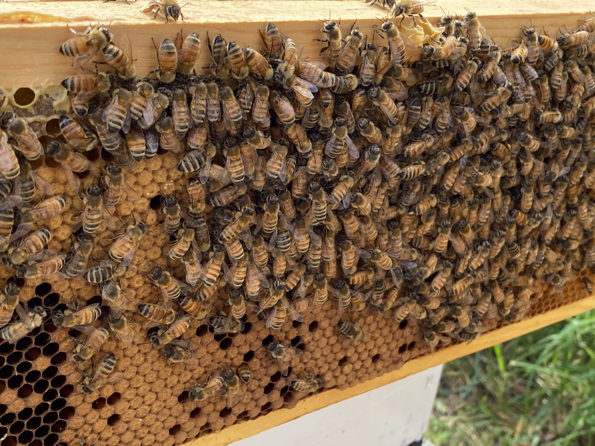
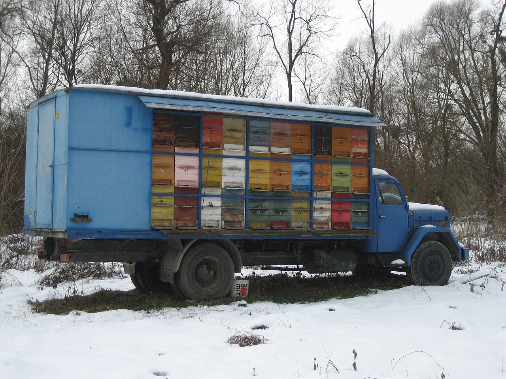
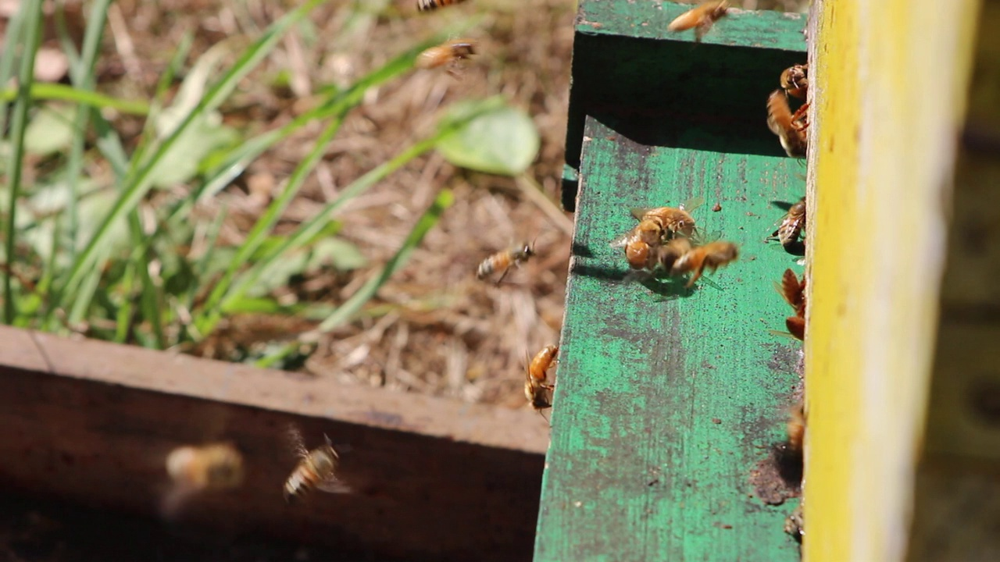

# Practical Beekeeping Handbook

**Colony Management**

**WORKING MANUSCRIPT — NOT A RELEASE OR A PRINT MASTER.**

Narrative revision (#228), image placement, pagination and format proof remain pending. Chapter numbers are global and unchanged. No final page count is claimed.

## Set navigation

| Edition | Chapters |
|---|---|
| [Complete digital edition](digital-complete.md) | 1–74 |
| [Foundations, Honey Bee Biology and Starting an Apiary](volume-01.md) | 1–23 |
| [Colony Management](volume-02.md) | 24–38 |
| [Bee Health](volume-03.md) | 39–46 |
| [Honey Production and Other Hive Products](volume-04.md) | 47–59 |
| [Business, Sustainability and Reference Material](volume-05.md) | 60–74 |

Complete References 75–85 are in Volume 5 and the complete digital edition. Chapter bibliographies and warnings remain within their chapters.

# Chapter 24 — Installing Bees

## Introduction

Installing bees is the moment when an empty hive becomes a living colony.

The beekeeper may begin with:

- A package of bees.
- a nucleus colony.
- a captured swarm.
- an established colony transferred from another hive.
- a colony obtained through a supervised split or transfer.

Each source requires a different installation method.

A package usually contains loose adult bees and a separately caged queen.

A nucleus colony contains bees, brood, food, comb and a laying queen on several frames.

A swarm is a naturally formed group of bees that has left another colony with a queen.

Successful installation depends on preparation before the bees arrive.

The hive should already be:

- Assembled.
- positioned.
- level.
- weatherproof.
- equipped with appropriate frames.
- protected from robbing.
- supplied with feed when necessary.
- accessible to the beekeeper.
- ready to close immediately.

Installing bees should be calm, deliberate and efficient.

The beekeeper should avoid unnecessary delays, excessive smoke, rough shaking, prolonged exposure and repeated disturbance.

---

## Learning Objectives

After completing this chapter, the reader should be able to:

- Compare package bees, nucleus colonies and swarms.
- Prepare a hive before bees arrive.
- choose suitable weather and time for installation.
- transport bees safely.
- install package bees using appropriate methods.
- transfer a nucleus colony without reversing frame order.
- install a captured swarm.
- handle a caged queen carefully.
- understand direct and delayed queen release.
- provide feed without encouraging robbing.
- reduce the entrance appropriately.
- recognise signs of queen acceptance.
- identify early installation problems.
- plan the first inspection.
- keep accurate colony records.

---

## Sources of Bees

Bees may be obtained from:

- Registered or reputable bee breeders.
- established local beekeepers.
- nucleus-colony producers.
- package-bee suppliers.
- swarm collection.
- managed colony divisions.
- relocation or rescue operations conducted lawfully.

The source affects:

- Disease risk.
- queen quality.
- colony strength.
- temperament.
- adaptation to local conditions.
- installation method.
- cost.
- likelihood of early success.

---

## Choosing a Reliable Supplier

A reliable supplier should be able to explain:

- The origin of the bees.
- queen age.
- queen mating status.
- colony temperament.
- disease-management practices.
- treatment history where relevant.
- expected collection date.
- transport requirements.
- refund or replacement conditions.
- installation recommendations.

Avoid buying bees solely because they are inexpensive.

A weak, diseased or queenless unit may cost more to correct than a healthy colony costs to purchase.

---

## Local Adaptation

Locally adapted bees may be better suited to:

- Regional weather.
- local nectar flows.
- winter length.
- local pests.
- seasonal brood patterns.
- available forage.

Local origin does not guarantee health or gentle temperament.

Every colony should still be assessed carefully.

---

## Package Bees

A package normally consists of:

- A ventilated transport container.
- a quantity of adult worker bees.
- a food container.
- a caged queen.
- sometimes a small number of drones.

Packages do not normally include brood comb.

The bees must build or occupy comb before the queen can establish a brood nest.

---

## Advantages of Package Bees

Potential advantages include:

- Relatively easy transport.
- no old brood comb.
- flexible installation into different hive systems.
- lower initial equipment volume.
- reduced transfer of some comb-associated problems.

---

## Limitations of Package Bees

Potential limitations include:

- No brood at installation.
- no stored pollen or honey comb.
- greater dependence on feed.
- risk of queen rejection.
- delayed population growth.
- possibility of absconding.
- stress during transport.
- need to build comb rapidly.

---

## Nucleus Colonies

A nucleus colony, often called a nuc, is a small functioning colony.

It usually contains:

- A laying queen.
- adult workers.
- brood in several stages.
- stored food.
- drawn comb.
- several frames.

The exact number and type of frames should be confirmed before purchase.

---

## Advantages of Nucleus Colonies

A healthy nuc may offer:

- Immediate brood production.
- established comb.
- known queen performance.
- faster development.
- reduced absconding risk.
- easier assessment of colony health.

---

## Limitations of Nucleus Colonies

Potential limitations include:

- Higher purchase cost.
- possible transfer of pests or disease.
- incompatibility with the beekeeper’s frame system.
- risk of damaged brood during transport.
- more difficult transport than a package.
- possible overcrowding if transfer is delayed.

---

## Captured Swarms

A swarm contains a queen and workers searching for a new nest.

A swarm may be:

- A large primary swarm with an older queen.
- a smaller secondary swarm with a younger queen.
- recently issued.
- temporarily clustered.
- already beginning to establish comb.

---

## Advantages of Swarms

Potential advantages include:

- Strong natural comb-building impulse.
- rapid occupation of a suitable cavity.
- low purchase cost when legally collected.
- opportunity to increase colony numbers.

---

## Limitations of Swarms

Potential limitations include:

- Unknown queen quality.
- unknown disease status.
- unknown genetics.
- possibility of a virgin queen.
- risk of leaving again.
- uncertain age and strength.
- unpredictable temperament.
- legal or access difficulties during collection.

---

## Biosecurity Before Installation

New bees may introduce:

- Varroa mites.
- viruses.
- bacterial disease.
- fungal disease.
- wax moths.
- small hive beetle where present.
- contaminated comb.
- resistant pests.
- undesirable genetics.

Ask for health information and follow local veterinary guidance.

---

## Quarantine

Where practical, new colonies may be placed:

- At a separate apiary.
- at the edge of an existing apiary.
- with dedicated tools.
- under increased observation.
- away from weak colonies.

Quarantine procedures depend on local disease risks and regulations.

---

## Preparing the Apiary

Before the bees arrive, confirm:

- Permission to use the site.
- safe access.
- secure hive stands.
- suitable flight path.
- water availability.
- protection from livestock.
- protection from public interference.
- compliance with local rules.
- adequate space for future expansion.

---

## Preparing the Hive Stand

The stand should be:

- Stable.
- level from side to side.
- appropriately sloped if the hive design requires drainage.
- strong enough for a full colony.
- resistant to sinking.
- high enough for comfortable work.
- protected from vegetation growth where possible.

---

## Positioning the Hive

The hive entrance should not face:

- A frequently used doorway.
- a public path.
- livestock confinement.
- a neighbouring sitting area.
- a road at head height.
- a children’s play area.

A fence or hedge may direct flight upward.

---

## Preparing the Hive Body

Inspect the hive body for:

- Gaps.
- cracks.
- damaged joints.
- sharp edges.
- loose screws.
- treatment contamination.
- mould.
- water penetration.
- pests.
- unsuitable odours.

New paint or coating must be fully cured before bees are installed.

---

## Preparing Frames

Frames should be:

- Correct for the hive.
- properly spaced.
- structurally sound.
- free from dangerous wire.
- fitted with suitable foundation where used.
- free from chemical contamination.
- arranged before installation.

Do not force incompatible frames into the hive.

---

## Drawn Comb

Clean drawn comb can help:

- Retain bees.
- provide immediate storage.
- give the queen cells for laying.
- reduce the energy needed for comb building.

Drawn comb also carries greater disease and wax-pest risk.

Use only comb from a trusted source.

---

## Foundation

Foundation provides a guide for comb construction.

It may be made from:

- Beeswax.
- plastic.
- other approved hive materials.

Foundation should be:

- Correctly fitted.
- securely supported.
- free from excessive odour.
- compatible with local temperature.
- protected from deformation.

---

## Foundationless Frames

Foundationless frames may be used when the hive and management system support natural comb construction.

They require:

- Level hive positioning.
- suitable comb guides.
- careful frame handling.
- regular early inspection.
- prevention of cross-comb.
- correct spacing.

---

## Hive Volume

A newly installed unit should not be given excessive empty space.

Too much space can make it harder for bees to:

- Regulate temperature.
- defend against pests.
- organise the nest.
- control robbing.
- maintain comb-building activity.

Use a hive volume appropriate to colony size.

---

## Entrance Reduction

A reduced entrance helps a new colony:

- Defend itself.
- regulate airflow.
- conserve heat.
- reduce robbing pressure.
- organise guard activity.

The entrance must still provide adequate ventilation.

---

## Feeders

Install the feeder before bees arrive when possible.

Suitable feeder types may include:

- Top feeders.
- internal frame feeders.
- contact feeders.
- small entrance feeders under controlled conditions.
- feeding bags where appropriate.

The feeder should not leak.

---

## Feed Preparation

Feed should be prepared using:

- Clean water.
- clean containers.
- suitable sugar.
- accurate proportions.
- hygienic handling.

Do not feed spoiled, fermented or contaminated syrup.

---

## When Feeding May Be Needed

Feeding may be required when:

- Installing package bees.
- forage is scarce.
- weather prevents flight.
- the colony has little stored food.
- comb must be built.
- a swarm has no reserves.
- the nuc is weak or recently transferred.

---

## When Feeding May Be Unnecessary

Feeding may be unnecessary when:

- A strong nectar flow is underway.
- the nuc contains adequate stores.
- the colony occupies drawn comb with food.
- feeding would increase robbing risk.
- harvest honey supers are present and local rules restrict feeding.

Assess the colony rather than feeding automatically.

---

## Robbing Prevention

To reduce robbing:

- Avoid spilling syrup.
- feed inside the hive.
- reduce entrances.
- work quickly.
- avoid leaving comb exposed.
- clean equipment.
- install colonies near evening when appropriate.
- avoid opening neighbouring colonies unnecessarily.

---

## Preparing Protective Equipment

Before receiving bees, prepare:

- Suit or jacket.
- veil.
- gloves.
- suitable footwear.
- smoker.
- hive tool.
- bee brush.
- queen cage clip if used.
- feeder.
- spare entrance reducer.
- collection container.
- first-aid supplies.

---

## Weather for Installation

Favourable installation weather is usually:

- Mild.
- relatively calm.
- dry.
- free from extreme heat.
- free from cold rain.
- suitable for short bee flight.

Installation may still be necessary during imperfect conditions if transport stress is increasing.

---

## Time of Day

Late afternoon or early evening may help because:

- Flying activity is decreasing.
- bees have the night to settle.
- drifting may be reduced.
- immediate departure may be less likely.
- robbing pressure may be lower.

Local weather and supplier instructions may justify a different time.

---

## Receiving Bees

When bees arrive:

- Confirm the order.
- check the container.
- inspect ventilation.
- assess temperature.
- look for excessive dead bees.
- confirm the queen cage is present where expected.
- place the bees in shade.
- avoid leaving them in a vehicle.
- install them as soon as practical.

---

## Signs of Transport Stress

Warning signs include:

- Overheating.
- excessive buzzing.
- bees forming a dense layer against ventilation.
- syrup leakage.
- large numbers of dead bees.
- damaged screens.
- queen cage damage.
- comb collapse in a nuc.

---

## Overheated Bees

Overheated bees may:

- Spread across ventilation surfaces.
- fan intensely.
- appear wet or distressed.
- die rapidly.
- become difficult to install.

Move them to a cool, shaded, ventilated location.

Do not soak a package without following supplier instructions.

---

## Chilled Bees

Chilled bees may appear:

- Quiet.
- clustered.
- slow moving.
- unable to fly.

Warm them gradually in a protected environment.

Do not place them against direct high heat.

---

## Transporting Package Bees

Package bees should be transported:

- In shade.
- with ventilation.
- secured against movement.
- away from direct exhaust heat.
- away from chemical fumes.
- away from intense sunlight.
- without airtight covering.

---

## Transporting Nucleus Colonies

A nuc should be:

- Closed securely.
- ventilated.
- strapped.
- kept upright.
- protected from overheating.
- prevented from frame movement.
- transported without unnecessary delay.

---

## Ventilation During Transport

Ventilation is essential because clustered bees generate heat.

Insufficient ventilation can kill a colony even during a short journey.

Do not rely only on a small entrance when transporting a strong nuc in warm weather.

---

## Vehicle Safety

Do not place unsecured live bees where they can:

- Distract the driver.
- escape into the passenger area.
- block visibility.
- fall during braking.
- contact food.
- contact children or animals.

---

## Preparing to Install Package Bees

Before opening the package:

- Put on protective clothing.
- light the smoker if needed.
- open the hive.
- remove enough frames to create space.
- prepare the queen-cage position.
- fill the feeder.
- prepare the entrance reducer.
- verify the hive identity.

---

## Calming Package Bees

Some suppliers recommend lightly misting the package with clean syrup.

Others advise against it.

Follow the supplier’s instructions.

Excess liquid can chill, mat or drown bees.

---

## Locating the Queen Cage

The queen cage may be:

- Suspended beside the feed container.
- attached to the package wall.
- held by a tab.
- protected by surrounding bees.

Remove it carefully.

Do not allow it to fall.

---

## Checking the Queen

Confirm that:

- The queen is present.
- she appears alive.
- attendants are present where expected.
- the cage is intact.
- ventilation holes are open.
- candy is present if the cage uses candy release.
- the cage is not overheated or soaked.

---

## If the Queen Appears Dead

Do not release the package into the hive without a plan.

Contact the supplier promptly.

The bees may be installed temporarily while replacement arrangements are made, but timing and method require careful judgement.

Record photographs and supplier information where appropriate.

---

## Removing the Feed Container

Remove the package feed container carefully.

Bees may cluster around it.

Avoid crushing bees or spilling syrup.

Cover the opening temporarily if necessary.

---

## Direct-Shake Installation

In a direct-shake installation:

1. Remove the queen cage.
2. position the queen cage safely.
3. remove several central frames.
4. open the package.
5. shake or pour the bees into the hive cavity.
6. replace frames slowly.
7. install the queen cage.
8. close the hive.
9. provide feed.
10. reduce the entrance.

---

## Advantages of Direct Shaking

Direct shaking:

- Places most bees inside quickly.
- reduces time outside the hive.
- allows the package to be removed.
- can be efficient in cool or uncertain weather.

---

## Limitations of Direct Shaking

Potential limitations include:

- Rough handling.
- bees flying widely.
- queen-cage loss.
- crushing during frame replacement.
- increased stress.
- difficulty for beginners.

The package should not be struck violently.

---

## No-Shake Installation

A no-shake method may involve placing the open package inside an empty hive space and allowing bees to leave gradually.

This requires:

- Sufficient internal space.
- correct queen-cage placement.
- safe package orientation.
- later removal of the container.
- careful control of gaps.
- suitable weather.

---

## Advantages of No-Shake Installation

Potential advantages include:

- Gentler transfer.
- less flying.
- fewer bees crushed.
- reduced beekeeper anxiety.

---

## Limitations of No-Shake Installation

Potential limitations include:

- Package occupies hive space.
- delayed frame arrangement.
- need for a return visit.
- risk of unusual clustering.
- possible comb construction in the wrong space.
- difficulty maintaining correct hive volume.

---

## Installing the Queen Cage

The queen cage should normally be placed:

- Between central frames.
- near the main bee cluster.
- near suitable comb.
- away from the feeder opening.
- away from the hive floor.
- where bees can contact the screen.

---

## Cage Orientation

Cage orientation depends on cage design.

Candy exits may be placed:

- Upward.
- sideways.
- according to supplier instructions.

The cage should not be positioned so that a dead attendant can block the release path.

---

## Securing the Cage

The cage may be secured with:

- A built-in tab.
- wire.
- a clip.
- a rubber band.
- a frame attachment.

It must not fall to the hive floor.

---

## Direct Queen Release

Direct release means allowing the queen to leave the cage immediately.

This may be appropriate only when acceptance is highly likely and the beekeeper has sufficient experience.

It carries a greater rejection risk when bees are unfamiliar with the queen.

---

## Delayed Queen Release

Delayed release allows bees time to become accustomed to the queen’s pheromones.

A candy plug may be used so that:

- Bees consume the candy.
- contact continues through the screen.
- release occurs gradually.

---

## Manual Release

Some situations require the beekeeper to return and manually release the queen.

Before release, observe bee behaviour on the cage.

Calm feeding and contact are more encouraging than biting, balling or intense aggression.

---

## Queen Acceptance Behaviour

Possible signs of acceptance include:

- Bees calmly covering the cage.
- workers extending their proboscises.
- bees feeding through the screen.
- easy movement of bees when brushed gently.
- absence of biting and tight balling.

---

## Possible Rejection Behaviour

Warning signs include:

- Bees tightly balling the cage.
- biting the mesh.
- attempting to sting through the cage.
- intense agitation.
- inability to brush bees away gently.

Do not release the queen directly when rejection is suspected.

---

## Candy Plug Access

Before installation, confirm whether:

- A cork must be removed.
- the candy is exposed.
- a transport plug remains.
- the cage has separate candy and non-candy ends.

Releasing the wrong plug may release the queen immediately.

---

## Queen Cage Inspection Timing

Avoid checking the cage repeatedly.

A common schedule is to inspect after several days, depending on:

- Supplier instructions.
- colony behaviour.
- weather.
- cage type.
- queen status.

Repeated opening can delay settling.

---

## If the Queen Is Still Caged

If the queen remains caged:

- Check whether candy is blocked.
- assess acceptance behaviour.
- verify that workers can reach the cage.
- confirm that the queen is alive.
- avoid releasing her into hostile bees.
- follow supplier guidance.

---

## If the Queen Has Been Released

After release:

- Remove the empty cage when convenient.
- close the hive gently.
- avoid searching aggressively for the queen.
- allow time for laying to begin.
- continue feeding if needed.

---

## Installing a Nucleus Colony

A nuc transfer should preserve:

- Frame order.
- frame orientation.
- brood-nest continuity.
- queen safety.
- food placement.
- bee space.

Prepare the full-size hive before opening the nuc.

---

## Matching Frame Systems

Confirm before purchase that the nuc frames match:

- Hive length.
- frame depth.
- lug design.
- top-bar width.
- spacing system.
- foundation type where relevant.

Adapters create additional complexity.

---

## Positioning the Nuc

Place the nuc beside or in front of the prepared hive.

Orient it so that frames can be transferred without rotation or confusion.

---

## Opening the Nuc

Use minimal smoke.

Observe:

- Bee temperament.
- frame spacing.
- brood condition.
- food.
- queen presence if easily visible.
- signs of disease.
- transport damage.

---

## Transferring Nuc Frames

Transfer frames one at a time.

Maintain:

- Original sequence.
- original orientation.
- brood frames together.
- food near brood.
- adequate space on each side.
- gentle frame movement.

---

## Avoid Reversing Frames

Reversing individual frames can:

- Split the brood pattern.
- place food incorrectly.
- disrupt colony organisation.
- increase chilling risk.
- confuse later records.

Maintain the same face direction unless there is a specific management reason.

---

## Adding Empty Frames

Place new frames according to colony strength and management goals.

For a small nuc, additional frames are commonly placed:

- Outside the brood nest.
- beside occupied frames.
- without splitting weak brood unnecessarily.

---

## Finding the Queen During Transfer

Finding the queen is useful but not always necessary.

Avoid prolonging the transfer solely to locate her.

If seen, protect her from:

- Crushing.
- falling.
- exposure.
- being trapped between boxes.

---

## Bees Remaining in the Nuc Box

After frames are transferred:

- Shake or brush remaining bees gently into the hive.
- place the nuc box near the entrance temporarily if necessary.
- ensure the queen is not left behind.
- remove the empty box before bees build comb in it.

---

## Closing the New Hive

After transfer:

- Confirm frame spacing.
- place the follower board where used.
- install the feeder.
- replace covers.
- reduce the entrance.
- secure the roof.
- record the installation.

---

## Installing a Swarm

Before installing a swarm, prepare:

- A suitable hive.
- frames.
- feeder if needed.
- entrance reducer.
- collection sheet.
- protective clothing.
- queen clip or cage if appropriate.
- secure transport equipment.

---

## Swarm Collection Safety

Before collecting, assess:

- Height.
- ladder requirement.
- electrical wires.
- traffic.
- public access.
- branch stability.
- property permission.
- colony temperament.
- escape route.

Decline unsafe collections.

---

## Confirming Swarm Entry

Signs that the swarm is entering the hive include:

- Bees walking toward the entrance.
- fanning workers near the entrance.
- reduced clustering at the collection point.
- directional movement.
- bees remaining around the hive.

---

## Fanning Behaviour

Workers may expose the Nasonov gland and fan.

This can help guide other swarm members toward the queen and colony location.

---

## Queen Presence in a Swarm

The queen may be:

- In the main cluster.
- on the collection sheet.
- inside the box.
- on a nearby branch.
- temporarily separated during handling.

Bees clustering away from the hive may indicate that the queen is not inside.

---

## Swarm Installation Methods

A swarm may be installed by:

- Shaking it directly into the hive.
- placing it on a sheet leading to the entrance.
- transferring it from a swarm box.
- allowing it to move from a collection container.
- positioning comb containing the queen inside the hive when safe and lawful.

---

## Walking a Swarm In

To walk a swarm into the hive:

1. Place a clean sheet in front of the entrance.
2. create a gentle upward ramp.
3. deposit the swarm on the sheet.
4. observe directional movement.
5. protect the area from disturbance.
6. confirm that most bees enter.
7. reduce the entrance appropriately.

---

## Advantages of Walking In

This method allows the beekeeper to observe:

- Colony movement.
- fanning.
- queen presence when visible.
- whether bees accept the hive entrance.

---

## Limitations of Walking In

It may be unsuitable during:

- Rain.
- cold.
- strong wind.
- public disturbance.
- darkness.
- very uneven ground.
- urgent transport.

---

## Preventing Swarm Absconding

To encourage a swarm to remain:

- Use a suitable hive volume.
- provide clean drawn comb where safe.
- feed when forage is poor.
- reduce disturbance.
- keep the hive shaded during extreme heat.
- provide ventilation.
- install promptly.
- avoid repellent odours.
- ensure the queen is present.

---

## Queen Excluders as Temporary Retention Devices

Some beekeepers temporarily place a queen excluder beneath the brood box to discourage a mated queen from leaving.

This method has risks:

- A small or virgin queen may pass through.
- drones may be trapped.
- ventilation may be affected.
- the entrance may become congested.
- the device may be forgotten.

It should not replace correction of poor hive conditions.

---

## Swarms with Virgin Queens

A secondary swarm may contain a virgin queen.

Such a colony may:

- Take longer to begin laying.
- conduct mating flights.
- appear queenless temporarily.
- require favourable weather.
- fail if mating is unsuccessful.

Avoid disturbing it repeatedly.

---

## Feeding Newly Installed Swarms

A swarm often has a strong comb-building impulse.

Feeding may help when:

- Nectar is scarce.
- weather is poor.
- only foundation is available.
- the swarm is small.
- rapid establishment is needed.

Avoid feeding in a way that triggers robbing.

---

## Installing Bees into Different Hive Types

The biological principles remain similar across hive systems, but the procedure may differ.

Consider:

- Frame orientation.
- entrance location.
- cavity volume.
- feeder type.
- follower boards.
- horizontal expansion.
- top-bar alignment.
- natural-comb support.

---

## Installing into a Vertical Hive

In a vertical framed hive:

- Begin with one brood box.
- place the cluster centrally.
- keep brood compact.
- add boxes only as needed.
- maintain correct frame spacing.
- avoid excessive empty volume.

---

## Installing into a Horizontal Hive

In a horizontal hive:

- Confine the colony with follower boards.
- establish the nest near a suitable entrance.
- expand gradually.
- maintain frame order.
- prevent unused cavity volume from becoming excessive.

---

## Installing into a Top-Bar Hive

In a top-bar hive:

- Ensure the hive is level.
- use reliable comb guides.
- confine the swarm initially.
- inspect early comb alignment.
- correct cross-comb while it is small.
- handle new comb gently.

---

## Installing into Natural-Comb Frames

Natural comb requires:

- Stable hive positioning.
- vertical frame alignment.
- careful temperature management.
- gentle inspection.
- early correction of poor comb direction.
- avoidance of violent shaking.

---

## Avoiding Excessive Smoke

Newly installed bees are already stressed.

Use smoke only when necessary.

Excessive smoke may:

- Drive bees out.
- separate bees from the queen.
- increase confusion.
- contaminate the hive.
- discourage settlement.

---

## Avoiding Strong Odours

New hives should be free from:

- Solvent fumes.
- uncured paint.
- fuel.
- chemical cleaners.
- strong perfume.
- mould.
- rodent odour.
- treatment residue.

Unpleasant odours may contribute to absconding.

---

## Water

Bees require water for:

- Cooling.
- brood food.
- dilution of stores.
- colony regulation.

Provide or identify a reliable source before installation.

---

## Orientation Flights

After installation, bees perform orientation flights to learn:

- Hive position.
- entrance appearance.
- surrounding landmarks.
- sun direction.
- flight route.

Large numbers of bees circling the hive can be normal.

---

## Drifting

Drifting occurs when bees enter another colony.

It is encouraged by:

- Identical hive appearance.
- straight rows.
- entrances facing the same direction.
- weak landmarks.
- strong wind.
- crowded placement.

---

## Reducing Drifting

Possible measures include:

- Varying hive colours.
- changing entrance directions.
- using landmarks.
- spacing hives irregularly.
- avoiding perfectly uniform rows.
- installing colonies at different times where appropriate.

---

## Absconding

Absconding means the entire colony leaves the hive.

Possible causes include:

- Excessive heat.
- poor ventilation.
- disturbance.
- unsuitable odour.
- pest pressure.
- lack of food.
- queen problems.
- excessive cavity volume.
- direct sunlight.
- repeated inspections.

---

## Signs of Possible Absconding

Warning signs may include:

- Bees clustering outside continuously.
- little interest in comb.
- failure to take feed.
- queen and workers gathering near the entrance.
- unusual agitation.
- no wax construction.
- sudden reduction in population.

---

## Reducing Absconding Risk

Reduce risk by:

- Preparing the hive properly.
- installing at a suitable time.
- avoiding excessive disturbance.
- controlling heat.
- providing food when needed.
- using appropriate cavity size.
- ensuring the queen is present.
- avoiding strong chemical odours.
- monitoring pests.

---

## The First Twenty-Four Hours

During the first day:

- Observe from outside.
- confirm that bees remain.
- check feeder leakage.
- check entrance congestion.
- watch for robbing.
- avoid opening the hive without a strong reason.
- protect the colony from animals and weather.

---

## External Observation

Useful observations include:

- Orientation flights.
- guard activity.
- pollen collection.
- dead bees at the entrance.
- fighting.
- fanning.
- clustering.
- syrup leakage.
- wasp activity.

---

## When to Conduct the First Inspection

The timing depends on:

- Bee source.
- queen-cage method.
- weather.
- supplier instructions.
- colony behaviour.
- feeding method.
- suspected emergency.

Package installations may need a brief queen-release check after several days.

A transferred nuc may need less immediate disturbance.

---

## First Inspection of a Package Colony

The first inspection should determine:

- Whether the queen was released.
- whether bees are clustering normally.
- whether comb construction has begun.
- whether feed is available.
- whether eggs are present when enough time has passed.
- whether robbing or pests are present.

---

## First Inspection of a Nucleus Colony

Assess:

- Queenright behaviour.
- brood pattern.
- eggs or young larvae.
- food reserves.
- frame occupation.
- disease signs.
- comb condition.
- expansion need.

---

## First Inspection of a Swarm

Assess:

- Whether the colony remained.
- comb construction.
- queen status.
- eggs when sufficient time has passed.
- feed need.
- cross-comb.
- pest activity.
- hive volume.

---

## Looking for Eggs

Eggs indicate that a queen has begun laying.

They are easiest to see when:

- Light falls over the shoulder.
- the frame is tilted.
- dark comb is used.
- reading glasses are available when needed.
- the frame is held steadily.

Do not destroy the brood nest while searching.

---

## Delayed Egg Laying

Eggs may be delayed because:

- The queen was recently released.
- the queen is virgin.
- mating weather is poor.
- comb is unavailable.
- the colony is stressed.
- the queen was injured.
- the colony is queenless.

Consider the full context before intervening.

---

## Queenless Signs

Possible signs include:

- Persistent agitation.
- absence of eggs after sufficient time.
- queen cells.
- disorganised behaviour.
- reduced comb building.
- laying workers later.
- roaring sound when opened.

No single sign is conclusive.

---

## Laying Workers

Laying workers may develop after prolonged queenlessness.

Possible signs include:

- Multiple eggs per cell.
- eggs on cell walls.
- drone brood in worker cells.
- irregular brood pattern.
- poor colony organisation.

Early correction of queen loss is easier than correcting established laying workers.

---

## Poor Queen Acceptance

If a package rejects the queen:

- Confirm queen status.
- check for another queen.
- assess cage behaviour.
- contact the supplier.
- avoid repeated direct releases.
- consider introducing a replacement using a controlled method.

---

## Queen Supersedure After Installation

Bees may build queen cells because:

- The queen is damaged.
- pheromone is weak.
- laying is poor.
- workers prefer replacement.
- transfer stress occurred.

Do not destroy every queen cell automatically.

Determine colony status first.

---

## Feed Consumption

Feed consumption varies with:

- Colony size.
- weather.
- nectar availability.
- comb-building need.
- feeder access.
- syrup concentration.
- temperature.

Rapid consumption does not always mean starvation.

---

## Feeder Problems

Common feeder problems include:

- Leakage.
- drowning.
- mould.
- fermentation.
- blocked access.
- robbing.
- cold syrup.
- empty feeder.
- bees building comb inside the feeder.

---

## Syrup Leakage

Leaking syrup can trigger severe robbing.

If leakage occurs:

- Stop the leak.
- clean exposed syrup.
- reduce the entrance.
- close neighbouring feed sources.
- minimise hive opening.
- reassess feeder design.

---

## Robbing Signs

Signs include:

- Fighting at the entrance.
- bees searching cracks.
- frantic flight.
- wax debris.
- bees leaving heavily loaded.
- dead bees near the entrance.
- activity continuing unusually late.

---

## Responding to Robbing

Possible actions include:

- Reduce the entrance.
- stop spilling feed.
- close leaking feeders.
- use a robbing screen where appropriate.
- avoid opening the hive.
- remove exposed comb.
- strengthen or relocate the colony when necessary.

---

## Weak Installation

A colony may be weaker than expected because of:

- Transport losses.
- old workers.
- queen failure.
- poor weather.
- drifting.
- disease.
- insufficient food.
- package underweight.
- swarm division.

---

## Supporting a Weak Colony

Support may include:

- Reducing cavity volume.
- reducing entrance size.
- providing feed.
- controlling pests.
- improving shelter.
- adding brood only from healthy colonies and with sound judgement.
- combining colonies where appropriate.

Avoid transferring disease while attempting support.

---

## Combining Colonies

Combining may be considered when:

- One unit is queenless.
- a colony is too weak to survive.
- installation failed.
- season is too advanced for recovery.

Confirm queen status and disease status before combining.

---

## Pest Monitoring

New colonies should be monitored for:

- Varroa.
- wax moth.
- ants.
- wasps.
- small hive beetle where present.
- rodents.
- other regional pests.

Weak installations are especially vulnerable.

---

## Varroa Assessment

A colony that appears healthy may still carry significant Varroa levels.

Use a recognised monitoring method and follow regional treatment guidance.

Do not assume package bees or swarms are mite free.

---

## Wax Moth Risk

Wax moths usually exploit weak colonies or unprotected comb.

Reduce risk by:

- Matching space to colony strength.
- removing abandoned comb.
- maintaining strong colonies.
- storing spare comb correctly.
- inspecting weak units.

---

## Ants

Ants may:

- Enter feeders.
- disturb small colonies.
- remove syrup.
- nest in covers.
- discourage settlement.

Use site management methods that do not contaminate the hive.

---

## Wasp Pressure

Wasps may attack weak colonies.

Controls include:

- Reduced entrances.
- clean feeding.
- removal of exposed honey.
- traps used responsibly where lawful.
- strong colony development.
- local nest management by qualified persons.

---

## Weather After Installation

Cold, rain or wind can prevent bees from:

- Foraging.
- mating.
- collecting pollen.
- gathering water.
- regulating feed intake.

Monitor food during prolonged poor weather.

---

## Hot Weather After Installation

Heat may cause:

- Bearding.
- ventilation stress.
- melted wax.
- comb collapse.
- absconding.
- feeder fermentation.

Provide shade or ventilation appropriate to the hive and climate.

---

## Cold Weather After Installation

A small colony may struggle to heat excessive space.

Use:

- Appropriate cavity size.
- suitable insulation.
- reduced entrances.
- adequate food.
- minimal disturbance.

---

## Moving an Installed Colony

Avoid moving a newly installed colony unnecessarily.

If movement is required:

- Secure all components.
- provide ventilation.
- close entrances safely.
- move at a suitable time.
- prevent frame movement.
- reopen promptly at the destination.
- provide orientation cues.

---

## Record Keeping

Record:

- Installation date.
- bee source.
- supplier.
- queen type.
- queen marking.
- queen age if known.
- hive location.
- installation method.
- feed provided.
- weather.
- queen release date.
- first eggs.
- disease observations.
- problems and corrective actions.

---

## Colony Identification

Each colony should have a unique identification.

This may be:

- Hive number.
- apiary code.
- queen colour and year.
- electronic record.
- weatherproof label.

Avoid relying only on memory.

---

## Package Installation Checklist

Before installation:

- Hive assembled.
- stand stable.
- frames ready.
- feeder installed.
- syrup prepared.
- entrance reducer ready.
- queen cage method understood.
- protective clothing ready.
- smoker functioning.
- weather acceptable.
- records prepared.

During installation:

- Package inspected.
- queen confirmed alive.
- feed container removed safely.
- bees transferred calmly.
- queen cage secured.
- frames replaced slowly.
- feeder filled.
- entrance reduced.
- roof secured.

After installation:

- Package removed.
- syrup spills cleaned.
- external activity observed.
- queen check scheduled.
- records completed.
- robbing monitored.

---

## Nucleus Installation Checklist

Before transfer:

- Frame compatibility confirmed.
- full-size hive prepared.
- frame order understood.
- feeder ready if needed.
- entrance reduced.
- protective equipment prepared.

During transfer:

- Nuc opened gently.
- frame orientation maintained.
- brood kept together.
- queen protected.
- remaining bees transferred.
- spacing corrected.
- hive closed promptly.

After transfer:

- Empty nuc checked for queen.
- feeder checked.
- entrance observed.
- first inspection scheduled.
- records completed.

---

## Swarm Installation Checklist

Before collection:

- Permission obtained.
- height assessed.
- electrical hazards checked.
- public protected.
- hive prepared.
- collection box ready.
- transport planned.
- weather assessed.

During collection:

- Main cluster captured.
- queen location considered.
- bees protected from heat.
- box ventilated.
- entrance secured.
- swarm movement observed.

After installation:

- Colony remained in hive.
- entrance reduced.
- feeder added when needed.
- absconding risk reduced.
- external activity monitored.
- first inspection scheduled.
- records completed.

---

## Common Package Installation Mistakes

### Opening the Package Before the Hive Is Ready

Bees remain exposed while equipment is organised.

### Losing the Queen Cage

The beekeeper cannot confirm queen status.

### Releasing the Queen Immediately Without Assessment

The bees may reject her.

### Allowing the Cage to Fall

The queen may become chilled or inaccessible.

### Giving Excessive Empty Space

The cluster cannot organise efficiently.

### Failing to Feed During Scarcity

Comb construction and establishment slow.

### Repeatedly Opening the Hive

Settlement and queen acceptance are disrupted.

---

## Common Nucleus Installation Mistakes

### Reversing Frame Order

The brood nest becomes disorganised.

### Splitting a Small Brood Nest

Brood may chill.

### Leaving the Queen in the Transport Box

The main colony may return to her.

### Delaying Transfer

The nuc may overheat or become overcrowded.

### Ignoring Frame Incompatibility

Frames cannot be installed safely.

### Expanding Too Quickly

The colony receives more space than it can defend.

---

## Common Swarm Installation Mistakes

### Assuming Every Swarm Has a Mated Queen

Egg laying may be delayed.

### Using a Hot, Poorly Ventilated Hive

The swarm may leave.

### Disturbing the Colony Every Day

Settlement is interrupted.

### Failing to Confirm Queen Entry

Bees may cluster outside the hive.

### Leaving Too Much Empty Space

The colony builds irregular comb or becomes difficult to defend.

### Using Contaminated Old Comb

Disease is introduced.

---

## Troubleshooting Table

| Problem | Possible Cause | Practical Response |
|---|---|---|
| Bees leave immediately | Queen absent, heat, odour, unsuitable hive | Confirm queen status, improve conditions, reassess hive |
| Queen remains caged | Blocked candy, poor access, rejection | Inspect cage and bee behaviour before release |
| No eggs after installation | Virgin queen, delayed release, queen failure | Allow appropriate time, assess queen status |
| Severe robbing | Syrup spill, weak entrance defence | Stop leakage, reduce entrance, avoid opening |
| Bees cluster outside | Heat, poor ventilation, queen outside | Improve ventilation and assess queen location |
| Comb built across frames | Hive not level, poor guides, excessive space | Correct early and restore alignment |
| Nuc appears weak | Drifting, disease, transport loss | Assess food, queen, pests and population |
| Package not building comb | No feed, cold weather, queen problem | Check food, temperature and queen status |
| Swarm absconds | Poor cavity, repeated disturbance, heat | Improve hive conditions and reduce disturbance |
| Queen rejected | Another queen present, long separation, stress | Confirm queen status and use controlled introduction |

---

## Scientific Notes

### A Nucleus Colony Has Population Continuity

Because brood is already present, new workers emerge soon after transfer.

### Package Bees Must Rebuild Colony Structure

They begin without brood and usually without comb.

### Swarms Are Prepared to Build Comb

Swarming workers often carry stored honey that supports early comb construction.

### Queen Acceptance Requires Colony Recognition

Workers need time to become accustomed to an unfamiliar queen.

### Colony Size Determines Defensible Space

A small colony cannot effectively occupy and protect excessive hive volume.

### Orientation Reduces Colony Loss

Bees use visual landmarks and flight patterns to learn the new location.

---

## Key Takeaways

- Prepare the complete hive before bees arrive.
- Buy bees from a reliable source.
- Confirm health, queen status and frame compatibility.
- Protect bees from overheating during transport.
- Install bees promptly.
- Use a reduced entrance for a new or weak colony.
- Feed when forage or stored food is insufficient.
- Prevent syrup leakage and robbing.
- Handle the queen cage carefully.
- Delayed queen release usually reduces rejection risk.
- Secure the queen cage near the cluster.
- Preserve nuc frame order and orientation.
- Keep the brood nest compact.
- Confirm that the queen is not left in the transport box.
- Give swarms suitable cavity volume and ventilation.
- Avoid excessive smoke and repeated disturbance.
- Observe the entrance before opening the hive.
- Inspect package queen release after an appropriate interval.
- Allow sufficient time before declaring a colony queenless.
- Monitor pests from the beginning.
- Record installation details and corrective actions.

---

## Chapter Summary

Installing bees requires different methods depending on whether the beekeeper receives a package, nucleus colony or swarm.

Package bees arrive without brood and usually require feed, comb construction and careful introduction of a caged queen.

A nucleus colony already contains brood, food, comb and a laying queen. Its frames should be transferred in the same order and orientation.

A swarm has a strong natural tendency to occupy a cavity and build comb, but its queen quality and mating status may be unknown.

Before installation, the hive should be assembled, positioned, equipped with frames, provided with a suitable feeder and protected with an entrance reducer.

Transported bees must be kept ventilated, shaded and secure.

Queen cages should be handled carefully. Delayed release gives workers time to accept an unfamiliar queen.

New colonies should not be disturbed repeatedly. External observation can reveal orientation flights, robbing, overheating, clustering and feeder problems.

The first inspection should answer specific questions without dismantling the colony unnecessarily.

Good records help the beekeeper track queen release, first eggs, feeding, disease observations and colony development.

---

## Review Questions

1. Which main forms of bees can be installed in a hive?
2. What does a package of bees normally contain?
3. What does a nucleus colony normally contain?
4. How does a swarm differ from a nuc?
5. Why should the supplier be selected carefully?
6. What information should a supplier provide?
7. What are the advantages of locally adapted bees?
8. What are the advantages of package bees?
9. What are the limitations of package bees?
10. Why does a nuc usually develop faster?
11. What disease risks accompany old comb?
12. Why may swarm queen quality be uncertain?
13. What biosecurity risks accompany new bees?
14. When may quarantine be useful?
15. What should be checked at the apiary before installation?
16. How should a hive stand be prepared?
17. Where should a hive entrance not face?
18. What defects should be checked in the hive body?
19. Why must coatings be fully cured?
20. How should frames be prepared?
21. What are the advantages of clean drawn comb?
22. What risks accompany drawn comb?
23. What is required when using foundationless frames?
24. Why should a small colony not receive excessive space?
25. Why is an entrance reducer useful?
26. Why should the feeder be installed before the bees arrive?
27. When may feeding be required?
28. When may feeding be unnecessary?
29. How can robbing be reduced?
30. Which protective equipment should be prepared?
31. What weather is favourable for installation?
32. Why may evening installation be helpful?
33. What should be checked when bees arrive?
34. What are signs of transport stress?
35. How should overheated bees be managed?
36. How should chilled bees be warmed?
37. How should package bees be transported?
38. How should a nucleus colony be secured?
39. Why is transport ventilation essential?
40. What must be prepared before opening a package?
41. Why must supplier instructions be followed before misting bees?
42. How should the queen cage be removed?
43. What should be checked on the queen cage?
44. What should be done if the queen appears dead?
45. What are the steps in direct-shake installation?
46. What are the advantages of direct shaking?
47. What are the limitations of direct shaking?
48. How does no-shake installation work?
49. What are its advantages?
50. What are its limitations?
51. Where should a queen cage be positioned?
52. Why must the queen cage be secured?
53. What is direct queen release?
54. Why does delayed release reduce risk?
55. What behaviour suggests queen acceptance?
56. What behaviour suggests possible rejection?
57. Why must the correct cage plug be identified?
58. Why should the cage not be checked repeatedly?
59. What should be done if the queen remains caged?
60. How should a nuc be transferred?
61. Why must frame order be preserved?
62. Why should weak brood not be split?
63. Is it always necessary to find the queen?
64. What should be done with bees remaining in the nuc box?
65. What should be assessed before collecting a swarm?
66. What does entrance fanning indicate?
67. What may a separate cluster indicate?
68. How can a swarm be walked into a hive?
69. When is walking a swarm unsuitable?
70. How can swarm absconding risk be reduced?
71. What risks accompany a temporary bottom queen excluder?
72. Why may a secondary swarm take longer to lay?
73. When should a swarm be fed?
74. How should a horizontal hive be restricted initially?
75. Why must a top-bar hive be level?
76. Why should excessive smoke be avoided?
77. Which odours may cause settlement problems?
78. Why is water important?
79. What are orientation flights?
80. Which conditions increase drifting?
81. How can drifting be reduced?
82. What causes absconding?
83. What should be observed during the first day?
84. When should the first inspection occur?
85. What should be checked in a package colony?
86. What should be checked in a nuc?
87. What should be checked in a swarm?
88. Why may egg laying be delayed?
89. What signs may suggest queenlessness?
90. What are signs of laying workers?
91. Why should queen cells not be destroyed automatically?
92. Which problems affect feeders?
93. How should syrup leakage be corrected?
94. What are the signs of robbing?
95. How can a weak installation be supported?
96. When may colony combination be considered?
97. Why should Varroa be monitored immediately?
98. Why are weak colonies vulnerable to wax moths?
99. Which installation details should be recorded?
100. What are the most important principles of successful bee installation?

---

## References and Further Reading

- Graham, J. M., editor. *The Hive and the Honey Bee*. Dadant & Sons.
- Caron, D. M., and Connor, L. J. *Honey Bee Biology and Beekeeping*. Wicwas Press.
- Sammataro, D., and Avitabile, A. *The Beekeeper’s Handbook*. Cornell University Press.
- Hooper, T. *Guide to Bees and Honey*. Northern Bee Books.
- Delaplane, K. S. *First Lessons in Beekeeping*. Dadant & Sons.
- Winston, M. L. *The Biology of the Honey Bee*. Harvard University Press.
- Food and Agriculture Organization of the United Nations. *Good Beekeeping Practices for Sustainable Apiculture*.
- International Bee Research Association. Technical guidance on colony establishment, queen introduction and swarm biology.
- National and regional beekeeping associations. Current guidance on packages, nucleus colonies, swarms, feeding and queen acceptance.
- National veterinary authorities. Current requirements for bee movement, disease notification, treatment and colony importation.
- Queen and bee suppliers. Current instructions concerning transport, installation, queen cages, release methods and replacement policies.

Bee movement rules, disease controls, import requirements, feeding recommendations and queen-release procedures vary by location. Follow current local regulations, supplier instructions and recognised veterinary guidance.

# Chapter 25 — Routine Hive Inspections

## Introduction

Routine hive inspections allow the beekeeper to understand what is happening inside a colony before small problems become serious.

An inspection is not simply the act of opening a hive.

It is a planned examination with clear questions.

A useful inspection may determine:

- Whether the colony is queenright.
- whether brood development is normal.
- whether sufficient food is present.
- whether the colony has enough space.
- whether swarm preparation has begun.
- whether pests or disease signs are visible.
- whether combs and equipment remain serviceable.
- whether immediate action is needed.
- when the colony should be inspected again.

Opening a hive always causes some disturbance.

The aim is therefore not to inspect as often or as deeply as possible.

The aim is to obtain the information needed while causing the least practical disruption.

---

## Learning Objectives

After completing this chapter, the reader should be able to:

- Define the purpose of a routine inspection.
- decide when an inspection is necessary.
- select appropriate weather and timing.
- prepare equipment before opening the hive.
- observe the colony from outside.
- open and close a hive calmly.
- examine frames systematically.
- assess queenright status without always finding the queen.
- evaluate eggs, larvae, capped brood and brood pattern.
- estimate colony population and strength.
- assess pollen, nectar and honey reserves.
- recognise overcrowding and insufficient space.
- identify signs associated with swarm preparation.
- recognise warning signs requiring further investigation.
- inspect different hive systems appropriately.
- record findings and make follow-up decisions.

---

## Purpose of an Inspection

Every inspection should have a purpose.

Common purposes include:

- Confirming queen acceptance after installation.
- checking brood development.
- assessing food.
- monitoring colony expansion.
- preparing for a nectar flow.
- evaluating swarm risk.
- checking a feeder.
- examining suspected queen loss.
- monitoring pests.
- preparing for winter.
- confirming that previous management succeeded.

Opening a hive without a clear purpose often creates disturbance without useful information.

---

## Inspection Questions

Before opening the hive, decide which questions must be answered.

A basic inspection may ask:

1. Is the colony queenright?
2. Is brood development appropriate?
3. Does the colony have adequate food?
4. Does it have enough usable space?
5. Are there signs of pests, disease or equipment failure?
6. Is any action required today?
7. When should the next inspection occur?

---

## Inspection Depth

Not every visit requires a complete brood-nest examination.

An inspection may be:

- External.
- limited.
- targeted.
- full.
- emergency.

The depth should match the purpose.

---

## External Observation

Many useful facts can be gathered without opening the hive.

Observe:

- Flight activity.
- pollen collection.
- guard behaviour.
- dead bees.
- fighting.
- orientation flights.
- fanning.
- bearding.
- unusual odours.
- entrance blockage.
- water around the hive.
- roof or stand damage.

External observation reduces unnecessary disturbance.

---

## Flight Activity

Normal activity varies with:

- Temperature.
- sunlight.
- wind.
- season.
- nectar flow.
- colony strength.
- time of day.

Low flight activity does not automatically mean the colony is failing.

---

## Pollen Collection

Workers returning with pollen often indicate that brood is being reared.

However, pollen collection alone does not prove that a healthy laying queen is present.

A colony may continue collecting pollen during some periods of queenlessness.

---

## Orientation Flights

Young workers often circle in front of the entrance during orientation flights.

This may appear as heavy or confused activity but is normally organised and temporary.

Orientation flights are commonly seen:

- On warm afternoons.
- after poor weather.
- after colony movement.
- during population growth.

---

## Robbing Activity

Robbing may involve:

- Fighting at the entrance.
- bees searching hive joints.
- frantic irregular flight.
- wax debris near the entrance.
- bees entering through cracks.
- unusual activity late in the day.

A suspected robbing event should not be treated as a normal inspection opportunity.

---

## Bearding

Bearding is the temporary clustering of bees outside the hive.

It may result from:

- Heat.
- humidity.
- crowding.
- nectar processing.
- poor ventilation.
- normal evening behaviour.

Bearding does not always mean that a colony is preparing to swarm.

---

## Dead Bees at the Entrance

A small number of dead bees may be normal.

Concern increases when there are:

- Large sudden accumulations.
- deformed wings.
- trembling bees.
- extended tongues.
- dead brood.
- many drones expelled unusually early.
- suspected poisoning signs.

Significant mortality requires investigation and, when appropriate, professional or veterinary guidance.

---

## Unusual Odours

Odour may provide important clues.

Possible sources include:

- Fermented feed.
- mould.
- dead animals.
- chemical contamination.
- decaying brood.
- overheating.
- spoiled honey.
- severe disease.

Do not rely on odour alone for diagnosis.

---

## Frequency of Inspection

Inspection frequency depends on:

- Season.
- colony age.
- queen status.
- swarm risk.
- weather.
- nectar flow.
- feeding.
- pest pressure.
- beekeeper objectives.
- previous findings.

Newly installed colonies may need targeted early checks.

Established colonies may require more frequent examination during swarm season than during stable periods.

---

## Avoiding Overinspection

Opening a hive too often can:

- Disrupt temperature.
- interrupt brood care.
- damage queen cells.
- crush bees.
- provoke defensive behaviour.
- encourage robbing.
- delay comb construction.
- increase queen-loss risk.
- waste beekeeper time.

Inspect only when the expected information justifies the disturbance.

---

## Weather Conditions

Favourable inspection weather is usually:

- Mild.
- dry.
- relatively calm.
- bright enough to see eggs and brood.
- warm enough to avoid brood chilling.
- suitable for worker flight.

Avoid unnecessary brood inspections during cold, wet or windy conditions.

---

## Temperature

Opening the brood nest in low temperatures can chill:

- Eggs.
- larvae.
- pupae.
- emerging workers.

Small colonies and divided brood nests are especially vulnerable.

---

## Wind

Wind can:

- Cool brood rapidly.
- make bees defensive.
- blow covers away.
- make frames difficult to control.
- direct smoke into the beekeeper.
- increase robbing exposure.

Use windbreaks or postpone the inspection when control becomes poor.

---

## Rain

Rain can:

- Chill exposed bees.
- wet brood and comb.
- reduce visibility.
- make the site slippery.
- prevent flying bees from leaving the beekeeper.
- increase colony disturbance.

Complete only urgent work during poor weather.

---

## Time of Day

Mid-morning through afternoon is often suitable when:

- Foragers are active.
- temperature is adequate.
- light is good.
- the colony is less crowded.

Local climate and seasonal conditions may justify different timing.

---

## Inspection Duration

A routine inspection should be efficient.

Prepare equipment so that the hive does not remain open while the beekeeper searches for:

- A missing tool.
- a feeder.
- replacement frames.
- a queen cage.
- records.
- entrance reducers.
- additional boxes.

---

## Personal Preparation

Before opening the hive:

- Assess personal health.
- wear suitable protective clothing.
- secure veil zips and closures.
- carry prescribed emergency medication.
- prepare drinking water in hot weather.
- inform another person when working remotely.
- confirm access for emergency services.

---

## Equipment Preparation

A routine inspection kit may include:

- Smoker.
- clean fuel.
- ignition source.
- hive tool.
- spare hive tool.
- bee brush.
- notebook or digital record.
- marker.
- queen cage.
- entrance reducer.
- replacement frames.
- container for brace comb.
- first-aid supplies.

---

## Smoker Preparation

The smoker should be:

- Lit before the hive is opened.
- producing cool smoke.
- free from sparks.
- positioned safely.
- supplied with enough fuel.
- kept away from dry vegetation.

The smallest effective amount of smoke should be used.

---

## Approach to the Hive

Approach from:

- The side.
- the rear.
- a direction outside the main flight path.

Avoid standing directly in front of the entrance.

Observe the colony before touching the hive.

---

## Opening the Hive

A calm opening sequence is:

1. Apply minimal entrance smoke if needed.
2. wait briefly.
3. remove or loosen the roof.
4. separate the cover gradually.
5. apply a small amount of smoke beneath the cover if needed.
6. wait for bees to move.
7. place removed parts securely.
8. begin the planned examination.

---

## Placement of Hive Components

Place roofs, covers and boxes:

- On clean stands.
- on an upturned roof when appropriate.
- away from mud.
- away from walking paths.
- with honey surfaces protected.
- where the queen cannot be lost.
- where robbers cannot easily access them.

---

## Creating Working Space

The first frame is often difficult to remove.

Create space by:

- Loosening several frames.
- moving frames slightly together.
- removing an outer frame first.
- placing it temporarily in a frame rest or protected box.

Working space reduces bee rolling and queen injury.

---

## Frame Removal

Before lifting a frame:

- Break the propolis seal.
- separate adjacent top bars.
- lift slowly.
- keep the frame vertical.
- avoid rubbing comb against neighbouring frames.
- watch the frame lugs.
- maintain control with both hands when needed.

---

## Rolling Bees

Rolling occurs when bees are crushed or dragged between comb surfaces.

This can:

- Injure workers.
- kill the queen.
- release alarm pheromone.
- damage brood.
- increase defensive behaviour.

Adequate frame spacing and slow movement reduce rolling.

---

## Holding a Frame

Hold the frame:

- Over the open hive.
- above a box or protected surface.
- with both hands when necessary.
- by the top-bar lugs.
- at a comfortable viewing angle.

Do not hold brood frames far from the hive.

---

## Turning a Frame

A safe turning method keeps the frame over the hive.

The beekeeper may:

1. Raise one end.
2. rotate the frame vertically.
3. turn the frame through its own plane.
4. lower the opposite side for viewing.

Avoid turning fresh natural comb horizontally.

---

## Frame Examination Sequence

A systematic sequence reduces missed information.

Inspect:

- Outer food frames.
- pollen area.
- brood-nest edge.
- central brood frames.
- opposite brood-nest edge.
- remaining food frames.

Return each frame in the same orientation and order unless management requires a planned change.

---

## Looking for the Queen

Finding the queen can be useful, but it is not always necessary.

Queenright status can often be inferred from:

- Eggs.
- young larvae.
- organised brood pattern.
- normal worker behaviour.
- absence of emergency queen cells.

Searching excessively for the queen increases disturbance.

---

## Queen Appearance

A queen often has:

- A longer abdomen.
- relatively short-looking wings.
- a smooth thorax.
- workers surrounding or following her.
- deliberate movement across comb.

Appearance varies with queen age, genetics and reproductive state.

---

## Protecting the Queen

When the queen is seen:

- Note the frame.
- move slowly.
- keep the frame over the hive.
- avoid placing it outside for long.
- avoid brushing her.
- replace the frame gently.
- prevent boxes from being set on exposed bees.

---

## Eggs

Fresh eggs are:

- Small.
- white.
- positioned inside cells.
- easiest to see with good light.

A single egg near the cell base is typical of a functioning queen.

---

## Egg Position

Very fresh eggs often stand upright.

They gradually lean and lie down before hatching.

Egg position provides only an approximate age estimate.

---

## Multiple Eggs

Multiple eggs may occur when:

- A young queen begins laying.
- cell space is limited.
- laying workers are present.

Queen-laid eggs are generally near the cell base.

Laying-worker eggs are often numerous and may occur on cell walls, but diagnosis should consider the complete brood pattern.

---

## Larvae

Healthy worker larvae are usually:

- Pearly white.
- moist.
- curled in the cell.
- surrounded by brood food.
- progressively larger with age.

Discoloured, dry, twisted or sunken larvae require closer assessment.

---

## Capped Brood

Worker brood cappings are normally:

- Slightly raised.
- relatively even.
- tan to brown.
- compact when colony conditions are good.

Drone brood is more prominently domed.

---

*Photo 25.2 — Healthy capped worker brood. Use the normal capping texture and broad brood area as a visual reference, not as proof that a colony is disease-free. Photo by Einebillion, CC BY 4.0.*

## Brood Pattern

A strong brood pattern is generally:

- Compact.
- continuous.
- appropriately shaped.
- surrounded by pollen and food.
- consistent with colony size and season.

No brood pattern is perfectly solid.

---

## Spotty Brood

A scattered brood pattern may result from:

- Old or failing queen.
- disease.
- chilled brood.
- brood removal by workers.
- inbreeding.
- limited food.
- pests.
- recent emergence.
- normal inspection timing.

A spotty pattern is a warning sign, not a complete diagnosis.

---

## Brood Nest Shape

The brood nest often forms an expanding oval or sphere across several frames.

Its size depends on:

- Season.
- colony strength.
- queen performance.
- food.
- temperature.
- available comb.
- colony genetics.

---

## Brood in All Stages

A healthy growing colony often contains:

- Eggs.
- young larvae.
- older larvae.
- capped brood.
- emerging workers.

The absence of one stage may reflect a temporary brood break or inspection timing.

---

## Brood Breaks

A brood break may occur because of:

- Swarming.
- queen replacement.
- queen introduction.
- poor weather.
- seasonal dearth.
- treatment strategy.
- queen loss.
- mating delay.

The beekeeper should use dates and colony history to interpret it.

---

## Drone Brood

Drone brood may appear:

- Along brood edges.
- in larger cells.
- in dedicated drone comb.
- during colony growth and swarm season.

Excessive scattered drone brood in worker-sized cells may indicate a queen problem or laying workers.

---

## Queen Cells

Queen cells may be associated with:

- Swarm preparation.
- supersedure.
- emergency queen replacement.
- abandoned incomplete cups.

Their position is informative but not conclusive by itself.

---

## Queen Cups

Small empty queen cups may be present routinely.

An empty cup does not prove swarm preparation.

A cup containing an egg or larva with royal jelly deserves closer attention.

---

## Swarm Cells

Swarm-associated queen cells are often:

- Numerous.
- along lower or side comb edges.
- produced in a crowded, strong colony.
- accompanied by reduced laying space.
- associated with mature drone populations.

Colony history and overall condition should guide interpretation.

---

## Supersedure Cells

Supersedure cells are often:

- Fewer in number.
- located on the comb face.
- associated with a present but failing queen.
- found without extreme crowding.

Location alone cannot guarantee the colony’s intention.

---

## Emergency Queen Cells

Emergency cells are built around young worker larvae after queen loss.

They may appear:

- Across brood-comb faces.
- in multiple locations.
- after sudden queen disappearance.
- from cells originally intended for workers.

---

## Destroying Queen Cells

Do not destroy queen cells automatically.

Before acting, determine:

- Whether the queen is present.
- whether eggs exist.
- whether the colony is preparing to swarm.
- whether supersedure is occurring.
- whether the colony is already queenless.
- whether a virgin queen may be present.

Removing all viable cells from a queenless colony can leave it unable to recover.

---

## Queenright Behaviour

A queenright colony often appears:

- Organised.
- calm after initial opening.
- occupied with brood care.
- evenly distributed across suitable comb.
- consistent with the presence of eggs or young larvae.

Behaviour alone is not proof.

---

## Possible Queenlessness

Possible signs include:

- No eggs after sufficient time.
- no young larvae.
- emergency queen cells.
- unusual agitation.
- prolonged roaring sound.
- reduced organisation.
- laying workers later.
- declining brood population.

The colony’s timeline must be considered.

---

## Population Assessment

Estimate how many frames are:

- Covered with bees.
- occupied by brood.
- containing food.
- partly built.
- empty.

Use the same method consistently between inspections.

---

## Frames Covered with Bees

A frame should be counted as covered only when bees occupy a meaningful proportion of both surfaces.

Avoid counting bees that temporarily move across a frame after smoke.

---

## Colony Strength

A strong colony has enough workers to:

- Cover brood.
- defend the entrance.
- regulate temperature.
- collect food.
- build comb.
- occupy available space.

Strength must be judged relative to season and hive size.

---

## Weak Colonies

A colony may be weak because of:

- Recent installation.
- queen failure.
- disease.
- parasites.
- starvation.
- robbing.
- pesticide exposure.
- poor wintering.
- excessive space.
- repeated swarming.

Weakness is a symptom requiring further assessment.

---

## Food Reserves

Inspect for:

- Nectar.
- capped honey.
- pollen.
- bee bread.
- available empty cells.
- feeder status.

Food should be considered in relation to weather, season and colony population.

---

## Nectar

Fresh nectar often appears as clear liquid in cells.

It may be:

- Uncapped.
- spread over many cells.
- moved repeatedly.
- concentrated during ripening.

Do not confuse fresh nectar with leaking feed.

---

## Capped Honey

Capped honey provides stored carbohydrate.

Evaluate:

- Quantity.
- position.
- accessibility.
- season.
- colony needs.
- planned harvest.

Honey that the colony needs should not be removed.

---

## Pollen and Bee Bread

Pollen stores are usually located near brood.

Their colour varies with plant source.

A complete absence of pollen during active brood rearing may indicate nutritional stress or poor forage.

---

## Starvation Risk

Warning signs include:

- Very light hive.
- little or no honey near the cluster.
- bees head-first in cells.
- dead bees on comb.
- brood abandonment.
- poor weather preventing flight.
- empty feeder.

An at-risk colony may require prompt feeding according to season and local guidance.

---

## Brood-Nest Congestion

Congestion occurs when the queen lacks usable cells because of:

- Nectar filling the brood nest.
- excessive pollen.
- insufficient drawn comb.
- delayed supering.
- poor frame management.
- rapid colony expansion.

Congestion can contribute to swarm preparation.

---

## Space Assessment

The colony needs space for:

- Brood.
- nectar.
- pollen.
- worker movement.
- ventilation.
- honey ripening.

Space must be usable, not merely present.

---

## Usable Space

A box of untouched foundation may not provide immediate usable laying space.

Usable space generally includes:

- Drawn empty cells.
- partly drawn comb the colony can complete.
- accessible storage space.
- correctly positioned frames.

---

## Adding Space

Space may be added through:

- Drawn frames.
- foundation frames.
- supers.
- additional brood boxes.
- gradual horizontal expansion.
- follower-board movement.

The method depends on hive type, colony strength and season.

---

## Adding Space Too Early

Excessive space can:

- Chill brood.
- weaken defence.
- encourage wax pests.
- slow organisation.
- increase heat loss.
- make inspections difficult.

---

## Adding Space Too Late

Insufficient space can:

- Congest the brood nest.
- increase swarm pressure.
- reduce nectar storage.
- promote brace comb.
- limit queen laying.
- cause crowding at the entrance.

---

## Comb Condition

Inspect comb for:

- Straightness.
- cross-comb.
- excessive drone cells.
- cracks.
- sagging.
- collapse.
- mould.
- pest damage.
- old dark comb.
- contamination.

---

## New Comb

Fresh comb is:

- Soft.
- fragile.
- sensitive to heat.
- easily damaged by shaking.
- prone to bending when held horizontally.

Handle it gently.

---

## Cross-Comb

Cross-comb extends across the intended frame or bar alignment.

Correct it early while the comb is small.

Delayed correction makes future inspections more destructive.

---

## Brace Comb

Brace comb may connect:

- Frames.
- boxes.
- covers.
- feeders.
- queen excluders.

Remove it when it prevents normal hive operation or safe inspections.

Check it for the queen before discarding or cutting.

---

## Burr Comb

Small irregular wax projections may occur where bee space is incorrect.

Repeated burr comb may indicate:

- Incorrect frame spacing.
- damaged equipment.
- incompatible components.
- excessive gaps.
- poor box alignment.

---

## Old Comb

Comb becomes darker through:

- Brood cocoons.
- propolis.
- debris.
- repeated use.

A planned comb-renewal programme can reduce contaminant accumulation and improve equipment quality.

---

## Mould

Limited surface mould may occur in:

- Weak colonies.
- poorly ventilated hives.
- damp winters.
- unused outer frames.

Heavy mould or persistent moisture requires correction of the underlying condition.

---

## Hive Moisture

Look for:

- Condensation.
- wet covers.
- mould.
- water on the floor.
- soaked insulation.
- leaking roofs.
- poor drainage.

Moisture management depends on climate and hive design.

---

## Hive Floor

The floor may reveal:

- Wax debris.
- dead mites.
- brood cappings.
- chalk-like mummies.
- dead bees.
- water.
- wax-moth debris.
- small hive beetles where present.

Floor evidence should be interpreted with colony findings.

---

## Varroa Warning Signs

Visible warning signs may include:

- Mites on adult bees.
- deformed wings.
- shortened abdomens.
- patchy brood.
- weak emerging bees.
- sudden population decline.

Absence of visible mites does not prove a low infestation.

A recognised monitoring method is required.

---

## Disease Warning Signs

Warning signs may include:

- Discoloured larvae.
- sunken or perforated cappings.
- unusual brood odour.
- ropy larval remains.
- chalk-like mummies.
- irregular brood death.
- trembling adults.
- crawling bees.
- excessive mortality.

Suspected serious or reportable disease requires appropriate professional or veterinary guidance.

---

## Avoiding Casual Diagnosis

Many colony problems share similar signs.

For example, patchy brood may result from:

- Queen quality.
- mites.
- disease.
- chilling.
- starvation.
- genetics.
- brood emergence.

Use recognised diagnostic procedures rather than guessing.

---

## Pest Inspection

Inspect for regional pests such as:

- Varroa mites.
- wax moths.
- ants.
- wasps.
- small hive beetles.
- rodents.
- other local organisms.

Treatment decisions belong to the appropriate pest-management procedures and current local guidance.

---

## Wax Moth Signs

Possible signs include:

- Webbing.
- tunnels.
- damaged comb.
- larval debris.
- silk galleries.
- faecal particles.

Wax moth damage is often most severe in weak colonies or stored comb.

---

## Small Hive Beetle Signs

Where present, signs may include:

- Adult beetles running across comb.
- larvae in hive debris.
- slime-damaged comb.
- fermented honey.
- beetles hiding in corners.

Follow regional control requirements.

---

## Ant Activity

Ants may be found:

- Under roofs.
- in feeders.
- between covers.
- around stands.
- carrying brood or food.

Control methods should not contaminate bees, comb or honey.

---

## Wasp Pressure

Wasps may:

- Hover near entrances.
- enter weak colonies.
- attack returning bees.
- remove brood.
- rob honey.

Reduced entrances and clean feeding help weak colonies defend themselves.

---

## Colony Temperament

Record whether the colony is:

- Calm.
- alert.
- moderately defensive.
- persistently defensive.
- dangerously aggressive.

Temperament should be assessed across several inspections and conditions.

---

## Factors Affecting Temperament

Temporary defensiveness may result from:

- Poor weather.
- queenlessness.
- robbing.
- nectar dearth.
- rough handling.
- alarm odour.
- predators.
- treatment disturbance.
- nearby machinery.

Persistent aggression may justify requeening or relocation.

---

## Inspection During Nectar Flow

During a strong nectar flow, inspect:

- Available storage space.
- brood-nest congestion.
- super filling.
- comb construction.
- swarm signs.
- queen movement.
- ventilation.

Avoid leaving exposed honey accessible to robbers.

---

## Inspection During Dearth

During nectar dearth:

- Work quickly.
- reduce exposed honey.
- watch for robbing.
- avoid spilling syrup.
- inspect fewer colonies at once.
- close boxes promptly.

Weak colonies require special protection.

---

## Inspection During Swarm Season

Swarm-season inspections focus on:

- Brood-nest congestion.
- queen cells.
- available laying space.
- colony population.
- drone production.
- nectar storage.
- previous swarm-control actions.

Inspection intervals may need to be shorter because queen-cell development progresses rapidly.

---

## Inspection After Swarming

After a swarm, the colony may have:

- Fewer adult bees.
- reduced flight activity.
- sealed queen cells.
- a virgin queen.
- a brood break.
- delayed egg laying.

Avoid repeated disturbance during queen emergence and mating.

---

## Inspection After Queen Introduction

A post-introduction inspection should determine:

- Whether the queen was released.
- whether she was accepted.
- whether eggs are present after sufficient time.
- whether workers are building emergency cells.
- whether another queen may exist.

Do not search roughly for a newly accepted queen.

---

## Inspection After Feeding

Check:

- Feed consumption.
- feeder leakage.
- fermentation.
- mould.
- drowning.
- robbing.
- unwanted comb.
- colony access.

Remove spoiled feed.

---

## Inspection After Treatment

Follow the authorised product instructions.

Record:

- Product.
- date.
- dose.
- colony.
- batch number where relevant.
- withdrawal restrictions.
- removal date.
- monitoring result.

Do not improvise treatment schedules during a routine inspection.

---

## New Colony Inspections

For a newly installed colony, confirm:

- Queen release.
- comb building.
- food.
- brood initiation.
- colony retention.
- entrance defence.
- pest pressure.

Avoid daily opening.

---

## Established Colony Inspections

For an established colony, evaluate:

- Queen performance.
- brood pattern.
- population.
- food.
- space.
- swarm status.
- pests.
- equipment condition.
- seasonal preparedness.

---

## Nucleus Colony Inspections

A nucleus colony requires careful space management.

Inspect for:

- Rapid congestion.
- food balance.
- queen quality.
- brood coverage.
- feeder need.
- pest pressure.
- readiness for transfer or expansion.

---

## Strong Colony Inspections

Strong colonies require:

- Adequate working space.
- careful box lifting.
- swarm assessment.
- sufficient supers.
- efficient inspection.
- controlled smoke.

Do not dismantle every box without reason.

---

## Weak Colony Inspections

For a weak colony, prioritise:

- Queen status.
- food.
- population.
- brood health.
- pest level.
- cavity size.
- robbing.
- equipment integrity.

Long inspections can chill the limited brood.

---

## Vertical Hive Inspection

A vertical hive should generally be inspected from the top downward.

The beekeeper may:

1. Remove supers as required.
2. place them securely.
3. inspect the upper brood box.
4. inspect the lower brood box when necessary.
5. preserve box and frame order.
6. reassemble carefully.

Do not separate boxes unnecessarily.

---

## Multiple Brood Boxes

When several brood boxes are present, determine whether a full examination is needed.

The queen and brood nest may occupy more than one box.

Record:

- Brood distribution.
- food position.
- congestion.
- queen cells.
- empty comb.
- box condition.

---

## Horizontal Hive Inspection

In a horizontal hive:

- Remove the cover.
- open only the required section.
- move the follower board.
- create a working gap.
- inspect sequentially.
- maintain frame orientation.
- expand or contract space gradually.

Avoid exposing the entire long cavity.

---

## Top-Bar Hive Inspection

In a top-bar hive:

- Ensure comb remains vertical.
- cut attachments before lifting.
- avoid twisting bars.
- inspect new comb carefully.
- correct cross-comb early.
- maintain bar order.
- protect fragile honey comb from heat.

---

## Natural-Comb Inspection

Natural comb must be handled gently.

Avoid:

- Shaking.
- holding comb horizontally.
- rapid turning.
- exposing it to high heat.
- allowing heavy nectar comb to bend.
- forcing bars or frames apart.

---

## Observation Hive Inspection

Observation hives require:

- Minimal disturbance.
- temperature control.
- safe public separation.
- controlled lighting.
- secure glass or transparent panels.
- careful feeding.
- frequent external observation.

Opening procedures depend on the design.

---

## Queen Excluder Inspection

When a queen excluder is present, check:

- Correct orientation where relevant.
- damage.
- blocked passages.
- brace comb.
- drones trapped above.
- queen location when suspected.
- colony movement between boxes.

Do not leave a damaged excluder in place.

---

## Super Inspection

When inspecting supers, assess:

- Bee coverage.
- nectar.
- capped honey.
- available cells.
- comb damage.
- queen presence.
- brood above the excluder.
- need for additional storage.

Avoid contaminating harvest comb with unsuitable smoke or chemicals.

---

## Closing the Hive

Before closing:

- Confirm the queen is not on the rim.
- return frames in correct order.
- restore correct spacing.
- remove unnecessary brace comb.
- move bees from crushing surfaces.
- replace boxes slowly.
- secure covers.
- restore entrance components.
- remove tools and waste.

---

## Preventing Bee Crushing

To reduce crushing:

- Use gentle smoke.
- lower boxes slowly.
- pause when resistance is felt.
- brush bees from edges.
- avoid sliding boxes long distances.
- check corners.
- maintain equipment alignment.

---

## Final External Check

After closing:

- Observe the entrance.
- confirm no large gap remains.
- check that the roof is secure.
- verify that feeders are closed.
- confirm boxes are aligned.
- remove spilled syrup.
- extinguish the smoker.
- record findings.

---

## Record Keeping

Record each inspection promptly.

Useful information includes:

- Date.
- weather.
- colony identification.
- queen seen or evidence present.
- eggs.
- brood stages.
- brood pattern.
- frames of bees.
- food reserves.
- queen cells.
- space.
- pests.
- disease warning signs.
- temperament.
- actions taken.
- next inspection date.

---

## Consistent Terminology

Use the same recording terms each time.

For example:

- Queen seen.
- eggs present.
- young larvae present.
- queen status uncertain.
- three frames of brood.
- six frames covered with bees.
- two food frames.
- no charged queen cells.

Consistent records make comparisons easier.

---

## Photographic Records

Photographs may help document:

- Brood patterns.
- queen markings.
- queen cells.
- equipment damage.
- unusual pests.
- colony identification.

Photography should not prolong exposure unnecessarily.

---

## Inspection Decisions

At the end of the inspection, decide whether to:

- Take no action.
- feed.
- add space.
- reduce space.
- replace equipment.
- monitor more closely.
- conduct a pest test.
- seek disease advice.
- requeen.
- combine.
- split.
- prepare swarm control.
- return on a specific date.

---

## Action Thresholds

A useful inspection links findings to predetermined actions.

Examples include:

- Feed when stores fall below the seasonal safety level.
- add space when most usable comb is occupied.
- investigate when eggs are absent beyond the expected queen timeline.
- perform recognised mite monitoring on schedule.
- seek professional advice when serious disease is suspected.

Thresholds should match regional conditions and management goals.

---

## When to Stop an Inspection

Close the hive when:

- Weather deteriorates.
- bees become dangerously defensive.
- the smoker fails.
- brood is chilling.
- robbing begins.
- the beekeeper feels unwell.
- equipment breaks.
- light becomes inadequate.
- the inspection objective has been completed.

---

## Common Inspection Mistakes

### Inspecting Without a Purpose

The colony is disturbed without gaining useful information.

### Opening in Poor Weather

Brood chills and bees become defensive.

### Searching for the Queen on Every Visit

Inspection time and queen-injury risk increase.

### Returning Frames in the Wrong Order

Brood and food organisation are disrupted.

### Holding Frames Away from the Hive

The queen or bees may fall.

### Ignoring Food While Studying Brood

A queenright colony may still starve.

### Adding Boxes Based Only on Calendar Dates

Actual colony strength and forage are ignored.

### Destroying All Queen Cells

A queenless colony may lose its only route to recovery.

### Diagnosing Disease from One Sign

Similar symptoms may have different causes.

### Failing to Record Findings

The beekeeper cannot compare colony development accurately.

---

## Routine Inspection Procedure

### Before Opening

- Identify the colony.
- review previous records.
- define inspection questions.
- check weather.
- observe the entrance.
- prepare equipment.
- light the smoker.
- put on protective clothing.

### Opening

- approach outside the flight path.
- apply minimal smoke.
- loosen the cover.
- place hive parts securely.
- create working space.

### Examination

- inspect frames in sequence.
- assess queenright evidence.
- examine brood.
- estimate population.
- assess food.
- check space.
- inspect comb.
- note pests and warning signs.
- check swarm status.

### Closing

- restore frame order.
- restore spacing.
- protect the queen.
- lower boxes slowly.
- secure the roof.
- check the entrance.
- remove equipment.

### Afterward

- extinguish the smoker.
- clean tools as required.
- record findings.
- complete immediate actions.
- schedule follow-up.

---

## Routine Inspection Checklist

- Colony identification confirmed.
- previous record reviewed.
- inspection purpose defined.
- weather suitable.
- external activity observed.
- protective clothing secure.
- smoker producing cool smoke.
- tools prepared.
- queenright evidence assessed.
- brood stages assessed.
- brood pattern assessed.
- population estimated.
- food reserves checked.
- available space checked.
- queen cells assessed.
- comb condition checked.
- pests considered.
- disease warnings considered.
- equipment condition checked.
- actions recorded.
- next inspection scheduled.

---

## Troubleshooting Table

| Observation | Possible Explanation | Next Step |
|---|---|---|
| No eggs | Queen loss, virgin queen, brood break, limited comb | Review dates, inspect for larvae and queen cells |
| Patchy brood | Emerging brood, queen issue, pests, disease, chilling | Examine full pattern and perform appropriate checks |
| Many queen cups | Normal cups or early swarm preparation | Check for eggs, larvae and royal jelly |
| Bees clustering outside | Heat, crowding, ventilation or normal bearding | Assess weather, space and ventilation |
| Little food | Dearth, weak foraging, robbing or high consumption | Evaluate urgency and feed when appropriate |
| Nectar throughout brood nest | Strong flow or congestion | Assess laying space and add usable space |
| Aggressive behaviour | Weather, queenlessness, robbing or genetics | Close safely and reassess under suitable conditions |
| Few adult bees | Swarm, disease, queen failure or seasonal decline | Assess brood, food, pests and history |
| Cross-comb | Poor alignment, unlevel hive or excessive gaps | Correct early and restore guides |
| Mould on outer comb | Weak population, moisture or unused space | Correct moisture and colony-space balance |

---

## Scientific Notes

### Inspections Are Samples

A hive inspection shows the colony at one moment.

Interpretation improves when findings are compared with previous records.

### Eggs Are Strong Queenright Evidence

Eggs show that a laying individual was present recently, although they do not always prove that the queen remains alive at inspection time.

### Brood Pattern Has Multiple Causes

A poor pattern is a symptom rather than a diagnosis.

### Colony Strength Is Seasonal

The same population may be strong in early spring and weak during peak summer.

### Empty Foundation Is Not Immediate Space

Bees must draw foundation before it becomes fully usable for brood or stores.

### Repeated Disturbance Has Costs

Opening a colony changes temperature, scent distribution and worker organisation.

---

## Key Takeaways

- Every inspection should have a defined purpose.
- External observation can answer many questions.
- Inspection depth should match the information required.
- Avoid opening colonies in cold, wet or windy conditions without necessity.
- Prepare all equipment before opening the hive.
- Use cool smoke sparingly.
- Create working space before removing central frames.
- Hold frames over the hive.
- Return frames in their original order and orientation.
- Eggs and young larvae often provide sufficient evidence of queenright status.
- Finding the queen is not necessary during every inspection.
- Evaluate brood pattern, population, food and space together.
- Empty foundation is not the same as drawn usable comb.
- Queen cells must be interpreted before they are removed.
- Visible pest signs do not replace recognised monitoring methods.
- Serious disease should not be diagnosed casually.
- Weak colonies require shorter and more focused inspections.
- Natural comb requires vertical, gentle handling.
- Close the hive when conditions become unsafe.
- Record findings and make a clear follow-up decision.

---

## Chapter Summary

Routine hive inspections are planned examinations designed to answer specific management questions.

External observation should come first. Flight activity, pollen collection, fighting, dead bees, bearding and entrance condition provide useful information before the hive is opened.

Inspection timing depends on weather, season, colony condition and purpose. Unnecessary inspections can chill brood, disturb the queen, provoke robbing and waste time.

The beekeeper should prepare clothing, smoker, tools, records and replacement equipment before opening the colony.

Frames should be removed systematically and held over the hive. Their order and orientation should normally be preserved.

Queenright status can often be confirmed through eggs, young larvae and normal brood development without finding the queen.

Brood assessment includes eggs, larvae, cappings, pattern, drone brood and queen cells. A poor brood pattern has many possible causes and should not be treated as a diagnosis by itself.

Population, food reserves and usable space should be assessed together. A strong colony can become congested even when empty foundation is present.

Routine inspections should also identify comb damage, moisture, equipment failure, pest signs, disease warnings and colony temperament.

Different hive systems require different handling. Vertical hives may involve several boxes, horizontal hives should be opened in sections, and natural comb must remain vertical.

Every inspection should end with careful closure, written records, a management decision and a planned follow-up date.

---

## Review Questions

1. What is the main purpose of a routine hive inspection?
2. Why should every inspection begin with specific questions?
3. What is the difference between an external and a full inspection?
4. Which facts can be learned from the hive entrance?
5. Why does low flight activity not always indicate failure?
6. What can pollen collection suggest?
7. How can orientation flights be recognised?
8. What are common signs of robbing?
9. What may cause bearding?
10. When should dead bees at the entrance cause concern?
11. Why should odour not be used alone for diagnosis?
12. Which factors determine inspection frequency?
13. How can overinspection harm a colony?
14. What weather is normally suitable for inspections?
15. Why is cold exposure dangerous for brood?
16. How does wind affect an inspection?
17. Why should routine inspections be avoided during rain?
18. What time of day is often suitable?
19. Why should equipment be prepared in advance?
20. Which items belong in a routine inspection kit?
21. What qualities should smoker smoke have?
22. From which direction should the hive be approached?
23. What is a calm hive-opening sequence?
24. Where should hive parts be placed?
25. Why is working space needed?
26. How should a frame be removed?
27. What is bee rolling?
28. How can rolling injure the queen?
29. Where should frames be held?
30. Why should fresh natural comb remain vertical?
31. What is a systematic frame sequence?
32. Why is finding the queen unnecessary at every inspection?
33. Which signs provide queenright evidence?
34. How can a queen be recognised?
35. How should a queen frame be protected?
36. What do fresh eggs look like?
37. How does egg position change with age?
38. What may cause multiple eggs?
39. What do healthy larvae generally look like?
40. How does worker brood differ from drone brood?
41. What is a compact brood pattern?
42. What may cause a spotty brood pattern?
43. Which brood stages should a growing colony contain?
44. What may cause a brood break?
45. When can drone brood indicate a problem?
46. Which colony events produce queen cells?
47. Why do empty queen cups not prove swarming?
48. What features often accompany swarm cells?
49. What may supersedure cells indicate?
50. How are emergency queen cells formed?
51. Why should queen cells not be destroyed automatically?
52. What signs may suggest queenlessness?
53. How can colony population be estimated?
54. What does a frame covered with bees mean?
55. How should colony strength be judged?
56. What are possible causes of colony weakness?
57. Which food reserves should be assessed?
58. What does fresh nectar look like?
59. Why must colony honey needs be considered before harvesting?
60. Where is pollen normally stored?
61. Which signs may indicate starvation?
62. What is brood-nest congestion?
63. Why can nectar in the brood nest encourage swarming?
64. What is usable space?
65. Why is foundation not immediately equivalent to drawn comb?
66. How can hive space be added?
67. What problems result from adding space too early?
68. What problems result from adding space too late?
69. Which comb defects should be recorded?
70. Why is new comb fragile?
71. When should cross-comb be corrected?
72. When should brace comb be removed?
73. What can repeated burr comb indicate?
74. Why does brood comb become darker?
75. What may cause mould on outer frames?
76. Which moisture signs should be investigated?
77. What information can hive-floor debris provide?
78. Which visible signs may be associated with Varroa?
79. Why does the absence of visible mites prove little?
80. Which brood signs require further disease investigation?
81. Why should disease not be diagnosed from one symptom?
82. What are signs of wax-moth activity?
83. How can small hive beetles affect comb?
84. How can ants disturb a colony?
85. Why are weak colonies vulnerable to wasps?
86. Which temporary factors can affect temperament?
87. When may persistent aggression justify requeening?
88. What should be checked during a nectar flow?
89. Why are inspections risky during dearth?
90. What is the focus during swarm season?
91. Why should a colony not be disturbed repeatedly after swarming?
92. What should be checked after queen introduction?
93. What feeder problems can be found during inspection?
94. Which treatment information should be recorded?
95. How should a newly installed colony be inspected?
96. What are the priorities when inspecting a weak colony?
97. How does a horizontal-hive inspection differ?
98. Why must top-bar comb attachments be cut before lifting?
99. What must be checked before closing the hive?
100. What information should every inspection record contain?

---

## References and Further Reading

- Graham, J. M., editor. *The Hive and the Honey Bee*. Dadant & Sons.
- Caron, D. M., and Connor, L. J. *Honey Bee Biology and Beekeeping*. Wicwas Press.
- Sammataro, D., and Avitabile, A. *The Beekeeper’s Handbook*. Cornell University Press.
- Hooper, T. *Guide to Bees and Honey*. Northern Bee Books.
- Delaplane, K. S. *First Lessons in Beekeeping*. Dadant & Sons.
- Winston, M. L. *The Biology of the Honey Bee*. Harvard University Press.
- Food and Agriculture Organization of the United Nations. *Good Beekeeping Practices for Sustainable Apiculture*.
- International Bee Research Association. Technical guidance on brood assessment, colony behaviour and inspection methods.
- National and regional beekeeping associations. Current guidance on seasonal inspections, swarm management, feeding and colony records.
- National veterinary authorities. Current guidance on reportable diseases, sampling, pest monitoring and authorised treatments.
- Manufacturers of hives, feeders, queen excluders and monitoring equipment. Current instructions for correct use and maintenance.

Inspection frequency, disease-reporting requirements, pest thresholds, feeding practices and authorised treatments vary by location. Beekeepers must follow current local veterinary guidance, product labels and regional regulations.

# Chapter 26 — Feeding Bees

## Introduction

Honey bees obtain their natural nutrition from nectar, honey, pollen and water. A healthy colony in a productive environment should normally depend on those natural resources rather than on continual supplementation.

However, natural forage is not always available in sufficient quantity, at the right time or in a form that a colony can use immediately. Newly installed bees may need support while they establish comb and brood. A small split may have too few foragers to meet its initial needs. A colony being prepared for queen rearing may require carefully timed nutrition. Prolonged rain, drought, fire, flooding, agricultural change or a temporary gap between flowering periods can interrupt food intake.

Feeding is therefore an important management tool, but it is not a substitute for sound apiary placement, healthy bees, adequate comb, suitable hive volume or competent seasonal management.

Every feeding decision should answer five questions:

1. Why does this colony need feed?
2. What nutrient or management effect is required?
3. Which feed and feeder are appropriate?
4. How much should be supplied?
5. When should feeding stop?

Feeding without a defined purpose can create new problems. It may stimulate brood rearing at the wrong time, fill space needed for brood, encourage robbing, contaminate harvestable honey, conceal poor forage conditions or support a colony that requires diagnosis rather than syrup.

This chapter explains planned supplemental feeding used during ordinary colony management. Emergency rescue feeding and specialised winter feeding are treated separately in Chapter 27.

---

## Learning Objectives

After completing this chapter, the reader should be able to:

- Explain the role and limitations of supplemental feeding.
- distinguish carbohydrate feeding from protein supplementation.
- assess a colony before deciding to feed.
- recognise circumstances in which feeding is unnecessary or inappropriate.
- select feed according to colony need and management purpose.
- prepare sugar syrup safely and consistently.
- choose a suitable syrup concentration.
- select and use common feeder types.
- reduce leakage, drowning and robbing.
- feed newly installed packages, nucleus colonies and captured swarms appropriately.
- support splits and queen-rearing colonies without overfeeding them.
- understand the relationship between feeding and comb construction.
- monitor food consumption and colony response.
- prevent fermentation, mould and contamination.
- protect honey quality during feeding.
- avoid feeding unsuitable substances.
- keep useful feeding records.
- determine when feeding should be reduced or stopped.
- recognise situations that belong to emergency or winter feeding rather than routine management.

---

## The Natural Diet of a Honey Bee Colony

A honey bee colony requires several classes of nutrients.

The principal natural sources are:

- Nectar, which supplies sugars and water.
- honey, which is processed and stored nectar.
- pollen, which supplies most proteins, lipids, vitamins and minerals.
- water, which is used for drinking, brood-food preparation, dilution of stored honey and temperature regulation.
- small quantities of minerals and other compounds obtained from natural foods and water.

Adult worker bees use carbohydrates to power flight, heat production, ventilation, wax secretion and general activity.

Developing larvae require brood food produced by nurse bees. The quality and quantity of that brood food depend partly on the nurse bees' access to pollen or stored bee bread.

A colony may therefore possess enough sugar stores while still experiencing inadequate protein nutrition. Conversely, it may have pollen available but insufficient carbohydrate stores to maintain normal activity.

Feeding decisions should identify the actual nutritional gap rather than assuming that every weak colony needs syrup.

---

## Supplemental Feeding as a Management Tool

Supplemental feeding may be used to:

- Support a newly installed colony.
- assist comb construction when conditions are suitable.
- maintain colony activity during a short forage gap.
- support a newly made split.
- help a nucleus colony establish itself.
- prepare colonies used for queen rearing.
- deliver a planned amount of carbohydrate when natural intake is temporarily inadequate.
- support brood rearing when management objectives and seasonal conditions justify it.
- reduce the risk of nutritional stress during a temporary interruption in flight.
- help equalise management conditions during a controlled apiary operation.

The intended result must be defined before feed is supplied.

For example, a beekeeper trying to support comb construction may use a different feeding rate from a beekeeper trying merely to prevent a small colony from consuming its remaining stores during several days of rain.

---

## What Feeding Cannot Correct

Feed cannot correct every colony problem.

Supplementation does not by itself repair:

- Queenlessness.
- a failing queen.
- serious brood disease.
- uncontrolled Varroa infestation.
- pesticide exposure.
- chronic moisture problems.
- badly damaged comb.
- a hive that is repeatedly robbed.
- unsuitable apiary placement.
- severe population imbalance.
- excessive hive volume for a small colony.
- failure to provide water.
- major management errors.

A colony that is not growing despite adequate feed should be examined for other causes.

Continually feeding a failing colony without diagnosis may delay necessary action.

---

## Assessment Before Feeding

Before preparing feed, examine the colony and its surroundings.

The assessment should consider:

- Colony population.
- brood quantity and pattern.
- presence of eggs or young larvae.
- apparent queen status.
- accessible nectar and honey stores.
- pollen and bee-bread stores.
- incoming pollen and nectar.
- current and expected weather.
- flowering plants within flight range.
- colony space.
- feeder condition.
- evidence of robbing.
- pest and disease signs.
- planned honey production.
- the season and local climate.
- the colony's recent feeding history.

Feeding should result from evidence and purpose rather than habit.

---

## Estimating Carbohydrate Stores

Exact weighing is not always possible, but useful estimates can be made.

Methods include:

- Visually assessing the area of capped honey and open nectar.
- lifting or gently tilting the hive from the rear or sides.
- comparing hive weight with known colonies of similar equipment.
- using a luggage scale, hive scale or load-cell system.
- recording changes between inspections.
- checking whether food is positioned where the bees can access it.
- observing whether bees are consuming stored honey rapidly.

A colony may possess food that is poorly positioned relative to the cluster or brood nest. This is especially important during cool conditions, but detailed emergency and winter access problems are covered in Chapter 27.

For routine management, the beekeeper should determine whether the colony has a reasonable reserve as well as current incoming food.

---

## Estimating Pollen and Bee-Bread Stores

Pollen is commonly stored around the brood area.

The beekeeper should examine:

- The number of cells containing pollen.
- the variety of pollen colours.
- whether pollen is present on several brood frames.
- whether foragers are returning with pollen loads.
- whether nurse bees appear abundant.
- whether brood rearing is expanding or contracting.
- whether larvae appear well fed.
- whether prolonged weather conditions are restricting foraging.

Pollen collection at the entrance is useful evidence, but it does not prove that the colony has sufficient dietary diversity or stored protein.

A colony with little brood may naturally consume less pollen. The reason for reduced brood must therefore be understood before protein feed is supplied.

---

## The Importance of Water

Water is essential to colony function.

Bees use water to:

- Dilute concentrated honey.
- prepare brood food.
- cool the hive through evaporation.
- regulate temperature.
- maintain adult metabolism.

A reliable water source should be available near the apiary, particularly when syrup or dry feed increases colony activity.

Suitable water stations provide:

- Shallow access.
- floating or rough landing surfaces.
- protection from drowning.
- regular cleaning.
- dependable refilling.
- separation from pesticide contamination.
- minimal attraction to neighbours' property.

Sugar syrup does not eliminate the colony's need for safe water.

---

## Carbohydrate Feeds

The most common carbohydrate supplement is syrup prepared from refined white granulated sugar and clean water.

Other forms may include:

- Dry white granulated sugar in specific management situations.
- commercially manufactured bee fondant.
- properly formulated commercial bee feed.
- stored honey from a known healthy source under carefully controlled circumstances.

Each feed has advantages and limitations.

For routine liquid feeding, plain white granulated sucrose is generally predictable, widely available and easy to prepare.

---

## Sugar Suitable for Syrup

Use food-grade refined white granulated sugar.

The product should be:

- Clean.
- dry before use.
- free from flavouring.
- free from artificial sweeteners.
- free from salt.
- free from starch-based additives.
- stored away from chemicals and pests.
- protected from moisture.

The composition of speciality sugars varies. Darker sugars may contain higher levels of minerals and other compounds that bees must process.

For dependable routine feeding, refined white granulated sugar is preferred unless a recognised bee-feed product is used according to its instructions.

---

## Substances That Should Not Be Fed

Do not feed bees:

- Artificial sweeteners.
- confectionery waste.
- chocolate.
- soft drinks.
- alcoholic liquids.
- spoiled fruit juice.
- jam containing additives.
- syrup containing unknown preservatives.
- heavily caramelised sugar.
- mouldy feed.
- fermented syrup.
- salt solutions.
- dairy products.
- animal feed mixtures.
- bakery waste of unknown composition.
- pesticide-contaminated material.
- honey from an unknown or potentially diseased colony.

Some human foods contain sugars but are not suitable bee feed.

A substance being sweet does not make it safe or nutritionally appropriate.

---

## The Disease Risk of Feeding Honey

Honey can transmit pathogens and spores between colonies.

Particular concern exists when honey:

- Comes from an unknown apiary.
- has been imported without traceable disease history.
- has been exposed to bees from multiple colonies.
- originates from a colony with suspected brood disease.
- has been recovered from abandoned equipment.
- is household honey of uncertain origin.
- contains residues or contaminants.

Do not place supermarket honey, table honey or unknown honey where bees can access it.

Honey intended for human consumption should also not be left exposed in the apiary because it may initiate robbing.

When frames of honey are transferred between colonies, disease history and local regulations must be considered.

---

## Sugar Syrup Concentrations

Sugar syrup is commonly described by the ratio of sugar to water.

Ratios may be stated by weight or by volume. These methods do not produce exactly the same concentration, so the chosen method should be recorded and used consistently.

Weight-based preparation is more reproducible.

Two practical concentrations are commonly used:

- A relatively light syrup, often close to one part sugar to one part water by weight.
- a relatively heavy syrup, often close to two parts sugar to one part water by weight.

Light syrup is commonly associated with stimulation, establishment and comb-building support.

Heavy syrup supplies more sugar with less water and is commonly used when the objective is storage rather than stimulation.

Local climate, season, colony condition and management purpose determine which concentration is appropriate.

Routine feeding should not be reduced to a rigid calendar rule.

---

## Light Syrup

A light syrup contains approximately equal weights of sugar and water.

For example:

- 1 kilogram of sugar with approximately 1 litre of water.
- 500 grams of sugar with approximately 500 millilitres of water.

Because the density of water is close to one kilogram per litre at ordinary temperatures, these measurements are practical for apiary work.

Light syrup may be used to:

- Support newly installed bees.
- encourage activity during colony establishment.
- assist wax production when bees are ready to build comb.
- support a split during suitable weather.
- simulate a modest nectar intake for a defined management purpose.
- maintain continuity through a short forage interruption.

Light syrup contains more water than heavy syrup and may ferment more readily in warm conditions.

Only quantities that the colony can use promptly should be offered.

---

## Heavy Syrup

A heavy syrup contains approximately two parts sugar to one part water by weight.

For example:

- 2 kilograms of sugar with approximately 1 litre of water.
- 1 kilogram of sugar with approximately 500 millilitres of water.

Heavy syrup may be used when the objective is to provide a concentrated carbohydrate source for storage.

Because Chapter 27 addresses emergency and winter feeding, this chapter does not prescribe winter quantities or cold-season rescue methods.

Heavy syrup should still be prepared without scorching or caramelising the sugar.

Its higher viscosity may make it unsuitable for some feeders or cool conditions.

---

## Selecting the Syrup Concentration

Choose concentration according to the intended effect.

Consider:

- Whether the colony needs immediate consumption or stored reserves.
- whether comb construction is desired.
- ambient temperature.
- feeder design.
- colony population.
- the expected duration of feeding.
- current nectar intake.
- humidity and ventilation.
- risk of fermentation.
- whether harvestable honey supers are present.

A lighter feed is not automatically better in spring, and a heavier feed is not automatically better in autumn. Colony assessment and local conditions remain essential.

---

## Preparing Sugar Syrup Safely

Use clean food-grade equipment.

A reliable preparation procedure is:

1. Measure the required water.
2. warm the water sufficiently to dissolve the sugar.
3. remove the water from direct heat when practical.
4. add the measured sugar.
5. stir until the crystals dissolve.
6. allow the syrup to cool completely.
7. place it in a clean, sealed food-grade container.
8. label the container with concentration and preparation date.
9. transport it without leakage.
10. fill feeders without spilling syrup in the apiary.

Boiling is not normally required.

Do not continue heating after the sugar has dissolved.

Never pour hot syrup into a hive.

---

## Avoiding Overheating and Caramelisation

Excessive heat can darken and degrade sugar syrup.

Warning signs include:

- Browning.
- caramel odour.
- burnt odour.
- unusual thickening.
- material stuck to the bottom of the vessel.
- smoke or scorching.

Discard syrup that has been burnt or strongly caramelised.

Heating should be controlled and limited to what is needed for dissolution.

Acidifying sugar syrup or repeatedly heating it may increase the formation of compounds that are undesirable for bees. Do not add acids or improvised preservatives without a sound, evidence-based reason and a bee-specific formulation.

---

## Water Quality for Syrup

Use water that is safe for food preparation.

Water should be:

- Free from visible contamination.
- free from pesticide exposure.
- free from fuel or oil.
- free from strong chemical odours.
- stored in clean containers.
- acceptable for human consumption where possible.

Do not use stagnant water from contaminated drums, ditches or industrial areas.

When local water is unusually hard, saline or chemically treated, seek local guidance before using it for repeated syrup preparation.

---

## Preparing Only the Amount Needed

Fresh syrup is preferable to large quantities stored for long periods.

Prepare quantities based on:

- The number of colonies.
- feeder capacity.
- likely consumption.
- ambient temperature.
- the interval before the next visit.
- the purpose of feeding.
- the ability to clean and refill feeders.

Making excessive syrup creates storage and spoilage risks.

A colony that consumes one quantity rapidly may not consume the same quantity later if forage conditions change.

---

## Storing Prepared Syrup

Prepared syrup should be:

- Kept in sealed food-grade containers.
- labelled clearly.
- stored in a cool, clean place.
- protected from ants, rodents and bees.
- protected from direct sunlight.
- separated from fuel, treatments and chemicals.
- checked before use.

Discard syrup that is:

- Fermenting.
- mouldy.
- unusually cloudy.
- stringy.
- contaminated with insects or dirt.
- producing gas.
- smelling sour or alcoholic.
- of uncertain age or identity.

Do not attempt to disguise spoiled syrup by mixing it with fresh syrup.

---

## Feed Additives

Many commercial and homemade additives are promoted for syrup.

Claims may include:

- Reduced mould.
- improved acceptance.
- increased brood production.
- disease prevention.
- nutritional supplementation.
- masking of odours.
- reduced robbing.
- improved digestion.

An additive should not be used merely because it is described as natural.

Essential oils, acids, vitamins, herbal extracts and other substances can be harmful at inappropriate concentrations. Some may alter honey flavour or residue status.

Before using an additive, determine:

- Its exact composition.
- legal status.
- intended purpose.
- recommended concentration.
- evidence of benefit.
- possible toxicity.
- residue implications.
- compatibility with other treatments.
- whether harvestable honey is present.

Plain, correctly prepared sugar syrup is usually preferable to an unnecessary mixture.

---

## Feeder Selection

A feeder should:

- Deliver feed where the colony can access it.
- minimise drowning.
- minimise leakage.
- limit access by robber bees.
- be suitable for the hive system.
- be easy to inspect.
- be easy to clean.
- permit controlled quantities.
- remain stable when the hive is opened or closed.
- protect feed from rain and contamination.

No feeder is ideal for every colony or climate.

---

## Entrance Feeders

Entrance feeders hold syrup outside or partly outside the entrance.

Advantages may include:

- Easy observation.
- easy refilling.
- no need to open the brood chamber fully.
- simple construction.

Disadvantages include:

- High visibility to other bees.
- increased robbing risk.
- rapid temperature fluctuation.
- leakage near the entrance.
- poor access in cool weather.
- vulnerability to damage or disturbance.

Entrance feeders should be used cautiously.

They are generally unsuitable when robbing pressure is significant or when many colonies share a small apiary.

---

## Top Feeders

Top feeders are placed above the colony.

Advantages may include:

- Large capacity.
- access from inside the hive.
- reduced external exposure.
- convenient refilling.
- suitability for multiple colonies when standardised equipment is used.

Disadvantages may include:

- Drowning if access systems fail.
- leakage into the colony.
- difficulty detecting cracks.
- disturbance during refilling.
- added hive height.
- attraction of ants.
- dead bees accumulating in the reservoir.

The access channel, floats or mesh must function correctly.

The feeder must sit level enough to prevent syrup from reaching unintended openings.

---

## Frame Feeders

Frame feeders occupy the space of one or more frames inside the hive.

Advantages may include:

- Feed close to the cluster or brood nest.
- reduced external visibility.
- protection from weather.
- compatibility with nucleus colonies and splits.

Disadvantages may include:

- Loss of comb space.
- drowning.
- disturbance during refilling.
- syrup spills inside the hive.
- difficulty assessing the remaining volume.
- burr comb around the feeder.
- queen or bees trapped during handling.

A frame feeder should include a secure ladder, float, roughened surface or other effective anti-drowning feature.

---

## Pail Feeders

A pail feeder releases syrup through small holes, often above the colony.

Advantages may include:

- Simple construction.
- controlled delivery.
- enclosed feed.
- moderate or large capacity.
- low drowning risk when correctly prepared.

Disadvantages may include:

- Leakage if the lid seal fails.
- vacuum failure.
- dripping during installation.
- holes becoming blocked.
- the need for additional hive space or an enclosure.
- deformation of unsuitable containers.

The pail should be food grade and structurally sound.

Test it over a washable surface before placing it above bees.

---

## Bag Feeders

A strong food-grade plastic bag may be filled with syrup and placed above the colony, with controlled access cuts made after placement.

Advantages may include:

- Low cost.
- minimal equipment.
- feed positioned above the bees.
- reduced exposed surface.

Disadvantages may include:

- Puncture and leakage.
- accidental crushing.
- difficult reuse.
- plastic waste.
- inconsistent access cuts.
- syrup trapping bees if the bag collapses.

Only strong, clean bags should be used.

The bag should be supported on a suitable surface and enclosed within the hive.

---

## Open Feeding

Open feeding places feed where many colonies can access it.

This method has serious disadvantages:

- It encourages competition.
- it may cause robbing.
- strong colonies take more than weak colonies.
- the amount consumed by each colony cannot be measured.
- bees from other apiaries may be attracted.
- disease transmission opportunities increase.
- neighbouring people and animals may be affected.
- feeding can trigger intense flight activity.
- the source can become contaminated.

Open feeding is not a precise way to support a particular colony.

Individual internal feeding is generally safer and easier to control.

---

## Feeder Capacity

A large feeder reduces the frequency of refilling but is not automatically the best choice.

Capacity should reflect:

- Colony size.
- purpose of feeding.
- expected consumption.
- risk of spoilage.
- weather.
- inspection interval.
- likelihood of leakage.
- ability to stop feeding promptly.
- weight and safe handling.

A small nucleus colony may be unable to protect or consume feed from a large exposed reservoir.

A large colony may empty a small feeder so quickly that the intended programme becomes inconsistent.

---

## Preventing Bee Drowning

Bees drown when they cannot maintain footing or escape from liquid feed.

Prevention measures include:

- Floats.
- ladders.
- mesh.
- roughened walls.
- restricted access channels.
- correctly fitted covers.
- shallow feeding surfaces.
- stable installation.
- avoiding excessive open liquid surface.
- removing dead bees and wax from feeders.

Test anti-drowning components before use.

Smooth surfaces may become more hazardous when coated with syrup.

---

## Preventing Leakage

Syrup leakage can:

- Drown bees.
- chill brood.
- soak insulation.
- damage hive materials.
- attract ants and wasps.
- initiate robbing.
- ferment within hive debris.
- contaminate equipment.

Before installation:

- Inspect seams.
- check lids and seals.
- test valves.
- confirm that holes are the intended size.
- verify that the hive is stable.
- make sure feeder surfaces are not warped.
- test the filled feeder away from colonies.
- carry the feeder upright.

After installation, observe the entrance for unusual excitement or dripping.

---

## Cleaning Feeders

Feeders should be cleaned before spoilage becomes established.

A cleaning routine may include:

1. Emptying unused feed safely.
2. removing dead bees and debris.
3. washing with hot water and suitable food-equipment methods.
4. scrubbing corners and access channels.
5. rinsing thoroughly.
6. allowing the feeder to dry.
7. checking for cracks and rough edges.
8. storing it protected from pests and contamination.

Do not leave residual cleaning chemicals where bees can contact them.

Equipment used for colonies with suspected infectious disease should be managed according to disease-control guidance rather than returned casually to normal use.

---

## Feeding Without Initiating Robbing

Robbing is one of the most important feeding hazards.

Risk increases when:

- Natural nectar is scarce.
- syrup is spilled.
- feeders leak.
- entrances are wide.
- weak colonies are exposed.
- hives remain open too long.
- comb or wax containing honey is left outside.
- feed is added during intense daytime flight.
- many colonies are manipulated simultaneously.
- open feeding is used.
- wasp pressure is high.

Robbing can rapidly overwhelm a small colony.

---

## Practical Robbing Prevention

To reduce risk:

- Feed inside the hive.
- avoid spilling syrup.
- clean spills immediately with water.
- reduce entrances when appropriate.
- keep hive parts assembled tightly.
- avoid exposing honey comb.
- work efficiently.
- use feeders that do not leak.
- feed colonies in the apiary according to a coordinated plan.
- avoid leaving empty syrup containers near the hives.
- monitor weak colonies after feeding begins.
- postpone nonessential manipulation during active robbing.

Evening feeding may reduce immediate discovery by foragers, but it does not make a leaking feeder safe.

---

## Signs That Feeding Has Triggered Robbing

Possible signs include:

- Fighting at the entrance.
- bees searching cracks and joints.
- frantic, irregular flight.
- bees approaching from several directions.
- wax fragments at the entrance.
- unusual defensive activity.
- bees entering feed spaces from outside.
- rapid decline of a weak colony.
- dead bees near the landing board.
- activity continuing unusually late.

When robbing begins, do not conduct a prolonged open-hive examination.

Reduce access, stop leakage, remove exposed feed and protect the colony.

---

## Feeding Newly Installed Package Bees

Package bees arrive without established comb or food stores unless they are installed onto drawn comb.

Their immediate needs may include:

- Access to carbohydrate feed.
- suitable comb space.
- stable hive temperature.
- water.
- protection from robbing.
- successful queen introduction.
- minimal unnecessary disturbance.

Light syrup is commonly used during establishment.

The feeder should be ready before installation so that bees do not remain without feed while equipment is prepared.

---

## Monitoring a Package Colony During Feeding

Check:

- Whether syrup is being consumed.
- whether the feeder leaks.
- whether the queen has been released appropriately.
- whether eggs appear after establishment.
- whether comb is being built.
- whether the cluster covers the developing brood.
- whether robbing is occurring.
- whether natural nectar is entering.
- whether the colony is filling brood space with syrup.

Consumption alone does not prove that the colony is developing normally.

Queen status and brood development must also be assessed.

---

## Feeding Nucleus Colonies

A nucleus colony usually arrives with drawn comb, brood, bees, a queen and some food.

Before feeding, determine:

- How much capped food is present.
- whether open nectar is available.
- whether pollen is stored.
- whether the queen is laying.
- whether the nucleus is expanding.
- whether forage conditions are suitable.
- whether transfer into a larger hive increased the space the colony must manage.

A nucleus colony may benefit from controlled feeding, but excessive syrup can occupy cells needed for brood.

The colony should not be judged solely by feeder consumption.

---

## Feeding Captured Swarms

A captured swarm may need support while establishing a new nest, particularly when:

- It is placed on foundation rather than drawn comb.
- weather becomes unsuitable.
- natural nectar is scarce.
- the swarm is small.
- the queen has not yet begun laying.
- the swarm was collected late in a forage period.

However, feeding should not be so excessive that the developing brood nest becomes filled with syrup.

A newly captured swarm should also be observed for queen status, disease signs and possible departure.

Local disease-control requirements may affect how swarms of unknown origin are managed.

---

## Feeding Splits

A newly created split often has:

- Few foragers.
- limited stores.
- a disrupted age structure.
- a small population.
- brood that still requires care.
- a queen cell, virgin queen or newly introduced queen.
- reduced ability to defend itself.

Controlled internal feeding may support establishment.

The beekeeper should ensure that the split also possesses:

- Adequate adult bees.
- appropriate brood.
- a clear queen plan.
- suitable hive volume.
- access to pollen or protein.
- a defensible entrance.
- protection from stronger colonies.

Feed cannot compensate for a split made with too few bees or without a viable queen strategy.

---

## Avoiding Brood-Nest Restriction in Splits

A small split may store syrup in the limited cells available.

This can restrict:

- Queen laying space.
- brood expansion.
- pollen placement.
- emergence patterns.
- usable comb arrangement.

Use controlled quantities and inspect the brood area.

Stop or reduce feeding when syrup begins to occupy cells needed for brood and natural conditions are adequate.

---

## Feeding During Comb Construction

Wax secretion requires energy.

Comb construction is most likely when:

- The colony has enough young bees.
- temperature is suitable.
- the colony is expanding.
- a nectar flow or feeding stimulus is present.
- the bees have a reason to occupy additional space.
- frames and foundation are correctly arranged.
- the colony is healthy and queenright.

Supplying syrup does not guarantee straight or complete comb.

Equipment spacing and colony strength remain essential.

---

## Conditions That Limit Comb Building

Bees may consume syrup without drawing foundation when:

- Temperatures are low.
- the colony is too small.
- the queen is failing.
- the hive contains excessive unused space.
- foundation is poorly fitted.
- wax is contaminated or unattractive.
- frames are spaced incorrectly.
- the colony is preparing to swarm.
- brood rearing is declining seasonally.
- disease or parasites reduce vitality.
- bees have enough drawn storage space already.

Do not continue increasing feed merely because foundation remains undrawn.

Identify the limiting condition.

---

## Preventing Cross-Comb During Feeding

Rapid feeding can accelerate wax construction.

To encourage orderly comb:

- Use straight frames.
- install foundation correctly.
- level the hive where the system requires it.
- maintain proper frame spacing.
- place new frames where the colony can use them.
- inspect natural-comb development before it becomes extensive.
- avoid creating uncontrolled empty cavities.
- correct small deviations early.
- avoid turning fragile new comb horizontally.

Feeding should support planned construction, not uncontrolled building.

---

## Feeding for Controlled Stimulation

Small repeated quantities of light syrup may imitate a modest nectar flow.

This technique may be used to encourage:

- Brood rearing.
- wax secretion.
- colony activity.
- queen-rearing preparation.
- expansion of a small colony.

Stimulation is not harmless.

It may create brood that the colony cannot later feed or keep warm if weather deteriorates.

It may also increase food consumption, population pressure and swarm tendency.

---

## Requirements Before Stimulatory Feeding

Before stimulating brood production, confirm:

- The colony is queenright.
- the queen is suitable.
- sufficient adult bees are present.
- pollen or an appropriate protein source is available.
- future forage is likely.
- weather will permit colony expansion.
- the colony has enough space.
- disease and parasite management are adequate.
- the beekeeper can continue monitoring.
- the additional population serves a defined objective.

Do not stimulate colonies simply because a calendar date has arrived.

---

## Feeding Colonies Used for Queen Rearing

Queen-rearing colonies require abundant nurse bees and reliable nutrition.

A feeding plan may help:

- Maintain brood-food production.
- support wax construction around queen cells.
- sustain colony activity during a forage gap.
- prepare cell-building colonies.
- support mating nuclei after establishment.

However, queen-rearing success also depends on:

- Larval age.
- nurse-bee population.
- colony organisation.
- temperature.
- queenless or queenright configuration.
- drone availability.
- mating weather.
- disease control.
- timing.

Syrup alone cannot create high-quality queens in a poorly prepared colony.

---

## Protein Nutrition

Protein is primarily obtained from pollen and bee bread.

Protein nutrition supports:

- Development of hypopharyngeal glands in nurse bees.
- production of brood food.
- larval growth.
- adult tissue maintenance.
- immune function.
- longevity and colony resilience.
- queen-rearing activity.

The quality of pollen varies by plant species.

Diverse natural pollen is generally preferable to a single artificial substitute.

---

## Pollen, Supplement and Substitute

These terms should be distinguished.

A pollen supplement contains pollen combined with other ingredients.

A pollen substitute is formulated without pollen but is intended to provide some of the nutrients associated with pollen feeding.

Products vary greatly in:

- Protein content.
- amino-acid balance.
- fat content.
- texture.
- moisture.
- attractiveness.
- digestibility.
- storage stability.
- contamination risk.

A high crude-protein percentage does not guarantee that bees can use the product effectively.

---

## Assessing the Need for Protein Feed

Consider protein supplementation when:

- Natural pollen is absent or severely limited.
- brood rearing is required for a defined management objective.
- weather prevents pollen collection for an extended period.
- a queen-rearing programme requires reliable nurse-bee nutrition.
- a split has brood but little pollen.
- local experience and inspection show a predictable pollen gap.

Do not feed protein automatically when:

- Natural pollen is abundant.
- the colony has substantial bee-bread stores.
- brood rearing should not be stimulated.
- the colony is queenless without a management plan.
- small hive beetle or other pest pressure makes patties hazardous.
- the product cannot be kept fresh.
- the colony is too weak to use or defend the feed.

---

## Commercial Protein Feeds

Commercial products offer standardised preparation and may provide nutritional information.

Before purchasing, check:

- Manufacturer reputation.
- ingredient list.
- production date.
- storage instructions.
- allergen or handling warnings.
- recommended serving size.
- local legal status.
- evidence from comparable climates and bee populations.
- whether the product is a supplement or substitute.
- expected shelf life after opening.

Follow bee-specific instructions.

Do not assume that livestock, poultry or human protein powders are suitable.

---

## Homemade Protein Patties

Homemade recipes are common, but ingredients and results vary.

Risks include:

- Inadequate amino-acid balance.
- excessive moisture.
- rapid spoilage.
- mould.
- fermentation.
- contamination.
- ingredients unattractive to bees.
- increased pest reproduction.
- uncertain residues.
- excessive cost relative to benefit.

When a suitable commercial product is unavailable, any homemade formulation should be based on reputable apicultural guidance for the local region rather than improvised from household ingredients.

---

## Placing Protein Patties

Protein patties are generally placed where nurse bees can reach them.

Practical considerations include:

- Position near the brood area.
- avoid crushing bees.
- maintain bee space.
- use portions the colony can consume promptly.
- inspect for mould and pest damage.
- prevent the patty from blocking hive ventilation or movement.
- replace protective paper only as the product instructions require.
- remove unused spoiled material.

Do not distribute large patties to colonies that consume them slowly.

---

## Protein Feed and Small Hive Beetle

In regions where small hive beetle occurs, protein patties may provide breeding material.

Risk increases when:

- Patties are large.
- colonies are weak.
- consumption is slow.
- temperatures favour beetle reproduction.
- excess feed remains hidden.
- hive space is too large for the colony to patrol.

Use smaller portions, monitor frequently and remove uneaten material.

Local pest conditions should influence protein-feeding decisions.

---

## Dry Pollen Substitute Feeding

Some beekeepers provide dry substitute in sheltered outdoor feeders.

Potential advantages include:

- Bees collect only what they choose.
- lower moisture-related spoilage.
- reduced patty residue inside hives.

Potential disadvantages include:

- No control over which colonies collect it.
- attraction of bees from other apiaries.
- exposure to moisture and contamination.
- drifting dust.
- uncertain intake.
- competition.
- disease-transfer opportunities around shared feeding sites.

Shared dry feeding must be considered carefully.

Individual colony assessment remains preferable.

---

## Timing Feed Relative to Hive Inspection

Prepare feed before opening the hive.

A controlled sequence is:

1. Observe the entrance.
2. confirm that robbing is not active.
3. perform the required inspection.
4. determine whether the planned feed is still appropriate.
5. close the brood chamber.
6. install or refill the feeder.
7. close the hive completely.
8. clean any spills.
9. observe the entrance.
10. record the quantity and feed type.

This prevents a feeder from being filled automatically when inspection findings show that feeding should stop.

---

## Feeding Rate

The feeding rate is influenced by:

- Feeder design.
- hole size.
- syrup concentration.
- temperature.
- colony population.
- number of bees able to access the feed.
- natural forage.
- brood-rearing intensity.
- available comb space.
- colony health.
- purpose of feeding.

A colony consuming feed rapidly is not necessarily starving.

Large colonies can remove syrup quickly, and robber bees may also empty a poorly protected feeder.

Interpret consumption alongside inspection findings.

---

## Small, Repeated Feedings

Small repeated quantities may be useful when the objective is controlled stimulation.

Advantages include:

- Reduced spoilage.
- closer control of brood-nest filling.
- frequent observation of response.
- lower loss if a feeder leaks.
- easier adjustment when forage changes.

Disadvantages include:

- More apiary visits.
- repeated disturbance.
- inconsistent supply if visits are missed.
- increased labour.
- risk of conditioning bees to frequent opening.

The schedule must be realistic for the beekeeper.

---

## Larger Feedings

Larger quantities may be used when:

- The colony is strong enough to access them.
- the feeder is secure.
- the purpose is storage.
- spoilage risk is low.
- the beekeeper cannot visit frequently.
- robbing controls are effective.

Larger quantities can:

- Fill brood space.
- leak more severely.
- ferment before use.
- increase hive weight unexpectedly.
- encourage excessive storage.
- make stopping less immediate.

The volume should match the management objective, not merely the feeder's maximum capacity.

---

## Monitoring Consumption

Record:

- Date.
- colony identification.
- feed type.
- concentration.
- quantity offered.
- quantity remaining.
- feeder type.
- weather.
- natural forage.
- colony condition.
- reason for feeding.
- observed response.
- next review date.

Consumption trends can reveal:

- Growing population.
- changing forage.
- feeder failure.
- robbing.
- declining colony activity.
- excessive supply.
- changes in temperature.
- the need to reassess the colony.

---

## When a Colony Does Not Take Syrup

Possible reasons include:

- Natural nectar is preferred.
- temperatures are too low for feeder access.
- the feeder is blocked.
- the syrup is spoiled.
- access holes are too small or sealed.
- the feeder is too far from the bees.
- the colony is very weak.
- the colony is queenless or unhealthy.
- the syrup concentration is unsuitable for conditions.
- ants or other pests dominate the feeder.
- bees have not discovered the feed.
- the feeder is leaking elsewhere.

Do not immediately conclude that the colony has sufficient stores.

Inspect the feeder and colony.

---

## When a Colony Takes Syrup Very Rapidly

Rapid removal may indicate:

- A large active population.
- limited natural forage.
- strong storage activity.
- comb construction.
- brood expansion.
- an excessively fast feeder.
- robbing.
- leakage.
- insufficient previous reserves.

Check where the syrup is going.

If brood cells are being filled and the queen lacks laying space, reduce or stop feeding.

---

## Overfeeding

Overfeeding can:

- Fill the brood nest with syrup.
- restrict queen laying.
- distort the colony's seasonal development.
- increase hive congestion.
- contribute to swarm preparation.
- cause excess comb construction.
- increase moisture load.
- waste feed.
- increase robbing risk.
- contaminate honey intended for harvest.
- conceal the true condition of local forage.

The presence of an empty feeder does not automatically justify refilling it.

---

## Recognising a Syrup-Bound Brood Nest

Signs may include:

- Open syrup in cells among brood.
- stored feed occupying central brood comb.
- reduced empty polished cells.
- the queen confined to a small laying area.
- new nectar or syrup surrounding brood on all sides.
- rapid decline in egg-laying despite a healthy queen.
- heavy combs with little usable brood space.

Management may require:

- Reducing or stopping feed.
- providing suitable drawn comb.
- adjusting hive space.
- assessing natural nectar intake.
- ensuring the colony is not being prepared incorrectly for storage.

Do not remove food recklessly from a colony that still lacks adequate reserves.

---

## Feeding and Honey Supers

Feeding sugar syrup while harvestable honey supers are present can result in syrup being stored in comb intended for human consumption.

This can:

- Misrepresent the product.
- alter composition.
- violate legal or quality standards.
- damage consumer trust.
- make traceability difficult.
- contaminate extracted batches.

As a general management principle, do not feed syrup when bees can store it in supers intended for sale as honey.

Exceptions should only follow clear local rules and a controlled purpose that protects harvest integrity.

---

## Protecting Honey Identity

Honey is produced by bees from plant nectar or secretions defined by applicable food standards.

Processed sugar feed is not floral nectar.

The beekeeper must maintain separation between:

- Supplemental feed.
- colony stores produced from feed.
- honey intended for harvest.
- extracted honey equipment.
- feed preparation equipment.

Records should show when feeding began and ended, which colonies were fed and when harvest supers were added.

---

## Withdrawal Period Before Honey Production

There is no single universal number of days that guarantees separation between feed and harvestable honey.

The appropriate interval depends on:

- Feed quantity.
- colony consumption.
- comb arrangement.
- brood needs.
- remaining stored syrup.
- colony strength.
- nectar-flow timing.
- supers and brood-box configuration.
- local food law and certification rules.

Before installing harvest supers, confirm that routine feeding has stopped and that the colony is not likely to move stored feed into them.

Follow local regulatory and scheme requirements.

---

## Feeding and Medication

Feed must not be used casually as a carrier for medicines or treatments.

Before administering any veterinary substance in feed, confirm:

- The product is legally authorised.
- the target condition has been correctly identified.
- the dose is accurate.
- the administration route is approved.
- treatment timing protects honey.
- withdrawal requirements are followed.
- records are maintained.
- the product is compatible with other treatments.
- treated feed cannot be robbed by other colonies.

Unapproved medication in syrup can create residues, treatment failure and legal problems.

---

## Feeding and Pesticide Exposure

Do not feed material that may have contacted:

- Herbicides.
- insecticides.
- fungicides.
- rodenticides.
- fuel.
- solvents.
- treated timber.
- cleaning chemicals.
- agricultural spray drift.

Feed containers should never be repurposed chemical containers.

If pesticide exposure is suspected, preserve evidence and seek appropriate local advice rather than attempting to solve the incident solely by feeding.

---

## Ant Control Around Feeders

Syrup attracts ants.

Management may include:

- Keeping spills cleaned.
- maintaining vegetation around stands.
- using physical barriers appropriate to the site.
- keeping feeder lids tight.
- repairing leaks.
- removing abandoned feed containers.
- avoiding pesticide use where bees can contact residues.

Any barrier or control method must not contaminate bees, hive surfaces, soil or feed.

---

## Wasps and Other Feed Competitors

Wasps may exploit:

- Wide entrances.
- weak colonies.
- exposed syrup.
- leaking feeders.
- damaged comb.
- apiary waste.
- dead colonies.

Reduce attraction by:

- Feeding internally.
- cleaning equipment.
- reducing entrances where suitable.
- removing dead colonies promptly.
- avoiding open comb.
- repairing feeders.
- maintaining strong, appropriately sized colonies.

Do not place poisoned bait where bees can access it.

---

## Feeding During Drought

Drought may reduce nectar and pollen even when flowers remain visible.

Assess:

- Actual bee visitation.
- nectar availability.
- pollen intake.
- colony weight.
- brood changes.
- water supply.
- local agricultural conditions.
- duration of the drought.

Feeding may maintain a colony through a temporary gap, but repeated annual drought may indicate that the apiary has too many colonies for local carrying capacity.

Relocation, reduced colony density or improved forage may be more sustainable than continual supplementation.

---

## Feeding During Prolonged Rain

Extended rain can prevent foraging while brood consumption continues.

Before feeding, determine:

- Existing stores.
- expected weather duration.
- colony population.
- feeder access.
- temperature.
- robbing conditions after the rain ends.

A short interruption may not require intervention in a colony with adequate reserves.

Small colonies and newly installed bees may require closer monitoring.

---

## Feeding During a Nectar Dearth

A nectar dearth is a period when incoming nectar is substantially reduced.

During a dearth:

- Robbing pressure increases.
- colonies become more defensive.
- stored food is consumed.
- brood rearing may contract.
- exposed syrup is discovered rapidly.
- weak colonies become vulnerable.

Use internal feeders, minimise manipulation and avoid spills.

Do not confuse routine dearth support with emergency feeding of a colony already at immediate risk of starvation.

---

## Apiary Carrying Capacity

If most colonies require continuous feeding during the normal productive season, investigate whether the apiary exceeds local forage capacity.

Warning signs include:

- Poor weight gain across many colonies.
- persistent robbing.
- little surplus despite healthy populations.
- repeated seasonal feed dependence.
- strong competition at water and pollen sources.
- improvement when colonies are moved elsewhere.

Possible responses include:

- Reducing colony numbers.
- distributing colonies among sites.
- improving forage.
- relocating the apiary.
- selecting more suitable seasonal locations.
- coordinating with landowners.

Supplemental feed should not conceal a structurally unsuitable site.

---

## Feeding Different Colony Strengths

Colonies in the same apiary do not always require identical feeding.

A strong colony may:

- Consume feed rapidly.
- store excess syrup.
- rob weaker colonies.
- need no supplementation.

A small colony may:

- Need feed close to the cluster.
- require a smaller feeder.
- be unable to defend a large entrance.
- consume slowly.
- spoil large portions.
- need correction of population or queen problems.

Individual assessment is more accurate than automatic equal feeding.

---

## Equalising Colonies Versus Feeding Them

A colony weak because it lacks adult bees may benefit more from carefully planned equalisation than from additional syrup.

Possible management options include:

- Adding emerging brood from a healthy colony.
- combining colonies when justified.
- reducing hive volume.
- correcting queen problems.
- moving food frames from a known healthy colony.
- strengthening entrance defence.
- replacing damaged comb.

Transfers between colonies carry disease and queen-safety risks.

Do not equalise colonies without understanding why one is weak.

---

## Feeding and Colony Behaviour

Feeding can change behaviour.

Possible effects include:

- Increased wax building.
- increased brood rearing.
- increased flight.
- defensive activity near feeders.
- increased robbing pressure.
- clustering around feeder access.
- storage in unexpected comb.
- increased water demand.
- altered swarm pressure.

Observe behaviour after introducing a new feeder or feeding schedule.

Stop and reassess if the response is inconsistent with the intended objective.

---

## Colony Access to Feed

Feed is useful only when bees can reach it.

Access depends on:

- Feeder position.
- colony cluster location.
- hive temperature.
- bee population.
- internal barriers.
- feeder entrances.
- burr comb.
- propolis.
- dead bees.
- syrup viscosity.
- hive tilt.
- queen excluders or other equipment.

A feeder may remain full even when the colony needs food if access is poorly designed.

---

## Feeding Weak Colonies

Weak colonies require caution.

Before feeding, inspect for:

- Queen failure.
- disease.
- Varroa damage.
- low adult population.
- chilled brood.
- robbing.
- excessive hive volume.
- poor comb.
- pesticide exposure.
- moisture.
- unsuitable location.

Use a feeder that the colony can defend and access.

Avoid creating a strong odour or external syrup source that attracts robbers.

---

## Feeding Queenless Colonies

A queenless colony may consume feed, but feeding does not resolve queenlessness.

Determine:

- Whether eggs or young larvae are present.
- whether emergency queen cells exist.
- whether a virgin queen may be present.
- how long queenlessness may have lasted.
- whether laying workers are developing.
- whether requeening or combining is appropriate.
- whether the population can survive the queen-replacement interval.

Feed only as part of a complete queen-management plan.

---

## Feeding Colonies With Disease Signs

Do not treat feed refusal or weak growth as a simple nutritional issue when disease signs are present.

Warning signs include:

- Irregular brood pattern.
- sunken or perforated cappings.
- discoloured larvae.
- abnormal odour.
- deformed wings.
- trembling or crawling bees.
- unusual adult mortality.
- diarrhoea-like staining.
- unexplained brood death.

Limit equipment transfer and seek qualified guidance where required.

Feeding may support bees temporarily, but it should not delay diagnosis or legally required disease reporting.

---

## Feeding Records

A feeding record should include:

- Apiary.
- colony identification.
- date.
- reason for feeding.
- feed type.
- recipe or concentration.
- quantity supplied.
- feeder type.
- remaining feed at the next visit.
- natural forage conditions.
- colony response.
- observed problems.
- date feeding ended.
- date harvest supers were installed.
- operator initials where several people manage the apiary.

Records improve consistency and protect traceability.

---

## Labelling Feed Containers

Every container should show:

- Contents.
- concentration.
- preparation date.
- additives, if any.
- intended apiary or colony group.
- responsible person.
- warning that the contents are not for human use when appropriate.

Never rely on memory to distinguish syrup from water or treatment mixtures.

Unlabelled liquids should not be used.

---

## Cost Control

Feeding costs include more than sugar.

Consider:

- Feed ingredients.
- water.
- fuel or electricity.
- containers.
- feeder purchase.
- cleaning.
- transport.
- labour.
- spoilage.
- apiary visits.
- losses from robbing.
- lost honey value if feed contaminates a crop.

Repeated high feeding costs may reveal poor apiary placement, unsuitable colony numbers or weak management timing.

---

## Biosecurity During Feeding

Feeding operations can spread contamination through shared tools and containers.

Good practice includes:

- Using clean equipment.
- avoiding contact between feeder surfaces and diseased material.
- not transferring leftover feed between colonies.
- washing hands or gloves when contamination is suspected.
- assigning equipment to affected colonies where necessary.
- preventing bees from entering stored-feed areas.
- keeping preparation spaces inaccessible to rodents and insects.
- following local disease-control requirements.

A feeder should not become a vehicle for moving pathogens from hive to hive.

---

## Personal Safety During Feed Preparation

Sugar sacks and filled feeders can be heavy.

Use safe handling methods:

- Lift with control.
- divide large quantities.
- keep floors dry.
- wear suitable footwear.
- avoid unstable containers.
- protect hands from hot water.
- use equipment that can support the load.
- secure containers during transport.
- keep children and animals away from hot syrup.
- clean slippery spills immediately.

Never carry hot syrup through an apiary.

---

## Fire and Heat Safety

When heating water:

- Use a stable heat source.
- keep combustible materials away.
- supervise the vessel.
- avoid overfilling.
- prevent boil-over.
- use heat-resistant handles and gloves.
- turn off the heat before leaving.
- allow syrup to cool in a protected place.

Sugar syrup spilled onto a hot surface can burn and produce smoke.

Preparation equipment should be appropriate for food use and the heat source.

---

## Transporting Syrup

During transport:

- Use sealed containers.
- keep lids upright.
- secure containers against movement.
- protect the vehicle from leakage.
- separate feed from fuel and chemicals.
- carry cleaning water and absorbent material.
- avoid leaving syrup in excessive heat.
- inspect containers before unloading.

A small leak in a vehicle can attract bees at the apiary and create a persistent cleaning problem.

---

## Feeding in Urban and Residential Apiaries

Urban feeding requires additional care because robbing or concentrated bee flight may affect neighbours.

Use:

- Internal feeders.
- controlled quantities.
- clean handling.
- reliable water.
- secure storage.
- evening installation when appropriate.
- narrow, defensible entrances for small colonies.
- immediate spill cleanup.

Do not leave syrup, sticky containers or comb outdoors.

Consider flight paths, shared gardens, pets and public access.

---

## Feeding in Remote Apiaries

Remote sites require a plan for:

- Feeder capacity.
- weather changes.
- transport.
- animal interference.
- theft or vandalism.
- safe access.
- communication.
- first-aid readiness.
- longer intervals between inspections.
- syrup spoilage.

Large feeders may reduce travel but increase the consequences of leakage.

A remote feeding programme must remain monitorable.

---

## Environmental Responsibility

Responsible feeding includes:

- Avoiding discarded plastic.
- reusing durable feeders where hygienically appropriate.
- preventing syrup discharge into soil and waterways.
- removing damaged equipment.
- storing sugar securely from wildlife.
- minimising unnecessary transport.
- avoiding open feeding that alters insect behaviour.
- improving forage where practical.

The long-term objective is a landscape capable of supporting bees naturally.

---

## Deciding When to Stop Feeding

Stop or reduce routine feeding when:

- The original objective has been achieved.
- Natural nectar intake is adequate.
- comb construction is sufficient.
- the colony has established suitable stores.
- the brood nest is becoming restricted.
- harvest supers are to be installed.
- robbing risk becomes unacceptable.
- syrup is spoiling before consumption.
- the colony is not responding and requires diagnosis.
- seasonal stimulation is no longer appropriate.
- feeding is causing congestion or swarm pressure.
- local rules or treatment requirements require cessation.

Stopping should be an active decision, not merely the result of an empty sugar supply.

---

## Removing Feeders

When feeding ends:

1. Confirm that removal is appropriate.
2. choose a time that minimises robbing.
3. remove remaining feed without spilling it.
4. close the hive immediately.
5. clean exposed syrup.
6. inspect the feeder.
7. wash and dry it.
8. repair or discard damaged components.
9. store it securely.
10. update colony records.

Do not leave empty sticky feeders beside the apiary.

---

## Evaluating the Result

A feeding programme should be evaluated by colony outcome.

Possible measures include:

- Increased usable comb.
- appropriate brood expansion.
- stable colony weight.
- successful split establishment.
- improved queen-rearing preparation.
- maintained stores through a forage gap.
- absence of robbing.
- absence of brood-nest restriction.
- clean feeders.
- no contamination of harvest honey.

Feed consumed is an input, not the final measure of success.

---

## Routine Feeding Versus Emergency Feeding

Routine feeding is planned before a colony reaches immediate danger.

Emergency feeding is required when the colony is at imminent risk because usable food is critically low or inaccessible.

Warning signs requiring urgent assessment include:

- An extremely light hive.
- bees searching empty cells.
- no accessible stores near the bees.
- dead bees with heads in cells.
- brood abandonment.
- collapse of normal activity.
- severe weather preventing access to food.

Emergency methods, cold-weather constraints and winter feeding are treated in Chapter 27.

---

## Common Feeding Mistakes

Common mistakes include:

- Feeding without inspecting.
- using unsuitable sugar.
- feeding unknown honey.
- overheating syrup.
- preparing excessive quantities.
- using dirty containers.
- installing leaking feeders.
- leaving entrances too wide.
- spilling syrup.
- open feeding near weak colonies.
- overfilling the brood nest.
- feeding while harvest supers are present.
- stimulating brood without future forage.
- giving large protein patties to weak colonies.
- ignoring pests in patties.
- failing to provide water.
- treating feed consumption as proof of colony health.
- failing to record quantities.
- continuing when the management objective has ended.
- confusing routine feeding with emergency rescue.

---

## Practical Guidance

Before feeding any colony:

1. Observe the entrance.
2. inspect or otherwise assess stores.
3. confirm queen and brood status.
4. identify the nutritional or management objective.
5. consider natural forage and weather.
6. choose an appropriate feed.
7. select a defensible internal feeder.
8. prepare only the required quantity.
9. label the feed.
10. test the feeder for leakage.
11. install it without spilling syrup.
12. record the amount supplied.
13. monitor consumption and colony response.
14. inspect for brood-nest restriction and robbing.
15. stop when the objective is achieved.

A disciplined feeding programme is specific, measured and temporary.

---

## Scientific Notes

### Carbohydrate Metabolism

Worker bees obtain most of their operational energy from sugars. Flight muscles require rapid energy production, and carbohydrates also support thermoregulation, ventilation, wax production and food processing.

Sucrose supplied in syrup is broken down into simpler sugars by enzymatic activity. However, syrup is not nutritionally identical to nectar because nectar contains plant-derived compounds and varies naturally among floral sources.

### Protein and Nurse-Bee Physiology

Young adult workers consume pollen and bee bread as their glandular systems develop. Their hypopharyngeal glands produce brood food used to feed larvae and the queen.

Protein shortage can therefore affect brood rearing indirectly by reducing the capacity of nurse bees to produce brood food.

### Nutritional Diversity

Pollen from different plant species varies in protein, amino acids, lipids, vitamins and minerals. Colonies benefit from access to diverse forage because no single pollen source is guaranteed to provide the ideal balance at all times.

Artificial diets may support colonies during shortages, but they do not fully reproduce the biological complexity of diverse natural pollen.

### Feeding and Colony Feedback

A colony adjusts brood production partly in response to incoming food, stored resources, worker population and environmental conditions.

Feeding can influence these signals. The resulting brood expansion may be beneficial when future resources are available, but harmful when the stimulation is followed by cold weather or continued forage failure.

### Fermentation

Sugar syrup can ferment when yeasts are present and conditions permit their growth.

Risk is influenced by:

- Water content.
- temperature.
- contamination.
- storage time.
- container cleanliness.
- exposure to air.

Light syrup generally presents a greater fermentation risk than a concentrated syrup under comparable conditions.

### Sugar Degradation During Heating

Prolonged heating, especially under acidic conditions, can alter sugars and increase degradation products.

For practical beekeeping, the safest approach is to use clean ingredients, moderate heat, brief preparation and no unnecessary acidification.

### Robbing Behaviour

Robbing is a competitive response to an accessible food source.

Odour, exposed comb, leaking syrup and weak colony defence can allow scout bees to locate food. Recruitment may then increase the number of robbers rapidly.

Preventing discovery is easier than stopping a developed robbing event.

### Stored Syrup and Honey Integrity

Bees may process and store sugar syrup in comb. Once stored, it may be difficult to distinguish visually from nectar-derived stores.

This is why separation in time, equipment and records is essential when producing honey for human consumption.

---

## Key Takeaways

- Natural nectar, honey, pollen and water are the colony's normal foods.
- Feed only for a defined and evidence-based purpose.
- Assess queen status, brood, stores, forage and colony strength before feeding.
- Refined white granulated sugar is the standard ingredient for routine syrup.
- Do not feed unknown honey, spoiled syrup or unsuitable human foods.
- Light and heavy syrups serve different management purposes.
- Prepare syrup with clean equipment and limited heat.
- Internal feeders generally provide better colony control than open feeding.
- Prevent drowning, leakage and robbing.
- Feed packages, nucleus colonies, swarms and splits according to their actual condition.
- Protein feeding is appropriate only when a real protein gap and a defined objective exist.
- Avoid filling brood space with syrup.
- Do not allow supplemental feed to enter honey intended for sale.
- Record feed type, quantity, date, purpose and outcome.
- Stop feeding when the objective is achieved.
- Emergency and winter feeding require additional methods described in Chapter 27.

---

## Chapter Summary

Feeding is a powerful but limited management intervention. It can support colony establishment, comb construction, controlled brood development, splits, queen-rearing operations and colonies experiencing temporary forage gaps. It cannot correct queen failure, disease, parasite damage, unsuitable hive volume or poor apiary placement.

A sound feeding decision begins with colony assessment. The beekeeper must determine whether carbohydrate, protein or another management correction is required. Feed type, concentration, quantity and delivery method should then be matched to that purpose.

Refined white sugar and clean water provide a predictable syrup. Preparation should avoid contamination, fermentation, overheating and unnecessary additives. Feeders must give bees safe access while limiting drowning, leakage and robbing.

Supplementation requires continued observation. Consumption alone is not proof of success. The beekeeper should inspect brood space, stores, colony behaviour, feeder condition and natural forage. Overfeeding may restrict the queen, distort seasonal development and compromise honey quality.

The best feeding programme is deliberate, measured, hygienic, traceable and temporary. Its success is shown by the condition of the colony, not by the amount of syrup used.

---

## Review Questions

1. What are the principal natural food sources of a honey bee colony?
2. What is the main nutritional role of nectar and honey?
3. What nutrients are supplied primarily by pollen and bee bread?
4. Why is water essential to a colony?
5. Why should supplemental feeding have a defined purpose?
6. Name four situations in which planned feeding may be useful.
7. Why is feeding not a substitute for good apiary placement?
8. Why should queen status be assessed before feeding?
9. Which colony problems cannot be corrected merely by supplying syrup?
10. What information should be gathered before a feeding decision?
11. How can a beekeeper estimate carbohydrate stores visually?
12. How can hive weight assist feeding decisions?
13. Why must the position of food inside the hive be considered?
14. What signs can help assess pollen availability?
15. Why does pollen collection at the entrance not prove that nutrition is adequate?
16. What is the preferred basic sugar for routine syrup preparation?
17. Why are darker or speciality sugars less predictable?
18. Why should artificial sweeteners never be fed to bees?
19. Why is unknown honey a disease risk?
20. Why should household or supermarket honey not be exposed to bees?
21. What does a one-to-one syrup ratio mean when measured by weight?
22. What does a two-to-one syrup ratio mean when measured by weight?
23. Why is weight-based syrup preparation more reproducible than volume-based preparation?
24. What management purposes are commonly associated with light syrup?
25. What management purposes are commonly associated with heavy syrup?
26. Why should syrup concentration not be selected by calendar date alone?
27. What is the correct general sequence for preparing sugar syrup?
28. Why is boiling usually unnecessary?
29. Why should syrup be cooled before it is placed in a hive?
30. What signs indicate that sugar syrup has been overheated?
31. Why should burnt or strongly caramelised syrup be discarded?
32. Why should unnecessary acids not be added to syrup?
33. What water quality is appropriate for syrup preparation?
34. Why should only the required amount of syrup be prepared?
35. How should prepared syrup be stored?
36. What signs indicate fermentation or spoilage?
37. Why should spoiled syrup not be mixed with fresh syrup?
38. What questions should be answered before using a feed additive?
39. Why may an additive described as natural still be harmful?
40. What characteristics should a well-designed feeder possess?
41. What are two advantages of an entrance feeder?
42. What are three disadvantages of an entrance feeder?
43. Why can top feeders reduce external exposure of syrup?
44. What hazards must be controlled in top feeders?
45. Why are frame feeders useful for nucleus colonies?
46. What is a major disadvantage of a frame feeder?
47. How can drowning be reduced in a frame feeder?
48. How does a pail feeder control syrup delivery?
49. What can cause a pail feeder to leak?
50. What are the principal risks of bag feeding?
51. Why is open feeding an imprecise management method?
52. How can open feeding increase disease and robbing risks?
53. Why should feeder capacity match colony size and purpose?
54. Name four methods used to prevent bee drowning.
55. What colony problems can be caused by syrup leakage?
56. How should a feeder be tested before installation?
57. Why must dead bees and debris be removed from feeders?
58. What conditions increase robbing risk during feeding?
59. Why is internal feeding generally preferable during a nectar dearth?
60. What are common signs of active robbing?
61. Why should a robbed colony not be left open for a prolonged inspection?
62. Why are newly installed package bees often fed?
63. What must be monitored besides syrup consumption in a package colony?
64. How does a nucleus colony differ nutritionally from a package colony?
65. Why can excessive feeding restrict a nucleus colony?
66. Under what circumstances may a captured swarm benefit from feeding?
67. Why may a new split require controlled feeding?
68. Why can feed not compensate for a split made with too few bees?
69. What is meant by a syrup-bound brood nest?
70. How can controlled quantities prevent brood-nest restriction?
71. What biological and environmental conditions favour comb construction?
72. Why might bees consume syrup without drawing foundation?
73. How can rapid comb construction lead to cross-comb?
74. What management purpose is served by small repeated feedings?
75. What are the risks of stimulatory feeding?
76. What must be confirmed before brood production is stimulated?
77. Why do queen-rearing colonies require strong nurse-bee nutrition?
78. Why can syrup alone not guarantee high-quality queens?
79. What is the difference between a pollen supplement and a pollen substitute?
80. Why does crude-protein percentage alone not prove feed quality?
81. Under what conditions may protein supplementation be justified?
82. When should protein feed be avoided?
83. What risks are associated with homemade protein patties?
84. Where should a protein patty normally be positioned?
85. Why should protein patties be supplied in amounts the colony can consume promptly?
86. How can protein patties encourage small hive beetle reproduction?
87. What are the limitations of shared dry pollen-substitute feeding?
88. Why should inspection findings be reviewed before a feeder is refilled?
89. What factors influence the rate at which syrup is consumed?
90. Why does rapid syrup consumption not necessarily indicate starvation?
91. Why may a colony refuse syrup?
92. What should be checked when a feeder remains full?
93. What problems can result from overfeeding?
94. Why should syrup not be fed while harvestable honey supers are present?
95. Why is there no universal withdrawal interval between feeding and honey production?
96. What information should be included in a feeding record?
97. What should be written on a feed-container label?
98. What conditions indicate that routine feeding should stop?
99. How should a feeder be removed and stored after feeding ends?
100. How does routine feeding differ from emergency feeding?

---

## References

- Brodschneider, R., and Crailsheim, K. “Nutrition and Health in Honey Bees.” *Apidologie*, 41, 2010, pp. 278–294.
- Caron, D. M., and Connor, L. J. *Honey Bee Biology and Beekeeping*. Wicwas Press.
- Contessi, A. *Le Api: Biologia, Allevamento, Prodotti*. Edagricole.
- Crane, E. *Bees and Beekeeping: Science, Practice and World Resources*. Cornell University Press.
- Delaplane, K. S. *First Lessons in Beekeeping*. Dadant and Sons.
- Graham, J. M., editor. *The Hive and the Honey Bee*. Dadant and Sons.
- Haydak, M. H. “Honey Bee Nutrition.” *Annual Review of Entomology*, 15, 1970, pp. 143–156.
- Herbert, E. W. “Honey Bee Nutrition.” In *The Hive and the Honey Bee*. Dadant and Sons.
- Human, H., Nicolson, S. W., Strauss, K., Pirk, C. W. W., and Dietemann, V. “Influence of Pollen Quality on Ovarian Development in Honeybee Workers.” *Journal of Insect Physiology*, 53, 2007, pp. 649–655.
- National Bee Unit. Guidance on feeding honey bee colonies, apiary hygiene and prevention of robbing.
- Sammataro, D., and Avitabile, A. *The Beekeeper’s Handbook*. Cornell University Press.
- Seeley, T. D. *The Wisdom of the Hive*. Harvard University Press.
- Somerville, D. *Fat Bees Skinny Bees: A Manual on Honey Bee Nutrition for Beekeepers*. Rural Industries Research and Development Corporation.
- Winston, M. L. *The Biology of the Honey Bee*. Harvard University Press.

# Chapter 27 — Emergency and Winter Feeding

## Introduction

A honey bee colony can survive long periods when flowers are absent, but only if it possesses enough accessible food and can maintain contact with those stores. During cold, wet or otherwise restrictive conditions, a colony may starve even when honey remains elsewhere in the hive.

Emergency feeding is not the same as routine supplemental feeding. Routine feeding is planned to support establishment, comb construction, brood development or another defined management objective. Emergency feeding is an immediate response to a colony that is at risk of starvation or cannot reach sufficient food.

Winter feeding also differs from ordinary warm-season feeding. Low temperatures affect:

- Bee movement.
- cluster position.
- feeder access.
- syrup processing.
- moisture control.
- evaporation.
- colony inspection.
- brood temperature.
- the beekeeper's ability to intervene safely.

The essential winter-feeding principle is simple:

Food must be present in a form that the bees can use, and it must be positioned where the cluster can reach it.

A hive may feel heavy while the colony remains separated from its stores. A feeder may contain food while bees are too cold to reach it. A block of fondant may be present but placed beyond the cluster. A colony may also possess adequate carbohydrates but fail because of queen loss, disease, parasites, moisture or insufficient population.

Emergency feeding therefore begins with assessment, not with the automatic addition of sugar.

This chapter builds on the routine feeding principles explained in Chapter 26. It focuses specifically on starvation prevention, winter stores, cold-weather feeding, emergency intervention and the transition back to normal spring management.

---

## Learning Objectives

After completing this chapter, the reader should be able to:

- Distinguish routine feeding from emergency feeding.
- recognise colonies at immediate risk of starvation.
- understand the difference between total food and accessible food.
- estimate winter stores using several practical methods.
- identify conditions that increase winter food consumption.
- plan autumn feeding before temperatures become unsuitable.
- select suitable feeds for warm, cool and cold conditions.
- understand why liquid syrup may be ineffective or harmful in cold weather.
- use fondant, candy or dry sugar appropriately.
- position emergency feed close to the winter cluster.
- transfer food frames with appropriate disease precautions.
- avoid chilling brood during emergency inspections.
- assess colonies without repeatedly dismantling the hive.
- recognise moisture and condensation hazards.
- reduce robbing during autumn feeding.
- manage weak colonies, nucleus colonies and late splits.
- respond to snow, prolonged rain and extended confinement.
- monitor feed consumption and remaining reserves.
- recognise situations in which feeding cannot save the colony.
- maintain records and protect honey integrity.
- decide when winter feeding can stop.
- transition safely from emergency support to spring management.

---

## Routine Feeding and Emergency Feeding

Routine feeding is planned before a colony reaches danger.

It may support:

- Colony establishment.
- comb construction.
- splits.
- queen rearing.
- controlled brood stimulation.
- a short forage gap.
- planned storage.

Emergency feeding is used when:

- Stores are critically low.
- bees are unable to reach existing stores.
- prolonged weather prevents foraging.
- a colony was underprepared for winter.
- brood rearing has increased consumption unexpectedly.
- a feeder failed.
- robbing removed reserves.
- hive damage exposed or spoiled stores.
- a late split lacks sufficient food.
- a colony is found near starvation.

Emergency feeding aims first to keep the colony alive.

It should not be confused with stimulation. A starving colony does not need management designed to increase brood production. It needs immediately accessible energy.

---

## The Winter Cluster

During cold weather, honey bees form a cluster.

The cluster is not completely motionless. Bees:

- Generate heat through muscular activity.
- move gradually over comb.
- exchange positions.
- maintain a warmer central area.
- protect the queen.
- consume nearby stores.
- expand and contract with temperature changes.
- move toward food when conditions permit.

The outer portion of the cluster is cooler than the centre.

The colony's ability to move depends on:

- Temperature.
- colony size.
- comb arrangement.
- brood presence.
- food position.
- hive configuration.
- moisture.
- health.
- duration of cold weather.

A strong colony may bridge a small gap between combs during mild winter weather. A weak colony may be unable to cross the same distance.

---

## Accessible Food

Accessible food is food that the cluster can reach under current conditions.

It may include:

- Honey immediately above the cluster.
- honey beside the cluster.
- fondant placed directly above the bees.
- candy positioned over an upper access hole.
- dry sugar placed where warm cluster moisture can reach it.
- a food frame placed beside the cluster during suitable conditions.

Food is not truly accessible when it is:

- Several frames away from a small cluster.
- beyond an empty comb barrier.
- below a cluster that naturally tends to move upward.
- behind cold hive space.
- sealed inside a feeder the bees cannot enter.
- frozen or too cold for effective use.
- placed above an impermeable barrier.
- separated by a queen excluder or poorly aligned equipment.
- located in a different box that the colony cannot reach.

The beekeeper must assess food location, not only total weight.

---

## Starvation With Honey Still in the Hive

Colonies sometimes die with honey remaining nearby.

Possible reasons include:

- A prolonged cold period prevented lateral movement.
- the cluster was too small.
- brood anchored the cluster in one position.
- food was located below or beyond empty comb.
- comb arrangement divided the stores.
- the colony entered winter in an unsuitable position.
- a feeder could not be accessed.
- moisture and chilling weakened the bees.
- disease or parasite damage reduced cluster strength.
- the queen and cluster became isolated from the main stores.

This is often described as isolation starvation.

The practical lesson is that reserve quantity and reserve placement must both be evaluated.

---

## Recognising Starvation Risk

Warning signs include:

- An unusually light hive.
- rapid weight loss.
- no capped stores visible near the cluster.
- bees searching empty cells.
- bees moving weakly over comb.
- dead bees with their heads deep inside cells.
- abandoned brood.
- a small cluster trapped below empty comb.
- unusual quiet during conditions when some activity would be expected.
- bees collecting spilled sugar immediately.
- a feeder that failed while stores were low.
- heavy consumption during extended cold.
- emergency feed nearly exhausted.

No single sign should be interpreted without context.

A quiet hive may contain a normal winter cluster. A noisy hive may have another problem such as queenlessness, disturbance or ventilation failure.

---

## Dead Bees With Heads in Cells

Bees found head-first in cells are commonly associated with starvation, but the sign is not exclusive.

A careful assessment should also consider:

- Colony size.
- remaining stores.
- food position.
- weather history.
- mite damage.
- disease signs.
- moisture.
- queen status.
- whether the colony died gradually or suddenly.
- possible pesticide exposure.

Do not diagnose a colony only from one visual sign.

When starvation appears likely, record the food distribution and management history so that future winter preparation can be improved.

---

## External Assessment Before Opening

During cold weather, gather as much information as possible without opening the hive.

Observe:

- Entrance condition.
- dead bees.
- snow or ice blockage.
- water accumulation.
- roof security.
- hive tilt.
- signs of animal damage.
- signs of robbing.
- unusual odour.
- debris on a monitoring board.
- flight during mild periods.
- condensation around openings.
- hive weight.

External assessment reduces unnecessary heat loss.

---

## Listening to the Colony

A colony may sometimes be heard by placing an ear close to the hive or using a listening device.

Possible observations include:

- A brief organised response after a gentle tap.
- continuous agitated sound.
- very weak sound.
- no detectable sound.
- sound concentrated in a particular area.

Listening is not a complete diagnosis.

A quiet colony may be tightly clustered. A dead colony may still contain moving bees for a short time. Sound should be combined with weight, weather, entrance signs and other evidence.

Avoid repeated tapping because disturbance increases energy consumption.

---

## Thermal Observation

Thermal imaging may help locate the cluster without opening the hive.

It can sometimes show:

- Cluster height.
- cluster position.
- relative colony size.
- movement over time.
- unusual heat loss.
- whether bees are near the top of the hive.

Thermal imaging has limitations:

- Sunlight can heat hive surfaces.
- insulation changes the image.
- wind affects readings.
- equipment requires interpretation.
- heat location does not prove food availability.
- a warm area does not confirm colony health.

Use thermal information as one part of an assessment.

---

## Hive Weight

Weight is one of the most useful indicators of remaining stores.

Methods include:

- Full hive scales.
- load cells.
- platform scales.
- lifting one side.
- lifting the rear.
- using a luggage scale.
- comparing similar hives.
- recording repeated measurements.

A single weight is less informative than a trend.

Regular records can reveal:

- Autumn reserve level.
- winter consumption rate.
- sudden robbing.
- feeder leakage.
- spring brood expansion.
- the need for emergency support.

---

## Hefting

Hefting means lifting or tilting part of the hive to estimate its weight.

A safe method may involve:

1. Standing at the side or rear.
2. checking that the stand is stable.
3. lifting only slightly.
4. comparing both sides if appropriate.
5. avoiding sudden movement.
6. recording the impression.
7. comparing with previous visits.

Hefting is subjective.

Its accuracy improves when the beekeeper repeatedly handles hives of the same type and known weight.

Large, unstable or strapped hives may require another method.

---

## Weighing One Side

A scale can be placed under one side of the hive.

The measured value may be used to estimate total weight, but simple doubling is not always exact because:

- Stores are not distributed evenly.
- hive components differ.
- cluster position changes.
- the stand may not be level.
- one side may carry more load.

Measuring both sides and adding the results is more reliable.

The same method should be used consistently across measurements.

---

## Separating Equipment Weight From Food Weight

Total hive weight includes:

- Floor.
- boxes.
- frames.
- foundation.
- comb.
- bees.
- brood.
- pollen.
- honey.
- feeder.
- roof.
- insulation.
- moisture.
- straps and stands in some weighing systems.

To estimate food reserves, the beekeeper should know the approximate empty equipment weight.

Standardised equipment makes comparisons easier.

Records from known empty boxes and frames can improve future estimates.

---

## Regional Variation in Winter Stores

There is no universal reserve quantity suitable for every colony.

Winter requirements vary with:

- Climate.
- winter duration.
- colony type.
- hive design.
- bee population.
- insulation.
- wind exposure.
- brood-rearing pattern.
- local forage.
- subspecies or stock.
- altitude.
- latitude.
- autumn weather.
- spring onset.
- beekeeper management.

A colony in a mild maritime climate may remain active for longer periods. A colony in a colder continental climate may remain tightly clustered but require stores over a longer winter.

Local association guidance and experienced regional beekeepers are valuable sources for reserve targets.

---

## Factors That Increase Food Consumption

Consumption may increase because of:

- Large colony population.
- prolonged brood rearing.
- mild winter temperatures that encourage activity.
- repeated disturbance.
- poor insulation.
- wind exposure.
- excessive ventilation.
- moisture stress.
- queen replacement activity.
- disease.
- parasite damage.
- repeated cluster expansion and contraction.
- early spring brood buildup.
- lack of pollen followed by inefficient brood rearing.
- robbing or leaking stores.

A warm winter does not always reduce consumption. Increased activity and brood production may use more food than a stable cold period.

---

## Factors That Reduce Effective Reserves

A colony may have fewer usable reserves than expected because of:

- Uncapped high-moisture feed.
- fermented stores.
- crystallised stores that are difficult to use.
- honeydew honey associated with digestive stress in some conditions.
- inaccessible frames.
- mould.
- rodent damage.
- wax moth damage in weak colonies.
- robbing.
- leakage.
- abandoned lower boxes.
- combs removed during autumn management.
- excessive late brood production.

Quality and accessibility matter as well as quantity.

---

## Autumn Preparation

Winter feeding should usually be planned early enough for bees to:

- Receive the feed.
- process it.
- reduce its water content.
- store it.
- cap it where appropriate.
- organise the brood nest.
- form the winter cluster around accessible food.

Late feeding becomes more difficult as temperatures fall.

The timing should be based on:

- Local climate.
- end of the main nectar flow.
- treatment schedule.
- honey harvest.
- colony weight.
- brood pattern.
- expected first cold period.
- feeder design.
- syrup-processing conditions.

Do not wait for starvation before beginning winter preparation.

---

## Assessing Colonies After Honey Harvest

After removing harvestable honey, assess each colony for:

- Adult population.
- brood amount.
- queen status.
- food remaining.
- pollen.
- disease signs.
- Varroa level.
- comb condition.
- hive volume.
- entrance size.
- feeder readiness.
- roof condition.
- winter configuration.

A strong summer colony may not remain strong after heavy mite damage or late queen failure.

Winter feeding should be part of a complete autumn assessment.

---

## Autumn Feeding Objectives

Autumn feeding may be used to:

- Bring reserves to a safe regional target.
- replace honey removed during harvest.
- support colonies through an autumn forage gap.
- provide concentrated stores before cold weather.
- help late nucleus colonies when their survival is otherwise realistic.
- correct uneven food distribution.
- complete winter preparation.

The objective is not to stimulate indefinite brood rearing.

Large amounts of light syrup given repeatedly can create unwanted stimulation and delay seasonal contraction.

---

## Heavy Syrup for Autumn Storage

A concentrated syrup, often near two parts sugar to one part water by weight, is commonly used for storage feeding.

Advantages may include:

- More sugar per unit volume.
- less water for bees to remove.
- reduced feeder volume.
- suitability for rapid autumn storage.

Limitations include:

- Greater viscosity.
- slower movement through small feeder holes.
- difficulty dissolving without adequate warm water.
- poor access in cold conditions.
- leakage if feeders are unsuitable.
- fermentation if contaminated and stored too long.

Heavy syrup should be fed while bees can still process and store it effectively.

---

## Why Liquid Syrup Becomes Unsuitable

Liquid feed becomes less suitable as temperatures fall because:

- Bees may not leave the cluster to reach it.
- syrup may become very cold.
- heavy syrup becomes more viscous.
- the colony may be unable to evaporate water.
- feeder access may be above cold empty space.
- condensation may increase.
- leaked syrup can chill bees.
- open liquid may ferment.
- repeated refilling disturbs the hive.

Local climate and hive design influence the temperature at which liquid feeding becomes ineffective.

The practical test is whether the colony can access and process the feed safely, not simply whether the syrup remains liquid.

---

## Feeder Position in Cool Weather

Feeders should be positioned where bees can reach them without crossing large cold spaces.

Possible arrangements include:

- A feeder directly above the cluster.
- a pail feeder over an inner-cover opening.
- a top feeder with protected internal access.
- a frame feeder beside the occupied combs during suitable conditions.
- a bag feeder placed over the cluster.
- fondant directly over the upper bars.

The beekeeper must understand the hive's internal path.

A feeder may appear close from outside while remaining separated by covers, empty boxes or unsuitable access holes.

---

## Rapid Autumn Feeding

When a colony requires a substantial amount of autumn feed, a feeder with adequate capacity may reduce repeated disturbance.

Rapid feeding may help the colony store feed before weather deteriorates.

It still requires monitoring for:

- Leakage.
- robbing.
- brood-nest restriction.
- fermentation.
- excessive moisture.
- feeder blockage.
- colony refusal.
- insufficient processing time.

Large feeders increase the consequences of failure. They must be tested before installation.

---

## Feeding Weak Colonies in Autumn

Before committing resources to a weak colony, determine why it is weak.

Possible causes include:

- Queen failure.
- late queen replacement.
- Varroa damage.
- viral disease.
- brood disease.
- robbing.
- pesticide exposure.
- insufficient adult bees.
- unsuitable hive volume.
- poor comb.
- repeated swarming.
- lack of forage.

A very weak colony may be unable to:

- Process large quantities of syrup.
- defend itself.
- maintain winter temperature.
- move to stores.
- survive even with feed.

Combining with another compatible colony may be more humane and effective than feeding a nonviable unit indefinitely.

---

## Late Nucleus Colonies and Splits

Late nuclei and splits require special caution.

They may have:

- Small populations.
- limited comb.
- few stores.
- young queens.
- prolonged brood rearing.
- poor entrance defence.
- high surface-area-to-population ratio.
- inadequate winter-bee development.

Support may include:

- Appropriate feeding.
- reduced hive volume.
- insulation suited to local conditions.
- narrow entrances.
- protection from robbing.
- disease control.
- careful food placement.
- combining when survival prospects are poor.

A late split should not be created merely because sugar can be supplied.

Population, queen quality and winter timing remain decisive.

---

## Food Frames

A frame containing capped honey may provide immediate food.

It can be useful when:

- The donor colony is known to be healthy.
- the frame fits the hive system.
- the feed is suitable.
- weather permits a brief intervention.
- the frame can be placed beside the cluster.
- disease regulations allow transfer.

Food-frame transfer carries risks.

Never transfer frames casually from:

- Unknown colonies.
- colonies with brood disease.
- abandoned apiaries.
- dead colonies of uncertain cause.
- equipment exposed to contamination.
- colonies under movement restrictions.

Disease history is more important than convenience.

---

## Positioning a Food Frame

During suitable weather, a food frame may be placed adjacent to the cluster.

The beekeeper should:

1. Identify the occupied combs.
2. avoid dividing the cluster.
3. remove an unsuitable empty frame if necessary.
4. place food beside the bees.
5. maintain correct frame spacing.
6. close the hive quickly.
7. record the transfer.
8. monitor hive weight afterward.

Do not place a cold food frame in the centre of a brood area.

Do not leave a wide gap between the cluster and food.

---

## Fondant

Bee fondant is a concentrated soft sugar feed.

Advantages include:

- Low water content.
- reduced need for processing.
- suitability for placement above the cluster.
- simple observation in some hive configurations.
- lower leakage risk than syrup.
- use during conditions unsuitable for liquid feed.

Limitations include:

- It can dry and harden.
- it may absorb moisture.
- bees may not reach it if positioned incorrectly.
- packaging may block access.
- poor formulations may contain unsuitable ingredients.
- it can attract pests.
- it may require an additional enclosure.

Use bee-suitable fondant from a known formulation.

---

## Positioning Fondant

Fondant should normally be placed:

- Directly above the occupied cluster.
- over an access hole used by the bees.
- on the top bars where permitted by hive design.
- inside a shallow feeding space.
- beneath insulation where appropriate.
- in contact with the warm area of the colony.

A small opening in the wrapping may be placed toward the bees.

Do not remove all wrapping if it causes the fondant to spread, dry rapidly or contact unsuitable materials.

Check that the roof closes securely.

---

## Candy Boards

A candy board is a firm sugar preparation positioned above the colony.

It may serve as:

- Emergency carbohydrate.
- reserve food.
- a moisture-absorbing surface in some designs.
- insurance against isolation from comb stores.

Candy-board formulation and use vary.

The board must:

- Be structurally secure.
- fit the hive.
- permit bee access.
- remain protected from rain.
- avoid crushing bees.
- avoid blocking essential ventilation.
- use bee-suitable ingredients.

A candy board should not be treated as a substitute for proper autumn stores.

---

## Dry Granulated Sugar

Dry white granulated sugar may be used as emergency feed in certain hive systems.

Methods include placing sugar:

- On paper above the top bars.
- in a shallow rim.
- over an upper access area.
- where cluster warmth and moisture can soften it.

Advantages include:

- Long storage life.
- low fermentation risk.
- easy transport.
- low leakage risk.
- possible absorption of some hive moisture.

Limitations include:

- Bees may remove it as debris in mild conditions.
- it may remain too dry for use.
- poor positioning prevents access.
- loose sugar can spill.
- it can block ventilation.
- it provides carbohydrate only.
- it is less immediately usable than soft fondant in some circumstances.

Only refined white granulated sugar should be used.

---

## Paper-Supported Dry Sugar

A common method uses paper placed above the top bars.

General principles are:

1. Use clean, uncoated paper.
2. position it above the cluster.
3. leave or create bee access.
4. pour dry sugar onto the support.
5. prevent sugar from falling through the hive.
6. provide enough enclosure space.
7. close the hive securely.
8. check without prolonged exposure.

The exact method must suit the hive design.

Do not use glossy, chemically treated or heavily printed materials where contamination is possible.

---

## Sugar Bricks

Sugar bricks are firm blocks made from refined sugar with enough moisture to bind them.

They may provide:

- Compact emergency food.
- low leakage risk.
- direct placement above the cluster.
- easier handling than loose sugar.

A suitable brick should:

- Remain structurally stable.
- contain no harmful additives.
- fit above the bees.
- permit access on several surfaces.
- remain dry during storage.
- be protected from rodents and insects.

Improvised bricks should not contain excessive acid, flavouring, salt or unknown binders.

---

## Emergency Feed Placement

Emergency feed should be placed as close as practical to the bees.

The beekeeper should determine:

- Where the cluster is located.
- whether brood is present.
- which direction the colony is moving.
- whether an upper access hole exists.
- whether insulation blocks access.
- whether the feed will crush bees.
- whether condensation will drip onto it.
- whether the roof can close properly.

During severe cold, speed matters.

Prepare the feed and equipment before opening the hive.

---

## Opening a Hive in Cold Weather

Opening a hive in cold weather can:

- Release heat.
- disturb the cluster.
- chill brood.
- separate bees.
- admit rain or snow.
- damage propolis seals.
- increase food consumption afterward.

Only open the hive when the expected benefit justifies the risk.

Prepare:

- Feed.
- tools.
- replacement cover.
- insulation.
- straps.
- records.
- lighting if needed.

Keep the opening brief and avoid removing brood frames unless essential.

---

## Emergency Intervention Sequence

A controlled sequence is:

1. Confirm that immediate intervention is justified.
2. select the correct feed.
3. prepare all equipment.
4. choose the mildest safe period available.
5. approach without disturbing the stand.
6. open only the required upper area.
7. locate the cluster position.
8. place feed directly within reach.
9. restore covers and insulation.
10. secure the roof.
11. record the action.
12. recheck weight or consumption at an appropriate interval.

The objective is access, not a full inspection.

---

## Starvation During Brood Rearing

Late-winter and early-spring brood rearing can sharply increase food use.

Brood requires:

- Heat.
- nurse-bee activity.
- carbohydrate.
- protein.
- water.

The cluster may remain anchored to brood and become less able to move toward distant stores.

Risk increases when:

- Brood expands during a mild period.
- cold weather returns.
- stores are beside rather than above the brood.
- the colony is small.
- the queen begins laying early.
- pollen stimulation occurred without adequate carbohydrate.
- the hive is repeatedly disturbed.

Weight monitoring should become more frequent as brood rearing accelerates.

---

## Protein Feeding in Winter

Protein supplementation is not automatically appropriate during winter.

It may stimulate brood production, increasing:

- Food consumption.
- heating demand.
- water requirement.
- waste accumulation.
- vulnerability to later cold.
- Varroa reproduction where brood is present.

Protein should be supplied only for a defined purpose and under conditions where the colony can support the resulting brood.

Emergency starvation is primarily an energy crisis. Carbohydrate access takes priority.

---

## Water During Winter

Colonies produce water through respiration and food metabolism.

They may also collect water during mild periods.

Water management involves a balance:

- Bees need water.
- excessive internal moisture is dangerous.
- condensation above the cluster can chill bees.
- overly dry feed may be difficult to use.
- excessive ventilation can increase heat loss and food use.

The objective is not to make the hive completely dry.

The objective is to prevent cold water from accumulating and dripping onto the cluster.

---

## Condensation

Warm moist air rises from the cluster.

When it contacts a cold surface, water may condense.

Risk is affected by:

- Roof insulation.
- upper hive temperature.
- ventilation.
- colony size.
- outside humidity.
- feed water content.
- hive material.
- entrance configuration.
- wind.
- snow cover.

Signs include:

- Water droplets under the roof.
- damp insulation.
- mould.
- wet top bars.
- water marks.
- dead bees in wet areas.
- fermented feed.

Condensation directly above the cluster is more dangerous than moisture that drains safely away.

---

## Insulation and Feeding

Insulation can:

- Reduce heat loss.
- moderate temperature fluctuations.
- reduce condensation on inner surfaces.
- improve access to feed above the cluster.
- reduce energy use in some conditions.

Poorly installed insulation can:

- Trap water.
- block ventilation.
- conceal leaks.
- provide rodent nesting material.
- interfere with covers.
- prevent feeder access.
- compress onto bees.

Insulation strategy should suit the hive, climate and colony.

Food access must be checked after insulation is installed.

---

## Ventilation

Winter ventilation should remove excess moisture without creating a strong cold draft through the cluster.

Possible approaches include:

- A correctly sized lower entrance.
- an upper entrance where locally appropriate.
- a ventilated cover.
- moisture-absorbing material.
- controlled roof space.
- appropriate hive tilt.

More ventilation is not always better.

Excessive airflow can increase:

- Heat loss.
- food consumption.
- cluster stress.
- difficulty maintaining brood temperature.

Observe actual moisture conditions rather than following a rigid formula.

---

## Hive Tilt

A slight forward tilt may help liquid water drain toward the entrance in some hive designs.

The stand must remain:

- Stable.
- level from side to side where required.
- strong enough for winter loads.
- resistant to wind.
- protected from sinking ground.

Do not create a tilt that destabilises boxes or causes feeders to leak.

Hive design determines whether tilt is appropriate.

---

## Snow at the Entrance

Snow around a hive is not automatically dangerous.

Loose snow can insulate the hive.

Problems arise when:

- Meltwater enters.
- ice seals the entrance.
- dead bees block the remaining opening.
- ventilation is completely obstructed.
- repeated thawing and freezing forms a solid barrier.
- the hive is buried beyond its structural capacity.

Clear entrances carefully when needed.

Avoid striking or shaking the hive.

Dark material spread on snow may increase melting but should not contaminate the entrance.

---

## Prolonged Rain and Confinement

Colonies may face starvation during extended rain even when temperatures are not very low.

Risk is greatest for:

- Newly installed bees.
- small splits.
- colonies with brood.
- colonies recently harvested.
- colonies in poor forage areas.
- colonies with leaking equipment.
- colonies already robbed.

Assessment should consider:

- Hive weight.
- weather forecast.
- existing stores.
- feeder access.
- brood level.
- robbing risk when weather improves.

Liquid feed may remain appropriate in mild rainy weather if bees can access and process it.

---

## Ice Storms and Severe Weather

After severe weather, inspect the apiary externally for:

- Fallen roofs.
- shifted boxes.
- damaged stands.
- blocked entrances.
- water entry.
- fallen branches.
- livestock damage.
- wind exposure.
- snow loading.
- inaccessible access roads.

Do not risk personal injury to reach colonies during dangerous conditions.

A properly prepared colony should tolerate a delay better than a beekeeper tolerates unsafe travel, falling branches or ice.

---

## Wind Damage

High winds can:

- Remove roofs.
- shift boxes.
- break straps.
- overturn hives.
- expose feeders.
- admit rain.
- separate hive components.

Winter preparation may include:

- Sound stands.
- straps.
- weighted roofs where suitable.
- windbreaks.
- stable hive alignment.
- replacement of rotten equipment.

After wind damage, restore the hive quickly while avoiding unnecessary internal examination.

---

## Rodents

Rodents may enter hives during cold weather.

They can:

- Damage comb.
- eat stores.
- disturb the cluster.
- contaminate frames.
- block entrances.
- destroy insulation.
- nest in empty space.

Entrance guards should be installed at the appropriate seasonal time.

They must still permit:

- Bee movement.
- removal of dead bees.
- ventilation.
- emergency exit.

Check guards for blockage.

---

## Birds and Other Animals

Woodpeckers, livestock and wildlife may damage hives.

Protection can include:

- Physical barriers.
- fencing.
- secure stands.
- netting installed without trapping bees.
- guards suited to local wildlife.
- moving vulnerable colonies.
- reducing attractants.

Animal protection should not block entrances or make emergency feeding impossible.

---

## Robbing During Autumn Feeding

Autumn feeding often occurs when natural nectar is scarce.

Robbing risk increases because:

- Many colonies are searching for food.
- weak colonies have reduced defence.
- feeders contain concentrated sugar.
- syrup spills are discovered rapidly.
- wasps remain active.
- repeated feeding visits expose odours.

Preventive measures include:

- Internal feeders.
- reduced entrances.
- tested equipment.
- evening installation where practical.
- coordinated feeding.
- immediate spill cleanup.
- no exposed comb.
- no open syrup containers.
- rapid closing of hives.

A colony robbed in autumn may enter winter with dangerously low reserves even if earlier records appeared adequate.

---

## Feeder Leakage

A winter feeder leak is especially dangerous.

It can:

- Drench bees.
- chill the cluster.
- soak insulation.
- increase condensation.
- initiate robbing.
- reduce recorded reserves.
- ferment hive debris.
- damage wooden equipment.
- attract pests.

Test every feeder before installation.

After filling, observe:

- The entrance.
- hive joints.
- floor.
- stand.
- outside bees.
- feeder level.

Unexpected intense activity may indicate leakage.

---

## Fermentation

Syrup may ferment when:

- It contains too much water.
- containers are dirty.
- temperatures permit yeast growth.
- it remains unused.
- bees cannot access it.
- the feeder is contaminated.
- old syrup is mixed with fresh syrup.

Fermented feed may smell:

- Sour.
- alcoholic.
- yeasty.
- unusually fruity.

Discard spoiled feed.

Do not attempt to recover it by boiling, adding more sugar or mixing it into fresh syrup.

---

## Crystallisation

Some stored honey crystallises naturally.

Crystallisation does not automatically make honey unusable.

Difficulties may arise when:

- Crystals are extremely hard.
- bees have insufficient water.
- the cluster cannot warm the comb.
- cells contain separated liquid and crystals.
- the food is distant.
- the colony is weak.

The beekeeper should consider honey source, colony access and local experience.

Do not assume that every crystallised frame must be removed.

---

## Honeydew Stores

Honeydew honey can be valuable, but some types contain higher levels of minerals and indigestible material.

During long confinement, such stores may contribute to digestive stress.

Risk depends on:

- Botanical and insect source.
- composition.
- colony health.
- duration of confinement.
- cleansing-flight opportunities.
- regional climate.

Regional guidance is important.

Do not replace suitable natural stores unnecessarily, but recognise that not all winter honey behaves identically.

---

## Dysentery-Like Staining

Faecal staining on the hive may result from several causes, including:

- Prolonged confinement.
- unsuitable food.
- fermented feed.
- Nosema infection.
- excessive moisture.
- disturbance.
- other digestive stress.

Staining alone is not a diagnosis.

Assessment should include:

- Weather history.
- feed history.
- colony strength.
- laboratory testing where appropriate.
- adult-bee condition.
- moisture.
- mortality.
- regional disease guidance.

Do not medicate feed without a legal diagnosis and authorised treatment.

---

## Disease and Emergency Feeding

A diseased colony may appear hungry because:

- Its population is declining.
- foraging is reduced.
- food processing is impaired.
- robbing removed stores.
- brood care consumes remaining resources.

Feeding may temporarily prevent starvation but does not correct disease.

Warning signs requiring further investigation include:

- Abnormal brood.
- deformed wings.
- trembling bees.
- unusual odour.
- perforated cappings.
- discoloured larvae.
- heavy mite fall.
- unexplained adult mortality.
- queen failure.

Emergency action should not delay disease reporting or treatment obligations.

---

## Varroa and Winter Survival

Varroa damage is a major cause of winter colony failure.

A colony may enter winter with:

- Adequate feed.
- a laying queen.
- acceptable equipment.

It may still collapse because winter bees were damaged by mites and viruses.

Feeding cannot replace healthy long-lived winter bees.

Effective mite management must occur early enough to protect the generation of bees that will survive winter.

---

## Queenlessness

A queenless winter colony may become:

- Restless.
- noisy.
- disorganised.
- unable to maintain normal population replacement.
- vulnerable to collapse.

Supplying feed does not restore queenright status.

Cold-season queen correction can be difficult because:

- Queens may be unavailable.
- acceptance may be poor.
- mating is impossible.
- colony population may be too small.
- weather prevents inspection.

Combining with a healthy queenright colony may be appropriate under suitable conditions and disease precautions.

---

## Colonies That Cannot Be Saved by Feed

Feeding alone is unlikely to save a colony with:

- No viable queen plan.
- severe brood disease.
- extreme Varroa damage.
- very few bees.
- a soaked and chilled cluster.
- extensive pesticide poisoning.
- catastrophic equipment failure.
- prolonged robbing with no defence.
- severe comb contamination.
- a population unable to maintain temperature.

Continuing to add feed may waste resources and expose other colonies to disease.

The beekeeper must evaluate viability honestly.

---

## Emergency Combining

Combining may be considered when:

- A colony is too small to winter.
- one colony is queenless.
- stores can support the combined population.
- both colonies are free of serious communicable disease.
- weather permits controlled work.
- queens are managed appropriately.

The exact method depends on:

- Hive design.
- temperature.
- colony position.
- queen status.
- timing.
- local practice.

Do not combine an unhealthy colony with a healthy colony merely to avoid losing equipment.

---

## Monitoring Emergency Feed

Emergency feed should be checked by the least disruptive method available.

Possible methods include:

- Looking through a transparent cover.
- briefly lifting an insulated lid.
- observing a fondant pack from above.
- weighing the hive.
- using thermal imaging.
- checking debris.
- recording consumption intervals.

The check should answer:

- Is feed still present?
- Can bees reach it?
- Has it hardened?
- Is it wet or mouldy?
- Is more needed?
- Has the cluster moved?
- Is moisture accumulating?

Do not remove feed merely because some natural stores remain.

---

## Replenishing Fondant

When replacing fondant:

1. Prepare the new portion before opening.
2. choose the safest available weather.
3. open only the necessary area.
4. leave usable remaining feed in place where practical.
5. position new feed directly over the cluster.
6. avoid crushing bees.
7. restore insulation.
8. close the roof securely.
9. record quantity and date.

Repeated small emergency additions may be less efficient than providing a sufficient block, but excessively large blocks may interfere with hive space and moisture management.

---

## Checking Dry Sugar

Dry sugar should be assessed for:

- Bee access.
- consumption tunnels.
- hardening.
- wetness.
- mould.
- collapse into the hive.
- blockage of openings.
- remaining quantity.

Some moisture absorption is normal in methods designed for it.

Remove material that has become contaminated or structurally unsafe.

---

## Record Keeping

Winter feeding records should include:

- Apiary.
- colony identifier.
- hive type.
- autumn weight.
- target reserve level.
- feed type.
- concentration.
- quantity supplied.
- feeding dates.
- feeder type.
- completion date.
- winter weight checks.
- emergency-feed additions.
- weather conditions.
- observed cluster position.
- moisture observations.
- losses or failures.
- spring outcome.

Records allow the beekeeper to compare preparation with survival.

---

## Calculating Feed Supplied

When syrup is supplied, record both:

- Total syrup quantity.
- approximate sugar quantity.

For example, equal weights of sugar and water contain less sugar per litre of finished feed than a two-to-one mixture.

Tracking only litres can make comparisons misleading.

Consistent weight-based preparation improves records.

Do not assume all supplied sugar becomes capped winter stores. Bees consume part of it during processing and colony activity.

---

## Feed Inventory

Before winter, maintain an inventory of:

- White granulated sugar.
- bee fondant.
- suitable emergency candy.
- clean feeders.
- feeder lids.
- spare rims.
- insulation.
- hive straps.
- scales.
- labels.
- food-grade containers.
- cleaning supplies.

Emergency supplies should be stored:

- Dry.
- sealed.
- away from chemicals.
- protected from rodents.
- clearly labelled.
- accessible during poor weather.

Preparation reduces the need to improvise unsuitable feed.

---

## Personal Safety

Winter apiary visits may involve:

- Ice.
- snow.
- mud.
- darkness.
- high winds.
- falling branches.
- isolated roads.
- heavy hives.
- cold stress.

Use:

- Suitable footwear.
- layered clothing.
- gloves that preserve safe grip.
- lighting.
- communication.
- first-aid supplies.
- vehicle preparation.
- realistic limits.

Do not work alone in dangerous remote conditions without informing another person.

Bee stings remain possible during winter inspections.

---

## Lifting Safety

Winter hives may be heavy.

When weighing or tilting:

- Check the stand.
- keep a stable stance.
- avoid twisting.
- use mechanical assistance.
- lift only enough to measure.
- do not place fingers under unstable boxes.
- avoid icy surfaces.
- stop if the hive shifts.

A dropped winter hive may separate the cluster and cause severe losses.

---

## Biosecurity

Emergency feeding can spread disease through shared equipment.

Good practice includes:

- Cleaning feeders.
- not sharing leftover feed between colonies.
- recording transferred food frames.
- using known healthy donor colonies.
- isolating suspect equipment.
- cleaning gloves and tools.
- preventing bees from accessing stored feed.
- following movement restrictions.
- disposing of contaminated material appropriately.

A dead colony should be closed against robbing until its cause is assessed.

---

## Dead Colonies in Winter

When a colony is found dead:

1. Close the entrance.
2. prevent robbing.
3. record the date.
4. assess remaining stores.
5. examine food position.
6. look for brood and queen evidence.
7. assess mite signs.
8. note moisture.
9. inspect for disease.
10. preserve samples if needed.
11. protect comb from pests.
12. clean or quarantine equipment appropriately.

Do not immediately distribute its food frames.

The cause of death must be considered first.

---

## Spring Transition

As temperatures rise, the colony may:

- Expand brood.
- consume stores rapidly.
- begin pollen collection.
- reach distant comb.
- use emergency feed more quickly.
- require water.
- become capable of processing syrup.

Spring transition should be based on conditions, not a calendar date.

Continue weight monitoring until reliable forage is available.

A few warm days do not guarantee a sustained nectar flow.

---

## When to Change From Solid Feed to Syrup

Liquid syrup may become appropriate when:

- Bees are flying regularly.
- temperatures permit feeder access.
- the colony can process water.
- emergency starvation has been stabilised.
- stimulation is intentionally desired.
- forage remains inadequate.
- feeder leakage and robbing can be controlled.

The transition should not expose the colony to a feed gap.

Chapter 26 provides the broader principles for routine syrup feeding.

---

## Removing Emergency Feed

Emergency feed may be removed when:

- Natural forage is reliable.
- the colony has adequate accessible stores.
- the feed is no longer being used.
- it interferes with hive management.
- it is deteriorating.
- harvest preparation requires separation.
- the original risk has passed.

Removal should be recorded.

Do not remove remaining emergency feed prematurely during unstable spring weather.

---

## Honey Quality

Sugar feed must not be allowed to contaminate honey intended for sale.

Winter feed may remain in brood-box comb during spring.

Before harvest:

- Stop inappropriate feeding.
- identify stored supplemental feed.
- keep harvest supers separate.
- allow the colony to use brood-box reserves.
- follow local food regulations.
- maintain records.
- avoid transferring feed frames into honey supers.

Processed sugar stores are not floral honey.

---

## Legal and Veterinary Considerations

Requirements may govern:

- Disease reporting.
- movement of colonies.
- disposal of infected equipment.
- veterinary treatments.
- feed additives.
- organic certification.
- food traceability.
- honey composition.
- medication withdrawal periods.

Local law takes precedence over general handbook guidance.

Do not mix medicines into emergency feed unless the product, diagnosis, dose and administration route are authorised.

---

## Emergency Feeding Checklist

Before intervention:

- Confirm that the colony is at risk.
- estimate weight.
- locate the cluster.
- assess food position.
- check weather.
- select suitable feed.
- prepare all equipment.
- consider disease.
- minimise opening time.

During intervention:

- Open only what is necessary.
- keep brood and cluster covered.
- place feed within reach.
- avoid crushing bees.
- avoid spilling syrup.
- restore insulation.
- secure the hive.

After intervention:

- Record the action.
- monitor consumption.
- reassess weight.
- inspect for moisture.
- plan the next check.
- investigate the cause of low reserves.

---

## Winter Feeding Decision Process

A disciplined decision process asks:

1. Is the colony alive?
2. Is the colony viable?
3. Does it have enough total food?
4. Is that food accessible?
5. Can bees reach a liquid feeder?
6. Would solid feed be safer?
7. Is the feed positioned directly above or beside the cluster?
8. Is moisture being controlled?
9. Is the colony being robbed?
10. Is disease or queen failure the primary problem?
11. When should the colony be checked again?
12. What management change will prevent recurrence?

The purpose is not simply to add sugar. It is to solve the specific survival problem.

---

## Common Mistakes

Common emergency and winter-feeding mistakes include:

- Waiting until the colony is nearly dead.
- judging stores only by looking at one frame.
- assuming a heavy hive guarantees accessible food.
- placing fondant away from the cluster.
- leaving an empty box between bees and feed.
- feeding cold syrup that bees cannot reach.
- using leaking feeders.
- opening the brood nest during severe cold.
- stimulating brood unintentionally.
- feeding unknown honey.
- transferring food frames without disease assessment.
- ignoring Varroa damage.
- treating queenlessness as a food problem.
- failing to record autumn feed.
- underestimating late-winter consumption.
- allowing entrances to become blocked.
- trapping moisture above the cluster.
- overventilating the hive.
- leaving dead colonies open to robbers.
- removing emergency feed after only a few warm days.
- allowing sugar stores to enter harvestable honey.

---

## Practical Guidance

A reliable winter-feeding programme begins before winter.

The beekeeper should:

1. Assess every colony after harvest.
2. confirm queen status.
3. evaluate disease and Varroa risk.
4. estimate existing stores.
5. determine a regional reserve target.
6. feed concentrated syrup while bees can process it.
7. complete major feeding before persistent cold.
8. configure hive space appropriately.
9. protect the colony from wind and water.
10. confirm ventilation and insulation.
11. reduce robbing opportunities.
12. record colony weight.
13. monitor weight during winter.
14. provide solid emergency feed directly above the cluster when needed.
15. avoid unnecessary internal inspection.
16. increase monitoring during late-winter brood expansion.
17. maintain emergency supplies.
18. investigate every winter loss.
19. keep supplemental feed separate from harvestable honey.
20. use records to improve the next season.

Good winter feeding is preventive, measured and adapted to local conditions.

---

## Scientific Notes

### Thermoregulation

Honey bees survive cold weather by generating metabolic heat.

Workers contract their flight muscles without flying. This activity consumes carbohydrate.

The colony does not heat the entire hive uniformly. It maintains the cluster and, when present, the brood area at biologically suitable temperatures.

Heat loss increases energy demand.

### Cluster Movement

The cluster moves gradually as nearby food is consumed.

Movement is affected by temperature and colony size.

Vertical movement toward stores above the cluster is often easier than long lateral movement across empty comb during severe cold.

This explains why food placement above the cluster can be effective.

### Brood and Energy Demand

Brood rearing increases energy consumption because the colony must maintain a warmer brood area.

Nurse bees also require protein and water.

Late-winter brood expansion may therefore cause rapid reserve depletion even when earlier winter consumption was modest.

### Moisture Generation

Metabolism produces water vapour.

Water also enters the hive through feed, outside humidity and rain leakage.

Warm vapour can condense on cold surfaces.

Insulation changes where condensation occurs, while controlled ventilation helps excess moisture escape.

### Feed Concentration

Concentrated syrup contains less water for a given amount of sugar.

Bees still consume energy while transporting and processing it.

When temperatures become too low, solid feed may be more accessible and impose less water-processing demand.

### Isolation Starvation

Isolation starvation occurs when bees die without reaching food that remains elsewhere in the hive.

It is associated with restricted movement, small cluster size, brood position, comb arrangement and prolonged cold.

The condition demonstrates why food accessibility must be assessed separately from total hive weight.

### Colony Population

A larger healthy cluster generally has greater thermoregulatory capacity.

However, it may also consume more food.

A small cluster uses less food in absolute terms but loses heat more rapidly and may be unable to move across comb.

### Winter Bees

Winter bees differ physiologically from short-lived summer workers.

They possess greater internal nutrient reserves and are adapted for longer survival.

Varroa and viral damage during their development can reduce longevity and compromise winter survival even when food is adequate.

### Food Consumption Patterns

Winter food consumption is not constant.

It may change with:

- Temperature.
- brood presence.
- activity.
- colony size.
- disturbance.
- insulation.
- disease.
- moisture.
- spring development.

Weight trends are therefore more useful than a fixed daily assumption.

### Solid Feed Moisture

Fondant and dry sugar interact differently with hive moisture.

Fondant already contains some water.

Dry sugar may absorb moisture near the cluster and become usable.

Neither feed corrects a hive with uncontrolled water entry or severe condensation.

---

## Key Takeaways

- Emergency feeding is intended to prevent starvation, not to stimulate unnecessary brood.
- Total food and accessible food are different.
- A colony may starve while honey remains elsewhere in the hive.
- Hive weight should be monitored as a trend.
- Winter reserve requirements vary by region, climate, hive and colony.
- Autumn feeding should be completed while bees can process syrup.
- Concentrated syrup is commonly used for autumn storage.
- Liquid feed may become inaccessible or harmful during cold weather.
- Fondant, candy, sugar bricks and dry sugar can provide cold-weather emergency food.
- Emergency feed must be positioned directly above or beside the cluster.
- Opening the hive in cold weather should be brief and purposeful.
- Moisture control is essential.
- Excessive ventilation can increase heat loss and consumption.
- Weak colonies require diagnosis, not unlimited feed.
- Varroa damage, disease and queenlessness cannot be corrected by sugar.
- Food frames must come from known healthy colonies.
- Robbing and feeder leakage can destroy winter preparation.
- Late-winter brood expansion may cause rapid starvation.
- Emergency feeding records improve future planning.
- Supplemental sugar must remain separate from harvestable honey.

---

## Chapter Summary

Emergency and winter feeding are survival management practices. They are required when colonies lack sufficient reserves, cannot reach their stores or face conditions that prevent normal foraging.

The beekeeper must assess colony viability, food quantity, food position, weather, health and hive configuration. A hive may contain substantial honey while a small cluster remains isolated from it.

Autumn preparation is preferable to emergency intervention. Colonies should be assessed after harvest, treated appropriately for parasites and disease, supplied with sufficient reserves and configured for local winter conditions.

Concentrated syrup can help colonies build stores while temperatures remain suitable. As cold weather develops, fondant, candy, sugar bricks or dry granulated sugar may provide safer emergency food.

Feed placement is critical. Solid feed should normally be placed directly above the occupied cluster. Repeated full inspections should be avoided during cold weather.

Moisture, ventilation, insulation, robbing, feeder leakage, Varroa, queen status and colony population all influence winter survival. Feeding cannot compensate for every problem.

Successful winter management is measured not by the amount of sugar supplied, but by the arrival of a healthy, queenright colony in spring with sufficient population and clean, traceable stores.

---

## Review Questions

1. How does emergency feeding differ from routine feeding?
2. What is the primary objective of emergency feeding?
3. Why is winter feeding different from warm-season feeding?
4. What is the winter cluster?
5. How does a cluster generate heat?
6. Why does cluster size affect access to food?
7. What is accessible food?
8. Why may food in another box be inaccessible?
9. What is isolation starvation?
10. How can a colony starve while honey remains in the hive?
11. What signs may indicate immediate starvation risk?
12. Why is a light hive an important warning?
13. What can dead bees with their heads in cells indicate?
14. Why is that sign not a complete diagnosis?
15. What should be observed before opening a hive in winter?
16. How can listening help assess a colony?
17. Why should repeated tapping be avoided?
18. What can thermal imaging reveal?
19. What are two limitations of thermal imaging?
20. Why is hive-weight trend more useful than one measurement?
21. What is hefting?
22. Why is hefting subjective?
23. Why may doubling a one-side weight be inaccurate?
24. What components contribute to total hive weight?
25. Why is standardised equipment useful for weight estimates?
26. Why is there no universal winter reserve target?
27. Name five factors that influence winter reserve requirements.
28. How can mild winter weather increase food consumption?
29. How does brood rearing affect consumption?
30. Why may crystallised stores become difficult to use?
31. Why should winter preparation begin before severe cold?
32. What should be assessed after honey harvest?
33. What are the main objectives of autumn feeding?
34. Why should autumn feeding not stimulate indefinite brood rearing?
35. What syrup concentration is commonly used for autumn storage?
36. Why does concentrated syrup require less water processing?
37. What are the limitations of heavy syrup?
38. Why does liquid syrup become unsuitable in cold weather?
39. How should a feeder be positioned in cool weather?
40. Why can rapid autumn feeding be useful?
41. What risks accompany large-capacity feeders?
42. Why must weak autumn colonies be diagnosed?
43. When may combining be preferable to continued feeding?
44. Why are late splits difficult to overwinter?
45. What factors besides food determine whether a nucleus colony survives?
46. When may a food frame be transferred?
47. Why must the donor colony be known to be healthy?
48. Where should a food frame be positioned?
49. Why should the cluster not be divided?
50. What is fondant?
51. What are the advantages of fondant?
52. What are the limitations of fondant?
53. Where should fondant normally be placed?
54. Why should packaging openings face the bees?
55. What is a candy board?
56. Why is a candy board not a substitute for autumn preparation?
57. When may dry granulated sugar be useful?
58. What are the disadvantages of dry sugar?
59. Why should only refined white sugar be used?
60. What is the purpose of paper beneath dry sugar?
61. What is a sugar brick?
62. What ingredients should not be added to sugar bricks?
63. Why must emergency feed be close to the cluster?
64. What risks arise when opening a hive in cold weather?
65. What equipment should be prepared before an emergency intervention?
66. What is the objective of a cold-weather emergency inspection?
67. Why is late-winter brood rearing a starvation risk?
68. How can brood anchor a cluster away from food?
69. Why is winter protein feeding not automatic?
70. How can protein feeding increase winter risk?
71. Why is carbohydrate the immediate priority during starvation?
72. How is water produced inside a winter colony?
73. Why is condensation above the cluster dangerous?
74. How can insulation affect condensation?
75. What problems can poorly installed insulation cause?
76. Why is excessive winter ventilation harmful?
77. How can hive tilt assist moisture drainage?
78. When does snow at the entrance become dangerous?
79. How can prolonged rain produce starvation risk?
80. What external damage should be checked after severe weather?
81. How can wind damage expose a colony?
82. Why are rodent guards used?
83. How can guards become hazardous?
84. Why is robbing risk high during autumn feeding?
85. How can autumn robbing be prevented?
86. Why is feeder leakage especially dangerous in winter?
87. What signs suggest syrup fermentation?
88. Why should fermented syrup be discarded?
89. Does crystallisation automatically make honey unusable?
90. Why may honeydew stores require regional consideration?
91. What can faecal staining indicate?
92. Why is staining alone not a diagnosis?
93. Why can feeding fail to save a diseased colony?
94. How does Varroa damage affect winter survival?
95. Why does feed not correct queenlessness?
96. When may emergency combining be considered?
97. How can emergency feed be monitored with minimal disturbance?
98. What should winter-feeding records contain?
99. When may the colony transition from solid feed to syrup?
100. How should supplemental winter stores be kept separate from harvestable honey?

---

## References

- Brodschneider, R., and Crailsheim, K. “Nutrition and Health in Honey Bees.” *Apidologie*, 41, 2010, pp. 278–294.
- Caron, D. M., and Connor, L. J. *Honey Bee Biology and Beekeeping*. Wicwas Press.
- Crane, E. *Bees and Beekeeping: Science, Practice and World Resources*. Cornell University Press.
- Delaplane, K. S. *First Lessons in Beekeeping*. Dadant and Sons.
- Farrar, C. L. “The Overwintering of Productive Colonies.” *American Bee Journal*.
- Free, J. B., and Spencer-Booth, Y. “The Upper Lethal Temperatures of Honeybees.” *Entomologia Experimentalis et Applicata*.
- Graham, J. M., editor. *The Hive and the Honey Bee*. Dadant and Sons.
- Human, H., Nicolson, S. W., and Dietemann, V. Studies of honey bee water balance, nutrition and colony physiology.
- National Bee Unit. Guidance on preparing honey bee colonies for winter and emergency feeding.
- Owens, C. D. *The Thermology of Wintering Honey Bee Colonies*. United States Department of Agriculture.
- Seeley, T. D. *The Wisdom of the Hive*. Harvard University Press.
- Seeley, T. D., and Visscher, P. K. Research on survival, thermoregulation and colony organisation.
- Somerville, D. *Fat Bees Skinny Bees: A Manual on Honey Bee Nutrition for Beekeepers*. Rural Industries Research and Development Corporation.
- Southwick, E. E. Research on honey bee cluster thermoregulation and energy use.
- Winston, M. L. *The Biology of the Honey Bee*. Harvard University Press.

# Chapter 28 — Swarm Prevention

## Introduction

Swarming is the natural reproductive process of a honey bee colony. During a swarm event, the established queen leaves the nest with a large proportion of the adult workers, while queen cells and enough bees remain behind to continue the original colony.

From the bees' perspective, swarming is successful colony reproduction. From the beekeeper's perspective, an uncontrolled swarm can reduce honey production, weaken a colony, create queen-loss risks and place bees in unsuitable or inaccessible locations.

Swarm prevention does not mean suppressing every natural impulse indefinitely. It means recognising the conditions that lead to swarming and managing the colony before its preparations become irreversible.

Effective prevention depends on:

- Understanding colony development.
- anticipating the swarm season.
- maintaining usable space.
- preventing brood-nest restriction.
- recognising queen cells correctly.
- managing queen age and colony genetics.
- balancing brood, adult bees and hive volume.
- using timely interventions.
- confirming that the intervention worked.

No single method prevents every swarm.

Adding an empty box may fail when bees have already committed to swarming. Destroying queen cells may delay departure but rarely corrects the cause. Opening the hive repeatedly may create disturbance without changing colony conditions.

Successful swarm control begins before sealed swarm cells appear.

This chapter explains prevention and controlled swarm management. Capturing and housing swarms that have already left a colony are covered separately in Chapter 29.

---

## Learning Objectives

After completing this chapter, the reader should be able to:

- Explain why honey bee colonies swarm.
- identify the environmental and internal conditions that increase swarm risk.
- recognise the normal seasonal development of swarm preparation.
- distinguish congestion from lack of empty box volume.
- assess brood-nest restriction.
- identify eggs, larvae and royal jelly in queen cups and queen cells.
- distinguish swarm, supersedure and emergency queen cells.
- recognise early and advanced swarm preparation.
- plan inspection intervals during swarm season.
- add usable space before the colony becomes committed to swarming.
- understand the limits of adding foundation.
- use drawn comb effectively.
- relieve congestion by redistributing brood and bees.
- form a nucleus colony as a swarm-control measure.
- understand artificial-swarm principles.
- explain the principles of a Demaree-type manipulation.
- manage queen age as part of swarm prevention.
- recognise genetic differences in swarm tendency.
- adapt prevention methods to vertical and horizontal hives.
- avoid common swarm-control mistakes.
- monitor colonies after intervention.
- keep useful swarm-management records.
- preserve the scope boundary with swarm capture.

---

## Why Colonies Swarm

A honey bee colony functions as a biological unit.

Swarming allows that unit to reproduce.

The process normally involves:

1. Colony population growth.
2. increasing brood and food intake.
3. development of queen cups.
4. queen-cell preparation.
5. reduced space or altered pheromone distribution.
6. queen weight reduction.
7. changes in worker behaviour.
8. departure of the prime swarm.
9. emergence of one or more virgin queens.
10. establishment of the old and new colonies.

Swarming is therefore not simply a reaction to a full hive.

It results from interactions among:

- Population.
- brood pattern.
- queen condition.
- available comb.
- nectar flow.
- worker age structure.
- colony genetics.
- weather.
- season.
- nest organisation.

---

## The Seasonal Swarm Period

Swarming most commonly occurs when colonies are expanding rapidly.

The exact timing varies with:

- Latitude.
- altitude.
- climate.
- flowering periods.
- colony strength.
- winter conditions.
- queen age.
- local bee stock.
- management.
- weather interruptions.

In many regions, swarm risk rises during spring and early summer.

However, swarms may occur outside the expected period when:

- Forage is unusually abundant.
- colonies were fed heavily.
- brood expansion began early.
- colonies became crowded.
- queens are old.
- weather delayed inspection.
- colonies possess strong inherited swarm tendency.

The beekeeper should follow colony development rather than relying only on calendar dates.

---

## Population Growth and Swarm Pressure

A colony preparing for a major nectar flow may produce large numbers of workers.

As sealed brood emerges, adult population can increase rapidly.

This may create:

- Crowded brood combs.
- reduced space for the queen.
- large numbers of young bees.
- heavy occupation of comb surfaces.
- congestion near the entrance.
- reduced distribution of queen pheromones.
- pressure to occupy new nest space.
- strong queen-cell construction.

A colony can appear manageable during one inspection and become crowded within a few days as several frames of brood emerge.

Anticipation is therefore essential.

---

## Congestion Versus Full Equipment

A colony can be congested even when an empty super is present.

Congestion concerns how bees and brood are distributed, not merely whether unused volume exists.

Examples include:

- Brood frames covered by dense layers of bees.
- nectar placed in brood cells.
- pollen filling potential laying space.
- an unused box above a queen excluder.
- foundation that bees are not drawing.
- an entrance crowded with traffic.
- empty comb positioned too far from the brood nest.
- a small brood chamber beneath several partially occupied supers.

Adding volume does not guarantee that the colony can use it.

Usable comb in the correct position matters more than empty cubic space.

---

## Brood-Nest Restriction

Brood-nest restriction occurs when the queen lacks suitable empty cells for laying.

Causes include:

- Nectar stored in brood comb.
- excessive syrup feeding.
- pollen congestion.
- old or damaged comb.
- poorly drawn foundation.
- unsuitable frame spacing.
- excessive drone comb.
- queen excluder arrangements.
- chilled unused comb.
- rapid nectar flow.
- insufficient brood-box capacity.

Signs include:

- Reduced empty polished cells.
- nectar scattered through brood frames.
- brood confined to a small area.
- queen searching for cells.
- uneven laying space.
- heavy food arcs surrounding brood.
- unused equipment elsewhere in the hive.

Relieving restriction before queen cells are advanced can reduce swarm pressure.

---

## Queen Pheromone Distribution

The queen produces pheromones that influence worker behaviour and colony organisation.

Workers distribute these signals through contact.

As colony population increases, effective distribution may decrease because:

- More workers must share the signal.
- bees become densely packed.
- the queen's pheromone production may decline with age.
- nest structure limits contact.
- the colony occupies several boxes.
- worker movement becomes congested.

Reduced queen influence is associated with queen-cell construction, though it is not the only cause.

An old queen may therefore contribute to swarm tendency even when space appears adequate.

---

## Queen Age

Colonies headed by older queens may be more likely to swarm.

Possible reasons include:

- Reduced pheromone output.
- declining laying consistency.
- worker response to queen condition.
- increased supersedure tendency.
- greater probability that the colony entered winter with an established queen.

Young queens do not guarantee freedom from swarming.

A colony with a young queen may still swarm because of:

- Severe congestion.
- inherited swarm tendency.
- heavy nectar intake.
- poor space management.
- missed queen cells.
- interrupted weather.
- oversized population.

Queen age is one factor among many.

---

## Genetic Swarm Tendency

Colonies differ genetically in their tendency to swarm.

Some stocks:

- Build population rapidly.
- initiate many queen cells.
- swarm repeatedly.
- produce afterswarms.
- respond poorly to simple space addition.

Others are more inclined to remain in the hive when adequate space is provided.

Selection can gradually improve apiary behaviour.

Useful records include:

- Queen identity.
- queen source.
- number of queen-cell events.
- confirmed swarms.
- repeated swarm attempts.
- honey production.
- temperament.
- disease resistance.
- success of interventions.

Requeening repeatedly swarming colonies with daughters from more manageable stock may reduce future problems.

---

## Queen Cups

Queen cups are small downward-facing wax structures.

They may be found:

- Along lower frame edges.
- on comb faces.
- near gaps.
- around damaged comb.
- throughout the brood nest.

Empty queen cups do not prove that the colony will swarm.

Many colonies maintain cups routinely.

The beekeeper should determine whether a cup contains:

- Nothing.
- an egg.
- a young larva.
- royal jelly.
- an advanced larva.
- a pupa beneath sealed wax.

Occupied queen cells require closer attention than empty cups.

---

## Swarm Cells

Swarm cells are generally produced as part of colony reproduction.

They are often:

- Numerous.
- located along lower frame edges.
- present on several brood frames.
- well supplied with royal jelly.
- associated with a strong populous colony.
- accompanied by brood-nest congestion.

Location alone is not a reliable diagnosis.

Swarm cells can occur on comb faces, and other queen cells may appear near frame edges.

The entire colony condition must be assessed.

---

## Supersedure Cells

Supersedure is the replacement of a queen without normal colony division.

Supersedure cells are often:

- Few in number.
- located on the comb face.
- associated with an old, injured or poorly performing queen.
- present while the existing queen remains in the colony.
- accompanied by a weak or irregular brood pattern.

These patterns are common but not absolute.

Destroying supersedure cells without correcting the queen problem may leave the colony with a failing queen.

---

## Emergency Queen Cells

Emergency queen cells are built when a colony suddenly loses its queen.

Workers enlarge cells containing young female larvae.

They may therefore appear:

- Across the face of brood comb.
- around the edges of recently cut comb.
- in larger numbers.
- soon after queen loss.

Emergency cells begin from worker cells rather than purpose-built cups.

Before treating queen cells as evidence of swarming, establish whether the original queen is present and whether eggs are still being laid.

---

## Confirming Queen Status

The beekeeper does not always need to see the queen.

Evidence of recent queen activity includes:

- Eggs.
- very young larvae.
- an organised brood pattern.
- polished cells.
- normal worker behaviour.
- absence of queenless roaring.
- lack of emergency-cell construction.

Eggs prove that a laying queen was present recently, but they do not prove that she remains in the hive at the moment of inspection.

If swarm cells are present, search carefully without delaying action unnecessarily.

---

## Early Swarm Preparation

Early warning signs may include:

- Rapid population growth.
- increasing drone brood.
- empty queen cups becoming numerous.
- nectar entering the brood nest.
- reduced empty laying space.
- bees covering most brood frames.
- congestion at the entrance.
- bees occupying all seams.
- reduced use of added foundation.
- increased queen-cell polishing.

At this stage, prevention may still be achieved through timely space and brood management.

---

## Intermediate Swarm Preparation

Intermediate signs include:

- Eggs in queen cups.
- young larvae in royal jelly.
- several active queen cells.
- reduced queen laying.
- dense populations of nurse bees.
- brood nest filled with nectar.
- heavy clustering despite suitable weather.
- bees reluctant to occupy added equipment.

At this stage, merely adding an empty super may not be sufficient.

A more decisive intervention is often required.

---

## Advanced Swarm Preparation

Advanced signs include:

- Large queen cells.
- sealed swarm cells.
- visibly slimmed queen.
- reduced egg laying.
- worker clustering.
- increased inactivity within a crowded colony.
- previous cells cut down and rebuilt.
- weather conditions suitable for departure.

A prime swarm may depart shortly before or after the first swarm cell is sealed, depending on weather and colony conditions.

Once sealed swarm cells are present, prevention becomes less reliable.

The colony should be managed as one already committed to swarming.

---

## Swarm Inspection Intervals

During the main swarm period, inspection intervals must be short enough to detect queen-cell development before departure.

Queen development from egg to emergence takes approximately sixteen days.

A prime swarm may leave before the new queen emerges.

Inspection timing should account for:

- Colony strength.
- previous queen cups.
- queen age.
- weather.
- nectar flow.
- management method.
- travel schedule.
- known swarm tendency.

Intervals of approximately seven days are commonly used during high-risk periods, but local conditions may require shorter or longer timing.

The beekeeper must not rely on a fixed interval when signs of advanced preparation are present.

---

## Inspection Technique During Swarm Season

A swarm inspection should answer:

1. Is the queen present or recently active?
2. Is there sufficient empty brood comb?
3. Is nectar restricting the brood nest?
4. Are queen cups occupied?
5. Are queen cells open or sealed?
6. How strong is the colony?
7. Is added space being used?
8. What intervention is required?
9. When must the colony be checked again?

Frames should be examined carefully, especially:

- Lower edges.
- frame corners.
- gaps.
- comb faces.
- burr comb.
- areas hidden by bees.

Shake or gently move bees only when necessary and safe.

---

## Providing Space Early

Space is most effective when provided before the colony becomes committed to swarming.

Useful space may consist of:

- Drawn brood comb.
- drawn super comb.
- foundation during strong wax-building conditions.
- an additional brood box.
- properly positioned empty comb.
- removed honey frames replaced with usable comb.

The colony must be able to:

- Reach the space.
- regulate its temperature.
- defend it.
- build or occupy it.
- use it for brood or nectar.

Too much poorly positioned space can chill or disorganise a small colony.

---

## Drawn Comb Versus Foundation

Drawn comb is immediately usable.

Foundation must first be drawn by bees.

Foundation may fail to relieve swarm pressure when:

- Weather is cool.
- wax-producing bees are not active.
- nectar flow is weak.
- the colony is already committed to swarming.
- the foundation is poorly placed.
- the box is above an excluder and bees are reluctant to cross.
- foundation quality is poor.
- the hive contains ample unused drawn comb elsewhere.

Foundation is useful but should not be treated as equivalent to empty drawn cells.

---

## Adding Honey Supers

Adding supers can reduce nectar congestion when done early.

A super is more likely to be used when:

- The colony is strong.
- nectar is entering.
- comb is drawn.
- access is direct.
- temperature is suitable.
- the box is positioned correctly.
- bees already occupy the upper area.

If a queen excluder is used, bees may be slow to enter a foundation-only super.

Options may include:

- Adding drawn comb.
- temporarily encouraging bees upward.
- ensuring adequate brood-box space.
- placing the super before severe congestion.
- checking that entrances and covers are properly aligned.

Adding a super after swarm cells are sealed is rarely a complete solution.

---

## Adding Brood Space

Additional brood space may be useful when the existing brood nest is restricted.

Methods include:

- Adding another brood box.
- inserting suitable drawn comb near the brood-nest edge.
- replacing food-bound frames.
- moving capped brood to create laying space.
- redistributing comb within the hive.

Brood-space addition must be appropriate to:

- Colony population.
- weather.
- hive system.
- queen movement.
- insulation.
- comb availability.

Do not divide a compact brood nest with multiple cold empty frames.

---

## Opening the Brood Nest

Opening the brood nest means inserting usable comb so that the queen gains laying space and congestion is reduced.

This must be done cautiously.

Suitable conditions include:

- Strong colony.
- warm stable weather.
- active brood expansion.
- adequate adult population.
- low chilling risk.
- suitable drawn comb.

Possible placement includes:

- One drawn comb near the brood centre.
- one or two combs between strong brood frames.
- gradual expansion at brood-nest edges.

Risks include:

- Chilled brood.
- divided cluster.
- abandoned brood.
- damaged queen.
- excessive empty space.
- cross-comb.

Foundation should not be inserted deeply into a brood nest unless the colony and weather can support rapid drawing.

---

## Moving Capped Brood

Capped brood may be moved upward or outward to create space.

Benefits may include:

- Empty cells becoming available after emergence.
- young bees moving into the added box.
- reduction of brood-box congestion.
- encouragement of super occupation.

Risks include:

- Chilling.
- moving the queen accidentally.
- separating brood from nurse bees.
- creating queen cells in isolated brood.
- spreading disease.
- disrupting hive organisation.

Frames should remain within a bee-covered and thermally suitable area.

---

## Removing Brood and Bees

Removing brood and accompanying bees can reduce colony population pressure.

The removed material may be used to:

- Form a nucleus colony.
- strengthen a weak but healthy unit.
- support queen rearing.
- create a controlled split.

The donor colony should retain:

- Adequate brood.
- sufficient nurse bees.
- enough food.
- a functioning queen.
- balanced comb arrangement.

Removing too little may not affect swarm pressure.

Removing too much may reduce production and colony stability.

---

## Forming a Nucleus Colony

A nucleus colony can serve as a swarm-control measure.

A basic nucleus may include:

- One or more brood frames.
- sufficient adhering young bees.
- food.
- pollen.
- suitable empty comb.
- a queen, queen cell or planned queen introduction.
- a reduced defensible entrance.

The original colony benefits from reduced:

- Brood.
- adult population.
- congestion.
- number of young bees.

The nucleus must be viable in its own right.

Detailed colony splitting is covered in Chapter 30.

---

## Queen Management

Queen management can reduce swarm risk.

Options include:

- Requeening with a young queen.
- replacing colonies with repeated swarm history.
- using selected low-swarming stock.
- maintaining accurate queen-age records.
- clipping queens where legally and ethically accepted.
- marking queens for easier identification.

Queen clipping does not prevent swarm preparation.

A clipped queen may fall near the hive when a swarm attempts to depart, while the bees may return temporarily or cluster nearby.

The underlying swarm impulse still requires management.

---

## Requeening

Requeening may be carried out:

- Before swarm season.
- after the main nectar flow.
- during colony reorganisation.
- following repeated swarm attempts.
- when the queen is old or failing.

Benefits of a young queen may include:

- Stronger pheromone distribution.
- more consistent laying.
- reduced supersedure risk.
- improved selected genetics.

Requeening during advanced swarm preparation may be difficult.

The colony may reject the introduced queen or continue queen-cell development.

---

## Destroying Queen Cells

Destroying queen cells without correcting the cause is unreliable.

It may:

- Delay swarming.
- cause bees to build new cells.
- leave hidden cells.
- damage the colony's only replacement queen.
- create queenlessness if the old queen has already departed.
- encourage repeated disruptive inspections.

Before removing any queen cell, determine:

- Whether the queen is present.
- whether the colony is swarming or superseding.
- whether cells are open or sealed.
- whether a controlled method is being applied.
- whether a replacement queen is required.

Queen-cell removal is a component of some methods, not a complete prevention strategy.

---

## Artificial Swarm Principles

An artificial swarm imitates the effects of natural swarming while keeping the bees under management.

The method separates:

- The old queen.
- flying bees.
- brood.
- queen cells.
- stored food.

The aim is to create a queenright unit that feels as though it has swarmed and a brood-containing unit that raises or receives a queen.

A common principle is:

1. Move the original hive.
2. place a new hive on the original stand.
3. place the old queen in the new hive with suitable comb.
4. allow returning foragers to join her.
5. place brood and queen cells in the moved unit.
6. manage queen cells according to the chosen plan.
7. monitor both units.

Exact procedures vary.

The beekeeper must maintain queen security, food, brood temperature and disease control.

---

## Timing an Artificial Swarm

Artificial swarming is generally most useful when:

- Swarm cells are present.
- the queen is still available.
- weather is suitable.
- sufficient equipment exists.
- both resulting units can survive.
- follow-up inspections are possible.

It is less reliable when:

- The swarm has already departed.
- the queen cannot be found.
- the colony is diseased.
- equipment is incomplete.
- weather is cold.
- the remaining population is too small.
- queen cells are mishandled.

Preparation before swarm season makes the method safer.

---

## Queen-Cell Management After an Artificial Swarm

The brood unit may contain many queen cells.

Leaving excessive cells can lead to:

- Multiple virgin queens.
- afterswarms.
- prolonged queenlessness.
- uncertain queen quality.

Depending on the method, the beekeeper may:

- Select one or two suitable cells.
- remove later cells.
- introduce a mated queen.
- use a known queen cell.
- split the brood unit further if resources permit.

Every cell manipulation must account for queen development timing.

Repeated opening near emergence can damage cells or release virgin queens unexpectedly.

---

## Demaree-Type Principles

A Demaree-type method separates much of the brood from the queen within one vertical hive.

General principles include:

- Queen placed below with empty drawn comb.
- queen excluder above.
- supers or space separating brood areas.
- most brood moved upward.
- queen cells in the upper section inspected and managed.
- flying bees remaining largely with the queen.

Potential benefits include:

- Reduced brood-nest congestion.
- retained field force.
- continued honey production.
- no permanent colony division.

Limitations include:

- Requires substantial equipment.
- requires finding the queen.
- requires careful follow-up.
- upper brood may build queen cells.
- heavy boxes must be handled.
- method is less suited to some horizontal systems.
- failure to manage cells can still result in swarming.

---

## Checkerboarding and Comb Arrangement

Some management systems alternate fuller and emptier combs above the brood nest to reduce the perception of a solid honey barrier.

The intention is to:

- Provide storage pathways.
- delay overhead congestion.
- encourage upward movement.
- maintain open space.

This approach requires:

- Suitable drawn comb.
- careful seasonal timing.
- understanding of local climate.
- avoiding brood chilling.
- accurate hive records.

It is not a guaranteed substitute for direct swarm inspection.

---

## Reversing Brood Boxes

In some multi-box systems, brood boxes may be reversed when the colony has moved upward and the lower box is largely empty.

Possible benefits include:

- Providing space above the active brood area.
- encouraging use of lower comb.
- reducing upper congestion.

Risks include:

- Splitting brood.
- placing brood in cold areas.
- damaging the queen.
- disrupting food arrangement.
- creating excessive empty space.
- applying the method too early.

Boxes should not be reversed automatically by date.

Inspect brood position first.

---

## Vertical Hive Considerations

Vertical hives allow space to be added above or below the colony.

Advantages include:

- Easy super addition.
- use of Demaree-type arrangements.
- movement of capped brood upward.
- separation using excluders.

Challenges include:

- Heavy lifting.
- bees reluctant to cross excluders.
- unused lower boxes.
- hidden congestion in the brood chamber.
- queen cells distributed across several boxes.

The beekeeper must inspect the active brood area, not only the top box.

---

## Horizontal Hive Considerations

Horizontal hives expand laterally.

Swarm prevention may involve:

- Adding drawn comb beside the brood nest.
- moving food frames outward.
- maintaining a clear expansion direction.
- preventing solid food barriers.
- removing brood for nuclei.
- dividing the hive with follower boards.
- forming an artificial swarm within separate compartments.

Challenges include:

- Long distances to added space.
- lateral isolation of stores.
- cross-comb in natural-comb systems.
- difficulty applying vertical methods directly.

Expansion space should be placed where the colony can use it immediately.

---

## Natural-Comb Colonies

Natural-comb colonies require particular attention during rapid expansion.

Risks include:

- Cross-comb.
- fragile new wax.
- drone-comb concentration.
- irregular brood-space availability.
- queen cells hidden along curved comb edges.
- comb collapse during manipulation.

Swarm prevention should preserve:

- Comb alignment.
- appropriate spacing.
- thermal continuity.
- queen safety.

Fragile comb should remain vertical.

Interventions requiring frequent frame movement may need adaptation.

---

## Nectar Flows and Swarm Risk

A strong nectar flow can reduce or increase swarm pressure.

It may reduce pressure when:

- Bees occupy new supers.
- comb is drawn rapidly.
- storage space remains abundant.
- the colony focuses on foraging.

It may increase pressure when:

- Nectar fills brood cells.
- supers were added too late.
- rain confines foragers.
- brood emerges rapidly.
- the queen loses laying space.
- colonies are already crowded.

The effect depends on hive space and timing.

---

## Weather Interruptions

Several days of poor weather during a developing nectar flow may intensify congestion.

Foragers remain inside while:

- Brood continues emerging.
- nectar remains in the hive.
- bees crowd comb surfaces.
- queen-cell development continues.
- inspections are delayed.

After poor weather, high-risk colonies should be assessed promptly when conditions become safe.

Do not assume that swarming stopped because bees could not depart.

---

## Feeding and Swarm Pressure

Feeding can contribute to swarm pressure when it:

- Stimulates brood expansion.
- fills brood cells.
- continues during natural nectar intake.
- encourages rapid comb occupation.
- supports a population larger than future forage can sustain.

Before feeding a strong colony during swarm season, define the objective.

Stop or reduce feed when:

- Natural nectar is sufficient.
- brood space is being filled.
- colony congestion increases.
- harvest supers are installed.
- the original purpose has been achieved.

---

## Entrance Congestion

Entrance congestion may be associated with:

- Heavy foraging.
- poor entrance size.
- ventilation activity.
- orientation flights.
- robbing.
- swarm pressure.
- bearding.
- drone traffic.

It should not be diagnosed in isolation.

Possible corrections include:

- Appropriate entrance adjustment.
- improved hive ventilation.
- additional usable comb.
- reduced internal congestion.
- better stand positioning.

Entrance enlargement does not correct brood-nest restriction.

---

## Bearding

Bearding is the clustering of bees outside the hive.

It may result from:

- Heat.
- humidity.
- nectar processing.
- poor ventilation.
- crowding.
- normal evening behaviour.
- swarm preparation.

Bearding alone does not prove that the colony will swarm.

Inspect internal conditions before applying swarm-control measures.

---

## Drone Brood

Increasing drone brood is normal during colony reproduction season.

It may indicate:

- Strong colony development.
- mating-season preparation.
- abundant food.
- increased swarm potential.

Drone brood alone is not a reason to destroy comb.

Excessive drone-comb removal can:

- waste colony energy.
- distort comb use.
- fail to prevent swarming.
- interfere with planned mite monitoring.

Interpret drone production alongside other signs.

---

## Removing Queen Cells Safely

When a method requires queen-cell removal:

1. Confirm queen status.
2. identify the purpose of the cells.
3. examine every brood frame.
4. check frame edges and comb faces.
5. move bees gently.
6. avoid damaging retained cells.
7. record which cells remain.
8. schedule the next inspection.

One missed sealed cell may allow a swarm or afterswarm.

Do not shake frames containing mature queen cells.

---

## After-Swarms

After the prime swarm leaves, the original colony may release one or more afterswarms headed by virgin queens.

Risk increases when:

- Many queen cells remain.
- colony population remains large.
- weather delays virgin emergence.
- strong inherited swarm tendency exists.
- queen cells are not managed.

Preventing afterswarms may require:

- Selecting limited queen cells.
- reducing colony population.
- splitting brood resources.
- monitoring queen emergence.
- confirming successful mating later.

Detailed capture of departed swarms belongs to Chapter 29.

---

## Combining Swarm-Control Methods

A successful strategy may combine:

- Early supering.
- drawn-comb addition.
- brood-nest management.
- removal of brood.
- nucleus formation.
- requeening.
- artificial swarming.
- queen-cell management.
- follow-up inspection.

Methods should complement one another.

For example, adding a super and removing one brood frame may help an early-risk colony, but an advanced colony with sealed cells may require artificial swarming.

---

## Choosing a Method

Select a method based on:

- Stage of swarm preparation.
- queen availability.
- colony strength.
- weather.
- hive type.
- spare equipment.
- available queens.
- beekeeper skill.
- lifting ability.
- honey-production goals.
- inspection schedule.
- apiary size.

A complex method that cannot be completed or monitored is less useful than a simpler method applied correctly.

---

## Post-Intervention Monitoring

After swarm-control work, verify:

- Queen status.
- presence of eggs.
- remaining queen cells.
- brood-space availability.
- use of added comb.
- nectar storage.
- population balance.
- robbing.
- colony temperament.
- success of any nucleus.
- need for additional equipment.

Do not assume success because the colony remained in place for one day.

Swarm pressure may return.

---

## Signs That Prevention Worked

Evidence may include:

- Queen continues laying.
- queen cells are not rebuilt.
- bees use added comb.
- brood nest contains empty cells.
- nectar moves into supers.
- congestion decreases.
- no swarm departs.
- colony remains productive.
- intervention units develop normally.

The colony should be reassessed through the remainder of the swarm period.

---

## Signs That Prevention Failed

Warning signs include:

- Rebuilt queen cells.
- sealed cells after intervention.
- missing queen.
- sudden population reduction.
- unusual clustering nearby.
- eggs absent unexpectedly.
- bees ignoring added space.
- continued brood-nest congestion.
- afterswarms.
- queenless behaviour.

The beekeeper should diagnose whether:

- The prime swarm departed.
- the queen was lost during manipulation.
- a cell was missed.
- the intervention was too late.
- space was unusable.
- genetic tendency remains strong.

---

## Record Keeping

Swarm-management records should include:

- Apiary.
- colony.
- queen age and origin.
- inspection date.
- colony strength.
- brood frames.
- queen cups.
- open queen cells.
- sealed queen cells.
- food and nectar condition.
- added equipment.
- brood removed.
- nucleus created.
- queen cells retained.
- queen status.
- next inspection date.
- confirmed swarm.
- final outcome.

Records help identify patterns across colonies and seasons.

---

## Apiary-Wide Planning

Swarm prevention is easier when the apiary is prepared before the season.

Maintain:

- Spare brood boxes.
- supers.
- drawn comb.
- foundation.
- floors.
- roofs.
- nucleus boxes.
- feeders.
- queen cages.
- marking equipment.
- hive stands.
- transport straps.
- records.

Lack of equipment often causes delayed or incomplete intervention.

---

## Managing Many Colonies

In larger apiaries, classify colonies by risk.

Possible categories include:

- Low risk.
- developing.
- congested.
- queen cells present.
- artificial swarm completed.
- nucleus formed.
- queen status uncertain.
- follow-up urgent.

Use clear records and physical identifiers.

High-risk colonies should receive priority when weather limits inspection time.

---

## Personal Safety

Swarm-season colonies may be large and heavy.

Safety considerations include:

- Lifting supers correctly.
- stable stands.
- secure veils.
- controlled smoke.
- avoiding work during storms.
- hydration.
- heat stress.
- safe ladder use.
- handling bees near the public.
- emergency medication.
- communication at remote sites.

Do not rush complex manipulations because bees are active.

Prepare equipment before opening the hive.

---

## Biosecurity

Swarm-control operations often move brood and comb.

This creates disease risk.

Good practice includes:

- Inspecting donor colonies.
- not transferring suspect brood.
- cleaning tools.
- recording frame movements.
- separating diseased equipment.
- avoiding exchange between unknown apiaries.
- checking local movement restrictions.
- preventing robbing.

A strong colony is not automatically disease-free.

---

## Common Mistakes

Common swarm-prevention mistakes include:

- Adding space too late.
- assuming empty foundation equals usable comb.
- destroying cells without finding the queen.
- confusing supersedure with swarming.
- missing cells hidden by bees.
- inspecting at intervals longer than queen-cell development permits.
- adding supers while the brood nest remains blocked.
- inserting too many cold frames into the brood nest.
- leaving excessive cells after an artificial swarm.
- failing to monitor the brood unit.
- relying on queen clipping.
- feeding a congested colony.
- splitting a colony without enough bees.
- moving diseased brood.
- applying vertical methods incorrectly in horizontal hives.
- ignoring weather interruptions.
- failing to record queen age.
- assuming one successful intervention ends swarm risk.
- capturing swarms without correcting the parent colony.
- working without spare equipment.

---

## Practical Guidance

A reliable swarm-prevention sequence is:

1. Identify the regional swarm season.
2. inspect colonies before rapid expansion.
3. record queen age.
4. monitor brood-space availability.
5. provide usable drawn comb early.
6. add supers before nectar congestion.
7. inspect queen cups for eggs and larvae.
8. maintain suitable inspection intervals.
9. distinguish swarm cells from other queen cells.
10. relieve brood-nest restriction.
11. remove brood and bees where appropriate.
12. form a nucleus when colony strength permits.
13. use artificial swarming for committed colonies.
14. manage queen cells deliberately.
15. requeen colonies with repeated swarm tendency.
16. adapt methods to hive type.
17. monitor after every intervention.
18. record outcomes.
19. select future queens from manageable colonies.
20. keep capture equipment ready in case prevention fails.

Swarm prevention is most successful when action occurs before sealed swarm cells appear.

---

## Scientific Notes

### Colony Reproduction

Swarming is reproduction at the colony level.

The original colony divides into two biological units:

- The departing swarm.
- the parent colony.

This differs from reproduction by individual queens and drones, which produces new bees but not a new independent colony by itself.

### Worker Age Structure

Rapid brood emergence produces many young workers.

Young workers contribute to:

- Brood care.
- wax secretion.
- queen-cell construction.
- swarm preparation.

A large population of underemployed young bees is associated with increased swarm tendency.

### Queen Development

A queen develops from egg to adult in approximately sixteen days.

Workers begin feeding selected larvae large quantities of royal jelly.

The relatively short development period requires frequent swarm-season inspections.

### Queen Slimming

Before swarm departure, workers reduce the queen's feeding and may encourage increased movement.

Her abdomen becomes lighter, improving flight ability.

Reduced egg laying may therefore accompany advanced swarm preparation.

### Pheromones

Queen and brood pheromones influence worker behaviour.

Distribution depends partly on direct and indirect contact among bees.

Population growth and nest congestion may reduce effective signal distribution.

### Comb Use

Comb is not interchangeable in function.

Cells may contain:

- Brood.
- nectar.
- honey.
- pollen.
- water.
- nothing.

Swarm prevention depends on providing empty usable cells where the queen and workers require them.

### Nectar Congestion

During a strong flow, workers may place nectar temporarily in brood cells.

If empty storage comb is unavailable, the brood nest can become restricted rapidly.

This can intensify swarm preparation.

### Genetic Variation

Swarm tendency has a heritable component.

Selection for manageable colonies can reduce, but not eliminate, swarming.

Environmental and management conditions still influence behaviour.

### Weather

Weather affects:

- Foraging.
- hive congestion.
- queen-cell development.
- departure timing.
- inspection opportunities.

Poor weather may delay swarm departure without reversing preparation.

### After-Swarms

Virgin queens may depart with additional workers after the prime swarm.

The parent colony can lose substantial population through repeated afterswarms.

Queen-cell management is therefore important after the first division.

---

## Key Takeaways

- Swarming is natural colony reproduction.
- Prevention is most effective before sealed swarm cells appear.
- Empty hive volume is not the same as usable space.
- Brood-nest restriction is a major risk factor.
- Drawn comb relieves congestion more quickly than foundation.
- Queen cups alone do not prove swarm preparation.
- Eggs, larvae and royal jelly in queen cells require action.
- Queen-cell location alone does not determine cell type.
- Inspection intervals must match queen-development timing.
- Destroying queen cells alone is unreliable.
- Adding supers too late may not stop a committed colony.
- Removing brood and bees can reduce swarm pressure.
- Nucleus formation can be an effective control method.
- Artificial swarming separates queen, flying bees and brood.
- Demaree-type methods can preserve the field force.
- Queen age and genetics influence swarm tendency.
- Queen clipping does not prevent swarm preparation.
- Vertical and horizontal hives require different adaptations.
- Post-intervention monitoring is essential.
- Swarm capture after departure is covered in Chapter 29.

---

## Chapter Summary

Swarming is the natural reproductive process by which a colony divides. It usually develops through a sequence of population growth, congestion, queen-cell construction, reduced queen laying and eventual departure of the old queen with many workers.

The beekeeper should identify swarm risk before advanced queen cells appear. Important warning signs include brood-nest restriction, nectar congestion, rapid worker emergence, occupied queen cups and poor use of added space.

Useful space must be accessible and appropriate. Drawn comb is immediately usable, while foundation requires favourable conditions before it relieves congestion. Supers should be added early, and brood space should be adjusted without chilling or dividing the colony.

When simple space management is insufficient, the beekeeper may remove brood, form a nucleus, requeen, create an artificial swarm or use a Demaree-type manipulation.

Queen cells must be interpreted in context. Swarm, supersedure and emergency cells reflect different colony conditions. Destroying cells without understanding queen status can create serious problems.

Every intervention requires follow-up. The beekeeper must confirm queen status, available laying space, use of added equipment and whether queen cells were rebuilt.

Swarm prevention is not a single action. It is a seasonal programme of anticipation, timely inspection, colony balancing, queen management and accurate records.

---

## Review Questions

1. What is swarming?
2. Why is swarming considered colony-level reproduction?
3. What normally happens to the old queen during a prime swarm?
4. What remains in the parent colony after swarm departure?
5. Why can swarming reduce honey production?
6. Why is swarm prevention not the same as suppressing all natural behaviour?
7. What factors interact to produce swarm preparation?
8. When is the main swarm period most likely?
9. Why should calendar dates not be used alone?
10. How can rapid brood emergence increase swarm pressure?
11. What is colony congestion?
12. Why can a colony be congested despite having an empty super?
13. What is brood-nest restriction?
14. How can nectar restrict queen laying?
15. How can excessive feeding increase swarm pressure?
16. Why is drawn comb more useful than foundation for immediate relief?
17. What are queen pheromones?
18. How can population growth affect pheromone distribution?
19. Why may older queens be associated with swarming?
20. Can a colony with a young queen swarm?
21. How does genetics influence swarm tendency?
22. What is a queen cup?
23. Do empty queen cups prove that a colony will swarm?
24. What should be checked inside a queen cup?
25. What are common characteristics of swarm cells?
26. Why is queen-cell position not a complete diagnosis?
27. What is supersedure?
28. What conditions may accompany supersedure cells?
29. What are emergency queen cells?
30. How do emergency cells originate?
31. Why should queen status be confirmed before cells are removed?
32. What evidence shows recent queen activity?
33. What are early signs of swarm preparation?
34. What are intermediate signs?
35. What are advanced signs?
36. Why are sealed swarm cells important?
37. When may a prime swarm depart?
38. Why must swarm-season inspections be frequent?
39. Approximately how long does queen development take?
40. Why may a seven-day interval be appropriate?
41. What questions should a swarm inspection answer?
42. Where should queen cells be sought?
43. Why is early space addition more effective?
44. What is usable space?
45. Why may foundation fail to reduce congestion?
46. When is foundation most likely to be drawn?
47. How can supers reduce nectar congestion?
48. Why may bees hesitate to cross a queen excluder?
49. Why is late supering unreliable?
50. When may additional brood space be useful?
51. What is meant by opening the brood nest?
52. What risks accompany opening the brood nest?
53. Why should cold foundation not divide brood?
54. How can moving capped brood create laying space?
55. What risks accompany moving brood?
56. How can removal of brood and bees reduce swarm pressure?
57. What must remain in the donor colony?
58. How can a nucleus colony help control swarming?
59. What resources must a nucleus receive?
60. Why can removing too much brood be harmful?
61. How does queen age influence prevention planning?
62. Why does queen clipping not prevent swarming?
63. What is requeening?
64. Why may a young queen reduce swarm tendency?
65. Why is requeening difficult during advanced preparation?
66. Why is destroying queen cells alone unreliable?
67. What must be established before removing a queen cell?
68. What is an artificial swarm?
69. Which colony components are separated in an artificial swarm?
70. Why are returning flying bees important?
71. When is artificial swarming most useful?
72. What conditions make artificial swarming difficult?
73. Why must queen cells be managed afterward?
74. What can cause afterswarms?
75. What is the general principle of a Demaree-type method?
76. What benefits may a Demaree method provide?
77. What are its limitations?
78. What is the purpose of checkerboarding?
79. Why does checkerboarding require drawn comb?
80. When may brood-box reversal be useful?
81. Why should brood boxes not be reversed automatically?
82. What advantages do vertical hives offer?
83. What challenges occur in vertical hives?
84. How is swarm prevention adapted to horizontal hives?
85. Why can lateral space remain unused?
86. What risks occur in natural-comb colonies?
87. How can a nectar flow reduce swarm pressure?
88. How can a nectar flow increase swarm pressure?
89. Why can poor weather intensify congestion?
90. Why does feeding need caution during swarm season?
91. Does entrance congestion always prove swarm preparation?
92. Does bearding always mean that a colony will swarm?
93. What does increasing drone brood indicate?
94. Why must mature queen cells not be shaken?
95. What is an afterswarm?
96. How can afterswarms be reduced?
97. What should determine the choice of prevention method?
98. What should be checked after intervention?
99. What information belongs in swarm-management records?
100. How does swarm prevention differ from swarm capture?

---

## References

- Caron, D. M., and Connor, L. J. *Honey Bee Biology and Beekeeping*. Wicwas Press.
- Seeley, T. D. *Honeybee Democracy*. Princeton University Press.
- Seeley, T. D. *The Wisdom of the Hive*. Harvard University Press.
- Winston, M. L. *The Biology of the Honey Bee*. Harvard University Press.
- Graham, J. M., editor. *The Hive and the Honey Bee*. Dadant and Sons.
- Delaplane, K. S. *First Lessons in Beekeeping*. Dadant and Sons.
- Sammataro, D., and Avitabile, A. *The Beekeeper’s Handbook*. Cornell University Press.
- Morse, R. A. *The Complete Guide to Beekeeping*. E. P. Dutton.
- Free, J. B. *The Social Organization of Honeybees*. Edward Arnold.
- Butler, C. G. *The World of the Honeybee*. Collins.
- Tarpy, D. R., and Lee, K. V. Extension guidance on swarm biology and queen-cell interpretation.
- National Bee Unit. Guidance on swarm control and artificial swarming.
- University of Minnesota Bee Lab. Guidance on colony growth and swarm prevention.
- University of Georgia Cooperative Extension. Honey bee swarm-management guidance.
- Welsh Beekeepers’ Association. Practical swarm-control guidance.

# Chapter 29 — Swarm Capture

## Introduction

A honey bee swarm is a mobile colony searching for a new nest.

The swarm usually contains:

- A queen.
- thousands of worker bees.
- food carried in the workers' honey stomachs.
- scout bees searching for nest sites.
- no brood.
- no comb at the moment of departure.

After leaving the parent colony, the bees commonly gather around the queen in a temporary cluster. The cluster may form on:

- A tree branch.
- a hedge.
- a fence.
- a wall.
- a vehicle.
- garden furniture.
- a building.
- a post.
- the ground.
- another exposed surface.

The temporary cluster may remain for minutes, hours or several days while scout bees evaluate possible nest cavities.

A clustered swarm often appears dramatic, but it is not automatically aggressive. The bees are generally focused on protecting the queen and finding a nest. They may still sting when crushed, struck, overheated, sprayed, trapped or handled roughly.

Swarm capture involves safely placing the queen and most of the workers into a suitable container, transporting them when necessary and establishing them in a prepared hive.

Capture should not be attempted without assessing:

- Height.
- access.
- traffic.
- electrical hazards.
- unstable structures.
- weather.
- public safety.
- property ownership.
- beekeeper experience.
- available equipment.
- whether the insects are actually honey bees.

A reachable swarm can often be collected with simple equipment. A dangerous or inaccessible swarm may require an experienced beekeeper, arborist, building specialist or emergency authority.

This chapter addresses swarms that have already left a colony or have entered a bait hive. Preventing the departure of swarms is covered in Chapter 28. Creating colonies deliberately by division is covered separately in Chapter 30.

---

## Learning Objectives

After completing this chapter, the reader should be able to:

- Explain what a swarm contains.
- describe the temporary clustering stage.
- distinguish a primary swarm from an afterswarm.
- recognise common honey bee swarm behaviour.
- assess whether a capture can be attempted safely.
- identify situations in which capture should be refused.
- prepare suitable capture equipment.
- select an appropriate container.
- collect a low, accessible swarm.
- use shaking, brushing or guiding methods correctly.
- recognise evidence that the queen entered the container.
- interpret worker fanning and marching behaviour.
- manage bees that remain at the original clustering site.
- collect a swarm resting on the ground.
- approach swarms on walls, fences and other surfaces.
- understand the limits of elevated swarm capture.
- transport a swarm with adequate ventilation.
- prevent overheating and escape.
- install a swarm into a prepared hive.
- select between drawn comb, foundation and natural-comb arrangements.
- decide whether feeding is appropriate.
- reduce absconding risk.
- evaluate queen status after installation.
- consider disease and Varroa risks.
- use bait hives for passive swarm capture.
- keep complete swarm records.
- preserve the boundaries with swarm prevention and colony splitting.

---

## What a Swarm Is

A swarm is a reproductive division of an established colony.

The departing group normally includes:

- The old or established queen in a primary swarm.
- a large population of workers.
- workers of different ages.
- scouts.
- bees carrying food.
- sometimes drones.

The parent colony retains:

- Brood.
- comb.
- stores.
- many workers.
- queen cells.
- usually no old queen after the prime swarm departs.

The swarm must find shelter, construct comb and establish brood before its carried food is exhausted.

This gives the swarm a strong incentive to occupy a suitable cavity quickly.

---

## Primary Swarms

The first swarm to leave a colony is often called the prime or primary swarm.

It usually contains:

- The established mated queen.
- a relatively large worker population.
- strong comb-building potential.
- immediate potential for egg laying after settlement.

Primary swarms are often larger than later swarms.

They may cluster:

- Lower to the ground.
- on substantial branches.
- in dense masses.
- relatively close to the parent apiary.

These are tendencies rather than strict rules.

A primary swarm can travel a considerable distance before clustering.

---

## Afterswarms

An afterswarm leaves the parent colony after the primary swarm.

It may contain:

- A virgin queen.
- more than one virgin queen temporarily.
- fewer workers.
- less stored energy.
- reduced ability to establish before poor weather.

Afterswarms may be:

- Smaller.
- more mobile.
- more likely to depart again.
- slower to begin egg laying.
- more difficult to evaluate.

A captured afterswarm should not be expected to show eggs immediately.

The virgin queen must:

- Mature.
- complete mating flights.
- return safely.
- begin laying.

Poor mating weather may delay or prevent establishment.

---

## Cast Swarms

A small afterswarm is sometimes called a cast swarm.

Its survival prospects depend on:

- Worker population.
- queen viability.
- season.
- forage.
- available comb.
- weather.
- support from the beekeeper.
- disease burden.
- time remaining before winter.

A very small cast may require:

- A nucleus box.
- reduced entrance.
- controlled feeding.
- later combination.
- close monitoring.

Providing a large empty hive to a small swarm can make temperature control and defence difficult.

---

## Temporary Clustering

After departure, the swarm often forms a cluster around the queen.

The cluster provides:

- Queen protection.
- communication.
- temperature regulation.
- a temporary base for scouts.
- a central point from which bees depart and return.

Scout bees inspect possible nest cavities and communicate their findings through dances.

The swarm may become increasingly active before departure.

Signs of imminent departure may include:

- Bees running over the cluster surface.
- increased flight.
- cluster loosening.
- widespread buzzing.
- many bees taking off.
- coordinated movement.

Capture should be organised promptly but not recklessly.

---

## Swarm Temperament

Swarming bees are often less defensive than bees protecting brood and stores.

However, sting risk remains.

Defensiveness may increase because of:

- Rough handling.
- rain.
- cold.
- heat.
- repeated failed capture attempts.
- queen injury.
- crushing bees.
- vibration.
- nearby colonies.
- alarm pheromone.
- dark clothing.
- perfume or strong odours.
- animals or people disturbing the cluster.

Protective clothing and calm handling remain necessary.

---

## Confirming the Insects Are Honey Bees

Before attempting collection, confirm that the insects are honey bees.

Possible confusion includes:

- Wasps.
- hornets.
- bumble bees.
- solitary bees.
- flies resembling bees.
- mixed insects feeding at a source.

A honey bee swarm usually appears as:

- Thousands of similarly sized bees.
- a dense hanging or surface cluster.
- many bees entering and leaving the mass.
- brown and golden body colouration.
- coordinated movement.
- no visible paper nest.

Do not disturb an unidentified colony.

Local specialists should handle protected species or hazardous wasps and hornets.

---

## Safety Assessment

Before capture, assess the entire site.

Ask:

1. Can the swarm be reached from the ground?
2. Is climbing required?
3. Is the branch stable?
4. Are electrical lines present?
5. Is road traffic nearby?
6. Are pedestrians exposed?
7. Is the ground uneven?
8. Are animals present?
9. Is the surface fragile?
10. Is the property owner's permission available?
11. Can the container be positioned safely?
12. Can the swarm be transported immediately?

A swarm is not valuable enough to justify serious injury.

---

## Situations in Which Capture Should Be Refused

Do not attempt capture when:

- The swarm is near live electrical equipment.
- safe access requires climbing beyond competence.
- a ladder cannot be secured.
- the branch is rotten or unstable.
- the swarm is above traffic.
- the location is legally restricted.
- the property owner refuses permission.
- the insects cannot be identified.
- the swarm is inside a dangerous structure.
- weather makes access unsafe.
- the swarm is exposed to chemicals.
- the colony is unusually aggressive and public safety cannot be maintained.
- appropriate equipment is unavailable.

Professional assistance may be required.

---

## Ladders

Ladders create significant risk.

If a ladder is used:

- Place it on stable ground.
- secure it against movement.
- maintain safe climbing contact.
- use another competent person.
- avoid carrying an open swarm container while climbing.
- keep the body centred.
- do not overreach.
- avoid electrical lines.
- do not climb during wind or rain.
- wear footwear with reliable grip.

A pole, lowered branch or elevated platform may be safer than unsupported climbing.

---

## Public Safety

A capture area should be controlled.

Keep away:

- Children.
- pets.
- curious observers.
- vehicles.
- lawn equipment.
- people with known sting allergy.
- anyone wearing insufficient protection.

Explain that bees may fly widely during collection.

Do not promise that no one will be stung.

Maintain access for emergency services.

---

## Legal and Property Considerations

Before entering land or altering vegetation, obtain permission.

Possible issues include:

- Trespass.
- protected trees.
- rental-property rules.
- building-management approval.
- road access.
- public-land restrictions.
- liability.
- local bee-registration requirements.
- movement controls for disease.
- removal fees.
- insurance.

Do not cut branches or dismantle structures without explicit authority.

Document who requested the collection and where the swarm was found.

---

## Personal Protective Equipment

Suitable protection may include:

- Full bee suit or jacket.
- secure veil.
- gloves.
- closed footwear.
- ankle protection.
- light-coloured clothing.
- weather-appropriate layers.

Before beginning:

- Check zips.
- close veil gaps.
- secure cuffs.
- remove jewellery that interferes.
- carry emergency medication when prescribed.
- inform another person of the location.
- keep a first-aid kit nearby.

A swarm can enter folds or loose openings during shaking.

---

## Essential Capture Equipment

A basic swarm kit may contain:

- Capture box.
- nucleus box or hive body.
- ventilated lid.
- sheet or light-coloured cloth.
- bee brush.
- soft scoop.
- hive tool.
- pruning shears.
- small hand saw where permitted.
- spray bottle containing clean water.
- straps.
- tape.
- entrance screen.
- spare frames.
- drawn comb where available.
- foundation.
- queen cage.
- marker.
- torch.
- first-aid supplies.
- swarm record sheet.

Equipment should be prepared before travel.

---

## Choosing a Capture Container

A capture container should be:

- Large enough for the swarm.
- well ventilated.
- closable.
- secure during transport.
- free from toxic residues.
- easy to position.
- resistant to collapse.
- able to provide shade.
- fitted with a controllable entrance.

Possible containers include:

- A nucleus box.
- a brood box with floor and cover.
- a purpose-built swarm box.
- a ventilated cardboard box for temporary use.
- a traditional swarm basket.
- a strong ventilated tote designed safely for bee transport.

Do not use containers that held chemicals, fuel, pesticides or strong-smelling materials.

---

## Estimating Swarm Size

Swarm size can be estimated by:

- Cluster dimensions.
- weight of the capture box.
- volume occupied after collection.
- number of frame spaces covered.
- comparison with known colonies.

Swarm size affects:

- Container volume.
- ventilation needs.
- hive size.
- feeding.
- ability to defend the entrance.
- expected establishment rate.

A large swarm can overheat quickly in a small closed box.

A small swarm may struggle in excessive hive volume.

---

## Ventilation

Ventilation is essential during containment.

A swarm produces:

- Heat.
- moisture.
- carbon dioxide.

Ventilation may be provided through:

- Screened openings.
- mesh lids.
- ventilated floors.
- entrance screens with airflow.
- purpose-built transport panels.

Openings must prevent bee escape.

Do not leave a closed swarm container in direct sun.

---

## Temperature Control

Captured swarms can overheat.

Risk increases with:

- Large swarm size.
- direct sunlight.
- poor ventilation.
- enclosed vehicles.
- high ambient temperature.
- prolonged confinement.
- tightly packed bees.
- blocked screens.

Signs of overheating may include:

- Intense fanning.
- bees spreading over screens.
- liquid moisture.
- heavy agitation.
- bee mortality.
- hot container surfaces.

Keep the swarm shaded and transport it promptly.

---

## Use of Water Mist

A very light mist of clean water may help keep flying bees together briefly.

It should not:

- Soak the bees.
- chill them.
- flood the cluster.
- contain sugar.
- contain chemicals.
- replace proper handling.

Sugar syrup should not be sprayed over an exposed swarm because it can:

- Attract other insects.
- make bees sticky.
- cause robbing.
- contaminate surfaces.
- encourage uncontrolled feeding.

Use water sparingly.

---

## Smoke During Swarm Capture

Smoke is not always necessary during swarm capture.

Heavy smoke may cause bees to:

- Break cluster.
- fly.
- become disorganised.
- move away from the container.

A small amount may be useful when bees must be moved from a difficult surface, but calm physical handling is often more effective.

Do not direct hot smoke into a confined swarm.

Chapter 22 covers smoker preparation and use.

---

## Preparing the Receiving Box

Before approaching the swarm:

1. Assemble the box.
2. install frames or suitable guides.
3. leave enough open access for the bees.
4. prepare the lid.
5. position ventilation.
6. arrange straps.
7. place a sheet below the cluster where practical.
8. ensure the box cannot tip.
9. confirm transport readiness.

Do not begin collection while still searching for missing equipment.

---

## Capturing a Low Branch Swarm

A low branch swarm is often the simplest to collect.

A common method is:

1. Place the open box beneath the cluster.
2. hold or support the branch.
3. give one firm controlled shake.
4. allow the main cluster to fall into the box.
5. replace frames or close most of the cover.
6. leave an entrance open.
7. observe bee behaviour.
8. repeat gently if a substantial cluster remains.

One decisive movement is usually better than repeated weak shaking.

Avoid crushing bees between the branch and box.

---

## Cutting a Branch

A small branch may be cut when:

- The owner gives permission.
- the branch is safe to remove.
- the cut will not damage a protected tree.
- the swarm can be lowered securely.
- cutting does not cause the branch to fall onto people or equipment.

The branch can be placed over or inside the capture box.

Do not cut:

- Large limbs.
- branches under tension.
- branches near electrical lines.
- branches requiring unsafe climbing.
- trees without permission.

Use clean, controlled tools.

---

## Brushing Bees

A soft bee brush may be used when shaking is not possible.

Brush:

- Slowly.
- downward toward the container.
- with minimal pressure.
- in short controlled strokes.

Avoid repeated brushing because it can:

- Irritate bees.
- injure legs and wings.
- crush the queen.
- spread alarm pheromone.
- cause bees to fly.

A feather, soft grass bundle or gloved hand may sometimes guide bees more gently.

---

## Scooping Bees

A soft scoop can move bees from:

- Ground surfaces.
- walls.
- flat branches.
- corners.
- furniture.

Suitable scoops include:

- Smooth plastic.
- lightweight cardboard.
- purpose-made bee scoops.

Do not use sharp metal edges.

Scoop gently beneath the mass and tip bees into the box.

The queen may be anywhere in the cluster.

---

## Capturing a Swarm From a Wall

A swarm on a wall cannot usually be shaken.

Possible methods include:

- Positioning the box directly beneath or beside the cluster.
- gently brushing bees downward.
- scooping sections.
- placing drawn comb against the cluster.
- creating a ramp to the box.
- using a temporary collection funnel where appropriate.

Success depends on getting the queen into the container.

If the queen remains on the wall, workers may return repeatedly.

---

## Capturing a Swarm From a Fence or Post

For a fence or post:

- Place the box as close as possible.
- brush or scoop bees.
- avoid trapping bees in cracks.
- inspect both sides.
- watch for queen movement.
- leave the box open after the main collection.
- allow remaining workers to join.

Do not damage property.

---

## Ground Swarms

A swarm may cluster on the ground when:

- The queen fell.
- the queen is clipped.
- the swarm was knocked down.
- weather forced it to land.
- the queen is injured.
- the cluster selected low vegetation.

A ground capture may use:

- A box placed beside the cluster.
- a sheet forming a ramp.
- gentle scooping.
- drawn comb.
- a queen cage if the queen is found.

Do not step within the bee mass.

---

## The Sheet-and-Ramp Method

A light-coloured sheet can help guide bees into a hive.

The method is:

1. Place the hive entrance near the cluster.
2. spread the sheet smoothly.
3. create a gentle upward path.
4. place bees near the entrance.
5. observe movement.
6. protect the path from wind.
7. avoid folds that trap bees.

When the queen enters, workers may orient toward the entrance and march inside.

This behaviour provides useful evidence but is not absolute proof.

---

## Finding the Queen

Finding the queen is helpful but not always necessary.

She may be:

- Inside the densest part of the cluster.
- on the underside of a branch.
- among bees already in the box.
- running on the ground.
- on the outside wall of the container.
- temporarily flying.

Signs that the queen may be in the box include:

- Workers entering steadily.
- bees fanning at the entrance.
- reduced clustering at the original site.
- organised orientation toward the box.
- calmer behaviour.

If the queen is seen, handle her carefully.

---

## Caging the Queen

A queen cage may be used when:

- The queen is found outside the box.
- repeated clustering occurs.
- the swarm is difficult to guide.
- transport requires additional security.
- queen condition needs assessment.

The cage should:

- Permit worker contact.
- protect the queen.
- be positioned inside the capture box.
- avoid overheating.
- avoid direct sunlight.
- prevent accidental crushing.

Do not leave a queen caged without monitoring longer than necessary.

---

## Fanning Behaviour

Workers may raise their abdomens and fan at the entrance.

This can disperse orientation pheromones and help other bees locate the queen or colony entrance.

Fanning near the capture box often indicates that:

- The queen may be inside.
- workers accept the box as the gathering point.
- remaining bees are being recruited.

Fanning elsewhere may indicate that the queen is still outside.

Observe where workers concentrate.

---

## Marching Behaviour

Bees may walk in an organised stream into the box.

This is often seen when:

- The queen has entered.
- the entrance is attractive.
- bees have been placed on a sheet.
- workers are orienting to colony odour.

Marching is a favourable sign.

However, bees may still leave later if:

- The queen exits.
- the box is unsuitable.
- scouts strongly favour another cavity.
- the colony overheats.
- disturbance continues.

---

## Bees Returning to the Original Site

Some bees may return to the branch or surface after collection.

Possible reasons include:

- Queen remains there.
- queen pheromone remains.
- cluster odour persists.
- workers were flying during collection.
- the box is too distant.
- entrance is difficult to find.

Place the capture box:

- Directly beneath the original site.
- with the entrance open.
- in shade.
- where bees can walk or fly to it.

Wait for stragglers when conditions permit.

---

## Repeated Re-Clustering

If bees repeatedly leave the box and reform the cluster:

- Reassess queen location.
- inspect the outside of the box.
- move the box closer.
- confirm ventilation.
- check for strong chemical odours.
- verify that frames are not blocking space.
- ensure the container is shaded.
- consider caging the queen if found.
- inspect for more than one cluster.

Do not continue violent shaking.

---

## Multiple Queens

Afterswarms may contain more than one virgin queen.

This can produce:

- Temporary separate clusters.
- fighting.
- repeated departure.
- uncertain queen status.
- division into smaller groups.

The beekeeper may not detect all queens.

Install the swarm and monitor carefully.

Do not assume immediate egg laying.

---

## Elevated Swarms

An elevated swarm may sometimes be collected using:

- An extension pole.
- a swarm-catching bag.
- a pole-mounted box.
- a securely elevated platform.
- professional climbing equipment.

Risks increase greatly with height.

The collection device must:

- Close safely.
- avoid dropping bees onto people.
- remain controllable.
- allow lowering without overturning.
- provide ventilation.

Never position yourself directly below a heavy falling branch.

---

## Pole-Mounted Swarm Catchers

A pole-mounted catcher may include:

- A lightweight bag.
- a rigid container.
- a closable frame.
- a drawstring.

A safe procedure requires:

1. Positioning the catcher around the cluster.
2. dislodging bees into it.
3. closing or folding the opening.
4. lowering slowly.
5. transferring bees into the prepared box.

Practice with empty equipment before using it near bees.

---

## Swarms Inside Buildings

Bees visible entering a wall cavity may no longer be a temporary exposed swarm.

They may be:

- Inspecting the cavity.
- entering during settlement.
- already established.
- building comb.

Once bees occupy a structure, removal may require:

- Building access.
- comb removal.
- queen removal.
- cavity repair.
- exclusion work.
- professional equipment.
- property-owner consent.

Sealing an occupied entrance can trap bees inside and drive them into the building.

Do not treat an established structural colony as a simple branch swarm.

---

## Cut-Outs

A cut-out removes an established colony and comb from an accessible cavity.

It differs from swarm capture because the colony may contain:

- Brood.
- honey.
- pollen.
- comb.
- pests.
- disease signs.

Cut-outs require additional skill and equipment.

They may involve:

- Building demolition.
- comb attachment to frames.
- honey containment.
- structural repair.
- sanitation.
- property liability.

Detailed structural removals are beyond routine swarm capture.

---

## Trap-Outs

A trap-out uses a one-way exit to remove flying bees from a cavity over time.

Limitations include:

- The queen and brood may remain inside.
- honey and comb remain.
- the process takes weeks.
- secondary pests may enter.
- building repair is still required.
- success is uncertain.
- legal permission is necessary.

A trap-out is not a quick swarm collection method.

---

## Swarms in Chimneys and Vents

Chimneys and ventilation systems present hazards including:

- Height.
- smoke exposure.
- carbon monoxide.
- falling debris.
- roof access.
- occupied building spaces.
- fire risk.
- legal restrictions.

Do not light a fire to remove bees.

Specialists should assess these sites.

---

## Swarms Near Roads

A roadside swarm requires traffic control.

Consider:

- Vehicle speed.
- visibility.
- parking.
- pedestrian access.
- legal authority.
- safe working space.
- emergency warning equipment.

Do not stand in traffic or place equipment where it creates a collision hazard.

Contact the relevant authority when necessary.

---

## Capturing at Night

Night capture may reduce flying bees, but it introduces:

- Poor visibility.
- trip risk.
- difficulty seeing the queen.
- stronger clustering.
- cooler temperatures.
- neighbour disturbance.
- transport hazards.

Use controlled lighting.

Bright light may attract and scatter bees.

Red-filtered or indirect light may reduce disturbance, but protective clothing remains necessary.

---

## Capturing in Rain

Rain can keep a swarm clustered but may also:

- Chill bees.
- make surfaces slippery.
- soak equipment.
- increase defensive behaviour.
- make ladders unsafe.
- damage cardboard boxes.

Avoid risky access in rain.

If the swarm is reachable and in immediate danger, use a dry ventilated container and complete the operation quickly.

---

## Capturing in Hot Weather

Heat increases the risk of:

- Overheating.
- comb collapse after installation.
- bee mortality in transport.
- heavy fanning.
- dehydration.

Provide:

- Shade.
- ventilation.
- prompt transport.
- suitable water access after installation.
- adequate hive volume.

Do not leave the swarm in a parked vehicle.

---

## Completing the Collection

The swarm is generally ready for removal when:

- Most bees are inside.
- flight activity has decreased.
- the original cluster has dispersed.
- workers are fanning at the box.
- few bees remain.
- the queen is confirmed or strongly presumed inside.

Before closing:

- Check box seams.
- secure frames.
- install ventilation.
- confirm no bees are being crushed.
- close the entrance at the appropriate time.
- attach straps.
- label the container.

---

## Waiting Until Evening

Leaving the box at the site until evening can allow flying bees to return.

Advantages include:

- More complete collection.
- fewer bees left behind.
- reduced daytime escape during transport.

Disadvantages include:

- Theft or disturbance.
- public exposure.
- rain.
- temperature changes.
- swarm departure.
- inability to monitor continuously.

The box must remain secure, shaded and ventilated.

---

## Straggler Bees

A small number of bees may remain after removal.

They may:

- Return to the parent colony.
- join nearby colonies.
- remain temporarily at the cluster site.
- die if unable to orient.

The beekeeper should make reasonable efforts to collect them without creating public hazards.

Leaving a ventilated box near the site for a period can help.

---

## Closing the Entrance

Close the entrance only when:

- Most bees are inside.
- ventilation is sufficient.
- transport is ready.
- bees cannot escape through other gaps.

Use:

- Mesh.
- a ventilated entrance screen.
- purpose-built closures.

Do not seal the entrance with an airtight material.

---

## Transporting a Swarm

During transport:

- Keep the box level.
- secure it with straps.
- maintain ventilation.
- protect it from sun.
- avoid violent braking.
- prevent frame movement.
- separate it from passengers where practical.
- carry protective clothing.
- travel directly to the destination.

A loose swarm inside a vehicle is dangerous.

---

## Vehicle Ventilation

The bee box requires its own secure ventilation.

Opening vehicle windows is not a substitute.

The container should not allow bees into the passenger area.

Avoid:

- Enclosed hot boots.
- direct exhaust exposure.
- fuel contamination.
- unstable stacking.
- heavy objects above the box.

Inspect screens before departure.

---

## Temporary Holding

A swarm may be held temporarily when:

- The permanent hive is not ready.
- transport must wait.
- weather prevents installation.
- the queen needs assessment.

Temporary holding should provide:

- Ventilation.
- shade.
- secure closure.
- suitable temperature.
- protection from rain.
- minimal disturbance.

Do not hold a swarm unnecessarily.

---

## Preparing the Permanent Hive

Before installation, prepare:

- Stable stand.
- floor.
- correctly sized hive body.
- frames.
- drawn comb or foundation.
- roof.
- entrance reducer if needed.
- feeder where appropriate.
- water source.
- clear flight path.

The hive should be ready before the transport box is opened.

---

## Hive Size

Match hive volume to swarm size.

A small swarm may benefit from:

- A nucleus box.
- follower boards.
- reduced empty volume.
- narrow entrance.
- close feed access.

A large swarm may need:

- A full brood box.
- sufficient frames.
- ventilation.
- rapid expansion space.

Excessive space can make defence and temperature control difficult.

---

## Drawn Comb

Drawn comb gives the swarm immediate space for:

- Queen laying.
- nectar storage.
- pollen storage.
- organisation.

Advantages include:

- Faster establishment.
- less energy required for wax construction.
- earlier brood production.

Risks include:

- Disease transmission.
- pesticide residues.
- wax contamination.
- comb from unknown colonies.

Use only clean comb from known healthy sources.

---

## Foundation

Foundation provides:

- Straight comb guides.
- standard frame structure.
- renewable comb.
- control over cell arrangement.

A strong swarm may draw foundation rapidly when:

- Weather is warm.
- forage is available.
- feed is supplied when appropriate.
- many wax-producing bees are present.

Foundation-only installation requires sufficient energy.

Monitor for:

- Cross-comb.
- incomplete drawing.
- sagging.
- poor attachment.
- brood-nest limitation.

---

## Natural-Comb Installation

Natural-comb systems may use:

- Starter strips.
- waxed guides.
- shaped top bars.
- foundationless frames.

The hive must be:

- Level in the required direction.
- correctly spaced.
- checked early.
- protected from overheating.
- handled gently.

New comb is fragile.

Incorrect alignment should be corrected before it becomes extensive.

---

## Installing by Shaking

One installation method is:

1. Open the prepared hive.
2. remove several central frames.
3. shake or pour the swarm gently into the opening.
4. replace frames slowly.
5. avoid crushing bees.
6. close the hive.
7. leave the entrance open.
8. observe orientation.

Do not pour bees through narrow spaces that crush them.

---

## Installing by Marching

The marching method places bees on a sheet in front of the hive.

Workers walk through the entrance.

Advantages include:

- Observation of behaviour.
- possible sighting of the queen.
- reduced direct dumping.

Limitations include:

- Weather exposure.
- slower installation.
- risk of queen wandering.
- ants.
- public disturbance.
- bees taking flight.

Keep the path short and protected.

---

## Installing With the Queen Caged

If the queen was caged:

- Place the cage securely inside the hive.
- allow worker contact.
- avoid direct sun.
- confirm the cage cannot fall.
- release according to the management plan.
- inspect for queen injury.

A caged queen may reduce immediate departure, but confinement alone does not guarantee acceptance.

---

## Preventing Absconding

A swarm may leave the new hive if:

- The cavity is unsuitable.
- it overheats.
- strong odours are present.
- the queen is outside.
- the hive is repeatedly disturbed.
- entrance conditions are poor.
- scouts remain committed to another site.
- comb arrangement is unacceptable.
- pests are present.

To reduce risk:

- Use clean equipment.
- provide suitable volume.
- include one frame of open brood only when disease-safe and management-appropriate.
- provide drawn comb when available.
- ensure ventilation.
- avoid immediate repeated inspection.
- place the hive in a stable location.
- feed only when justified.

---

## Open Brood as an Anchor

A frame of young open brood may encourage a swarm to remain because workers are strongly attracted to caring for brood.

However, transfer creates risks:

- Disease spread.
- chilling.
- queen injury in the donor colony.
- introduction of pests.
- weakening the donor colony.
- creating excessive hive volume.

Only use brood from a known healthy colony.

Do not treat brood anchoring as mandatory.

---

## Queen Excluders at the Entrance

Some beekeepers temporarily use an entrance queen excluder to reduce absconding.

Limitations include:

- It can obstruct drones.
- it can impede traffic.
- a small queen or virgin queen may pass.
- the queen may be injured.
- congestion may increase.
- it can interfere with orientation.
- it must be removed promptly.

It should not replace suitable hive preparation.

---

## Feeding a Captured Swarm

Feeding may be appropriate when:

- Natural nectar is scarce.
- weather prevents foraging.
- the swarm is installed on foundation.
- the swarm is small.
- establishment occurs late in the season.
- the colony has no stores.

Feeding may be unnecessary when:

- A strong nectar flow is active.
- drawn comb contains adequate food.
- the swarm is large and foraging normally.
- syrup would create robbing risk.
- honey supers for harvest are present.

Chapter 26 explains routine feeding principles.

---

## Feeding Method

Use an internal feeder that:

- Does not leak.
- can be defended.
- minimises drowning.
- remains accessible.
- does not expose syrup outside the hive.

Avoid open feeding.

Monitor:

- Consumption.
- comb construction.
- brood-space filling.
- robbing.
- fermentation.
- queen laying.

Stop when the objective is achieved.

---

## First Inspection

The first inspection should not be so early that it causes unnecessary disturbance.

Timing depends on:

- Queen type.
- swarm size.
- weather.
- feeding.
- comb availability.
- installation method.
- risk of absconding.

The first inspection should assess:

- Whether bees remained.
- comb construction.
- queen presence or evidence.
- eggs.
- brood.
- stores.
- feeder condition.
- cross-comb.
- disease signs.
- entrance defence.

A primary swarm may show eggs relatively soon.

An afterswarm may require more time.

---

## Queen Status After Capture

Possible outcomes include:

- Mated queen laying normally.
- virgin queen awaiting mating.
- queen injured during capture.
- queen lost.
- multiple queens.
- drone-laying queen.
- no queen.

Evidence should be interpreted according to timing.

Do not introduce a replacement queen too quickly when a virgin queen may still be present.

---

## Mating Delay

A virgin queen requires suitable weather and mature drones.

Egg laying may be delayed by:

- Rain.
- wind.
- low temperature.
- lack of drones.
- queen immaturity.
- disturbance.
- poor orientation conditions.

Records of capture date and swarm type help prevent premature intervention.

---

## Combining Small Swarms

A small swarm may be combined when:

- It lacks adequate population.
- the season is late.
- queen quality is poor.
- survival prospects are low.
- another healthy colony can receive it.

Before combining:

- Assess both colonies.
- manage queens.
- confirm disease status.
- consider temperament.
- ensure adequate stores.

Detailed colony combination is related to splitting and queen management in later chapters.

---

## Disease Risk

A swarm can carry:

- Varroa mites.
- viruses.
- Nosema.
- adult-bee pathogens.
- contaminated food in workers' bodies.

A swarm has no old brood comb at capture, but it is not disease-free.

Do not place it immediately in contact with valuable colonies without assessment.

---

## Varroa Assessment

The broodless period after capture can provide an opportunity for Varroa assessment or authorised management.

Consider:

- Local treatment regulations.
- queen status.
- timing before brood is capped.
- product authorisation.
- temperature.
- colony strength.
- honey-production plans.

Do not apply unapproved substances.

Record any treatment.

---

## Brood Disease

A swarm does not normally carry brood during capture.

After brood appears, inspect for:

- Pattern quality.
- abnormal larvae.
- perforated cappings.
- discolouration.
- odour.
- delayed development.

Unknown-origin swarms should be monitored carefully.

Do not distribute their comb to other colonies until health is established.

---

## Quarantine

Where practical, place captured swarms:

- In a separate area.
- away from vulnerable nuclei.
- with dedicated equipment.
- under observation.
- with robbing prevention.

Quarantine practices depend on apiary size and local rules.

At minimum, avoid immediate frame exchange.

---

## Marking and Recording the Queen

If the queen is found later, she may be marked according to recognised practice.

Record:

- Capture date.
- location.
- estimated swarm type.
- queen appearance.
- queen marking.
- laying date.
- temperament.
- colony development.
- treatments.

Do not handle a weak or virgin queen unnecessarily.

---

## Bait Hives

A bait hive is an empty prepared cavity intended to attract a swarm.

It allows passive capture when a swarm chooses the hive.

A useful bait hive should be:

- Dry.
- weatherproof.
- securely mounted.
- appropriately sized.
- easy to inspect.
- easy to close.
- ventilated.
- free from disease.
- located where bees can find it.

Bait hives do not guarantee capture.

---

## Bait Hive Volume

Honey bee swarms often prefer cavities with sufficient internal volume for colony development.

A practical bait hive commonly resembles:

- A nucleus box.
- a brood box.
- a purpose-built swarm trap.

Volume should not be so small that a large swarm rejects it or overheats.

Exact preference varies.

Ease of safe handling is important.

---

## Bait Hive Entrance

The entrance should be:

- Clearly visible to scouts.
- defensible.
- protected from direct rain.
- large enough for traffic.
- closable for transport.
- screened securely when moved.

A very large opening may be less attractive or difficult to defend.

Avoid designs that trap water.

---

## Bait Hive Location

Potential locations include:

- Woodland edges.
- hedgerows.
- orchard margins.
- established apiaries.
- areas with known swarm movement.
- elevated but safely accessible structures.

Consider:

- Morning sun.
- afternoon shade.
- wind protection.
- dry conditions.
- flight path.
- public safety.
- property permission.
- safe retrieval.
- distance from pesticide exposure.

Do not place traps where recovery requires unsafe climbing.

---

## Height of Bait Hives

Elevated cavities may attract scouts, but safety takes priority.

A bait hive that cannot be retrieved safely is poorly planned.

Use:

- Secure platforms.
- strong straps.
- stable brackets.
- reachable heights.
- ladders only within safe limits.

Ground-level and moderately elevated traps can still succeed.

---

## Old Comb in Bait Hives

A small amount of old dark comb odour can attract scout bees.

Risks include:

- Wax moth.
- disease.
- pesticide residues.
- robbing.
- damage during storage.

Only use comb from known healthy colonies.

Do not fill the trap with exposed honey.

---

## Swarm Lures

Commercial lures or small amounts of bee-attractive scent may be used.

A lure should:

- Be designed for bees.
- be used sparingly.
- not contaminate comb.
- not create fire risk.
- not expose people or animals.
- not replace a suitable cavity.

Excessive essential oil can repel bees or contaminate equipment.

Follow product instructions.

---

## Lemongrass-Type Odours

Some beekeepers use very small quantities of lemongrass-associated scent because components resemble orientation pheromone.

Overuse may:

- Repel scouts.
- saturate equipment.
- attract bees to unsafe surfaces.
- create persistent odour.
- irritate skin.

Do not pour essential oil directly onto comb.

Store it safely away from children and animals.

---

## Monitoring Bait Hives

Observe from outside for:

- Scout bees.
- repeated inspection.
- bees entering and leaving.
- increasing traffic.
- pollen collection.
- orientation flights.
- stable occupation.

Scout activity alone does not prove that a swarm moved in.

Confirmed occupation may involve:

- Sustained traffic.
- many bees.
- organised entrance behaviour.
- pollen arrival after establishment.
- nighttime presence.

Avoid opening while scouts are evaluating the cavity.

---

## Closing an Occupied Bait Hive

Move the bait hive when:

- Occupation is confirmed.
- most foragers are inside.
- weather is suitable.
- the destination is ready.
- ventilation is prepared.

Evening is often practical.

Before moving:

- Close the entrance with ventilated mesh.
- strap the hive.
- secure frames.
- check all gaps.
- label the box.
- plan the route.

Do not close scout bees in an unventilated trap during heat.

---

## Moving Distance

Bees orient to their nest location.

When a newly occupied bait hive is moved:

- Some bees may return to the original site.
- short moves may require staged relocation.
- longer moves may encourage reorientation.
- branches or grass near the new entrance may stimulate orientation.

Management depends on distance, timing and local conditions.

Record both locations.

---

## Preventing Robbing of Bait Hives

Do not place honey or syrup openly inside a trap.

Robbing can mimic occupation.

Signs of robbing may include:

- Fighting.
- frantic irregular flight.
- wax debris.
- bees searching seams.
- traffic that stops when food is exhausted.

A bait hive should attract swarms through cavity qualities and scent, not exposed feed.

---

## Inspecting Empty Traps

Inspect bait hives periodically for:

- Water.
- ants.
- wasps.
- rodents.
- wax moth.
- damaged straps.
- blocked entrances.
- rotten wood.
- contaminated comb.
- lure condition.

Maintain traps without disturbing active scouts unnecessarily.

---

## Multiple Bait Hives

Several traps may improve opportunity when they are:

- Distributed across suitable locations.
- legally placed.
- safely retrievable.
- regularly inspected.
- uniquely identified.

Do not place more traps than can be maintained.

Record each trap's location and status.

---

## Recovering an Unknown Swarm

An unknown swarm should be treated as unverified stock.

Assess:

- Temperament.
- queen performance.
- disease.
- Varroa.
- comb quality.
- productivity.
- local adaptation.
- repeated swarming tendency.

It may become a productive colony, but origin alone does not guarantee quality.

---

## Parent-Colony Follow-Up

When the swarm came from the beekeeper's own apiary, capturing it does not solve the parent colony's condition.

The parent colony may still contain:

- Many queen cells.
- virgin queens.
- risk of afterswarms.
- reduced population.
- queenlessness.
- brood.
- stores.
- congestion.

Inspect and manage the parent colony according to Chapter 28.

---

## Identification and Ownership

A swarm may originate from:

- The beekeeper's own colony.
- a neighbouring apiary.
- a feral colony.
- an unknown source.

Ownership rules differ by jurisdiction.

Avoid conflict by:

- Recording the location.
- speaking with nearby beekeepers.
- obtaining property permission.
- following local custom and law.
- avoiding claims that cannot be supported.

The immediate priority remains safe management.

---

## Fees and Communication

When providing a collection service, communicate:

- Whether collection is free or paid.
- what locations can be handled.
- whether structural removal is excluded.
- whether ladder access is accepted.
- what happens if the insects are not honey bees.
- whether return visits cost extra.
- who repairs property.
- who owns the captured colony.

Clear terms prevent disputes.

---

## Swarm Call Information

Before travelling, ask:

- Exact location.
- height.
- surface.
- cluster size.
- time first seen.
- whether bees are entering a cavity.
- access conditions.
- photographs where available.
- property permission.
- nearby electrical lines.
- allergic persons.
- traffic or public risk.
- whether anyone sprayed the bees.

This information determines equipment and feasibility.

---

## Photographs

Photographs can help distinguish:

- Exposed swarm.
- established colony.
- wasp nest.
- inaccessible cavity.
- branch height.
- public risk.

A photograph does not replace site assessment.

Perspective may hide height or hazards.

---

## After Pesticide Spraying

Do not collect a swarm that has been sprayed without evaluating:

- Product used.
- time of exposure.
- bee mortality.
- public contamination.
- equipment safety.
- legal disposal requirements.
- risk to other colonies.

Exposed bees may carry residues.

Do not introduce them into an apiary casually.

---

## Signs of Queen Injury

After rough capture, watch for:

- Queen unable to walk normally.
- damaged legs.
- torn wings.
- workers clustering unusually.
- repeated absconding.
- failure to lay.
- emergency queen cells after brood begins.
- queen found dead.

Queen injury may require requeening or combining.

Do not handle the queen more than necessary.

---

## Signs of Successful Establishment

A captured swarm is establishing successfully when:

- Bees remain in the hive.
- comb is being drawn.
- foragers orient normally.
- pollen enters.
- eggs appear at an appropriate time.
- brood develops.
- feed is used appropriately.
- temperament is manageable.
- no severe disease signs appear.
- hive population is stable.

Pollen collection is encouraging but does not prove queenright status.

---

## Signs of Failure

Warning signs include:

- Empty hive.
- repeated clustering outside.
- no comb construction.
- no eggs beyond the expected period.
- dwindling population.
- excessive dead bees.
- robbing.
- queenless roaring.
- drone laying.
- disease signs.
- severe cross-comb.
- feeder leakage.

Intervene according to the identified cause.

---

## Record Keeping

A swarm record should include:

- Date.
- time.
- exact location.
- property contact.
- height.
- surface.
- estimated size.
- likely primary swarm or afterswarm.
- weather.
- capture method.
- queen seen or not seen.
- container.
- transport destination.
- installation method.
- feed supplied.
- first inspection date.
- first eggs.
- Varroa assessment.
- treatments.
- temperament.
- final outcome.

Records help evaluate seasonal patterns and capture success.

---

## Biosecurity Checklist

For every unknown swarm:

- Use clean equipment.
- avoid unverified old comb.
- keep tools clean.
- prevent robbing.
- record origin.
- assess Varroa.
- inspect early brood.
- avoid immediate frame transfer.
- monitor adult mortality.
- follow local disease rules.

A broodless swarm is easier to assess in some respects, but it is not sterile.

---

## Common Mistakes

Common swarm-capture mistakes include:

- Misidentifying insects.
- climbing unsafely.
- collecting without permission.
- using an unventilated box.
- leaving bees in direct sun.
- shaking repeatedly.
- failing to prepare the hive.
- crushing the queen.
- closing the box before most bees enter.
- transporting loose frames.
- spraying syrup over the swarm.
- using contaminated containers.
- assuming fanning guarantees queen presence.
- ignoring afterswarm queen delays.
- inspecting too early.
- failing to monitor Varroa.
- using unknown comb.
- confusing an established wall colony with a swarm.
- sealing bees inside a building.
- ignoring the parent colony.
- placing bait hives where they cannot be retrieved safely.
- using excessive lure.
- attracting robbers with honey.
- failing to record origin and outcome.

---

## Practical Guidance

A reliable capture sequence is:

1. Confirm that the insects are honey bees.
2. obtain property permission.
3. assess height and hazards.
4. refuse unsafe work.
5. prepare protective clothing.
6. prepare a ventilated container.
7. position the box below or beside the cluster.
8. dislodge the main mass with one controlled action.
9. avoid crushing bees.
10. watch for fanning and marching.
11. locate or infer queen entry.
12. leave the entrance open for stragglers.
13. close with ventilation.
14. secure the box.
15. transport promptly.
16. install in a prepared hive.
17. provide suitable comb space.
18. feed only when justified.
19. monitor queen status and health.
20. assess Varroa and disease.
21. record the complete event.
22. manage the parent colony if its origin is known.

Safety takes priority over possession of the swarm.

---

## Scientific Notes

### Swarm Decision-Making

Scout bees investigate multiple nest cavities.

They communicate site quality through waggle dances.

Recruitment increases support for stronger options.

The swarm eventually reaches a collective decision and departs in coordinated flight.

### Cluster Thermoregulation

The swarm cluster regulates temperature through:

- Bee density.
- movement.
- heat production.
- fanning.
- water use.

Exposed swarms can tolerate changing conditions, but prolonged heat, rain or cold increases stress.

### Carried Food

Before departure, workers fill their honey stomachs.

This food supports:

- Flight.
- initial wax production.
- early colony activity.

The reserve is limited.

A swarm must establish quickly.

### Wax Production

Swarming bees often contain many workers capable of wax secretion.

Abundant energy and nest-building stimulus can produce rapid comb construction.

This is why a strong swarm may draw foundation faster than an established colony under the same conditions.

### Queen Pheromone

Workers cluster around the queen and distribute her pheromones through contact.

When the queen enters the box, worker orientation may shift toward it.

Fanning helps communicate colony location.

### Primary and Virgin Queens

A primary swarm generally contains a mated queen capable of laying soon after installation.

An afterswarm commonly contains a virgin queen.

The difference affects the expected inspection timeline.

### Absconding

Absconding is the departure of an entire colony from a nest.

A newly captured swarm may leave if the cavity is unsuitable or if scout commitment to another site remains strong.

Suitable equipment and minimal disturbance reduce risk.

### Brood Attraction

Open brood produces pheromones and requires care.

Workers are strongly attracted to brood.

A healthy brood frame may therefore encourage a swarm to remain, though biosecurity must be considered.

### Disease Transmission

A swarm leaves old comb behind, reducing some comb-related contamination.

Adult bees can still carry mites and pathogens.

New comb does not guarantee a healthy colony.

### Orientation

Bees learn the visual location of the new nest through orientation flights.

Movement after orientation may cause workers to return to the former site.

Timing and distance influence relocation success.

---

## Key Takeaways

- A swarm is a mobile colony searching for a nest.
- A primary swarm usually contains a mated queen.
- An afterswarm often contains a virgin queen.
- Confirm that the insects are honey bees before acting.
- Safety is more important than recovering the swarm.
- Do not work near electrical lines or unstable heights.
- Use a large enough ventilated container.
- Keep captured bees shaded.
- One controlled shake is better than repeated rough handling.
- Fanning and marching often indicate queen entry.
- Leave the box accessible for returning bees.
- Prevent overheating during transport.
- Prepare the permanent hive before opening the capture box.
- Drawn comb supports rapid establishment but must be disease-safe.
- Foundation and natural-comb systems require early alignment checks.
- Feed only when colony and forage conditions justify it.
- Unknown swarms require Varroa and health assessment.
- A captured swarm may abscond.
- Bait hives provide passive capture opportunities.
- Bait hives must be safe to inspect and retrieve.
- Swarm capture does not correct the parent colony.
- Chapter 28 covers prevention, while Chapter 30 covers deliberate splitting.

---

## Chapter Summary

Swarm capture begins with correct identification and safety assessment. An exposed swarm is often calm, but it remains capable of stinging and may be located in hazardous surroundings.

The beekeeper should use protective clothing, a suitable ventilated container and a prepared transport plan. Low branch swarms can often be shaken into a box. Swarms on walls, fences or the ground may require brushing, scooping or guiding.

The most important objective is to place the queen inside the capture container. Worker fanning, marching and abandonment of the original cluster are useful signs that the queen may be inside.

Captured swarms require ventilation, shade and secure transport. They should be installed promptly into equipment matched to swarm size.

Drawn comb offers immediate usable cells, but only comb from healthy known colonies should be used. Foundation and natural-comb systems can also succeed when conditions support rapid comb building.

A captured swarm may contain Varroa or disease. Unknown swarms should be monitored and kept separate from valuable colonies until their health and queen status are understood.

Bait hives offer a passive method of attracting swarms. They must be dry, secure, safely accessible and free from contaminated comb or exposed food.

Capture is complete only when the swarm has established, the queen is functioning, colony health has been assessed and accurate records have been made.

---

## Review Questions

1. What is a honey bee swarm?
2. What does a swarm normally contain?
3. What resources remain in the parent colony?
4. Why does a swarm form a temporary cluster?
5. What is a primary swarm?
6. Which queen usually leads a primary swarm?
7. What is an afterswarm?
8. Why may an afterswarm begin laying later?
9. What is a cast swarm?
10. Why are small cast swarms vulnerable?
11. What role do scout bees perform?
12. What signs may indicate imminent swarm departure?
13. Are clustered swarms incapable of stinging?
14. What factors may increase swarm defensiveness?
15. Why must the insects be identified before capture?
16. What insects may be mistaken for honey bees?
17. What questions belong in a capture safety assessment?
18. When should a capture be refused?
19. Why are electrical lines especially dangerous?
20. What precautions are required when using a ladder?
21. Why should the public be kept away?
22. What property permission may be required?
23. What protective clothing is appropriate?
24. What items belong in a basic swarm kit?
25. What qualities should a capture container have?
26. Why must chemical containers never be used?
27. Why does swarm size affect container choice?
28. Why is ventilation essential?
29. What conditions increase overheating risk?
30. What signs may indicate overheating?
31. When may a light water mist be useful?
32. Why should bees not be sprayed with syrup?
33. Is smoke always necessary?
34. Why may heavy smoke be counterproductive?
35. What should be prepared before approaching the swarm?
36. How is a low branch swarm commonly collected?
37. Why is one controlled shake preferable?
38. When may a branch be cut?
39. Why should large branches not be cut casually?
40. How should a bee brush be used?
41. Why can repeated brushing be harmful?
42. What is a bee scoop used for?
43. How can a wall swarm be collected?
44. How can a fence swarm be approached?
45. Why may a swarm cluster on the ground?
46. What is the sheet-and-ramp method?
47. Why is finding the queen useful?
48. What signs suggest the queen entered the box?
49. When may a queen cage be used?
50. What does worker fanning communicate?
51. What does marching behaviour indicate?
52. Why may bees return to the original branch?
53. What should be checked when re-clustering occurs?
54. Why may an afterswarm contain several queens?
55. What equipment may be used for elevated swarms?
56. Why are elevated swarms more dangerous?
57. How does a pole-mounted catcher work?
58. Why is a colony entering a wall not necessarily a simple swarm?
59. What is a cut-out?
60. How does a trap-out differ from capture?
61. Why should fire never be used in a chimney?
62. What hazards occur during roadside collection?
63. What are the disadvantages of night capture?
64. What risks arise during rain?
65. Why is hot-weather transport dangerous?
66. When is the swarm ready to be removed?
67. Why may the box be left until evening?
68. What happens to straggler bees?
69. Why must an entrance closure be ventilated?
70. How should a swarm box be secured in a vehicle?
71. Why is vehicle airflow not enough?
72. What conditions are required for temporary holding?
73. What must be prepared at the permanent apiary?
74. Why should hive size match swarm size?
75. What are the advantages of drawn comb?
76. What risks accompany old comb?
77. Under what conditions will foundation be drawn rapidly?
78. Why must natural-comb colonies be checked early?
79. What is the shaking installation method?
80. What is the marching installation method?
81. How is a caged queen handled during installation?
82. Why may a captured swarm abscond?
83. How can absconding risk be reduced?
84. Why can open brood anchor a swarm?
85. What risks accompany brood transfer?
86. Why are entrance queen excluders limited?
87. When may feeding be appropriate?
88. Why should open feeding be avoided?
89. What should the first inspection assess?
90. Why may an afterswarm show no eggs initially?
91. What factors delay queen mating?
92. When may a small swarm be combined?
93. Can a broodless swarm carry Varroa?
94. Why may the broodless period aid Varroa management?
95. What is the purpose of temporary quarantine?
96. What is a bait hive?
97. What qualities make a useful bait hive?
98. Why should exposed honey not be placed in a bait hive?
99. What information belongs in a swarm record?
100. How does swarm capture differ from prevention and colony splitting?

---

## References

- Seeley, T. D. *Honeybee Democracy*. Princeton University Press.
- Seeley, T. D. *The Wisdom of the Hive*. Harvard University Press.
- Winston, M. L. *The Biology of the Honey Bee*. Harvard University Press.
- Caron, D. M., and Connor, L. J. *Honey Bee Biology and Beekeeping*. Wicwas Press.
- Graham, J. M., editor. *The Hive and the Honey Bee*. Dadant and Sons.
- Delaplane, K. S. *First Lessons in Beekeeping*. Dadant and Sons.
- Sammataro, D., and Avitabile, A. *The Beekeeper’s Handbook*. Cornell University Press.
- Morse, R. A. *The Complete Guide to Beekeeping*. E. P. Dutton.
- Free, J. B. *The Social Organization of Honeybees*. Edward Arnold.
- Seeley, T. D., and Buhrman, S. C. Research on nest-site selection by honey bee swarms.
- Seeley, T. D., and Visscher, P. K. Research on collective decision-making in honey bee swarms.
- National Bee Unit. Practical guidance on swarms, colony movement and disease control.
- University extension services. Guidance on swarm capture, bait hives and colony installation.
- Honey Bee Health Coalition. Guidance on Varroa monitoring and management.
- Crane, E. *Bees and Beekeeping: Science, Practice and World Resources*. Cornell University Press.

# Chapter 30 — Splitting Colonies

## Introduction

Splitting a honey bee colony means dividing one established colony into two or more managed units.

A split may be created to:

- Increase colony numbers.
- prevent or reduce swarming.
- replace winter losses.
- produce nucleus colonies.
- preserve desirable genetics.
- prepare colonies for queen introduction.
- create backup queens.
- support apiary expansion.
- reduce congestion.
- isolate brood or adult bees for management purposes.

A successful split must function as a complete colony.

It needs:

- Enough adult bees.
- appropriate brood.
- adequate food.
- suitable comb.
- defensible hive space.
- a viable queen or queen-development plan.
- protection from robbing.
- suitable weather and forage.
- follow-up management.

Simply moving several frames into an empty box does not guarantee a viable colony.

The donor colony must also remain strong enough to survive and continue normal development.

Poorly planned splitting can leave:

- The parent colony weakened.
- the new unit queenless.
- brood chilled.
- food inaccessible.
- too few nurse bees.
- excessive flying-bee loss.
- both colonies vulnerable to robbing.
- insufficient time for winter preparation.

Splitting is therefore an exercise in balancing biological resources.

This chapter covers deliberate colony division. Capturing naturally departed swarms is covered in Chapter 29. Detailed replacement of an established or failing queen is covered in Chapter 31.

---

## Learning Objectives

After completing this chapter, the reader should be able to:

- Explain the principal reasons for splitting colonies.
- determine whether a donor colony is strong enough to divide.
- identify suitable seasonal conditions.
- estimate brood, bee and food requirements.
- distinguish queenright from queenless splits.
- understand walk-away split principles.
- create a split using a mated queen.
- create a split using a queen cell.
- establish a nucleus colony.
- manage equal and unequal divisions.
- account for flying-bee drift.
- decide whether a split should remain in the apiary or be moved.
- reduce entrances appropriately.
- prevent robbing.
- feed only when justified.
- understand queen-development timelines.
- schedule first and follow-up inspections.
- recognise failed queen establishment.
- correct or combine unsuccessful splits.
- minimise disease and Varroa transfer.
- use splitting as part of swarm control.
- plan splits for overwintering.
- keep accurate colony records.
- preserve the boundaries with swarm capture and requeening.

---

## Why Split a Colony?

A split may serve one or several objectives.

Common objectives include:

- Making an additional full colony.
- producing a nucleus colony.
- reducing swarm pressure.
- keeping a spare queen.
- replacing a weak or lost colony.
- increasing apiary numbers.
- preserving a valued queen line.
- selling colonies.
- managing colony population.
- preparing queenless starter units.
- reducing the risk of total loss from one queen failure.

The objective determines:

- Split size.
- timing.
- queen plan.
- hive equipment.
- feeding.
- destination.
- expected development.

A small nucleus intended as a temporary queen reserve requires different resources from a full production colony intended to overwinter independently.

---

## Biological Requirements of a Viable Split

A viable split requires balance among:

- Adult workers.
- nurse bees.
- flying bees.
- brood stages.
- food.
- comb.
- queen status.
- hive volume.
- season.
- future forage.

The split must be able to:

- Maintain brood temperature.
- feed larvae.
- defend its entrance.
- access food.
- care for or accept a queen.
- build or occupy comb.
- survive until new workers emerge.

A box that contains brood but too few adult bees may fail even when food is abundant.

---

## Assessing the Donor Colony

Before removing resources, inspect the donor colony.

Assess:

- Queen status.
- brood pattern.
- adult population.
- frames covered with bees.
- amount of sealed brood.
- amount of open brood.
- eggs and young larvae.
- honey and nectar.
- pollen.
- queen cells.
- disease signs.
- Varroa risk.
- comb condition.
- current forage.
- weather forecast.
- seasonal timing.

Do not split a colony merely because it occupies many boxes.

A colony may be large but unhealthy, queenless or heavily infested with Varroa.

---

## Donor-Colony Strength

A donor colony should normally possess enough resources to recover quickly.

Indicators of suitable strength may include:

- Several frames of healthy brood.
- abundant adult bees.
- a reliable queen.
- good food reserves.
- active foraging.
- expanding population.
- no serious disease signs.
- sufficient comb.

The exact minimum depends on:

- Hive type.
- climate.
- season.
- split objective.
- amount removed.
- availability of a mated queen.
- whether the split is moved.

Removing half of a marginal colony can create two failing colonies.

---

## Seasonal Timing

Splitting is easiest when:

- Colonies are expanding.
- drones are available.
- temperatures are suitable.
- forage is present or feeding is possible.
- enough time remains for queen development.
- enough time remains for worker replacement.
- mating weather is likely.
- the colony is not under severe stress.

Early splits may develop into strong colonies but require protection from cold.

Late splits may face:

- Insufficient mating time.
- low drone availability.
- poor forage.
- robbing.
- reduced comb building.
- inadequate winter population.
- insufficient stores.

Timing must reflect local conditions.

---

## Drone Availability

A queen raised by a queenless split must mate with drones.

Successful mating requires:

- Mature drones.
- suitable weather.
- drone congregation areas.
- flight conditions.
- adequate queen health.
- enough time before seasonal decline.

Drone brood in colonies does not guarantee that mature flying drones are available.

A split made too early may raise a queen that cannot mate.

A late split may face declining drone populations.

---

## Weather

Weather affects:

- Brood chilling.
- queen-cell development.
- mating flights.
- forage.
- feeder use.
- flying-bee return.
- robbing.
- inspection timing.

Avoid major splitting during:

- Cold rain.
- strong wind.
- severe heat.
- prolonged dearth.
- sudden cold forecasts.
- unsafe apiary conditions.

Prepare equipment so that brood remains exposed for the shortest possible time.

---

## Planning the Queen Strategy

Every split needs a queen strategy.

Options include:

- Moving the original queen into the split.
- leaving the original queen in the parent colony.
- introducing a purchased mated queen.
- introducing a ripe queen cell.
- allowing the split to raise an emergency queen.
- using a virgin queen.
- combining later if queen establishment fails.

The queen strategy determines:

- Which brood stages are needed.
- inspection timing.
- feeding.
- expected brood interruption.
- risk.
- cost.
- speed of colony growth.

A split without a clear queen plan is incomplete.

---

## Queenright Splits

A queenright split receives an established or introduced queen.

Advantages may include:

- Faster resumption of egg laying.
- shorter brood interruption.
- more predictable development.
- reduced risk of failed queen rearing.
- easier scheduling.

Limitations include:

- Cost of a purchased queen.
- acceptance risk.
- need to find the original queen.
- potential queen injury.
- loss if introduction is rushed.

A queenright split still requires adequate bees, food and brood.

---

## Queenless Splits

A queenless split has no laying queen when created.

It may receive:

- Eggs and very young larvae.
- an open queen cell.
- a sealed queen cell.
- a virgin queen.
- a mated queen later.

A queenless unit may show:

- Increased queenless sound.
- agitation.
- rapid emergency-cell construction.
- changes in foraging.
- temporary brood interruption.

Queenlessness should be intentional and recorded.

---

## Walk-Away Splits

A walk-away split is created by dividing colony resources and allowing the queenless side to raise its own queen.

The queenless half must receive:

- Eggs or very young female larvae.
- sufficient nurse bees.
- food.
- pollen.
- suitable comb.
- appropriate hive volume.
- protection from robbing.

Advantages include:

- No purchased queen required.
- simple equipment.
- local queen production.

Disadvantages include:

- Long brood interruption.
- uncertain queen quality.
- mating risk.
- delayed growth.
- risk of laying workers.
- no control over which larva is selected.
- dependence on drones and weather.

Walk-away splits are simple to create but not necessarily simple to manage.

---

## Emergency Queen Rearing

When a colony becomes queenless, workers may enlarge cells around young female larvae.

The selected larva must be young enough to develop into a functional queen.

Emergency queen cells may appear:

- Across brood comb faces.
- along damaged comb.
- near frame edges.
- in several locations.

The quality of emergency queens is influenced by:

- Larval age.
- nurse-bee population.
- nutrition.
- colony strength.
- cell construction.
- weather.
- genetics.

A weak split with little food may produce poor queen cells.

---

## Splits With Mated Queens

A mated queen can shorten the queenless period.

A typical process includes:

1. Create the split.
2. confirm that the original queen is not accidentally included unless intended.
3. allow the split to recognise queenlessness when required by the introduction method.
4. place the queen cage correctly.
5. protect the cage from direct sunlight and overheating.
6. allow controlled release.
7. inspect for acceptance.
8. confirm eggs later.

Introduction method depends on:

- Queen source.
- colony temperament.
- season.
- brood condition.
- duration of queenlessness.
- presence of queen cells.

All unintended queen cells should be managed according to the introduction plan.

---

## Queen Acceptance

A split may reject an introduced queen because:

- Another queen is present.
- a virgin queen is present.
- queen cells remain.
- the colony has been queenless too long.
- laying workers are developing.
- bees are highly defensive.
- the queen was introduced too quickly.
- the queen is weak or damaged.
- robbing or disturbance disrupts the colony.

Before release, observe worker behaviour around the cage.

Calm feeding contact differs from biting, balling and intense aggression.

---

## Splits With Queen Cells

A split may receive a ripe queen cell from selected stock.

Advantages include:

- Lower cost than a mated queen.
- controlled maternal genetics.
- shorter delay than starting from eggs.
- no need for queen-cage acceptance after emergence.

Risks include:

- Cell chilling.
- cell damage.
- wrong age.
- queen failure to emerge.
- virgin loss.
- poor mating weather.
- afterswarming when too many cells are present.

Queen cells must be handled gently and kept upright.

---

## Selecting a Queen Cell

A suitable queen cell should be:

- Well formed.
- undamaged.
- produced by a healthy colony.
- from desirable stock.
- at the correct developmental stage.
- protected from chilling.
- free from rough handling.

Do not shake or invert frames containing mature queen cells.

Record the expected emergence date.

---

## Nucleus Colonies

A nucleus colony is a small complete colony kept in reduced-volume equipment.

A nucleus may be used for:

- Queen mating.
- spare queens.
- colony increase.
- swarm control.
- overwintering.
- replacement stock.
- sale.

A nucleus commonly contains:

- Brood.
- adult bees.
- food.
- comb.
- a queen or queen plan.

The exact frame count depends on the equipment system.

---

## Nucleus Size

A larger nucleus generally has:

- Better temperature regulation.
- stronger defence.
- faster growth.
- more food.
- more nurse bees.

A smaller nucleus uses fewer donor resources but is more vulnerable to:

- Chilling.
- robbing.
- queen loss.
- starvation.
- wasps.
- slow development.
- seasonal decline.

The smallest possible split is rarely the most reliable split.

---

## Equal Splits

An equal split divides the parent colony approximately in half.

Resources may be balanced by:

- Brood.
- bees.
- food.
- comb.
- box volume.

Advantages include:

- Two substantial units.
- strong reduction in swarm pressure.
- straightforward resource division.

Disadvantages include:

- Significant loss of production strength.
- need for two queen plans.
- risk of weakened winter preparation.
- difficulty estimating flying-bee redistribution.

An apparently equal frame division may become unequal after foragers return to the original location.

---

## Unequal Splits

An unequal split removes a smaller portion from the donor colony.

This may be used to:

- Create a nucleus.
- reduce congestion.
- preserve honey-production strength.
- house a spare queen.
- support queen mating.

The parent colony retains more resources.

The smaller unit requires closer management.

---

## Finding the Queen

Knowing the queen's location is important when:

- The original queen must remain in the parent colony.
- the queen is to be moved.
- a purchased queen will be introduced.
- queen cells are being managed.
- equal divisions are planned.

To locate her:

- Examine brood frames first.
- look for fresh eggs.
- watch worker behaviour.
- inspect frame edges.
- use a queen clip or cage when found.
- keep the frame over the hive.
- avoid prolonged exposure.

Do not assume the queen remained on the frame where she was first seen.

---

## Splitting Without Finding the Queen

Some methods divide resources without immediately finding the queen.

Possible approaches include:

- Separating boxes with a queen excluder.
- observing which side later contains eggs.
- shaking bees through controlled arrangements.
- placing brood in separate boxes and checking queen status.

These methods require follow-up.

They are unsuitable when a precise same-day queen introduction depends on certainty.

---

## Brood Requirements

A split may receive:

- Eggs.
- young larvae.
- older larvae.
- sealed brood.
- emerging brood.

Each stage serves a different purpose.

Eggs and young larvae provide queen-rearing material.

Sealed brood provides future workers without requiring as much larval feeding.

Emerging brood strengthens the population quickly.

A balanced split often benefits from more than one brood stage.

---

## Open Brood

Open brood requires:

- Nurse bees.
- warmth.
- pollen.
- carbohydrate.
- water.

Too much open brood in a small split can overwhelm the adult population.

Chilled or underfed larvae may die.

The split should contain enough bees to cover every brood surface during cool periods.

---

## Sealed Brood

Sealed brood can strengthen a split as workers emerge.

Advantages include:

- Lower feeding demand than open larvae.
- rapid population increase.
- less exposed larval food requirement.

Risks include:

- Varroa transfer.
- chilling.
- delayed queen establishment if no young larvae are present.
- imbalance if too much sealed brood emerges into a small box.

Inspect donor brood for health.

---

## Adult Bee Requirements

Frames alone do not show how many adult bees remain after division.

A viable split needs:

- Nurse bees.
- house bees.
- guards.
- future foragers.
- enough bees to maintain temperature.

Flying bees may return to the original site.

For this reason, a split made in the same apiary often needs extra young bees shaken into it.

---

## Nurse Bees

Nurse bees are especially valuable because they:

- Feed larvae.
- care for queen cells.
- produce brood food.
- remain near brood.
- are less likely to fly back immediately.

Brood frames covered with young bees can provide the nucleus of a split.

Avoid moving the original queen unintentionally when shaking or transferring bees.

---

## Flying-Bee Drift

Older foragers remember the location of the original hive.

After a split, they may return to:

- The original stand.
- a nearby familiar hive.
- the donor colony.

This can leave the new split depleted.

The effect depends on:

- Distance moved.
- hive position.
- entrance orientation.
- weather.
- duration of confinement.
- age structure.
- visual landmarks.

Plan for drift rather than treating it as an accident.

---

## Keeping the Split in the Same Apiary

A split can remain in the same apiary.

Management options include:

- Placing the split on the original stand to receive foragers.
- moving the parent colony aside.
- shaking in extra young bees.
- reducing the entrance.
- placing branches in front of the entrance to stimulate orientation.
- changing entrance direction.
- using distinct hive colours or landmarks.

The distribution of flying bees should match the objective.

---

## Moving a Split Away

Moving the split several kilometres may reduce return of foragers to the donor site.

Advantages include:

- Better retention of adult bees.
- reduced drift.
- easier identification of colony resources.

Disadvantages include:

- Transport stress.
- ventilation needs.
- legal movement requirements.
- additional labour.
- risk of overheating.
- need for a second apiary.

The box must be secured and ventilated.

---

## Short-Distance Movement

Moving a colony a short distance may cause bees to return to the old position.

Possible methods include:

- Moving incrementally.
- using strong visual obstructions.
- closing and relocating under suitable conditions.
- moving temporarily to another apiary.
- placing the new colony directly on the original stand.

The best method depends on distance and colony role.

---

## Hive Volume

The new hive should match the split's population.

Excessive volume can cause:

- Heat loss.
- poor defence.
- wax moth exposure.
- slow comb occupation.
- moisture problems.

Insufficient volume can cause:

- Congestion.
- rapid brood restriction.
- renewed swarm pressure.

Use nucleus boxes, follower boards or reduced configurations where appropriate.

---

## Entrance Reduction

A new split often requires a reduced entrance.

Benefits include:

- Easier defence.
- reduced robbing.
- protection from wasps.
- less draft.
- better temperature control.

The entrance must remain large enough for:

- Bee traffic.
- ventilation.
- removal of dead bees.
- queen mating flights.

Monitor and enlarge it as the colony grows.

---

## Robbing Risk

Splits are vulnerable because they may have:

- Few guards.
- exposed food.
- syrup.
- disturbed comb.
- open entrances.
- nearby strong colonies.

Reduce risk by:

- Feeding internally.
- avoiding spills.
- reducing the entrance.
- closing hive gaps.
- minimising open-hive time.
- avoiding exposed honey.
- working during suitable periods.
- coordinating feeding across the apiary.

A robbed split can collapse quickly.

---

## Feeding Decisions

A split may need feed when:

- Natural nectar is scarce.
- it contains foundation.
- it has few foragers.
- weather restricts flight.
- it lacks adequate stores.
- it was moved.
- the season is late.

Feeding may be unnecessary when:

- Nectar is abundant.
- sufficient food frames are present.
- the split is strong.
- syrup would fill brood space.
- robbing risk is severe.

Chapter 26 provides detailed routine-feeding principles.

---

## Pollen and Protein

A split with open brood needs protein.

Sources may include:

- Pollen stored in comb.
- incoming natural pollen.
- carefully selected supplemental feed.

Do not assume syrup provides complete nutrition.

Protein patties may increase pest risk and spoilage.

Use only when a genuine need exists.

---

## Water

Splits require access to water for:

- Brood food.
- dilution of stores.
- temperature regulation.
- metabolism.

A moved split may not know the previous water source.

Provide a safe water source near the apiary.

---

## A Simple Queenright Nucleus Split

A practical method may be:

1. Prepare a nucleus box.
2. identify the donor queen.
3. choose one or more brood frames.
4. include sufficient adhering young bees.
5. include a food frame.
6. include suitable empty comb.
7. introduce or move the intended queen.
8. reduce the entrance.
9. close the box.
10. move or position it according to the drift plan.
11. feed if justified.
12. inspect for queen acceptance and eggs.

Exact frame numbers depend on equipment and conditions.

---

## A Simple Queenless Split

A queenless split may be created by:

1. Preparing the box.
2. locating the donor queen and leaving her behind.
3. selecting brood containing eggs or very young larvae.
4. adding sealed brood.
5. adding sufficient nurse bees.
6. adding food and pollen.
7. providing empty comb.
8. reducing the entrance.
9. recording the creation date.
10. avoiding premature disturbance.
11. checking queen cells at the appropriate time.
12. confirming queen emergence and later mating.

This method carries a long development interval.

---

## Queen Development Timeline

A queen develops from egg to adult in approximately sixteen days.

A queenless split starting with eggs may require:

- Several days before the chosen larva is clearly visible in a queen cell.
- about sixteen days from egg laying to emergence.
- additional days for queen maturation.
- suitable weather for mating flights.
- further time before eggs appear.

The total period without new eggs may extend for several weeks.

Do not diagnose failure too early.

---

## Inspection Timing for Walk-Away Splits

A possible inspection sequence is:

- Early check to confirm queen-cell construction.
- minimal disturbance during sensitive cell development.
- later check for emergence.
- sufficient waiting period for mating.
- final check for eggs and brood.

Exact dates depend on the age of the starting brood.

Records are essential.

Repeated opening can damage queen cells or interfere with mating.

---

## Queen-Cell Inspection

When inspecting queen cells:

- Keep frames vertical.
- avoid shaking.
- protect cells from cold and sun.
- minimise handling.
- note whether cells are open, sealed or emerged.
- distinguish clean emergence holes from torn-down cells.
- avoid destroying all cells accidentally.

A cell open neatly at the tip may indicate queen emergence.

A cell torn from the side may indicate destruction by another queen.

---

## Virgin Queen Behaviour

A virgin queen may be:

- Smaller than a laying queen.
- fast moving.
- difficult to find.
- capable of flight.
- easily lost during inspection.

Do not leave frames exposed.

Avoid unnecessary inspections before mating.

A virgin queen may fly from the comb and return, but loss is possible.

---

## Confirming Successful Mating

Evidence includes:

- Eggs.
- correctly positioned single eggs.
- developing worker brood.
- expanding brood pattern.

Early laying may be irregular.

Allow time before judging queen quality.

Multiple eggs may occur briefly in a young queen's first laying period, but persistent disorganised laying requires investigation.

---

## Failed Queen Establishment

A split may fail because:

- No queen cells were built.
- cells were chilled.
- queen failed to emerge.
- virgin was lost.
- mating failed.
- queen was rejected.
- queen was injured.
- laying workers developed.
- robbing weakened the colony.
- population declined before brood replacement.

Failure must be recognised before the unit becomes too weak to recover.

---

## Correcting a Failed Split

Possible responses include:

- Introducing a mated queen.
- adding a suitable queen cell.
- adding young brood from a healthy colony.
- combining with another colony.
- strengthening with emerging brood.
- correcting food shortage.
- reducing hive volume.

Do not continue adding brood indefinitely without solving queen status.

---

## Laying Workers

Laying workers may develop after prolonged queenlessness.

Signs include:

- Multiple eggs in cells.
- eggs on cell walls.
- scattered drone brood in worker cells.
- no normal worker brood.
- absence of a functional queen.

Requeening a laying-worker colony can be difficult.

Combining or using specialised correction methods may be more reliable.

Detailed queen replacement belongs to Chapter 31.

---

## Combining Weak Splits

Combining may be appropriate when:

- A queen failed.
- population is too small.
- the season is late.
- stores are insufficient.
- another compatible colony can receive it.

Before combining:

- Check disease.
- manage queens.
- evaluate temperament.
- confirm hive capacity.
- avoid combining a failing diseased unit with a healthy colony.

Combining should be a planned correction, not a last-minute concealment of poor management.

---

## Splitting for Swarm Control

Removing brood and bees can reduce:

- Population pressure.
- nurse-bee surplus.
- brood-nest congestion.
- swarm tendency.

However, a split may fail to stop swarming when:

- Sealed swarm cells remain.
- the queen is already prepared to depart.
- too few bees are removed.
- brood space remains blocked.
- added equipment is unused.
- genetic tendency is strong.

Chapter 28 explains broader swarm-prevention strategy.

---

## Splitting After Swarm Cells Appear

When swarm cells are present, a controlled division may separate:

- Old queen.
- flying bees.
- brood.
- queen cells.

Options include:

- Artificial swarm.
- nucleus with the old queen.
- brood split with selected queen cells.
- multiple mating nuclei.

Every unit must receive enough resources.

Leaving many queen cells may produce afterswarms.

---

## Increase Versus Production

Splitting a colony reduces immediate strength.

This may reduce:

- Honey production.
- pollination force.
- comb building.
- defensive capacity.

The beekeeper must balance:

- Colony increase.
- crop goals.
- winter preparation.
- equipment.
- labour.
- queen availability.

Maximum colony increase and maximum honey production are usually competing objectives.

---

## Replacement Colonies

Splits can be used to replace:

- Winter losses.
- failing queens.
- aggressive colonies.
- diseased colonies after proper sanitation.
- old comb units.
- unproductive stocks.

Replacement planning is more reliable when spare nuclei are created before emergencies occur.

---

## Preserving Genetics

A split can preserve a valued queen line by:

- Moving the original queen.
- raising daughters.
- maintaining a backup nucleus.
- recording maternal source.
- controlling drone environment where possible.

Do not multiply colonies solely because they are strong.

Also consider:

- Temperament.
- disease resistance.
- honey production.
- winter survival.
- swarming tendency.
- comb behaviour.

---

## Biosecurity

Splitting moves brood, bees and comb.

This can spread:

- Varroa.
- viruses.
- American foulbrood.
- European foulbrood.
- Nosema.
- wax moth.
- small hive beetle.
- contaminated wax.
- pesticide residues.

Only use healthy donor colonies.

Inspect every transferred frame.

---

## Varroa

Sealed brood can carry substantial Varroa populations.

A split may appear healthy while receiving:

- Mites in brood.
- mites on adult bees.
- virus-infected workers.

The brood interruption in a queenless split may create a useful management window, but it does not automatically eliminate mites.

Use authorised monitoring and treatment methods.

---

## Disease Signs

Do not transfer brood showing:

- Perforated cappings.
- sunken cappings.
- discoloured larvae.
- abnormal odour.
- twisted larvae.
- irregular unexplained brood loss.
- heavy chalkbrood.
- severe mite damage.

Suspected notifiable disease requires appropriate local action.

---

## Comb Quality

Transferred comb should be:

- Structurally sound.
- correctly drawn.
- free from severe contamination.
- free from excessive damage.
- appropriate for brood or food use.

Avoid giving a small split multiple unusable frames.

The comb should match the intended colony function.

---

## Overwintering Splits

A split intended to overwinter must develop:

- Adequate population.
- healthy winter bees.
- sufficient stores.
- suitable queen.
- disease control.
- defensible hive volume.
- proper moisture management.

Late splits require especially careful assessment.

A colony that is alive in autumn is not automatically ready for winter.

---

## Minimum Winter Viability

Winter viability depends on:

- Climate.
- colony size.
- queen quality.
- Varroa level.
- stores.
- hive insulation.
- comb arrangement.
- local winter duration.

Local experience is essential.

A marginal split may be better combined than overwintered alone.

---

## Record Keeping

A split record should include:

- Date.
- donor colony.
- new colony identifier.
- reason for splitting.
- queen location.
- queen source.
- brood frames.
- food frames.
- adult-bee estimate.
- hive type.
- destination.
- feeding.
- queen-cell dates.
- expected emergence.
- expected mating period.
- first eggs.
- Varroa assessment.
- treatments.
- final outcome.

Without records, queen timing is easily misinterpreted.

---

## Labelling Splits

Each split should be clearly identified.

Labels may include:

- Colony number.
- creation date.
- queen status.
- queen-cell date.
- source colony.
- next inspection date.

Do not rely on memory when several splits are created together.

---

## Apiary Planning

Before splitting, prepare:

- Nucleus boxes.
- floors.
- roofs.
- frames.
- comb.
- feeders.
- entrance reducers.
- queen cages.
- straps.
- labels.
- transport screens.
- water.
- records.

A split should not remain open while equipment is assembled.

---

## Personal Safety

Splitting may require:

- Heavy lifting.
- handling many brood frames.
- locating queens.
- moving boxes.
- transport.
- repeated inspections.

Use:

- Protective clothing.
- safe lifting.
- stable stands.
- controlled smoke.
- hydration.
- clear working space.
- secure vehicle loading.

Do not place brood boxes where they can fall or overheat.

---

## Common Mistakes

Common mistakes include:

- Splitting a weak colony.
- creating two weak units from one marginal colony.
- failing to plan queen status.
- moving too little brood.
- moving too many larvae without nurse bees.
- failing to provide food.
- ignoring flying-bee drift.
- leaving the entrance too wide.
- using excessive hive volume.
- introducing a queen while queen cells remain.
- inspecting queen cells too often.
- diagnosing queen failure too early.
- waiting too long to correct genuine failure.
- transferring diseased brood.
- ignoring Varroa.
- making late splits without winter time.
- feeding syrup into brood space.
- failing to record dates.
- weakening honey-producing colonies excessively.
- allowing robbing.
- creating more splits than can be managed.

---

## Practical Guidance

A reliable splitting process is:

1. Define the objective.
2. assess donor-colony health.
3. confirm seasonal suitability.
4. prepare all equipment.
5. select the queen strategy.
6. locate the original queen when required.
7. choose appropriate brood.
8. include enough nurse bees.
9. include food and pollen.
10. provide usable comb.
11. match hive volume to population.
12. reduce the entrance.
13. plan for flying-bee drift.
14. move the split if necessary.
15. feed only when justified.
16. record queen-development dates.
17. inspect at the correct intervals.
18. confirm successful queen establishment.
19. monitor Varroa and disease.
20. correct or combine failed units promptly.
21. prepare viable splits for winter.
22. maintain records through the first full season.

A successful split is not simply a divided hive. It is a balanced new colony with a realistic path to independence.

---

## Scientific Notes

### Colony Demography

A colony contains workers of different ages.

Young workers usually perform internal tasks.

Older workers forage.

Splitting changes the colony's age structure and may create temporary labour imbalance.

### Brood Thermoregulation

Brood requires a stable temperature.

Small splits lose heat more rapidly.

Adult bees must cover brood surfaces, especially during cool weather.

### Queen Development

Queens develop from egg to adult in approximately sixteen days.

The timing of queen-cell initiation changes the expected emergence date.

Accurate records are essential.

### Brood Interruption

A queenless split experiences a period without new eggs.

This reduces future worker emergence temporarily.

It may also interrupt Varroa reproduction in capped brood, creating a possible management opportunity.

### Flying-Bee Memory

Foragers learn visual landmarks around the hive.

When moved a short distance, they may return to the previous location.

This explains why apparently equal splits can become unequal.

### Nurse-Bee Behaviour

Young bees remain close to brood and are less likely to return to the old site.

They are essential for feeding larvae and rearing queens.

### Queen Pheromones

Queen pheromones influence worker behaviour.

When the queen is removed, the colony recognises queenlessness and may begin emergency queen-cell construction.

### Population Replacement

A new split may decline before it grows because older workers die before new brood emerges.

Sealed brood helps bridge this period.

### Resource Allocation

Brood, food, adult bees and comb are all limited resources.

Removing one resource changes the donor colony's development.

### Genetic Selection

Splitting multiplies the genetics of selected colonies.

Poor temperament, disease susceptibility and excessive swarming tendency can also be multiplied.

---

## Key Takeaways

- A split must function as a complete colony.
- Do not divide weak or unhealthy colonies.
- Every split requires a clear queen plan.
- Queenright splits usually develop faster.
- Walk-away splits require young larvae, nurse bees and mating conditions.
- Sealed brood supplies future workers.
- Open brood requires substantial care.
- Flying-bee drift can weaken the new unit.
- Small splits need reduced hive volume and entrances.
- Feed only when natural stores are inadequate.
- Queen-development timing must be recorded.
- Do not diagnose queen failure prematurely.
- Correct real failures before the population collapses.
- Splitting can reduce swarm pressure.
- Splitting also reduces immediate production strength.
- Brood and comb transfers carry disease and Varroa risks.
- Late splits may not reach winter viability.
- Weak failed units may need combining.
- Detailed requeening is covered in Chapter 31.
- Captured swarms are covered in Chapter 29.

---

## Chapter Summary

Splitting colonies is a practical method of increasing colony numbers, producing nucleus colonies, reducing swarm pressure and preserving valuable queens.

A successful division requires more than frames and bees. The new unit must receive sufficient adult workers, nurse bees, brood, food, comb and defensible hive space.

The beekeeper must decide how the split will become queenright. It may receive the original queen, a purchased mated queen, a queen cell, a virgin queen or brood from which workers can raise a queen.

Walk-away splits are simple to create but involve a long brood interruption and uncertain mating outcome. Splits with mated queens establish more quickly but require careful introduction.

Flying-bee drift can change the balance of the division. A split left in the same apiary may lose foragers, while a moved split requires secure ventilated transport.

Entrance reduction, robbing prevention, feeding and suitable hive volume are especially important for small units.

Every transferred frame must be assessed for disease and Varroa. A split should not be used to distribute an unhealthy colony through the apiary.

The split is successful only when it becomes a healthy, queenright and sustainable colony.

---

## Review Questions

1. What is a colony split?
2. What are four reasons for splitting colonies?
3. Why is moving frames into a box not enough?
4. What resources must a viable split possess?
5. Why must the donor colony remain strong?
6. What should be assessed before splitting?
7. Why should unhealthy colonies not be divided?
8. How does seasonal timing affect success?
9. Why is drone availability important?
10. What weather conditions make splitting risky?
11. What is a queen strategy?
12. What queen options are available?
13. What is a queenright split?
14. What are the advantages of a queenright split?
15. What risks accompany purchased queens?
16. What is a queenless split?
17. What is a walk-away split?
18. What brood must a walk-away split receive?
19. What are the disadvantages of walk-away splits?
20. How are emergency queen cells formed?
21. What factors influence emergency queen quality?
22. How does a mated queen shorten establishment?
23. Why must queen cells be managed before introduction?
24. What signs may indicate queen rejection?
25. What is a split with a queen cell?
26. What are the advantages of a ripe queen cell?
27. Why must mature queen cells remain upright?
28. What is a nucleus colony?
29. What purposes can nuclei serve?
30. Why are very small nuclei vulnerable?
31. What is an equal split?
32. Why may an equal frame division become unequal?
33. What is an unequal split?
34. Why may an unequal split preserve production?
35. Why is finding the queen important?
36. Can colonies be split without finding the queen?
37. What are the limitations of that approach?
38. Why are eggs useful in a queenless split?
39. What is the value of sealed brood?
40. Why can too much open brood be harmful?
41. What adult bees are most useful in a split?
42. Why are nurse bees especially valuable?
43. What is flying-bee drift?
44. Why do foragers return to the original stand?
45. How can a same-apiary split retain more bees?
46. Why might a split be moved several kilometres?
47. What transport risks accompany movement?
48. Why can short-distance movement fail?
49. Why should hive volume match population?
50. What problems result from excessive volume?
51. Why should the entrance be reduced?
52. What must a reduced entrance still allow?
53. Why are splits vulnerable to robbing?
54. How can robbing be reduced?
55. When may feeding be required?
56. When may feeding be unnecessary?
57. Why does syrup not replace pollen?
58. Why does a moved split need water?
59. What resources belong in a queenright nucleus?
60. What resources belong in a queenless split?
61. Approximately how long does queen development take?
62. Why may eggs be absent for several weeks?
63. Why should queen cells not be inspected repeatedly?
64. What does a neat opening at a cell tip suggest?
65. Why are virgin queens difficult to find?
66. How is successful mating confirmed?
67. Why may early laying appear irregular?
68. What can cause queen-establishment failure?
69. When should a failed split be corrected?
70. What correction options exist?
71. What are laying workers?
72. What signs suggest laying workers?
73. Why can requeening laying-worker colonies be difficult?
74. When may combining be appropriate?
75. What must be checked before combining?
76. How can splitting reduce swarm pressure?
77. Why may splitting fail to stop swarming?
78. What should be managed when swarm cells exist?
79. Why does splitting reduce honey production?
80. How should increase goals be balanced with crop goals?
81. How can nuclei replace winter losses?
82. How can splitting preserve genetics?
83. What undesirable traits may also be multiplied?
84. What diseases can be transferred during splitting?
85. Why is sealed brood important for Varroa transfer?
86. Does brood interruption eliminate Varroa?
87. What brood signs should prevent transfer?
88. What qualities should transferred comb possess?
89. What does an overwintering split require?
90. Why are late splits risky?
91. What information belongs in a split record?
92. Why should boxes be labelled?
93. What equipment should be prepared beforehand?
94. Why should brood not remain exposed?
95. What are common queen-planning mistakes?
96. Why must queen failure not be diagnosed too early?
97. Why must genuine failure not be ignored?
98. How does splitting differ from swarm capture?
99. How does splitting differ from requeening?
100. What defines a successfully established split?

---

## References

- Caron, D. M., and Connor, L. J. *Honey Bee Biology and Beekeeping*. Wicwas Press.
- Graham, J. M., editor. *The Hive and the Honey Bee*. Dadant and Sons.
- Winston, M. L. *The Biology of the Honey Bee*. Harvard University Press.
- Seeley, T. D. *The Wisdom of the Hive*. Harvard University Press.
- Delaplane, K. S. *First Lessons in Beekeeping*. Dadant and Sons.
- Sammataro, D., and Avitabile, A. *The Beekeeper’s Handbook*. Cornell University Press.
- Morse, R. A. *The Complete Guide to Beekeeping*. E. P. Dutton.
- Laidlaw, H. H., and Page, R. E. *Queen Rearing and Bee Breeding*. Wicwas Press.
- Connor, L. J. *Increase Essentials*. Wicwas Press.
- National Bee Unit. Guidance on nucleus colonies, queen development and colony increase.
- University extension services. Guidance on making splits and managing nucleus colonies.
- Honey Bee Health Coalition. Guidance on Varroa monitoring and brood-interruption management.
- Tarpy, D. R. Extension guidance on queen development, mating and acceptance.
- Free, J. B. *The Social Organization of Honeybees*. Edward Arnold.
- Crane, E. *Bees and Beekeeping: Science, Practice and World Resources*. Cornell University Press.

# Chapter 31 — Requeening

## Introduction

Requeening is the deliberate replacement of a colony's queen.

A beekeeper may requeen to:

- Replace an old queen.
- correct poor brood production.
- improve colony temperament.
- introduce selected genetics.
- replace a damaged queen.
- correct drone laying.
- reduce repeated swarming tendency.
- restore a queenless colony.
- improve seasonal planning.
- maintain reliable production colonies.
- preserve a colony that would otherwise decline.

The presence of a poor brood pattern does not automatically prove that the queen must be replaced.

Brood irregularity may also result from:

- Insufficient food.
- chilled brood.
- disease.
- Varroa damage.
- pesticide exposure.
- damaged comb.
- limited laying space.
- seasonal brood reduction.
- excessive nectar storage.
- worker removal.
- recent swarming.

Requeening should therefore begin with diagnosis.

Queen replacement also carries risk. A colony may reject and kill an introduced queen. The old queen may still be present. A virgin queen or hidden queen cell may interfere with acceptance. The introduced queen may be damaged, infertile or poorly mated.

Successful requeening depends on:

- Correctly identifying the problem.
- choosing a suitable replacement queen.
- preparing the colony.
- controlling queen cells.
- selecting an appropriate introduction method.
- minimising disturbance.
- verifying acceptance.
- monitoring later performance.

This chapter explains the replacement of queens in established colonies and managed nucleus colonies. Creating a new colony by division is covered in Chapter 30. Producing queens deliberately is covered in Chapter 32.

---

## Learning Objectives

After completing this chapter, the reader should be able to:

- Explain why colonies are requeened.
- distinguish queen failure from other colony problems.
- evaluate queen age and brood performance.
- recognise signs of queenlessness.
- identify drone laying.
- distinguish queen failure from laying workers.
- assess colony temperament as a selection factor.
- select an appropriate replacement queen.
- understand the risks of unknown queen sources.
- transport and hold queens safely.
- locate and remove an old queen.
- manage the interval between queen removal and introduction.
- use standard introduction cages.
- understand candy-release methods.
- use a push-in cage.
- introduce queens through nucleus colonies.
- recognise acceptance and rejection behaviour.
- manage queen cells before introduction.
- requeen colonies during different seasons.
- correct failed introductions.
- mark queens safely.
- understand the limits of queen clipping.
- maintain accurate queen records.
- preserve the boundaries with colony splitting and queen rearing.

---

## Why Replace a Queen?

A queen influences:

- Egg production.
- worker population.
- drone production.
- colony temperament.
- swarming tendency.
- seasonal development.
- genetic characteristics.
- colony organisation.

The queen does not control every aspect of colony behaviour by herself.

Workers, forage, weather, disease and hive conditions also matter.

Requeening is appropriate when evidence indicates that queen replacement is likely to improve colony function.

---

## Queen Age

Queens may live for several years, but commercial and practical performance often declines before natural death.

Age-related changes may include:

- Reduced egg production.
- irregular brood pattern.
- increased drone production.
- reduced pheromone output.
- greater supersedure risk.
- increased swarming tendency.
- delayed spring buildup.

Age alone is not sufficient reason to replace an excellent queen.

A productive older queen may outperform a poorly mated young queen.

Records make queen age useful rather than speculative.

---

## Brood Pattern

A good brood pattern generally shows:

- Large connected brood areas.
- relatively few unexplained empty cells.
- appropriate worker brood.
- larvae of similar age grouped together.
- normal cappings.
- healthy appearance.

A poor pattern may show:

- Scattered brood.
- many empty cells.
- excessive drone brood in worker cells.
- irregular ages.
- dead larvae.
- perforated cappings.
- small brood area.

Before blaming the queen, inspect for:

- Disease.
- Varroa.
- food shortage.
- chilled brood.
- unsuitable comb.
- pesticide exposure.
- seasonal contraction.
- brood interruption.

---

## Empty Cells Within Brood

Some empty cells are normal.

Cells may be empty because:

- Workers removed unhealthy brood.
- pollen is stored there.
- nectar is stored temporarily.
- the queen skipped damaged cells.
- brood emerged recently.
- hygienic behaviour removed infested brood.
- comb is irregular.

A very compact pattern is desirable, but an apparently perfect pattern is not the only measure of colony quality.

---

## Queenlessness

Possible signs of queenlessness include:

- No eggs.
- no young larvae.
- emergency queen cells.
- increased agitation.
- unusual roaring sound.
- workers running over comb.
- reduced organised brood care.
- pollen collection changing.
- later development of laying workers.

These signs require interpretation.

A colony may contain:

- A virgin queen.
- a recently mated queen not yet laying.
- a queen temporarily interrupted by weather.
- a queen missed during inspection.
- a swarm-related brood break.

Do not introduce another queen until queen status is reasonably established.

---

## Recent Queen Loss

Eggs remain visible for approximately three days after laying.

Young larvae remain present after eggs hatch.

A colony with eggs was queenright recently, though the queen may no longer be present.

Emergency queen cells may help estimate when queen loss occurred.

Record dates carefully.

---

## Drone-Laying Queen

A drone-laying queen lays unfertilised eggs.

Signs include:

- Drone brood in worker cells.
- raised bullet-shaped cappings.
- eggs generally placed singly and correctly.
- queen present.
- no normal worker brood.

Possible causes include:

- Failed mating.
- depleted sperm reserves.
- reproductive damage.
- age.
- poor mating weather.

A drone-laying queen should usually be replaced.

---

## Laying Workers

Laying workers develop after prolonged queenlessness.

Signs may include:

- Multiple eggs in cells.
- eggs on cell walls.
- scattered drone brood.
- many workers laying.
- absence of normal worker brood.
- no functional queen.
- difficult queen acceptance.

A young queen can occasionally lay more than one egg during her first days, so timing and placement matter.

Requeening a laying-worker colony is difficult because workers may reject the introduced queen.

Combining or specialised correction may be more reliable.

---

## Failing Queen Versus Laying Workers

A drone-laying queen often produces:

- Single eggs.
- eggs near cell bases.
- a recognisable brood pattern.
- a visible queen.

Laying workers commonly produce:

- Multiple eggs.
- eggs on walls.
- highly scattered drone brood.
- no normal queen.

The distinction is important because introduction success differs.

---

## Queen Damage

A queen may be damaged by:

- Rough frame handling.
- being rolled between combs.
- being crushed.
- failed marking.
- transport.
- worker attack.
- equipment gaps.
- predators.

Damage may affect:

- Walking.
- egg laying.
- mating.
- pheromone distribution.
- colony acceptance.

A queen with a damaged leg or wing may remain functional, but performance should be monitored.

---

## Colony Temperament

Temperament is influenced by:

- Queen genetics.
- drone genetics.
- colony size.
- weather.
- nectar flow.
- queenlessness.
- disease.
- handling.
- alarm pheromone.
- apiary location.

Repeated unmanageable defensiveness under normal conditions may justify requeening.

Temperament change is not immediate.

Existing workers remain in the colony until replaced by daughters of the new queen.

Improvement may take several weeks.

---

## Swarming Tendency

Some colonies repeatedly prepare to swarm despite appropriate space management.

Requeening with selected stock may reduce future tendency.

Requeening does not instantly reverse advanced swarm preparation.

Queen cells, congestion and colony organisation must still be managed.

---

## Supersedure

Supersedure is the colony's natural replacement of a queen without normal colony division.

Possible signs include:

- One or a few queen cells.
- cells on the comb face.
- failing brood pattern.
- old queen still present.
- simultaneous presence of old and young queens.

Location and number of cells are not absolute rules.

Destroying supersedure cells may leave the colony with a failing queen.

---

## Emergency Queen Replacement

Workers raise emergency queens after sudden queen loss.

They enlarge worker cells containing young larvae.

Emergency cells may be found across brood comb.

Before introducing a purchased queen:

- Confirm queenlessness.
- remove or manage emergency cells.
- inspect again for hidden cells.
- understand the age of the cells.

A colony committed to its own queen cells may reject an introduced queen.

---

## Selecting a Replacement Queen

Selection criteria may include:

- Source reputation.
- health status.
- genetic background.
- temperament.
- productivity.
- winter survival.
- local adaptation.
- swarming tendency.
- hygienic behaviour.
- Varroa-related traits.
- mating quality.
- age.

No queen guarantees every desirable trait.

Performance also depends on colony and environment.

---

## Local Versus Imported Queens

Locally raised queens may offer:

- Adaptation to local climate.
- compatibility with regional seasons.
- shorter transport.
- known beekeeper reputation.
- locally selected survival traits.

Imported queens may offer:

- Access to specialised genetics.
- earlier seasonal availability.
- selected breeding programmes.

Risks include:

- Transport stress.
- poor local adaptation.
- disease movement.
- regulatory restrictions.
- genetic mismatch.
- uncertain drone mating history.

Follow movement and health requirements.

---

## Queen Supplier Questions

Before ordering, ask:

- Is the queen mated?
- What is her age?
- What stock is she from?
- Is she marked?
- Is she clipped?
- How was mating managed?
- What health controls apply?
- When will she be dispatched?
- How is she packaged?
- What is the replacement policy?
- What documentation accompanies her?
- What should be done upon arrival?

Keep supplier details in colony records.

---

## Receiving a Queen

When a queen arrives:

- Open the outer package carefully.
- verify that she is alive.
- inspect attendant bees.
- check cage damage.
- confirm candy condition.
- keep the cage shaded.
- avoid overheating.
- avoid chilling.
- provide water according to supplier guidance if delayed.
- install promptly.

Do not leave a queen cage:

- In direct sun.
- inside a hot vehicle.
- near chemicals.
- exposed to ants.
- in a refrigerator unless specific professional guidance requires it.
- where children or animals can disturb it.

---

## Holding a Queen Temporarily

A queen should not be held longer than necessary.

Temporary holding requires:

- Moderate stable temperature.
- shade.
- ventilation.
- attendant access to food.
- protection from drying.
- protection from condensation.
- minimal vibration.

Follow supplier instructions.

A queen held for too long may weaken.

---

## Transporting Queens

Transport containers should protect against:

- Crushing.
- heat.
- cold.
- direct sun.
- chemical exposure.
- vibration.
- moisture.
- escape.

Queens should not travel loose.

Record arrival and installation times.

---

## Timing Requeening

Requeening may be easier when:

- A nectar flow is present.
- the colony is calm.
- young bees are abundant.
- robbing pressure is low.
- temperatures are moderate.
- the beekeeper can inspect later.

Challenges increase during:

- Nectar dearth.
- severe heat.
- cold weather.
- robbing.
- advanced queenlessness.
- laying-worker conditions.
- strong swarm preparation.
- heavy disturbance.

Timing should match colony condition and queen availability.

---

## Spring Requeening

Spring requeening may:

- Replace winter-failed queens.
- improve buildup.
- prepare production colonies.
- correct drone laying.

Limitations include:

- Queen availability.
- cold weather.
- small populations.
- early drone conditions.
- loss of brood time if introduction fails.

---

## Summer Requeening

Summer requeening may be used:

- After the main nectar flow.
- during colony increase.
- to correct temperament.
- to prepare younger queens for winter.

Risks include:

- Dearth.
- robbing.
- high temperature.
- difficult acceptance in large colonies.
- loss of a valuable crop if timing is poor.

---

## Autumn Requeening

Autumn requeening can provide young queens for winter.

Success depends on:

- Adequate population.
- suitable temperature.
- queen availability.
- acceptance.
- time to establish brood.
- sufficient stores.
- Varroa control.

A failed autumn introduction may leave insufficient time for correction.

---

## Winter Requeening

Winter requeening is generally difficult.

Problems include:

- Inability to inspect thoroughly.
- queen scarcity.
- poor acceptance.
- low temperature.
- cluster disruption.
- limited correction options.

Combining may be more practical for a queenless winter colony.

---

## Finding the Old Queen

Finding the queen may be necessary before introduction.

Search efficiently:

1. Identify frames containing eggs.
2. inspect central brood frames.
3. look for workers facing inward around her.
4. scan frame edges.
5. keep frames over the hive.
6. avoid excessive smoke.
7. check box walls.
8. use a queen clip when found.

The queen may move between frames during the inspection.

---

## Using a Queen Excluder to Locate Her

When the queen cannot be found, boxes may be separated using a queen excluder.

Later evidence of fresh eggs identifies the section containing her.

This method requires:

- Suitable weather.
- follow-up inspection.
- care not to isolate brood badly.
- accurate records.

It is not suitable for every hive system.

---

## Removing the Old Queen

When the old queen is found:

- Confirm that she is the queen intended for replacement.
- secure her before continuing.
- avoid dropping her.
- inspect for another queen.
- record removal time.
- manage her humanely.

Some beekeepers keep the old queen temporarily in a nucleus until the new queen is accepted.

This provides insurance.

---

## Backup Nucleus

A backup nucleus may hold:

- The old queen.
- brood.
- food.
- sufficient bees.
- a reduced entrance.

Advantages include:

- Protection against introduction failure.
- preservation of genetics.
- immediate correction option.

The nucleus must be managed as a viable colony.

Chapter 30 explains colony splitting.

---

## Queenless Interval

Some introduction methods benefit from a short queenless interval.

This allows workers to recognise queen loss.

An interval that is too short may reduce acceptance.

An interval that is too long may permit:

- Emergency queen-cell construction.
- stronger attachment to cells.
- laying-worker development.
- population decline.

The appropriate interval depends on method and colony condition.

---

## Queen Cells Before Introduction

Before introducing a queen:

- Inspect all brood frames.
- remove unintended queen cells when the method requires it.
- check frame edges.
- check comb faces.
- inspect burr comb.
- repeat inspection if sufficient time has passed for new cells.

One hidden queen cell can cause rejection.

Do not destroy cells until queen strategy is certain.

---

## Introduction Cages

A standard introduction cage separates the queen from workers while allowing:

- Odour exchange.
- feeding through mesh.
- gradual recognition.
- controlled release.

The cage may contain:

- Queen.
- attendant workers.
- candy plug.
- screened surfaces.

Cage design varies.

Follow supplier directions.

---

## Cage Placement

Place the cage:

- Between brood frames.
- near young bees.
- where temperature is stable.
- where workers can contact mesh.
- away from direct feeder leakage.
- without crushing the queen.
- with candy positioned correctly.

Avoid placing it:

- At the cold outer wall.
- above inaccessible space.
- directly beneath dripping syrup.
- where frames compress it.

---

## Candy Release

Candy release allows workers to eat through a plug gradually.

Advantages include:

- Time for pheromone exchange.
- reduced direct confrontation.
- controlled release.

Risks include:

- Candy too soft.
- candy too hard.
- premature release.
- blocked exit.
- attendants obstructing release.
- heat damage.

Do not puncture candy deeply enough to injure the queen.

---

## Attendant Workers

Some cages contain attendants.

Depending on local practice and supplier guidance, attendants may remain or be removed.

Potential considerations include:

- Attendants may support the queen.
- foreign attendants may increase aggression.
- removal risks queen escape.
- inexperienced handling may damage the cage.

Follow a recognised method consistently.

---

## Direct Release

Direct release places the queen into the colony without prolonged caging.

It may succeed under carefully controlled conditions, such as:

- Small queenless nuclei.
- strong nectar flow.
- specific professional methods.
- recent emergence.

It carries substantial risk.

Beginners should generally use controlled introduction rather than direct release.

---

## Push-In Cage

A push-in cage confines the queen directly on comb.

The cage covers:

- Emerging brood.
- empty cells.
- some food cells.

The queen can:

- Walk on comb.
- begin laying.
- interact with emerging young workers.
- establish pheromone contact.

Push-in cages can improve acceptance in difficult colonies.

---

## Selecting Comb for a Push-In Cage

Choose comb containing:

- Emerging brood.
- empty cells.
- some food.
- no queen cells.
- no adult queen.

Avoid:

- Damaged comb.
- excessive drone brood.
- chilled frames.
- diseased brood.
- cells filled entirely with nectar.

The cage edges must press firmly into comb.

---

## Releasing From a Push-In Cage

Release when:

- Workers outside behave calmly.
- no biting or balling is seen.
- the queen is active.
- eggs may be present.
- colony conditions remain stable.

Do not release merely because a fixed number of days passed.

Behaviour and queen condition matter.

---

## Introducing Through a Nucleus

A difficult colony may be requeened by first establishing the queen in a nucleus.

The process may include:

1. Create a queenless nucleus.
2. introduce the queen.
3. confirm acceptance.
4. confirm egg laying.
5. remove the old queen from the main colony.
6. combine the nucleus with the main colony.
7. monitor the new queen.

Advantages include:

- Queen establishes with young bees.
- acceptance can be verified.
- backup colony exists.
- main colony receives a laying queen.

This method requires additional equipment and time.

---

## Newspaper-Type Combining

A queenright nucleus may be combined with a queenless colony through a gradual contact barrier.

The barrier slows mixing.

The method requires:

- Correct queen status.
- compatible hive equipment.
- disease-free colonies.
- adequate ventilation.
- stable weather.
- management of old queen and queen cells.

Do not combine colonies without confirming which queen should remain.

---

## Acceptance Behaviour

Favourable behaviour around the cage may include:

- Calm walking.
- feeding through mesh.
- workers facing toward the queen without biting.
- bees easily moved from the cage.
- no tight balling.

Unfavourable behaviour may include:

- Biting mesh.
- gripping the cage.
- bent abdomens attempting to sting.
- tight clustering.
- intense agitation.
- workers difficult to brush away.

Do not release into obvious aggression.

---

## Queen Balling

Balling occurs when workers surround the queen tightly.

They may:

- Overheat her.
- sting her.
- injure legs.
- suffocate her.

If balling occurs:

- Protect the queen.
- return her to a cage when possible.
- reassess queenlessness.
- search for another queen.
- check queen cells.
- allow more introduction time.

Do not squeeze the ball.

---

## Confirmation of Acceptance

Acceptance is confirmed by more than an empty cage.

Check for:

- Queen present.
- normal movement.
- eggs.
- worker attention without aggression.
- no rebuilt queen cells.
- developing brood later.

The queen may be released but lost.

---

## First Follow-Up Inspection

The first check should be limited.

Confirm:

- Cage condition.
- queen release.
- worker behaviour.
- queen presence if easily seen.
- eggs when sufficient time has passed.
- queen cells.
- robbing.
- feeder status.

Avoid prolonged manipulation.

---

## Delayed Egg Laying

Egg laying may be delayed because of:

- Transport stress.
- release timing.
- weather.
- low food.
- colony disturbance.
- queen age.
- insufficient polished cells.
- queen injury.

Do not replace a queen immediately because eggs are absent on the first day.

Use the expected timeline.

---

## Failed Introduction

Failure may involve:

- Queen dead in cage.
- queen released and missing.
- queen balled.
- queen rejected.
- hidden queen present.
- queen cells retained.
- queen damaged.
- queen infertile.
- laying workers.

Record failure before selecting correction.

---

## Correcting a Failed Introduction

Options include:

- Reintroducing another queen.
- using a push-in cage.
- establishing a queen in a nucleus first.
- adding young brood.
- combining with a queenright nucleus.
- retaining a suitable queen cell.
- combining the colony.

Do not repeat the same failed method without diagnosing the cause.

---

## Requeening Laying-Worker Colonies

Laying-worker colonies are difficult to requeen because they may not recognise normal queenlessness.

Possible strategies include:

- Combining with a strong queenright colony.
- introducing a queenright nucleus.
- adding open brood repeatedly before introduction.
- shaking workers away from the hive under controlled conditions.
- using a protected push-in cage.

Results vary.

Combining is often more reliable than placing a valuable queen directly into the colony.

---

## Aggressive Colonies

Requeening an aggressive colony requires extra safety.

Prepare:

- Full protective clothing.
- helpers where appropriate.
- spare equipment.
- queen location plan.
- controlled smoke.
- public exclusion.
- emergency response.

A small queenright nucleus may be introduced after the aggressive queen is removed.

Temperament improvement takes time because old workers remain.

---

## Very Large Colonies

Large colonies may reject queens more readily because:

- Many older workers are present.
- queen pheromone distribution is complex.
- hidden queen cells are easily missed.
- finding the old queen is difficult.
- colony disturbance is greater.

Dividing or using a queenright nucleus may improve control.

---

## Small Colonies

Small queenless colonies may accept queens readily, but they may also:

- Lack enough workers.
- be robbed.
- be unable to regulate temperature.
- decline before brood emerges.

Queen replacement does not correct inadequate population.

---

## Requeening After Swarming

After a swarm:

- The old queen may have departed.
- virgin queens may be present.
- queen cells may remain.
- egg laying may be absent for weeks.

Introducing a queen without understanding this sequence may cause rejection.

Establish whether the colony contains a virgin queen or viable cells.

---

## Requeening During Swarm Preparation

A colony with advanced swarm cells may continue swarm behaviour after queen replacement.

Management may require:

- Artificial swarming.
- brood redistribution.
- queen-cell control.
- congestion relief.
- removal of the old queen.

Requeening alone is not complete swarm control.

---

## Requeening After Disease Diagnosis

Queen replacement may be part of managing some colony problems, but it does not cure infectious disease.

Before requeening:

- Diagnose disease.
- follow reporting rules.
- treat Varroa appropriately.
- replace contaminated comb when necessary.
- protect the new queen from the original cause.

Do not sacrifice valuable queens in collapsing colonies without correction of health problems.

---

## Varroa and Queen Performance

Varroa and associated viruses can produce:

- Poor brood patterns.
- reduced population.
- weak queens.
- queen-cell production.
- winter failure.

Requeening without Varroa management may not improve the colony.

---

## Nutrition

Queen acceptance and performance are influenced by:

- Nectar.
- pollen.
- stored food.
- nurse-bee condition.
- water.

A starving or heavily robbed colony is a poor introduction environment.

Correct urgent nutritional problems first.

---

## Feeding During Introduction

Small internal feeding may improve conditions during a dearth.

Risks include:

- Robbing.
- leakage.
- brood-space filling.
- disturbance.
- contaminated honey.

Use only when justified.

Chapter 26 provides detailed feeding guidance.

---

## Queen Marking

Marking helps the beekeeper:

- Find the queen.
- identify replacement year.
- confirm whether supersedure occurred.
- maintain records.

Marking requires:

- Gentle restraint.
- suitable paint or marker.
- drying time.
- avoiding eyes, spiracles, wings and joints.
- preventing escape.
- avoiding excessive pressure.

An injured marked queen may be rejected.

---

## International Queen Colour Convention

Many beekeepers use a five-year colour sequence.

The system can indicate the final digit of the queen's year.

Local practice should be confirmed.

Written records remain necessary because marks can wear off or queens can be superseded.

---

## Queen Clipping

Clipping removes part of one wing.

It may:

- Help identify the queen.
- limit normal flight during a swarm attempt.
- provide evidence of replacement.

It does not:

- Stop swarm preparation.
- prevent queen-cell construction.
- guarantee swarm recovery.
- eliminate the need for inspections.

Improper clipping can injure the queen.

Legal and ethical practices vary.

---

## Unmarked Replacement Queens

If a marked queen disappears and an unmarked queen is found, possibilities include:

- Supersedure.
- swarming.
- introduced queen loss.
- drifting queen.
- record error.

Confirm brood timing and colony history.

---

## Queen Records

Record:

- Colony identifier.
- queen source.
- queen line.
- introduction date.
- marking colour.
- clipping status.
- old queen removal.
- cage type.
- release method.
- acceptance date.
- first eggs.
- brood pattern.
- temperament.
- swarming behaviour.
- supersedure.
- final outcome.

Without records, queen age and identity become uncertain.

---

## Evaluating the New Queen

Evaluation should include:

- Egg pattern.
- worker brood.
- brood expansion.
- temperament after worker replacement.
- swarming tendency.
- disease response.
- seasonal development.
- winter performance.
- honey production where relevant.

Do not judge the queen from one small early brood patch.

---

## Time Needed for Temperament Change

Workers generally live for weeks during the active season.

After requeening, daughters of the old queen remain.

A noticeable behavioural change may require:

- Emergence of new workers.
- loss of older workers.
- several brood cycles.

Continue using appropriate protection.

---

## Supersedure After Introduction

A colony may supersede a newly introduced queen because:

- She is damaged.
- poorly mated.
- low pheromone output.
- laying poorly.
- incompatible with colony conditions.
- introduced during stress.

Supersedure is not always a management failure.

It may indicate that workers detected a problem.

---

## Multiple Queens

Occasionally, two queens coexist temporarily.

This may occur during:

- Supersedure.
- introduction.
- colony combining.
- queen emergence.

Do not assume only one queen is present.

Unexpected eggs after old queen removal may indicate a second queen.

---

## Biosecurity

Queens and attendants may carry:

- Varroa.
- pathogens.
- pests.
- contaminated cage material.

Source queens from responsible suppliers.

Follow movement rules.

Do not exchange cage attendants or equipment casually between colonies.

---

## Personal Safety

Requeening requires concentration and fine handling.

Safety practices include:

- Protective clothing.
- stable work surface.
- controlled smoke.
- shaded queen cage.
- organised tools.
- avoiding work during storms.
- keeping the public away.
- carrying emergency medication when prescribed.

Do not rush because the queen is exposed.

---

## Common Mistakes

Common requeening mistakes include:

- Replacing the queen without diagnosing the colony.
- failing to find the old queen.
- overlooking a virgin queen.
- leaving queen cells.
- releasing too quickly.
- placing the cage in a cold area.
- overheating the queen.
- opening repeatedly.
- assuming an empty cage proves acceptance.
- introducing into a laying-worker colony without preparation.
- handling the queen roughly.
- marking before acceptance without skill.
- relying on clipping for swarm control.
- failing to control robbing.
- ignoring Varroa.
- requeening a diseased colony without treatment.
- diagnosing failure too early.
- waiting too long after genuine failure.
- keeping no records.
- judging temperament before worker replacement.

---

## Practical Guidance

A reliable requeening process is:

1. Diagnose the colony.
2. confirm that queen replacement is justified.
3. select a healthy replacement queen.
4. prepare equipment.
5. inspect for disease and Varroa.
6. find and secure the old queen.
7. remove or retain her in a backup nucleus.
8. establish the intended queenless interval.
9. inspect and manage queen cells.
10. place the introduction cage near brood.
11. observe worker behaviour.
12. use controlled release.
13. avoid unnecessary disturbance.
14. check release and queen condition.
15. confirm eggs later.
16. inspect brood pattern.
17. correct failed introductions promptly.
18. maintain queen records.
19. evaluate temperament after worker replacement.
20. monitor long-term performance.

A successful introduction is not complete until the queen is laying normally and the colony accepts her brood.

---

## Scientific Notes

### Queen Pheromones

Queens produce several pheromonal signals.

These influence:

- Worker attraction.
- queen recognition.
- ovarian suppression in workers.
- colony organisation.
- queen-cell behaviour.

Workers need time to recognise the introduced queen's odour.

### Queen Recognition

Recognition depends on:

- Queen pheromones.
- colony odour.
- worker age.
- queenless duration.
- presence of brood.
- presence of another queen.
- queen-cell commitment.

This explains why gradual introduction is often safer.

### Sperm Storage

A mated queen stores sperm in her spermatheca.

She uses stored sperm to fertilise worker eggs.

Depletion, damage or failed mating can produce drone laying.

### Brood Pattern

Brood pattern reflects:

- Queen laying.
- worker brood removal.
- comb quality.
- disease.
- nutrition.
- temperature.
- Varroa.

It is therefore a colony-level indicator, not solely a queen measurement.

### Worker Replacement

Temperament changes gradually after requeening because existing workers retain the old queen's genetics.

New workers express the genetics of the replacement queen and the drones that mated with her.

### Emergency Queen Cells

Queenless workers select young larvae and alter feeding and cell structure.

The age and nutrition of the larva influence queen development.

### Laying Workers

In the absence of queen and brood pheromones, some worker ovaries develop.

These workers lay unfertilised eggs.

Established laying-worker colonies may resist introduced queens.

### Acceptance and Nectar Flow

Colonies often accept queens more readily when nectar is entering.

Foraging and feeding conditions influence worker behaviour.

A dearth may increase defensiveness and rejection risk.

### Queen Mating

A queen's daughters inherit maternal and paternal genetics.

Because queens mate with multiple drones, worker subfamilies exist within the colony.

Temperament and productivity are not determined by the queen's maternal line alone.

### Supersedure

Supersedure allows the colony to replace a failing queen while maintaining continuity.

Temporary coexistence of two queens may occur.

---

## Key Takeaways

- Requeening begins with diagnosis.
- Poor brood does not always mean queen failure.
- Queen age is useful only with records and performance evidence.
- Drone-laying queens and laying workers require different management.
- Confirm queenlessness before introduction.
- Hidden queens and queen cells cause rejection.
- Replacement queens should come from responsible sources.
- Protect queens from heat, cold and crushing.
- Gradual cage introduction is usually safer than direct release.
- Place cages near brood and young workers.
- Worker behaviour around the cage is important.
- Push-in cages can improve acceptance.
- Queenright nuclei are useful for difficult introductions.
- An empty cage does not prove success.
- Confirm queen presence, eggs and brood.
- Requeening does not cure disease or Varroa.
- Temperament change requires worker replacement.
- Queen clipping does not prevent swarming.
- Detailed queen production is covered in Chapter 32.
- Colony division is covered in Chapter 30.

---

## Chapter Summary

Requeening is the controlled replacement of a colony's queen.

The decision should be based on evidence such as queen age, poor laying, drone production, persistent defensiveness, repeated swarming or queen loss.

Poor brood pattern may result from disease, Varroa, food shortage, damaged comb or seasonal conditions. These causes must be assessed before the queen is blamed.

Successful introduction requires certainty about queen status. The old queen, virgin queens and unintended queen cells can cause rejection.

A replacement queen must be protected during transport and introduced under suitable colony conditions. Standard cages permit gradual pheromone exchange and controlled candy release. Push-in cages and queenright nucleus methods can improve success in difficult colonies.

Acceptance is confirmed by queen survival, normal worker behaviour, eggs and developing worker brood.

Failed introductions require diagnosis. Repeating the same method without correcting hidden queen cells, laying workers, disease or robbing is unlikely to succeed.

Queen records should include source, age, introduction method, acceptance, marking, brood performance and temperament.

Requeening is complete only when the colony is healthy, organised and developing normally under the replacement queen.

---

## Review Questions

1. What is requeening?
2. Why may a beekeeper replace a queen?
3. Why must diagnosis precede replacement?
4. What non-queen factors can create poor brood?
5. How can queen age affect performance?
6. Is age alone sufficient reason for replacement?
7. What does a good brood pattern look like?
8. Why are some empty brood cells normal?
9. What signs suggest queenlessness?
10. Why can absence of eggs be misleading?
11. What is a drone-laying queen?
12. What brood pattern does a drone-layer produce?
13. What are laying workers?
14. How do laying-worker eggs differ?
15. Why must drone laying be distinguished from laying workers?
16. How can a queen be damaged?
17. Can a damaged queen remain functional?
18. What factors affect colony temperament?
19. Why does temperament not improve immediately after requeening?
20. How can requeening influence swarm tendency?
21. What is supersedure?
22. Why should supersedure cells not be destroyed automatically?
23. What are emergency queen cells?
24. Why may queen cells cause rejection?
25. What traits may be considered when selecting a queen?
26. What are advantages of local queens?
27. What risks accompany imported queens?
28. What questions should be asked of a supplier?
29. What should be checked when a queen arrives?
30. Why must queen cages be shaded?
31. How should a queen be held temporarily?
32. What transport hazards threaten queens?
33. When is requeening often easier?
34. Why is a nectar dearth difficult?
35. What are spring requeening considerations?
36. What are summer requeening considerations?
37. What are autumn requeening considerations?
38. Why is winter requeening difficult?
39. Where should the old queen be sought?
40. How can a queen excluder help locate her?
41. Why might the old queen be retained temporarily?
42. What is a backup nucleus?
43. Why may a short queenless interval help?
44. What happens if queenlessness lasts too long?
45. Why must all brood frames be checked for queen cells?
46. What is an introduction cage?
47. What benefits does the cage provide?
48. Where should the cage be placed?
49. Why should it be near brood?
50. What is candy release?
51. What can cause candy release to fail?
52. Why should candy not be punctured deeply?
53. What are attendant workers?
54. Why may attendant removal be risky?
55. What is direct release?
56. Why is direct release risky?
57. What is a push-in cage?
58. What comb should be selected?
59. Why is emerging brood useful?
60. When should a push-in queen be released?
61. How can a nucleus improve introduction?
62. What is the advantage of confirming eggs in the nucleus?
63. How may a queenright nucleus be combined?
64. What behaviour suggests acceptance?
65. What behaviour suggests rejection?
66. What is queen balling?
67. How can balling injure a queen?
68. What should be done if balling occurs?
69. Does an empty cage prove acceptance?
70. What should the first inspection confirm?
71. Why may egg laying be delayed?
72. What constitutes introduction failure?
73. What correction options exist?
74. Why should the cause of failure be diagnosed?
75. Why are laying-worker colonies difficult?
76. What methods may help correct them?
77. Why are aggressive colonies hazardous to requeen?
78. Why may large colonies reject queens more readily?
79. Why can small colonies still fail?
80. Why is requeening after swarming complicated?
81. Why does requeening not stop advanced swarming by itself?
82. Can requeening cure infectious disease?
83. How can Varroa resemble queen failure?
84. Why does nutrition affect acceptance?
85. When may feeding help?
86. What are the risks of feeding during introduction?
87. Why are queens marked?
88. How should marking be performed?
89. What is the queen colour convention?
90. Why are written records still required?
91. What is queen clipping?
92. Does clipping prevent swarming?
93. What may an unmarked queen indicate?
94. What belongs in queen records?
95. How should a new queen be evaluated?
96. Why should early brood not be judged too quickly?
97. Why may a colony supersede a new queen?
98. Can two queens coexist?
99. How does requeening differ from splitting?
100. How does requeening differ from queen rearing?

---

## References

- Caron, D. M., and Connor, L. J. *Honey Bee Biology and Beekeeping*. Wicwas Press.
- Graham, J. M., editor. *The Hive and the Honey Bee*. Dadant and Sons.
- Winston, M. L. *The Biology of the Honey Bee*. Harvard University Press.
- Seeley, T. D. *The Wisdom of the Hive*. Harvard University Press.
- Delaplane, K. S. *First Lessons in Beekeeping*. Dadant and Sons.
- Sammataro, D., and Avitabile, A. *The Beekeeper’s Handbook*. Cornell University Press.
- Laidlaw, H. H., and Page, R. E. *Queen Rearing and Bee Breeding*. Wicwas Press.
- Connor, L. J. *Queen Rearing Essentials*. Wicwas Press.
- Ribbands, C. R. *The Behaviour and Social Life of Honeybees*. Bee Research Association.
- Free, J. B. *The Social Organization of Honeybees*. Edward Arnold.
- National Bee Unit. Guidance on queen introduction, queenlessness and colony management.
- University extension services. Guidance on queen replacement and introduction methods.
- Tarpy, D. R. Extension publications on queen quality, mating and introduction.
- Honey Bee Health Coalition. Guidance on Varroa monitoring and colony health.
- Morse, R. A. *The Complete Guide to Beekeeping*. E. P. Dutton.

# Chapter 32 — Queen Rearing

## Introduction

Queen rearing is the deliberate production of new honey bee queens.

A queen-rearing programme may be used to:

- Replace failing queens.
- expand colony numbers.
- maintain spare queens.
- improve colony temperament.
- reduce excessive swarming tendency.
- preserve productive or locally adapted stock.
- select for winter survival.
- support nucleus colonies.
- supply replacement queens after losses.
- improve apiary consistency.
- reduce dependence on outside suppliers.

A queen is not produced by genetics alone.

Her development depends on:

- Larval age.
- nurse-bee population.
- nutrition.
- royal jelly provision.
- cell construction.
- temperature.
- colony strength.
- disease status.
- mating conditions.
- drone quality.
- weather.
- handling.

A queen may be large and visually impressive yet poorly mated. Another may be smaller but productive, healthy and well accepted.

Queen quality must therefore be evaluated through performance rather than appearance alone.

Small-scale queen rearing can be carried out without specialised commercial equipment. A beekeeper may use:

- Natural swarm cells.
- supersedure cells.
- emergency queen cells.
- selected brood frames.
- grafting.
- cell punching.
- cell cutting.
- artificial cell cups.
- queenless nucleus colonies.
- dedicated starter and finisher colonies.

Every method has strengths and limitations.

This chapter explains the production and evaluation of queens. Introducing queens into established colonies is covered in Chapter 31. Moving colonies safely and efficiently is covered in Chapter 33.

---

## Learning Objectives

After completing this chapter, the reader should be able to:

- Explain why beekeepers rear queens.
- describe queen development from egg to adult.
- identify suitable breeder colonies.
- distinguish maternal genetics from mating influence.
- understand the importance of drones.
- recognise appropriate seasonal conditions.
- prepare queen-rearing colonies.
- explain starter and finisher colony functions.
- select larvae of appropriate age.
- understand grafting principles.
- use non-grafting methods.
- prepare queen cups and cell bars.
- manage queenless and queenright cell builders.
- provide adequate nutrition.
- protect queen cells from chilling and damage.
- establish mating nuclei.
- understand queen emergence and maturation.
- recognise appropriate mating conditions.
- evaluate newly mated queens.
- identify common queen-rearing failures.
- maintain accurate queen records.
- minimise disease and Varroa risks.
- preserve the boundaries with requeening and population management.

---

## Why Rear Queens?

Queen rearing gives the beekeeper greater control over colony replacement.

Potential advantages include:

- Queens available when needed.
- reduced purchase costs.
- known maternal origin.
- selection from locally successful colonies.
- better timing of nucleus production.
- backup queens.
- replacement of poor-tempered colonies.
- preservation of valuable lines.
- development of apiary-specific stock.

Queen rearing also carries costs:

- Additional equipment.
- labour.
- record keeping.
- mating risk.
- failed cells.
- failed queens.
- drone management.
- reduced production in support colonies.

The programme should match apiary size and beekeeper capacity.

---

## Queen Development

Queens, workers and drones pass through egg, larval and pupal stages.

A queen develops rapidly.

Approximate queen development is:

- Egg stage: about three days.
- open larval stage: approximately five and a half days.
- sealed cell period: approximately seven and a half days.
- emergence: about sixteen days after the egg was laid.

Actual timing varies slightly.

Accurate dating is essential because queen cells become increasingly sensitive as development proceeds.

---

## The Importance of Larval Age

Queen larvae must be selected very young.

The best larvae are typically:

- Newly hatched.
- lying in a small pool of brood food.
- smaller than the egg from which they hatched.
- curved gently at the bottom of the cell.
- less than approximately one day old.

Older larvae have already received a worker-development feeding pattern.

Using larvae that are too old may produce:

- Smaller queens.
- reduced reproductive anatomy.
- lower performance.
- inconsistent quality.

The larva's age is more important than its visual size alone.

---

## Royal Jelly and Queen Differentiation

Queens and workers begin from fertilised eggs.

Their developmental pathway differs largely because of nutrition and cell environment.

Queen larvae receive abundant royal jelly throughout development.

This supports:

- Rapid growth.
- development of ovaries.
- queen morphology.
- reproductive potential.
- shorter development time.

A strong cell-building colony must contain many well-fed nurse bees capable of producing brood food.

---

## Selecting Breeder Colonies

The breeder colony supplies the maternal genetics.

Selection should consider multiple seasons where possible.

Useful traits include:

- Good brood pattern.
- healthy population.
- winter survival.
- manageable temperament.
- low swarming tendency.
- productivity.
- hygienic behaviour.
- Varroa tolerance indicators.
- disease resistance.
- local adaptation.
- comb stability.
- steady spring development.
- ability to maintain stores.

Do not select solely from the largest colony in spring.

Temporary strength may result from drift, feeding or unusually early brood.

---

## Avoiding Selection From Poor Colonies

Do not deliberately rear queens from colonies showing:

- Chronic aggression.
- severe disease.
- repeated queen failure.
- excessive swarming.
- poor winter survival.
- serious chalkbrood.
- weak brood patterns without explanation.
- poor comb behaviour.
- uncontrolled robbing.
- persistent Varroa damage.

Strength alone does not compensate for undesirable traits.

---

## Maternal and Paternal Genetics

The breeder queen provides half of a daughter's genetics.

The drones she mates with provide the other half.

A queen-rearing programme cannot fully control offspring traits without considering drone sources.

Nearby colonies contribute drones.

Therefore, mating results depend on:

- Local drone population.
- neighbouring apiaries.
- feral colonies.
- mating distance.
- season.
- weather.
- drone maturity.
- breeding density.

Open-mated queens may produce variable colonies even when they share the same mother.

---

## Drone Quality

Good queens require suitable drones.

Drone quality depends on:

- Genetics.
- nutrition.
- colony health.
- Varroa control.
- age.
- temperature.
- season.
- access to mating areas.

Damaged or virus-affected drones may reduce mating success.

Drone-producing colonies should be:

- Strong.
- healthy.
- well fed.
- selected for useful traits.
- managed early enough for mature drones to be available.

---

## Drone Development and Maturity

Drones require approximately twenty-four days from egg to emergence.

After emergence, they need additional time to reach sexual maturity.

Queen rearing should therefore be planned only after mature drones are likely to be flying.

Seeing sealed drone brood does not prove that mature drones are available.

---

## Mating Weather

Virgin queens usually require:

- Warm enough temperatures.
- low or moderate wind.
- dry weather.
- adequate daylight.
- active drones.
- safe flight paths.

Poor weather can delay mating.

A virgin queen may remain unmated, become drone laying or disappear during flight.

Seasonal weather forecasts should influence queen-rearing schedules.

---

## Queen-Rearing Calendar

A queen-rearing calendar begins with a known event.

Possible starting points include:

- Grafting date.
- egg-laying date.
- queen-cell start date.
- cell sealing date.
- expected emergence date.

The calendar should record:

- Larval age.
- expected cell sealing.
- transfer date.
- expected emergence.
- mating-nucleus setup.
- expected mating period.
- first egg check.

Do not rely on memory.

---

## Natural Queen Cells

Natural queen cells may be produced through:

- Swarming.
- supersedure.
- emergency response.

They can be used for queen production, but their origin matters.

A swarm cell may come from a colony with strong swarm tendency.

A supersedure cell may come from a colony replacing a poor queen.

An emergency cell may have been started from an older larva.

Use natural cells only when the source colony and cell history are suitable.

---

## Swarm Cells

Swarm cells are often:

- Numerous.
- well fed.
- built by strong colonies.
- located near frame edges.

They may produce good queens.

However, repeated use from highly swarm-prone colonies may preserve undesirable behaviour.

Selection should consider the parent colony's history.

---

## Supersedure Cells

Supersedure cells are often few and may be well provisioned.

Potential advantages include:

- Deliberate colony investment.
- strong cell construction.
- suitable larval age.

Potential concern includes:

- The colony may be replacing a queen because of poor genetics or disease.

Assess the colony before using the cell.

---

## Emergency Queen Cells

Emergency cells are produced after queen loss.

Their quality varies.

Risks include:

- Selection of larvae that are too old.
- weak nurse-bee population.
- poor nutrition.
- rushed construction.
- too many competing cells.

The beekeeper can improve results by creating strong queenless units with very young larvae.

---

## Queenless Starter Colonies

A starter colony begins queen-cell construction.

It should contain:

- Many young nurse bees.
- abundant pollen.
- carbohydrate feed when appropriate.
- no queen.
- no competing young larvae outside the programme.
- warmth.
- strong population density.

Queenlessness increases urgency to accept grafted or transferred larvae.

A weak starter produces poor acceptance and weak cells.

---

## Finisher Colonies

A finisher colony completes queen-cell development.

It may be:

- Queenless.
- queenright with cells separated from the queen.
- a dedicated cell builder.
- part of a starter-finisher system.

The finisher must maintain:

- Nurse-bee abundance.
- feed.
- pollen.
- temperature.
- protection of cells.
- sufficient space.

Starting many cells is less important than finishing a manageable number well.

---

## Starter-Finisher Systems

A two-stage system uses:

1. A queenless starter for initial acceptance.
2. A strong finisher for continued feeding and development.

Advantages include:

- High initial acceptance.
- strong cell provisioning.
- reduced stress on one unit.
- larger production capacity.

Limitations include:

- More equipment.
- strict timing.
- cell transfer risk.
- queen-location errors.
- greater complexity.

Small apiaries may prefer simpler methods.

---

## Queenright Cell Builders

A queenright cell builder maintains its laying queen while rearing cells in another part of the colony.

The queen is separated using:

- Queen excluders.
- box arrangement.
- brood placement.
- colony organisation.

Benefits may include:

- Colony continuity.
- less disruption.
- sustained workforce.
- repeated production.

Risks include:

- Queen entering the cell area.
- poor acceptance.
- hidden queen cells.
- inadequate nurse-bee concentration.
- complex management.

---

## Nurse Bees

Nurse bees are essential because they produce brood food.

A good cell builder should have:

- Large numbers of young workers.
- emerging brood.
- pollen.
- nectar or suitable feed.
- limited competing open brood.
- high bee density.

Adding frames of emerging brood several days before grafting can increase nurse population.

---

## Nutrition

Queen-rearing colonies require excellent nutrition.

They need:

- Carbohydrates.
- pollen.
- water.
- diverse natural forage where possible.

Protein shortage can reduce:

- Royal jelly production.
- cell acceptance.
- larval growth.
- queen quality.

Supplemental feeding may help when natural forage is inadequate.

It should not create robbing, fermentation or brood-nest congestion.

---

## Grafting

Grafting transfers a very young larva from a worker cell into an artificial queen cup.

The basic process is:

1. Select a breeder frame.
2. identify larvae of suitable age.
3. prepare cups and tools.
4. maintain warmth and humidity.
5. lift the larva gently.
6. place it in the cup without inversion.
7. transfer the bar promptly to the starter.
8. record the grafting time.
9. inspect acceptance later.

Grafting requires practice.

---

## Grafting Tools

Tools may include:

- Chinese-style flexible grafting tool.
- fine metal grafting needle.
- small artist's brush.
- illuminated magnifier.
- head-mounted light.
- frame support.
- warm damp towel.

The best tool is one the beekeeper can use without injuring larvae.

---

## Larval Orientation

A larva should remain in the same orientation.

The grafting tool should slide beneath it with brood food.

Avoid:

- Rolling the larva.
- turning it over.
- squeezing it.
- exposing it to sun.
- allowing it to dry.
- touching it repeatedly.

Damaged larvae will be rejected or produce poor queens.

---

## Priming Queen Cups

Priming places a small amount of diluted royal jelly or suitable brood food in the cup before grafting.

Potential advantages include:

- Easier larval release.
- moisture protection.
- reduced adhesion.

Potential disadvantages include:

- Contamination.
- excessive liquid.
- drowning the larva.
- inconsistent concentration.

Many successful grafting systems use dry cups.

The beekeeper should use one consistent method.

---

## Artificial Queen Cups

Artificial cups may be made from:

- Wax.
- moulded plastic.
- reusable cup systems.

They should be:

- Clean.
- correctly sized.
- securely attached.
- free from chemical residues.
- accepted by bees.

New plastic cups may benefit from being placed in the colony before use so bees can clean and polish them.

---

## Cell Bars

Queen cups are commonly attached to bars held in a frame.

The arrangement should:

- Maintain bee space.
- allow nurse access.
- prevent cell damage.
- hold cups securely.
- fit the hive.
- permit safe transfer.

Overloading the cell builder can reduce queen quality.

---

## Acceptance Check

Initial acceptance may be checked after approximately one day.

Accepted cells often show:

- Larva present.
- abundant royal jelly.
- wax extension.
- nurse-bee attention.

Rejected cups may be:

- Empty.
- dry.
- untouched.
- cleaned out.

Do not disturb cells repeatedly.

---

## Non-Grafting Methods

Non-grafting methods allow queens to be raised without manually transferring larvae.

Options include:

- Cell-punch methods.
- cut-cell methods.
- selected brood-frame methods.
- cup systems in which the breeder queen lays directly.
- controlled emergency-cell formation.
- queen-rearing cassette systems.

These methods may be suitable for beginners or small apiaries.

---

## Cut-Cell Methods

A strip of comb containing very young larvae may be cut and arranged so workers can build queen cells downward.

Advantages include:

- No grafting skill required.
- use of ordinary comb.
- direct larval selection.

Risks include:

- Comb damage.
- poor larval spacing.
- chilling.
- cell crowding.
- disease transfer.
- inaccurate larval age.

Use clean healthy brood comb.

---

## Cell Punching

Cell punching removes individual worker cells containing selected larvae.

The cells are attached to queen-cell holders.

Advantages include:

- No direct larval handling.
- known larval age.
- use of natural wax cell.

Risks include:

- Larval damage.
- cell deformation.
- time.
- equipment needs.
- brood-frame damage.

---

## Direct-Lay Systems

Some systems confine the breeder queen so she lays eggs directly into removable cups.

Advantages include:

- Known egg age.
- no grafting.
- consistent cup placement.

Limitations include:

- Queen confinement.
- specialised equipment.
- variable acceptance.
- timing complexity.
- breeder interruption.

The colony and queen must be monitored carefully.

---

## Cell Starting Without Grafting

A simple small-scale method may use:

1. A strong queenless nucleus.
2. A frame containing eggs and newly hatched larvae from the breeder colony.
3. Removal of unsuitable competing brood.
4. Strong nurse-bee population.
5. controlled selection of the best cells.
6. later transfer to mating nuclei.

This method is less precise but practical.

---

## Queen-Cell Selection

Select cells that are:

- Well formed.
- well supplied.
- undamaged.
- properly oriented.
- produced from selected stock.
- developed under strong conditions.

Avoid:

- Small malformed cells.
- damaged tips.
- chilled cells.
- cells attached across moving frame joints.
- cells of uncertain age.

Cell size alone does not guarantee queen quality.

---

## Cell Protection

Queen cells are vulnerable to:

- Chilling.
- overheating.
- vibration.
- inversion.
- crushing.
- sun.
- drying.
- worker destruction.
- accidental queen access.

Handle mature cells gently and keep them upright.

---

## Queen-Cell Transport

During transport:

- Maintain moderate temperature.
- cushion vibration.
- keep cells upright.
- avoid direct sun.
- avoid cold wind.
- prevent crushing.
- minimise travel time.
- label cells.

Do not carry mature cells loose in a pocket.

---

## Timing Cell Transfer

Cells may be transferred to mating nuclei when sufficiently mature but before emergence.

Exact timing depends on the known graft or egg date.

Transfer too early may expose cells to chilling.

Transfer too late risks queens emerging during handling.

Use a written calendar.

---

## Cell Protectors

A cell protector may shield a queen cell from worker damage.

It may be useful when:

- Introducing cells to unfamiliar colonies.
- cells are placed near other queens.
- workers may tear down cells.
- transport is involved.

Protectors must not:

- Block emergence.
- overheat the cell.
- crush the tip.
- prevent nurse access when needed.

---

## Mating Nuclei

A mating nucleus houses a virgin queen until she mates and begins laying.

It requires:

- Adequate adult bees.
- food.
- comb.
- reduced defensible space.
- queen cell or virgin queen.
- suitable entrance.
- orientation landmarks.

A mating nucleus must remain viable through the queenless and mating period.

---

## Mating-Nucleus Size

Small nuclei use fewer resources but are more vulnerable to:

- Robbing.
- queen loss.
- overheating.
- chilling.
- absconding.
- food shortage.
- drifting.

Larger nuclei are more stable but require more brood and bees.

The best size depends on climate and apiary scale.

---

## Stocking Mating Nuclei

A mating nucleus may receive:

- Sealed or emerging brood.
- young bees.
- food.
- empty comb.
- a mature queen cell.

Avoid excessive open brood.

Too much brood may exceed the ability of the small population to care for it.

---

## Entrance Orientation

Mating nuclei should be visually distinct.

Helpful features include:

- Different colours.
- varied entrance directions.
- landmarks.
- spacing.
- irregular arrangement.
- patterns.

This helps queens return to the correct nucleus.

Dense identical rows increase drifting and queen loss.

---

## Virgin Queen Emergence

A newly emerged queen is:

- Soft-bodied.
- relatively pale.
- not fully mature.
- highly mobile.
- vulnerable.

She requires time before mating flights.

Do not disturb mating nuclei unnecessarily.

---

## Queen Maturation

After emergence, the virgin queen develops:

- Flight ability.
- orientation.
- reproductive maturity.
- mating behaviour.

She may take orientation flights before mating.

Repeated opening can cause her to fly prematurely or become lost.

---

## Mating Flights

A queen may take one or several mating flights.

She mates with multiple drones.

Mating usually occurs away from the apiary.

Factors affecting success include:

- Weather.
- drone density.
- queen health.
- predators.
- orientation.
- pesticide exposure.
- flight distance.

Not every queen returns.

---

## First Eggs

Egg laying may begin several days after successful mating.

Timing varies with:

- Weather.
- queen maturity.
- nutrition.
- cell availability.
- disturbance.

Do not declare failure too early.

Use the emergence date and weather history.

---

## Evaluating a Newly Mated Queen

Initial evaluation includes:

- Eggs.
- egg placement.
- worker brood.
- brood expansion.
- queen appearance.
- colony behaviour.
- supersedure cells.

A queen should not be judged from only the first few eggs.

Young queens may begin irregularly.

---

## Brood Pattern Evaluation

Evaluate after sufficient brood develops.

Look for:

- Worker brood.
- connected pattern.
- low unexplained loss.
- normal larvae.
- appropriate expansion.
- absence of excessive drone brood.

A poor pattern may still result from Varroa, disease, food or comb.

---

## Drone-Laying Queens

A newly mated queen may become drone laying because:

- She failed to mate.
- sperm storage failed.
- mating weather was poor.
- she was injured.
- drone availability was insufficient.

A persistent drone-laying queen should be replaced.

---

## Failed Mating

Signs include:

- No eggs after a reasonable period.
- queen absent.
- drone brood only.
- laying workers developing.
- repeated queen-cell construction.

Corrective options include:

- Another queen cell.
- a mated queen.
- combining.
- adding young brood.
- restocking the nucleus.

---

## Queen Loss During Mating

Queens may be lost through:

- Predation.
- wind.
- rain.
- disorientation.
- drifting.
- collision.
- pesticide exposure.
- entrance confusion.

Apiary layout and timing can reduce some risks but not eliminate them.

---

## Queen Banking

Queen banking holds multiple queens temporarily in cages within a strong colony.

It requires:

- Experienced management.
- abundant nurse bees.
- reliable feeding.
- frequent inspection.
- correct cage design.
- careful records.

Long-term banking may reduce queen quality.

For small apiaries, immediate use or short-term nucleus storage is usually safer.

---

## Queen Storage in Nuclei

A queenright nucleus provides:

- Natural laying conditions.
- brood.
- attendants.
- food.
- backup colony value.

It uses more resources than a cage bank but generally supports queen quality better.

---

## Selection After Mating

Do not keep every queen solely because she survived.

Evaluate:

- Brood pattern.
- temperament.
- development.
- queen longevity.
- swarming tendency.
- colony health.
- winter performance.
- production.

Selection continues after mating.

---

## Record Keeping

Queen-rearing records should include:

- Breeder colony.
- breeder queen identity.
- graft or start date.
- larval age.
- method.
- starter colony.
- finisher colony.
- acceptance count.
- cell transfer date.
- expected emergence.
- mating-nucleus identifier.
- queen emergence.
- mating period.
- first eggs.
- brood pattern.
- marking.
- destination colony.
- final performance.

Accurate records allow real selection.

---

## Queen Identification

Queens may be marked after successful establishment.

Marking supports:

- Age identification.
- breeder-line tracking.
- mating-nucleus records.
- supersedure detection.

Avoid marking queens when:

- Newly emerged and soft.
- highly active.
- weather is unsuitable.
- handling skill is insufficient.

---

## Production Rate

Do not attempt more cells than the cell builder can support.

Excessive cell numbers may cause:

- Reduced feeding per cell.
- smaller queens.
- inconsistent development.
- higher rejection.
- weak mating nuclei.

Quality is more important than maximum acceptance.

---

## Repeated Queen-Rearing Cycles

A cell builder may be used for repeated cycles.

It requires renewal through:

- Emerging brood.
- nurse bees.
- food.
- pollen.
- disease monitoring.
- queen status verification.

Repeated use without renewal weakens results.

---

## Varroa Management

Queen-rearing colonies and mating nuclei can carry Varroa.

Sealed brood moved into nuclei may introduce mites.

Monitor:

- Donor colonies.
- cell builders.
- mating nuclei.
- drone colonies.

Brood interruptions may create treatment opportunities, but authorised methods must be used.

---

## Disease Prevention

Do not rear queens from colonies with suspected infectious disease.

Equipment can spread pathogens through:

- Grafting tools.
- cell cups.
- frames.
- brood.
- nurse bees.
- queen cages.

Clean equipment and keep breeder histories.

---

## Biosecurity Between Apiaries

Queens, cells and nuclei moved between sites may carry:

- Adult-bee pathogens.
- mites.
- contaminated wax.
- beetles.
- movement-restricted disease.

Follow local movement requirements.

Record all transfers.

---

## Nutrition and Dearth

Queen rearing during dearth is difficult because colonies may:

- Reduce brood food.
- reject cells.
- rob nuclei.
- become defensive.
- stop drawing wax.
- reduce drone activity.

Internal feeding may help, but it must be controlled.

Natural diverse pollen is preferable where available.

---

## Robbing Prevention

Mating nuclei are highly vulnerable.

Reduce robbing by:

- Small entrances.
- internal feeders.
- no syrup spills.
- no exposed comb.
- coordinated feeding.
- rapid inspections.
- strong enough populations.
- closing unused equipment.

---

## Weather Interruptions

Poor weather can affect:

- Grafting acceptance.
- nurse-bee nutrition.
- queen-cell temperature.
- emergence.
- mating.
- first laying.

A successful cell does not guarantee a successfully mated queen.

Build extra capacity into the programme.

---

## Queen-Rearing Scale

Small-scale production may involve:

- A few selected cells.
- several mating nuclei.
- backup queens.

Larger programmes require:

- Dedicated cell builders.
- standardised equipment.
- repeated cycles.
- drone management.
- detailed records.
- labour planning.

Scale should increase only after reliable small-scale results.

---

## Common Mistakes

Common queen-rearing mistakes include:

- Using poor breeder colonies.
- ignoring drone quality.
- starting too early.
- selecting larvae that are too old.
- allowing larvae to dry.
- rolling larvae during grafting.
- weak cell builders.
- insufficient nurse bees.
- inadequate pollen.
- overloading cell bars.
- failing to date cells.
- chilling mature cells.
- handling cells roughly.
- poor mating-nucleus orientation.
- too few bees in nuclei.
- excessive open brood.
- inspecting virgin queens too often.
- diagnosing mating failure too early.
- keeping every queen without evaluation.
- ignoring Varroa and disease.
- keeping incomplete records.

---

## Practical Guidance

A reliable small-scale queen-rearing sequence is:

1. Define the breeding objective.
2. select a healthy breeder colony.
3. prepare drone-producing colonies.
4. confirm mature drone availability.
5. prepare a strong cell builder.
6. increase nurse-bee population.
7. ensure pollen and carbohydrate availability.
8. select very young larvae.
9. graft or use a non-grafting method.
10. place cells in the starter.
11. check initial acceptance once.
12. allow strong finishing.
13. date every cell.
14. prepare mating nuclei.
15. transfer mature cells carefully.
16. minimise disturbance around emergence.
17. allow time for maturation and mating.
18. check for eggs at the correct time.
19. evaluate worker brood.
20. mark and record successful queens.
21. reject poor queens.
22. monitor health and Varroa.
23. evaluate colony performance over time.

Queen rearing is successful only when queens become productive, healthy and suitable for long-term colony use.

---

## Scientific Notes

### Developmental Plasticity

Worker and queen larvae develop from fertilised eggs.

Nutrition and cell environment change gene expression and development.

This is an example of developmental plasticity.

### Royal Jelly

Royal jelly is produced mainly by nurse bees.

Its composition includes:

- Water.
- proteins.
- sugars.
- lipids.
- vitamins.
- biologically active compounds.

Quantity and continuity of feeding influence queen development.

### Ovarian Development

Queen larvae develop many more ovarioles than workers.

Older larvae cannot fully reverse worker developmental pathways after queen feeding begins.

### Multiple Mating

Queens mate with multiple drones.

This produces worker subfamilies within the colony.

Genetic diversity may improve colony resilience and task organisation.

### Drone Congregation Areas

Drones gather in specific aerial locations.

Virgin queens fly to these areas for mating.

The exact mechanisms guiding location remain complex.

### Sperm Storage

The queen stores sperm in the spermatheca.

A well-mated queen may use stored sperm for years.

Mating quality influences worker brood production.

### Nurse-Bee Density

High nurse-bee density increases attention to queen cells.

Cell-builder crowding, nutrition and brood age structure influence royal jelly provision.

### Queen-Cell Temperature

Queen development requires stable temperature.

Chilling can cause:

- Developmental delay.
- deformity.
- death.
- reduced quality.

### Brood Interruption

Mating nuclei experience brood interruption.

This can affect population but may also interrupt Varroa reproduction.

### Selection

Selection requires repeated measurement.

One successful colony in one season does not prove stable breeding value.

---

## Key Takeaways

- Queen rearing begins with selection, not grafting.
- Larval age strongly affects queen quality.
- Strong nurse-bee populations are essential.
- Nutrition must be abundant and balanced.
- Drone quality and availability matter.
- A breeder queen supplies only the maternal half of genetics.
- Natural queen cells vary in value.
- Grafting requires gentle handling and accurate timing.
- Non-grafting methods are practical alternatives.
- Cell builders should not be overloaded.
- Mature queen cells must remain warm, upright and protected.
- Mating nuclei need enough bees, food and defence.
- Virgin queens should not be disturbed repeatedly.
- Mating success depends on weather and drones.
- First eggs may be delayed.
- Newly mated queens require later brood evaluation.
- Poor queens should not be retained automatically.
- Queen-rearing records are essential.
- Varroa and disease can spread through brood, bees and equipment.
- Requeening is covered in Chapter 31.
- Population management is covered in Chapter 33.

---

## Chapter Summary

Queen rearing allows a beekeeper to produce replacement queens from selected colonies.

The process begins with breeder selection, drone planning and preparation of strong nurse-bee populations.

Very young larvae must receive abundant royal jelly in well-built queen cells. Grafting provides precise larval selection, while non-grafting methods offer practical alternatives.

Starter colonies begin cells, and finisher colonies complete their development. Both require strong populations, food, pollen and stable temperature.

Mature queen cells must be handled carefully. They are vulnerable to chilling, overheating, inversion and vibration.

Mating nuclei must provide enough adult bees, food, comb and protection for virgin queens.

After emergence, queens require time to mature and mate. Weather, drone availability and apiary layout influence success.

A queen should be evaluated through worker brood, brood pattern, temperament, development and long-term colony performance.

Queen rearing is not complete when a cell is sealed or a queen emerges. It is complete when a healthy, well-mated queen establishes a productive colony and her performance is recorded.

---

## Review Questions

1. What is queen rearing?
2. Why may a beekeeper rear queens?
3. What factors influence queen quality?
4. Why is appearance alone insufficient?
5. What are the main stages of queen development?
6. Approximately when does a queen emerge?
7. Why is larval age critical?
8. What does a suitable grafting larva look like?
9. What happens when larvae are selected too old?
10. What role does royal jelly play?
11. What traits should be considered in breeder selection?
12. Why should selection use more than colony size?
13. What colonies should not provide breeder larvae?
14. What genetics come from the breeder queen?
15. Why do drones matter?
16. How do neighbouring colonies influence mating?
17. What factors affect drone quality?
18. How long do drones require to develop?
19. Does sealed drone brood prove mating readiness?
20. What weather supports mating?
21. Why is a written queen calendar necessary?
22. What are natural queen cells?
23. What concern accompanies swarm cells?
24. What concern accompanies supersedure cells?
25. Why do emergency cells vary in quality?
26. What is a queenless starter?
27. What resources does a starter require?
28. What is a finisher colony?
29. Why should a finisher not be overloaded?
30. What is a starter-finisher system?
31. What are its advantages?
32. What is a queenright cell builder?
33. Why are nurse bees important?
34. How can emerging brood improve a cell builder?
35. Why is pollen necessary?
36. What is grafting?
37. What are the principal grafting steps?
38. What tools may be used?
39. Why must larval orientation be preserved?
40. What is priming?
41. What are artificial queen cups?
42. Why may new cups be preconditioned?
43. What is a cell bar?
44. What does accepted grafting look like?
45. When is acceptance commonly checked?
46. What are non-grafting methods?
47. What is a cut-cell method?
48. What are its risks?
49. What is cell punching?
50. What is a direct-lay system?
51. What is a simple brood-frame method?
52. What makes a suitable queen cell?
53. Why does cell size not guarantee quality?
54. What can damage mature cells?
55. How should cells be transported?
56. Why must transfer timing be recorded?
57. What is a cell protector?
58. What is a mating nucleus?
59. Why are very small nuclei risky?
60. What resources should a mating nucleus receive?
61. Why should entrances be visually distinct?
62. What is a newly emerged queen like?
63. Why should virgin queens not be disturbed?
64. What happens during queen maturation?
65. How many mating flights may occur?
66. What factors affect mating success?
67. When may first eggs appear?
68. Why should failure not be diagnosed too early?
69. How is a newly mated queen evaluated?
70. Why should early laying not be judged too quickly?
71. What causes drone-laying queens?
72. What signs indicate failed mating?
73. How may a queen be lost during mating?
74. What is queen banking?
75. Why can long-term banking reduce quality?
76. Why are queenright nuclei useful for storage?
77. Should every successfully mated queen be retained?
78. What information belongs in queen records?
79. Why are queens marked?
80. When should a queen not be marked?
81. What happens when too many cells are started?
82. How are repeated cell-building cycles supported?
83. How can Varroa enter mating nuclei?
84. Does brood interruption eliminate Varroa?
85. How can tools spread disease?
86. Why are movement records needed?
87. Why is queen rearing difficult during dearth?
88. How can robbing be prevented?
89. How can weather interrupt the programme?
90. Why should small-scale reliability come before expansion?
91. What are common breeder-selection mistakes?
92. What are common grafting mistakes?
93. Why must mature cells remain upright?
94. Why is mating-nucleus orientation important?
95. Why is excessive open brood unsuitable in small nuclei?
96. Why must queen performance be evaluated later?
97. How does queen rearing differ from requeening?
98. How does queen rearing relate to colony increase?
99. What defines a successful queen-rearing programme?
100. Why are long-term records essential?

---

## References

- Laidlaw, H. H., and Page, R. E. *Queen Rearing and Bee Breeding*. Wicwas Press.
- Connor, L. J. *Queen Rearing Essentials*. Wicwas Press.
- Caron, D. M., and Connor, L. J. *Honey Bee Biology and Beekeeping*. Wicwas Press.
- Graham, J. M., editor. *The Hive and the Honey Bee*. Dadant and Sons.
- Winston, M. L. *The Biology of the Honey Bee*. Harvard University Press.
- Seeley, T. D. *The Wisdom of the Hive*. Harvard University Press.
- Ribbands, C. R. *The Behaviour and Social Life of Honeybees*. Bee Research Association.
- Free, J. B. *The Social Organization of Honeybees*. Edward Arnold.
- Tarpy, D. R. Extension guidance on queen quality, mating and evaluation.
- National Bee Unit. Guidance on queen rearing, queen introduction and colony health.
- University extension services. Practical guidance on grafting, cell builders and mating nuclei.
- Honey Bee Health Coalition. Guidance on Varroa monitoring and brood-interruption management.
- Delaplane, K. S. *First Lessons in Beekeeping*. Dadant and Sons.
- Sammataro, D., and Avitabile, A. *The Beekeeper’s Handbook*. Cornell University Press.
- Crane, E. *Bees and Beekeeping: Science, Practice and World Resources*. Cornell University Press.

# Chapter 33 — Moving Colonies

## Introduction

Moving a honey bee colony is more than transporting a wooden hive.

The beekeeper is transporting:

- A living population.
- a queen.
- brood requiring temperature control.
- fragile comb.
- stored honey.
- pollen.
- ventilation needs.
- thousands of flying insects capable of escaping.
- equipment that may be heavy and unstable.

Colonies may be moved to:

- Establish a new apiary.
- follow seasonal forage.
- provide crop pollination.
- reduce conflict with neighbours.
- escape flooding, fire, construction or pesticide exposure.
- improve sunlight, drainage or wind protection.
- consolidate apiaries.
- relocate captured swarms or nucleus colonies.
- comply with property or legal requirements.
- move colonies for winter or spring management.

A poorly prepared move can cause:

- Overheating.
- suffocation.
- comb collapse.
- crushed bees.
- queen injury.
- brood chilling.
- box separation.
- escaped bees.
- returning foragers at the old site.
- vehicle hazards.
- public exposure.
- colony loss.

A successful move depends on planning before the entrance is closed.

The beekeeper must understand:

- How bees orient to location.
- how far the colony is being moved.
- when bees are likely to be inside.
- how ventilation will be maintained.
- how hive components will be secured.
- how the load will be restrained.
- how entrances will be reopened.
- how the colony will be monitored afterward.

This chapter explains safe movement of established colonies and nucleus colonies. Producing and managing queens is covered in Chapter 32. Seasonal timing across the full beekeeping year is covered in Chapter 34.

---

## Learning Objectives

After completing this chapter, the reader should be able to:

- Explain why colonies are moved.
- distinguish short-distance from long-distance relocation.
- understand worker orientation and return behaviour.
- identify legal and biosecurity requirements.
- determine whether a colony is fit to move.
- select suitable transport timing.
- prepare the destination before transport.
- inspect and repair hive equipment.
- secure frames, boxes, floors and roofs.
- provide sufficient ventilation.
- prevent overheating.
- close entrances safely.
- use transport screens and straps.
- load colonies into a vehicle securely.
- move colonies during evening or early morning.
- adapt transport to hot, cold and wet weather.
- move nucleus colonies and full colonies.
- protect natural comb.
- use safe lifting techniques.
- position colonies at the destination.
- reopen entrances correctly.
- encourage reorientation.
- manage short moves within an apiary.
- respond to escape, overheating and equipment failure.
- inspect colonies after relocation.
- maintain complete movement records.

---

## Reasons for Moving Colonies

A colony should be moved for a defined reason.

Common reasons include:

- Better forage.
- improved water access.
- safer public separation.
- better drainage.
- reduced wind exposure.
- reduced shade or excessive heat.
- pollination contracts.
- seasonal migration.
- apiary closure.
- property-owner request.
- construction.
- flooding.
- wildfire risk.
- pesticide risk.
- theft risk.
- livestock conflict.
- consolidation of weak or remote sites.
- sale or transfer.
- movement of splits or nuclei.
- emergency evacuation.

The reason determines urgency, distance and preparation.

An emergency move may require faster action than an ordinary relocation, but safety and ventilation cannot be ignored.

---

## Moving Distance

Movement distance affects bee orientation.

Three broad situations are useful:

- Movement within the same apiary.
- short-distance movement within normal foraging range.
- movement beyond the bees' familiar foraging area.

The exact boundaries are not absolute.

Weather, terrain, landmarks and colony activity affect the result.

---

## Honey Bee Orientation

Worker bees learn the location of the hive through orientation flights.

They use:

- Visual landmarks.
- sun position.
- landscape patterns.
- odours.
- entrance appearance.
- surrounding objects.

Experienced foragers may return to the previous hive location after a short move.

Young bees and newly emerged workers have not yet developed the same location memory.

---

## Returning to the Old Site

After a short relocation, foragers may fly back to the original stand.

They may:

- Cluster on the old stand.
- enter neighbouring colonies.
- become lost.
- remain exposed.
- weaken the moved colony.

The number returning depends on:

- Distance.
- time since movement.
- colony age structure.
- weather.
- entrance obstruction.
- presence of nearby colonies.
- landscape.
- whether bees were confined temporarily.

A move that appears successful in the morning may result in substantial worker loss later in the day.

---

## Long-Distance Movement

When a colony is moved beyond its familiar flight area, bees generally perform new orientation flights.

Advantages include:

- Reduced return to the former stand.
- clear establishment at the new site.
- easier movement of foragers with the colony.

Long-distance movement still requires:

- Secure transport.
- legal compliance.
- ventilation.
- destination preparation.
- water.
- safe unloading.
- reorientation.

Distance alone does not correct poor transport preparation.

---

## Short-Distance Movement

Moving a colony a few metres or a few hundred metres can be more difficult than moving it several kilometres.

Options include:

- Gradual movement.
- direct movement with reorientation obstacles.
- placing the hive on the original stand and moving another colony.
- temporary relocation outside the familiar range.
- movement during a period of confinement.
- use of young-bee-dominated nucleus colonies.

The chosen method should fit the urgency and apiary layout.

---

## Gradual Movement

A hive may be moved a short distance in small stages.

A common approach is to move it:

- A small distance each day.
- while maintaining entrance orientation.
- along a clear path.
- without obstructing neighbouring colonies.

Advantages include:

- Reduced forager loss.
- little confinement.
- simple equipment.

Limitations include:

- Takes time.
- unsuitable for urgent relocation.
- repeated lifting.
- risk of stand instability.
- difficult across fences or roads.

---

## Direct Short Move

A colony may be moved directly within an apiary.

Measures to encourage reorientation include:

- Placing branches at the entrance.
- placing grass loosely across the entrance.
- changing entrance direction.
- changing hive appearance.
- moving during evening.
- temporarily narrowing the entrance.
- placing a distinctive landmark beside the hive.

These methods encourage bees to notice that the surroundings changed.

They reduce but do not eliminate return to the old site.

---

## Temporary Relocation

A colony may be moved to a distant temporary site and later returned to a new position.

This can help reset orientation.

The temporary location must provide:

- Legal permission.
- suitable forage or feed.
- water.
- security.
- safe stands.
- adequate time.
- disease compliance.

Temporary relocation adds labour and transport risk.

It should not be used casually when a simpler method is adequate.

---

## Movement Regulations

Before transporting colonies, verify local requirements.

Rules may cover:

- Apiary registration.
- livestock movement.
- disease zones.
- notifiable disease.
- movement permits.
- inspection certificates.
- border crossings.
- vehicle hygiene.
- organic certification.
- pollination contracts.
- landowner permission.
- public-road load restraint.
- protected areas.
- import and export.

Legal requirements differ by country and region.

The beekeeper must check current official guidance.

---

## Disease Restrictions

Movement can spread disease.

Do not move colonies from:

- A restricted apiary.
- a suspected foulbrood outbreak.
- an unassessed dead-out area.
- a quarantine zone.
- a site subject to official instructions.

Inspect colonies before transport.

Moving a diseased colony may expose multiple apiaries and regions.

---

## Biosecurity Planning

Before movement:

- Inspect brood.
- assess Varroa.
- clean tools.
- avoid mixing frames.
- label colonies.
- separate suspect equipment.
- record source and destination.
- follow movement controls.
- clean transport surfaces.
- prevent robbing during loading.

Unknown colonies should not be transported directly into a valuable apiary without assessment.

---

## Assessing Fitness to Move

A colony should be assessed for:

- Queen status.
- population.
- brood.
- disease.
- Varroa.
- food.
- comb stability.
- hive integrity.
- ventilation.
- temperament.
- emergency condition.
- weight.

A colony may be unfit to move because of:

- Severe disease.
- collapsed comb.
- leaking honey.
- unstable boxes.
- excessive overheating risk.
- flooded equipment.
- insufficient ventilation.
- extreme weakness.
- unsafe aggression.
- active robbing.

Correct what can be corrected before transport.

---

## Inspecting Hive Equipment

Check:

- Floor.
- entrance.
- brood boxes.
- supers.
- frame rests.
- roof.
- inner cover.
- ventilation screens.
- handles.
- joints.
- straps.
- hive stand.
- damaged corners.
- cracks.

Rotten or warped equipment may separate during lifting.

Replace or reinforce weak components.

---

## Propolis and Box Joints

Bees often seal box joints with propolis.

This adhesion may help keep equipment together, but it should not be treated as load restraint.

Joints can break under:

- Vehicle vibration.
- sudden braking.
- lifting.
- uneven support.
- heat.
- impact.

Use proper straps or locking systems.

---

## Securing Frames

Frames may swing during transport.

Frame movement can:

- Crush bees.
- injure the queen.
- tear comb.
- break queen cells.
- spill honey.
- damage brood.

Ensure:

- Correct frame count.
- proper spacing.
- frame retainers where appropriate.
- secure box orientation.
- minimal gaps.
- careful acceleration and braking.

Do not transport a box with loose missing frames unless internal movement is controlled.

---

## Natural Comb

Natural comb and freshly drawn comb are especially fragile.

Risk increases when:

- Weather is hot.
- comb contains heavy honey.
- frames lack support.
- the colony is tilted.
- vibration is severe.
- comb is transported horizontally.

Natural comb should remain in its normal vertical orientation.

Drive smoothly and avoid sudden turns.

---

## Heavy Honey Combs

Full honey supers add substantial weight.

They can:

- Increase lifting injury.
- overload stands.
- shift the centre of gravity.
- increase box separation risk.
- collapse soft comb.
- increase vehicle load.

When practical and safe, harvestable supers may be removed before movement.

Do not remove essential colony stores without replacement.

---

## Reducing Hive Height

A tall hive is less stable.

Before transport, consider:

- Removing empty supers.
- removing unnecessary feeders.
- consolidating usable frames.
- reducing unused boxes.
- securing remaining boxes.

Do not compress a strong colony into insufficient space during hot weather.

Population and ventilation still matter.

---

## Roof Security

The roof must not lift during transport.

Use:

- Strong ratchet straps.
- hive clips.
- locking systems.
- vehicle enclosure.
- correctly fitted covers.

Weights placed on roofs at the apiary are not reliable during vehicle movement.

Remove loose bricks, stones and blocks before transport.

---

## Floor Security

The hive floor must remain attached.

A floor separation can release the entire colony.

Secure:

- Floor to boxes.
- boxes to one another.
- roof to boxes.

One full-length strap may be sufficient for some configurations, while large hives may require more than one.

Inspect strap condition.

*Photo 33.1 — Colonies prepared for transport. This real bee-transport vehicle shows multiple hives held in an organised rack system. The photograph demonstrates transport context rather than certifying the load: before travel, each operation must still verify hive restraint, roof and floor security, entrance management, ventilation, vehicle load limits and current road/legal requirements. Public-domain photograph by Marion Schneider & Christoph Aistleitner.*

---

## Straps

Suitable straps should be:

- Strong.
- undamaged.
- correctly rated.
- easy to tighten.
- resistant to slipping.
- placed away from sharp edges.

Ratchet straps provide strong restraint but can crush weak boxes if overtightened.

Do not rely on:

- Frayed rope.
- elastic cords.
- adhesive tape alone.
- propolis.
- roof weight.

---

## Entrance Closure

Entrances are usually closed after most flying bees return.

A closure should:

- Prevent escape.
- permit ventilation.
- remain secure.
- avoid crushing bees.
- be removable at the destination.

Suitable materials include:

- Ventilated entrance screens.
- mesh.
- purpose-built closures.
- foam only when separate ventilation is sufficient.

A solid entrance closure without other airflow may cause overheating.

---

## Closing the Colony

A typical sequence is:

1. Confirm transport readiness.
2. wait until most foragers return.
3. use minimal smoke if needed.
4. clear bees from the entrance.
5. fit the ventilated closure.
6. verify no gaps.
7. secure all boxes.
8. label the hive.
9. load promptly.

Do not close colonies hours before transport without adequate ventilation and temperature control.

---

## Evening Movement

Evening is often preferred because:

- Most foragers are home.
- temperatures may be lower.
- bee flight is reduced.
- public activity may be lower.
- colonies can orient the next morning.

Disadvantages include:

- Poor visibility.
- fatigue.
- traffic.
- trip hazards.
- difficult unloading.
- limited emergency support.

Use lighting that does not attract large numbers of bees.

---

## Early-Morning Movement

Early-morning movement may also be suitable.

Advantages include:

- Cooler temperatures.
- bees inside before flight.
- daylight for unloading.
- reduced heat exposure.

The beekeeper must complete closure before bees begin leaving.

---

## Daytime Movement

Daytime movement may be required during emergencies.

Challenges include:

- Foragers away from the hive.
- higher heat.
- more public activity.
- stronger flight.
- greater escape risk.

If the colony must be moved during the day:

- Assess urgency.
- provide excellent ventilation.
- reduce delay.
- collect returning bees where possible.
- consider leaving a temporary box at the old site.
- manage public access.

---

## Weather

Weather affects transport safety.

Consider:

- Temperature.
- sun.
- wind.
- rain.
- snow.
- road conditions.
- humidity.
- storm risk.

The safest move may need to be delayed unless the colony faces greater danger by remaining.

---

## Hot-Weather Movement

Heat is one of the greatest transport risks.

A confined colony produces heat.

Risk increases with:

- Large population.
- brood.
- direct sun.
- poor ventilation.
- traffic delays.
- enclosed vehicles.
- full honey supers.
- long travel.
- high humidity.

Provide:

- Screened ventilation.
- shade.
- airflow.
- prompt loading.
- direct travel.
- cool timing.
- emergency water mist for screens when appropriate.

Do not soak the colony.

---

## Overheating Signs

Warning signs include:

- Intense roaring.
- heavy fanning.
- bees covering ventilation mesh.
- wax softening.
- honey leaking.
- excessive moisture.
- bees becoming motionless.
- hot hive surfaces.
- dead bees near screens.

If overheating occurs:

1. Stop in a safe place.
2. move the hive out of direct sun where possible.
3. increase external airflow.
4. check that screens are not blocked.
5. avoid opening the hive beside the public.
6. use light water mist on ventilation surfaces if appropriate.
7. continue only when safe.

---

## Cold-Weather Movement

Cold movement can chill brood if the cluster is disturbed.

Risks include:

- Box separation.
- cluster breakage.
- cold air entering.
- prolonged unloading.
- icy lifting surfaces.
- delayed reopening.

Move gently and prepare the destination.

Do not leave hives open during cold weather.

---

## Rain

Rain may keep bees inside but creates:

- Slippery surfaces.
- wet straps.
- vehicle hazards.
- soaked equipment.
- entrance water.
- poor visibility.

Protect hives from direct rain during loading.

Maintain ventilation.

---

## Wind

Wind can:

- Lift roofs.
- destabilise boxes.
- blow bees.
- make lifting hazardous.
- affect trailers.
- overturn hives at the destination.

Use sheltered loading areas when possible.

Do not carry tall hives in severe wind.

---

## Destination Preparation

The destination must be ready before colonies arrive.

Prepare:

- Permission.
- stands.
- stable ground.
- access route.
- vehicle turning space.
- water.
- flight paths.
- fencing.
- livestock protection.
- wind protection.
- drainage.
- labels.
- emergency lighting.
- unloading equipment.

Do not arrive with live colonies and then begin constructing stands.

---

## Hive Stands

Stands should be:

- Stable.
- level where required.
- strong enough.
- resistant to sinking.
- correctly spaced.
- accessible for inspection.
- above flood risk.
- protected from livestock.

Check height for safe lifting.

---

## Flight Paths

Orient entrances away from:

- Public paths.
- doors.
- playgrounds.
- livestock handling areas.
- roads.
- neighbouring gardens.
- work areas.

Use barriers or hedges to raise flight paths where appropriate.

---

## Water at the Destination

Bees may lose access to their previous water source.

Provide water that is:

- Available immediately.
- shallow.
- safe from drowning.
- protected from contamination.
- regularly maintained.
- positioned to reduce neighbour conflict.

Do not wait until bees select swimming pools or animal troughs.

---

## Forage and Feeding

Assess forage before movement.

Feeding may be needed when:

- Colonies arrive during dearth.
- weather prevents flight.
- nucleus colonies have few stores.
- transport interrupted food access.
- colonies are installed on foundation.

Feeding may be unnecessary when:

- Natural nectar is strong.
- stores are sufficient.
- robbing risk is high.
- transport involved full food frames.

Use internal feeders.

---

## Vehicle Selection

The vehicle should provide:

- Adequate load capacity.
- flat secure support.
- ventilation.
- protection from weather.
- load restraint points.
- separation from passengers.
- easy unloading.
- clean surfaces.

Possible vehicles include:

- Van.
- pickup.
- trailer.
- truck.

The vehicle must be suitable for the number and weight of colonies.

---

## Passenger Compartments

Transporting bees in a passenger area creates risk.

Even secured hives may leak bees.

Where possible:

- Separate bees from passengers.
- use a screened cargo area.
- carry protective clothing.
- keep windows controlled.
- avoid loose bees.
- plan emergency stopping.

Do not transport unsecured hives beside unprotected passengers.

---

## Vehicle Load Capacity

Estimate total weight.

Include:

- Hives.
- honey.
- boxes.
- stands if carried.
- tools.
- straps.
- people.
- trailer load.

Do not exceed vehicle or axle limits.

Overloading affects braking and steering.

---

## Load Distribution

Place heavy colonies:

- Low.
- evenly distributed.
- centred where possible.
- against secure restraints.
- without blocking ventilation.

Avoid excessive weight on one side.

Keep the load stable during turns.

---

## Load Restraint

Each hive should be secured to prevent:

- Sliding.
- tipping.
- rotation.
- collision with other hives.

The entire load should be restrained to the vehicle.

Hive straps alone hold hive components together; they do not necessarily secure the hive to the vehicle.

Use rated vehicle restraints.

---

## Trailers

Trailers require attention to:

- Hitch security.
- tyre condition.
- lights.
- load balance.
- suspension.
- speed.
- vibration.
- turning radius.
- reversing.
- weather.

Trailer vibration may be greater than vehicle-bed vibration.

Drive smoothly.

---

## Loading Sequence

A controlled loading sequence is:

1. Confirm entrances closed.
2. confirm hive straps.
3. clear the route.
4. use correct lifting.
5. place hives in planned order.
6. maintain ventilation gaps.
7. restrain each row.
8. check vehicle balance.
9. inspect closures.
10. count colonies.
11. depart promptly.

Labels should remain visible.

---

## Manual Handling

Full hives may be extremely heavy.

Safe lifting includes:

- Testing weight first.
- using two people.
- using hive carriers.
- keeping the load close.
- bending knees.
- avoiding twisting.
- clearing obstacles.
- using ramps or trolleys.
- wearing suitable footwear.
- stopping when fatigued.

Do not lift beyond personal capacity.

---

## Hive Carriers

A hive carrier allows two people to share the load.

It should:

- Grip securely.
- fit the hive.
- remain level.
- avoid crushing entrances.
- be inspected for damage.

Both people should communicate before lifting and lowering.

---

## Trolleys and Ramps

Trolleys can reduce lifting.

Use:

- Stable wheels.
- secure straps.
- gentle ramps.
- non-slip surfaces.
- controlled descent.

Do not roll hives over severe bumps.

---

## Moving Nucleus Colonies

Nucleus colonies are lighter but may be more vulnerable.

They often have:

- Small populations.
- reduced ventilation capacity.
- little food.
- weaker entrance defence.
- less stable boxes.

Secure lids and frames carefully.

Avoid overheating small sealed boxes.

---

## Moving Full Colonies

Full production colonies may be:

- Tall.
- heavy.
- crowded.
- full of honey.
- difficult to ventilate.

Consider:

- Removing unnecessary supers.
- splitting the load safely.
- additional straps.
- stronger lifting equipment.
- larger ventilation screens.
- multiple people.

Do not dismantle a colony in darkness without a clear plan.

---

## Moving Queen Cells

Colonies containing mature queen cells require special care.

Avoid:

- Shaking.
- inversion.
- rough roads.
- chilling.
- overheating.

Record cell age.

Queen-cell transport principles are covered more fully in Chapter 32.

---

## Moving Virgin Queens

Mating nuclei with virgin queens should be moved carefully.

Movement may affect:

- Orientation.
- mating flights.
- return location.
- queen loss.

Move before the queen begins orientation where possible, or allow sufficient time to reorient afterward.

---

## Moving Brood

Brood must remain covered by bees and protected from temperature extremes.

Transport delay increases risk.

Open brood is especially dependent on:

- Nurse bees.
- warmth.
- food.

Do not separate brood boxes from their adult population without a controlled reason.

---

## Comb Collapse

Comb collapse can occur because of:

- Heat.
- vibration.
- tilting.
- heavy honey.
- new wax.
- unsupported natural comb.
- sudden braking.

If honey leaks:

- Stop safely.
- assess ventilation.
- keep bees away from public areas.
- stabilise the box.
- avoid opening unless necessary.
- clean vehicle contamination after arrival.

Leaking honey can cause robbing at the destination.

---

## Unloading

At arrival:

1. Confirm stands are ready.
2. clear the unloading area.
3. release vehicle restraints carefully.
4. move hives in planned order.
5. place each hive on its labelled stand.
6. check stability.
7. inspect straps.
8. verify entrances.
9. allow colonies to settle briefly.
10. reopen entrances according to the plan.

Avoid dropping or striking hives.

---

## Reopening Entrances

Entrances should be reopened when:

- Hives are stable.
- people are clear.
- flight paths are safe.
- colonies are not overheated.
- darkness or light conditions suit the plan.

Stand to the side.

Bees may exit quickly.

Wear protective clothing.

---

## Reorientation Obstructions

Branches, grass or leafy material can be placed loosely across the entrance.

The obstruction should:

- Make bees slow down.
- force visual reassessment.
- permit ventilation.
- allow exit.
- remain temporary.

Do not seal the entrance.

Remove or allow the material to fall away after orientation.

---

## Orientation Flights After Movement

Bees may perform circular flights facing the hive.

This is normal.

Observe for:

- Increasing controlled flight.
- bees returning correctly.
- pollen collection later.
- drift into adjacent colonies.
- clustering at old or incorrect stands.

---

## Distinctive Hive Markings

Different colours and patterns can reduce drift.

Use:

- Contrasting entrance colours.
- geometric patterns.
- varied stand orientation.
- landmarks.
- spacing.

Avoid toxic or wet paint on occupied hives.

---

## Leaving a Box at the Old Site

After a short move, a temporary box may collect returning foragers.

It may contain:

- Drawn comb.
- brood only when justified.
- a controllable entrance.

Collected bees can be moved later.

Risks include:

- Robbing.
- queenlessness.
- weather.
- public access.
- confusion with neighbouring colonies.

This is a management tool, not a universal requirement.

---

## Moving One Colony Among Others

When one hive is moved out of a row, neighbouring colonies may receive drifting bees.

Potential effects include:

- Population imbalance.
- fighting.
- disease movement.
- robbing.
- stronger neighbours.

Close gaps or reposition stands where appropriate.

---

## Post-Move Observation

Observe from outside for:

- Entrance activity.
- ventilation.
- dead bees.
- leaks.
- box movement.
- queenless sound.
- robbing.
- excessive clustering.
- orientation flights.
- water access.

Do not immediately dismantle the hive unless warning signs justify it.

---

## First Post-Move Inspection

Timing depends on:

- Move severity.
- weather.
- queen status.
- brood.
- comb risk.
- transport damage.
- feeding.
- emergency signs.

The inspection should assess:

- Queen presence or recent activity.
- eggs.
- brood condition.
- comb alignment.
- frame movement.
- honey leakage.
- stores.
- robbing.
- ventilation.
- colony strength.

Keep the first inspection efficient.

---

## Delayed Inspection

A calm, well-prepared colony may benefit from time to settle.

Unnecessary immediate inspection can:

- Increase disturbance.
- cause queen injury.
- damage soft comb.
- trigger robbing.

However, suspected comb collapse or box damage requires prompt assessment.

---

## Queen Loss

Queen loss during movement may result from:

- Crushing.
- comb collapse.
- frame movement.
- overheating.
- pre-existing failure.
- escape.

Signs include:

- No eggs later.
- emergency queen cells.
- agitation.
- queenless sound.

Do not assume transport caused every queen problem.

Use the colony timeline.

---

## Brood Chilling

Brood may be chilled when:

- Boxes separate.
- hive remains open.
- adult bees are displaced.
- movement occurs in severe cold.
- brood is transported without enough bees.

Signs may appear later as dead or removed brood.

Prevent exposure rather than relying on correction.

---

## Feeding After Movement

Feed only when justified.

Potential reasons include:

- Forage interruption.
- few stores.
- nucleus establishment.
- poor weather.
- comb construction.

Risks include:

- Robbing.
- syrup leakage.
- overheating.
- brood-space restriction.
- harvest contamination.

Chapter 26 covers feeding in detail.

---

## Robbing After Movement

Movement produces:

- Spilled honey.
- confused bees.
- weak entrances.
- open equipment.
- unusual odours.

Reduce robbing by:

- Cleaning spills.
- reducing entrances.
- closing gaps.
- feeding internally.
- avoiding exposed comb.
- monitoring neighbouring colonies.

---

## Emergency: Bees Escaping During Loading

If bees escape:

1. Stop movement.
2. keep people away.
3. wear protection.
4. locate the gap.
5. improve ventilation before resealing.
6. use minimal smoke if needed.
7. secure the closure.
8. reassess whether transport can continue.

Do not seal an overheated colony more tightly without airflow.

---

## Emergency: Box Separation

If boxes separate:

- Stop in a safe location.
- keep the public away.
- wear protective clothing.
- stabilise components.
- avoid crushing bees.
- reassemble carefully.
- replace or add straps.
- check ventilation.
- inspect for comb damage when safe.

Never attempt repairs in moving traffic.

---

## Emergency: Vehicle Breakdown

Prepare for:

- Delay.
- heat.
- public exposure.
- towing.
- night conditions.

Carry:

- Spare straps.
- mesh.
- water.
- protective clothing.
- warning equipment.
- lighting.
- contact numbers.

Move the vehicle to shade when safe.

---

## Emergency: Overturned Hive

If a hive overturns:

1. Protect people.
2. wear full protection.
3. restore boxes in correct order.
4. confirm floor and roof.
5. secure straps.
6. assess comb leakage.
7. reopen ventilation.
8. move promptly to the destination.
9. inspect later under controlled conditions.

Avoid stepping on bees or comb.

---

## Emergency Evacuation

Flood, fire, pesticide exposure or construction may require urgent movement.

Priorities are:

1. Human safety.
2. legal instructions.
3. route access.
4. colony ventilation.
5. basic hive restraint.
6. safe destination.
7. records.

Do not enter wildfire, floodwater or chemical zones to recover colonies when authorities prohibit access.

---

## Moving Colonies for Pollination

Pollination movement may involve many colonies.

Planning includes:

- Contract terms.
- placement density.
- pesticide communication.
- water.
- access.
- vehicle routes.
- night loading.
- theft prevention.
- colony strength standards.
- removal date.
- record keeping.

Colonies should be assessed before and after pollination.

---

## Pesticide Communication

Before moving colonies to crops, establish:

- Spray schedule.
- product information.
- notification method.
- safe relocation time.
- water sources.
- neighbouring crop treatments.
- emergency contacts.

Closing colonies during pesticide application can create overheating and is not a universal solution.

---

## Security

New apiaries may face:

- Theft.
- vandalism.
- livestock.
- public interference.

Use:

- Permission.
- discreet placement.
- identification.
- locks or gates.
- camera systems where lawful.
- clear landowner communication.
- regular visits.

Do not block emergency access.

---

## Record Keeping

Movement records should include:

- Colony identifier.
- source apiary.
- destination.
- date.
- time.
- reason.
- distance.
- vehicle.
- driver.
- legal documents.
- disease status.
- hive configuration.
- straps.
- entrance closure.
- weather.
- loading time.
- arrival time.
- reopening time.
- feeding.
- damage.
- queen status.
- follow-up result.

Records support biosecurity and management.

---

## Movement Checklist

Before the move:

- Confirm permission and legal compliance.
- inspect colony health.
- prepare destination.
- check route.
- inspect vehicle.
- estimate load.
- repair equipment.
- secure frames.
- remove loose roof weights.
- prepare straps.
- prepare ventilation.
- label hives.
- carry emergency equipment.

At closure:

- Wait for foragers when possible.
- close entrances with ventilation.
- secure floors, boxes and roofs.
- check gaps.
- load safely.
- restrain the vehicle load.

At arrival:

- place hives on stable stands.
- inspect straps.
- reopen entrances.
- add reorientation obstacles where needed.
- provide water.
- observe flight.
- record arrival.
- schedule follow-up.

---

## Common Mistakes

Common mistakes include:

- Moving without checking regulations.
- transporting diseased colonies.
- failing to prepare the destination.
- relying on propolis to hold boxes.
- using weak straps.
- leaving roof weights in place.
- closing entrances without ventilation.
- loading in direct sun.
- delaying departure.
- overloading the vehicle.
- failing to restrain hives to the vehicle.
- moving natural comb roughly.
- carrying hives beyond safe lifting capacity.
- ignoring forager return after a short move.
- reopening entrances in a public area.
- failing to provide water.
- feeding openly.
- inspecting too aggressively after arrival.
- ignoring honey leakage.
- keeping incomplete records.
- transporting passengers beside unsecured bees.

---

## Practical Guidance

A reliable movement sequence is:

1. Define the reason for moving.
2. confirm legal requirements.
3. inspect colony health.
4. choose the movement method.
5. prepare the destination.
6. prepare stands and water.
7. inspect hive equipment.
8. secure frames and boxes.
9. provide ventilation.
10. close entrances when most bees are inside.
11. label each colony.
12. load with safe lifting.
13. restrain the vehicle load.
14. travel directly and smoothly.
15. monitor heat during delays.
16. unload onto stable stands.
17. reopen entrances safely.
18. encourage reorientation.
19. observe for drift and robbing.
20. inspect later for queen, brood and comb damage.
21. record the move.
22. correct any post-move problems promptly.

A successful move ends with a stable, queenright colony functioning normally at the new site.

---

## Scientific Notes

### Spatial Memory

Foragers develop strong memories of the nest location.

They use landmarks and solar information.

This explains return to old stands after short moves.

### Orientation Flights

Young bees and relocated bees perform orientation flights.

They face the entrance and fly in widening arcs.

These flights help them learn the new location.

### Thermoregulation

Confined colonies generate heat through metabolism and muscular activity.

Without flight and evaporation, heat can accumulate rapidly.

### Ventilation

Fanning workers move air through the nest.

Entrance closure changes airflow.

Transport screens provide additional ventilation surface.

### Comb Mechanics

Wax softens as temperature rises.

Heavy honey comb creates greater mechanical stress.

New comb is especially vulnerable.

### Brood Temperature

Developing brood requires controlled temperature.

Movement can disrupt bee coverage and airflow.

### Drift

Drift occurs when bees enter a colony other than their own.

Similar hive appearance and rows increase drift.

### Colony Odour

Colonies possess characteristic odours.

Escaped or returning bees may be accepted or rejected depending on conditions, nectar flow and guard behaviour.

### Stress

Transport stress may alter behaviour temporarily.

Disturbance, vibration, heat and confinement contribute.

### Disease Movement

Transporting bees moves pathogens, mites and contaminated equipment.

Movement control is therefore an important biosecurity tool.

---

## Key Takeaways

- Moving a colony requires biological and mechanical planning.
- Short moves may cause foragers to return to the old site.
- Long moves usually trigger new orientation.
- Check current legal and disease requirements.
- Do not transport colonies with suspected restricted disease.
- Prepare the destination first.
- Inspect floors, boxes, roofs and frames.
- Propolis is not a transport restraint.
- Secure every hive with reliable straps.
- Secure the hives to the vehicle.
- Entrance closures must preserve ventilation.
- Heat is a major transport hazard.
- Move during cool periods when possible.
- Natural comb must remain upright.
- Use safe lifting equipment.
- Reopen entrances only after hives are stable.
- Branches or grass can encourage reorientation.
- Observe colonies before conducting a full inspection.
- Clean honey spills to prevent robbing.
- Keep complete movement records.

---

## Chapter Summary

Moving colonies safely requires preparation of the bees, equipment, vehicle, route and destination.

The beekeeper must understand whether the move is short enough for foragers to return to the previous stand or long enough to trigger new orientation.

Every hive should be inspected and repaired before transport. Frames, boxes, floors and roofs must be secured independently of propolis.

Ventilation is essential. A closed colony can overheat rapidly, especially during warm weather, delays or transport in an enclosed vehicle.

Hives must be restrained both internally and to the vehicle. The load should remain balanced and within legal capacity.

At the destination, colonies should be placed on prepared stable stands and entrances reopened safely. Branches, grass, altered entrance direction and distinctive landmarks can encourage reorientation.

Post-move observation should focus on ventilation, drift, robbing, leakage, queen status, brood and comb damage.

A move is successful when the colony establishes normal flight, maintains brood and continues development without substantial loss.

---

## Review Questions

1. Why might a colony be moved?
2. Why is moving a colony more than transporting equipment?
3. What are the major biological transport risks?
4. How does movement distance affect orientation?
5. What landmarks do bees use?
6. Why may foragers return to an old stand?
7. What is a long-distance move?
8. Why can short moves be difficult?
9. What is gradual movement?
10. When is gradual movement unsuitable?
11. What can encourage reorientation after a direct short move?
12. Why may temporary relocation be used?
13. What legal requirements may apply?
14. Why must disease restrictions be checked?
15. What is biosecurity planning?
16. How is fitness to move assessed?
17. What conditions may make a colony unfit?
18. What hive components must be inspected?
19. Why is propolis insufficient restraint?
20. How can loose frames harm bees?
21. Why is natural comb vulnerable?
22. How do full honey supers affect transport?
23. Why may hive height be reduced?
24. Why must roof weights be removed?
25. What qualities should straps have?
26. Why can ratchet straps damage boxes?
27. What must an entrance closure accomplish?
28. Why is solid closure dangerous?
29. When should entrances normally be closed?
30. What are the advantages of evening movement?
31. What are the disadvantages?
32. Why may early morning be suitable?
33. What problems arise during daytime movement?
34. How does weather affect planning?
35. Why is heat a major risk?
36. What factors increase overheating?
37. What signs indicate overheating?
38. What should be done when overheating occurs?
39. What risks accompany cold movement?
40. How does rain affect loading?
41. Why is wind dangerous?
42. What must be prepared at the destination?
43. What qualities should hive stands have?
44. How should flight paths be planned?
45. Why should water be available immediately?
46. When may feeding be necessary?
47. What features should a transport vehicle provide?
48. Why is the passenger compartment risky?
49. What contributes to total vehicle load?
50. Why is load distribution important?
51. What is the difference between hive straps and vehicle restraint?
52. What trailer risks must be considered?
53. What is a safe loading sequence?
54. How can manual-handling injuries be reduced?
55. What is a hive carrier?
56. Why are trolleys useful?
57. Why are nuclei vulnerable during transport?
58. What makes full colonies difficult to move?
59. Why must queen cells be handled gently?
60. How may movement affect virgin queens?
61. Why must brood remain covered?
62. What causes comb collapse?
63. What should be done if honey leaks?
64. What is the correct unloading sequence?
65. When should entrances be reopened?
66. Why should the beekeeper stand to the side?
67. What is a reorientation obstruction?
68. What do orientation flights look like?
69. How can distinctive markings reduce drift?
70. Why might a box be left at the old site?
71. What risks accompany that method?
72. How can moving one colony affect neighbours?
73. What should be observed after arrival?
74. What should the first inspection assess?
75. Why may inspection be delayed?
76. How can queen loss occur during movement?
77. What signs suggest queen loss?
78. What causes brood chilling?
79. When should a colony be fed after movement?
80. Why does movement increase robbing risk?
81. What should be done if bees escape during loading?
82. What should be done after box separation?
83. What emergency equipment should be carried?
84. How should an overturned hive be managed?
85. What are the priorities during emergency evacuation?
86. What additional planning is needed for pollination movement?
87. Why is pesticide communication important?
88. How can apiary security be improved?
89. What information belongs in movement records?
90. What should be checked before departure?
91. What should be checked during closure?
92. What should be done at arrival?
93. Why should loose roof stones never be transported?
94. Why must the load remain within vehicle capacity?
95. How can short-distance drift be reduced?
96. Why must natural comb remain vertical?
97. Why is public access controlled during reopening?
98. What are the most common transport mistakes?
99. What defines a successful colony move?
100. How does colony movement relate to seasonal apiary planning?

---

## References

- Caron, D. M., and Connor, L. J. *Honey Bee Biology and Beekeeping*. Wicwas Press.
- Graham, J. M., editor. *The Hive and the Honey Bee*. Dadant and Sons.
- Winston, M. L. *The Biology of the Honey Bee*. Harvard University Press.
- Seeley, T. D. *The Wisdom of the Hive*. Harvard University Press.
- Delaplane, K. S. *First Lessons in Beekeeping*. Dadant and Sons.
- Sammataro, D., and Avitabile, A. *The Beekeeper’s Handbook*. Cornell University Press.
- Morse, R. A. *The Complete Guide to Beekeeping*. E. P. Dutton.
- Crane, E. *Bees and Beekeeping: Science, Practice and World Resources*. Cornell University Press.
- National Bee Unit. Guidance on moving colonies, registration and disease control.
- Honey Bee Health Coalition. Guidance on Varroa, biosecurity and colony health.
- University extension services. Practical guidance on moving hives and reorientation.
- Seeley, T. D. Research on honey bee navigation and orientation.
- Dyer, F. C. Research on honey bee spatial learning and navigation.
- Free, J. B. *The Social Organization of Honeybees*. Edward Arnold.
- Relevant national transport and livestock-movement regulations.

# Chapter 34 — Seasonal Beekeeping Calendar

## Introduction

Beekeeping is governed by biological seasons rather than by dates alone. A colony responds to day length, temperature, rainfall, forage availability, brood-rearing conditions, food reserves, queen performance, disease pressure, and its own population structure. For that reason, a useful beekeeping calendar must do more than assign tasks to months. It must teach the beekeeper how to recognise the colony’s present phase and prepare for the phase that comes next.

The same calendar date can represent very different conditions in different locations. Colonies in a mild maritime climate may rear brood during much of the winter, while colonies in a continental or northern climate may remain tightly clustered for long periods. Spring buildup may begin in January in one region and in April in another. Drought may end a nectar flow that normally lasts several weeks. An unusually warm autumn can extend brood production and increase parasite reproduction. Local flowering sequences may also shift from year to year.

This chapter presents an annual management framework based on eight practical phases:

1. winter survival;
2. late-winter transition;
3. spring buildup;
4. swarm-development period;
5. principal nectar flow;
6. harvest and post-flow transition;
7. late-season preparation;
8. winter entry.

The calendar should be used together with weather observations, flowering records, colony inspections, apiary records, and local veterinary or regulatory guidance. It is a planning instrument, not a substitute for examining colonies and responding to their actual condition.

## Learning Objectives

After completing this chapter, the reader should be able to:

- explain why colony biology is more useful than fixed dates when planning seasonal work;
- identify the principal phases of an annual colony cycle;
- recognise the signs that a colony is entering a new management phase;
- prepare equipment, feed, space, queens, and treatments before they are urgently needed;
- distinguish necessary seasonal work from unnecessary disturbance;
- coordinate swarm management, honey production, feeding, queen management, and health control;
- adapt an annual calendar to local climate and forage conditions;
- plan seasonal inspections with clear objectives;
- anticipate common risks at different times of the year;
- create a practical calendar for an individual apiary;
- use records to improve the calendar from one year to the next.

## 34.1 The Colony Year

A honey bee colony changes continuously through the year. Its population rises and falls, brood production expands and contracts, food consumption changes, drones appear and disappear, and the balance between adult bees and developing brood shifts.

The annual cycle is influenced by five interacting systems.

### 34.1.1 Colony population

The adult population usually reaches its lowest point during or near winter and its highest point during the main buildup and nectar-flow period. Population growth does not occur immediately after brood production begins. Worker brood requires approximately three weeks to develop, and newly emerged workers require additional time before becoming effective foragers.

Management decisions must therefore anticipate future population needs. Space added only after congestion becomes obvious may be too late to prevent swarming. Feed supplied only after starvation signs appear may be too late to save the colony.

### 34.1.2 Brood production

Brood production is strongly influenced by queen condition, worker population, food supply, pollen availability, temperature, disease, and day length. A colony may increase brood production before abundant forage becomes visible because workers respond to improving environmental cues.

Brood production also increases food consumption. A colony that survived most of winter with adequate stores can become vulnerable during late winter or early spring when brood expansion accelerates.

### 34.1.3 Forage availability

Nectar and pollen flows determine much of the colony’s seasonal opportunity. Pollen supports brood rearing. Nectar provides energy and can be converted into stored honey. Important flows may be brief, local, and highly weather-dependent.

The beekeeper should know:

- the earliest significant pollen sources;
- the principal nectar-producing plants;
- periods in which forage commonly becomes scarce;
- the normal timing of the main harvest;
- plants that may produce unsuitable winter stores;
- agricultural spraying periods;
- local sources of water.

### 34.1.4 Health pressure

Parasites and pathogens do not remain constant through the year. Some increase as brood production expands. Others become especially damaging when colony population declines. Varroa mites, for example, reproduce in capped brood and may reach their greatest proportional impact when bee populations begin to contract after the main flow.

Health planning must therefore be seasonal and based on monitoring. Waiting until obvious colony decline occurs greatly reduces the chance of successful intervention.

### 34.1.5 Food reserves

Food consumption depends on colony size, brood area, weather, activity, and insulation. Large colonies may consume stores rapidly. Small colonies may conserve food but struggle to maintain adequate temperature. Prolonged cold, rain, drought, or wind can prevent foraging even when flowers are present.

Stores must be assessed repeatedly, especially during transitional periods.

## 34.2 Build the Calendar from Local Evidence

A calendar copied from another region should never be followed without adaptation. Construct the local calendar from several forms of evidence.

### 34.2.1 Weather records

Record:

- first sustained warming period;
- last common frost period;
- average rainfall pattern;
- summer drought risk;
- periods of strong wind;
- first autumn cooling;
- duration of winter confinement.

Daily weather can change rapidly, but multi-year records reveal useful patterns.

### 34.2.2 Flowering records

Write down when important plants begin, peak, and finish flowering. Record whether colonies actually use them. A plant may flower abundantly yet provide little nectar because of temperature, soil moisture, or plant variety.

### 34.2.3 Colony records

Record:

- brood expansion;
- drone production;
- queen-cell construction;
- colony weight or store estimates;
- supering dates;
- harvest dates;
- mite-monitoring results;
- treatment dates;
- queen age and performance;
- winter survival.

After several seasons, the apiary’s own records become more valuable than a generic regional calendar.

### 34.2.4 Local experience

Experienced local beekeepers, associations, inspectors, agricultural advisers, and veterinary authorities can provide important information about forage, disease prevalence, legal treatment requirements, and normal seasonal timing.

Local advice must still be evaluated against the condition of the beekeeper’s own colonies.

## 34.3 Winter Survival Phase

The winter survival phase begins when sustained cold or forage scarcity greatly reduces flight and brood production. Its exact timing varies by region.

### 34.3.1 Main objectives

The beekeeper’s objectives are to:

- preserve a dry and stable hive environment;
- prevent starvation;
- protect entrances from obstruction;
- minimise unnecessary disturbance;
- monitor external signs of trouble;
- prepare for late-winter needs.

### 34.3.2 External checks

Winter checks can often be performed without opening the hive. Observe:

- entrance blockage by dead bees, snow, vegetation, or debris;
- storm damage;
- displaced roofs or covers;
- water penetration;
- leaning hive stands;
- signs of rodents or other pests;
- unusual accumulations of dead bees;
- colonies flying on mild days;
- hive weight when assessed safely.

A small number of dead bees at the entrance is normal. Large or persistent losses require investigation when conditions permit.

### 34.3.3 Food assessment

The beekeeper can estimate stores by carefully lifting the rear or side of the hive, using hive scales, or examining stores during a suitable brief inspection. Colonies often move upward through their stores. Food may remain in the hive but be inaccessible across a cold gap.

Emergency food should be placed where the cluster can reach it. The type of feed must suit the temperature, colony condition, and local recommendations.

### 34.3.4 Ventilation and moisture

Colonies produce water vapour through respiration. Condensation that forms above the cluster and drips onto bees can be harmful. The hive should prevent water penetration and allow moisture management without creating severe drafts through the cluster.

The correct balance depends on hive design, insulation, colony size, and climate.

### 34.3.5 Disturbance

Opening a hive unnecessarily during cold conditions can break the cluster’s thermal stability. Winter inspections should be brief and justified by a clear need.

## 34.4 Late-Winter Transition

Late winter is often one of the most dangerous periods. The colony begins raising more brood, but reliable forage may not yet be available. Consumption rises while weather can still prevent flight.

### 34.4.1 Signs of transition

Possible signs include:

- increased cleansing flights;
- pollen entering the hive;
- warmer brood-nest temperature;
- increased food consumption;
- removal of debris from the entrance;
- expanding brood pattern during suitable inspections;
- greater water demand.

### 34.4.2 Priorities

The beekeeper should:

- confirm that the colony has accessible food;
- inspect only when weather permits;
- assess queenright status;
- identify dead or failing colonies;
- prepare replacement equipment;
- clean stored equipment;
- review health records;
- plan spring monitoring;
- avoid stimulating brood growth without the resources to support it.

### 34.4.3 First suitable inspection

The first full inspection should occur only when temperature, wind, and colony activity allow the brood nest to be exposed without excessive chilling.

The inspection should answer specific questions:

- Is the colony alive and queenright?
- Is brood present and reasonably healthy?
- Are stores adequate?
- Is the hive dry?
- Is there evidence of disease or parasite damage?
- Does the colony have sufficient space?
- Is immediate intervention required?

The hive should not remain open longer than necessary.

## 34.5 Spring Buildup Phase

Spring buildup is the period of rapid brood expansion and population growth before the main nectar flow.

### 34.5.1 Main objectives

The beekeeper should:

- protect the colony from starvation;
- confirm queen performance;
- provide usable comb space;
- monitor disease and parasites;
- correct equipment problems;
- support balanced development;
- prepare for swarm prevention;
- prepare supers and harvesting equipment.

### 34.5.2 Assessing colony strength

Colony strength should be evaluated using several indicators:

- number of frames substantially covered by bees;
- amount and distribution of brood;
- brood pattern;
- pollen and nectar availability;
- food reserves;
- queen presence or evidence of laying;
- signs of disease;
- temperament and activity.

A large adult population without adequate brood may indicate queen trouble. A broad brood area with insufficient food can create starvation risk.

### 34.5.3 Space management

A growing colony requires space for brood rearing, food storage, and bee movement. However, excessive empty space can make temperature regulation difficult for weak colonies.

Add space according to colony strength and expected growth. Drawn comb is immediately useful, while foundation requires bees, warmth, and nectar or feed to be built.

### 34.5.4 Weak colonies

Weak colonies require diagnosis before action. Possible causes include:

- poor queen performance;
- disease;
- parasite pressure;
- inadequate stores;
- a small winter population;
- dampness;
- chronic robbing;
- queenlessness;
- equipment failure.

Combining colonies can be appropriate in some circumstances, but diseased colonies must not be combined with healthy ones.

### 34.5.5 Equalization

Moving brood or food between colonies may help balance an apiary, but it also carries risks. The beekeeper must avoid spreading disease, chilling brood, weakening donor colonies, or transferring queens accidentally.

Equalization should never replace diagnosis.

## 34.6 Swarm-Development Period

Swarming is a natural reproductive process of the colony. The risk rises when a strong colony has abundant brood, many young bees, restricted laying space, favourable weather, drone presence, and appropriate forage conditions.

### 34.6.1 Early warning signs

Watch for:

- rapid population expansion;
- congestion in the brood area;
- reduced available laying space;
- numerous drones;
- polished queen cups;
- charged queen cells containing eggs or larvae;
- backfilling of brood comb with nectar;
- reduced queen laying;
- clustering or bearding not explained solely by heat;
- strong colonies outgrowing their current space.

### 34.6.2 Calendar preparation

Swarm management must begin before mature queen cells appear. Prepare:

- spare hive bodies;
- floors, covers, and stands;
- frames and drawn comb;
- nucleus equipment;
- queen cages if required;
- swarm-catching equipment;
- records for queen age and colony history.

### 34.6.3 Management principles

Effective swarm management may include:

- providing timely usable space;
- maintaining young productive queens;
- creating controlled splits;
- reorganizing colony population;
- removing specific causes of congestion;
- using a planned swarm-control method;
- inspecting at intervals appropriate to the method and conditions.

Simply cutting out queen cells without correcting the colony’s swarming condition is unreliable.

## 34.7 Principal Nectar-Flow Phase

During a major nectar flow, the colony may shift much of its effort toward foraging, nectar processing, wax production, and storage.

### 34.7.1 Main objectives

The beekeeper should:

- provide adequate storage space before it is needed;
- maintain colony health and queen function;
- minimise disruption;
- prevent avoidable swarming;
- monitor super filling and ripening;
- protect honey from contamination;
- prepare harvest equipment.

### 34.7.2 Supering

Supers should generally be added before existing storage space is completely filled. Delayed supering can restrict the colony and reduce harvest potential.

The correct timing depends on:

- colony strength;
- availability of drawn comb;
- intensity of the flow;
- weather forecast;
- hive configuration;
- intended honey product.

### 34.7.3 Inspection frequency

Inspections should have a clear purpose. During a strong flow, unnecessary brood-nest disturbance can interrupt work and damage queens or comb.

Continue monitoring issues that cannot safely be ignored, including swarming, queenlessness, disease, and space shortage.

### 34.7.4 Honey maturity

Honey should be harvested only when sufficiently ripened. Capped comb is useful evidence, but uncapped honey may also be mature. Where uncertainty exists, moisture should be measured with an appropriate instrument.

## 34.8 Harvest and Post-Flow Transition

The end of a principal nectar flow is a major transition. Incoming nectar decreases, robbing risk may rise, and parasite pressure can become increasingly important.

### 34.8.1 Recognising the end of a flow

Signs may include:

- reduced hive weight gain;
- fewer foragers returning with nectar;
- declining new wax production;
- bees becoming more defensive around exposed honey;
- increased interest in weak colonies or stored equipment;
- reduced whitening of new comb;
- flowering of major forage plants ending.

### 34.8.2 Harvest planning

Before removing honey:

- confirm that the crop is mature;
- identify any supers affected by treatment restrictions;
- prepare clean food-contact equipment;
- plan bee removal;
- minimise open exposure of honey;
- prevent robbing;
- retain adequate colony stores;
- record the source and harvest date.

### 34.8.3 Robbing prevention

After the flow:

- avoid spilling syrup or honey;
- reduce inspection time;
- do not leave wet comb exposed;
- repair gaps in hive equipment;
- reduce entrances where appropriate;
- support weak colonies;
- return extracted supers at a suitable time and in a controlled manner.

### 34.8.4 Health assessment

Post-flow monitoring is essential. A colony may appear populous while mites or disease are increasing. Because healthy winter bees must be raised before winter, treatment timing can be more important than the appearance of the colony at harvest.

## 34.9 Late-Season Preparation

Late-season preparation determines whether colonies enter winter with adequate bees, food, health, and equipment.

### 34.9.1 Main objectives

The beekeeper should:

- measure parasite levels;
- complete necessary health interventions;
- assess queen performance;
- ensure adequate stores;
- correct unsuitable hive space;
- prevent robbing;
- protect against pests;
- improve hive stability and weather resistance;
- prepare winter equipment.

### 34.9.2 Winter bees

Workers raised in late summer and autumn may live much longer than summer workers. Their health is essential because they support the colony through winter and help rear the first brood of the next season.

Parasite control performed too late may reduce mite numbers but fail to restore bees already damaged during development.

### 34.9.3 Queen assessment

A colony with a failing queen may not produce enough healthy winter bees. Evaluate:

- brood pattern;
- population trend;
- queen age;
- history of supersedure;
- signs of drone laying;
- temperament;
- disease status.

Late requeening carries seasonal risks. Decisions must account for mating conditions, queen availability, colony strength, and local climate.

### 34.9.4 Food preparation

Estimate both the amount and location of stores. Colonies require sufficient food arranged where the winter cluster can access it.

The required quantity varies widely with:

- climate;
- colony size;
- hive type;
- winter duration;
- brood-rearing pattern;
- forage availability;
- insulation;
- local management system.

Use local recommendations and actual hive assessment rather than a universal figure.

### 34.9.5 Hive configuration

Remove unnecessary empty space while retaining enough room for the colony and stores. Ensure:

- boxes are sound;
- roofs are secure;
- entrances are appropriate;
- ventilation or insulation systems are correctly arranged;
- mouse guards are installed where necessary;
- stands are stable;
- surrounding vegetation does not obstruct entrances;
- rainwater drains away from the hive.

## 34.10 Winter Entry

Winter entry is the final phase before sustained confinement or forage scarcity.

### 34.10.1 Final checks

Before severe weather:

- confirm adequate stores;
- confirm treatment completion and required withdrawal periods;
- ensure entrances are unobstructed;
- install pest protection;
- secure roofs and hive bodies;
- remove unused exposed equipment;
- confirm colonies are not excessively weak;
- update records;
- prepare emergency feed.

### 34.10.2 Avoid late disruption

Major brood-nest rearrangement late in the season can leave stores poorly positioned or create excessive space. Interventions should become progressively less invasive as weather deteriorates.

### 34.10.3 Apiary maintenance

Winter entry is also a time to:

- stabilize stands;
- cut dangerous branches;
- improve drainage;
- secure fences;
- protect against livestock;
- repair access routes;
- check warning signs and identification required by law.

## 34.11 A Flexible Seasonal Calendar

The following framework is based on colony phases rather than universal dates.

| Colony phase | Colony indicators | Primary beekeeper objectives | Common risks |
|---|---|---|---|
| Winter survival | Tight cluster, little flight, low brood area | Protect stores, dryness, entrances, and hive stability | Starvation, moisture, storm damage, pests |
| Late-winter transition | Cleansing flights, pollen intake, rising consumption | Confirm survival, food, queenright status, and equipment readiness | Isolation starvation, chilled brood, premature stimulation |
| Spring buildup | Rapid brood expansion and rising bee population | Support balanced growth and prepare swarm-control resources | Food shortage, disease, insufficient space |
| Swarm-development period | Drones, congestion, queen cells, backfilled brood comb | Prevent unmanaged swarming and maintain queen function | Colony loss, reduced harvest, queen failure |
| Principal nectar flow | Strong foraging and rapid storage | Provide supers, preserve health, and minimise disruption | Space shortage, swarming, unripe harvest |
| Post-flow transition | Reduced weight gain and increased robbing pressure | Harvest safely and monitor health | Robbing, starvation, rising parasite load |
| Late-season preparation | Population begins contracting | Produce healthy winter bees and establish stores | Late treatment, queen failure, inadequate food |
| Winter entry | Brood reduction and declining flight | Finalize food, equipment, pest protection, and records | Disturbance, inaccessible stores, weather damage |

## 34.12 Month-by-Month Adaptation

Months are useful only when tied to local conditions. The sequence below describes a temperate Northern Hemisphere pattern. Southern Hemisphere seasons occur approximately six months later, and local climates may differ greatly.

### January

Possible priorities:

- external hive checks;
- entrance clearance;
- storm-damage inspection;
- hive-weight assessment;
- emergency feed when required;
- equipment repair and preparation;
- record review;
- ordering queens, packages, or equipment where necessary.

Avoid routine opening during unsuitable weather.

### February

Possible priorities:

- continue store monitoring;
- observe cleansing flights;
- watch for pollen intake;
- prepare clean equipment;
- plan spring health monitoring;
- assess dead colonies when conditions permit;
- verify that emergency feed remains accessible.

In mild areas, brood rearing may already be increasing.

### March

Possible priorities:

- conduct the first suitable inspection;
- confirm queenright status;
- assess brood health;
- estimate stores;
- replace damaged equipment;
- begin structured parasite monitoring;
- prepare swarm-control equipment;
- provide space only according to colony strength.

### April

Possible priorities:

- monitor rapid buildup;
- manage brood-nest congestion;
- assess queen performance;
- add space when required;
- support colonies during weather interruptions;
- watch for queen cells;
- prepare supers;
- maintain water access.

### May

Possible priorities:

- intensive swarm-risk monitoring;
- carry out planned swarm control;
- add supers before storage space becomes limiting;
- create planned splits where appropriate;
- monitor queen status after manipulations;
- maintain disease surveillance.

### June

Possible priorities:

- manage supers during principal flows;
- minimise unnecessary brood disturbance;
- inspect for swarming where risk remains;
- ensure ventilation and water access;
- monitor honey maturity;
- prepare clean harvesting equipment.

### July

Possible priorities:

- harvest mature crops where flows have ended;
- prevent robbing;
- assess post-flow food reserves;
- monitor parasites;
- begin timely health interventions where required;
- evaluate queens and colony strength.

### August

Possible priorities:

- protect production of healthy winter bees;
- complete time-critical parasite management;
- feed colonies that lack stores when appropriate;
- reduce excess space;
- prevent robbing;
- combine only healthy colonies when justified;
- repair equipment.

### September

Possible priorities:

- confirm adequate winter stores;
- complete feeding early enough for safe processing;
- assess colony population and queen condition;
- install mouse protection where needed;
- arrange ventilation or insulation;
- secure hive equipment.

### October

Possible priorities:

- perform final non-invasive checks;
- confirm roofs, entrances, stands, and pest guards;
- reduce unnecessary disturbance;
- record final colony status;
- prepare emergency feed;
- remove exposed equipment attractive to pests.

### November

Possible priorities:

- external observation;
- storm and entrance checks;
- pest inspection;
- equipment cleaning and repair;
- record analysis;
- planning for the next season.

### December

Possible priorities:

- monitor hive security and weight;
- avoid unnecessary opening;
- review annual results;
- revise the local calendar;
- prepare purchasing and breeding plans;
- study health and production records.

## 34.13 Southern Hemisphere Conversion

Beekeepers in the Southern Hemisphere should not simply substitute month names mechanically. Instead, align tasks with biological events.

A broad conversion is:

| Northern temperate phase | Approximate Southern temperate period |
|---|---|
| Winter survival | June–August |
| Late-winter transition | August–September |
| Spring buildup | September–November |
| Swarm-development period | October–December |
| Principal nectar flow | Spring or summer according to local forage |
| Post-flow transition | After the principal local flow |
| Late-season preparation | Late summer to autumn |
| Winter entry | May–June |

Tropical and subtropical climates may have wet-season and dry-season cycles rather than a cold winter cycle. In those regions, rainfall and forage availability may be more important than temperature.

## 34.14 Seasonal Inspection Planning

Every inspection should have a purpose. A seasonal inspection plan reduces disturbance and prevents important observations from being forgotten.

### Winter inspection purpose

- verify food availability;
- check weather protection;
- clear entrances;
- assess urgent external problems.

### Spring inspection purpose

- confirm queenright status;
- assess brood;
- evaluate stores;
- identify disease;
- judge colony strength;
- plan space management.

### Swarm-period inspection purpose

- identify swarm preparation;
- confirm queen status;
- assess congestion;
- evaluate the result of swarm-control actions.

### Nectar-flow inspection purpose

- assess storage space;
- confirm colony function;
- avoid unnecessary brood disruption;
- determine harvest readiness.

### Post-flow inspection purpose

- assess stores;
- monitor parasites;
- identify robbing;
- evaluate queen and brood condition;
- plan health interventions.

### Autumn inspection purpose

- confirm healthy winter-bee production;
- estimate food reserves;
- finalize colony configuration;
- assess queen performance;
- verify pest protection.

## 34.15 Seasonal Equipment Planning

Equipment should be prepared before it is needed.

### Winter preparation list

- emergency food;
- entrance-clearing tool;
- spare roofs;
- straps or weights;
- pest guards;
- dry replacement boxes.

### Spring preparation list

- clean brood boxes;
- frames;
- foundation;
- drawn comb;
- feeders;
- spare floors and covers;
- health-monitoring equipment;
- nucleus boxes.

### Swarm-period preparation list

- complete hive setups;
- swarm box;
- sheet or collection container;
- queen cages;
- ladders only where safe and appropriate;
- protective clothing;
- transport straps.

### Harvest preparation list

- bee-removal equipment;
- food-safe containers;
- extractor or comb-honey equipment;
- uncapping equipment;
- filters;
- refractometer;
- labels and traceability records;
- clean storage space.

### Autumn preparation list

- feeders;
- suitable feed;
- insulation components;
- mouse guards;
- entrance reducers;
- hive straps;
- repair materials;
- mite-monitoring and authorized treatment supplies.

## 34.16 Integrating Health Management into the Calendar

Health management cannot be separated from seasonal planning.

### Monitoring points

Plan monitoring:

- before major brood expansion when appropriate;
- during or after buildup;
- before placing treatments that could affect honey;
- immediately after the main harvest;
- after treatment to assess effectiveness;
- before winter entry.

Monitoring methods and thresholds must follow local recommendations and current legal requirements.

### Treatment planning

Before treatment, confirm:

- the target condition;
- monitoring result;
- authorization status;
- correct dose;
- colony and temperature requirements;
- honey-super restrictions;
- treatment duration;
- resistance-management guidance;
- withdrawal requirements;
- required records.

Do not assume that a method legal in one country is legal in another.

## 34.17 Integrating Feeding into the Calendar

Feeding decisions depend on need, purpose, timing, and food safety.

Possible purposes include:

- emergency survival;
- supporting a newly installed colony;
- correcting inadequate stores;
- encouraging comb construction;
- supporting queen rearing;
- preparing for winter.

Feeding can also create problems:

- robbing;
- fermentation;
- moisture;
- contamination of marketable honey;
- excessive brood stimulation;
- poorly timed storage;
- pest attraction.

Never feed in a way that risks mixing feed-derived stores with honey intended for sale.

## 34.18 Integrating Queen Management

Queen performance should be reviewed throughout the year.

Record:

- queen age;
- origin;
- marking;
- brood pattern;
- colony temperament;
- swarm tendency;
- honey production;
- overwintering success;
- disease-related traits;
- supersedure events.

The best requeening period depends on queen availability, mating conditions, colony strength, and management objectives. The annual plan should include both intended requeening and contingency plans for queen failure.

## 34.19 Integrating Honey Production

Honey production planning begins long before harvest.

The annual sequence includes:

1. maintaining healthy winter colonies;
2. supporting spring buildup;
3. managing swarm risk;
4. preparing drawn comb and supers;
5. identifying the principal flow;
6. adding storage space in advance;
7. protecting honey from treatment contamination;
8. harvesting at suitable maturity;
9. processing hygienically;
10. preserving traceability.

A failure early in the sequence may reduce the crop months later.

## 34.20 Adapting to Unusual Seasons

No calendar remains correct every year.

### Early spring

An early warm period may accelerate brood expansion and swarm preparation. It may also be followed by cold weather, creating severe food stress.

### Late spring

Delayed forage can leave large brood areas unsupported. Colonies may require food even when the calendar suggests that natural forage should be available.

### Drought

Drought can stop nectar production, increase water demand, reduce pollen quality, and increase robbing.

### Excessive rain

Rain can prevent flight during full bloom. Colonies may consume stores despite abundant flowers.

### Heat

Heat can increase water needs, affect comb stability, reduce nectar secretion, and alter foraging hours.

### Warm autumn

A warm autumn may prolong brood rearing and parasite reproduction. Colonies can consume more stores than expected.

### Severe winter

Long confinement increases food demand and limits cleansing flights. Emergency intervention may become necessary.

## 34.21 Climate Change and Calendar Drift

Long-term changes in temperature, rainfall, flowering, drought, storms, and pest distribution may shift the traditional beekeeping season.

Beekeepers should compare current records with earlier years rather than relying entirely on inherited dates. Useful indicators include:

- first pollen date;
- first drone brood;
- first charged queen cells;
- beginning and end of major flows;
- annual harvest date;
- autumn brood-reduction date;
- winter flight frequency;
- parasite peaks;
- unusual forage gaps.

The calendar should be revised when evidence shows that biological timing has changed.

## 34.22 Practical Guidance

### Create a one-page apiary calendar

For each local phase, record:

- expected timing range;
- biological indicators;
- priority inspection questions;
- equipment required;
- health-monitoring action;
- feeding decision;
- swarm-management action;
- honey-production action;
- legal or traceability requirement;
- contingency plan.

### Work one phase ahead

At the end of every inspection, ask:

1. What phase is the colony in now?
2. What phase will probably come next?
3. What resource will the colony need?
4. What equipment will the beekeeper need?
5. What risk is increasing?
6. What action would become too late if postponed?

### Use thresholds, not habit

Do not add boxes merely because it is a particular month. Do not feed merely because feeding was done on the same date last year. Do not treat parasites without following an appropriate monitoring and management plan.

### Separate urgent from important

Urgent seasonal problems include:

- starvation;
- queenlessness during a critical period;
- severe robbing;
- dangerous hive damage;
- signs of notifiable disease;
- dangerously high parasite levels.

Important but schedulable work includes:

- equipment preparation;
- painting external hive parts;
- record analysis;
- replacing poor comb;
- planning queen purchases;
- improving stands.

### Keep a contingency reserve

Maintain spare equipment for:

- unexpected swarms;
- queen failure;
- damaged boxes;
- sudden feeding needs;
- splitting strong colonies;
- isolating suspect colonies.

## 34.23 Scientific Notes

### Phenology

Phenology is the study of recurring biological events and their relationship to seasonal and climatic variation. Flowering dates, insect emergence, bird migration, and colony buildup are phenological events.

A phenology-based beekeeping calendar is usually more reliable than one based only on calendar dates.

### Thermal regulation

Honey bees regulate brood-nest temperature through clustering, heat production, ventilation, water collection, and changes in worker distribution. Unnecessary opening during cold weather can increase the colony’s energetic cost.

### Population lag

Because worker development takes approximately three weeks, colony population responds to brood production with a delay. Management must anticipate this lag.

### Nutritional timing

Pollen quality and diversity influence brood production and worker health. Visible pollen collection does not always guarantee complete nutrition.

### Parasite dynamics

Parasite populations may increase while the colony also increases, making damage difficult to recognise. When the adult bee population later declines, the ratio of parasites to bees can rise rapidly.

### Winter-bee physiology

Winter bees generally develop enhanced nutrient reserves and can survive substantially longer than typical summer workers. Their quality depends on nutrition, parasite pressure, disease exposure, and colony conditions during development.

## 34.24 Common Calendar Errors

### Following dates without observing colonies

The colony’s biological phase must take priority over the printed month.

### Preparing equipment too late

A swarm box assembled after the swarm leaves or supers prepared after congestion develops do not solve the original problem.

### Ignoring forage gaps

Flowers may be visible while nectar production is poor. Colony weight and stores provide stronger evidence.

### Treating autumn as the end of active management

Late-season health and nutrition strongly influence winter survival and spring performance.

### Disturbing colonies without a purpose

Frequent opening is not the same as effective management.

### Failing to record actual timing

Without records, the same planning errors are repeated every year.

### Using another beekeeper’s calendar unchanged

Even nearby apiaries can differ because of altitude, shade, soil, forage, wind, and management goals.

## Key Takeaways

- A beekeeping calendar must follow colony biology, weather, and forage rather than fixed dates alone.
- The annual colony cycle can be organised into practical management phases.
- Preparation should occur before congestion, starvation, parasite damage, or harvest pressure becomes urgent.
- Late winter and the post-flow period are especially important risk transitions.
- Healthy winter bees must be protected before they are produced, not after damage is visible.
- Local flowering records and colony records improve calendar accuracy.
- Every inspection should have a defined seasonal purpose.
- Feeding, queen management, swarm control, honey production, and health management must be coordinated.
- Regulatory and treatment requirements vary by jurisdiction.
- The apiary calendar should be reviewed and corrected after every season.

## Chapter Summary

Seasonal beekeeping is the practice of matching management to the colony’s changing biological needs. Although month-based schedules can help organise work, they become useful only when interpreted through local climate, flowering patterns, weather, colony population, brood production, stores, queen performance, and health status.

The colony year can be understood as a sequence of winter survival, late-winter transition, spring buildup, swarm development, nectar flow, post-flow transition, late-season preparation, and winter entry. Each phase has distinct objectives and risks.

Successful planning requires the beekeeper to work one phase ahead. Food must be supplied before starvation, usable space before congestion, health intervention before winter bees are damaged, supers before the flow fills existing comb, and winter protection before severe weather.

Records transform a generic calendar into a local management system. By recording flowering, brood expansion, swarming, harvest, parasite levels, treatments, feeding, queen performance, and winter survival, the beekeeper can progressively improve the timing and effectiveness of future work.

## Review Questions

1. Why should a beekeeping calendar be based on biological seasons?
2. Which environmental factors influence the colony year?
3. Why can the same calendar date represent different colony conditions?
4. What are the eight practical phases described in this chapter?
5. Why is a calendar not a substitute for colony inspection?
6. How does colony population change during the year?
7. Why must population growth be anticipated?
8. How long does worker brood take approximately to develop?
9. Why does brood expansion increase food consumption?
10. Which factors influence brood production?
11. Why can late winter become a starvation period?
12. How does forage availability affect seasonal management?
13. What should a beekeeper record about flowering plants?
14. Why may visible flowering fail to produce a nectar flow?
15. How can health pressure change during the year?
16. Why can parasites become especially damaging after a nectar flow?
17. Which factors affect food consumption?
18. Why can food remain present but inaccessible?
19. What weather information is useful for an apiary calendar?
20. What is the value of multi-year weather records?
21. Why should pollen and nectar sources be recorded separately?
22. Which colony events should be entered in apiary records?
23. Why does local experience remain important?
24. What are the principal objectives during winter survival?
25. Which external hive checks can be made in winter?
26. When can dead bees at the entrance indicate concern?
27. How can winter stores be estimated?
28. Why should emergency food be placed close to the cluster?
29. Why is moisture control important in winter?
30. How can unnecessary winter disturbance harm a colony?
31. Why is late winter often dangerous?
32. Which signs indicate the late-winter transition?
33. What questions should the first suitable inspection answer?
34. Why should the first spring inspection be brief?
35. What are the main objectives during spring buildup?
36. How can colony strength be assessed?
37. What can a large adult population with little brood indicate?
38. Why can excessive empty space be harmful to a weak colony?
39. What factors determine when space should be added?
40. Why must weak colonies be diagnosed before intervention?
41. Which problems can cause colony weakness?
42. What risks accompany colony equalization?
43. Why is swarming considered a natural process?
44. Which colony conditions increase swarm risk?
45. What are early signs of swarm preparation?
46. Why must swarm-control equipment be prepared early?
47. Why is removing queen cells alone unreliable?
48. What are the principal objectives during a nectar flow?
49. Why should supers be added before existing space is full?
50. Which factors determine supering time?
51. Why should inspections remain purposeful during a flow?
52. How can honey maturity be assessed?
53. Which signs may indicate the end of a nectar flow?
54. Why does robbing risk rise after a flow?
55. What should be checked before removing honey?
56. How can robbing be reduced during harvest?
57. Why is post-flow parasite monitoring important?
58. What are the main late-season objectives?
59. What are winter bees?
60. Why can parasite treatment be biologically too late?
61. Which queen characteristics should be assessed late in the season?
62. Why does late requeening involve risk?
63. Why is there no universal winter-store requirement?
64. Which factors influence required winter stores?
65. What hive preparations should be completed before winter?
66. Why should major brood-nest rearrangement be avoided late in the season?
67. How should a beekeeper use the flexible seasonal table?
68. Why are month-based recommendations only approximate?
69. What are common January tasks in a temperate Northern Hemisphere apiary?
70. What is especially important during February?
71. What should be assessed during March?
72. Why is April commonly a rapid-growth period?
73. Why is May often associated with swarm management?
74. What are common June priorities?
75. Why is July often a health-management transition?
76. What is the importance of August management?
77. Which preparations are commonly completed in September?
78. Why should disturbance decline in October?
79. What planning work can be performed in November and December?
80. How should Southern Hemisphere beekeepers convert the calendar?
81. Why may tropical calendars follow rainfall rather than winter?
82. What is the purpose of a seasonal inspection plan?
83. How does a winter inspection differ from a spring inspection?
84. Which equipment should be prepared before swarm season?
85. Which equipment is required before harvest?
86. Why should health monitoring be scheduled?
87. What must be confirmed before using a treatment?
88. Why do treatment laws differ between countries?
89. What are legitimate purposes for feeding?
90. How can feeding create problems?
91. Why should feed-derived stores be kept separate from marketable honey?
92. Which queen information should be recorded?
93. Why does honey-production planning begin before the nectar flow?
94. How can drought affect colonies?
95. How can prolonged rain affect forage use?
96. What is phenology?
97. Why is population lag important?
98. Why are winter bees physiologically important?
99. What six questions should be asked at the end of an inspection?
100. How can the beekeeper improve the calendar after each season?

## References

- Caron, D. M., and Connor, L. J. *Honey Bee Biology and Beekeeping*. Wicwas Press.
- Crane, E. *Bees and Beekeeping: Science, Practice and World Resources*. Cornell University Press.
- Delaplane, K. S. *First Lessons in Beekeeping*. Wicwas Press.
- Graham, J. M., editor. *The Hive and the Honey Bee*. Dadant & Sons.
- Sammataro, D., and Avitabile, A. *The Beekeeper’s Handbook*. Cornell University Press.
- Seeley, T. D. *The Wisdom of the Hive*. Harvard University Press.
- Winston, M. L. *The Biology of the Honey Bee*. Harvard University Press.
- Food and Agriculture Organization of the United Nations. Publications and technical resources on apiculture and pollinator management.
- National and regional veterinary authorities. Current guidance on honey bee disease, authorized medicines, withdrawal periods, and notifiable conditions.
- National meteorological and phenological services. Local climate, rainfall, temperature, and flowering records.

# Chapter 35 — Monthly Management Tasks

## Introduction

A seasonal calendar explains how a honey bee colony changes through the year. Monthly management converts that biological understanding into organised fieldwork. The beekeeper must know not only what the colony is likely to be doing, but also what equipment must be prepared, what observations must be recorded, which risks require attention, and which actions should be postponed.

Monthly plans are useful because they reduce forgotten tasks and last-minute decisions. However, dates must never override colony condition. January in a mild coastal region may resemble March in a colder inland region. A late frost, drought, prolonged rain, early nectar flow, queen failure, or sudden rise in parasite pressure can shift the entire working schedule.

This chapter uses a temperate Northern Hemisphere year as its organizational model. Beekeepers in the Southern Hemisphere can shift the sequence by approximately six months. Tropical and subtropical beekeepers should align the tasks with wet and dry seasons, local nectar flows, brood cycles, and periods of forage shortage.

The month-by-month plan should be used as an operational checklist. The beekeeper must still inspect colonies appropriately, interpret local conditions, comply with veterinary and food-safety rules, and adapt every decision to the needs of the individual colony.

## Learning Objectives

After completing this chapter, the reader should be able to:

- organise beekeeping work through a twelve-month operating plan;
- distinguish calendar planning from biological decision-making;
- identify the principal management objectives for each month;
- prepare equipment before it becomes urgently necessary;
- schedule colony inspections according to weather and purpose;
- integrate feeding, swarm control, queen management, honey production, and health monitoring;
- recognise seasonal warning signs that require immediate action;
- adapt the monthly schedule to local climate and hemisphere;
- organise workshop, storage, purchasing, and record-keeping tasks;
- create a monthly checklist for an individual apiary;
- review annual results and improve the following year’s plan.

## 35.1 How to Use a Monthly Management Plan

A monthly plan should contain five categories:

1. colony work;
2. health and nutrition;
3. equipment and apiary preparation;
4. harvesting and product handling;
5. records and planning.

Not every colony requires every listed action. A strong production colony, a newly installed colony, a nucleus colony, a queen-rearing unit, and a weak overwintered colony may require different work during the same month.

At the beginning of each month, review:

- recent weather;
- expected weather;
- local flowering;
- colony records;
- queen status;
- food reserves;
- parasite-monitoring results;
- available equipment;
- legal treatment restrictions;
- intended production goals.

At the end of each month, record:

- completed inspections;
- unresolved colony problems;
- equipment shortages;
- health results;
- feeding;
- queen changes;
- honey movement;
- weather abnormalities;
- flowering dates;
- tasks transferred to the next month.

## 35.2 January — Winter Security and Planning

January is commonly a period of reduced colony activity in temperate Northern Hemisphere climates. The main goal is to preserve stable winter conditions while preparing for the coming season.

### Colony work

Avoid opening colonies during cold, windy, or wet weather unless intervention is necessary. Use external observations and weight assessment where possible.

Check:

- hive roofs;
- straps or weights;
- hive stands;
- entrances;
- wind protection;
- signs of water penetration;
- damage by animals;
- excessive dead bees;
- evidence of rodents;
- snow or vegetation blocking flight paths.

On a mild flight day, observe whether bees are cleansing and whether activity differs greatly between colonies. Absence of flight does not automatically mean colony death, but unusual silence or visible damage may justify investigation when conditions permit.

### Food management

Assess weight by lifting the hive carefully or using scales. Colonies that have moved upward through their food may require emergency feed positioned above or beside the cluster.

Do not give liquid feed during unsuitable cold conditions merely because the colony feels light. Feed type and placement must suit temperature and colony access.

### Health management

Review treatment records from the previous year. Check whether any winter health intervention is locally authorized and biologically appropriate.

Dead bees collected near entrances can sometimes provide useful evidence, but diagnosis should not be based on appearance alone.

### Equipment work

January is suitable for:

- cleaning tools;
- repairing boxes;
- assembling frames;
- wiring frames;
- installing foundation where storage conditions are suitable;
- repairing floors and roofs;
- checking feeders;
- cleaning protective clothing;
- servicing extractors;
- organising storage.

Do not reuse suspect disease-contaminated equipment without following appropriate legal and veterinary guidance.

### Planning and records

Prepare:

- colony inventory;
- queen-age list;
- equipment inventory;
- replacement-comb plan;
- expected queen requirements;
- purchase list;
- swarm-control equipment list;
- health-monitoring schedule;
- expected forage calendar.

### January warning signs

Act promptly if you find:

- a very light hive;
- a displaced roof;
- water entering the hive;
- blocked entrances;
- rodent damage;
- a collapsed stand;
- a large unexplained accumulation of dead bees.

### January checklist

- verify hive security;
- assess food risk;
- clear blocked entrances;
- repair spare equipment;
- review previous records;
- order critical supplies;
- prepare a provisional annual plan.

## 35.3 February — Late-Winter Readiness

February may remain wintry, but brood rearing can begin to increase. Food consumption may rise rapidly before forage becomes dependable.

### Colony work

Continue external checks. On suitable days, observe:

- cleansing flights;
- pollen entering;
- water collection;
- entrance cleaning;
- unusual weakness;
- robbing attempts;
- signs that colonies are becoming more active.

Avoid prolonged inspections. If weather permits a brief examination, the purpose should be limited to survival, food, queenright status, and obvious health concerns.

### Food management

Late-winter starvation is a major risk. A colony may have survived most of winter but consume its remaining accessible stores while raising brood.

Assess:

- hive weight;
- location of the cluster;
- accessibility of food;
- rate of weight loss;
- forecast weather.

Provide emergency feed when necessary. Do not stimulate excessive brood production unless sufficient food and future forage are reasonably assured.

### Health management

Prepare sampling equipment and records for spring parasite monitoring. Review the signs of notifiable diseases and determine who must be contacted if suspicious brood is found.

### Equipment work

Complete:

- frame assembly;
- spare hive preparation;
- nucleus-box preparation;
- feeder inspection;
- smoker repair;
- veil and glove inspection;
- stand repairs;
- super preparation.

Stored comb should be inspected for wax moth, rodents, mould, and damage.

### Planning

Confirm expected dates for:

- first full inspections;
- early pollen sources;
- swarm-control readiness;
- queen delivery;
- package or nucleus arrival;
- equipment purchases.

### February warning signs

- rapidly declining hive weight;
- repeated dead-bee accumulation;
- water dripping from the hive;
- visible pest damage;
- unusual flight from only one side or gap;
- severe difference in activity between neighbouring colonies.

### February checklist

- continue weight monitoring;
- keep emergency feed ready;
- finish spring equipment;
- review disease-response procedures;
- prepare inspection records;
- identify colonies needing early attention.

## 35.4 March — First Full Assessments

March often marks the beginning of regular colony work, though inspections must still depend on temperature and wind.

### Colony work

The first suitable inspection should determine:

- whether the colony is queenright;
- whether brood is present;
- whether brood appears healthy;
- whether stores are adequate;
- whether the hive is dry;
- whether the colony has sufficient space;
- whether equipment is damaged;
- whether immediate intervention is required.

Do not dismantle the entire brood nest without purpose. Weak colonies can be chilled easily.

### Queen assessment

Evidence of a functioning queen includes eggs, larvae, and an organised brood pattern. The queen herself does not always need to be found.

Possible concerns include:

- no eggs or young brood;
- scattered drone brood;
- multiple eggs in worker cells;
- irregular brood;
- very small brood area in favourable conditions;
- repeated queen cells;
- unexplained population decline.

### Food management

Brood expansion increases consumption. Continue to monitor stores, especially during cold or rainy interruptions.

Feeding decisions must avoid contamination of honey intended for sale.

### Health management

Begin structured parasite monitoring according to local recommendations. Inspect brood carefully for abnormal cappings, discoloured larvae, sunken cells, perforated cappings, unusual odour, or irregular development.

Do not transfer frames between colonies when disease is suspected.

### Equipment and apiary work

- level hive stands;
- improve drainage;
- clear vegetation;
- repair fences;
- restore water sources;
- install clean bottom boards if part of the management system;
- prepare spare brood boxes;
- place swarm-catching equipment where appropriate.

### March warning signs

- no queenright evidence;
- severe food shortage;
- signs of brood disease;
- extremely small population;
- damp or mouldy internal conditions;
- collapsed comb;
- high parasite result.

### March checklist

- complete first suitable inspections;
- classify colony strength;
- identify queen problems;
- assess brood health;
- assess stores;
- begin health monitoring;
- repair apiary infrastructure;
- prepare for rapid spring growth.

## 35.5 April — Expansion and Congestion Prevention

April can bring rapid brood expansion, increasing bee population, and rising forage availability.

### Colony work

Inspect strong colonies at intervals appropriate to local conditions and swarm risk. Evaluate:

- brood expansion;
- available laying space;
- nectar storage;
- pollen reserves;
- adult-bee population;
- drone production;
- queen cups or queen cells;
- condition of comb.

Provide usable space before congestion becomes severe. Drawn comb is immediately available; foundation requires favourable conditions to be built.

### Weak colonies

Diagnose weakness before adding brood or combining colonies. Possible causes include:

- poor queen;
- disease;
- high parasite pressure;
- insufficient food;
- chronic dampness;
- small winter population;
- robbing;
- equipment defects.

Never strengthen a diseased colony by moving frames through the apiary.

### Swarm preparation

Prepare all equipment needed for:

- artificial swarms;
- splits;
- nucleus colonies;
- queen isolation;
- swarm capture;
- emergency queen replacement.

### Feeding

Colonies may need food during cold rain even when flowers are abundant. Observe actual stores and hive weight, not only flowering.

### Equipment work

- place supers within easy reach;
- inspect queen excluders;
- sort drawn comb;
- prepare foundation;
- clean transport boxes;
- prepare labels and colony markers;
- repair swarm boxes.

### April warning signs

- brood-nest backfilling;
- charged queen cells;
- rapid congestion;
- severe imbalance between brood and food;
- unexplained queen failure;
- chalky, sunken, or abnormal brood;
- robbing at weak colonies.

### April checklist

- monitor buildup;
- confirm laying space;
- prepare swarm-control material;
- monitor health;
- support colonies during forage interruptions;
- keep supers ready;
- update queen and brood records.

## 35.6 May — Swarm Control and Early Production

May is frequently a high-risk swarm month in temperate regions. It may also overlap with important nectar flows.

### Colony work

Strong colonies require purposeful inspections. Look for:

- eggs or larvae in queen cells;
- sealed queen cells;
- reduced laying;
- congestion;
- large drone population;
- heavy nectar storage in brood comb;
- clustering below or outside the hive;
- insufficient super space.

A colony with developed queen cells requires a complete swarm-control decision, not merely removal of cells.

### Swarm-control operations

Possible planned methods include:

- creating a split;
- making an artificial swarm;
- temporarily separating the queen from brood;
- reorganizing flying bees;
- using nucleus colonies;
- requeening with suitable stock.

The chosen method must be followed correctly and checked at the proper interval.

### Honey production

Add supers before current storage space is full. Keep treatment restrictions in mind. Supers intended for marketable honey must not be exposed to prohibited substances.

### Queen management

Record:

- queen identity;
- queen age;
- swarm tendency;
- brood pattern;
- colony temperament;
- production;
- queen-cell events.

### Equipment work

Keep complete spare hives ready. During swarm season, loose components are not enough; floors, boxes, frames, covers, and stands must form usable units.

### May warning signs

- sealed swarm cells;
- absence of the old queen after swarm preparation;
- overcrowding;
- queen injury during manipulation;
- loss of orientation after moving equipment;
- exposed honey causing robbing;
- supers added too late.

### May checklist

- conduct swarm-risk inspections;
- perform planned controls;
- maintain supers;
- record queen events;
- keep complete swarm equipment ready;
- verify colonies after manipulations;
- avoid treatment contamination of honey.

## 35.7 June — Main Flow Management

June often supports heavy foraging and rapid honey storage.

### Colony work

Limit brood-nest disturbance unless there is a clear reason. Continue monitoring:

- queen function;
- remaining swarm risk;
- super space;
- colony ventilation;
- water access;
- signs of disease;
- abnormal defensive behaviour.

### Super management

Add supers early enough to prevent storage restriction. When drawn comb is limited, distribute it strategically according to colony strength and expected flow.

Inspect supers for:

- rate of filling;
- comb construction;
- honey ripening;
- cross-combing;
- damage;
- signs of pests.

### Honey maturity

Capped honey is often mature, but capping alone is not an absolute test. Where necessary, measure moisture.

Do not remove honey simply because a super feels heavy.

### Heat and water

Ensure colonies have reliable water access. Heat can increase water demand and affect wax stability.

Avoid placing removed comb in direct heat or sunlight where wax may soften.

### Health management

A strong population can hide growing parasite pressure. Continue monitoring according to the health plan without contaminating the crop.

### June warning signs

- supers nearly full with no replacement space;
- swarm cells despite ongoing flow;
- overheated equipment;
- insufficient water;
- damaged comb;
- unusual brood pattern;
- marketable honey exposed to unauthorized treatments.

### June checklist

- maintain adequate super space;
- minimise unnecessary brood disturbance;
- monitor maturity;
- provide water;
- prepare extraction equipment;
- maintain traceability;
- continue health observation.

## 35.8 July — Harvest and Post-Flow Transition

July may be a major harvest month, though timing depends entirely on local forage.

### Harvest preparation

Before removing honey:

- confirm maturity;
- identify each colony and super;
- verify treatment history;
- prepare clean food-contact equipment;
- clean extraction space;
- prepare containers;
- establish batch records;
- protect against bees and pests.

### Removing supers

Use a method appropriate to the apiary and local rules. Minimise:

- open honey exposure;
- bee crushing;
- colony disruption;
- robbing;
- contamination;
- overheating.

### Post-harvest colony work

After harvest, assess:

- remaining stores;
- brood condition;
- queen performance;
- parasite level;
- colony population;
- robbing risk;
- need for space reduction.

A strong-looking colony can deteriorate rapidly after the main flow if parasite pressure is high.

### Wet supers

Return extracted comb in a controlled manner. Do not leave wet comb exposed outdoors. Open comb can trigger severe robbing and spread bees across neighbouring property.

### Equipment hygiene

Clean extraction equipment promptly. Keep honey separate from chemicals, fuel, smoke, pets, dust, moisture, and strong odours.

### July warning signs

- unripe honey;
- rising robbing pressure;
- starving colonies after supers are removed;
- high parasite results;
- queen failure;
- exposed wet comb;
- mixed or incomplete batch records.

### July checklist

- harvest only mature honey;
- preserve traceability;
- prevent robbing;
- assess post-flow food;
- monitor parasites;
- evaluate queens;
- clean equipment;
- store honey correctly.

## 35.9 August — Protecting Winter-Bee Production

August management can determine winter survival. Colonies may still appear large, but the workers being raised now or soon may support the colony through winter.

### Health management

Monitor parasites using an appropriate method. Apply only authorized treatments and follow:

- dosage;
- colony requirements;
- temperature limits;
- duration;
- withdrawal period;
- super restrictions;
- resistance-management guidance;
- record requirements.

Treatment timing is critical. Reducing parasite numbers after winter bees have already been damaged may be too late to restore colony quality.

### Food management

Assess food after the principal flow. Some colonies may have large populations and surprisingly little reserve.

Feed when justified, but prevent:

- robbing;
- syrup leakage;
- fermentation;
- contamination of saleable honey;
- excessive moisture;
- poorly processed winter stores.

### Queen assessment

A failing queen can limit winter-bee production. Evaluate:

- brood pattern;
- amount of brood;
- queen age;
- supersedure signs;
- colony temperament;
- population trend.

### Colony strength

Weak colonies require diagnosis. Combining may be appropriate only when colonies are healthy and queen decisions are clear.

### Equipment work

- repair harvested supers;
- sort comb;
- protect stored comb;
- reduce excess space where appropriate;
- repair entrance gaps;
- prepare autumn feeders;
- prepare pest guards.

### August warning signs

- high parasite level;
- treatment failure;
- severe robbing;
- queenless colony;
- inadequate food;
- collapsing adult population;
- disease signs;
- leaking feeders.

### August checklist

- monitor and manage parasites;
- protect winter-bee production;
- assess food;
- assess queens;
- prevent robbing;
- reduce unsuitable space;
- protect stored comb;
- record treatments fully.

## 35.10 September — Winter Preparation

September commonly focuses on building adequate stores, finalizing colony configuration, and ensuring that colonies are healthy enough to overwinter.

### Food reserves

Estimate both quantity and location. Food must be accessible to the winter cluster.

Local requirements vary according to:

- winter length;
- colony size;
- hive type;
- insulation;
- climate;
- autumn brood production;
- winter forage;
- management system.

Do not rely on one universal number.

### Feeding

Complete major feeding early enough for colonies to process and position food safely. Late feeding can create moisture problems and may be poorly processed.

Prevent robbing by:

- feeding carefully;
- avoiding spills;
- repairing gaps;
- reducing entrances where appropriate;
- feeding at a suitable time;
- avoiding open feeding.

### Colony configuration

Remove unnecessary empty space without disrupting useful store arrangement. Confirm:

- box condition;
- roof condition;
- entrance size;
- ventilation or insulation arrangement;
- stand stability;
- drainage;
- pest protection.

### Health management

Confirm that treatments were completed correctly. Where recommended, verify effectiveness through post-treatment monitoring.

### Queen and brood

A colony entering winter with poor brood production or no queen requires immediate evaluation. Options become more limited as mating conditions deteriorate.

### September warning signs

- inadequate stores;
- unfinished feeding;
- ineffective parasite control;
- queenlessness;
- very small population;
- disease;
- persistent robbing;
- damaged equipment.

### September checklist

- finalize stores;
- verify treatment results;
- assess queenright status;
- reduce excess space;
- install pest protection;
- secure roofs;
- update winter-readiness records.

## 35.11 October — Final Winter Readiness

October is generally a month of reduced intervention.

### Colony work

Conduct only necessary inspections in suitable weather. Avoid major brood-nest rearrangement.

Confirm:

- food adequacy;
- entrance condition;
- pest guards;
- roof security;
- colony population;
- absence of severe robbing;
- completion of treatment records;
- stable hive stands.

### Moisture management

Ensure that the hive design manages condensation appropriately. The solution depends on climate, insulation, ventilation, hive material, and colony strength.

Avoid creating severe drafts through the cluster.

### Apiary maintenance

- cut obstructive vegetation;
- improve drainage;
- repair fences;
- stabilize stands;
- secure hives against wind;
- remove unused exposed equipment;
- protect access paths.

### Stored equipment

Inspect stored comb for pests. Keep honey equipment dry, clean, and protected from rodents.

### October warning signs

- light hives;
- unstable roofs;
- open gaps;
- severe dampness;
- rodent entry;
- unprotected comb;
- colonies weakened by late robbing.

### October checklist

- perform final winter-readiness checks;
- minimise disturbance;
- secure equipment;
- inspect stored comb;
- prepare emergency feed;
- close outstanding records.

## 35.12 November — Observation and Workshop Work

November is commonly a low-intervention month in the apiary and a productive month in the workshop.

### Apiary observation

Check from outside:

- storm damage;
- entrance obstruction;
- roof movement;
- animal interference;
- flooding;
- fallen branches;
- unusual dead-bee accumulation.

Do not open colonies without a justified need.

### Workshop tasks

- repair hive bodies;
- replace damaged frame parts;
- clean tools;
- service smokers;
- repair protective clothing;
- service extraction equipment;
- organise storage;
- dispose of unusable material responsibly;
- separate suspect equipment.

### Record analysis

Review:

- winter survival from the previous season;
- spring buildup;
- swarm events;
- queen performance;
- honey yield;
- parasite results;
- treatment effectiveness;
- feeding quantities;
- equipment failures;
- labour demand.

### Purchasing

Order or budget for:

- replacement boxes;
- frames;
- foundation;
- protective equipment;
- feeders;
- queen-rearing equipment;
- monitoring supplies;
- food-contact containers.

### November warning signs

- weather damage;
- blocked entrances;
- exposed stored comb;
- rodents;
- leaking storage areas;
- missing critical supplies.

### November checklist

- inspect apiary externally;
- repair equipment;
- review annual performance;
- calculate replacement needs;
- organise storage;
- update next season’s plan.

## 35.13 December — Annual Review and Emergency Readiness

December completes the management year and begins planning for the next.

### Colony work

Continue external observation and weight assessment. Keep emergency feed accessible.

Avoid unnecessary disturbance during severe weather.

### Annual review

For each colony, summarize:

- queen identity and age;
- spring strength;
- swarm behaviour;
- production;
- disease history;
- parasite results;
- treatments;
- feeding;
- temperament;
- winter readiness.

Identify colonies that should not contribute breeding material.

### Apiary review

Assess:

- suitability of location;
- forage;
- water;
- access;
- neighbour impact;
- wind exposure;
- drainage;
- theft or vandalism risk;
- livestock protection;
- equipment storage.

### Financial review

Record:

- equipment purchases;
- feed costs;
- treatment costs;
- queen costs;
- packaging;
- transport;
- honey yield;
- wax yield;
- sales;
- losses.

Even a small apiary benefits from accurate cost records.

### Planning

Prepare the next year’s:

- colony target;
- queen plan;
- replacement-comb plan;
- swarm-control strategy;
- production goal;
- health schedule;
- equipment budget;
- training priorities.

### December warning signs

- rapidly declining hive weight;
- storm damage;
- missing records;
- unplanned equipment shortage;
- unsuitable stored feed;
- unsafe workshop conditions.

### December checklist

- maintain emergency readiness;
- complete annual colony summaries;
- analyse costs and production;
- revise the apiary calendar;
- set realistic goals;
- prepare orders and repair schedules.

## 35.14 Southern Hemisphere Conversion

A broad six-month shift can be used as an initial guide:

| Northern month | Approximate Southern equivalent |
|---|---|
| January | July |
| February | August |
| March | September |
| April | October |
| May | November |
| June | December |
| July | January |
| August | February |
| September | March |
| October | April |
| November | May |
| December | June |

This conversion is only approximate. Local colony biology and forage remain the deciding factors.

## 35.15 Tropical and Subtropical Adaptation

Tropical beekeeping may not include a long broodless winter. Instead, the important periods may be:

- wet-season buildup;
- principal flowering;
- migratory forage period;
- drought;
- dearth;
- storm season;
- high swarming period;
- high absconding risk;
- pesticide-use period.

Create local management months around rainfall, flowering, heat, and forage gaps. Parasite and disease cycles may continue for longer periods because brood is present throughout much of the year.

## 35.16 Monthly Inspection Discipline

A beekeeper should not inspect merely because a month has changed. Every inspection must answer specific questions.

Before opening a colony, decide:

- why the hive must be opened;
- what observations are required;
- what equipment may be needed;
- what intervention is possible;
- how long the hive can remain open safely;
- what record will be completed.

After closing the hive, record:

- date;
- weather;
- colony strength;
- brood condition;
- stores;
- queen evidence;
- health observations;
- actions taken;
- next inspection reason;
- next inspection date or trigger.

## 35.17 Monthly Equipment Management

Equipment planning should remain at least one month ahead.

### Winter

Prepare spring equipment, feeders, nucleus boxes, and health-monitoring supplies.

### Early spring

Prepare supers, swarm-control equipment, queen cages, complete spare hives, and transport equipment.

### Swarm season

Maintain ready-to-use spare units. Repair equipment immediately after use.

### Main flow

Keep supers, food-safe containers, and extraction equipment available.

### Post-flow

Prepare feeders, pest guards, treatment equipment, storage space, and winter protection.

### Autumn

Repair harvested equipment and protect comb.

## 35.18 Monthly Health Planning

Health management should be scheduled, recorded, and based on evidence.

The monthly health file should show:

- monitoring date;
- monitoring method;
- result;
- treatment decision;
- product or method;
- batch information where required;
- dose;
- start date;
- end date;
- withdrawal requirement;
- post-treatment result;
- adverse effects;
- responsible person.

Notifiable disease suspicion must be handled according to local law. Do not move colonies, comb, honey, or equipment in ways that may spread disease.

## 35.19 Monthly Feeding Decisions

Before feeding, determine:

- whether the colony genuinely needs food;
- whether feed can be accessed;
- whether temperature is suitable;
- whether feeding risks robbing;
- whether marketable honey is present;
- whether stimulation is intended;
- whether brood expansion can be supported;
- whether the feed can be processed before cold weather.

Record feed type, quantity, date, and reason.

## 35.20 Monthly Queen Management

Each monthly inspection should update queen information where relevant.

Record:

- queen present or inferred;
- egg laying;
- brood pattern;
- queen age;
- marking;
- temperament;
- supersedure signs;
- swarm cells;
- replacement decision;
- introduction result.

A queen should not be judged from one small brood area during unfavourable weather. Evaluate context, colony strength, forage, and previous records.

## 35.21 Monthly Honey-Production Management

Honey production requires a continuous sequence:

- maintain healthy colonies during winter;
- protect spring buildup;
- prevent uncontrolled swarming;
- prepare drawn comb;
- add supers early;
- avoid contaminating honey;
- harvest mature comb;
- process hygienically;
- store correctly;
- maintain traceability.

The monthly schedule should show when each step must be prepared rather than merely when it is performed.

## 35.22 Monthly Record-Keeping System

Use one record page or digital entry per colony.

Minimum fields include:

- colony identification;
- location;
- queen information;
- inspection dates;
- strength;
- brood;
- stores;
- health;
- monitoring;
- treatments;
- feeding;
- supers;
- harvest;
- temperament;
- swarm events;
- equipment changes;
- winter status.

At apiary level, keep:

- weather observations;
- flowering;
- purchases;
- sales;
- harvest batches;
- equipment inventory;
- costs;
- losses;
- legal records.

## 35.23 Practical Guidance

### Use three task levels

Classify monthly tasks as:

**Critical**

Tasks that prevent colony death, disease spread, contamination, or serious equipment loss.

**Time-sensitive**

Tasks that lose effectiveness when delayed, such as supering, swarm control, parasite management, or winter feeding.

**Routine**

Tasks that can be rescheduled within a reasonable period, such as painting spare equipment or reorganizing storage.

### Keep one month of equipment in reserve

Do not wait until the day of need to assemble essential equipment.

### Use weather windows

Plan inspections around:

- temperature;
- wind;
- rainfall;
- colony flight;
- nectar flow;
- brood-chilling risk;
- robbing risk.

### Separate observation from intervention

Not every unusual condition requires immediate manipulation. First identify the problem, assess urgency, and choose the least disruptive effective action.

### Review the plan weekly

A monthly plan should be divided into weekly priorities. Weather and colony development can change too quickly for a plan to remain untouched for an entire month.

## 35.24 Scientific Notes

### Calendar dates and biological thresholds

Colonies respond to environmental thresholds rather than named months. Temperature, day length, pollen availability, colony population, and food reserves influence brood production and foraging.

### Population delay

Worker brood requires approximately three weeks to develop. The colony’s adult workforce therefore reflects reproductive conditions from earlier weeks.

### Nutritional delay

Poor nutrition during larval development may affect adult bee quality later. Feeding and forage decisions can have delayed consequences.

### Parasite timing

Parasite reproduction can continue while brood is present. A colony may appear strong while future winter bees are being damaged.

### Phenological variation

Flowering dates vary among years. Soil moisture, frost, temperature, plant variety, elevation, and sunlight can alter nectar availability.

### Management disturbance

Opening a hive changes temperature, scent distribution, and colony organisation. The benefits of inspection must justify the disturbance.

## Key Takeaways

- Monthly planning organises practical work but does not replace biological judgment.
- Every task must be adapted to colony condition, weather, forage, and location.
- Late-winter starvation, spring congestion, post-flow parasite pressure, and autumn preparation are major management transitions.
- Equipment should be ready before it is needed.
- Health monitoring must be planned and recorded.
- Feeding must have a defined purpose and must not contaminate marketable honey.
- Queen performance should be evaluated through records rather than one observation.
- Harvest work requires hygiene, maturity assessment, and traceability.
- Every inspection should have a defined purpose.
- Monthly records allow the beekeeper to improve future timing and reduce repeated mistakes.

## Chapter Summary

Monthly management transforms the annual colony cycle into an organised work system. The beekeeper uses each month to plan colony inspections, food assessment, health monitoring, equipment preparation, queen management, swarm control, honey production, winter preparation, and record keeping.

The calendar must remain flexible. Dates are useful for organisation, but colony biology determines action. January may require emergency feeding in one region and routine brood management in another. Southern Hemisphere timing is broadly shifted, while tropical management may be based on rainfall and forage rather than winter.

Good monthly management works ahead of the colony. Supers are prepared before the flow, swarm-control equipment before queen cells mature, health intervention before winter bees are damaged, and winter stores before cold weather prevents processing.

The final purpose of the monthly plan is not to create more inspections. It is to make each intervention timely, justified, efficient, safe, and accurately recorded.

## Review Questions

1. What is the purpose of a monthly management plan?
2. Why must dates not override colony condition?
3. Which five categories should a monthly plan contain?
4. Why may colonies in the same apiary need different work?
5. What information should be reviewed at the beginning of each month?
6. What should be recorded at the end of each month?
7. What is the main January objective?
8. Why should colonies generally not be opened during severe winter weather?
9. Which external hive checks are appropriate in January?
10. How can food reserves be assessed without a full inspection?
11. Why must emergency feed be accessible to the cluster?
12. Which equipment tasks are suitable for January?
13. Why should suspect equipment be handled cautiously?
14. What planning documents can be prepared in January?
15. Which January warning signs require action?
16. Why can food consumption increase in February?
17. Which signs indicate late-winter activity?
18. Why is excessive brood stimulation risky?
19. What health equipment should be prepared in February?
20. How should stored comb be inspected?
21. What is the purpose of the first suitable spring inspection?
22. Which evidence can confirm that a colony is queenright?
23. Why is finding the queen herself not always necessary?
24. Which signs may indicate queen failure?
25. Why does brood expansion increase starvation risk?
26. What brood abnormalities should be investigated?
27. Why must frames not be transferred from suspect colonies?
28. Which apiary repairs are useful in March?
29. How should colonies be classified after early spring inspections?
30. What is the main management challenge in April?
31. How can a beekeeper assess congestion?
32. Why is drawn comb more immediately useful than foundation?
33. Why must weak colonies be diagnosed before equalization?
34. Which causes can produce colony weakness?
35. What swarm-control equipment should be ready in April?
36. Why can colonies need feeding while flowers are visible?
37. Which warning signs indicate rising swarm pressure?
38. Why is May often a critical swarm-control month?
39. What should the beekeeper look for during May inspections?
40. Why is removing queen cells alone unreliable?
41. Which planned swarm-management methods may be used?
42. Why must a swarm-control method be checked afterward?
43. When should supers be added?
44. What queen information should be recorded?
45. Why must complete spare hives be ready during swarm season?
46. What is the main objective during June?
47. Why should brood-nest disturbance be limited during a major flow?
48. Which super conditions should be monitored?
49. Why is capped honey not always the only maturity test?
50. How does heat affect colony water demand?
51. Why can strong colonies still have high parasite pressure?
52. Which June conditions require rapid action?
53. What must be prepared before harvest?
54. Why is treatment history checked before removing honey?
55. What are the risks of exposing honey during removal?
56. Which colony conditions should be assessed after harvest?
57. Why may a strong colony decline rapidly after the flow?
58. How should wet supers be handled?
59. Why must extraction equipment be cleaned promptly?
60. What are common July warning signs?
61. Why is August important for winter survival?
62. What treatment information must be checked before use?
63. Why can parasite treatment be biologically too late?
64. How can feeding create robbing risk?
65. Which queen characteristics should be assessed in August?
66. When may combining colonies be appropriate?
67. What equipment work is suitable after harvest?
68. What are the principal September objectives?
69. Why must both amount and location of stores be assessed?
70. Which factors affect winter food requirements?
71. Why should major autumn feeding be completed early?
72. How can robbing be reduced during feeding?
73. What should be checked in the final colony configuration?
74. Why is post-treatment monitoring useful?
75. Why do queen-management options decline late in the season?
76. What is the main October management principle?
77. Why should major brood-nest rearrangement be avoided in October?
78. How should moisture be managed?
79. Which apiary-maintenance tasks are suitable in October?
80. Why must stored comb be protected?
81. What type of work is appropriate in November?
82. Which external signs should be checked after storms?
83. What equipment can be repaired in the workshop?
84. Which annual records should be analysed?
85. Why should purchases be planned before spring?
86. What should be included in a December colony summary?
87. Which apiary-location factors should be reviewed annually?
88. Why should financial records be kept?
89. Which goals should be set for the next season?
90. How can Southern Hemisphere timing be estimated?
91. Why is a six-month shift only approximate?
92. Which seasonal factors dominate tropical management?
93. Why must every inspection have a defined purpose?
94. What should be recorded after closing a hive?
95. Why should equipment planning remain ahead of colony need?
96. Which information belongs in a health record?
97. What questions should be answered before feeding?
98. Why should queen performance be judged from several observations?
99. What are the three task-priority levels?
100. How does monthly record keeping improve future management?

## References

- Caron, D. M., and Connor, L. J. *Honey Bee Biology and Beekeeping*. Wicwas Press.
- Crane, E. *Bees and Beekeeping: Science, Practice and World Resources*. Cornell University Press.
- Delaplane, K. S. *First Lessons in Beekeeping*. Wicwas Press.
- Graham, J. M., editor. *The Hive and the Honey Bee*. Dadant & Sons.
- Sammataro, D., and Avitabile, A. *The Beekeeper’s Handbook*. Cornell University Press.
- Seeley, T. D. *The Wisdom of the Hive*. Harvard University Press.
- Winston, M. L. *The Biology of the Honey Bee*. Harvard University Press.
- Food and Agriculture Organization of the United Nations. Technical publications on apiculture, honey handling, and pollinator management.
- National veterinary authorities. Current requirements for bee medicines, disease reporting, and colony movement.
- National meteorological and phenological services. Local weather and flowering records.

# Chapter 36 — Record Keeping

## Introduction

Good beekeeping depends on memory, observation, and timely action. Memory alone, however, is unreliable. Colonies change quickly, apiaries may contain many similar-looking hives, and important events can be forgotten within days. A written or digital record converts a brief inspection into information that can guide future decisions.

Record keeping is not paperwork added after beekeeping. It is part of colony management. A useful record tells the beekeeper what was observed, what action was taken, why it was taken, and what should happen next. Over time, records reveal patterns that cannot be seen during a single inspection.

A beekeeper who records queen age, brood condition, food reserves, swarming behaviour, parasite levels, treatments, feeding, harvests, weather, and losses can compare colonies objectively. This makes it easier to identify productive queens, recurring health problems, unsuitable equipment, forage gaps, treatment failures, and avoidable costs.

Records also support food safety, medicine control, traceability, legal compliance, insurance, sales, and business planning. Requirements vary among countries and regions, so every beekeeper must determine which records are legally required and how long they must be retained.

The best system is not necessarily the most complicated. It is the system that is accurate, consistent, easy to use in the apiary, protected against loss, and regularly reviewed.

## Learning Objectives

After completing this chapter, the reader should be able to:

- explain why accurate records improve colony management;
- distinguish colony, apiary, queen, health, feeding, harvest, equipment, and financial records;
- assign clear identities to colonies, apiaries, queens, and batches;
- design a practical inspection record;
- record observations without relying on vague descriptions;
- document feeding, parasite monitoring, medicines, and treatments;
- maintain harvest and product traceability;
- compare paper and digital systems;
- protect records through backup and access control;
- analyse records to identify trends and management priorities;
- determine which records may be legally required;
- create a simple record-keeping system suitable for a small or growing apiary.

## 36.1 Why Records Matter

A colony inspection lasts only a short time, but the information gathered may influence decisions for weeks or months. Without a record, the beekeeper may forget:

- whether eggs were seen;
- when the queen was replaced;
- which colony received feed;
- which treatment was used;
- when supers were added;
- whether a queen cell was removed;
- which hive showed unusual brood;
- how much honey was harvested;
- which colony had the highest parasite count;
- when a problem first appeared.

Records preserve continuity between inspections. They also reduce unnecessary opening. If a colony was inspected recently and no urgent concern was found, the beekeeper can avoid repeating the same work without purpose.

Records allow comparisons. A colony that seems weak may actually be improving. A colony that appears strong may have declined from its earlier condition. A queen that seems acceptable may repeatedly produce poor brood patterns, defensive workers, or excessive swarming.

Reliable records support four major functions:

1. immediate management;
2. seasonal planning;
3. long-term improvement;
4. legal and commercial accountability.

## 36.2 Principles of a Good Record System

A good system should be:

### Accurate

Record what was actually observed. Do not replace evidence with assumptions.

### Timely

Complete the record during the inspection or immediately afterward. Delayed recording increases errors.

### Consistent

Use the same terms, scales, symbols, and identifiers each time.

### Concise

A record should capture necessary information without becoming so long that it is abandoned.

### Traceable

Every entry should identify the colony, apiary, date, and person responsible.

### Legible

Paper records must be readable. Digital entries must use clear fields and standardised wording.

### Protected

Records should be protected from water, fire, loss, theft, device failure, and unauthorized alteration.

### Reviewable

The system must allow information to be searched, summarized, and compared.

## 36.3 Identification Before Documentation

Records are only useful when every object is identified clearly.

### 36.3.1 Apiary identification

Each apiary should have a unique name or code. Avoid using only informal descriptions such as “the field” or “the hill” if more locations may later be added.

An apiary record may include:

- apiary code;
- location;
- coordinates where appropriate;
- landowner details;
- access instructions;
- number of colonies;
- water source;
- principal forage;
- hazards;
- livestock presence;
- contact restrictions;
- registration information.

### 36.3.2 Colony identification

Each colony should have a durable identifier independent of box colour or position.

A colony code might combine:

- apiary code;
- hive number;
- year established.

For example, a colony could be identified as A02-H07-26. The exact format matters less than consistency.

Do not permanently identify a colony only by physical position. Colonies may be moved, combined, split, or replaced.

### 36.3.3 Queen identification

Queen records may include:

- queen code;
- year of birth;
- colour mark;
- origin;
- breeder;
- strain or lineage;
- date introduced;
- introduction result;
- mating status;
- replacement date;
- reason for replacement.

### 36.3.4 Equipment identification

Hive bodies, supers, feeders, extractors, tanks, and storage containers may require identification in larger operations.

Equipment codes help track:

- repairs;
- disease exposure;
- ownership;
- location;
- cleaning;
- food-contact use;
- depreciation;
- movement between apiaries.

### 36.3.5 Batch identification

Harvested honey, wax, pollen, propolis, or other products should be linked to a batch.

A batch identifier may include:

- harvest date;
- apiary;
- product type;
- extraction session;
- container sequence.

The system must allow the beekeeper to trace a final product back to its source and handling history.

## 36.4 The Colony Inspection Record

The colony inspection record is the central management document.

At minimum, it should include:

- colony identifier;
- apiary;
- date;
- time;
- weather;
- inspector;
- reason for inspection;
- colony strength;
- queen evidence;
- brood condition;
- food reserves;
- health observations;
- parasite monitoring;
- equipment status;
- action taken;
- next action;
- next inspection trigger.

## 36.5 Recording Colony Strength

Descriptions such as “strong,” “medium,” and “weak” are useful only when their meaning is consistent.

More objective measures include:

- number of frames covered by bees;
- number of brood frames;
- estimated brood area;
- number of occupied boxes;
- entrance activity;
- hive weight;
- adult population score.

A simple strength scale may be used:

| Score | General condition |
|---|---|
| 1 | Very small population requiring urgent assessment |
| 2 | Weak but viable colony |
| 3 | Moderate colony |
| 4 | Strong colony |
| 5 | Very strong colony with high growth or congestion potential |

The scale should be defined in the record system so that different inspectors use it similarly.

## 36.6 Recording Queen Status

The queen does not need to be seen at every inspection.

Record one of the following:

- queen seen;
- fresh eggs seen;
- young larvae seen;
- queenright evidence present;
- queen status uncertain;
- no queenright evidence;
- queen cell present;
- virgin queen expected;
- queen introduction underway;
- laying worker signs suspected.

Also record:

- brood pattern;
- laying area;
- drone brood distribution;
- queen cells;
- supersedure signs;
- queen temperament;
- marking condition.

Avoid writing only “queen okay.” That statement provides little information for later comparison.

## 36.7 Recording Brood Condition

Brood records should distinguish:

- eggs;
- open larvae;
- capped worker brood;
- capped drone brood;
- brood pattern;
- abnormal brood;
- empty cells within the pattern;
- damaged cappings;
- unusual odour;
- discoloured larvae;
- chilled brood;
- chalkbrood-like mummies;
- suspected disease.

When suspicious disease signs are present, record the observation and follow local reporting and movement rules. Do not move frames between colonies while the condition is unresolved.

Photographs can support documentation, but they should not replace required laboratory or official diagnosis.

## 36.8 Recording Food Reserves

Record food in a consistent way.

Possible measures include:

- frames of honey;
- frames of pollen;
- estimated weight;
- hive-scale reading;
- lifting assessment;
- location of stores;
- emergency feed present;
- feed consumed.

Location matters. A colony can have food that is poorly positioned or inaccessible during cold weather.

Useful entries include:

- honey frames: 4;
- pollen frames: 1.5;
- rear lift: light;
- feed above cluster;
- stores concentrated on one side;
- nectar entering strongly.

## 36.9 Recording Space and Equipment

Record:

- brood boxes present;
- supers present;
- frames occupied;
- empty drawn comb;
- foundation added;
- comb removed;
- feeder type;
- entrance reducer;
- queen excluder;
- insulation;
- pest guards;
- damaged boxes;
- broken frames;
- roof condition;
- stand condition.

This information supports equipment planning and prevents repeated unnecessary checks.

## 36.10 Recording Actions and Next Steps

An inspection record is incomplete unless it states what was done.

Examples include:

- added one super;
- removed damaged frame;
- supplied emergency feed;
- reduced entrance;
- marked queen;
- created split;
- combined colony;
- collected sample;
- installed treatment;
- replaced roof;
- moved hive;
- removed excess space.

The record should also state what happens next:

- recheck queen acceptance in three days;
- inspect for eggs in seven days;
- repeat parasite test after treatment;
- add super when eight frames are occupied;
- assess stores after cold period;
- contact veterinary authority;
- do not move equipment.

A clear trigger is better than a vague note such as “check later.”

## 36.11 Queen Records

A separate queen record is valuable because queens may move between colonies.

Record:

- queen identifier;
- year;
- colour mark;
- source;
- breeder;
- colony of origin;
- mating location;
- date introduced;
- acceptance;
- brood pattern;
- temperament of workers;
- swarming tendency;
- production;
- winter survival;
- disease-related observations;
- date removed;
- reason removed;
- daughter performance where relevant.

Queen records help prevent repeated breeding from poor stock.

## 36.12 Swarm and Split Records

For every swarm or split, record:

- date;
- source colony;
- method;
- frames transferred;
- queen status;
- food provided;
- destination;
- new colony identifier;
- follow-up date;
- mating result;
- colony development;
- later combination or sale.

When a swarm is captured, record:

- location;
- estimated size;
- capture time;
- queen seen or not;
- quarantine or isolation measures;
- health assessment;
- feeding;
- final colony identity.

## 36.13 Feeding Records

Feeding records should include:

- colony;
- date;
- reason;
- feed type;
- quantity;
- concentration where relevant;
- delivery method;
- marketable honey present or absent;
- consumption;
- spillage or robbing;
- follow-up assessment.

Reasons may include:

- emergency feeding;
- winter preparation;
- installation support;
- comb building;
- queen-rearing support;
- dearth management.

Do not record only “fed.” Quantity and reason are necessary.

## 36.14 Parasite-Monitoring Records

Monitoring records should include:

- colony;
- date;
- method;
- sample size;
- result;
- calculated percentage or count;
- threshold used;
- action decision;
- person performing test;
- unusual conditions.

Methods may differ among regions and management systems. The record must identify the method because results from different methods may not be directly comparable.

For example, an entry might show:

- alcohol wash;
- 300-bee sample;
- 9 mites;
- calculated result: 3 percent;
- action required under local plan.

## 36.15 Treatment and Medicine Records

Treatment records are among the most important documents in an apiary.

Record:

- colony or apiary treated;
- product;
- active substance;
- batch number where required;
- expiry date;
- supplier;
- legal authorization;
- dose;
- application method;
- start date;
- end date;
- temperature conditions where relevant;
- honey supers present or absent;
- withdrawal period;
- person responsible;
- adverse effects;
- post-treatment monitoring result.

Never rely on memory for withdrawal periods or treatment dates.

Local law may require specific medicine records and retention periods.

## 36.16 Disease and Mortality Records

When disease is suspected or confirmed, record:

- colony;
- date first observed;
- signs;
- photographs if appropriate;
- sample collected;
- laboratory result;
- official contact;
- movement restrictions;
- treatment or destruction;
- equipment disposition;
- neighbouring colonies inspected;
- final outcome.

For dead colonies, record:

- date found;
- last known condition;
- estimated time of death;
- remaining stores;
- queen status if known;
- brood condition;
- parasite history;
- treatment history;
- moisture;
- pests;
- robbing;
- weather;
- probable cause;
- evidence supporting the conclusion.

Do not state a cause as certain unless evidence supports it.

## 36.17 Harvest Records

Harvest records connect colony management with food production.

Record:

- harvest date;
- apiary;
- colonies or supers;
- product type;
- batch code;
- comb condition;
- maturity assessment;
- moisture reading where used;
- gross weight;
- net weight;
- extraction date;
- processing method;
- containers;
- storage location;
- person responsible.

Honey that is unsuitable, contaminated, fermented, or affected by treatment restrictions must be identified and kept separate.

## 36.18 Processing and Storage Records

Processing records may include:

- extraction room;
- cleaning date;
- equipment used;
- filtration;
- settling;
- warming;
- moisture;
- container code;
- filling date;
- best-before system;
- storage temperature;
- corrective actions;
- damaged containers.

Storage records should allow the beekeeper to determine:

- what is stored;
- where it is stored;
- how much remains;
- when it was produced;
- which batch it belongs to;
- whether stock rotation is correct.

## 36.19 Sales and Customer Records

Commercial records may include:

- invoice or receipt number;
- date;
- customer;
- product;
- batch;
- quantity;
- price;
- payment method;
- delivery;
- returns;
- complaints;
- corrective action.

Customer information must be handled according to privacy law.

A complaint record should identify the product batch and allow rapid investigation.

## 36.20 Equipment Records

An equipment inventory may include:

- item code;
- description;
- purchase date;
- cost;
- supplier;
- location;
- condition;
- cleaning status;
- repair history;
- disease exposure;
- disposal date.

This prevents unnecessary purchases and helps identify recurring failures.

## 36.21 Weather and Flowering Records

Weather and flowering records improve seasonal planning.

Record:

- temperature;
- rainfall;
- wind;
- drought;
- frost;
- heat;
- first flowering;
- peak flowering;
- end of flowering;
- pollen intake;
- nectar flow evidence;
- hive weight change;
- dearth periods.

A plant flowering does not always mean it is producing useful nectar. Colony activity and weight change provide additional evidence.

## 36.22 Financial Records

Even a small apiary benefits from cost records.

Record expenses for:

- colonies;
- queens;
- feed;
- treatments;
- equipment;
- protective clothing;
- transport;
- rent;
- registration;
- insurance;
- packaging;
- labels;
- market fees;
- laboratory testing;
- repairs;
- training.

Record income from:

- honey;
- wax;
- colonies;
- queens;
- pollination;
- nucleus colonies;
- other hive products;
- educational services.

Financial records reveal whether an activity is actually profitable.

## 36.23 Paper Records

Paper systems can be simple, durable, and easy to use in the apiary.

Advantages include:

- no battery required;
- quick handwritten notes;
- low cost;
- easy use with gloves;
- independence from mobile signal;
- visible history.

Disadvantages include:

- water damage;
- loss;
- difficult searching;
- handwriting problems;
- repeated calculations;
- limited backup;
- storage volume.

Use waterproof covers, pencils or suitable pens, and standardised forms.

## 36.24 Digital Records

Digital systems may use:

- spreadsheets;
- mobile applications;
- databases;
- cloud storage;
- barcode systems;
- electronic scales;
- sensors;
- photographs.

Advantages include:

- searching;
- sorting;
- automatic totals;
- reminders;
- graphs;
- backups;
- shared access;
- batch tracking.

Disadvantages include:

- device failure;
- battery dependence;
- poor signal;
- software changes;
- subscription costs;
- data export problems;
- privacy risk;
- accidental deletion.

Choose systems that allow data export in a common format.

## 36.25 Hybrid Systems

Many beekeepers use a hybrid system.

A practical approach is:

1. record brief observations in the apiary;
2. transfer important information to a central system;
3. photograph or scan paper sheets;
4. back up the central file;
5. review summaries monthly.

Avoid maintaining two systems that disagree. One version must be treated as authoritative.

## 36.26 Symbols and Shorthand

Shorthand can speed field recording, but it must be defined.

Examples might include:

- QS: queen seen;
- E: eggs;
- OL: open larvae;
- CB: capped brood;
- QC: queen cells;
- F: feed;
- S: super added;
- M: monitoring completed.

The meaning of every symbol should appear on the record sheet.

Avoid personal shorthand that another person cannot understand.

## 36.27 Photographs and Voice Notes

Photographs can document:

- brood patterns;
- queen markings;
- equipment damage;
- disease signs;
- apiary layout;
- product labels;
- batch containers.

Every photograph should be linked to:

- date;
- colony;
- apiary;
- purpose.

Voice notes can be useful when writing is difficult, but they must be transcribed or stored in an organised system. Unlabelled recordings soon become unusable.

## 36.28 Data Quality

Poor data can create false conclusions.

Common quality problems include:

- missing colony identifiers;
- wrong dates;
- inconsistent scales;
- duplicate entries;
- vague wording;
- impossible measurements;
- unrecorded units;
- copying old data;
- recording intended actions as completed;
- confusing colonies after movement.

Review records for errors before analysis.

## 36.29 Backup and Retention

Digital records should have more than one copy.

A practical backup system includes:

- working copy;
- separate device or drive;
- remote backup where appropriate;
- regular export;
- periodic recovery test.

Paper records can be scanned or photographed.

Retention periods depend on the record type and local law. Medicine, food, tax, sales, and traceability records may require longer retention than routine inspection notes.

## 36.30 Privacy and Security

Records may contain:

- customer details;
- landowner details;
- financial information;
- exact apiary locations;
- veterinary documents;
- employee information.

Protect access with:

- device passwords;
- secure storage;
- limited permissions;
- encrypted backup where appropriate;
- careful sharing;
- safe disposal.

Exact apiary coordinates should not be shared unnecessarily.

## 36.31 Reviewing Records

Records become valuable when reviewed.

### Weekly review

Identify:

- urgent colonies;
- follow-up inspections;
- equipment needed;
- treatment dates;
- feeding needs.

### Monthly review

Compare:

- colony strength;
- queen performance;
- stores;
- parasite levels;
- feeding;
- equipment demand;
- flowering;
- weather.

### Seasonal review

Assess:

- winter survival;
- spring buildup;
- swarming;
- honey production;
- queen replacement;
- parasite control;
- feeding;
- losses.

### Annual review

Calculate:

- survival rate;
- average yield;
- treatment effectiveness;
- queen replacement rate;
- swarm rate;
- feeding cost;
- equipment cost;
- profit or loss.

## 36.32 Turning Records into Decisions

Records should answer practical questions.

Examples include:

- Which colonies repeatedly swarm?
- Which queens produce calm workers?
- Which colonies require the most feed?
- Which treatment produced the best result?
- Which apiary produced the highest yield?
- When does the main nectar flow usually begin?
- Which equipment fails most often?
- Which colonies survive winter best?
- Which forage gap creates starvation risk?
- Which batch generated a complaint?

A record system that never influences decisions is incomplete.

## 36.33 Practical Guidance

### Start simple

For each colony, record:

- identity;
- date;
- strength;
- queen evidence;
- brood;
- stores;
- health;
- action;
- next step.

Add more fields only when they have a clear use.

### Record facts before interpretation

Write:

- “No eggs or larvae seen.”

Then add:

- “Queen status uncertain.”

Do not write only:

- “Queenless.”

### Use fixed scales

Define what each strength or food score means.

### Record units

Write kilograms, litres, frames, millilitres, percentages, or counts.

### Record negative findings

“No queen cells seen” can be important during swarm season.

### Separate planned from completed actions

A planned treatment is not a completed treatment.

### Review before leaving the apiary

Check that every opened colony has an entry.

### Link records

A colony record, treatment record, and honey batch record should use matching identifiers.

## 36.34 Scientific Notes

### Observer variation

Different people may score the same colony differently. Standard definitions reduce observer variation.

### Measurement error

Hive weight, brood area, mite counts, and frame coverage are estimates unless measured precisely. Records should reflect the method used.

### Sampling error

A parasite sample represents part of the colony, not every bee. Sample size, location, and method influence the result.

### Correlation and cause

Two events occurring together do not prove that one caused the other. A colony may have low yield and high parasite levels, but weather, queen quality, swarming, or forage may also contribute.

### Longitudinal value

Repeated observations of the same colony are often more informative than one isolated measurement.

### Selection bias

If only the strongest colonies are inspected or sampled, the records may give a misleading picture of the entire apiary.

## Key Takeaways

- Records are part of colony management, not an administrative afterthought.
- Every colony, apiary, queen, equipment item, and product batch should have a clear identifier.
- Inspection records should document observations, actions, and next steps.
- Feeding, monitoring, treatment, harvest, and traceability records require precise dates and quantities.
- Objective measurements are more useful than vague descriptions.
- Paper, digital, and hybrid systems can all work when used consistently.
- Records must be protected through backup, retention, privacy, and access control.
- Data quality determines the quality of later decisions.
- Regular review converts stored information into practical management.
- The best system is simple enough to use and detailed enough to support decisions and legal duties.

## Chapter Summary

Record keeping preserves the information gathered during inspections and connects one management decision to the next. A complete system includes colony identity, queen status, brood, food, health, parasite monitoring, treatments, feeding, equipment, harvests, batches, sales, weather, flowering, finances, and losses.

Every record should identify the colony or batch, date, responsible person, observation, action, and follow-up. Objective measures such as frames of bees, brood area, hive weight, parasite percentage, feed quantity, and harvest weight are more useful than vague descriptions.

Paper systems are simple and reliable in the field. Digital systems improve searching, analysis, reminders, and backup. Hybrid systems combine both approaches, provided one authoritative record is maintained.

Records must be reviewed weekly, monthly, seasonally, and annually. Their purpose is not merely to document the past. Their purpose is to improve future decisions, protect colony health, maintain product traceability, satisfy legal requirements, reduce losses, and identify the most effective management practices.

## Review Questions

1. Why is memory alone unreliable in beekeeping?
2. How can records reduce unnecessary inspections?
3. What four major functions do records support?
4. What makes a record accurate?
5. Why should records be completed promptly?
6. Why is consistency important?
7. What does traceability mean in record keeping?
8. Why must records be protected?
9. What information belongs in an apiary identifier?
10. Why should colony identity not depend only on hive position?
11. What information may be included in a queen identifier?
12. Why might equipment require identification?
13. What is a product batch?
14. What should a colony inspection record include?
15. Why should the reason for inspection be recorded?
16. How can colony strength be measured objectively?
17. What is the purpose of a strength scale?
18. Why must inspectors use scales consistently?
19. Why does the queen not need to be seen at every inspection?
20. What evidence can confirm queenright status?
21. Why is “queen okay” an inadequate entry?
22. Which brood stages should be distinguished?
23. What brood abnormalities should be recorded?
24. Why should frames not be moved when disease is suspected?
25. How can photographs support brood records?
26. Why must food location be recorded?
27. Which methods can estimate food reserves?
28. What equipment details belong in a colony record?
29. Why must actions taken be recorded?
30. What is a next-action trigger?
31. Why is “check later” an inadequate instruction?
32. Why should queens have separate records?
33. Which queen traits are useful for breeding decisions?
34. What should be recorded when creating a split?
35. What should be recorded for a captured swarm?
36. Which details belong in a feeding record?
37. Why is recording only “fed” inadequate?
38. Why must parasite-monitoring methods be identified?
39. What information belongs in a monitoring record?
40. How can a parasite percentage be calculated?
41. Why are treatment records especially important?
42. Which product details should be recorded?
43. Why must treatment start and end dates be recorded?
44. Why should honey-super status be documented?
45. What is a withdrawal period?
46. Why is post-treatment monitoring useful?
47. What should be recorded when disease is suspected?
48. Why must equipment disposition be documented?
49. What information should be recorded for a dead colony?
50. Why should a cause of death not be stated without evidence?
51. Which details belong in a harvest record?
52. Why should moisture readings be linked to batches?
53. What is the purpose of a batch code?
54. Which processing details may be recorded?
55. What should a storage record allow the beekeeper to determine?
56. How do sales records support traceability?
57. Why must customer information be protected?
58. What should be recorded in an equipment inventory?
59. How can equipment records reduce costs?
60. Why are flowering records useful?
61. Why does flowering not always mean nectar production?
62. Which weather events should be recorded?
63. Which expenses belong in financial records?
64. Which sources of income may be recorded?
65. How can financial records reveal profitability?
66. What are the advantages of paper records?
67. What are the disadvantages of paper records?
68. What are the advantages of digital records?
69. What risks affect digital systems?
70. Why should digital systems support data export?
71. What is a hybrid record system?
72. Why must one version be authoritative?
73. How can shorthand improve field recording?
74. Why must abbreviations be defined?
75. What information should be linked to a photograph?
76. What problem affects unlabelled voice notes?
77. What are common data-quality errors?
78. Why must units be recorded?
79. What is the difference between a planned and completed action?
80. Why should records be checked before analysis?
81. What copies should a digital backup system include?
82. Why should backup recovery be tested?
83. Why may different records require different retention periods?
84. Which personal information may appear in apiary records?
85. Why should exact apiary coordinates be protected?
86. What should be reviewed weekly?
87. What should be compared monthly?
88. What should be assessed seasonally?
89. Which calculations are useful annually?
90. How can records identify poor queens?
91. How can records improve treatment decisions?
92. How can records identify forage gaps?
93. Why should records influence decisions?
94. Why is it useful to start with a simple system?
95. Why should facts be recorded before interpretation?
96. Why should negative findings be recorded?
97. What is observer variation?
98. What is sampling error?
99. Why does correlation not prove cause?
100. Why are repeated observations valuable?

## References

- Caron, D. M., and Connor, L. J. *Honey Bee Biology and Beekeeping*. Wicwas Press.
- Crane, E. *Bees and Beekeeping: Science, Practice and World Resources*. Cornell University Press.
- Graham, J. M., editor. *The Hive and the Honey Bee*. Dadant & Sons.
- Sammataro, D., and Avitabile, A. *The Beekeeper’s Handbook*. Cornell University Press.
- Winston, M. L. *The Biology of the Honey Bee*. Harvard University Press.
- Food and Agriculture Organization of the United Nations. Technical resources on apiculture, food safety, traceability, and small-scale enterprise management.
- World Organisation for Animal Health. Guidance on honey bee diseases, surveillance, and notification.
- National veterinary authorities. Current requirements for medicine records, disease reporting, treatment use, and colony movement.
- National food-safety authorities. Current requirements for food traceability, hygiene, labelling, storage, and product withdrawal.
- National tax and business authorities. Current requirements for financial records, invoices, retention, and commercial reporting.

# Chapter 37 — Common Beginner Mistakes

## Introduction

Most beekeeping failures are not caused by one dramatic event. They usually develop from several small mistakes made too early, too late, or without enough information. A colony may survive an imperfect inspection, a delayed super, or a poorly placed feeder, but repeated errors can gradually reduce its strength, disturb its organisation, increase disease pressure, or leave it unprepared for winter.

Beginners often make mistakes because they are trying to help. They inspect too frequently because they want reassurance. They feed when feeding is unnecessary because they fear starvation. They add equipment too early because they want the colony to grow. They remove queen cells without understanding why the colony produced them. They delay parasite monitoring because the colony appears strong. They harvest too much because the hive feels heavy.

The purpose of this chapter is not to discourage new beekeepers. Mistakes are part of learning. The goal is to identify the most common avoidable errors, explain why they occur, show the signs that they are developing, and provide practical ways to prevent or correct them.

Good beekeeping does not mean never making an error. It means recognising uncertainty, observing carefully, using records, acting at the correct time, and learning from outcomes.

## Learning Objectives

After completing this chapter, the reader should be able to:

- identify common mistakes made by new beekeepers;
- explain why well-intended actions can harm colonies;
- distinguish urgent problems from normal colony variation;
- recognise errors involving inspections, feeding, queen management, swarming, health, harvesting, and winter preparation;
- prevent avoidable colony stress;
- correct mistakes without creating additional problems;
- use records to identify repeated management failures;
- understand when expert, veterinary, or regulatory help is required;
- develop realistic expectations about colony growth and honey production;
- create a personal mistake-prevention checklist.

## 37.1 Starting Without Adequate Preparation

One of the earliest mistakes is acquiring bees before the apiary, equipment, knowledge, and contingency plans are ready.

A beginner may purchase bees and only afterward discover that:

- the hive stand is unstable;
- the site is unsuitable;
- protective clothing does not fit;
- frames are incomplete;
- feed is unavailable;
- local registration is required;
- neighbours object;
- there is no spare equipment;
- transport is unsafe;
- the beekeeper cannot inspect during critical periods.

Preparation should include:

- legal and registration checks;
- apiary permission;
- safe access;
- water availability;
- complete hive equipment;
- spare frames and boxes;
- feeding equipment;
- protective clothing;
- smoker and tools;
- record system;
- emergency contact;
- disease reporting knowledge.

Correction requires slowing down. Do not expand the apiary until the existing colonies can be managed properly.

## 37.2 Choosing an Unsuitable Apiary Site

A poor site can create chronic problems that management cannot fully correct.

Common errors include:

- placing hives in deep shade and damp conditions;
- using unstable ground;
- facing entrances into strong prevailing wind;
- positioning hives where people or animals regularly pass;
- allowing vegetation to block entrances;
- placing colonies in flood-prone areas;
- choosing a location without reliable access;
- ignoring pesticide exposure;
- using a site with no water source;
- placing hives too close to property boundaries.

Consequences may include dampness, defensive flight paths, poor forage access, overheating, livestock damage, complaints, theft, or difficult winter management.

Before moving colonies, evaluate whether the problem can be corrected with shade, wind protection, drainage, fencing, water, or entrance direction. If not, relocation may be necessary.

## 37.3 Buying Too Much Equipment Too Early

Beginners may purchase large quantities before knowing which hive system, management style, or scale suits them.

This can lead to:

- incompatible boxes;
- unsuitable frame sizes;
- unused equipment;
- poor-quality tools;
- storage problems;
- unnecessary debt;
- difficulty changing systems later.

Begin with a standardised system and enough spare equipment for likely needs. Expansion should follow experience and colony growth.

Cheap equipment can also become expensive if it warps, leaks, breaks, or cannot be cleaned properly.

## 37.4 Keeping Only One Colony

A single colony can teach many lessons, but it limits comparison and options.

With two or more colonies, the beekeeper can compare:

- population;
- brood pattern;
- food reserves;
- temperament;
- forage intake;
- seasonal timing.

Multiple colonies also provide more management flexibility. However, more colonies require more time, equipment, and health control. The solution is not unlimited expansion, but a manageable number.

## 37.5 Inspecting Without a Purpose

Opening a hive simply to “see how the bees are doing” often creates unnecessary disturbance.

An inspection should answer defined questions, such as:

- Is the colony queenright?
- Are stores adequate?
- Is swarm preparation occurring?
- Is more space needed?
- Is brood healthy?
- Did the previous intervention work?

Without a purpose, the beekeeper may dismantle the brood nest, miss important evidence, crush bees, chill brood, or fail to record useful information.

Before opening the hive, prepare tools, equipment, and a clear inspection objective.

## 37.6 Inspecting Too Frequently

Frequent inspections can disrupt temperature, scent organisation, brood care, nectar processing, and queen movement.

Possible consequences include:

- chilled brood;
- crushed bees;
- queen injury;
- reduced productivity;
- defensive behaviour;
- broken comb;
- robbing;
- unnecessary stress.

Inspection frequency should depend on:

- season;
- colony condition;
- swarm risk;
- queen status;
- treatment schedule;
- weather;
- management method.

A recent record may show that no inspection is yet necessary.

## 37.7 Inspecting Too Infrequently

The opposite error is ignoring colonies during critical periods.

Important events can develop quickly:

- starvation;
- queenlessness;
- swarm preparation;
- super congestion;
- robbing;
- disease;
- parasite increase;
- feeder leakage;
- storm damage.

The correct balance is purposeful inspection at biologically appropriate intervals.

## 37.8 Opening Hives in Unsuitable Weather

Cold, wind, rain, or severe heat can make inspection harmful or ineffective.

Cold exposure can chill brood. Wind increases heat loss and makes handling difficult. Rain can wet bees and comb. Excessive heat can soften wax and stress colonies.

Emergency conditions may justify intervention, but routine inspections should use suitable weather windows.

## 37.9 Using Too Much Smoke

Smoke is a tool, not a method of forcing bees into submission.

Excessive smoke can:

- disrupt colony organisation;
- contaminate honey;
- drive the queen;
- cause bees to gorge heavily;
- increase confusion;
- damage brood if smoke is hot.

Use cool, clean smoke in small amounts. Avoid unsuitable fuel and do not direct hot smoke deep into the brood nest.

## 37.10 Using Too Little Smoke or Poor Technique

Avoiding smoke completely can also create problems in defensive colonies.

Opening boxes suddenly, crushing bees, or moving frames without control may release alarm pheromone and escalate defensive behaviour.

Good technique includes:

- preparing the smoker before opening;
- applying a small amount at the entrance;
- waiting briefly;
- lifting covers slowly;
- avoiding bee crushing;
- using additional smoke only when necessary.

## 37.11 Crushing Bees and Queens

Rough handling is a common beginner error.

Bees may be crushed when:

- replacing boxes;
- sliding frames;
- lowering covers;
- inserting feeders;
- closing entrances;
- manipulating queen cages.

A queen can be injured between frames or on box edges.

Move slowly, maintain frame spacing, and watch contact surfaces before closing the hive.

## 37.12 Failing to Maintain Correct Frame Spacing

Incorrect spacing can cause:

- brace comb;
- cross-combing;
- difficult inspections;
- crushed bees;
- damaged brood;
- inaccessible frames.

Frames should be returned in their correct order and spacing. Missing frames should not leave uncontrolled gaps.

## 37.13 Rearranging the Brood Nest Unnecessarily

The brood nest is organised for temperature, feeding, and bee movement.

Unnecessary rearrangement can:

- separate brood from nurse bees;
- isolate food;
- create cold gaps;
- disrupt the queen’s laying area;
- divide the colony.

Any brood-nest manipulation should have a defined purpose and suit colony strength and weather.

## 37.14 Failing to Recognise Queenright Evidence

Beginners often spend too long searching for the queen.

Fresh eggs and young larvae usually provide sufficient evidence that a laying queen was recently present.

Excessive queen searching increases disturbance and queen-injury risk.

The queen must be found only when the operation specifically requires it.

## 37.15 Assuming a Colony Is Queenless Too Quickly

A colony may temporarily show no eggs because:

- a virgin queen is present;
- mating is delayed;
- weather is poor;
- a new queen has not begun laying;
- brood production has seasonally declined;
- the queen was recently confined or introduced.

Adding another queen or combining too quickly can kill a viable queen.

Use timelines, records, brood age, queen-cell history, and careful observation.

## 37.16 Mishandling Queen Cells

Queen cells do not all have the same meaning.

They may indicate:

- swarming;
- supersedure;
- emergency queen replacement.

Destroying all queen cells can leave a colony queenless. Leaving all cells in a swarm-ready colony may allow repeated swarms.

Before acting, determine:

- queen presence;
- queen-cell location;
- number;
- age;
- colony strength;
- swarm history;
- brood condition.

## 37.17 Releasing an Introduced Queen Too Quickly

A queen may be rejected if released before the colony accepts her.

Introduction success depends on:

- colony queenlessness;
- absence of hidden queens;
- absence of conflicting queen cells;
- colony temperament;
- season;
- method;
- queen condition.

Follow the chosen introduction method and verify acceptance carefully.

## 37.18 Feeding Without a Clear Reason

Feeding should have a defined purpose.

Unnecessary feeding may:

- stimulate brood at the wrong time;
- fill the brood nest;
- cause robbing;
- attract pests;
- ferment;
- increase moisture;
- contaminate marketable honey.

Record why feed is given, what type, how much, and whether saleable honey is present.

## 37.19 Feeding Too Late

Late feeding may leave colonies unable to process and position stores before cold weather.

It can also increase moisture and produce poorly ripened stores.

Winter preparation should begin early enough for safe processing.

## 37.20 Feeding Too Much at Once

A leaking or oversized feed supply can trigger:

- drowning;
- robbing;
- fermentation;
- comb flooding;
- excessive brood-nest storage;
- feeder collapse.

Use suitable feeders, inspect for leaks, and match quantity to colony strength and purpose.

## 37.21 Ignoring Robbing Risk

Robbing can escalate rapidly during forage dearth.

Common causes include:

- spilling syrup;
- leaving honey exposed;
- prolonged inspections;
- wide entrances on weak colonies;
- wet supers left outdoors;
- leaking feeders;
- damaged boxes.

Signs include fighting, frantic flight, bees searching gaps, wax debris, and rapid food loss.

Corrective actions may include closing exposed food, reducing entrances, stopping disturbance, repairing gaps, and supporting weak colonies.

## 37.22 Adding Space Too Early

Excessive space can make temperature control difficult for weak colonies.

It may also encourage pests and slow comb occupation.

Add space according to colony population, weather, brood expansion, and expected flow.

## 37.23 Adding Space Too Late

Delayed supering or brood-space management can cause congestion, brood-nest backfilling, reduced laying, swarming, and lost production.

Prepare equipment before the colony reaches full capacity.

## 37.24 Adding Foundation Without Suitable Conditions

Foundation requires:

- sufficient young bees;
- warmth;
- nectar flow or feeding;
- colony strength.

Adding too much foundation during poor conditions may leave it undrawn or damaged.

## 37.25 Removing Too Much Honey

A heavy hive does not mean all honey is surplus.

The colony needs food for:

- brood rearing;
- dearth;
- winter;
- bad weather;
- recovery after harvest.

Estimate remaining stores before removing supers.

## 37.26 Harvesting Unripe Honey

Honey with excessive moisture may ferment.

Cappings are useful evidence but not the only measure. Moisture testing may be necessary.

Harvest timing should account for maturity, weather, and handling conditions.

## 37.27 Contaminating Honey

Honey can be contaminated by:

- unauthorized treatments;
- smoke;
- dirty tools;
- fuel;
- chemicals;
- pets;
- dust;
- unsuitable containers;
- wet equipment;
- poor storage.

Use food-safe equipment and maintain separation from non-food materials.

## 37.28 Ignoring Traceability

Without batch identification, the beekeeper cannot determine which apiary, harvest, or process produced a problem.

Every harvest should link:

- source;
- date;
- extraction;
- container;
- storage;
- sale.

## 37.29 Delaying Parasite Monitoring

A colony can appear strong while parasite levels are increasing.

Waiting for visible symptoms often means intervention is late.

Monitoring should be scheduled and results recorded.

## 37.30 Treating Without Monitoring

Routine treatment without evidence can:

- waste money;
- expose colonies unnecessarily;
- increase resistance pressure;
- contaminate products;
- create false confidence.

Treatment decisions should follow an integrated health plan and local guidance.

## 37.31 Using Unauthorized or Incorrect Treatments

Using the wrong product, dose, duration, or timing can harm bees, contaminate honey, and violate law.

Always verify:

- authorization;
- active substance;
- dose;
- temperature limits;
- super restrictions;
- withdrawal period;
- record requirements.

## 37.32 Assuming Every Brood Problem Is the Same

Irregular brood can result from:

- queen age;
- disease;
- parasites;
- chilled brood;
- nutrition;
- damaged comb;
- pesticide exposure;
- worker removal of affected brood.

Diagnosis must be based on evidence. Suspected notifiable disease requires proper reporting.

## 37.33 Moving Frames Between Colonies Without Health Checks

Equalizing colonies can spread:

- brood disease;
- parasites;
- contaminated comb;
- pests.

Inspect donor and receiving colonies. Do not transfer suspect frames.

## 37.34 Combining Colonies Without Finding the Cause of Weakness

A weak colony may be weak because of disease, queen failure, starvation, or parasites.

Combining without diagnosis may spread the problem or kill a good queen.

## 37.35 Ignoring Small Colonies

Weak colonies can become robbing targets and parasite reservoirs.

They require diagnosis, not neglect.

Possible actions include:

- correcting food shortage;
- replacing a queen;
- reducing space;
- treating health problems;
- combining healthy colonies;
- protecting entrances.

## 37.36 Expanding the Apiary Too Quickly

Rapid expansion can exceed:

- available time;
- equipment;
- transport;
- record capacity;
- health control;
- forage;
- storage;
- finances.

A larger apiary magnifies weak systems.

Expansion should follow demonstrated management capacity.

## 37.37 Failing to Keep Records

Without records, beginners repeat errors and lose track of:

- queen age;
- feeding;
- treatments;
- inspections;
- swarm events;
- harvests;
- losses.

Simple records are better than complicated records that are never completed.

## 37.38 Recording Vague Information

Entries such as “fine,” “weak,” or “needs checking” are difficult to use.

Better entries include:

- six frames covered by bees;
- eggs seen;
- three frames of brood;
- light on rear lift;
- one charged queen cell;
- repeat mite test in seven days.

## 37.39 Ignoring Equipment Maintenance

Leaking roofs, warped boxes, broken frames, and unstable stands can damage colonies.

Inspect and repair equipment before failure.

## 37.40 Using Incompatible Equipment

Mixing frame sizes and box systems can make manipulation, replacement, and harvest difficult.

Standardization reduces errors and cost.

## 37.41 Poor Wax-Comb Management

Old, damaged, contaminated, or misshapen comb can reduce colony hygiene and make inspection difficult.

Replace comb gradually. Do not remove too much useful comb at one time from a weak colony.

## 37.42 Leaving Stored Comb Unprotected

Wax moth, rodents, moisture, and mould can destroy stored comb.

Protect comb using methods suitable for climate, equipment, and legal requirements.

## 37.43 Neglecting Water Needs

Colonies need water for cooling and brood food.

Without a reliable source, bees may visit neighbours, livestock troughs, pools, or contaminated water.

Provide water before bees establish undesirable habits.

## 37.44 Blocking Flight Paths

Hives should not direct bees across doors, paths, playgrounds, or work areas.

Fences or vegetation can raise the flight path where appropriate.

## 37.45 Ignoring Neighbours

Complaints often arise from:

- low flight paths;
- swarms;
- water collection;
- defensive bees;
- visible hive placement;
- poor communication.

Responsible siting and management protect both bees and community relationships.

## 37.46 Working Without Protective Equipment

Confidence should not replace safety.

Beginners may work without a veil, suitable footwear, or allergy planning.

Protective clothing should fit, close securely, and match colony temperament and task.

## 37.47 Working Alone During High-Risk Tasks

Ladders, heavy boxes, remote locations, and severe defensive behaviour create additional risk.

Plan communication, transport, and emergency response.

## 37.48 Ignoring Physical Lifting Technique

Honey supers and brood boxes can be heavy.

Poor lifting can cause back, shoulder, and hand injuries.

Use stable footing, correct posture, mechanical help, and smaller loads where necessary.

## 37.49 Leaving the Smoker Unsafe

A smoker can cause fire.

Do not place it on dry vegetation, inside vehicles while hot, or near flammable materials.

Extinguish it fully and transport it safely.

## 37.50 Expecting Immediate Honey Production

New colonies may use their first season to:

- build comb;
- establish brood;
- store winter food;
- recover from installation.

Harvest depends on colony strength, forage, weather, comb availability, queen quality, and management.

Unrealistic expectations can lead to overharvesting and poor decisions.

## 37.51 Assuming Strong Flight Means a Healthy Colony

Heavy entrance traffic can occur while the colony has:

- high parasite pressure;
- queen problems;
- poor brood;
- food shortage;
- disease.

Entrance observation is useful but not a complete diagnosis.

## 37.52 Treating All Colonies the Same

Colonies differ in:

- strength;
- queen age;
- temperament;
- stores;
- disease history;
- production;
- swarming tendency.

Management should be colony-specific.

## 37.53 Copying Another Beekeeper Without Understanding the Context

A method successful in one region may fail elsewhere because of:

- climate;
- hive type;
- forage;
- law;
- treatment authorization;
- bee stock;
- season.

Understand the principle before copying the technique.

## 37.54 Changing Methods Constantly

Using a different method at every inspection prevents proper evaluation.

Choose evidence-based methods, follow them correctly, and record results before changing.

## 37.55 Taking Online Advice Without Verification

Online information varies in quality.

Check advice against:

- reputable books;
- local associations;
- veterinary authorities;
- food-safety authorities;
- experienced local beekeepers;
- current product labels;
- local law.

## 37.56 Delaying Action on Urgent Problems

Some problems require immediate response:

- starvation;
- severe robbing;
- storm damage;
- treatment misuse;
- suspected notifiable disease;
- exposed honey;
- queen failure at a critical time.

Do not confuse caution with inaction.

## 37.57 Acting Too Quickly on Uncertain Problems

Other situations require diagnosis before intervention.

Examples include:

- temporary absence of eggs;
- suspected queenlessness;
- irregular brood;
- low flight activity;
- unusual cluster position.

Collect evidence before making irreversible changes.

## 37.58 Failing to Prepare for Winter Early

Winter failure often begins months before cold weather.

Common errors include:

- late parasite control;
- inadequate food;
- failing queen;
- excessive space;
- damaged equipment;
- poor ventilation or insulation arrangement;
- late feeding;
- weak winter-bee production.

Winter preparation is a seasonal process, not a final inspection.

## 37.59 Disturbing Colonies Late in the Season

Major rearrangement late in the year can leave food badly positioned or create thermal stress.

Interventions should become less invasive as conditions deteriorate.

## 37.60 Misdiagnosing Winter Losses

Dead colonies are often labelled “starved,” “frozen,” or “queenless” without evidence.

A proper investigation should review:

- remaining food;
- cluster position;
- brood;
- queen history;
- parasite records;
- treatment;
- moisture;
- disease;
- weather;
- robbing;
- colony strength.

## 37.61 Correcting Mistakes Without Creating New Ones

When a mistake is discovered:

1. stop the harmful action;
2. assess urgency;
3. identify the likely cause;
4. protect the colony from immediate danger;
5. choose the least disruptive correction;
6. record the event;
7. verify the result;
8. change the procedure that caused it.

Examples:

- After spilling syrup, clean it immediately and reduce robbing risk.
- After adding excessive space to a weak colony, reduce space carefully.
- After finding unripe harvested honey, separate and assess it rather than mixing it with mature honey.
- After missing a treatment window, monitor and seek appropriate current guidance rather than improvising.

## 37.62 Practical Guidance

### Use a pre-inspection checklist

Before opening:

- define the purpose;
- check weather;
- prepare equipment;
- prepare the smoker;
- confirm protective clothing;
- review the previous record.

### Use a closing checklist

Before leaving:

- confirm frames are correctly spaced;
- check queen safety where relevant;
- verify boxes are seated;
- secure the roof;
- remove exposed feed or honey;
- complete the record;
- schedule follow-up.

### Ask three questions before acting

1. What evidence do I have?
2. What happens if I do nothing?
3. What new risk will the intervention create?

### Maintain spare equipment

Keep ready:

- complete hive unit;
- frames;
- feeder;
- roof;
- floor;
- entrance reducer;
- queen cage;
- transport straps.

### Review mistakes monthly

Record:

- what happened;
- why it happened;
- consequence;
- correction;
- prevention.

## 37.63 Scientific Notes

### Disturbance and colony organisation

Hive opening alters temperature, air movement, scent distribution, and worker activity. Repeated disturbance has cumulative effects.

### Confirmation bias

A beekeeper may see only the evidence that supports an expected diagnosis. Written observations reduce this risk.

### Intervention risk

Every intervention has potential benefit and potential harm. Good management balances both.

### Population delay

Adult population reflects brood production from previous weeks. A mistake affecting brood today may become visible later.

### Parasite lag

A colony can appear healthy while developing bees are being damaged. Visible decline may occur after the best intervention window.

### Learning from repeated observations

One inspection is a snapshot. Records across time reveal direction and pattern.

## Key Takeaways

- Most beginner mistakes are small, repeated, and preventable.
- Every inspection should have a clear purpose.
- Too much intervention can be as harmful as neglect.
- Queen cells, feeding, space, and brood condition must be interpreted in context.
- Parasite monitoring cannot be delayed until visible decline.
- Honey must be harvested mature, hygienically, and with traceability.
- Winter preparation begins before autumn.
- Records reveal repeated errors and improve decisions.
- Advice must be adapted to local biology, climate, equipment, and law.
- Correction should solve the original problem without creating a new one.

## Chapter Summary

Common beginner mistakes usually result from acting without preparation, interpreting incomplete evidence, or delaying time-sensitive work. Frequent inspection, rough handling, excessive smoke, incorrect feeding, poor space management, mishandled queen cells, delayed parasite monitoring, overharvesting, and weak winter preparation can all reduce colony health.

The opposite errors are also important. Inspecting too rarely, adding space too late, failing to feed an endangered colony, or delaying action on disease or robbing can be equally damaging.

Good beekeeping requires balance. The beekeeper must observe before acting, understand the colony’s biological phase, use records, prepare equipment early, and evaluate the result of every intervention.

Mistakes should be documented rather than hidden. A recorded mistake becomes a management lesson. An unrecorded mistake is likely to be repeated.

## Review Questions

1. Why do many colony failures develop gradually?
2. Why can well-intended actions harm colonies?
3. What should be prepared before acquiring bees?
4. Which problems can result from an unsuitable apiary site?
5. Why is unstable ground dangerous?
6. Why should pesticide exposure be considered?
7. What is the risk of buying too much equipment early?
8. Why is equipment standardization useful?
9. What are the advantages of managing more than one colony?
10. Why must apiary size remain manageable?
11. Why should every inspection have a purpose?
12. What problems can result from purposeless inspections?
13. Why can inspecting too frequently be harmful?
14. What determines appropriate inspection frequency?
15. What can happen when colonies are inspected too rarely?
16. Why is cold weather unsuitable for routine inspection?
17. How can excessive heat affect comb?
18. What problems can excessive smoke cause?
19. What characterizes correct smoke use?
20. Why can too little smoke also create problems?
21. How are bees commonly crushed during inspections?
22. Why is queen injury especially serious?
23. What problems result from incorrect frame spacing?
24. Why should the brood nest not be rearranged without purpose?
25. What evidence can show that a colony is queenright?
26. Why is excessive queen searching risky?
27. Why can a temporary absence of eggs be normal?
28. Which evidence should be reviewed before declaring queenlessness?
29. What can queen cells indicate?
30. Why is destroying all queen cells dangerous?
31. Why may an introduced queen be rejected?
32. What conditions affect queen introduction?
33. Why must feeding have a clear purpose?
34. How can feeding contaminate marketable honey?
35. Why can late feeding be ineffective?
36. What problems can result from feeder leaks?
37. What common actions trigger robbing?
38. Which signs indicate robbing?
39. Why can adding space too early be harmful?
40. What happens when space is added too late?
41. Which conditions support comb building?
42. Why is visible foundation not always useful space?
43. Why must remaining stores be assessed before harvest?
44. What risk results from harvesting unripe honey?
45. How can honey maturity be assessed?
46. Which materials can contaminate honey?
47. Why are food-safe containers necessary?
48. What is the purpose of traceability?
49. Why is parasite monitoring required even in strong colonies?
50. Why can visible parasite symptoms appear late?
51. What risks result from treating without monitoring?
52. Why must only authorized treatments be used?
53. Which treatment details must be verified?
54. Why can irregular brood have several causes?
55. What should happen when notifiable disease is suspected?
56. Why can moving frames spread disease?
57. Why must weak colonies be diagnosed before combining?
58. How can weak colonies affect nearby colonies?
59. Why can rapid apiary expansion become dangerous?
60. Which systems must grow with colony numbers?
61. Why are records essential?
62. What makes a record too vague?
63. Which objective observations are useful?
64. How can leaking roofs affect colonies?
65. Why is incompatible equipment inefficient?
66. Why should old comb be replaced gradually?
67. What can damage stored comb?
68. Why should water be provided before bees seek other sources?
69. Why must flight paths be considered?
70. How can neighbours be affected by poor hive placement?
71. Why should protective equipment still be used by confident beekeepers?
72. Which tasks are higher risk when working alone?
73. How can lifting injuries be prevented?
74. Why is a smoker a fire risk?
75. Why may a new colony produce no surplus honey?
76. Why does strong entrance activity not prove colony health?
77. Why should colonies not all receive identical management?
78. Why can another beekeeper’s method fail locally?
79. What should be understood before copying a technique?
80. Why is constantly changing methods unhelpful?
81. How should online advice be verified?
82. Which problems require urgent action?
83. Why can irreversible action be dangerous when evidence is uncertain?
84. When should winter preparation begin?
85. Which late-season errors reduce winter survival?
86. Why should disturbance decrease late in the season?
87. Why are winter-loss diagnoses often uncertain?
88. Which evidence should be reviewed after colony death?
89. What is the first step after discovering a mistake?
90. Why should the least disruptive correction be chosen?
91. What should be done after syrup is spilled?
92. How can excessive hive space be corrected?
93. Why should unripe honey be separated?
94. What should a pre-inspection checklist contain?
95. What should be checked before leaving the apiary?
96. What three questions should be asked before intervention?
97. Which spare equipment should be maintained?
98. What is confirmation bias?
99. Why can the effect of a brood-management mistake appear later?
100. How can a mistake become a useful management lesson?

## References

- Caron, D. M., and Connor, L. J. *Honey Bee Biology and Beekeeping*. Wicwas Press.
- Crane, E. *Bees and Beekeeping: Science, Practice and World Resources*. Cornell University Press.
- Delaplane, K. S. *First Lessons in Beekeeping*. Wicwas Press.
- Graham, J. M., editor. *The Hive and the Honey Bee*. Dadant & Sons.
- Sammataro, D., and Avitabile, A. *The Beekeeper’s Handbook*. Cornell University Press.
- Seeley, T. D. *The Wisdom of the Hive*. Harvard University Press.
- Winston, M. L. *The Biology of the Honey Bee*. Harvard University Press.
- Food and Agriculture Organization of the United Nations. Technical resources on practical apiculture, colony management, and food safety.
- World Organisation for Animal Health. Guidance on honey bee health and disease reporting.
- National veterinary and food-safety authorities. Current guidance on medicines, notifiable disease, honey hygiene, traceability, and legal compliance.

# Chapter 38 — Emergency Colony Problems

## Introduction

Most colony problems should be prevented by routine management, but emergencies still occur. A feeder can leak, a roof can blow off, a colony can be robbed within hours, a queen can disappear during a critical period, comb can collapse in heat, or an apparently strong colony can suddenly show severe brood loss or adult mortality.

Emergency beekeeping is not ordinary management performed faster. It is a different decision process. The first objective is to prevent immediate harm. The second is to preserve evidence. The third is to identify the cause before applying a long-term correction.

A useful emergency sequence is:

1. protect people, animals, and property;
2. stop the immediate source of damage;
3. stabilise the colony with the least disruptive action;
4. prevent spread to other colonies;
5. collect observations, records, photographs, and samples where appropriate;
6. identify whether specialist, veterinary, laboratory, or regulatory help is required;
7. correct the underlying cause;
8. verify recovery.

This chapter addresses rapid colony triage. It does not replace the detailed disease, parasite, treatment, feeding, queen-management, or safety chapters.

## Learning Objectives

After completing this chapter, the reader should be able to:

- distinguish an urgent colony problem from a routine management issue;
- perform a rapid apiary and colony triage without destroying useful evidence;
- recognise starvation, severe robbing, queen failure, laying-worker problems, overheating, chilling, flooding, structural damage, comb collapse, poisoning events, and suspicious brood loss;
- stabilise a colony before attempting a full diagnosis;
- know when movement, combining, feeding, or treatment should be delayed;
- reduce disease and parasite spread during an emergency;
- protect people, livestock, neighbouring colonies, and food products;
- document an incident well enough for later diagnosis and traceability;
- recognise circumstances that require current local regulatory or veterinary guidance;
- evaluate whether a weak colony has a realistic path to recovery.

## 38.1 What Counts as an Emergency?

An emergency is a condition in which delay is likely to cause rapid colony loss, public danger, contamination, disease spread, or major equipment damage.

Examples include:

- active starvation;
- severe robbing;
- overturned or opened hives;
- flooding;
- blocked ventilation during transport;
- overheating or comb collapse;
- a damaged hive exposing brood and stores;
- major feeder leakage;
- suspected pesticide poisoning affecting many bees;
- sudden widespread adult-bee mortality;
- a rapidly collapsing brood pattern;
- suspected notifiable or reportable disease;
- dangerous defensive behaviour after structural disturbance;
- bees trapped in a building, vehicle, or enclosed transport container.

Other problems are important but usually allow time for evidence-based planning. Examples include an ageing queen, moderate food shortage, gradual equipment deterioration, or a weak colony that is stable.

The difference is not the beekeeper's anxiety. The difference is the likely consequence of waiting.

## 38.2 The First Five Minutes

When arriving at a disturbed or failing colony, do not immediately dismantle the hive.

### Step 1 — Protect people and animals

Check for:

- aggressive bees in public areas;
- vehicle or road hazards;
- electrical hazards after storms;
- floodwater;
- fire;
- chemical exposure;
- unstable stacks;
- broken glass or sharp material;
- livestock access.

**Emergency:** If a person develops signs of a severe allergic reaction after a sting, follow the emergency medical plan and seek emergency medical assistance immediately. Colony management becomes secondary.

### Step 2 — Observe from outside

Before opening, note:

- flight activity;
- fighting at the entrance;
- dead bees;
- unusual odour;
- leaking syrup or honey;
- displaced boxes;
- ventilation blockage;
- clustering outside the hive;
- bees crawling on the ground;
- predators or pests;
- weather and temperature;
- nearby spraying or chemical activity.

### Step 3 — Stop an active hazard

Examples:

- shade an overheating transport load;
- restore ventilation;
- cover exposed comb after storm damage;
- stop feeder leakage;
- stand an overturned hive upright;
- reduce an entrance during severe robbing if doing so can be done safely;
- remove livestock from the flight path.

### Step 4 — Avoid spreading the problem

Do not move combs, bees, feed, or tools into other colonies until disease and poisoning risks are considered.

### Step 5 — Record before changing

Take photographs and write down the condition before major intervention. This is especially important for poisoning events, suspected disease, storm or transport damage, and unexplained mortality.

## 38.3 Rapid Triage: Colony, Equipment, Environment

A useful emergency assessment separates three systems.

| System | Questions | Examples of urgent findings |
|---|---|---|
| Colony | Are bees alive, organised, queenright, fed, and maintaining brood? | starvation, massive mortality, severe brood loss, queen failure |
| Equipment | Is the hive closed, stable, ventilated, and weatherproof? | roof loss, box separation, collapsed comb, blocked entrance |
| Environment | Is the site safe and biologically suitable? | flood, heat, pesticide exposure, fire, livestock disturbance |

A colony can fail because only one of these systems fails. It can also experience several problems at once. For example, a storm may overturn a hive, expose stores, trigger robbing, chill brood, and injure the queen.

## 38.4 Emergency Starvation

Starvation can occur even when honey is present elsewhere in the hive. A small or cold cluster may be unable to reach distant stores.

### Warning signs

Possible evidence includes:

- very light hive weight;
- bees with heads deep in empty cells;
- dead bees on comb;
- little or no accessible food near the cluster;
- weak, quiet activity despite suitable weather;
- brood abandonment;
- a cluster separated from remaining stores.

### Immediate response

The objective is to place usable food where bees can reach it.

Depending on season, temperature, hive type, and local practice, options may include:

- placing a suitable frame of safe stores adjacent to the cluster;
- providing fondant or another appropriate emergency solid feed directly above or beside the cluster;
- using suitable syrup only when temperatures and colony activity make liquid feeding appropriate.

Do not flood the colony with cold syrup in freezing conditions. Do not use fermented, contaminated, or unknown honey.

**Caution:** Honey from an unknown colony can transmit disease. Do not use it as emergency feed unless its disease status is known and its use is lawful.

### After stabilisation

Investigate why the shortage occurred:

- inadequate autumn stores;
- prolonged bad weather;
- late-season brood rearing;
- robbing;
- excessive harvest;
- feeder failure;
- a cluster unable to reach food;
- queen or parasite problems reducing effective workforce.

For detailed feeding principles, see Chapters 26 and 27.

## 38.5 Suspected Queenlessness

A colony without a functioning queen may become an emergency when there is little time left in the mating season, the adult population is declining, or laying workers are developing.

Do not diagnose queenlessness from one missing queen sighting.

Evidence should include several observations such as:

- no eggs after a biologically appropriate interval;
- no young larvae;
- emergency queen cells;
- altered brood pattern;
- colony behaviour consistent with queen loss;
- known queen injury or removal.

### Immediate response

First determine whether the colony has the resources and time to recover.

Options may include:

- allowing a viable queen cell to develop;
- introducing a mated queen using an appropriate acceptance method;
- giving a diagnostic frame containing suitable young brood where local management permits;
- combining a healthy queenless colony with a healthy queenright colony when appropriate.

Do not combine before excluding serious disease.

For full queen diagnosis and introduction methods, see Chapter 31.

## 38.6 Failing Queen Versus Missing Queen

A failing queen may still be present and laying. Signs can include:

- persistently small brood area despite adequate conditions;
- excessive drone brood in worker cells;
- irregular brood pattern not explained by disease or chilled brood;
- repeated supersedure attempts;
- reduced colony growth.

Do not assume the queen is responsible for every poor brood pattern. Brood disease, Varroa-associated damage, nutrition, pesticide exposure, and environmental stress can produce similar signs.

Emergency action is required only if delay risks colony viability. Otherwise, collect evidence before replacement.

## 38.7 Laying Workers

When a colony remains queenless long enough, some workers may begin laying unfertilised eggs.

Possible signs include:

- multiple eggs in cells;
- eggs attached away from the normal cell base;
- scattered drone brood in worker-sized cells;
- absence of normal worker brood;
- prolonged queenlessness.

None of these signs should be used alone.

Laying-worker colonies can be difficult to requeen directly. Depending on colony strength and season, management may involve:

- combining with a strong healthy queenright colony;
- repeated introduction of brood in some management systems;
- creating a controlled reorganisation using a nucleus colony;
- abandoning attempts to recover a very small colony and reallocating safe equipment after health assessment.

Do not waste a valuable queen by repeated introduction without addressing the colony's biological state.

## 38.8 Severe Robbing

Robbing can destroy a weak colony rapidly and spread pathogens and mites between colonies.

### Signs

- frantic, irregular flight at entrances;
- fighting;
- bees seeking cracks and box joints;
- wax debris at the entrance;
- torn cappings;
- bees leaving heavily loaded;
- unusually defensive behaviour;
- rapid loss of stores.

*Photo 38.1 — Hive entrance during a documented episode of intense robbing. This still was extracted from Peck and Seeley's field video of robber bees fighting with guard bees at a mite-weakened colony. Heavy entrance traffic in a single photograph is not, by itself, enough to distinguish robbing from orientation or normal flight; confirm with behaviour such as fighting, persistent attempts at cracks and edges, irregular side-to-side approaches, and loss of stores. Frame extracted from Peck & Seeley (2019), PLOS ONE S1 Video, CC BY 4.0.*

### Immediate response

1. Stop exposing honey, syrup, or wet equipment.
2. Close spilled feed containers.
3. Reduce the entrance of the victim colony to a defensible size.
4. Repair gaps that allow uncontrolled entry.
5. Avoid prolonged open-hive work.
6. Remove or securely protect honey-rich equipment.
7. Reassess whether feeding methods are triggering the event.

In severe cases, temporary relocation may be considered where lawful and practical, but moving colonies during active robbing can also spread confusion and disease.

Do not spray bees with toxic substances or seal a colony without adequate ventilation.

## 38.9 Absconding Risk

Absconding is the departure of most or all adult bees from the nest. It differs from reproductive swarming.

Risk can increase with:

- severe disturbance;
- overheating;
- chronic pest pressure;
- repeated predation;
- severe food shortage;
- unsuitable hive conditions;
- recent installation of a swarm or package;
- strong odours or contamination.

Emergency management should correct the cause rather than imprison bees. Ensure ventilation, food where needed, suitable volume, stable comb, and minimal disturbance.

Entrance confinement can overheat or suffocate a colony and should not be used casually.

## 38.10 Overheating

Honey bees regulate nest temperature collectively, but colonies can be overwhelmed when ventilation is blocked, hives are transported in heat, direct solar load is extreme, or adult bees cannot access water.

### Warning signs

- heavy bearding combined with signs of heat stress;
- frantic ventilation;
- bees spreading throughout transport screens;
- very hot hive surfaces;
- softening or sagging wax;
- honey leakage;
- comb collapse.

### Immediate response

- move the hive or transport load out of direct heat where safe;
- restore ventilation immediately;
- provide external shade;
- allow safe air movement;
- provide water access when appropriate;
- reduce handling until comb cools.

**Warning:** Never seal a populous colony in a poorly ventilated container. Metabolic heat can rise rapidly, especially during transport.

## 38.11 Comb Collapse

Fresh or heavily loaded comb can fail in high heat, during rough handling, or when foundationless comb is tilted incorrectly.

### Response

1. Reduce heat and movement.
2. Keep damaged frames vertical.
3. Remove leaking honey that is triggering robbing.
4. Recover the queen if she is exposed and can be safely found.
5. Re-support salvageable comb using appropriate frame repair methods.
6. Remove irreparable contaminated material.
7. Restore normal bee space and frame alignment.

Do not return fermenting, dirty, chemically contaminated, or structurally unsafe comb to a colony.

## 38.12 Chilled Brood

Brood can chill after prolonged hive opening, sudden loss of adult population, cold weather, box separation, or a colony being given more brood than it can cover.

Affected brood may die even though adult bees survive.

### Response

- close the hive promptly;
- restore insulation and normal box contact;
- reduce excessive space where appropriate;
- ensure the surviving adult population can cover the brood area;
- avoid adding more brood;
- reassess food and queen status.

Chilled brood can resemble disease. If the pattern is unusual or persists, investigate disease rather than assuming temperature alone.

## 38.13 Storm and Wind Damage

Strong wind can remove roofs, shift boxes, topple stands, and break branches onto hives.

### Response sequence

1. Confirm the site is safe to enter.
2. Reassemble the hive in the original order where possible.
3. Cover exposed brood and stores.
4. restore the entrance and ventilation;
5. secure boxes with straps or other suitable restraints;
6. assess crushed bees and queen risk;
7. replace broken weatherproof components;
8. clean exposed honey that could initiate robbing;
9. document losses.

If frames have been scattered, do not transfer unknown combs between colonies merely to fill boxes.

## 38.14 Flooding and Water Ingress

Flooded colonies face drowning, chilling, contamination, and loss of comb.

**Warning:** Do not enter floodwater when there is risk from current, depth, electrical hazards, unstable ground, sewage, or chemicals.

If intervention is safe:

- move the colony to stable dry ground;
- maintain ventilation;
- remove standing water from equipment;
- replace saturated insulating material;
- assess contaminated comb and feed;
- provide food if stores have been lost;
- monitor for queen loss and chilled brood.

Food contaminated by floodwater should not be used for human consumption, and contaminated comb may require disposal according to the nature of the contamination and local guidance.

## 38.15 Blocked Entrances

Snow, dead bees, grass, transport material, mud, or displaced equipment can obstruct an entrance.

A blocked entrance can restrict ventilation and flight and may trap a colony.

Clear the obstruction without opening the brood nest unnecessarily. In snow, consider whether a safe upper ventilation or exit arrangement is already part of the hive design. Do not create uncontrolled draughts merely to provide an opening.

## 38.16 Feeder Failure

A leaking feeder can drown bees, chill brood, trigger robbing, soak hive material, and create fermentation.

### Immediate response

- remove or stop the leaking feeder;
- clean exposed syrup;
- replace wet or contaminated material where necessary;
- reduce robbing risk;
- check whether syrup entered brood cells or pooled on the floor;
- repair or replace the feeder before reuse.

A failed feeder is not corrected by adding more feed through the same defective equipment.

## 38.17 Sudden Adult-Bee Mortality

Large numbers of dead adult bees require careful assessment.

Possible causes include:

- pesticide exposure;
- starvation;
- overheating;
- transport stress;
- severe Varroa-associated viral disease;
- acute disease;
- toxic feed;
- smoke or fire exposure;
- drowning;
- robbing-related fighting.

The distribution of dead bees matters. Bees concentrated at the entrance suggest a different event from dead bees clustered head-first in empty cells or bees dying throughout a transport cage.

Do not discard evidence before deciding whether laboratory or regulatory investigation is appropriate.

## 38.18 Suspected Pesticide Poisoning

Possible indicators include:

- sudden large numbers of dead or twitching bees;
- affected foragers near the entrance;
- simultaneous effects in several colonies;
- a temporal link with nearby pesticide application;
- unusual odour or visible residue;
- loss of foraging force without corresponding brood disease.

These signs are not proof of poisoning.

### Response

1. Protect yourself from unknown chemicals.
2. Record date, time, weather, crop flowering, nearby activity, and affected colonies.
3. Photograph the entrance, dead bees, vegetation, and any visible application activity from a lawful location.
4. Collect samples only according to the requirements of the relevant authority or laboratory.
5. Prevent contaminated material from entering human food.
6. Contact the appropriate pesticide, agriculture, veterinary, or environmental authority where reporting is required or investigation is available.

Do not confront applicators while an incident is developing. Preserve evidence and use formal reporting systems.

## 38.19 Sudden Brood Collapse

A rapid change from healthy brood to widespread dead, discoloured, sunken, twisted, perforated, or removed brood requires a structured differential diagnosis.

Possible causes include:

- brood disease;
- Varroa-associated viral damage;
- chilled brood;
- queen failure;
- pesticide exposure;
- nutritional stress;
- severe overheating;
- hygienic removal of affected brood.

**Warning:** If a notifiable or reportable disease is suspected, stop moving bees, brood, comb, feed, or equipment until current local requirements are checked.

For disease recognition, see Chapter 39 and the dedicated disease chapters.

## 38.20 Suspected Notifiable or Reportable Disease

Disease-control laws vary by country and region. A condition that is notifiable in one jurisdiction may be managed differently in another.

When a serious regulated disease is suspected:

- close the hive after obtaining necessary observations;
- avoid moving colonies and equipment;
- keep tools used on the suspect colony separate;
- record the colony identification;
- contact the competent authority or bee inspector promptly;
- follow official sampling and movement instructions.

Do not attempt to hide, destroy, medicate, sell, or move a suspect colony to avoid inspection.

WOAH lists several internationally important bee diseases and infestations, but national obligations are determined by local law and competent authorities.

## 38.21 Transport Damage

Transport emergencies can include:

- box separation;
- lost roof;
- torn screen;
- overheating;
- bees escaping inside a vehicle;
- shifted frames;
- comb collapse;
- vehicle breakdown;
- prolonged confinement.

### Priorities

1. Stop the vehicle in a safe location.
2. Protect occupants and the public.
3. Restore ventilation.
4. Resecure the hive before continuing.
5. Keep the hive upright.
6. Avoid opening a populous colony beside traffic.
7. Reassess temperature and bee behaviour before resuming travel.

For full movement planning, see Chapter 33.

## 38.22 Weak Colony in Rapid Decline

A weak colony is not automatically an emergency. A colony that is actively declining may be.

Assess:

- adult bee population;
- brood quantity and age distribution;
- queen status;
- food;
- Varroa level where appropriate;
- disease signs;
- robbing;
- equipment volume;
- season and recovery time.

Do not strengthen a sick colony by adding brood from healthy colonies until infectious disease and parasite risks have been considered.

## 38.23 When Combining Is Appropriate

Combining can rescue healthy bees from a colony that has little chance of independent recovery, but it can also spread disease or sacrifice a good queen.

Combine only when:

- both colonies have been assessed for health;
- queen status is understood;
- the receiving colony is suitable;
- the season supports the decision;
- the method minimises fighting;
- local disease controls permit movement of material.

Do not combine merely because a colony is small.

## 38.24 When Not to Treat Immediately

Emergency action does not always mean treatment.

Delay treatment when:

- the diagnosis is uncertain;
- the product is not authorised for the jurisdiction or hive situation;
- honey supers or food-safety constraints make use inappropriate;
- the treatment could destroy diagnostic evidence;
- a regulator or veterinarian should inspect first;
- the colony is too stressed for the intervention.

Stabilisation, sampling, and correct diagnosis may be the safer sequence.

## 38.25 Biosecurity During Emergencies

Emergencies encourage shortcuts, which is exactly when contamination risk can increase.

Use a clean-to-dirty work order:

1. inspect apparently healthy colonies first;
2. leave suspect colonies until last;
3. use dedicated or cleaned tools;
4. avoid swapping frames;
5. contain dripping honey and feed;
6. bag suspect debris when appropriate;
7. clean gloves or change disposable gloves between suspect colonies;
8. disinfect equipment only with methods appropriate to the pathogen and material.

Different pathogens require different decontamination methods. No single cleaning method is universally effective.

## 38.26 Protecting Honey and Other Food Products

During emergencies, honey can be exposed to:

- floodwater;
- smoke;
- firefighting chemicals;
- pesticides;
- veterinary medicines;
- dirty surfaces;
- lubricants or fuel;
- broken glass;
- rodent contamination.

When food safety is uncertain, segregate the product and do not sell or blend it with unaffected honey until its status is resolved.

## 38.27 Emergency Records

An emergency record should include:

- apiary and colony identification;
- date and time;
- weather;
- observer;
- signs before intervention;
- photographs;
- approximate adult-bee and brood condition;
- food status;
- recent treatments and feeding;
- nearby agricultural activity if relevant;
- action taken;
- samples collected;
- people or authorities contacted;
- follow-up date;
- outcome.

Record facts separately from interpretations. “About 500 dead bees at entrance” is more useful than “poisoned colony”.

## 38.28 Emergency Decision Table

| Finding | Immediate priority | Avoid |
|---|---|---|
| Colony extremely light, bees in empty cells | Place safe accessible emergency food | Long inspection in cold weather |
| Active severe robbing | Stop exposed feed, reduce defensible entrance, close hive promptly | Leaving wet supers or syrup exposed |
| Overheating in transport | Restore airflow and shade | Sealing entrances without ventilation |
| Roof/boxes displaced | Reassemble and weatherproof | Leaving exposed honey overnight |
| Sudden mass mortality | Preserve evidence and investigate | Discarding all dead bees before sampling |
| Suspicious brood disease | Isolate tools, stop movement, seek current guidance | Moving brood to stronger colonies |
| Feeder leak | Stop leak, clean spill, control robbing | Refilling defective feeder |
| Flooded hive | Protect people first, move only when safe | Entering unsafe floodwater |
| Possible queenlessness | Verify evidence and seasonal options | Repeatedly introducing queens without diagnosis |
| Collapsed comb | Cool, stabilise, keep frames vertical | Tilting soft natural comb |

## 38.29 Recovery Monitoring

A colony is not recovered merely because the immediate hazard has stopped.

Schedule follow-up based on the problem.

Possible recovery indicators include:

- normal flight resuming;
- stable or increasing hive weight;
- eggs or normal young brood after queen correction;
- robbing stopping;
- adult mortality returning to background levels;
- brood pattern improving over one or more brood cycles;
- equipment remaining dry and secure;
- parasite monitoring returning to the management target used locally.

Record failures as well as successes.

## 38.30 Scientific Notes

### Colony-level resilience

A honey bee colony can buffer short disturbances through thermoregulation, food sharing, hygienic behaviour, workforce reallocation, and brood regulation. Resilience has limits. Repeated or simultaneous stressors can push the colony beyond its capacity to compensate.

### Delayed signs

The cause of an emergency may occur days or weeks before visible decline. A high Varroa burden, for example, can damage developing bees before the adult population visibly collapses.

### Differential diagnosis

Many colony signs are non-specific. Patchy brood, low population, reduced flight, and dead bees can each arise from several causes. Diagnosis should combine history, pattern, examination, monitoring, and laboratory confirmation where required.

### Social transmission

Drifting, robbing, beekeeper movement of comb, and shared equipment can move pathogens and parasites between colonies. An emergency in one colony can therefore become an apiary-level problem.

### Evidence preservation

Photographs, labelled samples, records, and untreated material can be diagnostically valuable. Premature cleaning or treatment may remove evidence.

## 38.31 Practical Emergency Kit

A field emergency kit may include:

- protective clothing;
- smoker and safe fuel;
- hive tools;
- spare roof and floor;
- straps;
- entrance reducers;
- mesh ventilation material;
- spare frames;
- suitable emergency feed;
- clean food-grade container;
- sealable sample containers;
- labels and waterproof marker;
- disposable gloves;
- clean water for personal hygiene;
- first-aid kit;
- torch;
- contact details for inspectors, veterinarian, landowner, and emergency services.

The contents should match local risks and legal requirements.

## 38.32 Emergency Checklist

Before acting:

- [ ] Is anyone in danger?
- [ ] Is the site safe to enter?
- [ ] Is the problem still actively worsening?
- [ ] Can the hazard be stopped without opening the brood nest?
- [ ] Could disease, parasites, chemicals, or contaminated food be involved?
- [ ] Have photographs and observations been recorded?

During stabilisation:

- [ ] Protect ventilation.
- [ ] Protect brood and stores from weather.
- [ ] Stop leaking feed or honey.
- [ ] Prevent robbing.
- [ ] Keep suspect equipment separate.
- [ ] Use the least disruptive effective action.

Before leaving:

- [ ] Hive is stable and weatherproof.
- [ ] Entrance is functional.
- [ ] Public and livestock risk is controlled.
- [ ] Food status is acceptable.
- [ ] Follow-up is scheduled.
- [ ] Samples are labelled if collected.
- [ ] Required authority or specialist has been contacted.
- [ ] Incident record is complete.

## Key Takeaways

- Emergency management begins with safety and stabilisation, not with a full hive inspection.
- Preserve evidence before making irreversible changes.
- Starvation, robbing, overheating, flooding, structural failure, poisoning, and severe brood problems can progress rapidly.
- Queenlessness should be diagnosed from evidence, not from failure to see the queen.
- Do not transfer brood, comb, honey, or equipment from a suspect colony until disease risk is considered.
- Severe robbing is both a resource-loss problem and a disease-transmission risk.
- Sudden adult mortality and brood collapse require differential diagnosis.
- Current local law governs notifiable disease, pesticide incidents, medicines, and movement restrictions.
- Combining weak colonies is appropriate only after health and queen status are understood.
- Recovery must be verified with follow-up observations and records.

## Chapter Summary

Colony emergencies require a disciplined sequence: protect people, stop immediate damage, stabilise the hive, prevent spread, preserve evidence, diagnose the cause, and verify recovery. The most serious mistakes occur when a beekeeper reacts to one visible sign without considering alternative explanations.

Starvation requires accessible safe food. Severe robbing requires rapid removal of exposed resources and a defensible entrance. Overheating requires ventilation and shade. Storm and flood damage require structural stabilisation before routine inspection. Queen problems require evidence. Sudden brood or adult-bee losses require a differential diagnosis and may require laboratory or regulatory involvement.

Emergency response should never become an excuse for poor biosecurity, off-label treatment, uncontrolled movement of suspect material, or food-safety shortcuts. A calm, recorded, least-disruptive response protects both the affected colony and the rest of the apiary.

## Review Questions

1. What distinguishes a colony emergency from a routine management issue?
2. What is the first priority in any apiary emergency?
3. Why should a hive not be dismantled immediately on arrival?
4. Which external observations should be recorded before opening a disturbed hive?
5. Why is evidence preservation important?
6. What three systems should be assessed during rapid triage?
7. How can honey remain present while a colony starves?
8. Which signs can support a diagnosis of starvation?
9. Why must emergency feed be accessible to the cluster?
10. Why can unknown honey be unsafe as feed?
11. What should be investigated after a starvation event is stabilised?
12. Why does failure to see the queen not prove queenlessness?
13. Which observations can support a queenless diagnosis?
14. When can queenlessness become time-critical?
15. Why should disease be excluded before combining colonies?
16. How can a failing queen differ from a missing queen?
17. Which non-queen problems can cause an irregular brood pattern?
18. What are typical signs associated with laying workers?
19. Why may direct queen introduction fail in a laying-worker colony?
20. What is the difference between robbing and normal heavy flight?
21. Which entrance signs can indicate robbing?
22. Why should exposed honey be removed during a robbing event?
23. How can robbing spread disease and mites?
24. Why can sealing a robbed colony be dangerous?
25. What is absconding?
26. How does absconding differ from reproductive swarming?
27. Which conditions can increase absconding risk?
28. Why should overheating be considered during transport?
29. Which signs suggest dangerous heat stress?
30. What is the first objective when an enclosed colony overheats?
31. Why does fresh comb have greater collapse risk in heat?
32. How should a damaged natural-comb frame be handled?
33. Why can chilled brood resemble disease?
34. Which events can cause chilled brood?
35. What should be restored after a storm separates hive boxes?
36. Why should spilled honey be cleaned after storm damage?
37. What safety hazards may make flood rescue inappropriate?
38. How can floodwater affect honey and comb?
39. Which materials can block a hive entrance?
40. Why can a blocked entrance become a ventilation emergency?
41. What damage can a leaking feeder cause?
42. Why should a defective feeder not simply be refilled?
43. Which causes should be considered after sudden adult-bee mortality?
44. Why is the location of dead bees diagnostically useful?
45. Which observations may suggest pesticide exposure?
46. Why are poisoning signs not proof of pesticide causation?
47. What information should be recorded during a suspected poisoning event?
48. Why should unknown chemical residues be treated cautiously?
49. What causes can produce sudden brood collapse?
50. Why should brood collapse trigger a differential diagnosis?
51. What should happen when a regulated disease is suspected?
52. Why should tools from a suspect colony be kept separate?
53. Why must disease reporting requirements be checked locally?
54. Which transport failures can threaten colonies?
55. What should be restored first in a transport overheating emergency?
56. Why should a populous hive not be opened beside traffic?
57. When does a weak colony become an urgent problem?
58. Which factors determine whether a weak colony can recover?
59. Why can adding healthy brood to a sick colony be risky?
60. What conditions should be met before combining colonies?
61. When should treatment be delayed during an emergency?
62. Why can treatment interfere with diagnosis?
63. What is a clean-to-dirty inspection order?
64. Why should suspect colonies be inspected last?
65. Why is one universal disinfection method inappropriate?
66. Which emergency contaminants can make honey unsafe for sale?
67. What should be done with honey of uncertain contamination status?
68. Which facts belong in an emergency record?
69. Why should observations be separated from interpretations?
70. Give an example of an objective mortality record.
71. What is the immediate priority in an extremely light colony?
72. What should be avoided during a cold-weather starvation emergency?
73. What is the immediate priority during severe robbing?
74. What is the immediate priority during transport overheating?
75. Why should dead bees not all be discarded after unexplained mortality?
76. What should not be moved from a colony with suspicious brood disease?
77. What should be done first after detecting a feeder leak?
78. What determines whether a flooded hive can be approached safely?
79. What evidence should be gathered before treating apparent queenlessness?
80. Why should soft comb remain vertical?
81. What does recovery monitoring add to emergency management?
82. Which signs can indicate recovery after queen correction?
83. Why may the effect of a stressor appear later than the stressor itself?
84. What is colony-level resilience?
85. Why can simultaneous stressors be more damaging than one stressor?
86. What is differential diagnosis?
87. Why are patchy brood and low population non-specific signs?
88. How can robbing spread a local problem to other apiaries?
89. What evidence can be destroyed by premature cleaning?
90. Which items belong in an apiary emergency kit?
91. Why should emergency-kit contents vary by location?
92. What should be checked before entering an emergency apiary?
93. Why should ventilation be protected during stabilisation?
94. Why should suspect material remain segregated?
95. What must be checked before leaving the apiary?
96. Why should follow-up be scheduled before the emergency is considered closed?
97. What is the danger of making an irreversible decision from one sign?
98. Why is combining not a universal solution for weak colonies?
99. How do food safety and bee health overlap during emergencies?
100. What is the complete emergency sequence from immediate safety to verified recovery?

## References

- Caron, D. M., and Connor, L. J. *Honey Bee Biology and Beekeeping*. Wicwas Press.
- Delaplane, K. S. *First Lessons in Beekeeping*. Wicwas Press.
- Graham, J. M., editor. *The Hive and the Honey Bee*. Dadant & Sons.
- Sammataro, D., and Avitabile, A. *The Beekeeper’s Handbook*. Cornell University Press.
- Seeley, T. D. *The Wisdom of the Hive*. Harvard University Press.
- Winston, M. L. *The Biology of the Honey Bee*. Harvard University Press.
- World Organisation for Animal Health. “Diseases of Bees.” Current WOAH disease information and Terrestrial Code resources. Accessed 15 September 2026.
- Department for Environment, Food & Rural Affairs and Animal and Plant Health Agency. “Honey bees: protecting them from pests and diseases.” GOV.UK, updated 21 August 2024. Accessed 15 September 2026.
- Department of Agriculture, Environment and Rural Affairs, Northern Ireland. “Bee Health.” Includes current statutory bee-health information and 2026 foulbrood guidance. Accessed 15 September 2026.
- Agri-Food and Biosciences Institute. “Testing for Honeybee Pests and Diseases.” Published 17 July 2025. Accessed 15 September 2026.
- Honey Bee Health Coalition. *Hive Health Best Management Practices* and current hive-health resources. Accessed 15 September 2026.
- National, regional, veterinary, pesticide, environmental, and food-safety authorities. Current requirements for disease reporting, pesticide incidents, medicine use, movement, sampling, and contaminated food products must be verified for the reader’s jurisdiction.
