# Practical Beekeeping Handbook

**Bee Health**

**WORKING MANUSCRIPT — NOT A RELEASE OR A PRINT MASTER.**

Narrative revision (#228), image placement, pagination and format proof remain pending. Chapter numbers are global and unchanged. No final page count is claimed.

## Set navigation

| Edition | Chapters |
|---|---|
| [Complete digital edition](digital-complete.md) | 1–74 |
| [Foundations, Honey Bee Biology and Starting an Apiary](volume-01.md) | 1–23 |
| [Colony Management](volume-02.md) | 24–38 |
| [Bee Health](volume-03.md) | 39–46 |
| [Honey Production and Other Hive Products](volume-04.md) | 47–59 |
| [Business, Sustainability and Reference Material](volume-05.md) | 60–74 |

Complete References 75–85 are in Volume 5 and the complete digital edition. Chapter bibliographies and warnings remain within their chapters.

# Chapter 39 — Diseases

## Introduction

Honey bee colonies can host bacteria, fungi, microsporidia, and viruses without always showing obvious disease. This distinction is fundamental: detection of a pathogen is not automatically the same as clinical disease, and a weak colony is not automatically diseased.

Disease becomes visible when the interaction among pathogen, host, colony condition, environment, nutrition, parasites, and management produces harmful effects. A brood pattern may deteriorate because of bacterial disease, but it can also deteriorate because of a failing queen, chilled brood, pesticide exposure, Varroa-associated viral damage, or nutritional stress. Adult bees may crawl or die outside the hive because of infection, poisoning, starvation, heat, or other causes.

The beekeeper's task is therefore not merely to memorise symptoms. It is to recognise abnormal patterns, prevent spread, preserve evidence, and obtain reliable confirmation when necessary.

This chapter provides the disease framework for Part V. Detailed chapters later in this part address Varroa, Nosema, American foulbrood, European foulbrood, viruses, and integrated pest management in greater depth.

## Learning Objectives

After completing this chapter, the reader should be able to:

- explain the difference between infection, disease, infestation, and general colony stress;
- recognise the main categories of honey bee disease;
- identify field signs that require closer examination or laboratory confirmation;
- distinguish brood disease patterns from queen, nutrition, temperature, poisoning, and parasite problems;
- use a structured disease inspection sequence;
- understand why American foulbrood and European foulbrood require particular care;
- recognise chalkbrood, sacbrood, nosemosis, and major viral syndromes at an overview level;
- collect and label samples without unnecessarily spreading disease;
- apply practical apiary biosecurity;
- understand why treatment must follow diagnosis, current law, and authorised product directions.

## 39.1 Infection Is Not the Same as Disease

A pathogen may be present without obvious clinical signs. Disease is the harmful expression of that infection.

Several factors influence whether infection becomes disease:

- pathogen species and strain;
- infectious dose;
- age and developmental stage of the bee;
- queen quality and colony demography;
- nutrition;
- temperature and weather;
- pesticide exposure;
- parasite burden;
- genetic resistance and hygienic behaviour;
- stress caused by movement or management;
- presence of other pathogens.

This is one reason laboratory detection must be interpreted together with colony history and field signs.

## 39.2 Disease, Parasite, Pest, and Predator

These terms should not be used interchangeably.

| Category | Definition | Examples |
|---|---|---|
| Disease | Harmful condition caused by an infectious agent or disease process | American foulbrood, European foulbrood, chalkbrood, sacbrood |
| Parasite | Organism living on or in a host and obtaining resources at the host's expense | *Varroa destructor*, *Acarapis woodi*, *Tropilaelaps* spp. |
| Pest/scavenger | Organism damaging comb, stores, or colony environment without necessarily parasitising bees | small hive beetle, wax moths |
| Predator | Organism that captures and consumes bees | hornets, some wasps, birds, mammals |
| Toxic or environmental stress | Non-infectious harmful exposure or condition | pesticide poisoning, starvation, overheating, chilling |

These categories can interact. Varroa mites, for example, are parasites that also alter viral transmission and disease severity.

## 39.3 The Main Disease Groups

Honey bee diseases can be grouped broadly by causative agent.

### Bacterial diseases

The two major bacterial brood diseases are:

- American foulbrood, caused by *Paenibacillus larvae*;
- European foulbrood, caused by *Melissococcus plutonius*.

Both can produce irregular brood, but their biology, field presentation, persistence, legal status, and control differ.

### Fungal diseases

The best-known fungal brood disease is chalkbrood, caused by *Ascosphaera apis*. Infected larvae become characteristic hard mummies.

Stonebrood is associated with *Aspergillus* species and is much less commonly diagnosed. Because some *Aspergillus* species can also affect humans, suspicious mouldy brood should be handled cautiously.

### Microsporidian disease

Nosemosis is caused principally by *Nosema apis* and *Nosema ceranae*. Microsporidia are obligate intracellular pathogens now considered closely related to fungi. A proposed taxonomic change places these species in the genus *Vairimorpha*, but the older *Nosema* terminology remains widely used in practical apiculture and has not been universally replaced.

### Viral diseases

Honey bees can carry numerous viruses. Important examples include:

- deformed wing virus;
- sacbrood virus;
- acute bee paralysis virus;
- chronic bee paralysis virus;
- Israeli acute paralysis virus;
- Kashmir bee virus;
- black queen cell virus.

Viruses may circulate at low levels without obvious signs. Disease expression can increase when Varroa mites amplify or transmit particular viruses, when colonies are nutritionally stressed, or when other stressors are present.

## 39.4 Brood Disease Versus Adult-Bee Disease

A useful first distinction is whether the main abnormality is in brood, adults, or both.

### Brood-focused signs

- irregular or patchy brood pattern;
- dead larvae in unusual positions;
- discoloured larvae;
- sunken or perforated cappings;
- scales attached to cell walls;
- chalk-like mummies;
- sac-like larval remains;
- uncapped or partially removed pupae.

### Adult-focused signs

- crawling bees;
- trembling;
- inability to fly;
- distended abdomens;
- premature death;
- deformed wings;
- hairless dark bees in some paralysis syndromes;
- unusually short-lived workers;
- rapid population decline.

The distinction helps organise investigation but does not prove a cause.

## 39.5 What a Healthy Brood Pattern Looks Like

Healthy brood is not perfectly uniform, but normally shows biological order.

A healthy young larva is typically:

- pearly white;
- moist and glistening;
- curled in a normal C-shape;
- progressively provisioned according to age.

Healthy capped worker brood generally forms coherent areas with relatively few unexplained gaps. Some gaps are normal because of queen laying pattern, hygienic removal, drone cells, pollen cells, or brood-nest structure.

A disease assessment begins by comparing abnormal cells with nearby normal cells of similar age.

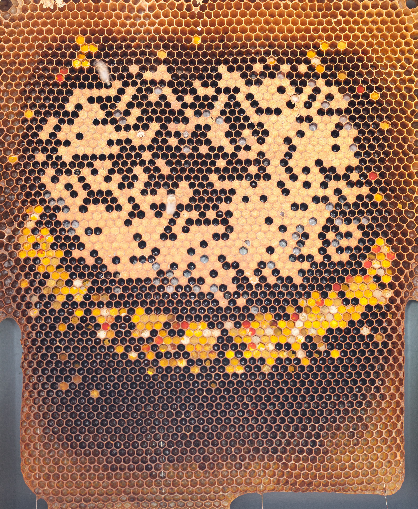

*Photo 39.1 — Healthy larvae reference. Eggs, larvae at several ages, capped brood and pollen cells provide a normal-development reference before disease signs are interpreted. Photo by Joska16, CC BY-SA 4.0.*

## 39.6 Why Patchy Brood Is Not a Diagnosis

Patchy brood can result from:

- AFB or EFB;
- Varroa-associated damage;
- hygienic removal of diseased brood;
- old or failing queen;
- inbreeding or high brood inviability;
- chilled brood;
- starvation or poor nutrition;
- pesticide exposure;
- interruption of egg laying;
- worker-laid drone brood;
- physical damage during inspection.

The correct response is to examine the pattern more closely, not to name a disease from the pattern alone.

## 39.7 A Structured Disease Inspection

### Step 1 — Review history

Before opening, review:

- recent inspections;
- queen age and status;
- feeding;
- treatments;
- Varroa monitoring;
- colony movement;
- purchased bees or queens;
- borrowed or second-hand equipment;
- nearby disease reports;
- weather and forage changes.

### Step 2 — Observe the entrance

Look for:

- dead or crawling bees;
- discarded brood;
- unusual staining;
- robbing;
- abnormal flight;
- mummies or larval remains on the floor or landing board.

### Step 3 — Compare adult population with brood

A large brood area with too few adults may suggest recent adult loss. A large adult population with very little brood may suggest queen or brood-health problems.

### Step 4 — Examine brood systematically

Compare open and sealed brood. Note:

- larval colour;
- position;
- consistency;
- age at death;
- capping appearance;
- scales;
- odour;
- distribution across frames.

### Step 5 — Decide whether sampling is needed

Laboratory or inspector confirmation may be required when:

- signs are ambiguous;
- regulated disease is suspected;
- treatment depends on species identification;
- an unusual or emerging disease is possible;
- several colonies are affected without a clear cause.

## 39.8 American Foulbrood: Overview

American foulbrood (AFB) is a serious brood disease caused by the spore-forming bacterium *Paenibacillus larvae*.

Larvae become infected by ingesting spores. The vegetative bacteria multiply after infection, and large numbers of highly resistant spores can form in diseased larval remains. These spores can persist for long periods in contaminated material.

### Field signs that may raise suspicion

- irregular sealed brood;
- sunken or perforated cappings;
- brown larval or pupal remains;
- ropey consistency in some diseased material;
- dark scales adhering closely to the lower cell wall;
- characteristic pupal tongue in some advanced scales;
- colony weakening.

No single field sign should replace confirmation where regulation or diagnosis requires it.

### Why AFB demands strict biosecurity

AFB spores can move through:

- contaminated comb;
- honey and feed;
- tools;
- gloves;
- robbing;
- drifting;
- moving bees and equipment;
- contaminated extraction or storage operations.

**Warning:** If AFB is suspected, stop moving bees, comb, honey, and equipment until current local requirements have been checked. In many jurisdictions AFB is notifiable or subject to official control.

Detailed diagnosis and control are covered in Chapter 43.

## 39.9 European Foulbrood: Overview

European foulbrood (EFB) is caused by *Melissococcus plutonius* and primarily affects larvae before or around capping.

Typical field observations may include:

- patchy brood;
- larvae that lose their pearly-white appearance;
- yellowish to brown larvae;
- larvae lying twisted or in abnormal positions;
- visible tracheal lines in some affected larvae;
- sour or unusual odour in some colonies.

Field diagnosis can be difficult because several brood disorders resemble EFB. Microscopy, lateral-flow tests, culture, or molecular methods may be used depending on jurisdiction and laboratory practice.

EFB does not form the highly persistent spores characteristic of AFB, but contaminated material and infected colonies can still transmit the bacterium.

Detailed EFB guidance appears in Chapter 44.

## 39.10 AFB and EFB: Practical Comparison

| Feature | American foulbrood | European foulbrood |
|---|---|---|
| Main agent | *Paenibacillus larvae* | *Melissococcus plutonius* |
| Main target | Developing brood | Developing brood |
| Spore formation | Yes; highly persistent | No AFB-like bacterial spore stage |
| Typical timing of larval death | Often after capping | Often before capping, although presentation varies |
| Characteristic remains | Brown, sometimes ropey; adherent scales | Discoloured, twisted or collapsed larvae; scales usually less adherent |
| Legal status | Often regulated/notifiable | Often regulated/notifiable in some jurisdictions |
| Confirmation | Inspector/laboratory methods as locally required | Inspector/laboratory methods as locally required |

The table supports recognition but is not a substitute for competent diagnosis.

## 39.11 Chalkbrood

Chalkbrood is caused by the fungus *Ascosphaera apis*.

Infected larvae become mummified. Mummies may appear:

- white;
- grey;
- mottled;
- black when reproductive structures develop.

Mummies may be found in cells, on the hive floor, or at the entrance after workers remove them.

Chalkbrood severity is influenced by colony condition and environment. Brood chilling, dampness, weak adult coverage, and susceptible stock can contribute to disease expression.

Management focuses on colony strength, appropriate ventilation and moisture control, reduction of avoidable brood chilling, hygienic stock where appropriate, and correction of underlying stress. Treatment claims should not be accepted without reliable evidence and legal authorisation.

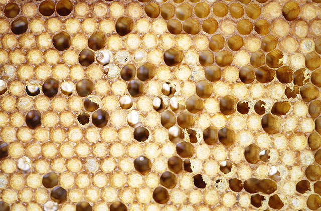

*Photo 39.2 — Chalkbrood mummies. White to darker hardened mummies can occur in brood cells or be removed from them; appearance should be interpreted with colony history and other signs. Photo by Conall, CC BY 2.0.*

## 39.12 Stonebrood

Stonebrood is an uncommon fungal disease associated with *Aspergillus* species. Larvae can become hard and mould-covered.

Because some *Aspergillus* species can produce airborne spores and may be harmful to humans, avoid inhaling dust from suspicious mouldy material.

**Caution:** Wear appropriate protective equipment and seek competent diagnostic guidance when stonebrood is suspected. Do not deliberately shake or brush mouldy material into the air.

## 39.13 Sacbrood

Sacbrood is a viral brood disease. Infected larvae fail to complete normal pupation and may form a fluid-filled sac between the old larval skin and the body.

Possible signs include:

- larvae with raised or darkened heads;
- yellowing followed by browning;
- a sac-like larval form that can sometimes be lifted from the cell;
- scattered affected brood.

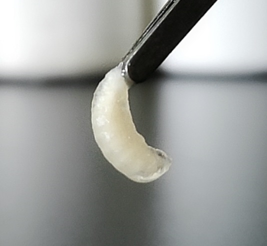

*Photo 39.3 — Sacbrood larva. This real clinical photograph shows the characteristic sac-like form in* Apis cerana. *Comparable signs in honey-bee brood should be interpreted with the colony pattern and other findings; a photograph alone is not definitive diagnosis. Photo by Xiaoqing Li; source: Wei et al.,* Viruses *14 (2022), Figure 1, CC BY 4.0.*

Mild sacbrood can occur without colony-level collapse. Persistent or extensive signs require investigation of colony stress, queen performance, nutrition, and other health problems.

## 39.14 Nosemosis

Nosemosis affects adult bees and is associated principally with *Nosema apis* and *Nosema ceranae*.

Field signs can be unreliable. Some affected colonies show poor growth, reduced productivity, shortened worker lifespan, or dysentery-like spotting, while others show few obvious external signs.

Microscopy can detect spores, but species differentiation and interpretation may require molecular methods. Spore detection must be interpreted in context because infection intensity, species, season, and colony condition matter.

Detailed diagnosis and management are covered in Chapter 42.

## 39.15 Viral Disease

Honey bee viruses are important because many can remain covert and become more damaging under particular conditions.

### Deformed wing virus

Deformed wing virus (DWV) is strongly associated with Varroa infestation. Obvious deformed wings are only one possible sign. In heavily affected colonies, many infected bees may die before or soon after emergence, producing dwindling adult populations.

### Chronic bee paralysis virus

Chronic bee paralysis can be associated with trembling, inability to fly, clustering of affected bees, and in some cases dark, shiny, hairless-looking workers. Similar signs can have other causes, so laboratory confirmation may be useful.

### Acute paralysis viruses

Acute bee paralysis virus, Israeli acute paralysis virus, and Kashmir bee virus can be associated with rapid adult mortality under certain conditions, especially where Varroa-mediated transmission is important.

### Black queen cell virus

Black queen cell virus can affect queen larvae and is often discussed in association with other colony stresses, including microsporidian infection.

Detailed virus biology is covered in Chapter 45.

## 39.16 Varroa and Viral Disease

Varroa mites do more than remove host resources. They alter the epidemiology of viral disease by transmitting and amplifying particular viruses.

The practical consequence is important: treating visible viral signs without controlling the Varroa problem can fail because the vector and underlying transmission pressure remain.

The 2026 ninth edition of the Honey Bee Health Coalition Varroa guide reflects current emphasis on monitoring, timely control, resistance awareness, and integrated management rather than waiting for visible colony damage.

Varroa is covered in detail in Chapter 41.

## 39.17 Dysentery Is a Sign, Not a Disease Name

Faecal spotting around the hive can occur with confinement, unsuitable food, digestive disturbance, and some infections. It should not automatically be labelled Nosema.

Diagnosis should consider:

- season and flight opportunities;
- feed quality;
- moisture;
- colony strength;
- laboratory testing where indicated.

## 39.18 Odour Is Supporting Evidence, Not Proof

Beekeeping descriptions sometimes emphasise a particular smell for foulbrood or other disorders. Odour varies with disease stage, colony condition, decay, and observer experience.

Use odour as one observation only. Do not rule disease in or out because a hive smells normal or abnormal.

## 39.19 The Limits of Field Tests

Field tools can be useful, but each has limitations.

Examples include:

- brood appearance;
- rope tests;
- lateral-flow devices;
- microscopy;
- alcohol washes for parasites;
- floor debris examination.

A field test can support a diagnosis but may have false-negative or false-positive limitations depending on the method, disease stage, and sample quality.

Recent research continues to improve molecular point-of-care detection of AFB and EFB, but regulatory acceptance and practical availability vary.

## 39.20 Sampling Principles

Before sampling, identify the question.

Examples:

- Is *P. larvae* present in suspicious brood?
- Is *M. plutonius* causing the observed larval disease?
- Which *Nosema* species is present?
- Is a virus associated with sudden mortality?

### Good sample practice

- follow the receiving laboratory's instructions;
- sample the correct material;
- use clean containers;
- label each colony separately;
- record date and apiary;
- prevent cross-contamination;
- keep chain-of-custody information if legally relevant;
- ship under the required conditions.

Do not place several suspect colonies into one unlabelled sample unless the laboratory specifically requests pooled material.

## 39.21 When to Contact an Inspector or Veterinarian

Seek competent help when:

- a regulated disease is suspected;
- field signs are severe or unusual;
- diagnosis is uncertain;
- treatment requires veterinary involvement;
- several colonies develop the same unexplained syndrome;
- medicine residues or food-safety issues may be involved;
- movement restrictions may apply.

Veterinary roles and legal responsibilities vary by country.

## 39.22 Notifiable and Reportable Disease

WOAH lists internationally important bee diseases and infestations in its standards, including American foulbrood, European foulbrood, varroosis, small hive beetle infestation, Tropilaelaps infestation, and acarapisosis.

National and regional law determines what a beekeeper must report and what official control measures apply.

For example, current UK guidance requires immediate reporting of suspected AFB and EFB to the National Bee Unit in relevant jurisdictions and places statutory controls on specified exotic pests. Other countries use different legal frameworks.

**Warning:** Never assume that advice from another country is legally valid in your own apiary.

## 39.23 Biosecurity: Preventing Disease Movement

Disease prevention is easier than cleaning up an apiary-wide outbreak.

Important measures include:

- obtain bees from reliable sources;
- inspect introduced colonies and nuclei;
- quarantine or segregate where appropriate;
- avoid moving unknown comb between colonies;
- keep apiary and colony records;
- clean tools according to the suspected hazard;
- manage robbing;
- prevent honey and syrup spills;
- replace unsuitable old comb gradually;
- store comb securely;
- monitor Varroa;
- avoid sharing contaminated extraction equipment;
- investigate abnormal brood before equalising colonies.

## 39.24 Second-Hand Equipment

Used equipment can be economical but may carry pathogens, spores, pests, pesticide residues, or unknown wax contamination.

Before purchase or use, determine:

- disease history;
- origin;
- legal movement status;
- material condition;
- whether components can be effectively decontaminated;
- whether comb should be discarded rather than reused.

Old brood comb from an unknown source is a substantially different risk from a clean new wooden box.

## 39.25 Robbing and Disease Spread

Robbing can move honey, spores, mites, and pathogens between colonies.

A diseased or collapsing colony may become a robbing target, turning a single-colony problem into an apiary-level exposure.

Reduce robbing by:

- avoiding exposed feed and honey;
- reducing vulnerable entrances;
- closing hives promptly;
- processing wet supers appropriately;
- correcting severe weakness.

## 39.26 Drifting and Disease Spread

Workers and drones do not always return to their original colony. Drift can increase where hives are arranged uniformly in rows with similar entrances.

Useful measures include:

- varied entrance orientation where practical;
- visual landmarks;
- sensible spacing;
- avoiding unnecessary crowding;
- managing colony health across the whole apiary rather than only individual hives.

## 39.27 Beekeeper-Mediated Spread

The beekeeper can be an efficient vector of disease.

Common routes include:

- hive tools;
- gloves;
- frames;
- feeders;
- brood transfer;
- equalisation;
- extracted honey equipment;
- shared storage containers;
- moving colonies.

A clean-to-dirty work sequence and colony identification reduce this risk.

## 39.28 Disease and Nutrition

Poor nutrition does not create bacterial or viral pathogens, but it can reduce colony resilience and alter brood rearing, immunity, and recovery.

Disease management should therefore include assessment of:

- carbohydrate stores;
- pollen availability;
- brood demand;
- forage interruption;
- competition;
- weather;
- feeder hygiene.

Supplemental feeding is not a cure for infectious disease.

## 39.29 Disease and Queen Performance

A failing queen can imitate disease by producing sparse or irregular brood. Disease can also reduce brood enough to make a good queen appear unproductive.

Before replacing a queen solely because of patchy brood, inspect individual cells and consider disease, parasites, nutrition, and brood viability.

## 39.30 Disease and Temperature

Chilled brood may occur after:

- prolonged hive opening;
- cold weather;
- sudden adult-bee loss;
- excessive brood area for the worker population;
- box separation;
- transport damage.

Chilled brood may be removed by workers and create a patchy pattern. Persistent or characteristic abnormal larvae require further investigation.

## 39.31 Disease and Pesticide Exposure

Pesticide exposure can resemble infectious disease when it causes adult mortality, reduced foraging, abnormal movement, queen effects, or brood loss.

A sudden event affecting several colonies simultaneously, particularly after nearby application, should prompt chemical-exposure investigation as well as disease assessment.

Do not treat a suspected poisoning event as an infectious disease without evidence.

## 39.32 Treatment Principles

Treatment should follow diagnosis.

Before using any medicine or pesticide in a colony, verify:

- the target condition;
- legal authorisation in the jurisdiction;
- label directions;
- dose and method;
- temperature limitations;
- brood conditions;
- honey-super restrictions;
- withdrawal or harvest requirements;
- resistance-management implications;
- required veterinary oversight;
- treatment records.

**Warning:** Never increase a dose, combine products, extend exposure, or use an unregistered substance simply because a previous treatment appeared ineffective.

## 39.33 Antibiotic Stewardship

Antibiotics do not treat viruses, fungi, microsporidia, or mites. Their legal use in bacterial bee disease varies by country and may require veterinary oversight.

AFB presents a special problem because antibiotics may suppress vegetative bacterial growth but do not eliminate the durable spores. This can mask signs without removing contaminated material.

Use antibiotics only where authorised and under the required professional framework.

## 39.34 Why “Natural” Does Not Mean Safe or Effective

Plant extracts, essential oils, acids, herbal preparations, and traditional remedies are sometimes promoted for bee disease.

A product should not be accepted merely because it is described as natural.

Ask:

- Is the diagnosis correct?
- Is there credible evidence of efficacy?
- Is it authorised?
- Could it harm brood, queens, adult bees, wax, or honey?
- Could residues enter food?
- Could it interfere with later diagnosis?

## 39.35 Disease Records

For each suspected disease event, record:

- colony ID;
- apiary;
- date;
- queen status;
- adult population;
- brood pattern;
- affected stage;
- photographs;
- odour if relevant;
- recent feeding;
- Varroa results;
- treatment history;
- sample details;
- laboratory or inspector result;
- action taken;
- outcome.

Over time, these records can reveal recurrence, seasonal patterns, equipment links, and management failures.

## 39.36 Apiary-Level Disease Mapping

When more than one colony is affected, draw a simple apiary map.

Mark:

- first affected colony;
- date of first sign;
- later affected colonies;
- entrances and orientation;
- shared equipment routes;
- feeding points;
- recent colony movements.

Spatial patterns can support investigation of robbing, drift, shared equipment, local exposure, or management-related spread.

## 39.37 Disease Decision Table

| Observation | Important possibilities | Next step |
|---|---|---|
| Sunken/perforated cappings with brown remains | AFB, other brood death | Stop transfers; obtain competent confirmation |
| Twisted yellow-brown larvae | EFB, chilled brood, other larval disease | Compare age/pattern; sample if suspicious |
| White/black hard mummies | Chalkbrood | Assess colony strength, moisture, chilling and recurrence |
| Sac-like larvae | Sacbrood | Confirm pattern; assess broader colony stress |
| Crawling/trembling adults | viral disease, poisoning, starvation, other causes | Review history; examine mortality distribution; sample if needed |
| Deformed wings | Varroa-associated viral damage, developmental injury | Measure Varroa and assess colony-level damage |
| Faecal spotting | confinement, feed problem, nosemosis, other digestive stress | Do not diagnose from spotting alone |
| Sudden mass mortality in several colonies | pesticide exposure, acute toxic event, severe disease | Preserve evidence; contact appropriate authority/lab |

## 39.38 Practical Disease-Control Routine

### At every routine inspection

- note brood pattern;
- compare larvae of similar age;
- look for abnormal cappings;
- observe removed brood or mummies;
- record Varroa-monitoring status;
- avoid unnecessary frame transfer.

### When something is abnormal

1. stop equalising colonies;
2. record the pattern;
3. inspect affected cells closely;
4. compare with a healthy colony if available;
5. review recent management;
6. decide whether regulated disease is plausible;
7. isolate tools if needed;
8. arrange competent confirmation;
9. follow current control requirements.

## 39.39 Scientific Notes

### Colony disease is a system-level outcome

A honey bee colony behaves as a superorganism. Disease expression reflects effects on individuals and on colony-level functions such as brood care, thermoregulation, food distribution, and workforce replacement.

### Social immunity

Colonies use collective defences including hygienic removal of abnormal brood, grooming, resin use, and organisation of nest tasks. These behaviours reduce but do not eliminate disease risk.

### Pathogen load and clinical signs

Presence, quantity, tissue distribution, strain, host age, and coinfection can all influence disease severity. A positive laboratory result must therefore be interpreted with field evidence.

### Varroa changes viral epidemiology

Research has repeatedly shown that Varroa invasion can change viral prevalence and titre, including dramatic changes in deformed wing virus dynamics. This is why viral disease and mite management cannot be separated in practice.

### Diagnostic technology is improving

Microscopy, culture, immunological methods, conventional PCR, quantitative PCR, sequencing, and point-of-care molecular tools each have strengths and limitations. The best method depends on the diagnostic question and regulatory framework.

## 39.40 Disease-Prevention Checklist

- [ ] Bees come from traceable sources.
- [ ] Colony IDs and queen histories are current.
- [ ] Brood is examined during suitable inspections.
- [ ] Varroa is monitored using an appropriate method.
- [ ] Unknown brood comb is not introduced casually.
- [ ] Weak colonies are diagnosed before combining.
- [ ] Robbing triggers are controlled.
- [ ] Tools are cleaned appropriately.
- [ ] Suspect colonies are inspected last.
- [ ] Feed is clean and traceable.
- [ ] Honey from unknown disease status is not fed casually.
- [ ] Second-hand equipment is risk-assessed.
- [ ] Abnormal brood is photographed and recorded.
- [ ] Samples are labelled by colony.
- [ ] Current local disease-reporting rules are known.
- [ ] Medicines are used only according to current authorisation and label requirements.

## Key Takeaways

- Pathogen detection is not automatically the same as clinical disease.
- Patchy brood is a sign requiring investigation, not a diagnosis.
- AFB, EFB, chalkbrood, sacbrood, nosemosis, and viral disease have different biology and control requirements.
- AFB spores are exceptionally persistent and demand strong biosecurity.
- EFB can resemble other larval disorders and often benefits from competent confirmation.
- Varroa profoundly changes the risk and severity of several viral diseases.
- Dysentery, odour, deformed wings, and dead bees must be interpreted in context.
- Sampling quality determines diagnostic value.
- Robbing, drifting, shared equipment, and frame transfer can spread disease.
- Treatment must follow diagnosis, current law, product authorisation, and food-safety requirements.

## Chapter Summary

Honey bee disease diagnosis begins with patterns, not labels. The beekeeper first determines whether brood, adults, or both are affected, reviews colony history, compares normal and abnormal individuals, and considers non-infectious alternatives. Serious or regulated conditions then require appropriate sampling, laboratory or inspector confirmation, and control according to the jurisdiction.

American foulbrood and European foulbrood are important bacterial brood diseases but differ in spore formation, larval presentation, persistence, and management. Chalkbrood is a fungal brood disease characterised by mummified larvae. Sacbrood is viral. Nosemosis affects adult bees and often requires laboratory support for reliable interpretation. Viral disease is especially important in the presence of Varroa because the mite changes transmission and disease expression.

The strongest disease programme is preventive. Traceable bees, controlled movement of comb, clean-to-dirty inspections, robbing prevention, Varroa management, accurate records, and rapid investigation of abnormal brood reduce both colony losses and apiary-wide spread.

## Review Questions

1. What is the difference between infection and disease?
2. Why can a pathogen be present without obvious disease?
3. Which host and environmental factors influence disease expression?
4. Why must laboratory results be interpreted with field signs?
5. What distinguishes a parasite from an infectious disease agent?
6. Give two examples of honey bee bacterial diseases.
7. Which organism causes American foulbrood?
8. Which organism causes European foulbrood?
9. Which fungus causes chalkbrood?
10. What is nosemosis?
11. Why is the taxonomy of Nosema/Vairimorpha sometimes presented differently?
12. Name three important honey bee viruses.
13. Why is Varroa important to viral disease?
14. What are common brood-focused warning signs?
15. What are common adult-bee warning signs?
16. What does a normal young honey bee larva look like?
17. Why is a perfectly solid brood pattern not required for health?
18. Why is patchy brood not a diagnosis?
19. Name four non-infectious causes of patchy brood.
20. Why should colony history be reviewed before disease inspection?
21. Which recent management records are especially useful?
22. What can entrance debris reveal?
23. Why compare adult population with brood area?
24. Which larval features should be examined?
25. When should laboratory sampling be considered?
26. What makes AFB especially persistent?
27. How do AFB larvae become infected?
28. Which field signs can raise suspicion of AFB?
29. Why is the rope test not sufficient on its own?
30. How can AFB spores move between colonies?
31. What should stop when AFB is suspected?
32. Which bacterium causes EFB?
33. At what developmental stage is EFB commonly most evident?
34. Which larval colour and position changes may occur in EFB?
35. Why can EFB be difficult to diagnose visually?
36. How does EFB differ from AFB in spore formation?
37. Why must local law be checked for foulbrood?
38. What produces chalkbrood mummies?
39. Why can chalkbrood severity vary among colonies?
40. Which colony conditions can favour chalkbrood expression?
41. What is stonebrood?
42. Why should mouldy stonebrood-like material be handled cautiously?
43. What are typical sacbrood features?
44. Does mild sacbrood always cause colony collapse?
45. Which bees are mainly affected by nosemosis?
46. Why are field signs of Nosema unreliable?
47. What can microscopy show in a Nosema investigation?
48. Why may molecular testing be useful for Nosema?
49. Which virus is strongly associated with Varroa?
50. Why are deformed wings only one expression of DWV-associated disease?
51. Which signs can occur with chronic bee paralysis?
52. Why can paralysis signs have several causes?
53. Name three acute paralysis-associated viruses.
54. Which virus is associated with queen-cell disease?
55. Why can viral infection remain covert?
56. How does Varroa alter viral epidemiology?
57. Why can viral control fail if Varroa is ignored?
58. Why is dysentery not a disease diagnosis?
59. Which factors should be reviewed when faecal spotting is present?
60. Why should odour be treated only as supporting evidence?
61. What are the limitations of field tests?
62. Why does sample quality matter?
63. What question should be defined before taking a sample?
64. Why should colonies be labelled separately in laboratory submissions?
65. What is cross-contamination?
66. When should a bee inspector or veterinarian be contacted?
67. What does WOAH listing mean in general terms?
68. Who determines the beekeeper's actual legal reporting duties?
69. Why is foreign legal advice unsafe to copy directly?
70. How can traceable bee sources reduce disease risk?
71. Why can old brood comb of unknown origin be risky?
72. How does robbing spread disease?
73. How can drifting contribute to pathogen movement?
74. How can the beekeeper spread disease between colonies?
75. What is the purpose of a clean-to-dirty inspection sequence?
76. How can poor nutrition influence disease expression?
77. Why is feeding not a cure for infectious disease?
78. How can queen failure mimic disease?
79. Why should a queen not be replaced solely because brood is patchy?
80. How can chilled brood resemble infection?
81. Which events can cause brood chilling?
82. How can pesticide exposure resemble disease?
83. Why can several colonies dying simultaneously suggest a shared exposure?
84. What must be checked before using any bee medicine?
85. Why are honey-super restrictions important?
86. What is antibiotic stewardship?
87. Why do antibiotics not cure viruses?
88. Why can antibiotics fail to eliminate AFB contamination?
89. Why does “natural” not mean safe or effective?
90. Which questions should be asked about an alternative remedy?
91. Which facts belong in a disease record?
92. How can an apiary map support disease investigation?
93. What should be done when sunken cappings and brown remains are found?
94. What should be considered when twisted yellow-brown larvae are found?
95. What should be considered when white or black mummies are found?
96. What should be investigated when deformed-wing bees appear?
97. What should happen when mass mortality affects several colonies?
98. What is social immunity?
99. Why can pathogen quantity matter as well as pathogen presence?
100. What are the main components of a practical disease-prevention programme?

## References

- World Organisation for Animal Health. “Diseases of Bees.” Current disease summaries and Terrestrial Code resources. Accessed 15 September 2026.
- Department for Environment, Food & Rural Affairs and Animal and Plant Health Agency. “Honey bees: protecting them from pests and diseases.” GOV.UK, updated 21 August 2024. Accessed 15 September 2026.
- Department of Agriculture, Environment and Rural Affairs, Northern Ireland. “Bee Health” and current foulbrood guidance, including guidance updated May 2026. Accessed 15 September 2026.
- Agri-Food and Biosciences Institute. “Testing for Honeybee Pests and Diseases.” Published 17 July 2025. Accessed 15 September 2026.
- Honey Bee Health Coalition. “Hive Management” and current bee-health best-management resources. Accessed 15 September 2026.
- Honey Bee Health Coalition. *Tools for Varroa Management: A Guide to Effective Varroa Sampling & Control*, 9th ed., 2026.
- Penn State Extension. “Nosema Disease of Honey Bees.” Updated 26 February 2026.
- Penn State Extension. “A Quick Reference Guide to Honey Bee Parasites, Pests, Predators, and Diseases.” Updated 11 November 2021.
- Heo, J., Cheon, D.-S., Chung, N.-K., Kim, Y., and Kim, D.-Y. “Evaluation of the performance of a point-of-care molecular assay for simultaneous detection of the agents of American foulbrood and European foulbrood in apiaries.” *Journal of Veterinary Diagnostic Investigation* 37(6), 2025, 919–926. DOI: 10.1177/10406387251369898.
- Forsgren, E. et al. “Standard methods for European foulbrood research 2.0.” *Journal of Apicultural Research*, 2024. DOI: 10.1080/00218839.2024.2380425.
- Alburaki, M., Abban, S. K., Evans, J. D., and Chen, Y. “A thirty-two-year (1984–2015) longitudinal analysis of honey bee disease and pathogen prevalence in the USA.” *Apidologie* 56, 60 (2025). DOI: 10.1007/s13592-025-01187-8.
- Aronstein, K. A., and Murray, K. D. “Chalkbrood disease in honey bees.” *Journal of Invertebrate Pathology* 103(Suppl. 1), 2010, S20–S29.
- Caron, D. M., and Connor, L. J. *Honey Bee Biology and Beekeeping*. Wicwas Press.
- Graham, J. M., editor. *The Hive and the Honey Bee*. Dadant & Sons.
- Sammataro, D., and Avitabile, A. *The Beekeeper’s Handbook*. Cornell University Press.
- Winston, M. L. *The Biology of the Honey Bee*. Harvard University Press.
- Competent national and regional animal-health, veterinary-medicine, pesticide, and food-safety authorities. Current reporting, movement, treatment, and residue requirements must be checked for the reader’s jurisdiction.

# Chapter 40 — Parasites

## Introduction

Honey bees share their colonies with many other organisms, but only some are true parasites. A parasite lives on or in a host and obtains resources at the host's expense. This relationship distinguishes parasites from predators, scavengers, wax-destroying pests, and infectious microorganisms.

For modern *Apis mellifera* beekeeping, parasitic mites are especially important. *Varroa destructor* is established across most of the beekeeping world and profoundly changes colony health through direct parasitism and its interaction with viruses. *Tropilaelaps* mites, particularly *Tropilaelaps mercedesae*, are an expanding threat whose range has moved westward from Asia into parts of Eurasia. The tracheal mite, *Acarapis woodi*, lives inside the respiratory system of adult bees and remains internationally recognised even though its practical importance differs greatly among regions.

This chapter explains the major parasite groups, how they spread, what they do to colonies, how to recognise suspicious signs, and how surveillance should be organised. It deliberately leaves detailed Varroa thresholds, treatment selection, and integrated pest-management programmes to Chapters 41 and 46.

## Learning Objectives

After completing this chapter, the reader should be able to:

- define parasitism and distinguish parasites from pathogens, predators, and hive pests;
- explain why mites are important honey bee parasites;
- describe the life-cycle principles of *Varroa destructor*;
- recognise the main field consequences of Varroa infestation without relying on visible mites alone;
- describe the biology and emerging geographic importance of *Tropilaelaps* mites;
- distinguish *Tropilaelaps* from Varroa conceptually and morphologically;
- explain acarapisosis caused by *Acarapis woodi*;
- understand how drifting, robbing, swarming, bee movement, and brood movement spread parasites;
- select an appropriate surveillance question before choosing a monitoring method;
- apply biosecurity and regulatory precautions when an exotic parasite is suspected.

## 40.1 What Is a Parasite?

A parasite depends on a host for resources while imposing a biological cost on that host.

In honey bees, parasites may be:

- external, living on the body surface or within the brood cell;
- internal, living inside host structures;
- temporary, contacting the host only during part of the life cycle;
- closely dependent on brood;
- transmitted directly between bees;
- moved indirectly by beekeeping operations.

The harm may include:

- tissue damage;
- reduced body condition;
- shortened lifespan;
- impaired development;
- reduced flight or thermoregulatory capacity;
- altered immune function;
- transmission or amplification of infectious agents;
- colony-level population decline.

## 40.2 Parasite, Pathogen, Pest, or Predator?

| Category | Relationship with bees | Examples |
|---|---|---|
| Parasite | Lives on or in a bee and takes resources from the host | *Varroa destructor*, *Tropilaelaps* spp., *Acarapis woodi* |
| Pathogen | Infectious agent that causes disease | *Paenibacillus larvae*, *Melissococcus plutonius*, honey bee viruses |
| Hive pest/scavenger | Damages comb, stores, debris, or hive environment | wax moths, small hive beetle |
| Predator | Captures and consumes bees | hornets, some wasps, birds |
| Commensal/associate | Lives in or around the colony without necessarily causing important harm | various mites and arthropods |

The categories can interact. A parasite may vector a pathogen, and a collapsing parasitised colony may become vulnerable to scavengers and robbing.

## 40.3 Why Mites Are So Important

Mites are small enough to remain hidden, reproduce rapidly, and move with their hosts. Honey bee colonies also provide a favourable environment: dense populations of related hosts, repeated brood production, stable nest conditions, and contact between thousands of adult bees.

The practical problem is that damage can accumulate before the beekeeper sees an obvious mite.

A colony can therefore look productive while parasite pressure is increasing in the brood nest.

## 40.4 Varroa Destructor: The Dominant Global Parasite

*Varroa destructor* is an ectoparasitic mite of honey bees. Its original host relationship involved the Asian honey bee *Apis cerana*, but host switching to *Apis mellifera* created one of the most important health problems in modern apiculture.

Adult female mites can be seen without magnification. They are flattened, oval, and reddish-brown. Their body shape allows them to move between abdominal segments and remain protected on adult bees.

The mite feeds principally on honey bee fat-body tissue and associated haemolymph. The fat body is central to metabolism, immunity, nutrient storage, detoxification, and overwintering physiology.

## 40.5 Varroa Reproduction

Varroa reproduction occurs mainly inside capped brood cells.

A simplified sequence is:

1. a mature female mite enters a brood cell shortly before capping;
2. the cell is capped;
3. the foundress mite begins feeding and lays eggs;
4. offspring develop within the sealed cell;
5. mating occurs among mite offspring;
6. mature females emerge with the adult bee and can infest other bees or brood cells.

Drone brood remains capped longer than worker brood and can support greater reproductive success for Varroa under many conditions.

This relationship with sealed brood explains why colony brood pattern strongly influences mite population growth.

## 40.6 Varroa on Adult Bees

Older literature often called the period on adult bees the “phoretic” phase. The term remains common, but it can imply that mites are merely travelling. They also feed on adult bees during this period.

Adult bees move mites:

- within the colony;
- between colonies through drifting;
- into robbing colonies;
- with swarms;
- with packages and nucleus colonies;
- during beekeeper movement of adult bees.

Visible mites on adult bees usually indicate substantial exposure, but absence of visible mites does not indicate a mite-free colony.

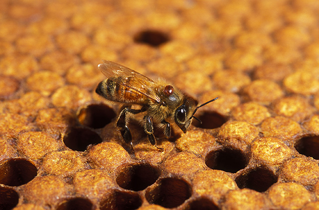

*Photo 40.1 — Adult female Varroa on a bee. The mite is shown at realistic scale on its host; failure to see mites during a routine inspection does not establish a low infestation level. USDA photo by Scott Bauer; public domain.*

## 40.7 Varroa Damage to Developing Bees

Parasitised pupae may emerge with:

- lower body weight;
- reduced nutrient reserves;
- shortened lifespan;
- altered immune responses;
- viral infection or increased viral load;
- developmental abnormalities.

Some damaged bees die before emergence. Others emerge apparently normal but have reduced longevity or performance.

The colony-level effect is therefore larger than the number of visibly deformed bees suggests.

## 40.8 Varroa and Viruses

Varroa mites are important biological vectors and amplifiers of honey bee viruses, particularly deformed wing virus complexes.

High Varroa pressure can change viral transmission so profoundly that a colony with abundant summer bees can later experience rapid population decline.

This is why waiting for deformed wings or obvious collapse is poor monitoring practice. Parasite measurement must precede visible failure.

Detailed Varroa monitoring and control are covered in Chapter 41.

## 40.9 Signs Associated with High Varroa Pressure

Possible signs include:

- mites visible on adult bees;
- mites in brood cells;
- deformed wings;
- shortened abdomens;
- patchy brood;
- uncapped or removed pupae;
- reduced adult population;
- unexpected late-season decline;
- poor winter survival;
- elevated mite counts using a validated monitoring method.

None of the visible signs alone measures infestation accurately.

## 40.10 Why Visual Inspection Is Not Enough

Most mites may be hidden on bees or under brood cappings. The beekeeper may inspect thousands of bees without seeing enough mites to appreciate the real population.

A colony should therefore be monitored using a method designed to estimate mite pressure, not merely by looking for mites during routine inspections.

Methods such as alcohol or detergent washes, sugar-roll methods, natural mite fall, and brood examination answer different questions and have different strengths and limitations.

Chapter 41 explains these methods in detail and gives current decision guidance.

## 40.11 Reinvasion and Mite Immigration

A colony whose Varroa level has been reduced can acquire mites again.

Important routes include:

- drifting workers;
- drones;
- robbing of collapsing colonies;
- nearby untreated colonies;
- movement of infested colonies;
- introduction of brood or bees.

This process is often described as reinvasion or mite immigration.

The practical lesson is that one successful treatment does not permanently solve Varroa.

## 40.12 Tropilaelaps: An Emerging Threat

*Tropilaelaps* mites are ectoparasitic mites associated naturally with Asian giant honey bees and capable of reproducing in *Apis mellifera* colonies.

Species of particular concern to managed western honey bees include *Tropilaelaps mercedesae* and *Tropilaelaps clareae*.

Historically, practical beekeeping literature often described Tropilaelaps as an Asian problem. That description is now inadequate. By 2026, peer-reviewed and reference-laboratory reporting documented continuing westward expansion of *T. mercedesae*, including confirmed occurrence in Georgia and parts of Russia and other areas of Eurasia. Reports and surveillance close to European borders have increased concern about further spread.

Because distribution changes, beekeepers should use current official surveillance information rather than static maps in older books.

## 40.13 How Tropilaelaps Differs from Varroa

Both mites reproduce with honey bee brood, but their biology differs.

Tropilaelaps mites are:

- narrower and more elongated than Varroa;
- fast-moving on the comb;
- strongly dependent on brood for feeding and reproduction;
- capable of rapid population increase where brood is continuously available.

Varroa mites are broader and more flattened and can survive for longer periods feeding on adult bees.

The stronger brood dependence of Tropilaelaps has major implications for surveillance and control.

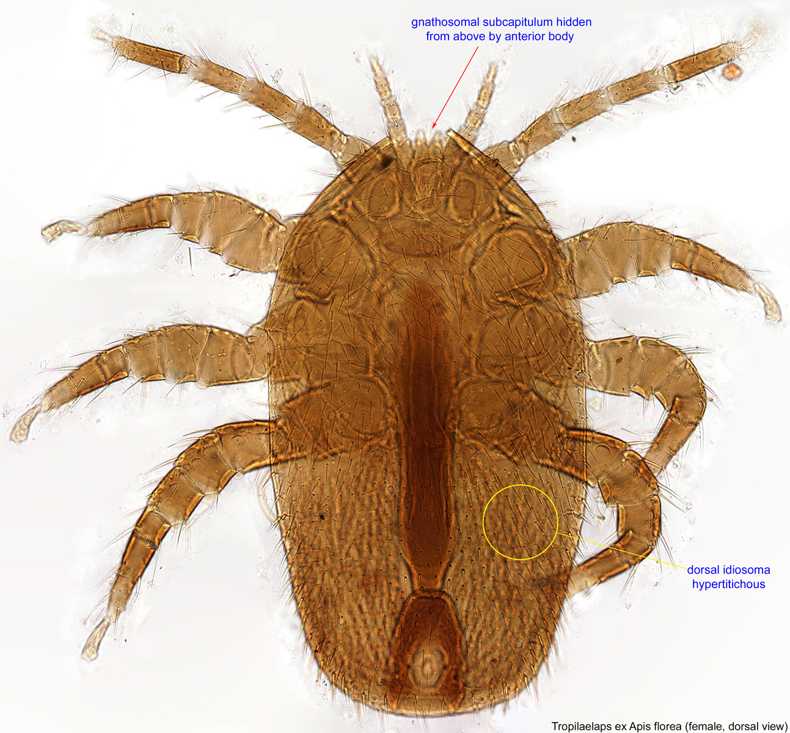

*Photo 40.2 — Tropilaelaps specimen. Confirmed specimen image used for morphological context; field identification of an unfamiliar mite should follow current surveillance and laboratory guidance. Image by Pavel Klimov, Bee Mite ID / USDA; public domain.*

## 40.14 Tropilaelaps Reproduction and Damage

Female Tropilaelaps mites enter brood cells before capping and reproduce on developing bees.

Damage can include:

- brood mortality;
- irregular sealed brood;
- deformed or weakened emerging adults;
- reduced adult longevity;
- colony weakening;
- viral transmission or interaction, including concern about deformed wing virus.

Recent 2026 reviews emphasise the combination of a short reproductive cycle, brood dependence, rapid dispersal potential, and range expansion as reasons for increased international concern.

## 40.15 Tropilaelaps Dispersal

Tropilaelaps can spread through:

- movement of infested brood;
- adult bees carrying mites temporarily;
- drifting;
- robbing;
- colony movement;
- swarming.

Recent field work in Georgia demonstrated that natural swarms can carry *T. mercedesae* and that some mites can survive long enough to enter newly produced brood and reproduce.

This finding is important because older assumptions about poor survival away from brood could lead to underestimating dispersal risk.

## 40.16 Suspected Tropilaelaps: What to Do

Where Tropilaelaps is absent, regulated, or under official surveillance, suspicion should be treated as a biosecurity event.

Possible observations include:

- fast-moving elongated mites on comb;
- mites in brood cells;
- irregular brood;
- damaged pupae;
- deformed emerging bees;
- unexplained rapid parasite-like brood damage.

**Warning:** Do not move the suspect colony, brood frames, bees, or equipment until current local reporting requirements have been checked.

Collecting and submitting specimens should follow the competent authority or diagnostic laboratory's instructions.

## 40.17 Tropilaelaps Detection

Detection methods can include:

- brood-cell examination;
- uncapping brood;
- natural mite-fall examination;
- adult-bee sampling;
- trapping or brood-based methods;
- morphological identification;
- molecular confirmation.

Research published in 2026 continues to evaluate early-detection methods for European honey bee colonies. Surveillance programmes may specify particular methods, sample sizes, or laboratory confirmation.

A negative result from one limited sample does not necessarily prove absence.

## 40.18 Acarapis Woodi: The Tracheal Mite

*Acarapis woodi* is a microscopic internal mite that lives principally in the prothoracic tracheae of adult honey bees. The infestation is called acarapisosis or tracheal-mite infestation.

The mites feed within the respiratory system and reproduce there. Heavy infestation can impair gas exchange and reduce the condition and performance of adult bees.

Unlike Varroa and Tropilaelaps, *A. woodi* cannot normally be diagnosed by routine naked-eye inspection.

## 40.19 Tracheal-Mite Transmission

Tracheal mites spread mainly by direct contact between adult bees.

Young adult bees are particularly susceptible to colonisation. Once established, mites reproduce in the tracheae and offspring leave to seek new hosts.

Colony and apiary spread can therefore occur through:

- close bee-to-bee contact;
- drifting;
- robbing;
- introduced adult bees;
- swarming;
- movement of infested colonies.

## 40.20 Signs Associated with Acarapisosis

Heavy infestation has historically been associated with:

- weak colonies;
- poor flight;
- crawling bees;
- disjointed or apparently abnormal wing position;
- reduced honey production;
- poor winter survival;
- spring dwindling.

These signs are non-specific. Similar signs can result from viral disease, cold, starvation, queen failure, pesticide exposure, or other problems.

Diagnosis therefore requires examination of the tracheae or another validated diagnostic method.

## 40.21 Tracheal-Mite Diagnosis

A diagnostic laboratory may dissect the prothoracic tracheae of adult bees and examine them microscopically.

Normal tracheae are pale and translucent. Infested tracheae can show mites, eggs, feeding damage, darkening, or scarring.

Molecular methods may also be used in specialist settings.

Do not attempt to diagnose acarapisosis from “K-wing” appearance alone.

## 40.22 Regional Importance of Tracheal Mites

The practical importance of tracheal mites has changed over time and differs among regions and bee stocks. Some populations show greater resistance, and in some countries the parasite is detected infrequently compared with Varroa.

However, WOAH continues to list acarapisosis in its international bee-health framework, and some national surveillance systems monitor it.

A parasite that is uncommon locally should not be ignored when importing bees or investigating unexplained adult-bee problems.

## 40.23 Genetic Resistance and Grooming

Honey bee stocks differ in susceptibility to parasites.

Relevant traits can include:

- grooming;
- hygienic behaviour;
- brood removal;
- mite reproduction suppression;
- colony brood patterns;
- adult-bee characteristics that reduce tracheal-mite establishment.

USDA research has shown that grooming behaviour contributes to tracheal-mite resistance in some honey bee stocks.

Genetic resistance is a management resource, not a guarantee of parasite freedom.

## 40.24 Other Mites Found in Hives

Not every mite seen in a hive is Varroa, Tropilaelaps, or a dangerous parasite.

Hives contain mites that may be:

- scavengers;
- pollen feeders;
- fungal feeders;
- predators of small arthropods;
- incidental visitors.

Misidentification can lead to unnecessary treatment.

When an unusual mite is found, preserve a specimen and obtain competent identification rather than applying a miticide blindly.

## 40.25 Braula Coeca and Other Bee Associates

*Braula coeca*, commonly called the bee louse, is actually a wingless fly rather than a true louse or mite. Adult Braula may ride on adult bees and obtain food from bees, while larvae develop in wax cappings.

Its importance is generally much lower than Varroa, and control should not be confused with Varroa management.

This example illustrates why correct identification matters before intervention.

## 40.26 Parasites and Brood Pattern

Parasite-related brood damage can produce:

- empty cells;
- uncapped pupae;
- partially removed brood;
- delayed emergence;
- deformed adults;
- irregular cappings.

The same pattern can occur with brood disease or chilling.

A brood frame should therefore be examined for:

- abnormal larvae and pupae;
- mites;
- capping changes;
- queen pattern;
- hygienic removal;
- signs of bacterial or fungal disease.

## 40.27 Parasites and Colony Demography

A colony can tolerate some loss of individual bees while population replacement remains strong. Problems accelerate when parasitism reduces the lifespan of emerging workers faster than new adults can replace them.

This is particularly dangerous before winter in temperate climates. Long-lived winter bees must survive for months, so damage during their development can have colony-level consequences far beyond the immediate brood cycle.

## 40.28 Parasites and Nutrition

Adequate nutrition supports brood rearing and adult physiology, but feeding does not remove parasites.

A well-fed colony with uncontrolled Varroa can still collapse.

Conversely, poor nutrition can increase the harm caused by parasites and associated viruses.

Management must address both resource adequacy and parasite pressure.

## 40.29 Parasites and Queen Performance

A queen may appear to be failing when parasitised brood dies or is removed by workers.

Before replacing a queen because of patchy brood, consider:

- parasite pressure;
- brood disease;
- nutritional interruption;
- chilled brood;
- queen age and mating quality.

Queen replacement may improve genetics or colony organisation, but it does not directly eliminate an established parasite population.

## 40.30 Movement of Brood

Brood transfer is a powerful management tool and a powerful parasite-transfer route.

Moving a capped brood frame can move:

- reproducing Varroa;
- Tropilaelaps where present;
- brood pathogens;
- emerging infested adults.

Before equalising colonies or making splits, consider the health status of the donor colony.

## 40.31 Packages, Nuclei, and Purchased Colonies

Purchased bees should not be assumed parasite-free.

Before acquisition, ask about:

- origin;
- recent monitoring;
- treatment history;
- queen source;
- movement certification where required;
- known regional pests and parasites.

After arrival, establish a monitoring baseline at the biologically appropriate time.

## 40.32 Swarms and Parasite Risk

A swarm may arrive with adult-carried mites even though it contains no capped brood at capture.

The broodless interval can create management opportunities for some parasites, but it should not be interpreted as proof that the swarm is parasite-free.

Captured swarms should be incorporated into the apiary's health-monitoring programme.

## 40.33 Drifting

Drifting occurs when a bee enters a colony other than its own.

Factors that can increase drift include:

- uniform hive appearance;
- long straight rows;
- entrances facing the same direction;
- crowded apiaries;
- wind;
- colony movement.

Drifting can redistribute Varroa and other bee-associated organisms.

## 40.34 Robbing

Robbing is particularly important because strong colonies can acquire mites while robbing weakened, heavily infested colonies.

A collapsing donor colony may therefore expose apparently healthy neighbours.

Robbing prevention is part of parasite management, not only theft-of-honey prevention.

## 40.35 Monitoring: Define the Question First

Before choosing a method, decide what you need to know.

Examples:

- Is Varroa pressure currently low enough for this management stage?
- Has a Varroa control intervention worked?
- Is an unusual mite Tropilaelaps?
- Is acarapisosis present in an unexplained adult-bee syndrome?
- Has an introduced colony brought a regulated parasite?

The method must match the question.

## 40.36 Monitoring Methods Are Not Interchangeable

An adult-bee wash, natural mite fall, brood uncapping, tracheal dissection, and molecular test do not measure the same thing.

Differences include:

- target parasite;
- sensitivity;
- whether the method estimates colony infestation or merely detects presence;
- whether bees are sacrificed;
- seasonal usefulness;
- brood dependence;
- laboratory requirements.

Use validated methods and current regional guidance.

## 40.37 Sampling Bias

A poor sample can produce false reassurance.

Bias can arise from:

- sampling too few bees;
- taking bees from the wrong location;
- sampling at an unrepresentative season;
- examining only one brood frame;
- failing to mix the sample correctly;
- using damaged equipment;
- counting debris that cannot be confidently identified.

Standardised sampling improves comparability across time.

## 40.38 Parasite Monitoring Records

Record:

- colony ID;
- date;
- method;
- sample size where relevant;
- raw count;
- calculated infestation measure where appropriate;
- brood status;
- colony strength;
- intervention;
- product and batch where relevant;
- follow-up result.

Do not record only “mites treated”. Without a pre- and post-intervention measurement, treatment performance is difficult to evaluate.

## 40.39 Exotic-Parasite Surveillance

Surveillance for an exotic parasite has a different objective from routine Varroa management.

The question is often presence/absence and rapid official confirmation rather than a treatment threshold.

An exotic-parasite plan should include:

- recognition training;
- specimen preservation;
- diagnostic contacts;
- movement records;
- rapid notification;
- temporary movement restraint;
- tracing of recently moved bees and equipment.

## 40.40 Legal and Regulatory Context

Parasite reporting and movement rules vary.

WOAH lists acarapisosis, Tropilaelaps infestation, and varroosis among internationally listed bee conditions. National implementation differs.

Some jurisdictions treat Tropilaelaps as an exotic notifiable pest and impose movement or eradication measures following detection. Other regions where the parasite is established use different management systems.

**Warning:** Check current competent-authority guidance before moving a suspect colony or specimen across borders or administrative regions.

## 40.41 Treatment Is Parasite-Specific

A product effective against one mite under one colony condition may not be effective, authorised, or safe against another.

Selection depends on:

- parasite identity;
- colony brood status;
- temperature;
- honey-production status;
- resistance patterns;
- authorised products;
- application method;
- residue risk;
- operator safety.

Do not improvise parasite treatment from agricultural pesticide products.

## 40.42 Resistance to Acaricides

Repeated exposure to the same active ingredient can select for resistant parasite populations.

Resistance management may involve:

- monitoring treatment performance;
- rotating effective authorised modes of action where guidance supports it;
- integrating non-chemical controls;
- avoiding under-dosing and unapproved delivery methods;
- participating in local resistance surveillance.

Exact Varroa treatment planning belongs in Chapter 41.

## 40.43 Brood Interruption

Because Varroa and Tropilaelaps reproduction depends on brood, brood interruption can alter parasite population dynamics.

However, the two mites differ in their ability to persist on adult bees. A strategy developed for Varroa should not automatically be assumed to control Tropilaelaps in the same way.

Brood manipulation also has costs:

- reduced colony growth;
- queen risk;
- management labour;
- timing constraints;
- potential loss of production.

## 40.44 Drone-Brood Manipulation

Varroa often reproduces more successfully in drone brood. Some management systems use drone-brood removal as one component of control.

This method:

- requires correct timing;
- removes brood and colony resources;
- is not sufficient alone in many situations;
- must not be left in the colony after mites have reproduced if the intention is removal;
- should be integrated with monitoring.

Detailed use belongs in Chapter 41 and Chapter 46.

## 40.45 Heat, Acids, Essential Oils, and Other Controls

Various physical and chemical approaches are used against mites. Their efficacy and safety depend on parasite, product, temperature, dose, delivery, colony condition, and local authorisation.

This chapter does not provide treatment recipes because those details can become unsafe or obsolete when products, resistance, and regulations change.

Use current authorised labels and regional recommendations.

## 40.46 Common Diagnostic Mistakes

### Mistake 1 — “I cannot see mites, so the colony has none”

Most relevant parasites can be missed by casual visual inspection.

### Mistake 2 — “Deformed wings prove the current mite count”

Deformed bees show damage but do not quantify current Varroa infestation.

### Mistake 3 — “Every small mite is Varroa”

Several harmless or less important mites can occur in hives.

### Mistake 4 — “One negative sample proves absence”

Detection probability depends on sample size, season, method, and parasite distribution.

### Mistake 5 — “Treatment last month means the colony is protected”

Treatment can fail, resistance can occur, and reinvasion can raise mite pressure again.

## 40.47 Parasite Decision Table

| Finding | Main concern | Appropriate next step |
|---|---|---|
| Elevated validated Varroa sample | Varroa pressure | Follow current Chapter 41/local decision guidance |
| Deformed adults plus declining colony | Varroa-associated viral damage among differentials | Measure Varroa and assess broader disease picture |
| Fast elongated mite on brood comb in region considered free of Tropilaelaps | Exotic parasite | Preserve specimen, stop movement, notify competent authority |
| Crawling bees with possible “K-wing” | Several possible causes including tracheal mites | Seek diagnostic confirmation; do not diagnose visually |
| Unusual mite unlike known Varroa | Misidentification/exotic organism | Preserve and identify before treatment |
| Good result immediately after Varroa control, high count later | Reinvasion or treatment failure | Review records, neighbouring pressure and control performance |

## 40.48 Apiary Parasite-Control Checklist

- [ ] Every colony has a unique ID.
- [ ] Varroa is monitored using an appropriate validated method.
- [ ] Monitoring dates are planned before visible damage occurs.
- [ ] Post-control verification is recorded.
- [ ] Captured swarms and purchased bees enter the monitoring system.
- [ ] Brood is not transferred from unassessed colonies.
- [ ] Robbing triggers are controlled.
- [ ] Unusual mites are preserved for identification.
- [ ] Exotic-parasite reporting contacts are known.
- [ ] Treatment follows current authorisation and label directions.
- [ ] Resistance and treatment failure are considered when results are poor.
- [ ] Colony movement records are maintained.

## 40.49 Scientific Notes

### Parasite-host adaptation

Parasite severity depends partly on evolutionary history. *Apis cerana* and its Varroa parasites have host defences and reproductive interactions that differ from the relatively recent *V. destructor*–*A. mellifera* relationship.

### Fat-body feeding

Modern research changed the older simplified view that Varroa feeds mainly on haemolymph. Evidence demonstrates major feeding on honey bee fat-body tissue, helping explain broad physiological effects.

### Emerging range of Tropilaelaps

The 2025–2026 literature documents continuing expansion of *T. mercedesae* beyond its historically described range, including western Eurasian detections and intensified surveillance near Europe. Distribution statements therefore require dates.

### Parasite-vector interaction

Parasite harm can be multiplied when the parasite changes pathogen transmission. Varroa and deformed wing virus are a central example.

### Detection probability

Surveillance is probabilistic. Failure to find a parasite in a limited sample reduces estimated likelihood of infestation but does not always establish true absence.

## Key Takeaways

- Parasites are biologically distinct from infectious pathogens, hive pests, and predators.
- *Varroa destructor* is the dominant parasitic threat to *Apis mellifera* across much of the world.
- Varroa reproduces in sealed brood and also feeds on adult bees.
- Varroa damage is amplified by its interaction with honey bee viruses.
- Visible mites and deformed wings are late or incomplete indicators; structured monitoring is essential.
- *Tropilaelaps mercedesae* is an emerging, expanding threat and should no longer be described simply as confined to its old Asian range.
- Tropilaelaps is more dependent on brood than Varroa and can multiply rapidly where brood is continuous.
- *Acarapis woodi* lives inside adult-bee tracheae and requires microscopic or equivalent diagnostic confirmation.
- Robbing, drifting, swarming, bee movement, and brood movement can spread parasites.
- Exotic-parasite suspicion requires biosecurity, specimen preservation, movement restraint, and current official guidance.

## Chapter Summary

Parasitic mites damage honey bees directly and can intensify infectious disease. *Varroa destructor* reproduces in sealed brood, feeds on developing and adult bees, and plays a major role in viral epidemiology. Its population cannot be judged reliably by casual visual inspection, so structured monitoring and repeated verification are essential.

*Tropilaelaps* mites share brood-associated parasitism but differ in morphology, speed, brood dependence, and survival biology. The geographic range of *T. mercedesae* has expanded westward, making current surveillance information more important than historical distribution maps. In areas where the mite is exotic, suspicion is a biosecurity event rather than merely a treatment decision.

The tracheal mite *Acarapis woodi* is an internal parasite of adult bees. Clinical signs are non-specific, and confirmation requires examination of the respiratory system or another validated method.

Across all parasite problems, the principles are consistent: identify the organism correctly, use a monitoring method that answers the management question, prevent movement between colonies, record results, verify control performance, and follow current local law and authorised treatment guidance.

## Review Questions

1. What defines a parasite?
2. How does a parasite differ from a pathogen?
3. How does a hive pest differ from a true bee parasite?
4. Name three important parasitic mites of honey bees.
5. Why can mite damage accumulate before mites are seen?
6. What is the principal host tissue consumed by Varroa according to modern research?
7. Why is the honey bee fat body physiologically important?
8. Where does Varroa reproduce?
9. When does a foundress Varroa enter a brood cell?
10. Why can drone brood support greater Varroa reproduction?
11. What happens to mature daughter mites when the adult bee emerges?
12. Why is “phoretic phase” an incomplete description of Varroa on adult bees?
13. How can adult bees move Varroa between colonies?
14. Why does absence of visible mites not prove absence of infestation?
15. How can Varroa affect developing bees?
16. Why may a Varroa-damaged bee look externally normal?
17. What is the connection between Varroa and deformed wing virus?
18. Why is waiting for deformed wings poor management?
19. Name four signs associated with high Varroa pressure.
20. Why do visible signs fail to quantify infestation?
21. Why are structured monitoring methods needed?
22. Do adult-bee washes and natural mite fall answer exactly the same question?
23. What is reinvasion or mite immigration?
24. How can robbing increase reinvasion?
25. Why does a successful treatment not permanently solve Varroa?
26. What is *Tropilaelaps mercedesae*?
27. Which honey bee host did Tropilaelaps historically parasitise?
28. Why is it inaccurate in 2026 to describe Tropilaelaps simply as an Asian-only concern?
29. How does Tropilaelaps body shape differ from Varroa?
30. How does Tropilaelaps movement on comb typically differ from Varroa?
31. Why is brood especially important to Tropilaelaps?
32. Which brood effects can Tropilaelaps cause?
33. What viral interaction is of concern with Tropilaelaps?
34. How can Tropilaelaps spread through brood movement?
35. What recent evidence shows that swarming can move Tropilaelaps?
36. Why does swarm transmission change older assumptions about dispersal?
37. What should a beekeeper do after finding a suspicious elongated fast-moving mite in a region considered free of Tropilaelaps?
38. Why should suspect brood not be moved?
39. Name three methods that can contribute to Tropilaelaps detection.
40. Why may molecular confirmation be needed?
41. Why does one negative sample not always prove absence?
42. What is *Acarapis woodi*?
43. Where does *A. woodi* live in the bee?
44. Why cannot tracheal mites usually be diagnosed by naked-eye hive inspection?
45. How do tracheal mites spread between bees?
46. Which adult bees are particularly susceptible to colonisation by tracheal mites?
47. Name three non-specific signs historically associated with heavy acarapisosis.
48. Why is “K-wing” not a sufficient diagnosis?
49. How can a laboratory diagnose tracheal mites?
50. What may an infested trachea look like under examination?
51. Why does regional importance of tracheal mites vary?
52. Why does WOAH recognition remain relevant even where tracheal mites are uncommon?
53. How can genetics influence parasite susceptibility?
54. What role can grooming play in parasite resistance?
55. Why is genetic resistance not the same as parasite freedom?
56. Are all mites found in a hive harmful parasites?
57. Why should an unusual mite be preserved before treatment?
58. What is *Braula coeca*?
59. Why is the name “bee louse” biologically misleading?
60. What lesson does Braula illustrate about diagnosis?
61. How can parasite damage create a patchy brood pattern?
62. Which other conditions can also cause patchy brood?
63. How can parasites alter colony population replacement?
64. Why is parasite damage to winter bees especially important?
65. Does supplemental feeding eliminate mites?
66. How can nutrition interact with parasite damage?
67. How can parasite-related brood loss be mistaken for queen failure?
68. Why should queen replacement not be the only response to patchy brood?
69. What parasites can move on capped brood frames?
70. Why should donor-colony health be considered before equalising brood?
71. What health questions should be asked before purchasing a nucleus colony?
72. Why are purchased bees not assumed parasite-free?
73. Can a broodless swarm carry mites?
74. Why should captured swarms enter the apiary monitoring programme?
75. What is drifting?
76. Which apiary arrangements can increase drifting?
77. Why can a strong colony acquire mites while robbing a weak colony?
78. What question should be defined before selecting a monitoring method?
79. Why are monitoring methods not interchangeable?
80. What is sampling bias?
81. How can too-small samples produce false reassurance?
82. Why should monitoring be standardised across time?
83. Which facts should be recorded with a parasite sample?
84. Why is “treated for mites” an inadequate record?
85. How does exotic-parasite surveillance differ from routine Varroa threshold monitoring?
86. What should an exotic-parasite response plan include?
87. Who determines parasite-reporting obligations in a particular jurisdiction?
88. Why should a suspect exotic parasite not be moved across borders casually?
89. Why is parasite treatment species-specific?
90. Which colony conditions influence safe treatment selection?
91. What is acaricide resistance?
92. How can treatment-performance monitoring help detect resistance or failure?
93. Why can brood interruption affect mite populations?
94. Why should a Varroa brood-break method not automatically be assumed equally effective for Tropilaelaps?
95. Why can drone-brood removal reduce some Varroa reproduction?
96. Why is drone-brood removal rarely sufficient as the only control?
97. Why does this chapter avoid fixed treatment recipes?
98. Why is “no visible mites” a common and dangerous diagnostic mistake?
99. What does detection probability mean in parasite surveillance?
100. What are the core principles of a reliable honey bee parasite-management programme?

## References

- World Organisation for Animal Health. “Diseases of Bees.” Current WOAH Terrestrial Code and bee-disease resources. Accessed 15 September 2026.
- Honey Bee Health Coalition. *Tools for Varroa Management: A Guide to Effective Varroa Sampling & Control*, 9th ed., released 22 June 2026.
- Honey Bee Health Coalition. “Varroa Management” and current decision-support resources. Accessed 15 September 2026.
- United States Department of Agriculture, Agricultural Research Service. “Tracheal Mite.” Bee Research Laboratory reference resource. Accessed 15 September 2026.
- United States Department of Agriculture, Agricultural Research Service. “Tracheal Mites Resistant Bees.” Honey Bee Breeding, Genetics, and Physiology Research. Accessed 15 September 2026.
- European Union Reference Laboratory for Bee Health, ANSES. “Geographical Spread of the Exotic Mite Tropilaelaps spp.: State of Play of the Worldwide Situation in March 2025,” with subsequent 2025–2026 updates. Accessed 15 September 2026.
- Franco, S., and Duquesne, V. “Geographical Spread of the Exotic Mite Tropilaelaps spp.: Suspected Presence in North-Eastern Turkey.” European Union Reference Laboratory for Bee Health, 24 August 2026. The report explicitly identifies the Turkish observation as suspected and not officially confirmed at publication.
- Williams, G. R., Aurell, D., Gill, M. C., Khongphinitbunjong, K., Tokach, R., and Traynor, K. S. “Tropilaelaps mercedesae: rapid geographic expansion in a novel honey bee host.” *Trends in Parasitology* 42(9), 2026, 912–927. DOI: 10.1016/j.pt.2026.07.002.
- Esmaeily, M., Kwon, S., Babaeian, E., and Jung, C. “Tropilaelaps mercedesae: an emerging global threat to apiculture — a comprehensive review.” *Frontiers in Insect Science* 6, 2026, 1871985. DOI: 10.3389/finsc.2026.1871985.
- “Evaluation of methods for early detection of Tropilaelaps mites in European honey bee (*Apis mellifera*) colonies.” *Scientific Reports*, 2026. DOI: 10.1038/s41598-026-52776-1.
- Caron, D. M., and Connor, L. J. *Honey Bee Biology and Beekeeping*. Wicwas Press.
- Graham, J. M., editor. *The Hive and the Honey Bee*. Dadant & Sons.
- Sammataro, D., and Avitabile, A. *The Beekeeper’s Handbook*. Cornell University Press.
- Current national and regional animal-health authorities. Parasite distribution, notification, movement, treatment, and import requirements must be verified for the reader’s jurisdiction.

# Chapter 41 — Varroa Destructor

## Introduction

*Varroa destructor* is one of the most consequential parasites of the western honey bee, *Apis mellifera*. In regions where Varroa is established, successful colony management requires repeated monitoring and timely control. The absence of visible mites is not evidence that a colony is safe.

Varroa harms bees directly by feeding on host tissues and indirectly by altering the transmission and severity of honey bee viruses, especially deformed wing virus complexes. The result is not merely a few damaged individuals. A colony can lose the long-lived workers needed for winter survival, experience shortened adult lifespan, show irregular brood, and collapse even after appearing productive earlier in the season.

Modern Varroa management therefore follows a measurement-and-verification cycle:

1. monitor;
2. interpret the result in the local seasonal context;
3. select an authorised control appropriate to brood, temperature, honey status, and resistance risk;
4. apply it correctly;
5. verify performance;
6. continue monitoring for reinvasion.

The 2026 ninth edition of the Honey Bee Health Coalition's *Tools for Varroa Management* guide reflects this current approach. Exact intervention thresholds and authorised products differ among jurisdictions and can change, so this chapter explains principles rather than presenting one universal treatment table.

## Learning Objectives

After completing this chapter, the reader should be able to:

- explain the Varroa life cycle and its relationship with sealed brood;
- describe how Varroa feeding affects developing and adult honey bees;
- explain the connection between Varroa and viral disease;
- understand seasonal mite population growth and colony-level risk;
- distinguish visible damage from quantitative monitoring;
- perform and interpret the principles of an adult-bee mite wash;
- explain the uses and limits of sugar-roll, natural-fall, and brood-based methods;
- calculate mites per 100 sampled bees when the sample size is known;
- choose control categories according to brood status, temperature, honey production, law, and resistance risk;
- verify treatment effectiveness and respond to possible failure or reinvasion.

## 41.1 Why Varroa Requires Its Own Management System

Varroa differs from many problems because it can increase while the colony still looks strong.

A large colony provides:

- abundant brood for mite reproduction;
- many adult bees for dispersal;
- opportunities for drift;
- strong robbing capacity that can import mites from collapsing colonies.

This means a colony's apparent strength can hide increasing future risk.

## 41.2 The Mite

Adult female *V. destructor* mites are reddish-brown, broad, and flattened. Their shape allows them to fit between bee body segments and move within brood cells.

Adult males and immature mite stages remain primarily within capped brood cells and are rarely encountered during normal inspection.

The reproductive female, often called a foundress, is the stage most important to field monitoring and colony-to-colony spread.

## 41.3 Host Shift and Susceptibility

Varroa evolved in association with Asian honey bees, particularly *Apis cerana*. The host-parasite relationship in *A. cerana* includes behavioural and reproductive constraints that limit mite population growth more effectively than in most *A. mellifera* colonies.

After Varroa shifted successfully to *A. mellifera*, the mite gained access to a host with fewer effective co-evolved defences. This helps explain why unmanaged populations can become destructive.

## 41.4 What Varroa Feeds On

Older explanations often stated that Varroa feeds mainly on haemolymph. Modern experimental evidence shows substantial feeding on honey bee fat-body tissue, with associated access to body fluids.

The fat body is involved in:

- nutrient storage;
- metabolism;
- immune function;
- detoxification;
- vitellogenin physiology;
- overwintering longevity.

Damage to this tissue helps explain broad effects on bee health.

## 41.5 Reproduction in Capped Brood

Varroa reproduction occurs inside capped brood cells.

A simplified sequence is:

1. a foundress enters a suitable larval cell before capping;
2. the cell is sealed;
3. she establishes a feeding site on the developing bee;
4. eggs are laid in sequence;
5. mite offspring develop and mate within the cell;
6. one or more mature daughter mites may emerge with the adult bee.

The reproductive outcome varies with brood type, timing, mite fertility, host factors, and temperature.

## 41.6 Worker Brood and Drone Brood

Drone brood remains capped longer than worker brood. The longer developmental period often allows greater reproductive success for Varroa.

This preference has practical consequences:

- drone brood can contain disproportionate mite numbers;
- drone-brood removal can be used as one control component;
- uncontrolled drone-brood production can contribute to mite growth;
- drone-brood sampling can reveal mites but does not replace quantitative adult-bee monitoring.

## 41.7 Varroa on Adult Bees

Between reproductive periods, mites live on adult bees. The traditional term “phoretic phase” remains common, but the mite is not simply hitchhiking; it also feeds.

Adult-bee associations allow mites to:

- redistribute within a colony;
- reach new brood cells;
- move through drift;
- travel with swarms and purchased bees;
- enter colonies during robbing interactions.

## 41.8 Direct Effects on Developing Bees

A parasitised pupa can emerge with:

- reduced body mass;
- lower nutrient reserves;
- physiological stress;
- altered immunity;
- shorter adult lifespan;
- increased viral burden;
- developmental abnormalities.

Visible deformity represents only the most obvious part of the damage.

## 41.9 Varroa and Deformed Wing Virus

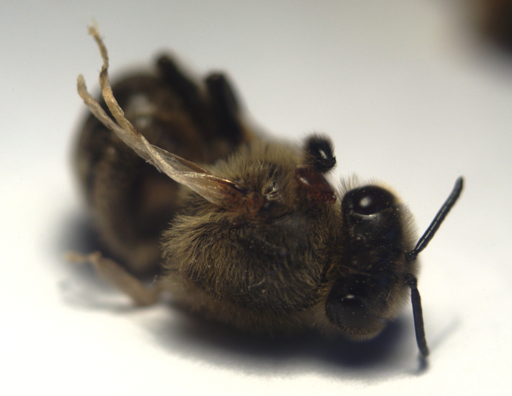

*Photo 41.2 — Deformed-wing bee. The visible phenotype is consistent with severe Varroa–virus damage, but it does not quantify the colony's current mite infestation. Photo by Stefan de Konink, CC0 1.0.*

Varroa is strongly associated with transmission and amplification of deformed wing virus variants.

The mite changes the virus's epidemiology by providing an efficient route of transmission during sensitive developmental stages. High mite pressure can therefore produce a colony in which newly emerging bees have reduced longevity even when most do not show visibly deformed wings.

Varroa control is consequently also a major viral-disease control measure.

## 41.10 Why Colonies Can Collapse Rapidly

Colony population is delayed biological evidence.

A worker seen today developed weeks earlier. If developing brood is heavily parasitised, the colony may still contain an apparently large population of older workers. As these workers die, replacement by healthy young adults may fail.

The result can appear to be a sudden collapse even though the underlying damage accumulated over several brood cycles.

## 41.11 Seasonal Population Dynamics

Varroa population growth depends strongly on brood availability.

In many temperate colonies:

- mite reproduction accelerates as brood production expands;
- the colony's bee population may peak before the mite-to-bee ratio peaks;
- later in the season, bee population can fall while many mites remain;
- each developing winter bee can therefore face greater parasite and viral pressure.

Calendar timing varies with climate, latitude, forage, queen condition, and management. Monitor biology, not merely month names.

## 41.12 The Winter-Bee Problem

Long-lived winter workers must survive much longer than typical summer workers.

If Varroa and virus damage occurs while winter bees are developing, the colony may enter winter with:

- apparently adequate numbers but poor worker longevity;
- reduced fat-body reserves;
- increased viral burden;
- shortened cluster persistence.

This is why late control after winter bees have already been heavily damaged can be biologically too late even if mites are subsequently killed.

## 41.13 Reinvasion and Immigration

Mite numbers can rise after effective control because new mites enter from other colonies.

Routes include:

- drifting workers;
- drones;
- robbing of heavily infested collapsing colonies;
- introduction of bees or brood;
- movement of colonies.

Post-treatment monitoring is therefore essential.

## 41.14 Visible Signs Are Late Evidence

Possible signs of high Varroa-associated damage include:

- deformed-wing bees;
- mites seen on adults;
- mites visible in brood;
- patchy brood;
- uncapped pupae;
- reduced adult population;
- unexpected autumn dwindling;
- poor winter survival.

A management system that waits for these signs is reacting late.

## 41.15 Monitoring Objectives

Monitoring can answer different questions:

- What is the current mite pressure?
- Is intervention needed under the local decision framework?
- Did the last control work?
- Is reinvasion occurring?
- Which colonies in an apiary are highest risk?

Define the question before choosing the method.

## 41.16 Adult-Bee Wash: Principle

An alcohol or detergent wash dislodges mites from a measured sample of adult bees so they can be counted.

Many established protocols use approximately 300 adult bees collected from brood-nest frames, while avoiding the queen. Exact sampling equipment and method should follow a validated local protocol.

The method sacrifices the sampled bees but generally provides a more repeatable estimate than casual visual inspection.

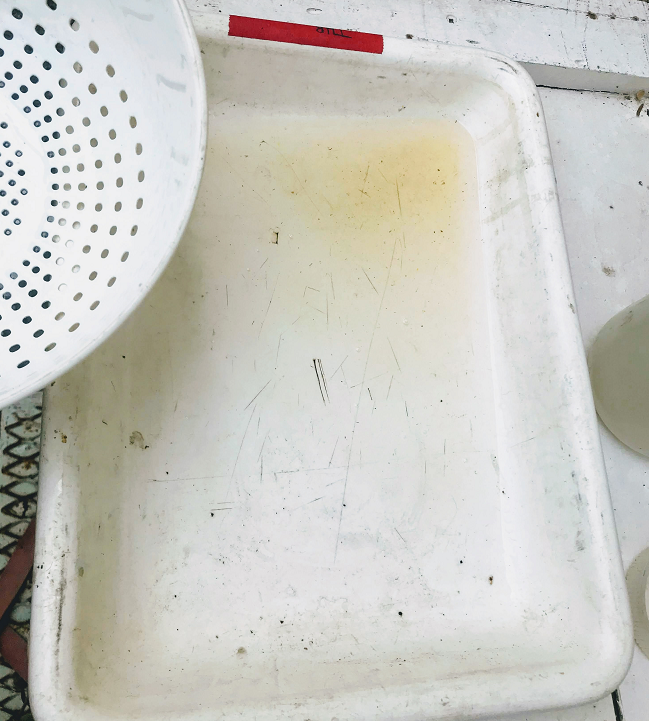

*Photo 41.1 — Result of an adult-bee alcohol wash. Recovered mites are counted in the drained liquid after the bee sample is washed through the colander. This USDA ARS example shows one validated procedure endpoint; exact equipment, liquid, sample size, washing sequence, and interpretation should follow a current validated local protocol. Photo by Mona Chambers, USDA Agricultural Research Service.*

## 41.17 Selecting Bees for an Adult-Bee Sample

Sampling location matters.

Bees collected from frames containing brood are commonly used because mites are not distributed uniformly through the adult population.

A practical sampling sequence is:

1. prepare the labelled sampling container before opening the hive;
2. choose an appropriate brood frame with sufficient adult bees;
3. confirm the queen is not on the frame;
4. collect the required sample using the validated method;
5. close the colony promptly;
6. process the sample according to the protocol;
7. count mites and bees or use a calibrated sample volume;
8. record the result.

**Warning:** Confirm the queen is not included. A sampling procedure that sacrifices bees can also kill the queen if she is accidentally collected.

## 41.18 Calculating Mites per 100 Bees

When the number of sampled bees is known:

`mites per 100 bees = (number of mites ÷ number of bees) × 100`

Example:

- mites recovered: 9
- bees sampled: 300
- infestation measure: `(9 ÷ 300) × 100 = 3 mites per 100 bees`

The calculation is objective. The management decision based on that number must use current regional guidance, season, colony condition, treatment history, and risk tolerance.

## 41.19 Why Thresholds Are Not Universal

Intervention guidance varies because risk depends on:

- season;
- climate;
- brood amount;
- local virus pressure;
- management goal;
- expected time until the next monitoring event;
- treatment options;
- reinvasion pressure;
- regional research and advisory systems.

The 2026 Honey Bee Health Coalition guide includes updated threshold guidance for its target region, but it should not be copied automatically into every country.

## 41.20 Sugar-Roll Monitoring

A powdered-sugar roll can dislodge some mites from living sampled bees, which can then be returned to the colony.

Advantages can include:

- bees are generally not intentionally killed;
- useful field demonstration;
- relatively low chemical handling risk.

Limitations include:

- performance can vary with humidity, technique, sugar condition, and operator skill;
- mites may not be removed as consistently as in a well-performed wash;
- the queen must still be excluded;
- method-specific interpretation is required.

Do not compare values from different methods as if they were identical measurements.

## 41.21 Natural Mite Fall

A monitoring board beneath a screened floor can collect naturally falling mites over a defined period.

This can provide information about:

- presence;
- broad changes in mite activity;
- treatment-associated mite drop;
- unusual spikes.

However, natural fall is affected by colony size, grooming, brood, treatment, weather, board duration, scavengers, and identification errors. It is not always a direct substitute for adult-bee infestation estimates.

## 41.22 Brood Uncapping

Opening capped brood cells can demonstrate reproducing mites and may support diagnosis or surveillance.

It is useful for:

- teaching mite biology;
- detecting mites in brood;
- evaluating drone-brood infestation;
- specialised research or surveillance.

It is less suitable as the sole routine measure of colony-wide intervention need unless a validated local protocol explicitly uses it.

## 41.23 Monitoring Frequency

Monitoring frequency should increase when risk is changing rapidly.

Factors include:

- active brood rearing;
- proximity to historically high-risk periods;
- recent treatment;
- neighbouring colony collapse;
- new bee purchases;
- colony movement;
- high previous counts;
- preparation of winter bees.

A single annual test is inadequate in most Varroa-established regions.

## 41.24 Apiary Sampling Strategy

Testing only the strongest or easiest colony can miss problems.

For a small apiary, individual-colony monitoring is often practical.

For large operations, a statistically and operationally valid sampling strategy may be used, but high-risk or unusual colonies still require individual assessment.

Never assume that all colonies in one apiary have identical mite levels.

## 41.25 Establishing a Baseline

Newly acquired colonies, swarms, and splits should enter the monitoring system.

A baseline helps distinguish:

- imported mite pressure;
- local population growth;
- reinvasion;
- treatment failure.

Record the source and date of introduction.

## 41.26 From Result to Decision

A monitoring result should trigger a decision process, not a reflex treatment.

Ask:

1. What method produced the result?
2. Was sampling performed correctly?
3. What is the current regional intervention guidance?
4. How much brood is present?
5. Are honey supers on the hive?
6. What temperature limits apply to authorised options?
7. What was used previously?
8. Is resistance suspected locally?
9. How soon can effectiveness be checked?

## 41.27 Categories of Varroa Control

Control options fall broadly into:

- authorised synthetic acaricides;
- authorised organic-acid products;
- authorised essential-oil or plant-derived products;
- other registered mite-control products;
- brood manipulation;
- drone-brood removal;
- queen confinement or brood interruption;
- resistant or mite-surviving bee stocks;
- apiary practices that reduce drift and robbing.

Availability and legal status vary by country.

## 41.28 Synthetic Acaricides

Depending on jurisdiction, authorised products may include active ingredients such as amitraz, synthetic pyrethroids, or other acaricides.

Important considerations include:

- resistance;
- wax residues;
- temperature and brood conditions;
- treatment duration;
- honey-super restrictions;
- correct strip or delivery placement;
- product shelf life;
- exact label use.

Never substitute an agricultural formulation for a veterinary or apicultural product simply because the active ingredient name appears similar.

## 41.29 Formic Acid Products

Authorised formic-acid products can affect mites in sealed brood to a degree that differs from many contact treatments.

Performance and colony safety depend strongly on:

- product formulation;
- temperature;
- colony strength;
- ventilation;
- application instructions;
- queen and brood condition.

**Warning:** Concentrated acids can injure skin, eyes, and respiratory tissues. Use only authorised products and required personal protective equipment.

## 41.30 Oxalic Acid Products

Oxalic acid is used in authorised formulations in some jurisdictions, particularly where brood conditions suit the chosen method.

Its effectiveness against mites beneath sealed cappings is limited compared with exposure to mites on adult bees, so brood status strongly influences performance.

Application forms and permitted uses vary. Do not improvise concentration, heating equipment, or delivery method.

**Warning:** Oxalic acid can injure eyes, skin, and respiratory tissues. Heating or vaporisation methods create specific inhalation hazards and require appropriate authorised equipment and respiratory protection where permitted.

## 41.31 Thymol and Related Products

Thymol-based products are authorised in some regions.

Performance depends on product design, ambient temperature, hive configuration, colony strength, and label instructions.

Excessive temperature can increase colony stress, while low temperature can reduce volatilisation and efficacy.

## 41.32 Other Registered Products

Other authorised products may use different active ingredients or delivery systems, including hop-derived compounds in some markets.

Because registration changes, a printed handbook should teach the decision framework and direct readers to the current competent-authority product list rather than presenting a permanent global catalogue.

## 41.33 Honey-Super and Food-Safety Restrictions

A treatment acceptable when no harvestable honey is present may be prohibited during a nectar flow or while honey supers intended for human consumption are on the colony.

Before treatment, check:

- whether supers must be removed;
- whether a withdrawal interval applies;
- whether comb can later be used for food production;
- residue restrictions;
- product storage and disposal instructions.

Protecting bees does not justify contaminating food.

## 41.34 Temperature Restrictions

Some Varroa products have narrow or important temperature limits.

Too cold can reduce efficacy. Too hot can increase colony stress, queen loss, brood damage, or excessive vapour exposure.

Use forecast conditions for the full treatment period, not only the temperature at application.

## 41.35 Brood Status and Product Choice

A colony with extensive sealed brood differs biologically from a broodless colony.

Ask:

- Does the product reach mites within capped brood?
- Is the colony naturally broodless?
- Has brood interruption been deliberately created?
- Will brood resume before treatment is complete?

This is why copying another beekeeper's treatment date without comparing brood conditions can fail.

## 41.36 Drone-Brood Removal

Drone-brood removal exploits Varroa's reproductive success in drone cells.

A controlled method generally requires:

1. providing dedicated drone comb or an identified drone-brood area;
2. allowing mites to enter before capping;
3. removing the capped brood before drones emerge;
4. freezing or otherwise handling removed brood hygienically where lawful;
5. repeating according to the management plan;
6. continuing quantitative monitoring.

If infested drone brood is allowed to emerge, the method can increase rather than reduce mite population.

## 41.37 Brood Interruption

Temporary brood interruption can reduce the number of protected reproductive sites and can increase the exposure of mites to controls that work mainly on adult-bee-associated mites.

Methods may involve:

- controlled queen caging;
- making splits;
- planned brood breaks;
- queen replacement strategies.

These methods require skill and affect colony growth and production. They should not be imposed without considering season and queen safety.

## 41.38 Screened Floors

Screened floors can allow some fallen mites to leave the colony and are useful for monitoring boards.

By themselves, screened floors generally should not be expected to provide adequate Varroa control in a high-pressure colony.

They are a supporting tool, not a substitute for monitoring and effective intervention.

## 41.39 Resistant Bee Stocks

Selection programmes have developed honey bees with traits associated with reduced mite reproduction or improved removal of infested brood.

Examples of relevant traits include:

- Varroa-sensitive hygiene;
- general hygienic behaviour;
- grooming;
- suppressed mite reproduction;
- brood traits that alter reproductive success.

Resistant stock can reduce management pressure but does not justify abandoning monitoring unless robust local evidence supports that decision.

## 41.40 Integrated Control

Integrated pest management combines:

- monitoring;
- biological knowledge;
- resistant stock;
- cultural management;
- mechanical or biotechnical methods;
- authorised treatments when needed;
- resistance management;
- verification.

Chapter 46 develops the full IPM framework. The central principle here is that no single tool should be expected to solve every colony, season, or resistance situation.

## 41.41 Acaricide Resistance

Resistance occurs when mites with heritable survival advantages increase under repeated exposure to a control.

Risk increases with:

- repeated use of the same active ingredient;
- under-dosing;
- prolonged sublethal exposure;
- unapproved delivery methods;
- contaminated reused treatment materials;
- widespread regional use of one control.

Resistance can turn an apparently familiar treatment into a failing treatment.

## 41.42 Treatment Failure Versus Reinvasion

A high post-treatment count can result from:

- incorrect application;
- unsuitable temperature;
- product degradation;
- resistance;
- insufficient exposure;
- heavy sealed brood;
- dosing or placement error;
- rapid reinvasion after successful control.

The timing of pre-treatment, immediate post-treatment, and later monitoring helps distinguish possibilities.

## 41.43 Verifying Effectiveness

A treatment is not complete until its result is checked.

Verification should use an appropriate quantitative method after the product's treatment period and according to local guidance.

Record:

- pre-treatment result;
- treatment product and active ingredient;
- application dates;
- weather/temperature;
- brood condition;
- post-treatment result;
- adverse effects;
- subsequent reinvasion monitoring.

## 41.44 Do Not Judge by Mite Drop Alone

A large number of dead mites after treatment can mean that the product killed many mites. It does not necessarily mean that few mites remain.

A heavily infested colony can drop thousands and still retain a damaging population.

Post-treatment infestation measurement is more informative than admiring a high mite drop.

## 41.45 Residual Mite Pressure

Even a highly effective intervention rarely means absolute zero mites.

Remaining mites can reproduce, and new mites can arrive.

Management therefore aims to keep pressure below damaging levels through repeated measurement and timely action rather than to assume permanent eradication.

## 41.46 Avoiding Off-Label Escalation

When an authorised product appears less effective, increasing dose, extending duration, adding extra strips, mixing products, or using agricultural formulations may seem tempting.

**Warning:** Do not improvise off-label pesticide exposure. It can harm bees, queens, brood, applicators, honey quality, wax quality, and resistance management, and may breach the law.

Investigate the cause of failure and use current professional guidance.

## 41.47 Operator Safety

Varroa controls can expose the beekeeper to:

- acids;
- pesticide residues;
- vapours;
- hot equipment;
- contaminated gloves;
- concentrated active ingredients.

Before use:

- read the entire label;
- prepare required PPE;
- work in adequate ventilation;
- keep products in original containers;
- protect children and animals;
- avoid food-preparation areas;
- know first-aid instructions;
- store and dispose according to law.

## 41.48 Colony Safety

Monitor for treatment-associated problems such as:

- queen loss;
- brood interruption beyond expectation;
- adult mortality;
- absconding;
- excessive agitation;
- feed interruption.

If serious adverse effects occur, follow the product label and current veterinary or regulatory advice.

## 41.49 Treatment Records

A useful Varroa treatment record contains:

- colony ID;
- date;
- pre-treatment monitoring method and result;
- product name;
- active ingredient;
- lot/batch where relevant;
- dose/application according to label;
- start and removal date;
- temperature range;
- honey-super status;
- post-treatment result;
- observed adverse effects.

Records allow treatment performance to be compared rather than guessed.

## 41.50 Apiary-Level Varroa Mapping

Plot monitoring results by colony.

Patterns can reveal:

- one recurrent high-mite colony;
- a cluster near a robbing source;
- differences among queen lines;
- poor performance of one treatment batch;
- colonies requiring additional testing.

Do not average away a dangerously high individual colony.

## 41.51 Decision Table

| Situation | Main question | Action principle |
|---|---|---|
| Low measured pressure under current local guidance | When to retest? | Schedule next monitoring before risk period |
| Rising count during brood expansion | How quickly can mites multiply? | Shorten monitoring interval and prepare intervention |
| High count with harvest supers present | Which options are legally compatible with food production? | Use only authorised options for that situation or alter harvest plan |
| High count before winter-bee production | How fast can pressure be reduced safely? | Act promptly using current local guidance and verify |
| High result after completed treatment | Failure or reinvasion? | Quantify, review application/resistance, choose corrective plan |
| Deformed-wing bees but no recent count | How high is current mite pressure? | Perform quantitative monitoring immediately |
| Neighbouring colonies collapsing | Is immigration risk elevated? | Increase monitoring frequency |

## 41.52 Common Mistakes

### Waiting for visible mites

By the time mites are easily noticed, pressure may already be high.

### Treating by calendar only

The colony and mite population may not match last year's timing.

### Treating without a baseline

Without a pre-treatment measurement, urgency and efficacy are difficult to assess.

### Never verifying treatment

Product application is not evidence of control.

### Repeating one active ingredient indefinitely

This increases resistance risk.

### Ignoring brood status

A treatment that mainly reaches mites on adults performs differently when most mites are protected in capped brood.

### Treating every colony identically

Mite pressure, strength, queen line, brood, and reinvasion can differ among colonies.

## 41.53 Scientific Notes

### Fat-body feeding

Research using tissue localisation and feeding evidence shifted the scientific understanding of Varroa nutrition toward the honey bee fat body as a major feeding target. This helps connect parasitism with reduced metabolic reserves and longevity.

### Vector competence

Varroa is not merely associated with viruses; it changes transmission routes and can select for viral dynamics that differ from oral or contact transmission alone.

### Non-linear colony effects

Damage is not always proportional to visible mite number. Timing matters. A given infestation during production of winter bees can have greater consequences than the same measured level at another colony stage.

### Selection pressure

Any control that kills susceptible mites more effectively than resistant mites creates selection pressure. Responsible resistance management preserves useful treatments longer.

### Monitoring uncertainty

A mite sample is an estimate, not a perfect census. Standardised methods reduce uncertainty enough to support better decisions.

## 41.54 Practical Varroa Programme

### Before the active season

- review previous mite and treatment records;
- identify high-risk colonies;
- check current authorised products and local guidance;
- prepare monitoring equipment.

### During brood expansion

- monitor at intervals appropriate to local risk;
- record brood status;
- use non-chemical controls where they fit the management system;
- avoid assuming strong colonies are low risk.

### Before and during major risk periods

- shorten the interval between tests where indicated;
- intervene before damaging thresholds are exceeded under local guidance;
- protect marketable honey.

### After any intervention

- complete the full authorised treatment course;
- remove treatment materials when required;
- verify effectiveness quantitatively;
- investigate inadequate control.

### Before winter

- ensure mite pressure has been reduced early enough to protect development of long-lived workers;
- verify rather than assume success;
- continue watching for reinvasion.

## 41.55 Varroa Checklist

- [ ] Colony has a unique ID.
- [ ] Monitoring method is validated and recorded.
- [ ] Queen is protected during sampling.
- [ ] Sample location and approximate size are appropriate.
- [ ] Result is calculated consistently.
- [ ] Current local action guidance has been checked.
- [ ] Brood status is recorded.
- [ ] Honey-super status is known.
- [ ] Product is authorised for the jurisdiction and situation.
- [ ] Temperature limitations have been checked.
- [ ] PPE is prepared.
- [ ] Treatment is applied exactly according to label.
- [ ] Active ingredient history is reviewed for resistance management.
- [ ] Post-treatment verification is scheduled.
- [ ] Reinvasion monitoring continues.

## Key Takeaways

- Varroa management is a continuous measurement-and-verification process.
- Visible mites and deformed wings are late or incomplete evidence.
- Varroa reproduces in sealed brood and feeds on both developing and adult bees.
- Damage to fat-body tissue and interaction with viruses reduce worker quality and longevity.
- Winter-bee protection requires action before irreversible developmental damage accumulates.
- Adult-bee washes provide quantitative information when performed with a validated protocol.
- Monitoring methods are not interchangeable and thresholds are not universal.
- Treatment choice depends on brood, temperature, harvest status, legal authorisation, and resistance risk.
- Product application is not proof of success; post-treatment monitoring is essential.
- Off-label escalation can harm bees, food safety, operators, and long-term treatment efficacy.

## Chapter Summary

*Varroa destructor* is a reproductive brood parasite, an adult-bee feeder, and an important driver of viral disease. Its population can increase unnoticed during periods of strong colony growth, making visual inspection alone inadequate. The most reliable management system begins with standardised monitoring before visible damage occurs.

Adult-bee washes, sugar rolls, natural mite fall, and brood examinations provide different types of information. The result must be interpreted against current local guidance rather than a permanent universal threshold. Once intervention is required, the beekeeper must choose an authorised option that fits brood status, temperature, honey production, colony strength, and resistance history.

Treatment does not end with application. Effectiveness must be verified, failures investigated, and reinvasion monitored. Combining quantitative records, resistant stock, brood-based controls, authorised treatments, and apiary biosecurity creates a more resilient system than relying on one product year after year.

## Review Questions

1. Why can a strong-looking colony still have dangerous Varroa pressure?
2. What are the main steps in a modern Varroa management cycle?
3. What does an adult female Varroa look like?
4. Which mite stage is most important for colony-to-colony spread?
5. Why is the host shift from *Apis cerana* to *Apis mellifera* important?
6. Which honey bee tissue is now recognised as a major Varroa feeding target?
7. What functions does the honey bee fat body perform?
8. Where does Varroa reproduce?
9. When does a foundress enter a brood cell?
10. What happens to mature daughter mites when the host bee emerges?
11. Why does drone brood often support greater mite reproduction?
12. How can drone brood influence mite population growth?
13. Why is “phoretic” an incomplete description of Varroa on adult bees?
14. How can adult bees spread mites between colonies?
15. How can parasitism affect the body condition of an emerging worker?
16. Why can an apparently normal-looking bee still be damaged by Varroa?
17. Which virus complex is strongly associated with Varroa?
18. Why does Varroa control also reduce viral-disease risk?
19. Why can colony collapse appear sudden?
20. How does brood availability affect Varroa population growth?
21. Why may the mite-to-bee ratio rise late in the season?
22. Why are winter bees particularly important in Varroa management?
23. Why can late treatment fail to restore already damaged winter bees?
24. What is reinvasion?
25. How can robbing increase mite immigration?
26. Why are visible signs considered late evidence?
27. Name four visible signs associated with severe Varroa damage.
28. What management questions can Varroa monitoring answer?
29. What is the principle of an alcohol or detergent wash?
30. Why are bees often collected from brood frames for sampling?
31. Why must the queen be excluded from a destructive sample?
32. How is mites per 100 bees calculated?
33. What result is produced by 9 mites from 300 bees?
34. Why does a numerical result not automatically dictate the same action worldwide?
35. Which factors make intervention thresholds regional and seasonal?
36. What is the principle of a powdered-sugar roll?
37. Which environmental factor can affect sugar-roll performance?
38. Why should sugar-roll results not be treated as identical to wash results?
39. What can a natural-mite-fall board show?
40. Why is natural fall not always a direct substitute for an adult-bee wash?
41. What can brood uncapping reveal?
42. Why is drone-brood examination not necessarily a complete colony estimate?
43. When should monitoring frequency increase?
44. Why is one annual Varroa test usually inadequate?
45. Why can colonies in the same apiary have different mite levels?
46. Why should a newly purchased nucleus colony receive a monitoring baseline?
47. What should be reviewed before deciding on treatment?
48. Why must honey-super status be known before treatment?
49. What broad categories of Varroa control are available?
50. Why do authorised synthetic acaricides require resistance awareness?
51. Why must agricultural pesticide formulations not replace registered hive products?
52. What factors influence the safe use of formic-acid products?
53. Why are concentrated acids an operator hazard?
54. Why does brood status influence oxalic-acid performance?
55. What specific hazard can heated oxalic-acid application create?
56. How does temperature affect thymol-based products?
57. Why should a handbook avoid a permanent worldwide product list?
58. How can Varroa treatment contaminate honey if used incorrectly?
59. Why should the full forecast temperature range be considered?
60. What question should be asked about mites under sealed brood?
61. How does drone-brood removal work?
62. What happens if intentionally trapped infested drone brood is allowed to emerge?
63. How can brood interruption change mite control opportunities?
64. What costs can brood interruption impose on the colony?
65. Why are screened floors insufficient as the sole control in many colonies?
66. Which honey bee traits can contribute to Varroa resistance?
67. Why must resistant stock still be monitored?
68. What is integrated pest management?
69. How does IPM reduce dependence on one control method?
70. What is acaricide resistance?
71. Which management practices can accelerate resistance?
72. How can under-dosing contribute to resistance?
73. What is the difference between treatment failure and reinvasion?
74. Name four reasons a treatment may appear to fail.
75. Why is post-treatment monitoring necessary?
76. Which facts should be recorded with a Varroa treatment?
77. Why is a large mite drop not proof that few mites remain?
78. Why is absolute eradication an unrealistic routine assumption?
79. Why can increasing a treatment dose off-label be dangerous?
80. What risks does off-label treatment create for honey?
81. What should a beekeeper do if an authorised product performs poorly?
82. Which personal hazards can Varroa products create?
83. Why should products remain in their original containers?
84. Which adverse colony effects should be watched during treatment?
85. Why should active ingredient be recorded, not only brand name?
86. How can apiary mapping of mite results improve decisions?
87. Why should a high individual colony not be hidden in an apiary average?
88. What should happen after a low monitoring result?
89. Why is rising pressure during brood expansion important?
90. What challenge occurs when high mite pressure is found while harvest supers are present?
91. Why is high mite pressure before winter-bee production urgent?
92. What should be investigated after a high post-treatment result?
93. Why should neighbouring colony collapse trigger increased monitoring?
94. What is wrong with treating only by calendar date?
95. Why is a pre-treatment baseline useful?
96. Why should one active ingredient not be repeated indefinitely without evaluation?
97. How does timing alter the biological consequence of the same infestation level?
98. Why is a mite sample an estimate rather than a perfect census?
99. What makes the 2026 ninth edition of the HBHC Varroa guide relevant to current practice?
100. What are the essential components of a sustainable Varroa management programme?

## References

- Honey Bee Health Coalition. *Tools for Varroa Management: A Guide to Effective Varroa Sampling & Control*, 9th ed., released 22 June 2026.
- Honey Bee Health Coalition. “Varroa Management” and current decision-support resources. Accessed 15 September 2026.
- Honey Bee Health Coalition. *Guide to Varroa Mite Controls for Commercial Beekeeping Operations*. Current resource accessed 15 September 2026.
- World Organisation for Animal Health. “Diseases of Bees” and current varroosis standards. Accessed 15 September 2026.
- Ramsey, S. D. et al. “Varroa destructor feeds primarily on honey bee fat body tissue and not hemolymph.” *Proceedings of the National Academy of Sciences*, 2019, 116(5):1792–1801. DOI: 10.1073/pnas.1818371116.
- Traynor, K. S. et al. “Varroa destructor: A Complex Parasite, Crippling Honey Bees Worldwide.” *Trends in Parasitology*, 2020, 36(7):592–606. DOI: 10.1016/j.pt.2020.04.004.
- Rosenkranz, P., Aumeier, P., and Ziegelmann, B. “Biology and control of Varroa destructor.” *Journal of Invertebrate Pathology*, 2010, 103(Suppl 1):S96–S119.
- Nazzi, F., and Le Conte, Y. “Ecology of Varroa destructor, the major ectoparasite of the western honey bee, Apis mellifera.” *Annual Review of Entomology*, 2016, 61:417–432.
- Caron, D. M., and Connor, L. J. *Honey Bee Biology and Beekeeping*. Wicwas Press.
- Graham, J. M., editor. *The Hive and the Honey Bee*. Dadant & Sons.
- Current national veterinary-medicine and pesticide authorities. Authorised products, labels, intervention guidance, residue limits and legal requirements must be checked for the reader’s jurisdiction.

# Chapter 42 — Nosema

## Introduction

Nosemosis is an infection of adult honey bees caused principally by two microsporidian species traditionally known as *Nosema apis* and *Nosema ceranae*. A more recent taxonomic proposal places them in the genus *Vairimorpha*, producing the names *Vairimorpha apis* and *Vairimorpha ceranae*. The reclassification is used increasingly in scientific literature but has not been adopted universally in practical beekeeping. This chapter therefore uses *Nosema* as the familiar field term while acknowledging *Vairimorpha* in scientific context.

Nosema is difficult to manage well because field signs are non-specific. Faecal spotting may occur in some affected colonies, especially with *N. apis*, but dysentery does not prove nosemosis and nosemosis can occur without obvious dysentery. A weak spring colony, reduced honey yield, early worker mortality, or poor brood development can have many other causes.

Reliable management begins by separating three questions:

1. Are microsporidian spores present?
2. Which species is present?
3. Is the infection contributing materially to colony disease?

Microscopy can detect and quantify spores, while PCR or qPCR can distinguish species and increase analytical sensitivity. Neither method should be interpreted without colony history, season, nutrition, Varroa pressure, and other possible stressors.

## Learning Objectives

After completing this chapter, the reader should be able to:

- explain what Nosema microsporidia are and how they infect adult honey bees;
- describe the main differences and overlaps between *N. apis* and *N. ceranae*;
- explain the proposed *Vairimorpha* nomenclature;
- describe faecal–oral transmission and the intracellular life cycle;
- recognise the limitations of field signs;
- select adult bees appropriately for diagnostic sampling;
- explain microscopy, haemocytometer spore counting, PCR, and qPCR at a practical level;
- interpret a positive laboratory result without overdiagnosing disease;
- reduce transmission through hygiene, comb management, nutrition, and colony management;
- understand why treatment options and legal authorisation vary by jurisdiction.

## 42.1 What Is Nosema?

Nosema organisms are microsporidia: microscopic, spore-forming, obligate intracellular parasites that are now considered closely related to fungi.

They cannot complete their life cycle independently of host cells. In honey bees, infection occurs mainly in cells of the midgut, where the parasite multiplies and produces spores that can later leave the bee in faeces.

This combination of intracellular multiplication and environmentally resistant spores supports transmission within and between colonies.

## 42.2 The Naming Problem: Nosema or Vairimorpha?

Phylogenetic research led to a proposal that the principal honey bee Nosema species be transferred to the genus *Vairimorpha*.

Accordingly:

- *Nosema apis* may be written *Vairimorpha apis*;
- *Nosema ceranae* may be written *Vairimorpha ceranae*.

Scientific and veterinary publications currently use both naming systems. Penn State Extension's February 2026 review notes that the change has not been universally accepted and retains *Nosema* for practical communication.

A publication should therefore avoid suggesting that one name proves the other is obsolete in every jurisdiction or diagnostic laboratory.

## 42.3 The Two Principal Species

### Nosema apis

*N. apis* has a long history in *Apis mellifera*. In temperate climates it has often been associated with late-winter or spring problems, confinement, and visible faecal staining.

### Nosema ceranae

*N. ceranae* was first described from the Asian honey bee *Apis cerana* and later became widespread in *A. mellifera*. It can occur without obvious dysentery and may show different seasonal patterns from *N. apis*.

### Mixed infections

A colony can carry both species. Species identity cannot reliably be determined from ordinary light-microscope appearance alone because spores overlap substantially in morphology.

## 42.4 Other Microsporidia

Other Nosema-like microsporidia have been reported from honey bees, including *Nosema neumanni* from Africa, but their distribution and practical importance are much less established than those of *N. apis* and *N. ceranae*.

An unusual molecular result should be interpreted by a competent laboratory rather than forced into the two common species categories.

## 42.5 The Spore

The spore is the durable transmission stage.

After ingestion, environmental conditions in the host trigger germination. A specialised polar tube is rapidly extruded and transfers infective material into a host cell.

This remarkable mechanism allows an organism far smaller than a bee to bypass the cell membrane and establish an intracellular infection.

## 42.6 Life Cycle in the Adult Bee

A simplified sequence is:

1. a bee ingests viable spores;
2. spores germinate in the digestive tract;
3. the polar tube transfers the infective stage into a midgut epithelial cell;
4. the parasite multiplies inside the cell;
5. new spores develop;
6. heavily infected cells become damaged or die;
7. spores enter the gut lumen;
8. spores leave in faeces or remain available for transmission.

Repeated infection can damage digestive function and alter adult physiology.

## 42.7 Transmission

The main transmission route is faecal–oral.

Within the colony, spores can move through:

- contaminated comb surfaces;
- faecal deposits;
- food transfer;
- cleaning behaviour;
- contaminated water or feed equipment;
- drifting bees;
- robbing;
- beekeeper movement of contaminated material.

Outside defecation generally reduces contamination inside the hive. Long confinement can increase the risk that faecal material accumulates where nestmates contact it.

## 42.8 Why Confinement Matters

During prolonged cold or wet weather, bees may be unable to take cleansing flights.

Potential consequences include:

- increased faecal retention;
- defecation in or near the hive;
- greater contact with contaminated surfaces;
- reduced opportunities to replace old foragers;
- nutritional stress.

Confinement is one factor, not a stand-alone diagnosis of nosemosis.

## 42.9 Effects on Individual Bees

Nosema infection can affect:

- nutrient absorption;
- energy balance;
- digestive physiology;
- immune responses;
- gland function;
- age-related division of labour;
- worker lifespan.

The biological effect varies with species, infection intensity, nutrition, temperature, pesticide exposure, coinfection, and bee genotype.

## 42.10 Colony-Level Effects

Possible colony-level consequences include:

- slow spring build-up;
- reduced adult population;
- shortened worker lifespan;
- reduced honey production;
- queen supersedure or queen problems in some circumstances;
- weak brood rearing;
- poor recovery after winter;
- increased vulnerability to other stressors.

These effects are non-specific and must be differentiated from Varroa, queen failure, starvation, poor forage, pesticide exposure, and other disease.

## 42.11 Dysentery Is Not Nosema

Faecal staining on frames or the hive front is often called dysentery.

It can result from:

- prolonged confinement;
- unsuitable or contaminated feed;
- excessive water in diet;
- digestive disturbance;
- nosemosis;
- combinations of these factors.

*N. ceranae* infection can occur with little or no faecal staining.

Do not diagnose Nosema from brown spots alone.

## 42.12 Nosema Can Be Subclinical

Subclinical infection means the parasite is present without obvious external signs.

A colony may contain infected workers while maintaining acceptable brood and production. Whether the infection becomes economically or biologically important depends on context.

This creates a central diagnostic challenge: a positive test does not automatically explain every colony problem.

## 42.13 Seasonality

Historical *N. apis* patterns in temperate climates often show higher spore levels around late winter and spring, followed by a decline as flight conditions improve and short-lived summer workers replace older bees.

*N. ceranae* can show different and less sharply seasonal patterns.

Climate, management, sampling population, and local species prevalence all affect observations. Fixed monthly rules should therefore be avoided.

## 42.14 Which Bees Should Be Sampled?

Sample choice depends on the diagnostic question.

Older foragers can have higher probability of detectable Nosema infection than very young house bees. For colony-level surveillance, many protocols therefore sample returning foragers or older bees.

However, laboratories may specify:

- hive-entrance bees;
- adult workers from particular locations;
- live or recently dead bees;
- a minimum number of bees;
- pooled versus individual testing.

Follow the receiving laboratory's protocol so the result can be interpreted correctly.

## 42.15 Why Sample Size Matters

Nosema infection is not distributed identically among all workers.

If only a few bees are tested, heavily infected individuals can distort the average or infected bees can be missed entirely.

A representative pooled sample reduces some variability, but it also hides individual differences.

The correct sample size depends on whether the objective is detection, prevalence, average spore load, or research-level analysis.

## 42.16 Microscopy

Light microscopy remains a widely used method for detecting Nosema-like spores.

A typical laboratory approach includes:

1. collecting an appropriate adult-bee sample;
2. macerating abdomens or digestive tissues in a measured volume of water;
3. mixing thoroughly;
4. placing a small amount on a microscope slide or counting chamber;
5. examining under suitable magnification;
6. identifying spores by characteristic appearance;
7. counting when quantitative assessment is required.

Method details should follow a validated laboratory protocol.

## 42.17 What Nosema Spores Look Like

Under light microscopy, Nosema spores are small, bright, oval to elongated structures.

However, shape and size overlap among species and can be confused with artefacts by inexperienced observers.

Microscopy is useful for detecting Nosema-like spores but is poor at reliable species identification of *N. apis* versus *N. ceranae*.

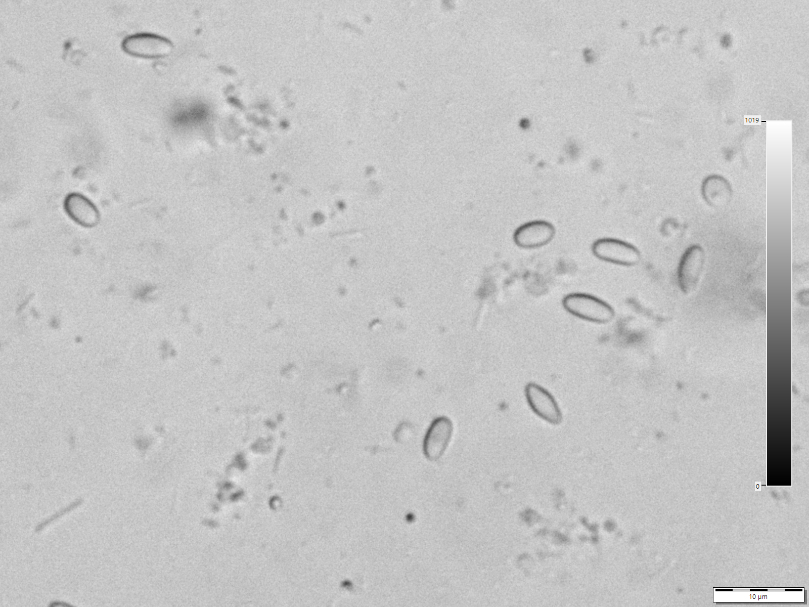

*Photo 42.1 — Nosema-like spores under light microscopy. The source identifies these as* Nosema apis *spores at approximately 1000× magnification. Routine light-microscope morphology can demonstrate Nosema-like spores but should not be used by itself to distinguish* N. apis *from* N. ceranae*. Image by Lukáš Vomastek, CC BY-SA 4.0.*

## 42.18 Haemocytometer Spore Counting

A haemocytometer is a calibrated counting chamber used to estimate spore concentration.

The calculation depends on:

- volume of homogenate;
- number of bees;
- chamber dimensions;
- grid areas counted;
- dilution;
- counting rules.

Because protocols differ, readers should not copy a calculation constant from an unrelated procedure.

The result is commonly expressed as spores per bee or spores per unit volume.

## 42.19 Limits of Spore Counts

A spore count provides information, but it is not a universal treatment threshold.

Limitations include:

- uneven infection among bees;
- sample-age effects;
- seasonal variation;
- species differences;
- spores may not correspond perfectly to active intracellular burden;
- laboratory preparation and counting error;
- uncertainty about what level predicts colony damage.

A 2024 systematic review of fumagillin field trials noted weak support for simple treatment decisions based only on spores-per-bee thresholds.

## 42.20 PCR and qPCR

Polymerase chain reaction methods detect species-specific genetic material.

PCR can help answer:

- Is *N. apis* present?
- Is *N. ceranae* present?
- Are both present?

Quantitative PCR (qPCR) can estimate target abundance under a validated assay.

These methods are more specific than ordinary microscopy but require laboratory equipment, controls, and careful interpretation.

## 42.21 Why More Sensitive Is Not Always More Clinically Meaningful

A highly sensitive assay can detect very small amounts of pathogen material.

That improves surveillance but can also identify low-level infections with uncertain colony consequence.

The beekeeper and diagnostician must distinguish:

- analytical detection;
- infection burden;
- clinical disease;
- management significance.

## 42.22 Differential Diagnosis

When a colony is weak or dwindling, consider:

- Varroa-associated viral disease;
- queen failure;
- starvation;
- poor pollen supply;
- chronic pesticide exposure;
- tracheal mites where relevant;
- other gut pathogens;
- adverse weather;
- excessive moisture;
- robbing;
- repeated disturbance;
- Nosema infection.

More than one problem may occur simultaneously.

## 42.23 Nosema and Varroa

Nosema and Varroa affect bees through different mechanisms, but both can shorten worker lifespan and interact with other stressors.

A weak colony with Nosema spores should still receive appropriate Varroa monitoring. Finding one problem does not exclude the other.

## 42.24 Nosema and Nutrition

Infected bees face energetic and digestive stress.

Adequate access to diverse pollen and carbohydrate stores supports general colony physiology but does not directly sterilise infection.

Poor nutrition can increase vulnerability and make recovery slower.

Supplemental feed should be used only when there is a nutritional need and should not be marketed or understood as a proven cure for Nosema unless supported by authorised evidence.

## 42.25 Nosema and Pesticides

Research has investigated interactions between microsporidian infection and pesticide exposure. Effects can depend on chemical, dose, route, species, bee age, nutrition, and experimental design.

Avoid simple claims that one pesticide always “causes Nosema” or that Nosema always makes one pesticide more toxic.

In a field investigation, record both disease and exposure history.

## 42.26 Nosema and Queen Performance

Some research has identified effects of Nosema infection on queen physiology, survival, or supersedure risk, while colony outcomes vary.

A failing queen should not be diagnosed with Nosema solely because workers test positive.

Queen age, mating, brood pattern, nutrition, parasites, and season must also be considered.

## 42.27 Prevention Begins with Strong Basic Management

Useful preventive principles include:

- maintain adequate food stores;
- reduce chronic moisture problems;
- avoid unnecessary winter disturbance;
- provide suitable ventilation without excessive draught;
- reduce robbing;
- manage Varroa;
- replace failing queens;
- avoid exchanging suspect comb casually;
- keep feeders clean;
- maintain colony records.

These actions improve colony resilience even when they do not eliminate every Nosema spore.

## 42.28 Comb Contamination

Faecal deposits and spores can contaminate comb and hive surfaces.

Risk is higher when bees defecate inside the colony or contaminated equipment is moved.

Comb management may include:

- gradual replacement of heavily soiled brood comb;
- avoiding transfer of visibly contaminated material;
- keeping stored comb dry and protected;
- cleaning hive components using methods supported for the material and local guidance.

Do not assume a general household disinfectant is effective or safe on bee equipment.

## 42.29 Equipment Hygiene

Feeders and tools should be cleaned between suspect colonies when feasible.

Important principles are:

- remove organic material before disinfection;
- use an effective method for the target organism and equipment material;
- avoid residues harmful to bees or honey;
- dry equipment appropriately;
- keep cleaned and suspect equipment separate.

A decontamination method should be evidence-based, not improvised.

## 42.30 Colony Replacement and Combining

A severely weak Nosema-positive colony may not recover simply because it is given more bees.

Before combining:

- assess for other infectious disease;
- measure Varroa where appropriate;
- consider whether contaminated comb is being transferred;
- understand queen status;
- evaluate seasonal recovery potential.

Combining can transfer both pathogens and parasites into a healthy colony.

## 42.31 Treatment: A Jurisdiction-Specific Subject

Fumagillin has historically been used against Nosema in some countries. Its legal status, availability, residue rules, and veterinary requirements differ internationally.

It is not authorised for routine beekeeping use in all jurisdictions, including many European contexts.

**Warning:** Do not use fumagillin, antibiotics, or any veterinary medicine unless the product and use are currently authorised for the jurisdiction and the label or veterinary direction permits it.

## 42.32 What Fumagillin Does and Does Not Do

Where legally authorised, fumagillin acts against active microsporidian development rather than reliably eliminating every environmental spore.

Field efficacy can vary between *N. apis* and *N. ceranae*, colony conditions, dose, timing, and study design.

Treatment does not replace hygiene, nutrition, correct diagnosis, and control of other stressors.

## 42.33 Evidence Limitations for Alternative Treatments

Many substances have been investigated, including:

- plant extracts;
- essential oils;
- probiotics;
- organic acids;
- nutritional supplements;
- RNA-based or molecular approaches;
- other experimental compounds.

Laboratory activity does not automatically mean field efficacy, legal authorisation, food safety, or commercial suitability.

Do not convert experimental concentration data into home treatment recipes.

## 42.34 Food-Safety Considerations

Honey and other hive products can be contaminated by unauthorised medicines or residues.

Before any treatment, verify:

- authorisation;
- honey-super restrictions;
- withdrawal period;
- residue limits;
- whether treated colonies can supply food products;
- record requirements.

An attempt to help a colony must not create an unsafe food product.

## 42.35 When Laboratory Testing Is Most Useful

Testing is particularly useful when:

- a colony dwindles without a clear cause;
- several colonies show similar adult-bee problems;
- microscopy reveals spores but species matters;
- a breeding or research programme requires precise identification;
- treatment decisions depend on confirmed diagnosis;
- surveillance is being conducted systematically.

Testing every weak colony for only Nosema can create tunnel vision if other causes are ignored.

## 42.36 Sampling Procedure

A practical diagnostic submission should:

1. define the question;
2. contact the laboratory before sampling if instructions are unclear;
3. collect the requested number and type of bees;
4. use a clean labelled container;
5. identify apiary and colony;
6. record date and symptoms;
7. keep colonies separate unless pooling is specifically requested;
8. store and ship samples according to laboratory instructions;
9. retain the inspection record;
10. interpret the result with the colony history.

## 42.37 A Good Diagnostic Record

Record:

- colony ID;
- date;
- weather and recent confinement;
- adult population;
- brood quantity and pattern;
- stores;
- faecal staining;
- queen status;
- Varroa result;
- recent feed;
- recent treatment;
- sample type and number of bees;
- microscopy result;
- spore count method;
- PCR/qPCR result if performed;
- action and follow-up.

## 42.38 Interpreting a Positive Result

A positive result should prompt four questions:

1. How reliable was the sample and method?
2. Which Nosema species was identified, if known?
3. Does the colony show signs compatible with disease?
4. Are there stronger alternative or interacting explanations?

Avoid the statement “the colony died of Nosema” unless the evidence supports causation rather than simple pathogen detection.

## 42.39 Interpreting a Negative Result

A negative result can mean:

- infection is absent;
- infection is below the method's detection limit;
- the wrong bees were sampled;
- sample size was insufficient;
- infection is unevenly distributed;
- laboratory or handling problems occurred.

The strength of a negative conclusion depends on the test and sampling design.

## 42.40 Apiary-Level Patterns

If multiple colonies are tested, compare:

- spore detection;
- species;
- strength;
- queen line;
- wintering position;
- food source;
- moisture;
- Varroa;
- production.

Patterns across time are often more useful than one isolated count.

## 42.41 Practical Decision Table

| Finding | Interpretation | Next step |
|---|---|---|
| Faecal staining, no laboratory result | Non-specific digestive/confinement sign | Review feed, weather and colony condition; test if warranted |
| Spores on microscopy, colony strong | Infection detected; disease significance uncertain | Record, identify species if needed, monitor colony context |
| High spore count, weak colony | Nosema may contribute but count alone is not proof | Perform differential diagnosis and consider species testing |
| PCR positive for *N. ceranae*, no signs | Subclinical infection possible | Do not assume treatment is automatically required |
| Weak spring colony plus high Varroa | Multiple stressors likely | Address Varroa and evaluate Nosema in the full health picture |
| Repeated apiary-wide positives | Shared exposure/management pattern possible | Review comb, nutrition, moisture, movement and hygiene |

## 42.42 Common Mistakes

### Calling every faecal stain Nosema

Dysentery has multiple causes.

### Using one spore threshold universally

Evidence does not support one simple number for every species, season, and colony.

### Sampling only young nurse bees

This can reduce detection probability for a question aimed at colony-level adult infection.

### Assuming microscopy identifies species

Routine light microscopy generally cannot reliably separate *N. apis* from *N. ceranae*.

### Treating without legal verification

Medicine status differs by country.

### Ignoring Varroa

A Nosema-positive colony can also have damaging Varroa-associated viral disease.

## 42.43 Scientific Notes

### Microsporidia and fungi

Microsporidia were historically classified as protozoa. Molecular evidence now places them within or very near the fungal lineage, explaining modern descriptions of them as fungus-related obligate intracellular parasites.

### Species identification

*N. apis* and *N. ceranae* spores overlap morphologically. PCR-based methods provide more reliable species discrimination than routine light microscopy.

### Spore load versus disease

Spore number is an imperfect proxy for disease severity. Intracellular stages, bee age, tissue damage, species, host condition, and sampling population influence the relationship.

### Taxonomic transition

The *Vairimorpha* reclassification illustrates a broader scientific principle: taxonomy can change as molecular phylogeny improves even while long-established practical names remain in use.

### Multifactorial colony health

Nosema outcome can depend on interactions among nutrition, pesticide exposure, climate, Varroa, viruses, queen condition, and management. Single-cause explanations should be treated cautiously.

## 42.44 Practical Nosema-Management Programme

### Routine prevention

- maintain strong colonies;
- minimise chronic nutritional stress;
- manage Varroa;
- use clean feeders;
- prevent robbing;
- replace badly soiled comb gradually;
- record wintering problems.

### When disease is suspected

- examine the whole colony;
- review food and queen status;
- measure Varroa;
- collect an appropriate adult-bee sample;
- use microscopy and species testing as needed;
- avoid unnecessary frame transfer.

### After a positive result

- interpret the result in context;
- correct management stressors;
- follow authorised veterinary guidance if treatment is justified and legal;
- retest when the diagnostic plan calls for it;
- record recovery or continued decline.

## 42.45 Nosema Checklist

- [ ] Colony weakness has been assessed objectively.
- [ ] Dysentery has not been treated as a diagnosis.
- [ ] Varroa status is known.
- [ ] Queen and food status are known.
- [ ] Sample type matches the diagnostic question.
- [ ] Laboratory instructions were followed.
- [ ] Microscopy result is separated from species identification.
- [ ] Spore count method is recorded.
- [ ] PCR/qPCR is used when species-level information is required.
- [ ] Positive results are interpreted with season and colony signs.
- [ ] Equipment and feeders are hygienic.
- [ ] Suspect comb is not moved casually.
- [ ] Any medicine is currently authorised.
- [ ] Honey and residue rules are checked.
- [ ] Follow-up is recorded.

## Key Takeaways

- Nosemosis is caused principally by *N. apis* and *N. ceranae*, increasingly also called *Vairimorpha apis* and *Vairimorpha ceranae*.
- The parasite infects adult-bee midgut cells and spreads mainly by the faecal–oral route.
- Dysentery is not a reliable stand-alone diagnosis.
- Nosema infection can be subclinical.
- Microscopy detects spores but routine microscopy does not reliably identify species.
- Spore counts are useful measurements but do not provide a universal treatment threshold.
- PCR and qPCR provide more specific species-level information.
- Colony weakness requires differential diagnosis, particularly including Varroa, queen failure, nutrition, and toxic exposure.
- Treatment legality differs among countries, and fumagillin must not be assumed universally available or appropriate.
- Hygiene, strong colony management, nutrition, Varroa control, and good records remain central to practical prevention.

## Chapter Summary

Nosema disease is biologically important but diagnostically subtle. The two principal microsporidia, *N. apis* and *N. ceranae*, infect adult-bee midgut cells and produce spores that are transmitted mainly through faecal contamination. The proposed *Vairimorpha* nomenclature is increasingly used but remains inconsistent across practical and scientific sources.

Field signs are not specific. Faecal staining can occur without Nosema, and *N. ceranae* can occur without obvious dysentery. Microscopy can reveal spores, haemocytometer methods can estimate spore concentration, and PCR/qPCR can distinguish species. Each method answers a different question and has limitations.

A positive result should be interpreted with colony strength, season, queen status, nutrition, Varroa pressure, treatment history, and other stressors. Management focuses first on sound colony husbandry and transmission reduction. Where a medicine is considered, current national authorisation, veterinary requirements, residue rules, and product directions determine what is legally usable.

## Review Questions

1. What is nosemosis?
2. Which two microsporidian species cause most honey bee nosemosis?
3. What alternative genus name is increasingly used for these organisms?
4. Why does this chapter retain the name Nosema in practical discussion?
5. What kind of organisms are microsporidia?
6. Why are they called obligate intracellular parasites?
7. Which part of the adult bee is principally infected?
8. What is the role of the spore?
9. What specialised structure allows a Nosema spore to infect a host cell?
10. How do Nosema organisms multiply after infection?
11. How do spores leave an infected bee?
12. What is the principal transmission route?
13. How can contaminated comb contribute to transmission?
14. Why can long winter confinement increase risk?
15. Does confinement itself prove Nosema infection?
16. Which physiological functions can Nosema affect?
17. How can shortened worker lifespan affect the colony?
18. Name four colony-level effects associated with nosemosis.
19. Why are these colony-level signs non-specific?
20. What is dysentery?
21. Name three causes of faecal staining other than Nosema.
22. Can *N. ceranae* occur without obvious dysentery?
23. What does subclinical infection mean?
24. Why does a positive test not automatically prove that Nosema caused colony weakness?
25. How does classical *N. apis* seasonality often appear in temperate climates?
26. Why may *N. ceranae* show a different seasonal pattern?
27. Why should fixed monthly rules be avoided?
28. Why are older foragers often useful for Nosema surveillance?
29. Why should a laboratory's sampling instructions be followed?
30. How can sample size influence detection?
31. What is the principle of pooled sampling?
32. What is a limitation of pooled samples?
33. How does light microscopy detect Nosema-like spores?
34. Why must the bee homogenate be mixed thoroughly?
35. What is the approximate appearance of Nosema spores under light microscopy?
36. Why can artefacts be confused with spores?
37. Can ordinary light microscopy reliably separate *N. apis* and *N. ceranae*?
38. What is a haemocytometer?
39. Which variables affect a haemocytometer spore calculation?
40. Why should a calculation constant not be copied from an unrelated protocol?
41. What does “spores per bee” represent?
42. Why is a spore count not a universal treatment threshold?
43. How can bee age influence a spore-count result?
44. Why can infection intensity be uneven within one colony?
45. What did recent systematic review evidence question about simple spores-per-bee treatment thresholds?
46. What does PCR detect?
47. How can PCR distinguish *N. apis* from *N. ceranae*?
48. What additional information can qPCR provide?
49. Why can a highly sensitive test identify infections of uncertain clinical significance?
50. What is the difference between analytical detection and clinical disease?
51. Name five alternative causes of a weak or dwindling colony.
52. Why should Varroa be measured in a Nosema investigation?
53. How can poor nutrition interact with Nosema?
54. Does supplemental feeding directly eliminate Nosema?
55. Why should claims about supplements curing Nosema be treated cautiously?
56. What should be recorded about possible pesticide exposure?
57. Why should a failing queen not be attributed automatically to Nosema?
58. What basic management practices support Nosema prevention?
59. Why is chronic moisture relevant to colony health?
60. How can contaminated comb contribute to persistence?
61. Why should heavily soiled comb be managed cautiously?
62. What should happen before hive equipment is disinfected?
63. Why is an ordinary household disinfectant not automatically suitable for bee equipment?
64. What should be assessed before combining a weak Nosema-positive colony?
65. How can combining spread problems?
66. What drug has historically been used against Nosema in some countries?
67. Why must fumagillin not be assumed legally available everywhere?
68. Does fumagillin reliably eliminate every environmental spore?
69. Why can field efficacy vary?
70. Why does medication not replace hygiene and Varroa control?
71. Name three categories of experimental or alternative Nosema interventions.
72. Why does laboratory activity not prove field efficacy?
73. Why should experimental concentrations not be converted into home recipes?
74. How can unauthorised medicine affect honey safety?
75. Which legal checks belong before any treatment?
76. When is laboratory testing especially useful?
77. Why can testing only for Nosema create tunnel vision?
78. What is the first step in a good sampling procedure?
79. Why should colony samples normally remain separately labelled?
80. Which facts should accompany a laboratory sample?
81. What information belongs in a Nosema diagnostic record?
82. Which four questions should follow a positive test?
83. Why should causation not be claimed from detection alone?
84. What can a negative test mean besides true absence?
85. How can poor sample choice cause a false-negative result?
86. Why are repeated apiary-level patterns useful?
87. What does faecal staining without laboratory evidence tell you?
88. What does a positive microscopy result in a strong colony prove?
89. Why can a high spore count in a weak colony still require differential diagnosis?
90. What does PCR-positive *N. ceranae* in an apparently healthy colony represent?
91. Why can several stressors act simultaneously?
92. What is the modern scientific relationship between microsporidia and fungi?
93. Why is species identification more reliable with PCR than ordinary microscopy?
94. Why is spore number an imperfect measure of disease severity?
95. What does the *Vairimorpha* naming change illustrate about scientific taxonomy?
96. What are the main routine preventive measures for Nosema?
97. What should be done when disease is suspected?
98. What should happen after a positive result is received?
99. Why must treatment authorisation and food-residue rules be verified locally?
100. What evidence should be combined before concluding that Nosema materially contributed to colony disease?

## References

- Penn State Extension. “Nosema Disease of Honey Bees.” Updated 26 February 2026.
- Szabó, I., Sučik, M., Morochovičová, J., and Sabová, L. “An Overview of the Most Commonly Used Methods for the Detection of Nosema spp. in Honeybees.” *Microorganisms* 13(11), 2025, 2501. DOI: 10.3390/microorganisms13112501.
- “Diagnostic Techniques and Epidemiological Methods for Parasites in Beekeeping: Considerations and Perspectives.” 2025–2026 review literature, current taxonomic and diagnostic discussion.
- Burnham, A. J. “A Systematic Review of Fumagillin Field Trials for the Treatment of Nosema Disease in Honeybee Colonies.” *Insects* 15(1), 2024, 29. DOI: 10.3390/insects15010029.
- “Pathogen- and host-directed pharmacologic strategies for control of Vairimorpha (Nosema) spp. infection in honey bees.” 2024 review of experimental therapeutic strategies.
- Bartolomé, C. et al. Current taxonomic literature discussing *Nosema*/*Vairimorpha* usage, as referenced in Penn State Extension's 2026 synthesis.
- Fries, I. “Nosema ceranae in European honey bees.” Relevant foundational and review literature on host shift and distribution.
- World Organisation for Animal Health. Current honey bee disease resources and diagnostic standards. Accessed 15 September 2026.
- National veterinary-medicine and food-safety authorities. Current authorisation, veterinary prescription, residue and honey-sale requirements must be checked for the reader’s jurisdiction.

# Chapter 43 — American Foulbrood

## Introduction

American foulbrood (AFB) is a serious bacterial disease of honey bee brood caused by *Paenibacillus larvae*. Its importance comes from a combination of high larval susceptibility, enormous spore production in diseased remains, exceptional environmental persistence, and efficient movement through contaminated honey, comb, equipment, robbing, and beekeeping activity.

AFB must be approached differently from many routine colony problems. In numerous jurisdictions it is notifiable or subject to official control. The beekeeper's first responsibility after a credible suspicion is therefore not to experiment with treatment, move the colony, or redistribute equipment. It is to prevent spread, preserve evidence, identify the colony clearly, and follow current competent-authority instructions.

Control rules differ internationally. Some authorities require destruction of clinically affected colonies or contaminated material. Others permit defined salvage, irradiation, veterinary treatment, or other measures under specific conditions. Antibiotics may suppress vegetative bacterial growth where legally authorised, but they do not eliminate the persistent spores and can mask clinical signs. Experimental approaches such as bacteriophage therapy are scientifically promising but should not be confused with universally authorised field control.

## Learning Objectives

After completing this chapter, the reader should be able to:

- explain the biology of *Paenibacillus larvae* and why spores are central to AFB persistence;
- describe how susceptible larvae become infected;
- recognise field signs that should raise suspicion of AFB;
- distinguish supporting field tests from definitive confirmation;
- understand major differential diagnoses;
- prevent movement of spores within and between apiaries;
- collect and label samples according to competent laboratory or inspector instructions;
- understand why AFB can require statutory control;
- explain the limitations of antibiotics and other suppressive treatments;
- apply a practical prevention, tracing, and biosecurity system.

## 43.1 The Causative Organism

*Paenibacillus larvae* is a Gram-positive, spore-forming bacterium specialised in infecting honey bee larvae.

It exists in two biologically important forms:

- vegetative bacterial cells, which multiply within an infected larva;
- endospores, which are the durable infectious stage.

The vegetative stage drives disease inside the larva. The spores allow the organism to survive in hive material and spread to new larvae and colonies.

## 43.2 Why the Spore Is So Important

AFB spores are highly resistant environmental structures. They can remain viable for many years in dried larval scales, honey, comb, hive debris, and equipment.

A single diseased larval remain can contain an enormous number of spores.

This persistence means:

- an apparently empty hive can remain biologically risky;
- old comb can carry infection long after the original colony is gone;
- honey from infected colonies can spread spores if fed to bees;
- equipment history matters;
- temporary disappearance of clinical signs does not prove that contamination has been eliminated.

## 43.3 Which Bees Are Infected?

AFB is fundamentally a brood disease.

Young larvae are the susceptible host stage. Adult bees can carry and distribute spores but do not develop the same lethal brood disease.

Larvae become infected when they ingest food containing viable spores.

Age at exposure influences susceptibility. Very young larvae are generally most vulnerable.

## 43.4 Infection Process

A simplified sequence is:

1. spores contaminate larval food;
2. a susceptible larva ingests the spores;
3. spores germinate in the larval gut;
4. vegetative bacteria multiply;
5. infection progresses through larval tissues;
6. the larva dies, commonly after the cell has been capped;
7. the remains become brown and decomposed;
8. the material dries into an adherent scale;
9. large numbers of durable spores persist in the scale and cell.

The next generation of larvae can then be exposed when workers clean contaminated cells or redistribute contaminated food.

## 43.5 Colony-Level Development

AFB does not always become obvious immediately.

Early in an outbreak, only scattered brood cells may be affected. Workers may remove some diseased larvae, temporarily reducing visible signs.

As contamination increases:

- more brood cells become infected;
- brood pattern becomes irregular;
- the colony fails to replace adult workers adequately;
- population and productivity decline;
- robbing risk may increase as the colony weakens.

A collapsing diseased colony can then expose neighbouring colonies to contaminated stores.

## 43.6 Typical Field Signs

Possible AFB signs include:

- irregular or “pepper-pot” sealed brood;
- sunken cappings;
- perforated cappings;
- dark or greasy-looking cappings;
- brown decomposing larval or pupal remains;
- ropey or viscous consistency at some disease stages;
- dark scales adhering tightly to the lower cell wall;
- a protruding pupal tongue in some advanced cases;
- progressive colony weakening.

Not every infected colony shows every sign.

## 43.7 The Brood Pattern

A patchy brood pattern is often the first reason a beekeeper looks more closely.

However, patchiness also occurs with:

- European foulbrood;
- Varroa-associated damage;
- chilled brood;
- failing queens;
- hygienic brood removal;
- nutritional stress;
- pesticide exposure;
- sacbrood;
- physical injury.

Patchy brood therefore signals investigation rather than proving AFB.

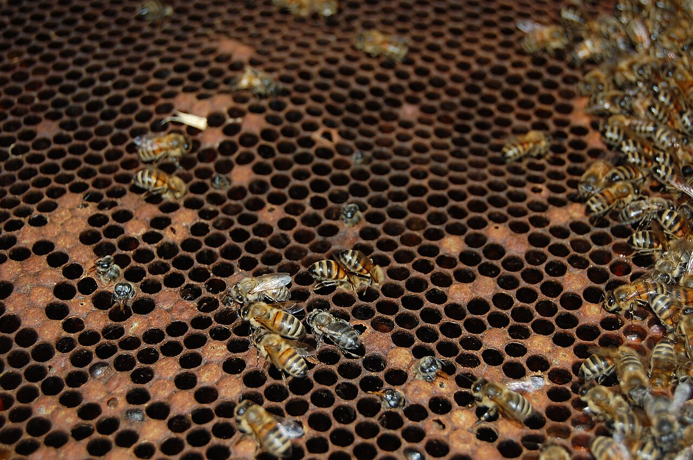

*Photo 43.1 — AFB brood-frame context. This real whole-frame photograph was described by its creator as a typical appearance of brood affected by American foulbrood. Use it to recognise a pattern that warrants closer investigation, not to diagnose AFB from patchiness alone. Compare suspicious cells with the specific signs in this chapter and follow current competent-authority or laboratory confirmation requirements. Photo by Tanarus, CC BY-SA 3.0.*

## 43.8 Capping Changes

AFB-affected sealed cells may have:

- depressed surfaces;
- small irregular holes;
- darker appearance;
- moist or greasy-looking areas.

These changes occur because the larva dies and shrinks beneath the cap and workers may partially open suspicious cells.

Perforated cappings are important supporting evidence but are not unique to AFB.

## 43.9 Larval Remains

At certain disease stages, infected remains can become:

- light brown;
- darker brown;
- sticky or viscous;
- eventually dry and scale-like.

The exact appearance depends on stage and colony cleaning behaviour.

Fresh white healthy larvae should be used as the visual reference.

## 43.10 The Rope Test

The traditional rope or matchstick test examines the consistency of suspicious brood material.

A clean disposable or disinfectable probe is inserted into the decomposed material and withdrawn slowly. A characteristic ropey thread can support suspicion of AFB.

Limitations include:

- not every AFB case is at the correct stage to rope;
- some non-AFB material can be sticky;
- technique and judgement vary;
- the test can contaminate tools and nearby surfaces;
- it does not replace official or laboratory confirmation where required.

**Caution:** Treat the probe as contaminated after contact with suspect material.

## 43.11 The Scale

As diseased remains dry, they form a scale that can adhere tightly to the lower side of the cell.

AFB scales can be difficult for workers to remove and may contain very large numbers of spores.

Old scales are therefore epidemiologically important even after wet larval remains have disappeared.

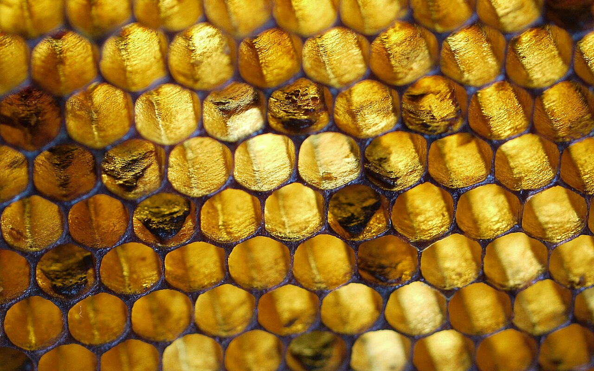

*Photo 43.2 — AFB adherent scale. Hard, dark larval remains can persist tightly on the lower wall of brood cells after infected material dries. This specialist-provenance teaching photograph shows the appearance described as AFB scale, but a reader should not classify every dark cell residue from appearance alone; interpret it with the colony's other signs and current official or laboratory confirmation requirements. Photo by Dalibor Titera, Bee Research Institute at Dol, CC BY-SA 4.0.*

## 43.12 The Pupal Tongue

In some AFB cases, the proboscis or “tongue” of a dead pupa projects upward from the scale.

This can be a striking sign when present, but it is not present in every case and should not be required before suspicion is taken seriously.

## 43.13 Odour

Some heavily diseased colonies develop a distinctive unpleasant odour.

Odour is variable and subjective. Its absence does not exclude AFB, and its presence does not prove it.

Do not use smell as the primary diagnostic method.

## 43.14 Differential Diagnosis: European Foulbrood

European foulbrood (EFB), caused by *Melissococcus plutonius*, often kills larvae before or around capping and may produce twisted, yellow-brown larvae.

AFB more characteristically involves diseased remains under sealed brood and highly persistent spores.

However, field presentations overlap. Laboratory or inspector confirmation may be necessary.

Chapter 44 covers EFB in detail.

## 43.15 Differential Diagnosis: Sacbrood

Sacbrood virus can produce dead larvae with:

- raised or darkened heads;
- a fluid-filled sac-like skin;
- scale-like remains later in development.

Sacbrood remains usually do not show the classic ropey consistency of appropriate-stage AFB and have a different disease biology.

## 43.16 Differential Diagnosis: Chilled Brood

Chilled brood often affects a recognisable area exposed after:

- cold weather;
- prolonged inspection;
- sudden adult-bee loss;
- excessive brood area for the worker population.

Dead brood can discolor and decay secondarily, so history and distribution are important.

## 43.17 Differential Diagnosis: Varroa-Associated Brood Damage

High Varroa pressure and associated viruses can produce:

- patchy sealed brood;
- uncapped pupae;
- partially removed brood;
- deformed emerging adults.

Finding mites or deformed adults does not exclude simultaneous AFB, so suspicious bacterial brood signs still require investigation.

## 43.18 Field Diagnostic Kits

Commercial lateral-flow or immunological field tests are available in some regions for foulbrood organisms.

Their value depends on:

- correct sampling;
- disease stage;
- product validation;
- storage conditions;
- expiry;
- local regulatory acceptance.

A field kit can support a decision but must not be used to bypass mandatory reporting or official confirmation.

## 43.19 Laboratory Confirmation

Laboratory methods may include:

- microscopy;
- culture;
- biochemical identification;
- immunological methods;
- PCR or qPCR;
- newer validated immunoassays or point-of-care molecular methods.

The best method depends on whether the aim is clinical confirmation, surveillance, strain characterisation, or regulatory action.

## 43.20 Sampling Suspect Brood

Follow the receiving authority or laboratory's instructions.

A sample may involve:

- a section of comb containing representative suspect brood;
- swabs;
- larval remains;
- honey or debris for surveillance purposes;
- other material specifically requested.

Label the colony and apiary clearly. Do not mix samples from different suspect colonies unless instructed.

## 43.21 Preserve Evidence Before Cleaning

If official investigation may occur, avoid destroying diagnostic evidence before contact with the competent authority.

Photograph:

- entire brood frame;
- distribution of affected cells;
- close-up cappings;
- suspect larval remains;
- hive identification.

Record date, colony history, recent movement, feeding, queen changes, and equipment transfers.

## 43.22 Immediate Response to Suspicion

When AFB is credibly suspected:

1. stop moving brood, bees, honey, and equipment from the colony;
2. close the hive after necessary observations;
3. mark the colony clearly;
4. segregate tools used on it;
5. prevent robbing;
6. avoid feeding its honey to bees;
7. record recent movements and frame transfers;
8. contact the competent authority or bee-health service where reporting applies;
9. follow official sampling and control instructions.

Do not wait for the colony to become severely diseased before seeking confirmation.

## 43.23 Legal Status Varies by Jurisdiction

AFB is internationally important and listed by WOAH, but national control systems differ.

Examples:

- Ireland lists infection with *P. larvae* as a notifiable bee disease and maintains national animal-health surveillance information;
- the United Kingdom operates statutory control through its bee-health services;
- other countries may use state, provincial, federal, veterinary, or inspector-based systems.

Legal status can change. Always verify current local requirements.

## 43.24 Why Movement Restrictions Matter

Moving a clinically affected colony can distribute spores through:

- drifting bees;
- robbing;
- dropped honey;
- transported comb;
- reused boxes;
- vehicle contamination;
- shared tools;
- destination-apiary exposure.

Movement control is therefore an epidemiological intervention, not bureaucracy without purpose.

## 43.25 Robbing and AFB

A weak AFB colony may become a robbing target.

Robbers can carry contaminated honey back to their own colonies. Spores in that honey may later reach larvae through food preparation.

Prevent robbing by:

- keeping the suspect hive closed except when necessary;
- reducing uncontrolled access if instructed and safe;
- containing exposed honey;
- protecting removed comb;
- not leaving wet supers nearby.

## 43.26 Drifting

Adult bees can drift between neighbouring colonies. Although adults do not develop AFB as brood does, they can carry contaminated material.

Apiary layout, colony density, and entrance orientation influence drift.

Disease control must consider the apiary, not only the visibly affected colony.

## 43.27 Beekeeper-Mediated Spread

Common human-mediated routes include:

- moving brood frames;
- equalising colonies;
- transferring honey frames;
- sharing feeders;
- contaminated hive tools;
- contaminated gloves;
- purchasing used comb;
- extracting honey from suspect colonies with shared equipment;
- selling or gifting contaminated material.

Good intentions can spread AFB faster than natural bee movement.

## 43.28 Honey as a Spore Vehicle

Honey can contain *P. larvae* spores without being visibly abnormal.

Human consumption is a different question from bee-disease transmission; the organism is primarily a honey bee brood pathogen. However, contaminated honey can be epidemiologically dangerous if fed to bees.

Never feed honey of unknown or suspect AFB status to colonies.

## 43.29 Second-Hand Equipment

Used brood comb presents particular risk because scales and spores can remain within cells.

Before acquiring second-hand equipment, determine:

- source apiary;
- disease history;
- whether comb is included;
- local legal requirements;
- whether an approved decontamination method exists;
- whether destruction is safer and required.

Cheap unknown brood comb can become an expensive disease introduction.

## 43.30 Colony Destruction

In some jurisdictions, confirmed clinical AFB requires destruction of affected colonies and specified contaminated material.

Methods and legal supervision vary. They can include euthanasia of the colony followed by destruction of bees and combustible equipment under official requirements.

This handbook does not provide a universal destruction procedure because fire, chemical use, transport, environmental protection, and disease-control law differ.

**Warning:** Do not burn hives, use fuels, apply killing agents, or dispose of infected material without current legal and fire-safety authority guidance.

## 43.31 Equipment Salvage

Some non-comb equipment may be eligible for approved decontamination in particular jurisdictions.

Possible professional methods can include:

- controlled scorching of suitable wooden surfaces;
- validated chemical decontamination;
- irradiation;
- other officially approved processes.

Effectiveness depends on material, organic debris, method parameters, and spore resistance.

Wax comb is especially difficult to decontaminate reliably without destruction or specialised processing.

## 43.32 Cleaning Is Not the Same as Disinfection

Cleaning removes wax, propolis, honey, debris, and organic matter.

Disinfection or decontamination aims to reduce or eliminate the biological hazard.

A dirty surface can protect microorganisms from a disinfectant. Cleaning is therefore often necessary before an approved decontamination process, but cleaning alone does not guarantee spore elimination.

## 43.33 Heat and Spore Resistance

AFB spores resist conditions that kill ordinary vegetative bacteria.

Casual washing with warm water, leaving equipment in sunlight, or briefly heating a hive does not provide reliable decontamination.

Use only methods supported by competent guidance for *P. larvae* spores.

## 43.34 Antibiotics: Fundamental Limitation

Antibiotics act against susceptible vegetative bacterial cells, not the durable AFB spores.

Where antibiotics are legally used, they may suppress visible disease while contaminated comb remains.

Risks include:

- recurrence after treatment stops;
- masking clinical signs;
- antibiotic resistance;
- residues in honey or wax;
- delayed elimination of contaminated equipment.

Medication should never be treated as equivalent to spore eradication.

## 43.35 Antibiotic Resistance

Resistance to commonly used antibiotics has been documented in *P. larvae* populations in some regions.

Repeated prophylactic or poorly controlled use creates selection pressure.

Veterinary oversight, surveillance, and compliance with authorised uses are essential where antibiotics are permitted.

## 43.36 Experimental Bacteriophage Therapy

Bacteriophages are viruses that infect bacteria. Research has explored phages that target *P. larvae*.

A 2026 systematic review reported promising results across laboratory, larval, and limited colony studies, including protective effects in some trials.

However:

- formulation remains an active research area;
- delivery within colonies is challenging;
- phage host range matters;
- regulatory authorisation differs;
- field evidence remains much smaller than the evidence base for established statutory control.

Do not substitute experimental phage preparations for official AFB control.

## 43.37 Emerging Diagnostic Research

Recent work includes:

- improved immunoassays for *P. larvae* detection and differentiation;
- point-of-care molecular assays for simultaneous AFB and EFB detection;
- more sensitive environmental surveillance;
- strain and genotype analysis.

New diagnostic tools can improve speed, but they must be validated and accepted within the relevant control programme.

## 43.38 Hygienic Behaviour

Hygienic bees detect and remove abnormal brood more effectively.

This trait can reduce the progression of some brood diseases and is valuable in breeding programmes.

Recent research has associated strong hygienic behaviour with lower proportions of AFB-affected brood in some experimental populations.

However, hygienic behaviour does not make a colony invulnerable to heavy spore exposure and does not cancel reporting obligations.

## 43.39 Resistant Stock Is Not a Licence to Ignore AFB

Genetic resistance can reduce disease expression but cannot guarantee absence of spores or prevent contaminated equipment from spreading infection.

A resistant colony can still be part of an epidemiological chain.

Monitoring, biosecurity, and legal control remain necessary.

## 43.40 Tracing the Source

After confirmation, reconstruct recent contacts.

Review:

- purchased colonies and nuclei;
- swarm captures;
- second-hand equipment;
- brood or honey-frame transfers;
- shared extractors;
- apiary movements;
- feeding of external honey;
- colony sales;
- dead-outs robbed by other colonies.

Tracing can identify colonies that need inspection before clinical signs develop.

## 43.41 Apiary Inspection After a Case

When permitted and directed, examine neighbouring colonies systematically.

Record:

- colony ID;
- brood pattern;
- suspicious cappings;
- larval remains;
- previous frame transfers;
- strength;
- robbing evidence;
- samples taken.

Inspecting every colony with the same contaminated tool can defeat the purpose of surveillance. Follow official tool-hygiene protocols.

## 43.42 Spore Detection Without Clinical Disease

AFB spores may be detected in honey, debris, adult bees, or other material before obvious disease is visible.

This can support surveillance and risk assessment, but interpretation depends on:

- sample type;
- method sensitivity;
- spore concentration;
- colony history;
- legal definitions;
- local control policy.

A positive environmental test and a clinically diseased colony are not always managed identically.

## 43.43 Food and Processing Equipment

Honey-processing equipment that contacts contaminated honey may spread spores back to bees if wet supers, honey, or residues are later exposed to colonies.

Maintain separation between:

- suspect material;
- marketable product;
- clean extraction equipment;
- equipment returning to apiaries.

Follow food-safety and disease-control instructions for affected product.

## 43.44 Wax

Wax recovered from AFB-contaminated comb may contain spores or carry associated contamination depending on processing.

Rendering practices, commercial wax sterilisation standards, and legal reuse rules vary.

Do not assume home melting makes wax suitable for returning to brood colonies.

## 43.45 Prevention: Buying Bees

Reduce introduction risk by:

- buying from traceable sources;
- checking inspection or certification systems where available;
- asking about disease history;
- inspecting brood after arrival;
- recording origin and queen source;
- avoiding unexplained used comb.

A cheap colony with unknown health history can introduce a long-lived apiary problem.

## 43.46 Prevention: Managing Dead-Outs

Dead colonies should be closed against robbing until the cause is assessed.

Do not automatically redistribute their honey and brood comb.

If the colony died from AFB, rapid robbing can expose multiple neighbouring colonies before the beekeeper investigates.

## 43.47 Prevention: Feeding

Feeders should not be filled with honey of unknown disease status.

Commercial sugar or other appropriate feed is generally easier to source safely than unknown honey.

Where honey feeding is used, its origin and legal suitability must be known.

## 43.48 Prevention: Frame Transfers

Before moving brood or food frames between colonies:

- inspect donor brood;
- review donor disease history;
- avoid suspect or unexplained dead-out comb;
- maintain traceability.

Equalising colony strength should never override disease biosecurity.

## 43.49 Prevention: Apiary Records

A useful AFB-prevention record includes:

- colony origin;
- queen source;
- brood-frame movements;
- supers shared between colonies;
- used equipment source;
- disease inspections;
- laboratory results;
- official notices;
- destruction or decontamination records;
- colony sales and movements.

Traceability makes outbreak investigation faster and more accurate.

## 43.50 Decision Table

| Finding | Interpretation | Immediate principle |
|---|---|---|
| Patchy brood only | Non-specific | Inspect cells closely; do not diagnose yet |
| Sunken/perforated cappings plus brown remains | AFB among important differentials | Stop transfers and obtain confirmation |
| Positive rope test | Strong supporting evidence in suitable material | Treat colony as suspect; follow reporting requirements |
| Adherent dark scales | Important AFB suspicion sign | Prevent movement and seek competent diagnosis |
| Positive field kit | Supporting diagnostic evidence | Follow local official confirmation/control process |
| Laboratory-confirmed clinical AFB | Regulated disease in many regions | Implement competent-authority control measures |
| Spores detected without clinical signs | Exposure/contamination evidence | Interpret under local surveillance policy |

## 43.51 Common Mistakes

### Waiting for a foul smell

Odour is unreliable and may appear late or not at all.

### Moving suspect frames to a strong colony

This can spread spores.

### Feeding honey from a dead-out

Unknown honey can carry AFB spores.

### Keeping the same contaminated hive tool in use

The beekeeper can transmit spores mechanically.

### Treating with antibiotics and assuming the hive is clean

Spores remain.

### Saving unknown old brood comb because it is valuable

The biological cost of contaminated comb can exceed its replacement value.

### Hiding a suspect case

Delayed reporting can expose neighbouring apiaries and may breach the law.

## 43.52 Scientific Notes

### Spore persistence

Endospore formation is the central reason AFB is difficult to eradicate from contaminated equipment. Spores tolerate environmental conditions that rapidly kill vegetative bacteria.

### Genotype and virulence

*P. larvae* strains differ genetically and can differ in larval killing dynamics. A strain that kills larvae very quickly may sometimes produce fewer spores per infected larva because workers remove remains earlier, illustrating why pathogen virulence and transmission are not always simple linear traits.

### Hygienic behaviour

Honey bee social immunity can reduce disease expression by removing diseased brood before extensive sporulation. Colony genetics therefore influence clinical progression without eliminating the need for biosecurity.

### Surveillance before symptoms

Sensitive molecular and immunological methods can detect contamination before classical field signs. This creates opportunities for early action but also requires careful interpretation to avoid treating every low-level detection as equivalent to clinical disease.

### Experimental therapy

Phage research shows how pathogen-specific biological control might complement future AFB programmes. It remains an emerging field, not a replacement for current statutory measures.

## 43.53 Practical AFB Response Checklist

When suspicious brood is found:

- [ ] Stop frame and equipment transfers.
- [ ] Mark the colony clearly.
- [ ] Photograph the brood pattern and close-up signs.
- [ ] Keep tools from the suspect colony separate.
- [ ] Prevent robbing and exposed honey.
- [ ] Do not feed honey from the colony to bees.
- [ ] Review recent colony and equipment movements.
- [ ] Check current reporting requirements.
- [ ] Contact the competent authority or laboratory.
- [ ] Collect samples only as instructed.
- [ ] Do not medicate or destroy evidence before official guidance where regulation applies.
- [ ] Inspect contact colonies under the required protocol.
- [ ] Record the final diagnosis.
- [ ] Document destruction, decontamination, or other official action.
- [ ] Continue follow-up surveillance.

## Key Takeaways

- American foulbrood is caused by the spore-forming bacterium *Paenibacillus larvae*.
- Young larvae become infected by ingesting spores in contaminated food.
- Persistent spores, not merely vegetative bacteria, make AFB difficult to eliminate.
- Patchy brood, perforated cappings, ropey remains, adherent scales, and occasional pupal tongues support suspicion but must be interpreted correctly.
- AFB can be confused with EFB, sacbrood, chilled brood, queen problems, and Varroa-associated brood damage.
- A credible suspicion should stop movement of brood, honey, bees, and equipment until current local requirements are known.
- Robbing and beekeeper frame transfer are major routes of spread.
- Antibiotics do not destroy AFB spores and can mask disease where their use is permitted.
- Experimental phage and new diagnostic technologies are promising but do not replace current legal control.
- Traceability, early diagnosis, controlled movement, hygienic stock, and strict biosecurity are the foundation of prevention.

## Chapter Summary

American foulbrood is a brood disease built around an exceptionally persistent infectious stage. *P. larvae* spores enter young larvae in food, germinate, multiply, kill developing brood, and are produced in huge numbers as diseased remains dry into scales. Those scales and contaminated comb can remain dangerous long after the original colony has disappeared.

Field diagnosis begins with brood pattern and cell-level signs. Sunken or perforated cappings, brown decomposed remains, ropey material, adherent scales, and occasional pupal tongues are important observations, but confirmation may require an inspector, validated field assay, culture, PCR, immunological methods, or other laboratory testing.

The immediate goal after suspicion is containment. Do not redistribute frames, feed suspect honey, allow robbing, or use contaminated tools across colonies. Because AFB is regulated in many jurisdictions, control may involve official inspection, destruction, approved equipment decontamination, movement restrictions, or other statutory measures.

Antibiotics cannot eliminate spores and must never be treated as a substitute for decontamination or official disease control. Future technologies, including bacteriophages and advanced point-of-care diagnostics, may improve management, but the current foundation remains early recognition, traceability, strong biosecurity, and compliance with competent-authority requirements.

## Review Questions

1. What organism causes American foulbrood?
2. What two major biological forms does *P. larvae* have?
3. Which form is responsible for long environmental persistence?
4. Why are AFB spores difficult to eliminate?
5. Where can spores persist in an apiary?
6. Which honey bee stage develops AFB disease?
7. How do susceptible larvae acquire infection?
8. Why are very young larvae particularly vulnerable?
9. What happens after spores germinate in the larval gut?
10. At what broad developmental stage do many infected larvae die?
11. What happens to dead larval remains over time?
12. Why are scales epidemiologically important?
13. How can workers contribute to within-colony spore spread?
14. Why can early AFB be difficult to notice?
15. What happens to colony population as brood losses accumulate?
16. How can a weakening AFB colony threaten neighbouring colonies?
17. Name five field signs associated with AFB.
18. What is a pepper-pot brood pattern?
19. Why is a patchy brood pattern not diagnostic?
20. Name four non-AFB causes of patchy brood.
21. Why may AFB cappings become sunken?
22. Why can workers perforate suspicious cappings?
23. How can larval remains change in colour and consistency?
24. What is the purpose of the rope test?
25. Why can the rope test be negative in a true AFB case?
26. Why must a rope-test probe be treated as contaminated?
27. What is an AFB scale?
28. Why can bees have difficulty removing old AFB scales?
29. What is the pupal-tongue sign?
30. Does absence of a pupal tongue exclude AFB?
31. Why is odour unreliable for diagnosis?
32. Which bacterium causes European foulbrood?
33. How does EFB often differ from AFB in brood stage affected?
34. Why may laboratory confirmation be needed to distinguish AFB and EFB?
35. Which viral brood disease can resemble foulbrood?
36. How can chilled brood mimic infectious brood disease?
37. How can Varroa-associated damage create a patchy brood pattern?
38. Does finding Varroa exclude AFB?
39. What can a lateral-flow field test contribute?
40. Why can a field kit not bypass mandatory reporting?
41. Name four laboratory methods that can support AFB diagnosis.
42. Why does the diagnostic method depend on the investigation question?
43. Which material may be submitted for AFB testing?
44. Why should colonies normally be labelled separately?
45. Why should diagnostic evidence be photographed before major intervention?
46. What should be recorded about colony movement?
47. What is the first movement-related action after credible AFB suspicion?
48. Why should the hive be marked clearly?
49. Why should tools used on a suspect colony be segregated?
50. Why should suspect honey not be fed to bees?
51. Why is AFB control legally different among countries?
52. Is AFB notifiable in Ireland according to current national surveillance information?
53. Why must current local requirements be checked even when WOAH lists the disease?
54. How can moving a diseased hive spread spores?
55. Why does movement restriction help control an outbreak?
56. How does robbing spread AFB?
57. Why should wet supers not be left near a suspect colony?
58. How can drifting contribute to spread?
59. Name five beekeeper-mediated routes of AFB transmission.
60. Why can equalising colonies spread disease?
61. Can apparently normal honey contain AFB spores?
62. Why is human food safety a different question from bee-disease transmission?
63. Why is second-hand brood comb high risk?
64. What should be checked before buying used hive equipment?
65. Why can unknown old comb be more costly than new foundation?
66. Why does this chapter not prescribe one destruction method?
67. Which hazards accompany uncontrolled hive burning?
68. What types of equipment may be salvageable under approved programmes?
69. Why is wax comb especially difficult to decontaminate?
70. What is the difference between cleaning and disinfection?
71. Why can organic debris interfere with decontamination?
72. Why is warm-water washing inadequate for AFB spores?
73. What is the fundamental limitation of antibiotics in AFB?
74. How can antibiotics mask clinical disease?
75. What food-safety risk accompanies inappropriate antibiotic use?
76. Why is antibiotic resistance important in AFB management?
77. What is a bacteriophage?
78. Why are bacteriophages being studied for AFB?
79. Why should experimental phage therapy not replace official control today?
80. What kinds of new diagnostic technologies are being studied?
81. What is hygienic behaviour?
82. How can hygienic behaviour reduce disease progression?
83. Does hygienic stock eliminate reporting obligations?
84. Why can resistant stock still spread spores?
85. What should be reconstructed during source tracing?
86. Why should neighbouring colonies be inspected after confirmation?
87. How can using one dirty hive tool undermine an apiary inspection?
88. What is the difference between spore detection and clinical AFB?
89. Why might surveillance detect spores before symptoms?
90. How can shared extraction equipment contribute to epidemiological spread?
91. Why should home-rendered wax not automatically be returned to brood colonies after AFB contamination?
92. How can traceable bee purchases reduce risk?
93. Why should dead-outs be protected from robbing before diagnosis?
94. Why is feeding unknown honey risky?
95. What should be checked before transferring a brood frame?
96. Which records are useful for AFB traceability?
97. What does a positive rope test mean in practical terms?
98. What should happen after laboratory-confirmed clinical AFB?
99. Why does the durable spore stage shape almost every AFB control decision?
100. What are the core components of an effective AFB prevention and response programme?

## References

- World Organisation for Animal Health. “Diseases of Bees” and current standards for American foulbrood of honey bees. Accessed 15 September 2026.
- Department of Agriculture, Food and the Marine, Ireland. Animal Health Surveillance: “Infection of honey bees with *Paenibacillus larvae* (American foulbrood).” Current national surveillance page; AFB listed as notifiable in Ireland. Accessed 15 September 2026.
- Department for Environment, Food & Rural Affairs and Animal and Plant Health Agency. Current UK bee-health guidance on American foulbrood and statutory disease reporting. Accessed 15 September 2026.
- Reinecke, A., Göbel, J., and Genersch, E. “Immunoassays for the detection and differentiation of Paenibacillus larvae, the etiological agent of American foulbrood (AFB) in honey bees.” *Scientific Reports* 16, 2635 (2026).
- Heo, J., Cheon, D.-S., Chung, N.-K., Kim, Y., and Kim, D.-Y. “Evaluation of the performance of a point-of-care molecular assay for simultaneous detection of the agents of American foulbrood and European foulbrood in apiaries.” *Journal of Veterinary Diagnostic Investigation* 37(6), 2025, 919–926. DOI: 10.1177/10406387251369898.
- Walter, N., Bolte, A. T., Mirzaei, M. K., Deng, L., and Rupp, M. “Bacteriophage therapy against American foulbrood in honey bees: a PRISMA-guided systematic review.” *Frontiers in Microbiology* 17, 2026, 1816537. DOI: 10.3389/fmicb.2026.1816537.
- Ducommun-Dit-Verron, O., Zerna, G., and Beddoe, T. “An Enquiry into the Status of American Foulbrood Therapeutics.” *Insects* 17(3), 2026, 312. DOI: 10.3390/insects17030312.
- Boonmee, T. et al. “Non-thermal atmospheric pressure plasma inactivation of Paenibacillus larvae, the causative agent of American foulbrood in honeybees.” *Scientific Reports* 16, 2026, 11139.
- Genersch, E. “American Foulbrood in honeybees and its causative agent, Paenibacillus larvae.” Foundational review literature on pathogen biology and control.
- Current national and regional bee-health authorities. Reporting, movement restrictions, destruction, salvage, decontamination, veterinary medicines, food products and compensation rules must be verified for the reader’s jurisdiction.

# Chapter 44 — European Foulbrood

## Introduction

European foulbrood (EFB) is a bacterial disease of honey bee brood caused by *Melissococcus plutonius*. It usually affects larvae while they are still uncapped or around the time of capping, producing an irregular brood pattern and larvae that lose their normal pearly-white appearance, become yellowish or brown, and may lie twisted or collapsed in their cells.

EFB differs fundamentally from American foulbrood (AFB). *M. plutonius* does not form the highly resistant endospores produced by *Paenibacillus larvae*. Even so, EFB can persist within colonies and apiaries, move through contaminated comb and food, recur after apparent recovery, and become a statutory disease problem in jurisdictions where reporting and official control apply.

Clinical expression is influenced by colony biology. Disease can become more obvious when larval demand exceeds the nurse-bee population or when nutritional, weather, queen, parasite, or management stress disrupts brood care. This does not mean that stress “causes” EFB; the bacterium is the infectious agent. Stress influences whether infection becomes obvious and how effectively the colony compensates.

## Learning Objectives

After completing this chapter, the reader should be able to:

- explain the biology of *Melissococcus plutonius*;
- recognise the principal field signs of EFB;
- distinguish EFB from AFB, sacbrood, chilled brood, queen failure, and nutritional brood loss;
- understand how EFB spreads within and between colonies;
- explain why stress and nutrition can influence disease expression without being the infectious cause;
- use field tests only within their validated limitations;
- collect representative samples for laboratory confirmation;
- apply immediate biosecurity when EFB is suspected;
- understand jurisdiction-specific official control and medicine rules;
- plan follow-up after a colony appears to recover.

## 44.1 The Causative Bacterium

*Melissococcus plutonius* is a Gram-positive bacterium associated primarily with disease in honey bee larvae.

Unlike the AFB organism, it does not form the durable bacterial endospores that make AFB equipment contamination exceptionally persistent.

This difference is important but should not be misunderstood: EFB can still persist in colony material and recur.

## 44.2 Susceptible Brood

Larvae become infected when they consume food contaminated with *M. plutonius*.

Disease is most often associated with young larvae. The bacteria multiply in the larval gut and compete with the host for nutrients.

Severely affected larvae may die before capping, although death can also occur around or after capping depending on infection, colony response, and associated microorganisms.

## 44.3 A Simplified Disease Sequence

1. A young larva receives contaminated food.
2. *M. plutonius* multiplies in the gut.
3. The larva experiences nutritional and physiological stress.
4. Growth becomes abnormal.
5. The larva changes colour and position.
6. The larva may die before completing normal development.
7. Workers may remove affected brood.
8. Contaminated food, comb, bees, and equipment can expose new larvae.

This process can produce a rapidly changing brood pattern because workers continually remove some abnormal larvae.

## 44.4 What a Normal Larva Looks Like

Healthy young larvae are typically:

- pearly white;
- moist and glistening;
- curled in a regular C-shape;
- lying in a predictable position at the base of the cell;
- progressively surrounded by appropriate brood food.

Disease recognition is easier when abnormal larvae are compared directly with healthy larvae of similar age on the same frame.

## 44.5 Common EFB Field Signs

Possible signs include:

- patchy or erratic brood;
- discoloured larvae;
- larvae changing from white to yellow or brown;
- twisted, stretched, or collapsed larval position;
- visible tracheal lines in some affected larvae;
- larvae that appear melted or deflated;
- inconsistent age pattern among surviving brood;
- occasional unusual or sour odour;
- colony weakening where disease is extensive.

No single sign is sufficient in every case.

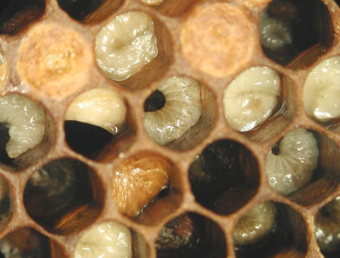

*Photo 44.1 — EFB larvae. Malpositioned and discoloured larvae are important field signs that can raise suspicion of European foulbrood, but visual appearance can overlap with other brood abnormalities; confirm according to current local diagnostic and regulatory guidance. Photo by Eva Forsgren. Source: Budge et al., Standard methods for European foulbrood research 2.0, Journal of Apicultural Research, CC BY 4.0.*

## 44.6 Larval Position

Abnormal larval position can be especially useful.

Instead of a neat C-shape, an affected larva may:

- twist around the cell;
- lie lengthwise;
- collapse against one side;
- appear flattened;
- become irregularly coiled.

These changes should prompt closer examination but can overlap with other brood problems.

## 44.7 Colour Change

Healthy larvae are translucent to pearly white.

With EFB, affected larvae may become:

- creamy;
- yellowish;
- yellow-brown;
- brown as decomposition progresses.

Secondary microorganisms can alter colour, consistency, and odour, so textbook appearance is not always present.

## 44.8 Visible Tracheae

In some affected larvae, the white tracheal system can remain visible through discoloured tissues.

This is a useful supporting observation but not a unique diagnostic feature.

Do not diagnose EFB solely because tracheal lines are visible.

## 44.9 Odour

Some EFB descriptions refer to a sour or unpleasant smell.

Odour varies with:

- disease stage;
- secondary bacteria;
- temperature;
- decomposition;
- observer experience.

Absence of odour does not exclude EFB.

## 44.10 Brood Pattern

EFB often creates a patchy pattern because larvae die at different times and workers remove them.

However, patchiness also occurs with:

- AFB;
- Varroa-associated brood damage;
- queen failure;
- chilled brood;
- sacbrood;
- starvation;
- pollen shortage;
- genetic brood inviability;
- pesticide exposure.

The brood pattern is the start of diagnosis, not the end.

## 44.11 EFB Versus AFB

| Feature | European foulbrood | American foulbrood |
|---|---|---|
| Primary bacterium | *Melissococcus plutonius* | *Paenibacillus larvae* |
| Durable endospores | No AFB-like spore stage | Yes; highly persistent |
| Commonly affected stage | Young larvae, often before capping | Larvae that often die after capping |
| Common larval position | Twisted/collapsed open brood | Brown remains often beneath cappings |
| Scale adhesion | Usually less tightly adherent | Often tightly adherent to lower cell wall |
| Ropey remains | Not the classical feature | Can occur at suitable disease stage |
| Legal status | Jurisdiction-dependent; often controlled | Jurisdiction-dependent; often controlled |

Field overlap means confirmation may be required.

## 44.12 EFB Versus Sacbrood

Sacbrood virus can produce larvae that:

- fail to pupate;
- have raised or darkened heads;
- form a fluid-filled sac;
- become scale-like later.

EFB more often shows irregularly positioned, discoloured, nutritionally compromised larvae.

Laboratory testing can resolve uncertain cases.

## 44.13 EFB Versus Chilled Brood

Chilled brood often follows a clear event:

- cold weather;
- prolonged hive opening;
- sudden adult-bee loss;
- excessive brood area for the worker population;
- broken hive structure.

Its distribution may correspond to the edge of the brood area or recently exposed comb.

If abnormal larvae persist despite normal thermal conditions, infectious disease becomes more likely.

## 44.14 EFB Versus Queen Failure

A failing queen can create empty cells and uneven brood age without producing characteristic diseased larvae.

Examine individual larvae rather than judging only the pattern.

A colony can also have both queen problems and EFB.

## 44.15 EFB and Nutrition

EFB often becomes clinically more obvious during periods when brood demand and food supply are poorly matched.

Possible contributing conditions include:

- rapid spring expansion;
- forage interruption;
- low pollen availability;
- poor weather;
- reduced nurse-bee population;
- excessive brood relative to colony strength.

Nutrition influences the host-colony response; it does not replace *M. plutonius* as the cause of EFB.

## 44.16 EFB and Colony Strength

Strong colonies may remove abnormal brood efficiently and dilute some infection pressure through rapid worker turnover.

Weak colonies can struggle because:

- fewer nurse bees care for brood;
- hygienic removal capacity is reduced;
- food distribution is less efficient;
- robbing risk increases;
- recovery from brood loss is slower.

Colony strengthening must never be performed by moving suspect brood into a healthy colony.

## 44.17 EFB and Hygienic Behaviour

Honey bee colonies vary genetically in detection and removal of abnormal brood.

Hygienic behaviour can reduce visible disease progression by removing infected larvae before extensive decomposition.

This can be beneficial, but it can also make early disease less obvious during a single inspection.

## 44.18 Bacterial Diversity and Virulence

*M. plutonius* is genetically diverse. Strains can differ in virulence, growth characteristics, and association with clinical disease.

Modern EFB research therefore considers:

- strain identity;
- virulence-associated characteristics;
- colony susceptibility;
- environmental context;
- coinfecting microorganisms.

This helps explain why outbreaks can behave differently among regions and apiaries.

## 44.19 Secondary Bacteria

Other bacteria can multiply in diseased larval remains after primary EFB infection.

These secondary organisms can alter:

- odour;
- colour;
- consistency;
- rate of decomposition.

A visually “atypical” EFB case may therefore still contain *M. plutonius*.

## 44.20 Transmission Within a Colony

Potential routes include:

- nurse bees feeding contaminated material to larvae;
- cleaning infected cells;
- contaminated brood food;
- contaminated comb surfaces;
- movement of food within the nest.

Workers are therefore central both to disease transmission and to hygienic removal.

## 44.21 Transmission Between Colonies

EFB can spread through:

- brood-frame transfer;
- honey or food-frame transfer;
- drifting;
- robbing;
- swarms or moved colonies;
- contaminated hive tools;
- shared feeders;
- second-hand comb and equipment.

Apiary management can accelerate or reduce spread.

## 44.22 Robbing

A weak EFB colony can be robbed.

Robbing creates several risks:

- contaminated honey movement;
- adult-bee mixing;
- exposure of neighbouring colonies;
- loss of remaining stores;
- rapid colony collapse.

Control exposed feed and close suspect colonies promptly after inspection.

## 44.23 Immediate Response to Suspicion

When EFB is reasonably suspected:

1. stop moving brood and food frames;
2. close the colony after necessary observations;
3. mark the colony clearly;
4. segregate hive tools and gloves as appropriate;
5. prevent robbing;
6. photograph representative brood;
7. record recent movements and frame transfers;
8. check current reporting obligations;
9. contact the competent bee-health authority where required;
10. sample according to inspector or laboratory instructions.

## 44.24 Regulatory Status

EFB is listed internationally by WOAH and is notifiable or otherwise regulated in a number of countries.

Current UK guidance, for example, instructs beekeepers who suspect EFB to contact the National Bee Unit, close the hive, disinfect equipment before inspecting other colonies, and avoid removing colonies, equipment, or honey until the disease has been controlled.

Other jurisdictions use different systems.

**Warning:** Do not move a suspect colony based on management advice from another country without checking local law.

## 44.25 Field Test Kits

Validated lateral-flow or immunological field tests are available in some regions.

For best performance:

- select representative affected larvae;
- follow kit storage requirements;
- respect expiry dates;
- use the specified extraction method;
- prevent cross-contamination;
- interpret the result within local official policy.

A negative test does not always rule out disease if sampling was poor or signs are early.

## 44.26 Laboratory Diagnosis

Laboratory methods can include:

- microscopy;
- bacterial culture;
- immunological testing;
- conventional PCR;
- qPCR;
- sequencing or strain typing in research and surveillance;
- validated point-of-care molecular assays.

The 2024 update to standard methods for EFB research reflects advances in detection, cultivation, molecular diagnosis, and experimental methods.

## 44.27 Sampling

Follow the receiving laboratory's instructions.

Representative material may include:

- affected larvae;
- a brood-comb section;
- swabs;
- adult bees in surveillance studies;
- honey, debris, or other matrices for specific investigations.

Label each colony clearly.

## 44.28 Sample Quality

Good diagnosis depends on good samples.

Avoid:

- dried, unrepresentative material when fresh affected larvae are requested;
- mixing colonies without instruction;
- contaminated tools between samples;
- unlabelled containers;
- excessive heat during transport;
- long delay where sample conditions matter.

## 44.29 Positive Detection Without Obvious Disease

*M. plutonius* can sometimes be detected in colonies without strong clinical signs.

This creates an important distinction between:

- organism detection;
- clinical EFB;
- outbreak-level disease requiring statutory control.

Interpretation depends on method, sample, bacterial load, colony condition, and law.

## 44.30 Colony Recovery

Some EFB-affected colonies can appear to recover when:

- forage improves;
- brood demand falls;
- nurse-bee population catches up;
- diseased larvae are removed;
- queen or colony management improves.

Apparent recovery does not guarantee elimination of *M. plutonius* from the colony environment.

Follow-up inspection is essential.

## 44.31 Requeening

Requeening may help in some management programmes by:

- introducing different hygienic genetics;
- creating a temporary brood interruption;
- correcting an old or failing queen;
- resetting brood dynamics.

Requeening is not a universal cure and may be inappropriate while statutory restrictions are in place.

## 44.32 Shook-Swarm Methods

Some official EFB programmes use forms of shook-swarm management in selected circumstances, moving adult bees onto clean equipment while contaminated brood comb is removed under a defined protocol.

This approach aims to reduce bacterial contamination and interrupt brood-associated transmission.

Because disease severity, season, equipment, feeding, legal oversight, and disposal requirements matter, do not improvise a shook-swarm treatment from a generic description.

## 44.33 Colony Destruction

Severely affected colonies may require destruction under some statutory programmes.

The decision depends on:

- local law;
- disease severity;
- outbreak context;
- inspector assessment;
- colony condition;
- available approved controls.

Follow the competent authority's procedure.

## 44.34 Antibiotic Use

Antibiotics are authorised for EFB in some jurisdictions and prohibited or tightly restricted in others.

Potential limitations include:

- residues in honey;
- antimicrobial resistance;
- suppression without correction of underlying management stress;
- recurrence;
- masking disease;
- legal prescription requirements.

**Warning:** Never use antibiotics in bee colonies unless the exact product and use are legally authorised and all veterinary, label, and food-safety requirements are met.

## 44.35 Antibiotic Stewardship

Responsible antimicrobial use requires:

- confirmed or professionally supported diagnosis;
- legal indication;
- correct product and dose under authorised directions;
- treatment records;
- residue compliance;
- avoidance of routine prophylactic misuse;
- consideration of non-antibiotic control measures.

Antibiotics should not be used simply because brood looks irregular.

## 44.36 Comb Management

Contaminated brood comb can contribute to persistence.

Management options depend on the official control programme and may include:

- removal of suspect comb;
- replacement with clean comb or foundation;
- defined decontamination of reusable equipment;
- destruction of specified material.

Avoid moving EFB comb into healthy colonies.

## 44.37 Equipment Hygiene

Clean hive tools and reusable equipment according to current disease-control guidance.

A useful sequence is:

1. remove wax, propolis, and organic debris;
2. use an approved decontamination method suitable for the material;
3. avoid contaminating clean surfaces during handling;
4. store clean equipment separately.

Do not assume that one AFB decontamination method is automatically required or optimal for EFB.

## 44.38 Feed and Food Safety

Feeding contaminated honey between colonies can transfer microorganisms.

Do not use honey of uncertain disease status as bee feed.

If medicine is used, protect human food by following:

- honey-super restrictions;
- withdrawal periods;
- residue limits;
- record requirements.

## 44.39 Buying Bees and Equipment

Reduce EFB introduction risk by:

- using traceable suppliers;
- asking about disease history;
- inspecting brood after purchase;
- avoiding old brood comb of uncertain origin;
- checking movement certification where applicable;
- monitoring introduced colonies before exchanging frames.

## 44.40 Dead-Outs

A dead colony should not be treated as a free source of comb until the cause is understood.

Close dead-outs against robbing and inspect brood comb for evidence of disease before redistribution.

## 44.41 Apiary-Level Investigation

When one colony is confirmed with EFB:

- inspect contact colonies;
- map recent frame transfers;
- review shared feeders and tools;
- identify purchased bees or equipment;
- record robbing events;
- note colony strength and queen line;
- follow official surveillance instructions.

## 44.42 Recurrence

EFB can recur after apparent improvement.

Possible reasons include:

- residual contamination;
- continued susceptible brood;
- renewed nutritional stress;
- weak hygienic response;
- untreated contact colonies;
- movement of contaminated material.

Schedule follow-up based on disease biology and official guidance.

## 44.43 Decision Table

| Observation | Main possibilities | Next step |
|---|---|---|
| Patchy open brood | EFB, queen problem, nutrition, chilled brood, other disease | Examine individual larvae and history |
| Twisted yellow-brown larvae | EFB important differential | Stop transfers; obtain validated confirmation |
| Sour odour | EFB possible but non-specific | Do not diagnose by smell alone |
| Negative field kit with strong suspicious signs | Sampling/test limitation possible | Seek laboratory or inspector confirmation |
| Positive *M. plutonius* PCR without signs | Infection/exposure detected | Interpret with clinical and regulatory context |
| Confirmed EFB | Regulated in many regions | Follow competent-authority control plan |
| Apparent recovery after forage improves | Clinical expression reduced | Reinspect; do not assume organism elimination |

## 44.44 Common Mistakes

### Treating stress as the cause

Poor nutrition can worsen disease, but *M. plutonius* is the infectious agent.

### Diagnosing from smell

Odour is variable.

### Moving brood to “save” it

This can spread disease.

### Assuming no spores means no persistence

EFB lacks AFB-type endospores but can still persist and recur.

### Treating with antibiotics before confirmation

This risks residues, resistance, and masking.

### Declaring recovery after one better brood frame

Follow-up is required.

## 44.45 Scientific Notes

### Nutritional competition

*M. plutonius* multiplies in the larval gut and interferes with the nutrition available to the developing larva. Disease outcome therefore depends partly on the balance between bacterial growth and food supply.

### Strain diversity

Genetic diversity among *M. plutonius* strains contributes to differences in virulence and epidemiology. Modern molecular typing improves outbreak investigation.

### Social immunity

Hygienic removal can reduce visible disease by eliminating affected larvae. This colony-level defence alters clinical presentation and can make a low-level outbreak difficult to recognise from one inspection.

### Detection versus disease

Sensitive molecular tests can detect *M. plutonius* below the level at which obvious brood disease is present. Epidemiological interpretation therefore requires more than a positive/negative label.

### Standardisation

Updated standard methods are valuable because differences in culture, sampling, PCR targets, experimental infection, and scoring can otherwise make research results difficult to compare.

## 44.46 Practical EFB Response Programme

### Before disease occurs

- buy traceable bees;
- maintain adequate nutrition;
- manage Varroa;
- use hygienic stock where appropriate;
- keep frame-transfer records;
- protect dead-outs from robbing.

### When suspicious brood is found

- stop movement;
- photograph representative larvae;
- compare with healthy larvae;
- check current legal requirements;
- use validated field/laboratory confirmation;
- inspect contact colonies.

### After confirmation

- follow the official control plan;
- manage contaminated comb and equipment appropriately;
- use medicines only if authorised;
- record every intervention;
- schedule follow-up for recurrence.

## 44.47 EFB Checklist

- [ ] Abnormal larvae have been compared with healthy larvae of similar age.
- [ ] Patchy brood has not been treated as a diagnosis.
- [ ] Frame movement has stopped.
- [ ] Colony ID and photographs are recorded.
- [ ] Tools from the suspect colony are segregated or decontaminated.
- [ ] Robbing risk is controlled.
- [ ] Current reporting requirements are checked.
- [ ] Sample follows laboratory/inspector instructions.
- [ ] AFB is included in the differential diagnosis.
- [ ] Varroa, queen, nutrition, and chilling are assessed.
- [ ] Medicine is used only if legally authorised.
- [ ] Honey-residue rules are protected.
- [ ] Contact colonies are inspected where required.
- [ ] Comb/equipment action is documented.
- [ ] Follow-up inspection is scheduled.

## Key Takeaways

- European foulbrood is caused by *Melissococcus plutonius*.
- Young larvae are commonly affected, often before capping.
- Twisted, yellow-brown, collapsed larvae are important signs but not proof by themselves.
- EFB does not form the exceptionally persistent endospores of AFB, yet it can persist and recur.
- Nutrition and colony strength influence clinical expression but do not replace the bacterium as the cause.
- Patchy brood, visible tracheae, and odour are supporting observations, not stand-alone diagnoses.
- Field kits and molecular tests must be interpreted within validated and regulatory frameworks.
- Movement of brood, food, bees, tools, and second-hand comb can spread infection.
- Control options, including shook-swarm methods, destruction, and antibiotics, vary by jurisdiction.
- Follow-up after apparent recovery is essential.

## Chapter Summary

European foulbrood is a larval bacterial disease whose appearance changes with larval age, colony strength, nutrition, bacterial strain, and worker hygienic behaviour. Affected larvae commonly lose their normal pearly-white C-shape, become yellowish or brown, twist or collapse in cells, and disappear as workers remove them.

EFB differs from AFB because *M. plutonius* does not produce the highly persistent AFB endospore. Nevertheless, contaminated colony material can maintain infection, and clinical disease can recur. A strong nectar and pollen flow may reduce visible disease without proving elimination.

Diagnosis combines brood examination, colony history, validated field tests, laboratory methods, and legal context. When EFB is suspected, movement of brood and food should stop, biosecurity should increase, and current local reporting requirements should be followed.

Management may include official shook-swarm procedures, comb replacement, requeening, destruction, or authorised medicines depending on jurisdiction and disease severity. No treatment replaces traceability, good nutrition, hygienic management, and follow-up surveillance.

## Review Questions

1. What bacterium causes European foulbrood?
2. Does *M. plutonius* form AFB-like endospores?
3. Which honey bee stage is most commonly affected?
4. How do larvae become infected?
5. Where does *M. plutonius* multiply initially?
6. How can bacterial growth interfere with larval development?
7. At what broad stage do many EFB larvae die?
8. What does a normal young larva look like?
9. Why should abnormal larvae be compared with healthy larvae of the same age?
10. Name five common EFB field signs.
11. How can larval position change in EFB?
12. What colour changes can occur?
13. Why may secondary microorganisms alter textbook appearance?
14. What can visible tracheal lines indicate?
15. Are visible tracheae diagnostic by themselves?
16. Why is odour unreliable?
17. Why does EFB often create a patchy brood pattern?
18. Name four other causes of patchy brood.
19. Which organism causes AFB?
20. What major biological feature distinguishes AFB persistence from EFB?
21. Which brood stage is more characteristically affected in EFB than AFB?
22. Why can field presentation still overlap?
23. How can sacbrood differ visually from EFB?
24. How can chilled brood be distinguished using history and distribution?
25. How can queen failure mimic a brood-pattern problem?
26. Can a colony have both queen failure and EFB?
27. How can nutrition influence EFB expression?
28. Does poor nutrition itself cause EFB?
29. Why can rapid spring expansion expose EFB problems?
30. How can weak colony strength worsen disease expression?
31. Why should a weak EFB colony not simply receive suspect brood from another hive?
32. What is hygienic behaviour?
33. How can hygienic behaviour reduce visible disease?
34. Why can hygienic removal make early disease less obvious?
35. Why does bacterial strain diversity matter?
36. How can secondary bacteria affect odour and consistency?
37. How can nurse bees transmit infection within a colony?
38. Name five routes of spread between colonies.
39. Why is robbing an EFB risk?
40. What should happen immediately when EFB is reasonably suspected?
41. Why should the suspect colony be marked?
42. Why should tools be segregated?
43. Why should recent frame transfers be reviewed?
44. Is EFB internationally recognised by WOAH?
45. Why do actual reporting duties still depend on jurisdiction?
46. What does current UK guidance require after suspected EFB?
47. Why should a colony not be moved based only on foreign management advice?
48. What can a lateral-flow field kit contribute?
49. Why can a field test produce false reassurance?
50. Name four laboratory methods used for EFB.
51. Why are updated standard methods useful?
52. What type of material may be sampled?
53. Why must each colony be labelled separately?
54. How can poor sample transport affect diagnosis?
55. What does a positive PCR without clinical signs demonstrate?
56. What additional information is needed to interpret molecular detection?
57. Why can a colony appear to recover when forage improves?
58. Does apparent recovery guarantee pathogen elimination?
59. How might requeening contribute to an EFB management programme?
60. Why is requeening not a universal cure?
61. What is the principle of a shook-swarm approach?
62. Why should a shook-swarm control not be improvised?
63. When might destruction be required?
64. Why do official control decisions vary?
65. Are antibiotics authorised for EFB everywhere?
66. What are the main risks of inappropriate antibiotic use?
67. What is antimicrobial stewardship?
68. Why should irregular brood never trigger automatic antibiotic treatment?
69. How can contaminated comb contribute to recurrence?
70. Why should EFB comb not be moved into healthy colonies?
71. What is the difference between cleaning and decontamination?
72. Why should organic debris be removed before many decontamination methods?
73. Why is an AFB decontamination protocol not automatically the correct EFB protocol?
74. Why should unknown honey not be used as feed?
75. Which food-safety checks are required when medicine is used?
76. How can traceable suppliers reduce disease risk?
77. Why should dead-outs be protected from robbing?
78. What should an apiary-level investigation review?
79. Why can EFB recur?
80. What should happen after apparent clinical recovery?
81. What does patchy open brood tell the beekeeper?
82. What should be done after finding twisted yellow-brown larvae?
83. Why is a sour smell insufficient for diagnosis?
84. What should follow a negative field test when signs remain strongly suspicious?
85. How should a positive *M. plutonius* PCR in a healthy-looking colony be interpreted?
86. What action follows confirmed EFB where statutory control applies?
87. Why is “stress caused the disease” scientifically incomplete?
88. Why is “EFB has no spores, so equipment is safe” also incorrect?
89. What is meant by nutritional competition in EFB?
90. How can genotype influence virulence?
91. What is social immunity?
92. Why can molecular detection occur before clinical disease?
93. What should be done routinely before disease occurs?
94. What should be recorded when suspicious brood is found?
95. Why should AFB remain in the differential diagnosis?
96. Why should Varroa be assessed in an EFB investigation?
97. How do colony strength and nutrition affect recovery?
98. Why must legal medicine status be checked locally?
99. What makes follow-up a necessary part of control?
100. What are the core components of practical EFB prevention and response?

## References

- World Organisation for Animal Health. “Diseases of Bees” and current European foulbrood standards. Accessed 15 September 2026.
- Department for Environment, Food & Rural Affairs and Animal and Plant Health Agency. “Honey bees: protecting them from pests and diseases.” Current EFB reporting and control guidance. Accessed 15 September 2026.
- Department of Agriculture, Environment and Rural Affairs, Northern Ireland. “DAERA advice on foulbrood diseases of honey bees.” Published 4 April 2025; updated 26 May 2026.
- Forsgren, E. et al. “Standard methods for European foulbrood research 2.0.” *Journal of Apicultural Research*, 2024. DOI: 10.1080/00218839.2024.2380425.
- Heo, J., Cheon, D.-S., Chung, N.-K., Kim, Y., and Kim, D.-Y. “Evaluation of the performance of a point-of-care molecular assay for simultaneous detection of the agents of American foulbrood and European foulbrood in apiaries.” *Journal of Veterinary Diagnostic Investigation* 37(6), 2025, 919–926. DOI: 10.1177/10406387251369898.
- Forsgren, E. “European foulbrood in honey bees.” *Journal of Invertebrate Pathology* 103(Suppl. 1), 2010, S5–S9.
- Current national and regional bee-health and veterinary-medicine authorities. Reporting, movement, treatment, antibiotic, residue and equipment-control requirements must be verified for the reader’s jurisdiction.

# Chapter 45 — Viruses

## Introduction

Honey bee colonies commonly contain viruses. Detection alone is therefore not the same as disease. A colony can carry viral RNA without visible signs, while another colony with the same named virus can experience deformed brood, paralysis, shortened worker lifespan, or rapid population loss.

The difference often lies in viral load, transmission route, bee age, tissue infected, genetics, nutrition, coinfection, environmental stress, and—most importantly for several major viruses—the presence of *Varroa destructor*.

Varroa has transformed honey bee virology. By feeding on developing and adult bees and transmitting viruses directly into host tissues, the mite can alter viral prevalence, load, variant structure, and clinical outcome. Deformed wing virus (DWV) is the clearest example, but acute paralysis viruses are also associated with mite pressure.

For the beekeeper, the central principles are:

1. recognise syndromes without diagnosing from appearance alone;
2. measure and control Varroa;
3. collect representative samples when laboratory diagnosis is useful;
4. interpret RT-PCR/qPCR results with colony history and sample type;
5. reduce movement and stressors when unexplained disease is occurring;
6. avoid unsupported antiviral remedies.

## Learning Objectives

After completing this chapter, the reader should be able to:

- explain the difference between viral infection and clinical viral disease;
- describe horizontal, vertical, food-borne, contact, and vector-mediated transmission;
- explain why Varroa changes viral epidemiology;
- recognise the main syndromes associated with DWV, chronic bee paralysis virus, acute paralysis viruses, sacbrood virus, and black queen cell virus;
- understand the value and limitations of RT-PCR and quantitative RT-PCR;
- distinguish detection from causation;
- choose representative bees or brood for diagnostic sampling;
- understand coinfection and viral variants;
- reduce viral risk through Varroa control, nutrition, biosecurity, and colony management;
- separate experimental antiviral research from authorised practical treatment.

## 45.1 What Is a Virus?

A virus is an infectious entity containing genetic material enclosed in a protein coat and, in some viruses, additional structures. It cannot reproduce independently. It must enter host cells and use cellular machinery to make new viral particles.

Most well-studied honey bee viruses are RNA viruses.

This matters diagnostically because laboratory tests often detect viral RNA rather than culturing a living virus in the way bacteria may be cultured.

## 45.2 Infection Versus Disease

A bee can be infected without showing visible signs.

Terms commonly used include:

- covert infection: virus is present without obvious disease;
- subclinical infection: biological effects may occur without distinctive external signs;
- overt or clinical disease: clear signs or measurable pathology are present.

A positive PCR result therefore demonstrates detected viral genetic material, not automatically the cause of colony failure.

## 45.3 Viral Load

Viral load refers to the amount of viral material detected in a defined sample under a defined method.

Higher loads can be associated with greater disease risk for some viruses, but interpretation depends on:

- virus;
- tissue;
- sample type;
- bee age;
- season;
- assay;
- normalisation method;
- Varroa level;
- clinical signs.

There is no single universal viral-load threshold for all honey bee viruses.

## 45.4 Transmission Routes

Honey bee viruses can spread through several routes.

### Horizontal transmission

Between individuals of the same generation through:

- food sharing;
- faecal contamination;
- glandular secretions;
- contact;
- cannibalism of infected brood;
- wounds;
- parasitic mites.

### Vertical transmission

From queen or drone reproductive tissues to offspring or through eggs in some virus-host relationships.

### Vector-mediated transmission

A parasite carries virus between hosts. Varroa is the most important viral vector in modern *Apis mellifera* colonies.

## 45.5 Why Transmission Route Changes Disease

Oral exposure and direct injection into tissue are biologically different.

A virus that causes little disease when acquired orally may become more damaging when a mite introduces it through feeding wounds during pupal development.

Vector-mediated transmission can therefore change both infection probability and disease severity.

## 45.6 Varroa as a Viral Driver

Varroa affects viruses through several mechanisms:

- direct transmission;
- repeated feeding wounds;
- physiological stress;
- fat-body damage;
- altered immunity;
- concentrated transmission inside brood cells;
- redistribution between colonies.

The practical consequence is simple: viral management cannot be separated from Varroa management where the mite is established.

## 45.7 Deformed Wing Virus Complex

Deformed wing virus is among the most important honey bee viruses globally.

Major genetic variants include DWV-A and DWV-B, with additional variants and recombinant forms described in the literature. DWV-B was historically known as Varroa destructor virus-1 in earlier naming systems.

Variant distribution changes geographically and over time.

## 45.8 Visible DWV Syndrome

The classic syndrome can include:

- shortened or misshapen wings;
- crumpled wings;
- shortened abdomen;
- poor mobility;
- inability to fly;
- early death after emergence.

However, many high-DWV bees do not show obvious wing deformity.

Visible deformed wings therefore represent a severe phenotype, not the full burden of disease.

## 45.9 Hidden DWV Damage

A bee can emerge with apparently normal wings but have:

- high viral load;
- reduced lifespan;
- impaired physiology;
- reduced foraging performance;
- increased mortality under stress.

At colony level, this can create dwindling without many obvious deformed bees.

## 45.10 DWV and Winter Bees

DWV-associated damage during development of long-lived winter workers is particularly serious.

If winter bees have reduced longevity, the cluster may shrink before spring even when autumn population originally appeared adequate.

This is one reason Varroa must be controlled before winter-bee development is irreversibly compromised.

## 45.11 DWV Variants and Evolution

Varroa-mediated transmission changes selection pressure on DWV populations.

Different variants can compete, recombine, and change in frequency. A laboratory report that distinguishes variants can support epidemiological research but usually does not replace basic colony management decisions such as urgent Varroa control.

## 45.12 Chronic Bee Paralysis Virus

Chronic bee paralysis virus (CBPV) can cause striking adult-bee disease.

Two classic clinical presentations have been described, but mixed signs are common.

Possible observations include:

- trembling or shaking bees;
- inability to fly;
- crawling near the hive;
- bloated abdomen in some affected bees;
- dark, shiny, hairless-looking workers;
- rejection of affected bees by nestmates;
- large numbers of dead or moribund adults.

These signs require differential diagnosis.

## 45.13 Hairless Black Bees

Hairless, dark-looking bees can result when body hairs are lost, revealing the shiny cuticle.

In CBPV outbreaks, affected bees may be attacked or excluded by nestmates.

However, hair loss can also occur from age, robbing, abrasion, or other causes.

Do not diagnose CBPV from colour alone.

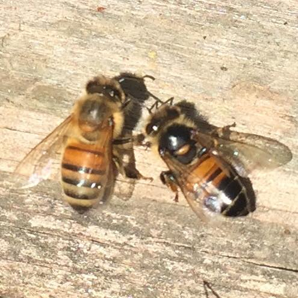

*Photo 45.1 — CBPV-type adult appearance. The bee on the right shows darkening and reduced hair that can resemble the shiny, hairless appearance described in chronic bee paralysis. This photograph is a visual teaching example, not a stand-alone diagnosis: age, abrasion, robbing and other causes can also alter hair and colour, so interpret the sign with the colony-level syndrome and appropriate diagnostic evidence. Photo by Abrahami, CC BY-SA 4.0.*

## 45.14 Trembling and Crawling

Trembling bees may suggest CBPV, acute paralysis viruses, pesticide poisoning, chilling, nutritional problems, or other neurological stress.

A diagnostic investigation should ask:

- Are affected bees alive or dead?
- Are several colonies involved?
- Is there a recent pesticide event?
- What is the Varroa level?
- Are deformed-wing bees present?
- Is the syndrome concentrated at one hive?
- What does laboratory testing show?

## 45.15 Acute Bee Paralysis Virus

Acute bee paralysis virus (ABPV) can cause rapid adult mortality under suitable infection conditions.

It is associated with the Dicistroviridae group and has important interactions with Varroa.

Clinical signs can include:

- trembling;
- inability to fly;
- paralysis;
- rapid death.

These signs overlap with other acute viruses and toxic exposure.

## 45.16 Israeli Acute Paralysis Virus

Israeli acute paralysis virus (IAPV) is another dicistrovirus associated with acute adult-bee disease.

Research demonstrates that its within-host infection dynamics can differ substantially from DWV. A 2026 study found that IAPV infection in surviving experimental bees could decline rapidly while DWV remained high for longer, illustrating that viruses should not be assumed to share the same time course.

## 45.17 Kashmir Bee Virus

Kashmir bee virus (KBV) is closely related to ABPV and IAPV.

It can occur without obvious disease but can become important under stress or vector-mediated conditions.

Because these viruses are genetically related, well-designed molecular assays and controls are important for correct discrimination.

## 45.18 The Acute Paralysis Virus Complex

ABPV, IAPV, and KBV are often discussed together because of:

- genetic relationship;
- overlapping clinical signs;
- rapid disease potential;
- association with Varroa or other stressors;
- diagnostic cross-reactivity concerns in poorly designed assays.

Species-specific laboratory testing is needed when precise identification matters.

## 45.19 Sacbrood Virus

Sacbrood virus (SBV) primarily produces a brood disease.

Affected larvae may:

- fail to pupate;
- become yellowish or grey;
- develop a raised or darkened head;
- retain fluid between the body and old larval skin;
- form a characteristic sac-like structure;
- dry into a scale-like remain.

Mild sacbrood can occur transiently and does not always indicate colony collapse.

## 45.20 Sacbrood Differential Diagnosis

Sacbrood can be confused with:

- EFB;
- chilled brood;
- starvation;
- other dead brood.

The sac-like body and raised head can support suspicion, but laboratory confirmation may be useful in atypical cases.

## 45.21 Black Queen Cell Virus

Black queen cell virus (BQCV) is associated particularly with queen larvae and pupae.

Affected queen-cell contents can darken, and the queen larva may die.

BQCV is often detected in colonies without an obvious queen-cell outbreak and has been associated epidemiologically with other stressors, including microsporidian infection in some studies.

## 45.22 Lake Sinai Viruses

Lake Sinai viruses are a diverse group frequently detected in honey bees.

Their clinical significance remains less straightforward than that of classical DWV syndromes or sacbrood. Detection can be common without a unique visible disease pattern.

This group illustrates why metagenomic discovery and routine clinical diagnosis are different tasks.

## 45.23 Other Honey Bee Viruses

Other viruses described in honey bees include:

- slow bee paralysis virus;
- cloudy wing virus;
- bee macula-like virus;
- Apis iridescent-virus-like detections in some contexts;
- numerous newly described RNA viruses.

Not every detected virus has a well-defined disease syndrome or proven management significance.

## 45.24 Coinfection

One bee can carry multiple viruses simultaneously.

Coinfection can produce:

- additive effects;
- no obvious interaction;
- competition;
- altered replication;
- different mortality timing.

The outcome depends on specific viruses, order and route of infection, host condition, and environment.

Do not assume that two detected viruses automatically act synergistically.

## 45.25 Virus–Nosema Interactions

Viral and microsporidian infections may coexist.

The presence of both does not prove that one caused the other. Shared risk factors such as poor nutrition, ageing, confinement, or general colony stress can influence both.

A complete health investigation considers all major stressors rather than selecting one positive laboratory result as the sole cause.

## 45.26 Virus–Pesticide Interactions

Research has explored interactions between pesticide exposure and viral infection.

Some combinations alter immunity or survival under experimental conditions, but effects depend strongly on chemical, dose, virus, bee age, and route.

Field conclusions require exposure evidence as well as virological evidence.

## 45.27 Virus–Nutrition Interactions

Protein and energy availability influence immune and metabolic capacity.

Poor nutrition can reduce resilience to viral disease, especially when combined with Varroa.

Feeding does not eliminate viruses. Nutritional support is part of colony management, not an antiviral drug.

## 45.28 Virus–Genetics Interactions

Honey bee stocks differ in:

- Varroa resistance;
- hygienic behaviour;
- immune response;
- virus tolerance;
- brood dynamics.

Breeding can reduce disease risk indirectly by reducing mite reproduction or improving removal of compromised brood.

Genetic resistance should complement, not replace, monitoring.

## 45.29 Clinical Examination

When viral disease is suspected, record:

- adult-bee behaviour;
- wing condition;
- hair loss;
- crawling or trembling;
- mortality distribution;
- brood pattern;
- sacbrood-like larvae;
- queen-cell abnormalities;
- colony population;
- Varroa level;
- recent treatments;
- nutrition;
- pesticide events.

The pattern across the whole colony is more informative than one abnormal bee.

## 45.30 Selecting Adult Bees for Virus Testing

Sample choice depends on the question.

Possible samples include:

- visibly moribund bees;
- apparently healthy adults;
- newly emerged bees;
- foragers;
- pooled colony samples;
- individual bees.

These are not interchangeable.

A recent 2026 investigation of severe commercial colony losses demonstrated that pooled samples could show similar high virus levels in both healthy and collapsing apiaries, while individually selected moribund bees provided clearer evidence for high DWV loads associated with observed pathology.

## 45.31 Why Moribund Bees Can Be Informative

If a specific syndrome is occurring, collecting affected individuals can increase the diagnostic signal related to that syndrome.

However, moribund-bee sampling can overrepresent severe infections and should not be used to estimate population-wide prevalence without an appropriate design.

Use both clinical and representative sampling when the investigation requires both causation and prevalence information.

## 45.32 Brood Sampling

For sacbrood or queen-cell disease, appropriate brood material may be more informative than adult workers.

Follow laboratory instructions concerning:

- developmental stage;
- number of individuals;
- preservation;
- freezing or transport;
- sterile tools;
- separate colony labels.

## 45.33 RT-PCR

Most important honey bee viruses contain RNA, so reverse-transcription PCR (RT-PCR) is commonly used.

The process broadly involves:

1. extracting RNA;
2. converting viral RNA into complementary DNA;
3. amplifying a virus-specific genetic target;
4. detecting the amplified product.

A positive test indicates target RNA was detected under the assay conditions.

## 45.34 Quantitative RT-PCR

Quantitative reverse-transcription PCR (RT-qPCR or qRT-PCR) estimates the amount of target viral RNA.

Reliable interpretation requires:

- validated primers/probes;
- standards or normalisation;
- appropriate controls;
- RNA quality assessment;
- consistent sample processing;
- awareness of assay detection limits.

Results from different laboratories or protocols may not be directly comparable.

## 45.35 PCR Does Not Prove Infectious Virus

Detection of viral RNA does not always prove that intact infectious virus particles are actively replicating.

Additional evidence can include:

- very high load associated with signs;
- negative-strand or replication markers in research contexts;
- tissue localisation;
- experimental infection;
- isolation or other specialised methods.

Routine beekeeper diagnostics usually combine PCR results with field evidence rather than attempting complete mechanistic proof.

## 45.36 Pooling Samples

Pooling several bees reduces testing cost and can support surveillance.

However, pooling can:

- dilute one highly infected bee;
- hide individual variation;
- make causal association with a moribund phenotype harder;
- prevent individual-level prevalence estimates.

The sample design must match the question.

## 45.37 Hive Debris as a Surveillance Matrix

Recent research has evaluated hive debris for non-invasive detection of viruses such as ABPV, CBPV, and DWV using molecular methods.

This approach can support surveillance without sacrificing live bees, but the relationship between debris viral RNA and active clinical disease requires validated interpretation.

Emerging methods should not be treated as direct substitutes for established diagnostic sampling until performance is understood.

## 45.38 Laboratory Contamination

PCR methods are highly sensitive.

Contamination can create false-positive results through:

- reused tools;
- aerosols;
- positive-control material;
- mixed samples;
- contaminated work surfaces.

Good laboratories physically separate extraction, reagent preparation, amplification, and positive-control handling where appropriate.

## 45.39 Negative Results

A negative virus result can mean:

- virus is absent;
- viral load is below detection limit;
- wrong tissue or life stage was sampled;
- RNA degraded;
- sampling missed infected individuals;
- assay target did not match a divergent variant;
- technical failure occurred.

Interpret negatives with sample quality and clinical context.

## 45.40 Differential Diagnosis: Deformed Wings

Deformed wings strongly suggest developmental damage associated with DWV/Varroa in many contexts, but alternatives include:

- physical injury;
- pupal developmental disruption;
- other viral or toxic effects.

The immediate practical response should include quantitative Varroa assessment regardless of whether virus testing is available.

## 45.41 Differential Diagnosis: Crawling Bees

Crawling adults can result from:

- CBPV;
- ABPV/IAPV/KBV;
- pesticide poisoning;
- chilled bees;
- starvation;
- tracheal mites;
- severe Varroa-associated damage;
- injury.

Look for timing, distribution, simultaneous effects across apiaries, and laboratory evidence.

## 45.42 Differential Diagnosis: Trembling

Trembling is a neurological sign, not a virus name.

In a suspected CBPV outbreak, combine:

- adult behaviour;
- hair-loss pattern;
- mortality;
- colony crowding;
- Varroa status;
- molecular testing.

## 45.43 Differential Diagnosis: Dead Brood

Dead larvae require separation among:

- sacbrood;
- EFB;
- AFB;
- chilled brood;
- starvation;
- heat injury;
- toxic exposure.

Brood position, colour, capping, consistency, scale, smell, and laboratory testing all contribute.

## 45.44 Viral Disease and Colony Crowding

CBPV outbreaks are sometimes associated with crowding and prolonged close contact among adult bees.

Management that reduces excessive congestion may help in some outbreak contexts, but it is not a substitute for diagnosis or a guaranteed cure.

Avoid drastic manipulations that create robbing or chill brood.

## 45.45 The Central Role of Varroa Control

For DWV and several acute viruses, the most powerful practical intervention is often effective Varroa management.

This means:

- monitoring mites before visible viral disease;
- treating according to authorised regional guidance when required;
- verifying control;
- preventing reinvasion;
- protecting winter-bee development.

Antiviral claims that ignore Varroa are biologically incomplete.

## 45.46 No Universal Antiviral Medicine Programme

Unlike some bacterial diseases, routine honey bee virus control is not based on broadly accepted direct antiviral pharmaceuticals.

Various drugs, plant compounds, RNA interference systems, probiotics, immune stimulants, and other approaches have been studied experimentally.

Research evidence does not equal authorised field treatment.

**Warning:** Do not place human or veterinary antiviral drugs into bee colonies unless a competent authority has explicitly authorised that use.

## 45.47 RNA Interference Research

RNA interference (RNAi) can target specific viral RNA sequences and has been investigated as an antiviral strategy in insects, including honey bees.

Challenges include:

- delivery;
- stability;
- sequence variation;
- colony-scale dosing;
- cost;
- environmental and regulatory evaluation.

It remains a research and technology-development field rather than a universal beekeeper remedy.

## 45.48 Nutrition and Supportive Management

Supportive management can include:

- adequate carbohydrate stores;
- access to diverse pollen;
- avoiding chronic moisture;
- correcting queen failure;
- preventing robbing;
- avoiding unnecessary colony stress;
- managing Varroa.

Supportive management improves host resilience but should not be marketed as virus eradication.

## 45.49 Biosecurity

Viruses can move with:

- adult bees;
- brood;
- queens;
- drones;
- Varroa mites;
- food exchange;
- drifting;
- robbing.

Practical biosecurity includes:

- traceable bee purchases;
- parasite monitoring;
- avoiding frame transfer from collapsing colonies;
- quarantining or monitoring introductions where appropriate;
- controlling robbing;
- recording movements.

## 45.50 Colony Movement

Moving colonies can expose them to:

- new Varroa populations;
- new virus variants;
- nutritional stress;
- temperature stress;
- high-density contact with other operations.

Pollination and migratory beekeeping therefore require strong pre-movement and post-movement health surveillance.

## 45.51 Decision Table

| Finding | Main concern | Next step |
|---|---|---|
| Deformed-wing bees | DWV/Varroa-associated damage | Quantify Varroa; assess colony decline; test virus if needed |
| Dark shiny trembling adults | CBPV among differentials | Sample affected bees; assess crowding and other causes |
| Sudden crawling/dead adults | Acute viruses or poisoning among differentials | Preserve moribund/dead bees; record exposure history; test appropriately |
| Sac-like larvae | Sacbrood | Examine brood pattern and differential diagnoses; lab test if unclear |
| Blackened queen-cell contents | BQCV among possibilities | Examine queen-rearing context and submit suitable sample |
| High virus RNA in pooled healthy bees | Infection detected | Do not infer disease without phenotype/context |
| Low pooled signal but severe moribund bees | Sampling dilution possible | Test representative affected individuals |

## 45.52 Common Mistakes

### Treating a positive PCR as proof of cause

Viruses can be common in apparently healthy colonies.

### Ignoring Varroa

This misses the primary management lever for several important viruses.

### Sampling only dead bees from the floor

Old degraded material may give poor RNA quality and uncertain timing.

### Pooling without understanding the consequence

Pooling can dilute individual high loads.

### Diagnosing CBPV from one dark bee

Hair loss has multiple causes.

### Using unapproved “antiviral” chemicals

This can harm bees, contaminate food, and delay real management.

## 45.53 Scientific Notes

### Quasispecies and variants

RNA viruses mutate rapidly and exist as genetically diverse populations. Selection imposed by host, vector, and transmission route can alter variant frequencies over time.

### Varroa-driven viral evolution

The global spread of Varroa changed DWV ecology by creating a highly efficient transmission route. This altered which viral variants dominate in many populations.

### Sampling matrix changes interpretation

The 2026 analysis of severe US commercial colony losses showed that pooled colony samples and individually selected moribund bees answered different questions. High pooled viral prevalence did not by itself distinguish collapsing from healthy colonies, whereas specific moribund individuals revealed stronger phenotype-associated DWV signals.

### Coinfection is not automatically synergy

A 2026 experimental study of DWV and IAPV found different infection timelines and did not find simple universal synergistic increases in viral load. Interactions must be demonstrated, not assumed.

### Molecular detection expands the known virome

Sequencing discovers many viral sequences. Discovery should be followed by epidemiology and pathology before a new virus is blamed for disease.

## 45.54 Practical Virus Investigation Programme

### When adult disease is observed

- record behaviour and mortality distribution;
- quantify Varroa;
- record recent pesticide exposure;
- collect fresh affected and representative comparison bees;
- submit samples under laboratory instructions;
- reduce robbing and unnecessary movement.

### When brood disease is observed

- compare affected larvae with healthy brood;
- consider bacterial and environmental differentials;
- collect the correct brood stage;
- preserve chain of identity by colony.

### After results

- interpret viral load with phenotype and sample type;
- address Varroa and management stressors;
- do not use unauthorised antivirals;
- repeat testing only when it answers a defined management question.

## 45.55 Virus Checklist

- [ ] Colony ID and date are recorded.
- [ ] Clinical signs are described objectively.
- [ ] Varroa level is known.
- [ ] Pesticide/exposure history is recorded.
- [ ] Adult and brood problems are separated.
- [ ] Sample type matches the question.
- [ ] Moribund bees are sampled when syndrome causation is being investigated.
- [ ] Representative bees are sampled when prevalence is the question.
- [ ] Samples are kept separate by colony.
- [ ] RNA preservation follows laboratory instructions.
- [ ] PCR detection is not equated automatically with causation.
- [ ] Viral load is interpreted with assay method.
- [ ] Coinfections are not assumed to be synergistic.
- [ ] Varroa control is verified.
- [ ] No unauthorised antiviral medicine is used.

## Key Takeaways

- Viral infection is common; clinical viral disease is a separate question.
- Most important honey bee viruses are RNA viruses detected with reverse-transcription molecular methods.
- Varroa fundamentally changes transmission and disease expression for DWV and several acute viruses.
- Deformed wings are a severe DWV/Varroa-associated phenotype but many damaged bees have normal-looking wings.
- CBPV can cause trembling, crawling, hairless dark bees, and adult mortality, but these signs have differentials.
- ABPV, IAPV, and KBV are related acute paralysis viruses requiring appropriate molecular discrimination.
- Sacbrood is principally a viral brood disease; BQCV is especially associated with queen-cell disease.
- RT-PCR detection does not automatically prove that the detected virus caused colony failure.
- Sample type matters: pooled surveillance samples and moribund-bee diagnostic samples answer different questions.
- Practical viral management focuses on Varroa control, nutrition, biosecurity, and reducing stress rather than unsupported antiviral drugs.

## Chapter Summary

Honey bee viruses are widespread and biologically diverse. The central diagnostic challenge is not merely finding viral RNA but determining whether infection is contributing to observed disease. Clinical examination, Varroa measurement, sample selection, laboratory method, viral load, and colony history must be considered together.

Deformed wing virus is the dominant example of vector-amplified disease. Varroa transmits the virus efficiently during development and can create high viral loads, shortened worker lifespan, visible deformed wings, or hidden physiological damage. Chronic bee paralysis virus produces important adult-bee syndromes, while ABPV, IAPV, and KBV form an acute-paralysis group with overlapping signs. Sacbrood affects larvae, and black queen cell virus can affect developing queens.

Molecular diagnostics are powerful but easy to overinterpret. Pooling may obscure highly infected individuals, while targeted moribund-bee sampling may better associate virus with a specific syndrome. Negative tests also depend on sampling and RNA quality.

Because broadly accepted direct antiviral medicines are not the foundation of practical apiculture, disease reduction focuses on controlling Varroa, maintaining nutrition, preventing robbing and movement of unhealthy material, using appropriate genetics, and investigating exposure events carefully.

## Review Questions

1. What is a virus?
2. Why can a virus not reproduce independently?
3. What type of genetic material is common among major honey bee viruses?
4. What is covert infection?
5. What is clinical viral disease?
6. Why does a positive PCR not automatically prove disease causation?
7. What is viral load?
8. Which factors influence interpretation of viral load?
9. Is there one universal viral-load threshold for all bee viruses?
10. What is horizontal transmission?
11. Give three examples of horizontal virus transmission.
12. What is vertical transmission?
13. What is vector-mediated transmission?
14. Why is Varroa the most important viral vector in *Apis mellifera*?
15. How can transmission route change disease severity?
16. Name four mechanisms by which Varroa can intensify viral disease.
17. What is the deformed wing virus complex?
18. Name two major DWV variants.
19. What was DWV-B historically called?
20. Why can DWV variant frequencies change geographically?
21. What are classic visible DWV signs?
22. Why do visible deformed wings underestimate total DWV damage?
23. How can a normal-winged bee still be affected by DWV?
24. Why are winter bees especially vulnerable to Varroa-DWV damage?
25. What does recombination mean in viral evolution?
26. What practical decision is usually more urgent than variant typing in a high-Varroa colony?
27. What virus is associated with chronic bee paralysis?
28. Name three signs associated with CBPV.
29. Why can affected bees look black and shiny?
30. Why is one hairless bee not sufficient for diagnosis?
31. Name four alternative causes of crawling or trembling bees.
32. What questions help investigate a paralysis syndrome?
33. What is ABPV?
34. Which signs can occur with ABPV?
35. Why can ABPV be confused with poisoning?
36. What is IAPV?
37. How did recent research show IAPV dynamics can differ from DWV?
38. What is Kashmir bee virus?
39. Why are ABPV, IAPV, and KBV often discussed together?
40. Why do related viruses require well-designed molecular assays?
41. What is sacbrood virus?
42. What happens to a sacbrood-infected larva?
43. Why does sacbrood not always mean colony collapse?
44. Which diseases can sacbrood resemble?
45. What is black queen cell virus associated with?
46. Why can BQCV detection occur without a queen-cell outbreak?
47. What are Lake Sinai viruses?
48. Why is their clinical interpretation often difficult?
49. Does discovery of a new virus sequence automatically prove disease?
50. What is coinfection?
51. Can coinfection be additive, neutral, competitive, or synergistic?
52. Why should synergy not be assumed?
53. Can Nosema and viruses occur in the same colony?
54. Why does coexistence not prove causation between them?
55. What is required before attributing a field event to pesticide-virus interaction?
56. How can nutrition influence viral resilience?
57. Does feeding eliminate viruses?
58. How can bee genetics influence virus risk?
59. Why can Varroa-resistant stock reduce viral pressure indirectly?
60. What observations belong in a clinical virus investigation?
61. Why does sample selection matter?
62. When can moribund bees be especially informative?
63. What is a limitation of sampling only moribund bees?
64. Why can pooled samples hide individual high viral loads?
65. What did the 2026 commercial-colony-loss investigation illustrate about pooled versus individual sampling?
66. When should brood rather than adults be sampled?
67. What does RT in RT-PCR mean?
68. Why is reverse transcription required for RNA viruses?
69. What does RT-PCR detect?
70. What additional information can quantitative RT-PCR provide?
71. Which controls are needed for reliable qRT-PCR?
72. Why are results from different laboratories not always directly comparable?
73. Does viral RNA detection prove intact infectious virus?
74. What additional research evidence can strengthen proof of active infection?
75. Why is pooling useful in surveillance?
76. Why can pooling weaken causal diagnosis?
77. How might hive debris be used in virus surveillance?
78. Why must debris-based detection be validated before broad clinical interpretation?
79. How can PCR laboratory contamination create false positives?
80. What can a negative virus test mean besides true absence?
81. Why does RNA degradation matter?
82. Why should deformed-wing bees trigger Varroa measurement?
83. Why is trembling a sign rather than a diagnosis?
84. Which main diseases belong in the differential diagnosis of dead brood?
85. How can colony crowding relate to CBPV outbreaks?
86. What is the most important practical management lever for DWV risk?
87. Why is there no standard universal direct-antiviral programme for honey bees?
88. Why should human antiviral medicines not be put into hives?
89. What is RNA interference?
90. Why is RNAi not yet a universal beekeeper remedy?
91. What supportive management improves host resilience?
92. How can bee movement introduce new viral pressure?
93. What should be done after finding high virus RNA in apparently healthy pooled bees?
94. What should be done when severe moribund bees are underrepresented in a pooled sample?
95. What is a viral quasispecies?
96. How did Varroa alter DWV evolution and ecology?
97. Why is phenotype-linked sampling scientifically useful?
98. Why must coinfection effects be demonstrated experimentally rather than assumed?
99. What should a beekeeper do after receiving a positive virus laboratory report?
100. What are the core components of practical honey bee viral-disease management?

## References

- de Miranda, J. R. et al. Standard and foundational methods for honey bee virus research and diagnosis, *Journal of Apicultural Research* and related COLOSS BEEBOOK literature.
- Prayugo, V., Payne, A. N., Bonning, B. C., and Dolezal, A. G. “Infection timelines and co-infection effects of Israeli acute paralysis virus and deformed wing virus in the honey bee (Apis mellifera).” *Journal of Invertebrate Pathology* 214, 2026, 108484. DOI: 10.1016/j.jip.2025.108484.
- Becchimanzi, A. et al. “Deformed Wing Virus infection induces immunosuppression and gut dysbiosis in honey bees.” *Animal Microbiome* 8, article 13 (2026).
- Ruan, X. et al. “Experimental infection of acute bee paralysis virus induces differential responses of selected honey bee immune genes, independent of varroa resistance.” *Scientific Reports* 16, 2026, 24199.
- “Viruses and vectors tied to honey bee colony losses.” *PLOS Pathogens*, 2026. DOI: 10.1371/journal.ppat.1013939.
- Olivieri, S. et al. “Use of Hive Debris to Detect Acute Bee Paralysis Virus, Chronic Bee Paralysis Virus and Deformed Wing Virus in Honey Bees: An Innovative and Non-Invasive Approach.” *Veterinary Medicine and Science* 11(3), 2025, e70343. DOI: 10.1002/vms3.70343.
- Hesketh-Best, P. J., Luis, A. R., Schroeder, D. C., and Martin, S. J. “Viruses Infecting Cuban Honey Bees and Evolution of Deformed-Wing-Virus Variants.” *Viruses* 18(1), 2026, 148.
- Maggi, L. A. et al. “Correlated effects of selection in honey bees on viral load of deformed wing and chronic bee paralysis viruses.” *Italian Journal of Animal Science* 25(1), 2026, 525–533. DOI: 10.1080/1828051X.2026.2655994.
- Honey Bee Health Coalition. *Tools for Varroa Management*, 9th ed., 2026, for current Varroa-vector control principles.
- Current veterinary diagnostic laboratories and national bee-health authorities. Sampling, disease reporting, movement, treatment and medicine requirements must be checked for the reader’s jurisdiction.

# Chapter 46 — Integrated Pest Management

## Introduction

Integrated pest management (IPM) is a decision system, not a single treatment. It combines prevention, surveillance, correct identification, biological understanding, action criteria, non-chemical controls, authorised chemical controls when needed, resistance management, verification, and records.

In beekeeping, IPM is especially valuable because the managed organism is itself an insect living in a wax-and-honey food-production system. A control that kills a target mite can also injure brood, contaminate wax, select for resistance, interfere with queens, expose the operator, or leave residues if used incorrectly.

A practical honey bee IPM cycle is:

1. prevent introduction and reduce favourable conditions;
2. monitor before visible damage;
3. identify the problem correctly;
4. interpret risk using current local guidance;
5. choose the least disruptive effective combination of controls;
6. apply authorised products exactly as directed when chemical control is required;
7. verify the result;
8. record performance and improve the next decision.

Varroa provides the clearest IPM example, but the same decision discipline applies to other parasites, pests, robbing, equipment-associated disease risk, and exotic-pest surveillance. Regulated diseases such as foulbrood are an important exception: statutory action may be required immediately and is not replaced by an ordinary economic-threshold decision.

## Learning Objectives

After completing this chapter, the reader should be able to:

- define integrated pest management in a honey bee context;
- distinguish prevention, monitoring, thresholds, intervention, and verification;
- explain why regulated disease controls can override ordinary IPM thresholds;
- build an annual surveillance plan;
- integrate genetic, cultural, mechanical, biological, and chemical tools;
- use brood interruption and colony manipulation strategically without assuming they are harmless;
- explain resistance selection and mode-of-action rotation;
- protect honey, wax, queens, brood, operators, and the environment during pest control;
- interpret treatment failure and reinvasion;
- use records to improve apiary-level decisions over time.

## 46.1 What IPM Is

IPM aims to keep harmful organisms below unacceptable levels while reducing unnecessary intervention and preserving effective control tools.

It does not mean:

- never using treatments;
- always using “natural” products;
- waiting until damage is visible;
- applying every available control at once;
- following the same calendar every year.

It means choosing interventions from evidence.

## 46.2 The IPM Hierarchy

A useful hierarchy is:

1. prevention;
2. surveillance and monitoring;
3. correct identification;
4. risk/action interpretation;
5. cultural and management controls;
6. genetic resistance;
7. mechanical/physical or biotechnical controls;
8. biological controls where validated and authorised;
9. selective chemical controls;
10. verification and resistance management.

The hierarchy is flexible. An urgent regulated pest or severe infestation may require rapid action at a higher level.

## 46.3 Prevention Comes First

Preventive measures can reduce future control pressure.

Examples include:

- buying traceable bees;
- avoiding unknown brood comb;
- quarantining or separately monitoring introductions where appropriate;
- maintaining colony IDs;
- preventing robbing;
- reducing drift;
- cleaning shared equipment;
- storing comb securely;
- maintaining adequate nutrition;
- using resistant bee stocks;
- keeping movement records.

Prevention is rarely perfect, but it reduces the frequency and severity of outbreaks.

## 46.4 Surveillance Versus Monitoring

The terms overlap but can be separated practically.

### Surveillance

Broadly asks whether a pest or disease is present and how it is distributed.

Example: checking for an exotic *Tropilaelaps* mite in a region where it is not established.

### Monitoring

Repeatedly measures a known problem to guide management.

Example: measuring Varroa infestation through the active season.

Both require standard methods and records.

## 46.5 Correct Identification

An IPM programme fails if the target is wrong.

Before intervention, determine whether the problem is:

- parasite;
- infectious disease;
- hive pest;
- predator;
- poison exposure;
- nutrition;
- queen failure;
- environmental stress.

A patchy brood pattern, for example, is not itself a pest identity.

## 46.6 Detection Before Damage

Waiting for obvious signs often increases both colony harm and treatment intensity.

Examples:

- visible deformed-wing bees can indicate advanced Varroa-virus pressure;
- an exotic mite is easier to contain before widespread distribution;
- a foulbrood case is easier to trace before contaminated frames are moved through an apiary.

Early monitoring expands management options.

## 46.7 Action Thresholds

An action threshold is a point at which intervention is justified because expected harm from continued pest pressure exceeds the cost or risk of control.

In honey bees, thresholds may depend on:

- pest identity;
- season;
- colony strength;
- brood level;
- climate;
- virus pressure;
- management goal;
- future monitoring interval;
- treatment availability.

Thresholds should be current and region-specific rather than memorised as permanent universal numbers.

## 46.8 Not Every Problem Uses a Threshold

Threshold logic is inappropriate when law requires action after detection or suspicion.

Examples can include:

- American foulbrood;
- European foulbrood in regulated jurisdictions;
- exotic small hive beetle in regions under eradication or exclusion;
- *Tropilaelaps* in regions where it is not established.

In these situations, regulatory definitions and competent-authority instructions govern the response.

## 46.9 Economic Threshold Versus Biological Threshold

Classical agricultural IPM often uses economic injury levels and economic thresholds.

Honey bee management adds complications:

- the colony is both livestock and pollination unit;
- treatment can contaminate food products;
- parasite-vector interactions can create delayed losses;
- a colony can spread mites or pathogens to neighbours;
- the value of pollination may exceed honey value;
- winter survival can depend on damage occurring months earlier.

A beekeeper therefore considers biological, legal, and operational risk, not only immediate honey revenue.

## 46.10 The Monitoring Calendar Is Biological

A calendar can remind the beekeeper to monitor, but biology determines risk.

Important triggers include:

- brood expansion;
- start of major nectar flow;
- end of major nectar flow;
- colony splitting;
- queen replacement;
- migration;
- neighbouring colony collapse;
- preparation of winter bees;
- post-treatment verification.

Use dates as reminders, not substitutes for observation.

## 46.11 Establishing Baselines

Before applying a control, record the starting condition.

A baseline can include:

- pest count;
- colony strength;
- brood area;
- queen status;
- stores;
- previous treatment;
- weather;
- clinical signs.

Without a baseline, treatment efficacy becomes difficult to distinguish from normal fluctuation.

## 46.12 Standardised Monitoring

Repeated measurements are most useful when the method is consistent.

Standardise:

- sample location;
- sample size;
- equipment;
- counting procedure;
- time interval;
- calculation;
- record format.

Changing methods without noting the change can create false trends.

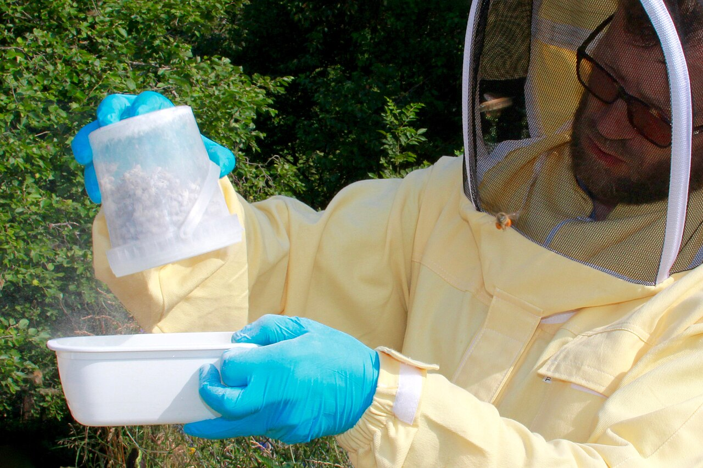

*Photo 46.1 — Monitoring in practice. This field example shows a beekeeper using a powdered-sugar method to sample for Varroa while wearing protective clothing. The photograph illustrates one real monitoring workflow, not a universal preference for one sampling method. Record the colony ID, sample method, date, sample size and result separately so repeated measurements remain comparable. Photo by Jürg Vollmer, CC BY-SA 4.0.*

## 46.13 Sampling Error

Monitoring is an estimate.

Sources of error include:

- small samples;
- uneven pest distribution;
- wrong brood frame;
- seasonal movement of parasites;
- operator inconsistency;
- poor equipment;
- misidentification.

IPM responds to uncertainty by monitoring repeatedly rather than pretending one sample is perfect.

## 46.14 Cultural Controls

Cultural controls change management practices to make pest growth or transmission less favourable.

Examples include:

- colony splits;
- brood interruption;
- timing of queen replacement;
- management of drone brood;
- preventing robbing;
- reducing drift;
- cleaning dead-outs promptly;
- controlling comb exchange;
- managing colony density.

These controls can be powerful because they change pest biology without relying solely on pesticides.

## 46.15 Brood Interruption

Varroa reproduction requires capped brood. Temporarily interrupting brood production can therefore:

- reduce reproductive opportunities;
- expose a larger proportion of mites on adult bees;
- improve performance of controls that do not penetrate capped brood effectively.

Brood interruption can result from:

- splits;
- controlled queen caging;
- queen replacement;
- natural broodless periods.

It also reduces brood production and can affect colony strength, so timing matters.

## 46.16 Splits as an IPM Opportunity

Creating a split often produces a period with reduced or absent capped brood.

Recent research has shown that this biological window can be combined strategically with authorised mite controls to increase effectiveness in some systems.

The principle is important: coordinate treatment with pest vulnerability rather than applying controls without considering the life cycle.

## 46.17 Drone-Brood Management

Varroa often reproduces efficiently in drone brood.

Managed drone-brood removal can remove reproducing mites if:

- drone comb is deliberately provided or identified;
- it becomes capped;
- it is removed before adult drones and mites emerge;
- removed brood is handled hygienically;
- quantitative monitoring continues.

Failure to remove the brood on time can increase mite production.

## 46.18 Robbing Prevention as IPM

Robbing spreads:

- Varroa;
- AFB spores;
- EFB-associated contamination;
- viruses;
- other colony material.

Reduce robbing by:

- avoiding exposed honey;
- feeding without spills;
- reducing vulnerable entrances;
- closing weak/dead colonies;
- processing wet supers appropriately;
- avoiding long open-hive inspections during dearth.

## 46.19 Reducing Drift

Drifting moves bees and their associated parasites/pathogens between colonies.

Measures can include:

- varied entrance orientation;
- visual landmarks;
- non-uniform hive placement;
- appropriate spacing;
- avoiding unnecessarily dense straight rows where practical.

No layout eliminates drift completely.

## 46.20 Genetic Controls

Bee breeding can support IPM through traits such as:

- Varroa-sensitive hygiene;
- suppressed mite reproduction;
- grooming;
- hygienic removal of diseased brood;
- disease resistance;
- survival under local environmental conditions.

Genetic resistance reduces dependence on chemical control but should be verified under local conditions.

## 46.21 Selecting Resistant Stock

Ask suppliers:

- What trait is selected?
- How is it measured?
- Is performance documented?
- Under what climate and management system?
- Are colonies still monitored for Varroa?

Marketing terms such as “mite resistant” should not replace measurable evidence.

## 46.22 Mechanical and Physical Controls

These controls physically remove or disrupt pests.

Examples include:

- drone-brood removal;
- screened-floor mite collection as a supporting tool;
- trapping comb;
- controlled heat systems where validated and authorised;
- physical exclusion of some predators or pests.

Each method has labour, timing, and efficacy limitations.

## 46.23 Biological Controls

Biological control uses living organisms or biologically derived systems against a pest.

Research areas include:

- entomopathogenic fungi against mites;
- bacteriophages against bacterial pathogens;
- microbial antagonists;
- RNA-based biological technologies.

The term “biological” does not mean automatically safe, effective, or legally authorised.

## 46.24 Chemical Controls

Chemical controls remain important when monitoring shows that other measures are insufficient.

Good IPM chemical use requires:

- correct target identification;
- authorised product;
- appropriate timing;
- correct dose and placement;
- suitable temperature;
- attention to brood;
- honey-food restrictions;
- operator PPE;
- post-treatment verification.

Chemicals are tools inside the system, not the system itself.

## 46.25 Product Selection by Active Ingredient

Brand names change, but active ingredients and modes of action determine biological selection pressure.

Record both:

- commercial product;
- active ingredient.

This allows the beekeeper to recognise when two different brands actually apply the same selection pressure.

## 46.26 Mode of Action

Mode of action describes how a control affects the target organism.

Rotating brand names without changing mode of action may provide little resistance benefit.

Resistance management should use current guidance on cross-resistance and active-ingredient classes rather than a simple “different packet” rule.

## 46.27 Resistance Selection

Resistance evolves when treatment kills susceptible individuals more effectively than resistant ones and the survivors reproduce.

Selection pressure increases with:

- repeated use of one active ingredient;
- under-dosing;
- prolonged low-level exposure;
- illegal homemade delivery systems;
- treatment residues remaining beyond instructions;
- area-wide dependence on one chemistry.

## 46.28 Resistance Is an Apiary and Regional Problem

A resistant mite does not respect hive ownership.

Drifting and robbing can spread resistant mites between colonies and apiaries.

Resistance management therefore benefits from coordination among neighbouring beekeepers, inspectors, researchers, and industry.

## 46.29 Treatment Rotation

Rotation can delay resistance when:

- products are effective;
- active ingredients have genuinely different relevant modes of action;
- cross-resistance is considered;
- each product is used according to label;
- non-chemical controls reduce overall chemical exposure.

Rotation cannot restore a product that has already failed badly in a resistant local population without evidence.

## 46.30 Combination Treatments

Combining products can create:

- additive efficacy;
- toxicity;
- residue problems;
- unknown interactions;
- conflicting label requirements.

Do not combine treatments unless the combination is explicitly authorised or directed by competent veterinary/regulatory guidance.

## 46.31 Timing Is Part of Efficacy

A good product at the wrong time can fail.

Timing depends on:

- pest life cycle;
- brood status;
- temperature;
- nectar flow;
- honey supers;
- colony strength;
- reinvasion risk;
- weather forecast.

IPM seeks the window when the target is vulnerable and collateral risk is acceptable.

## 46.32 Treatment Windows and Brood

Controls that mainly affect mites on adult bees perform differently when most mites are under brood cappings.

A broodless or brood-reduced period can create a higher-exposure window.

The beekeeper should therefore record brood status with every treatment.

## 46.33 Temperature and Weather

Some registered products depend strongly on ambient temperature.

Too cold may reduce release or activity. Too hot may increase queen, brood, or adult-bee stress.

Use the expected temperature across the full treatment interval.

## 46.34 Honey and Food Safety

Before treatment, verify:

- honey-super restrictions;
- withdrawal period;
- residue limits;
- wax implications;
- product storage;
- disposal rules.

IPM includes food safety as a core outcome.

## 46.35 Operator Safety

Controls can involve acids, pesticide residues, heat, vapours, sharp equipment, and heavy hive manipulation.

Use:

- label-specified PPE;
- safe mixing/handling procedures;
- adequate ventilation;
- original containers;
- secure storage;
- emergency first-aid information.

Never trade beekeeper safety for faster treatment.

## 46.36 Non-Target Effects

A control can affect:

- queen;
- brood;
- adult workers;
- drones;
- beneficial hive-associated organisms;
- wax microbiota;
- surrounding arthropods;
- human consumers.

“Low toxicity to the target host” and “no non-target effect” are different claims.

## 46.37 Treatment Failure

After poor control, investigate:

- wrong diagnosis;
- inadequate application;
- temperature;
- expired or degraded product;
- resistance;
- heavy protected brood;
- insufficient duration;
- missed colonies;
- rapid reinvasion;
- calculation error.

Do not automatically increase dose.

## 46.38 Verification

Every significant control action should have a defined success measure.

Examples:

- post-treatment Varroa wash;
- repeat pest inspection;
- laboratory confirmation after disease-control programme;
- reduction in hive-beetle trapping index;
- no new exotic-pest detections after official surveillance.

Verification turns treatment into evidence.

## 46.39 Before-and-After Comparison

A strong record includes:

- pre-control measurement;
- intervention;
- application conditions;
- post-control measurement;
- adverse effects;
- later recurrence or reinvasion.

This allows methods to be compared across years.

## 46.40 Area-Wide Effects

Honey bee colonies interact over kilometres through foraging, drifting, robbing, swarm movement, and beekeeper transport.

One unmanaged collapsing Varroa colony can become a mite source for several managed colonies.

Area-wide programmes aim to coordinate:

- monitoring periods;
- control timing;
- resistance surveillance;
- education;
- movement information.

## 46.41 Quarantine and Introduction Management

New bees can introduce:

- Varroa;
- Tropilaelaps where present;
- tracheal mites;
- viruses;
- bacterial disease;
- small hive beetle or other pests.

An introduction protocol can include:

- traceable source;
- movement documents;
- initial examination;
- Varroa baseline;
- temporary segregation where feasible;
- follow-up monitoring before sharing frames.

## 46.42 Exotic Pest Detection

When an exotic regulated organism is suspected, ordinary IPM thresholds stop being the main decision tool.

The response becomes:

1. preserve specimen/evidence;
2. stop unnecessary movement;
3. identify colony and apiary;
4. notify competent authority;
5. follow official containment and tracing.

Examples can include exotic *Tropilaelaps* or small hive beetle depending on jurisdiction.

## 46.43 Disease Within an IPM Framework

Some infectious diseases can be reduced through IPM-like prevention:

- hygienic stock;
- biosecurity;
- comb management;
- nutrition;
- surveillance;
- movement control.

However, notifiable disease law can require specific actions regardless of an economic threshold.

IPM does not override statutory disease control.

## 46.44 Small Hive Beetle Example

Where small hive beetle is established, management can combine:

- strong colonies;
- reduced unused comb space;
- rapid honey extraction;
- clean apiary practices;
- mechanical trapping;
- authorised soil or hive treatments where legal;
- monitoring.

Where the beetle is exotic, detection may instead trigger official reporting and containment.

The same organism can therefore require a different IPM decision in a different jurisdiction.

## 46.45 Wax Moth Example

Wax moths often exploit weak or unoccupied comb rather than causing primary collapse of a strong colony.

Prevention can include:

- maintaining strong colonies;
- removing abandoned comb;
- protecting stored supers;
- freezing or other physical treatment where appropriate;
- maintaining dry ventilated storage where compatible with the local system.

Correctly identifying the underlying colony weakness prevents treating a secondary scavenger as the primary cause.

## 46.46 Predator Example

Hornets or wasps may require:

- entrance management;
- apiary-site changes;
- trapping only where effective and lawful;
- nest management by competent authorities;
- species identification, especially where invasive species are regulated.

Broad indiscriminate trapping can kill non-target insects and should not be assumed to be good IPM.

## 46.47 Pesticide Exposure Is Not a Hive Pest

Agricultural pesticide poisoning is an environmental exposure, not a pest infestation.

Its management centres on:

- communication with growers;
- incident documentation;
- sample preservation;
- exposure reduction;
- formal reporting;
- regulatory investigation.

Do not apply a hive pesticide to solve an external pesticide exposure.

## 46.48 Monitoring Technology

Emerging tools include:

- electronic scales;
- acoustic sensors;
- temperature sensors;
- computer vision;
- automated mite counters;
- molecular environmental sampling;
- machine-learning risk models.

Technology can increase observation frequency but must be validated against biological ground truth.

## 46.49 Precision Apiculture

Precision apiculture uses colony-specific data to target interventions more accurately.

Potential benefits include:

- reducing unnecessary treatments;
- identifying high-risk colonies early;
- comparing queen lines;
- improving labour efficiency;
- tracking treatment performance.

Data quality and calibration remain essential.

## 46.50 Avoiding Calendar Dependence

A fixed annual treatment date can be convenient but may fail when:

- spring begins early;
- brood continues through winter;
- migration changes exposure;
- nectar flow shifts;
- reinvasion occurs;
- resistance changes product performance.

Use calendar reminders to trigger monitoring, not automatic treatment.

## 46.51 Treatment-Free Claims

Some bee populations and selected stocks survive Varroa with reduced or no acaricide use. Other untreated, non-resistant colonies experience high loss.

“Treatment-free” is therefore not a single biological condition.

A responsible programme must distinguish:

- documented resistant stock;
- active selection with monitoring and mitigation;
- unmanaged cessation of control.

Do not stop monitoring because a philosophy replaces data.

## 46.52 IPM and Commercial Beekeeping

Commercial operations face additional constraints:

- thousands of colonies;
- pollination schedules;
- labour;
- transport;
- treatment synchronisation;
- marketable honey;
- resistance across large mite populations.

IPM must be operationally practical as well as biologically sound.

Sampling plans, treatment windows, and area-wide coordination become especially important.

## 46.53 IPM and Small Apiaries

Small-scale beekeepers have advantages:

- individual-colony monitoring is feasible;
- queen lines can be tracked precisely;
- brood manipulation can be customised;
- detailed records are manageable.

The main risk is neglecting monitoring because there are only a few colonies.

## 46.54 Cost of Control

IPM considers more than product price.

Costs include:

- labour;
- equipment;
- queen loss;
- brood interruption;
- lost honey production;
- residue risk;
- treatment failure;
- resistance development;
- colony replacement.

A cheap ineffective control can be the most expensive option.

## 46.55 Choosing Between Controls

Compare options by:

- efficacy;
- evidence quality;
- legal status;
- target specificity;
- brood compatibility;
- temperature range;
- food-safety compatibility;
- resistance risk;
- operator safety;
- labour;
- cost;
- verification method.

## 46.56 IPM Decision Table

| Situation | IPM interpretation | Response principle |
|---|---|---|
| Low measured Varroa under current local guidance | Below present action level | Continue scheduled monitoring |
| Rising Varroa approaching risk period | Preventive window closing | Prepare timely combined control |
| High Varroa with much capped brood | Many mites protected in brood | Select strategy that accounts for brood biology |
| Treatment completed, high post-count | Failure/reinvasion possible | Diagnose cause before repeating chemistry |
| Suspected AFB | Regulated disease possibility | Stop movement and follow official requirements |
| Unusual fast elongated mite in non-endemic area | Possible exotic *Tropilaelaps* | Preserve specimen and notify authority |
| Wax moth in abandoned dead-out | Secondary scavenger | Diagnose why colony failed and protect stored comb |
| Sudden mass adult mortality after nearby spray | Environmental exposure | Preserve evidence; use incident-reporting pathway |

## 46.57 Building an Annual IPM Plan

### Step 1 — List local hazards

Include established and exotic threats.

### Step 2 — Define monitoring method

Specify how and when each important threat will be assessed.

### Step 3 — Define action rules

Use current official or scientifically supported guidance.

### Step 4 — List control options

Separate cultural, genetic, mechanical, biological, and authorised chemical tools.

### Step 5 — Identify constraints

Honey flow, temperature, labour, queen availability, movement, and law.

### Step 6 — Define verification

Every intervention needs a success measure.

### Step 7 — Review annually

Use records to update the plan.

## 46.58 Record Structure

For each colony or management group, record:

- ID;
- date;
- pest/disease target;
- monitoring method;
- raw result;
- calculated measure;
- action threshold source;
- intervention;
- active ingredient/method;
- weather;
- brood status;
- honey-super status;
- post-control result;
- adverse effects;
- next monitoring date.

## 46.59 Auditing the Programme

At the end of the season, ask:

- Which colonies repeatedly exceeded thresholds?
- Which queen lines required fewer interventions?
- Which treatments failed?
- Did resistance appear possible?
- Were there residue or safety problems?
- Which monitoring periods were missed?
- Which manipulations reduced production excessively?
- Did any untreated neighbouring source drive reinvasion?

An IPM programme should improve with every season.

## 46.60 Common Mistakes

### Treating before identifying

Wrong target, wrong control.

### Treating by calendar only

Biology changes.

### Using “natural” as a safety test

Natural acids and oils can injure bees and people.

### Rotating brands instead of modes of action

Resistance pressure may remain unchanged.

### Skipping verification

Treatment application is not evidence of success.

### Ignoring legal disease obligations

Thresholds do not override reporting law.

### Ignoring neighbours

Drift and robbing make Varroa an area-wide problem.

## 46.61 Scientific Notes

### IPM is adaptive

The core of IPM is feedback. Monitoring informs control, and verification informs the next round of monitoring and control.

### Selection pressure

Every effective pesticide changes the genetic composition of the surviving pest population. Combining non-chemical methods with careful chemical use can reduce dependence on one selection pressure.

### Life-cycle synchronisation

The 2025 study of newly split colonies illustrates an IPM principle: a cultural control that creates a brood break can make mites biologically more exposed to a subsequent authorised control.

### Thresholds can change

The 2026 Honey Bee Health Coalition guide updated Varroa threshold guidance. Current resistance reviews also argue for flexible thresholds as mite-virus risk and control performance evolve. A good handbook therefore teaches interpretation rather than fossilising one number.

### Area-wide ecology

Honey bee pest management cannot be understood strictly at the individual-hive scale. Bees fly, drift, rob, swarm, and are transported, creating a connected landscape of parasite and pathogen movement.

## 46.62 Practical IPM Checklist

- [ ] Local established and exotic hazards are listed.
- [ ] Every colony or management group is identifiable.
- [ ] Monitoring methods are defined before the season.
- [ ] Results are recorded quantitatively where possible.
- [ ] Target organism is correctly identified.
- [ ] Current action guidance is checked.
- [ ] Statutory disease rules are separated from ordinary thresholds.
- [ ] Non-chemical controls are considered first where effective.
- [ ] Resistant stock is evaluated using evidence.
- [ ] Brood biology is considered before mite control.
- [ ] Product is authorised.
- [ ] Active ingredient and mode of action are recorded.
- [ ] Cross-resistance is considered.
- [ ] Honey and temperature restrictions are checked.
- [ ] PPE is prepared.
- [ ] Post-control verification is scheduled.
- [ ] Reinvasion is considered.
- [ ] Treatment failures are investigated rather than simply repeated.
- [ ] Records are reviewed at season end.
- [ ] Next year's plan is updated from evidence.

## Key Takeaways

- IPM is a continuous decision cycle rather than a treatment list.
- Prevention, monitoring, correct identification, and verification are as important as intervention.
- Thresholds are pest-, season-, region-, and management-specific.
- Notifiable disease and exotic-pest law can override ordinary threshold logic.
- Cultural controls such as brood interruption can exploit pest biology.
- Resistant stock can reduce treatment dependence but does not eliminate monitoring.
- Chemical controls remain useful when they are authorised, correctly timed, and verified.
- Resistance management depends on active ingredient, mode of action, cross-resistance, and reduced unnecessary exposure.
- Honey safety, operator safety, and non-target effects are core IPM outcomes.
- Good records transform individual treatments into a learning system.

## Chapter Summary

Integrated pest management combines biological knowledge with measurement. The beekeeper first prevents avoidable introductions, monitors important threats, identifies the organism correctly, and interprets risk using current guidance. Intervention then combines the least disruptive effective cultural, genetic, mechanical, biological, and authorised chemical controls.

Varroa demonstrates the power of this approach. Brood interruption, resistant stock, drone-brood removal, robbing reduction, quantitative monitoring, and well-timed registered acaricides can be integrated so that no single control bears the entire burden. This reduces treatment frequency, slows resistance selection, and provides alternative options when one product fails.

IPM is not universal threshold management. Regulated AFB, EFB, exotic *Tropilaelaps*, or small hive beetle can require official action immediately. Nor does IPM mean avoiding chemicals at all costs. It means using every tool according to evidence, law, food safety, target biology, and measured need.

The final step is verification. A post-treatment sample, follow-up inspection, or laboratory result closes the feedback loop. Records then allow the beekeeper to identify recurring high-risk colonies, resistant queen lines, failing products, reinvasion patterns, and better management windows. An IPM programme should become more precise with every season.

## Review Questions

1. What is integrated pest management?
2. Why is IPM not a single treatment?
3. What are the main steps in an IPM cycle?
4. Why is beekeeping IPM different from treating pests on a non-food structure?
5. What does prevention include?
6. Why are traceable bee purchases important?
7. What is the difference between surveillance and monitoring?
8. Give an example of exotic-pest surveillance.
9. Give an example of repeated monitoring for an established parasite.
10. Why is correct identification essential?
11. Why is patchy brood not a pest identity?
12. What is the advantage of detecting a problem before visible damage?
13. What is an action threshold?
14. Which factors can change a Varroa action threshold?
15. Why should thresholds not be memorised as universal numbers?
16. Which disease situations can override threshold logic?
17. Why is AFB not simply an economic-threshold problem?
18. What is an economic injury level in classical IPM?
19. Why is immediate honey revenue an incomplete measure of bee-health risk?
20. How can pollination value affect management decisions?
21. Why should a monitoring calendar follow biology?
22. Name four biological events that should trigger monitoring.
23. What is a baseline?
24. Why is a pre-treatment baseline valuable?
25. Which parts of monitoring should be standardised?
26. How can changing sampling method create a false trend?
27. What is sampling error?
28. Why does IPM use repeated monitoring?
29. What are cultural controls?
30. Name four cultural controls used in beekeeping.
31. Why does brood interruption affect Varroa?
32. What are the possible costs of brood interruption?
33. How can splitting a colony create an IPM opportunity?
34. What principle is illustrated by combining a brood break with a suitable authorised control?
35. Why can drone-brood removal reduce Varroa?
36. What happens if infested drone brood is allowed to emerge?
37. Why is robbing prevention part of IPM?
38. Which pathogens or parasites can move during robbing?
39. How can apiary layout reduce drifting?
40. Can drift be eliminated completely?
41. What are genetic controls?
42. Name three resistance traits relevant to Varroa.
43. What should a buyer ask about “mite-resistant” stock?
44. Why does resistant stock not eliminate monitoring?
45. What are mechanical or physical controls?
46. Give two examples of physical or mechanical controls.
47. What is biological control?
48. Why does “biological” not automatically mean safe?
49. When do chemical controls fit within IPM?
50. What checks belong before chemical treatment?
51. Why should active ingredient be recorded as well as product name?
52. What is mode of action?
53. Why can rotating brand names fail to manage resistance?
54. What is resistance selection?
55. Which practices can increase selection pressure?
56. Why can under-dosing promote resistance?
57. How can resistant mites spread between apiaries?
58. What makes resistance an area-wide problem?
59. When can treatment rotation help?
60. What is cross-resistance?
61. Why should unauthorised product combinations be avoided?
62. Why is timing part of treatment efficacy?
63. How does capped brood change exposure of mites to some controls?
64. Why should brood status be recorded?
65. How can temperature affect a registered product?
66. Why should the forecast cover the whole treatment interval?
67. Which food-safety checks precede treatment?
68. Why are honey-super restrictions part of IPM?
69. What operator hazards may occur during mite treatment?
70. What are non-target effects?
71. Why is low bee toxicity not the same as zero environmental effect?
72. What should be investigated after treatment failure?
73. Why should dose not automatically be increased after failure?
74. What is verification?
75. Give three examples of post-control verification.
76. Why is a before-and-after comparison useful?
77. What is an area-wide effect?
78. How can one collapsing colony affect neighbouring Varroa levels?
79. What can area-wide programmes coordinate?
80. What should an introduction protocol include?
81. Why can new bees introduce more than Varroa?
82. What should happen after suspected exotic-pest detection?
83. Why does IPM not override statutory disease control?
84. How can small hive beetle management differ between endemic and exotic regions?
85. Why are wax moths often secondary pests?
86. What should be investigated when wax moths overwhelm a dead-out?
87. Why can indiscriminate predator trapping harm IPM goals?
88. Why is pesticide poisoning not a hive-pest infestation?
89. What can monitoring technology add?
90. Why must electronic sensors be validated biologically?
91. What is precision apiculture?
92. Why is a fixed calendar treatment programme fragile?
93. What distinctions are required when discussing “treatment-free” beekeeping?
94. Why can small apiaries perform detailed individual-colony monitoring?
95. What costs besides product price belong in an IPM decision?
96. What criteria should be used to compare controls?
97. What are the steps for building an annual IPM plan?
98. Which data belong in an IPM record?
99. What questions should be asked during a season-end audit?
100. What makes an IPM programme improve over time?

## References

- Honey Bee Health Coalition. *Tools for Varroa Management: A Guide to Effective Varroa Sampling & Control*, 9th ed., 2026.
- COLOSS. “Varroa Control” Task Force resources and current sustainable-management programme. Accessed 15 September 2026.
- Bahreini, R., and Morfin, N. “The growing challenge of Varroa destructor resistance to acaricides: seeking sustainable solutions.” *Current Opinion in Insect Science* 78, 2026, 101568. DOI: 10.1016/j.cois.2026.101568.
- Aurell, D., Bruckner, S., Steury, T. D., and Williams, G. R. “Treating newly split Apis mellifera honey bee colonies with organic miticides—an opportunity for Integrated Pest Management of Varroa destructor mites.” *Journal of Economic Entomology* 118(4), 2025, 1495–1503. DOI: 10.1093/jee/toaf126.
- O'Connell, D. P. et al. “A systematic meta-analysis of the efficacy of treatments for a global honey bee pathogen — the Varroa mite.” *Science of the Total Environment* 963, 2025, 178228. DOI: 10.1016/j.scitotenv.2024.178228.
- “Integrated Pest Management Control of Varroa destructor, the Most Damaging Pest of Apis mellifera Colonies.” *Journal of Insect Science* 21(5), 2021, 6.
- USDA Agricultural Research Service. Current Varroa IPM and resistant-honey-bee research programmes, including area-wide management initiatives. Accessed 15 September 2026.
- World Organisation for Animal Health. Current honey bee disease and infestation standards. Accessed 15 September 2026.
- Current national veterinary-medicine, pesticide, food-safety and bee-health authorities. Product registration, thresholds, regulated-disease controls, residue requirements and operator-safety rules must be verified for the reader’s jurisdiction.
