# Practical Beekeeping Handbook

**Honey Production and Other Hive Products**

**WORKING MANUSCRIPT — NOT A RELEASE OR A PRINT MASTER.**

Narrative revision (#228), image placement, pagination and format proof remain pending. Chapter numbers are global and unchanged. No final page count is claimed.

## Set navigation

| Edition | Chapters |
|---|---|
| [Complete digital edition](digital-complete.md) | 1–74 |
| [Foundations, Honey Bee Biology and Starting an Apiary](volume-01.md) | 1–23 |
| [Colony Management](volume-02.md) | 24–38 |
| [Bee Health](volume-03.md) | 39–46 |
| [Honey Production and Other Hive Products](volume-04.md) | 47–59 |
| [Business, Sustainability and Reference Material](volume-05.md) | 60–74 |

Complete References 75–85 are in Volume 5 and the complete digital edition. Chapter bibliographies and warnings remain within their chapters.

# Chapter 47 — Nectar Flow

## Introduction

Honey production begins before any honey appears in a super. It begins with plants, weather, soil water, flower development, and the ability of a colony to place enough effective foragers in the field at the right time.

A nectar flow is a period in which nectar entering a colony exceeds immediate colony consumption strongly enough that bees store a surplus. This definition is deliberately practical. Flowers can be abundant without producing a useful flow, and nectar can be available in the landscape without producing a surplus if colonies are weak, weather prevents flight, competition is intense, or incoming nectar is consumed by brood rearing.

Three quantities must therefore be kept separate:

1. **nectar secretion by plants**;
2. **nectar collected by the colony**;
3. **surplus honey eventually ripened and harvested**.

They are related but never identical.

Successful honey production depends on aligning colony population with local phenology. A strong colony that peaks two weeks after the main crop has flowered cannot recover the lost opportunity. Likewise, adding supers to a weak colony does not create a nectar flow.

## Learning Objectives

After completing this chapter, the reader should be able to:

- define a nectar flow in practical colony terms;
- distinguish nectar secretion, forager intake, and harvestable honey surplus;
- explain how plant species, soil moisture, temperature, humidity, wind, and rainfall affect nectar availability;
- recognise major, minor, and interrupted flows;
- distinguish nectar flow from honeydew flow;
- use colony flight, comb condition, fragrance, weight gain, and scale data as flow indicators;
- interpret scale-hive weight without confusing nectar gain with true honey yield;
- prepare colony population in advance of a predicted flow;
- make evidence-based supering decisions;
- record local flowering phenology instead of relying on fixed calendar dates.

## 47.1 Nectar as a Plant Reward

Nectar is an aqueous sugar solution secreted by specialised plant tissues called nectaries. Floral nectar attracts pollinators, while extrafloral nectaries can serve other ecological functions.

Nectar composition varies greatly among plant species and can include:

- sucrose;
- glucose;
- fructose;
- amino acids;
- minerals;
- organic acids;
- volatile compounds;
- secondary metabolites.

The volume secreted and sugar concentration can change during a single day.

## 47.2 Flowers Do Not Guarantee Nectar

A field can appear to be in full bloom yet provide little usable nectar.

Reasons include:

- insufficient soil moisture;
- temperature outside the plant's secretion range;
- flowers at the wrong developmental stage;
- wind or low humidity causing rapid evaporation;
- previous nectar removal;
- cultivar differences;
- nutrient stress;
- rain washing or diluting nectar;
- low flower density despite visual colour;
- inaccessible floral morphology.

The beekeeper should therefore learn to read bees and hive weight as well as flowers.

## 47.3 Floral Phenology

Phenology is the timing of recurring biological events such as bud burst, flowering, seed formation, and leaf fall.

For beekeeping, useful phenological records include:

- first flower;
- 10–20% bloom;
- full bloom;
- declining bloom;
- end of bloom;
- observed bee visitation;
- first sustained colony weight gain.

Phenology is more transferable than calendar dates because flowering shifts with altitude, latitude, temperature, rainfall, and year-to-year weather.

## 47.4 Major and Minor Flows

A **major flow** produces substantial surplus storage and can dominate the annual crop.

A **minor flow** contributes nectar but may mainly support brood and adult maintenance.

The same plant can generate a major flow in one region and a minor flow in another because of acreage, weather, competing forage, soil, and colony density.

## 47.5 Continuous Versus Pulsed Flows

Some landscapes provide a relatively continuous sequence of flowering sources. Others produce strong pulses separated by dearths.

A pulsed environment can create management challenges:

- colonies expand during one flow;
- a sudden gap increases robbing and swarm pressure;
- supers may contain partially ripened nectar;
- the next crop can mix with the previous one;
- colonies may consume stored surplus during the gap.

Recording the sequence of local forage is therefore more useful than recording only the largest crop.

## 47.6 Nectar Versus Honeydew

Honeydew is a sugar-rich excretion produced by sap-feeding insects such as aphids and scale insects on living plants. Bees can collect it when floral nectar is limited or when honeydew is abundant.

Honeydew honey can differ from blossom honey in:

- mineral content;
- electrical conductivity;
- colour;
- flavour;
- sugar profile;
- botanical indicators.

Legal definitions and compositional limits may distinguish blossom and honeydew honey.

## 47.7 Plant Species and Cultivar

Nectar potential varies not only by species but sometimes by cultivar.

Two varieties of the same crop can differ in:

- nectary size;
- sugar concentration;
- flower density;
- flowering duration;
- compatibility with local pollinators.

Agronomic breeding can therefore alter forage value even when the crop name remains the same.

## 47.8 Soil Moisture

Plants require sufficient water to maintain growth and nectar secretion.

Drought can reduce:

- flower number;
- flower size;
- nectar volume;
- duration of bloom;
- sugar export to nectaries.

However, excessive rain can also reduce bee access and dilute or wash nectar.

The best honey years are often produced by favourable sequences of weather rather than one ideal day.

## 47.9 Temperature

Temperature affects both plants and bees.

For plants it can influence:

- nectar secretion;
- sugar concentration;
- flower opening;
- volatile production;
- bloom duration.

For bees it affects:

- flight ability;
- flight duration;
- energetic cost;
- recruitment;
- nectar evaporation inside the hive.

Different plants have different temperature responses, so no single “nectar temperature” applies to all crops.

## 47.10 Humidity

Relative humidity affects water loss from nectar.

High humidity can leave nectar more dilute, requiring greater evaporation by bees. Low humidity can concentrate exposed nectar but may also coincide with plant water stress.

A refractometer reading from fresh incoming nectar can therefore vary greatly even within the same floral source.

## 47.11 Wind

Strong wind can reduce foraging by:

- increasing flight energy cost;
- disrupting navigation;
- making small flowers difficult to land on;
- lowering local temperature;
- accelerating flower desiccation.

Sheltered apiary placement can partly reduce wind exposure, but bees still must travel through the wider landscape.

## 47.12 Rain

Rain affects nectar flows in several ways.

It can:

- replenish soil moisture;
- stimulate later flowering;
- wash nectar from open flowers;
- dilute nectar;
- prevent flight;
- shorten flowers mechanically;
- create a strong post-rain flow if warm weather follows.

A rainy week can therefore either improve or destroy honey prospects depending on timing.

## 47.13 Cloud and Solar Radiation

Solar radiation affects flower temperature, photosynthesis, and local microclimate.

Some nectar plants secrete best under bright warm conditions; others perform well in cooler or partially shaded environments.

The beekeeper should learn crop-specific behaviour locally rather than applying one rule to all plants.

## 47.14 Time of Day

Different flowers reach peak nectar secretion at different times.

A colony may therefore show:

- morning weight gain from one crop;
- midday slowdown;
- afternoon gain from another source.

Daily scale data can reveal these patterns when combined with weather and field observation.

## 47.15 Flower Age

Nectar secretion often changes as a flower ages.

Pollination can reduce nectar production or trigger flower senescence in some species. In others, nectar continues to be replenished for a period.

A field at “full bloom” may therefore contain flowers of very different nectar value.

## 47.16 Sugar Concentration and Bee Preference

Honey bees generally prefer nectar that provides a favourable energetic return, but preference depends on more than sugar concentration.

Foragers also respond to:

- travel distance;
- nectar volume;
- handling time;
- flower abundance;
- competition;
- colony recruitment;
- alternative sources.

A slightly weaker nectar very close to the apiary can sometimes outperform richer nectar far away.

## 47.17 Foraging Economics

Every foraging trip has costs:

- flight energy;
- time;
- exposure to weather;
- predation;
- handling time at flowers.

A profitable nectar source provides enough sugar per unit time to justify recruitment.

This is why dance communication encodes both direction and distance and why colonies can switch rapidly between sources.

## 47.18 Recruitment

Successful foragers recruit nestmates through waggle dances and associated cues.

Recruitment strength reflects source profitability.

A productive floral patch can therefore draw a large fraction of the colony's foraging workforce, while a weak source may receive only scattered visits.

## 47.19 Scout Bees

Scouts search for new food sources and help the colony adjust when flowering conditions change.

Their role becomes especially important when:

- a major source finishes;
- weather opens a new flight window;
- a crop begins flowering suddenly;
- colonies are moved to a new area.

## 47.20 Colony Population and Flow Capture

A nectar flow has limited duration. The colony needs a large workforce before the peak, not after it.

Productive colonies require enough:

- foragers;
- house bees to receive nectar;
- bees to ventilate and evaporate water;
- comb space;
- queen and brood support.

A colony overloaded with unripe nectar but short of receiver bees can become storage-limited.

## 47.21 Receiver Bees

Foragers often transfer nectar to younger house bees.

Receiver bees:

- accept loads;
- distribute nectar;
- add glandular secretions;
- place nectar into cells;
- participate in ripening and storage.

This is one reason a balanced age structure matters during a heavy flow.

## 47.22 Nectar Processing

Incoming nectar may contain far more water than ripe honey.

Bees reduce water through:

- repeated transfer;
- spreading droplets over comb surfaces;
- placing nectar in partially filled cells;
- ventilation;
- warm hive conditions;
- later consolidation.

Enzymatic changes also occur during ripening.

## 47.23 Nectar Is Not Yet Honey

Fresh nectar in a cell should not be treated as finished honey.

During ripening:

- water content falls;
- sugars are enzymatically transformed;
- acidity changes;
- aroma evolves;
- cells become consolidated;
- mature honey is often capped.

This distinction becomes critical during harvest.

## 47.24 Hive Fragrance

During a strong flow, an apiary can develop a characteristic warm nectar aroma.

This can support other observations, but fragrance is subjective and cannot quantify incoming nectar.

Use it as a field clue rather than a measurement.

## 47.25 Entrance Activity

Heavy flight can indicate a flow, but entrance traffic can also reflect:

- orientation flights;
- water collection;
- pollen collection;
- robbing;
- relocation after disturbance.

Look for returning bees with distended abdomens, flight direction, pollen loads, and sustained pattern across the day.

## 47.26 White Wax

Fresh pale wax on super comb, bridge comb, or comb edges often indicates active construction associated with strong incoming resources.

It is a useful sign of colony expansion and flow, but bees can also build wax after feeding.

Context matters.

## 47.27 Cells Glinting with Nectar

Tilting a frame slightly can reveal liquid nectar reflecting light in cells.

This is direct evidence of storage but not of ripeness.

Do not shake unripe nectar from comb or assume uncapped cells are ready for harvest.

## 47.28 Hive Weight

Hive weight is one of the most objective indicators of nectar flow.

A colony gaining several kilograms over a period is receiving more material than it is losing, but the gain can include:

- nectar;
- pollen;
- water;
- bees;
- added equipment.

Weight interpretation therefore requires context.

## 47.29 Scale Hives

A scale hive provides continuous or periodic weight data from one colony.

Useful measurements include:

- overnight stable weight;
- daily minimum;
- daily maximum;
- net 24-hour change;
- multi-day trend.

Daily curves can reveal foraging periods, evaporation, rain loading, and management events.

## 47.30 The Daily Weight Curve

A typical productive day may show:

1. early-morning stable weight;
2. temporary loss as foragers leave;
3. weight gain as nectar returns;
4. evening peak;
5. overnight weight loss as water evaporates and bees metabolise resources.

The overnight loss explains why gross daytime gain is not equal to final honey gain.

## 47.31 Rain on a Scale Hive

Rain can add water directly to:

- roof surfaces;
- wooden boxes;
- straps;
- hive stands.

A sudden weight increase during rain should not be mistaken for nectar.

Use weather data with scale data.

## 47.32 Swarms and Weight Data

A swarm leaving a colony can produce a sudden weight loss.

Likewise, adding a super creates a step increase unrelated to forage.

Mark all management events in the scale record.

## 47.33 Using Multiple Scale Hives

One scale hive can mislead if its queen, population, or health differs from the apiary average.

Multiple scales allow comparison of:

- colony strength;
- site variation;
- queen lines;
- microclimate;
- treatment or management effects.

Even two well-selected colonies can be more informative than one.

## 47.34 Forecasting a Flow

Flow forecasting combines:

- historical phenology;
- current bud development;
- rainfall history;
- soil moisture;
- temperature forecast;
- crop acreage;
- beekeeper scale records;
- direct field observation.

Forecasting is probabilistic. Prepare colonies before certainty arrives.

## 47.35 Building a Local Bloom Calendar

Record local plants by biological stage rather than only month.

A useful table includes:

- species/common name;
- location;
- first bloom;
- peak bloom;
- end bloom;
- bee visitation;
- pollen colour if relevant;
- scale-hive response;
- annual reliability.

After several years, this becomes one of the beekeeper's most valuable assets.

## 47.36 Indicator Plants

Some plants bloom shortly before an important honey crop and can serve as local indicators.

An indicator plant does not cause the later flow. It provides a phenological signal that regional development has reached a useful stage.

Indicator relationships must be learned locally.

## 47.37 Degree Days

Growing degree-day models accumulate heat units above a defined base temperature and can help predict flowering or pest development.

Their usefulness depends on:

- correct base temperature;
- local calibration;
- plant species;
- weather station location.

They complement, not replace, direct field observation.

## 47.38 Climate Variability

Climate variability can shift:

- flowering date;
- bloom duration;
- drought frequency;
- overlap between crops;
- honeydew insect populations;
- winter brood activity;
- storm damage.

Long-term bloom records help separate a one-year anomaly from a persistent trend.

## 47.39 Climate Change and Mismatch

If plants flower earlier but colony population does not increase at the same rate, a phenological mismatch can reduce honey capture.

Conversely, warmer conditions can lengthen some flowering periods or create new forage opportunities.

Management must remain adaptive rather than assuming every change is negative or positive.

## 47.40 Preparing the Colony

Preparation starts several brood cycles before the anticipated flow.

Key factors include:

- healthy queen;
- low damaging Varroa pressure;
- adequate food before natural forage builds;
- sufficient brood space;
- prevention of premature swarming;
- enough drawn comb;
- appropriate colony strength.

Trying to build a workforce after the main bloom starts is usually too late.

## 47.41 Queen Timing

The queen's egg-laying pattern weeks before the flow helps determine worker numbers during the flow.

A worker takes about three weeks from egg to adult emergence and additional time before becoming a typical forager.

Therefore, the adult foraging force reflects earlier management.

## 47.42 Swarm Pressure

Strong colonies approaching a major flow may also be approaching swarming condition.

A swarm can remove:

- a large share of the workforce;
- the old queen;
- immediate honey-production capacity.

Swarm management and honey-production planning are therefore linked.

## 47.43 Supering Before Congestion

Supers should be added before storage space becomes a critical bottleneck.

Signs that additional space may be required include:

- rapid weight gain;
- fresh nectar spreading through available cells;
- heavy white-wax production;
- bees occupying most super frames;
- strong weather/phenology forecast.

The exact timing depends on hive type and management system.

## 47.44 Too Little Super Space

Insufficient space can cause:

- nectar backfilling into brood nest;
- reduced laying space;
- increased congestion;
- greater swarm pressure;
- slower nectar handling;
- lost surplus.

Drawn comb is especially valuable during a sudden heavy flow.

## 47.45 Too Much Empty Space

Excessive unused volume can:

- increase thermoregulation burden;
- slow occupation of new comb;
- create problems in weak colonies;
- complicate inspections.

Strong flow management balances anticipated intake with colony capacity.

## 47.46 Drawn Comb Versus Foundation

Drawn comb can accept nectar immediately.

Foundation requires wax production and construction before cells become available.

During an intense short flow, drawn comb can therefore capture nectar that might otherwise be lost.

## 47.47 Wax Production During Flow

Wax secretion is energetically expensive but can be stimulated by strong nectar intake, warm conditions, and colony need for storage space.

Young adult bees are especially important wax producers.

A colony asked to build large amounts of comb may store less immediately extractable honey than one given drawn supers, but new comb has long-term value.

## 47.48 Brood Nest Backfilling

During a heavy flow, workers may place nectar in brood-nest cells.

Some temporary backfilling is normal. Severe backfilling can reduce queen laying space and contribute to swarm pressure.

Monitor brood-space availability without repeatedly disrupting the colony during peak foraging.

## 47.49 Flow Interruption

A flow can stop suddenly because of:

- cold front;
- drought;
- crop mowing;
- storm damage;
- flowering completion;
- rain;
- agricultural harvest.

The colony may rapidly shift from storage to consumption.

## 47.50 Dearth

A dearth is a period when usable nectar is scarce relative to colony needs.

Signs can include:

- reduced weight gain or net loss;
- increased robbing attempts;
- more defensive behaviour;
- reduced wax production;
- declining fresh nectar;
- reduced brood rearing.

A dearth after a major flow can surprise beekeepers who assume stores will only increase.

## 47.51 Robbing During Dearth

During dearth, strong colonies may search aggressively for alternative sugar sources.

Protect the apiary by:

- avoiding exposed honey;
- closing wet supers;
- feeding without spills when feeding is necessary;
- reducing vulnerable entrances;
- minimising prolonged inspections.

## 47.52 Colony Consumption During Dearth

Stored honey is not permanently “harvest surplus” until it is removed.

Colonies can consume substantial stores during:

- prolonged rain;
- brood rearing;
- hot dry dearths;
- post-flow periods.

Scale-hive records can reveal this consumption.

## 47.53 Apiary Competition

Too many colonies relative to forage can reduce per-colony yield.

Carrying capacity depends on:

- floral density;
- duration of bloom;
- weather;
- competing managed apiaries;
- wild pollinators;
- flight distance;
- colony strength.

There is no universal number of hives per hectare for mixed landscapes.

## 47.54 Foraging Radius

Honey bees can forage several kilometres, but energetic profitability generally favours productive sources closer to the apiary.

A large theoretical flight radius should not be treated as a uniformly exploited circle.

Landscape use is patchy and changes daily.

## 47.55 Apiary Placement

Good honey sites combine:

- reliable forage;
- safe access;
- water;
- suitable sun/shade balance;
- wind protection;
- low flood risk;
- low pesticide exposure;
- secure hive placement;
- manageable competition.

Convenient access alone does not make a productive site.

## 47.56 Migratory Beekeeping

Moving colonies to crops can capture flows unavailable at a permanent apiary.

Planning requires:

- crop bloom forecast;
- landowner agreement;
- pesticide communication;
- transport logistics;
- legal movement requirements;
- colony health certification where applicable;
- water and site preparation;
- post-movement monitoring.

## 47.57 Arrival Timing for Migratory Colonies

Arriving too early can expose colonies to starvation or pesticide risk before bloom. Arriving too late loses early nectar.

Use crop phenology and grower communication rather than a fixed annual date.

## 47.58 Pollination Versus Honey Production

A crop can be valuable for pollination but poor for surplus honey.

Pollination contracts and honey crops should be evaluated separately.

Some crops provide abundant pollen but little nectar; others provide nectar of limited market value but excellent colony support.

## 47.59 Pesticide Risk During Flows

Flowering agricultural crops can expose foragers to pesticides.

Risk management includes:

- communication with growers;
- knowledge of spray schedules;
- label-compliant application by growers;
- avoiding preventable exposure windows;
- incident documentation if mortality occurs.

Do not assume a profitable crop is automatically a safe crop.

## 47.60 Honey Source Separation

Beekeepers seeking varietal honey need to know when one dominant source begins and ends.

Useful tools include:

- phenology;
- scale data;
- super placement dates;
- sensory changes;
- pollen/melissopalynological analysis where appropriate;
- electrical conductivity or chemical markers for some origins.

Perfect source separation is often biologically impossible in mixed landscapes.

## 47.61 Floral Origin Claims

A floral-origin claim should be supported by the honey's actual characteristics and current legal requirements.

In the EU, for example, a floral or vegetable origin may be indicated only when the honey comes wholly or mainly from the indicated source and has the expected organoleptic, physicochemical, and microscopic characteristics.

Do not name a honey after the most visually obvious local flower without evidence.

## 47.62 Regional Origin Claims

Geographical-origin claims also require traceability.

An apiary location record should include:

- coordinates or precise site identity;
- movement dates;
- super dates;
- harvest lot;
- neighbouring forage context.

Later chapters address legal labelling in more detail.

## 47.63 Flow Records

For each apiary, record:

- site;
- colony IDs;
- major flowering sources;
- phenological stage;
- weather;
- scale-hive change;
- supers added;
- swarms;
- queen events;
- harvest date;
- final crop weight.

These records turn local experience into usable evidence.

## 47.64 Comparing Years

A useful comparison does not ask only, “How much honey did I harvest?”

Also compare:

- bloom start;
- peak bloom;
- rainfall before bloom;
- flight days during bloom;
- colony strength;
- Varroa pressure;
- number of supers;
- dearth duration;
- harvest moisture.

This helps identify whether yield changed because of weather or management.

## 47.65 Using Weather Stations

A nearby weather station can provide:

- rainfall;
- temperature;
- humidity;
- wind;
- solar radiation.

Distance and elevation matter. Conditions at the apiary can differ from an airport or city station several kilometres away.

On-site sensors improve local interpretation.

## 47.66 Remote Hive Scales

Connected scales can send weight data without opening colonies.

Benefits include:

- early flow detection;
- dearth detection;
- swarm alerts;
- winter consumption tracking;
- timing of super additions.

Limitations include sensor drift, battery failure, rain loading, animal disturbance, and one-colony bias.

## 47.67 Interpreting Sudden Gains

A sudden gain can reflect:

- strong nectar flow;
- rainwater;
- added feeder;
- added super;
- beekeeper leaning equipment on the scale.

Automatic data still need human context.

## 47.68 Interpreting Sudden Losses

A sudden loss can reflect:

- swarm departure;
- super removal;
- roof or equipment loss;
- feeding equipment removal;
- scale disturbance.

A slower persistent decline more often indicates consumption exceeding intake.

## 47.69 From Nectar Flow to Harvest Prediction

Final harvest is lower than gross incoming nectar because:

- nectar contains water later evaporated;
- bees consume sugars;
- brood is fed;
- wax may be produced;
- some honey remains for colony needs;
- harvestable frames are not completely full.

Scale-hive gain is therefore a management indicator, not a direct invoice weight.

## 47.70 Practical Flow Assessment Procedure

### Before opening the hive

Record:

- weather;
- flowering sources;
- entrance activity;
- current scale trend.

### In the colony

Check briefly for:

- fresh nectar;
- white wax;
- available storage space;
- brood-nest congestion;
- super occupation;
- swarm signs where seasonally relevant.

### After inspection

Decide whether to:

- add space;
- leave unchanged;
- manage swarm pressure;
- prepare for dearth;
- schedule harvest assessment.

## 47.71 Decision Table

| Observation | Likely interpretation | Management response |
|---|---|---|
| Flowers abundant, hive weight flat | Nectar weak, weather poor, or colony unable to exploit source | Check colony strength and actual bee visitation |
| Sustained multi-day weight gain | Active useful flow | Ensure adequate storage space |
| Strong daytime gain, large overnight loss | Dilute nectar being ripened | Do not equate gross gain with honey yield |
| Fresh white wax and rapidly filling supers | Strong intake and construction | Add space before congestion |
| Weight declining after bloom | Dearth/consumption | Protect stores and monitor robbing |
| One scale hive gaining, others not | Colony-specific difference possible | Inspect queen/strength/health across apiary |
| Sudden large weight loss | Swarm or management event | Verify immediately |
| Rain-associated weight increase | Water loading possible | Compare with weather and next dry reading |

## 47.72 Scientific Notes

### Nectar secretion is dynamic

Nectar volume and concentration are not fixed species traits. They emerge from plant genetics interacting with water status, temperature, flower age, pollination, soil, and time of day.

### Colony foraging is collective economics

Recruitment allows a colony to concentrate labour on resources offering high energetic return. The foraging pattern of thousands of workers emerges from repeated individual decisions and social information.

### Honey production is delayed

Worker population available during a flow is largely determined by eggs laid weeks earlier. Beekeeping for surplus production therefore requires anticipation.

### Scale-hive data are mass balance, not honey analysis

A scale measures total mass. Interpretation requires separating nectar, water, equipment, bees, rainfall, evaporation, and management events.

### Climate changes phenology

Long-term biological records can reveal shifts in bloom timing and overlap that standard calendar notes miss.

## 47.73 Nectar-Flow Checklist

- [ ] Major local forage species are identified.
- [ ] Bloom stages are recorded phenologically.
- [ ] Scale data are annotated with weather and management events.
- [ ] Colony Varroa status is under control before major flows.
- [ ] Queen performance is adequate.
- [ ] Sufficient worker population is developing before the expected flow.
- [ ] Drawn comb is available where possible.
- [ ] Supers are added before severe storage congestion.
- [ ] Swarm pressure is monitored.
- [ ] Dearth periods are anticipated.
- [ ] Robbing triggers are controlled.
- [ ] Pesticide communication is established for agricultural sites.
- [ ] Floral-origin claims are supported by evidence.
- [ ] Harvest decisions are based on ripeness, not merely the end of flowering.
- [ ] Annual records are compared after the season.

## Key Takeaways

- A nectar flow is a colony-level surplus event, not simply a landscape full of flowers.
- Plant nectar secretion, colony intake, and final honey yield are different quantities.
- Weather affects both nectar production and bee flight.
- Phenology is more reliable than fixed calendar dates.
- Strong honey crops require worker populations prepared several weeks in advance.
- Receiver bees, comb space, ventilation, and drawn comb are part of flow capture.
- Scale hives provide powerful objective data but measure total mass, not pure honey gain.
- Sudden flow interruptions can turn surplus storage into rapid consumption and robbing pressure.
- Apiary competition and forage carrying capacity are landscape-specific.
- Good local bloom and scale records become increasingly valuable over successive years.

## Chapter Summary

Nectar flow management connects botany, weather, bee behaviour, and colony population. A flower produces nectar only under suitable physiological and environmental conditions, and a colony converts that opportunity into harvestable honey only if it has enough foragers, receiver bees, storage space, and time for ripening.

The most reliable beekeeper does not manage by calendar alone. Local phenology, weather, scale-hive trends, fresh nectar, wax production, and super occupation provide a real-time picture of flow development. Long-term records then reveal which sources are dependable and how climate and management alter their value.

Preparation must occur before the flow. Queen performance, Varroa control, brood population, drawn comb, and swarm management determine whether the colony can exploit a short period of abundance. Once the flow begins, the goal is to avoid congestion while maintaining enough room for nectar handling and ripening.

Weight gain is an especially useful measurement, but it must be interpreted as mass balance. Rain, equipment, swarms, evaporation, and colony consumption all change weight. Used correctly, a scale hive becomes a window into the hidden transition from landscape bloom to incoming nectar and finally to mature honey.

## Review Questions

1. What is a practical definition of a nectar flow?
2. What three quantities must be distinguished when discussing honey production?
3. Why can a field full of flowers produce little honey?
4. What is nectar?
5. Which major sugars can occur in nectar?
6. Why does nectar composition vary among plant species?
7. What is phenology?
8. Why is phenology more useful than fixed calendar dates?
9. Which flowering stages should a beekeeper record?
10. What is a major nectar flow?
11. What is a minor flow?
12. Why can the same plant produce a major flow in one region and a minor flow in another?
13. What is a pulsed forage environment?
14. Which management problems can occur between strong flows?
15. What is honeydew?
16. How can honeydew honey differ from blossom honey?
17. Why can cultivar affect nectar value?
18. How does drought affect nectar secretion?
19. Can excessive rain also reduce honey production?
20. Why can a favourable weather sequence matter more than one ideal day?
21. How does temperature affect plants?
22. How does temperature affect bee flight?
23. Why is there no universal optimum nectar temperature for every crop?
24. How can humidity influence incoming nectar concentration?
25. Why can low humidity be both helpful and harmful?
26. How does wind affect foraging?
27. Why can rain improve a later nectar flow?
28. How can rain destroy an active flow?
29. Why does solar radiation matter?
30. How can nectar secretion vary by time of day?
31. Why does flower age matter?
32. What factors besides sugar concentration influence bee preference?
33. What are the energetic costs of a foraging trip?
34. What does waggle-dance recruitment accomplish?
35. What role do scout bees play?
36. Why must colony population peak before or during the main flow?
37. What are receiver bees?
38. Why is a balanced worker age structure useful during a heavy flow?
39. How do bees reduce nectar moisture?
40. Why is fresh nectar not yet honey?
41. What changes occur during honey ripening?
42. Can hive fragrance prove a strong flow quantitatively?
43. Why can heavy entrance traffic be misleading?
44. What does fresh white wax often indicate?
45. Why can feeding also stimulate wax production?
46. What does glinting liquid in cells demonstrate?
47. Does uncapped nectar prove harvest readiness?
48. Why is hive weight useful?
49. What materials besides nectar can change hive weight?
50. What is a scale hive?
51. What does a typical daily weight curve look like during a strong flow?
52. Why does weight often fall overnight?
53. Why can rain create a false weight gain?
54. How does a swarm appear in scale data?
55. Why should management events be annotated in scale records?
56. Why are multiple scale hives better than one?
57. What information belongs in a nectar-flow forecast?
58. Why is a forecast probabilistic?
59. What should a local bloom calendar contain?
60. What is an indicator plant?
61. What are growing degree days?
62. Why do degree-day models require local calibration?
63. How can climate variability alter honey flows?
64. What is phenological mismatch?
65. Why must colony preparation start several brood cycles before a crop?
66. Which health factor should be controlled before major flows?
67. How does queen laying weeks earlier affect honey yield?
68. Why does swarming reduce production potential?
69. When should supers be added?
70. What problems can too little super space cause?
71. Can too much empty space also create problems?
72. Why is drawn comb valuable during a short intense flow?
73. Why is wax production energetically expensive?
74. What is brood-nest backfilling?
75. How can a flow stop suddenly?
76. What is a dearth?
77. Which signs suggest a dearth?
78. Why does robbing pressure increase during dearth?
79. Can colonies consume apparent surplus before harvest?
80. What determines apiary carrying capacity?
81. Why is there no universal hive-per-hectare rule for mixed landscapes?
82. Why should a theoretical foraging radius not be treated as a uniformly exploited circle?
83. What makes a productive apiary site?
84. What additional issues arise in migratory beekeeping?
85. Why is arrival timing important at a crop?
86. Why should pollination value be separated from honey value?
87. How can pesticide risk intersect with nectar flow?
88. Which tools help separate varietal honey sources?
89. What is required for a defensible floral-origin claim?
90. What information supports a regional-origin claim?
91. Which data belong in annual flow records?
92. Why should yield be compared with weather and colony strength across years?
93. What are the limitations of a distant weather station?
94. What are the benefits of remote hive scales?
95. What can cause a sudden apparent gain unrelated to nectar?
96. What can cause a sudden weight loss?
97. Why is gross nectar intake greater than final harvestable honey?
98. What should a beekeeper assess during a brief flow inspection?
99. Why is the end of flowering not automatically the correct harvest date?
100. What combination of records provides the strongest local nectar-flow knowledge over time?

## References

- Seeley, T. D. *The Wisdom of the Hive*. Harvard University Press.
- Seeley, T. D. *Honeybee Ecology: A Study of Adaptation in Social Life*. Princeton University Press.
- Winston, M. L. *The Biology of the Honey Bee*. Harvard University Press.
- Graham, J. M., editor. *The Hive and the Honey Bee*. Dadant & Sons.
- Free, J. B. *The Social Organization of Honeybees*. Edward Arnold.
- Nicolson, S. W., Nepi, M., and Pacini, E., editors. *Nectaries and Nectar*. Springer.
- Corbet, S. A. Foundational research on nectar secretion, pollination ecology, and environmental effects on floral resources.
- USDA and national agricultural extension resources on crop-specific flowering, pollination, and nectar production; local recommendations should be validated for region and cultivar.
- Council Directive 2001/110/EC relating to honey, consolidated version applicable from 14 June 2026, for EU floral and geographical origin claims and compositional definitions.
- Directive (EU) 2024/1438 amending the EU honey rules, including updated origin-traceability and labelling requirements applicable from 14 June 2026.
- Current national meteorological, agricultural, pesticide, movement, and pollination-contract guidance should be used for local production decisions.

# Chapter 48 — Honey Harvesting

## Introduction

Harvesting honey is the point where apiary management becomes food handling. Until a super is removed, the colony controls most of the product environment. From the moment a frame leaves the hive, the beekeeper becomes responsible for protecting the honey from excess moisture, dirt, chemicals, smoke, pests, foreign materials, overheating, fermentation, and loss of traceability.

A good harvest answers four questions before the first super is lifted:

1. **Is the honey mature enough for the intended market and storage period?**
2. **Is the crop free from treatment, contamination, and brood-related restrictions?**
3. **Can the bees be removed without creating robbing, excessive stress, or food-safety problems?**
4. **Can the supers be transported into a clean extraction system while preserving lot identity?**

Capped comb is useful evidence of ripening, but capping is not a laboratory measurement. Uncapped honey can sometimes be sufficiently low in moisture, while recently capped honey can occasionally remain wetter than expected. The practical tool that resolves uncertainty is representative moisture measurement with a properly used refractometer.

Legal composition limits must also be separated from conservative harvest targets. For example, the consolidated EU honey rules applicable from 14 June 2026 set a general maximum moisture content of 20% for honey placed on the market, with specific exceptions such as heather and certain baker's honey categories. Codex likewise uses a general maximum of 20% for most honey. A legal maximum is not an instruction to harvest every lot at that value. Fermentation risk, storage temperature, yeast load, market specification, floral type, and shelf-life objective all matter.

## Learning Objectives

After completing this chapter, the reader should be able to:

- determine whether honey supers are ready for harvest using multiple indicators;
- explain why capping percentage alone is an imperfect maturity test;
- use a honey refractometer correctly and understand calibration limitations;
- take representative moisture samples from frames and lots;
- distinguish legal moisture limits from conservative operational targets;
- recognise fermentation risk and high-moisture warning signs;
- choose suitable bee-removal methods and understand their limitations;
- prevent robbing during harvest;
- protect honey from veterinary medicines, smoke, fuel, dust, rain, brood contamination, and foreign materials;
- maintain lot traceability from apiary to extraction room.

## 48.1 What Makes Honey Ready to Harvest?

Harvest readiness combines:

- sufficient ripening;
- acceptable moisture;
- absence of brood in the harvest comb;
- compliance with treatment restrictions;
- suitable crop identity where varietal separation is intended;
- practical weather and transport conditions;
- sufficient colony stores remaining for the bees.

A super can be physically full but still unsuitable for immediate harvest.

## 48.2 Capping as a Ripeness Indicator

Bees often cap honey after reducing moisture to a level suitable for storage under colony conditions.

A frame with most cells capped is therefore a strong practical indicator of maturity.

However, capping is influenced by:

- nectar source;
- colony behaviour;
- humidity;
- comb position;
- local climate;
- speed of a heavy flow.

Use capping as evidence, not as the only test.

## 48.3 Uncapped Honey

Uncapped cells may contain:

- very dilute fresh nectar;
- partly ripened nectar;
- fully ripened honey not yet capped.

The appearance alone does not distinguish these reliably.

If a frame contains substantial uncapped honey and the crop is intended for storage or sale, measure moisture rather than guessing.

## 48.4 The Traditional Shake Test

Some beekeepers tip a frame and shake it sharply. If liquid nectar sprays out, the frame is clearly not ready.

The test can identify very watery nectar but has serious limitations:

- failure to shake out does not prove safe moisture;
- vigorous shaking can spill product;
- it can trigger robbing;
- it is subjective;
- it cannot quantify a borderline lot.

Use a refractometer for decisions that matter.

## 48.5 Why Moisture Matters

Honey's low water availability helps inhibit many microorganisms. As water content rises, osmotolerant yeasts have a better opportunity to grow and ferment sugars.

Fermentation can produce:

- gas;
- frothing;
- sour or alcoholic odour;
- flavour change;
- container pressure;
- product downgrade or loss.

Moisture is therefore a food-quality and economic parameter, not merely a legal number.

## 48.6 Legal Maximum Versus Operational Target

The legal maximum for a market describes what may be sold under that legal standard. It is not necessarily the best storage target.

Many beekeepers and packers choose lower internal moisture specifications to increase shelf stability. The appropriate target depends on:

- floral source;
- intended storage period;
- storage temperature;
- yeast count;
- customer or processor specification;
- local legal standard.

Do not confuse “complies with the maximum” with “optimised for long-term stability”.

## 48.7 Current EU Example

Under the consolidated EU honey rules applicable from 14 June 2026:

- honey in general: not more than 20% moisture;
- heather (*Calluna*) honey and baker's honey in general: not more than 23%;
- baker's honey from heather: not more than 25%.

These are market composition criteria, not universal recommendations for when every beekeeper should harvest.

Other countries may use Codex values directly or have national standards.

## 48.8 Refractometer Principle

A refractometer measures how light bends as it passes through a sample. The refractive index changes with dissolved solids and water content.

Honey refractometers are usually calibrated to display moisture percentage directly or through a honey-specific scale.

A refractometer is only as good as:

- calibration;
- sample quality;
- temperature compensation;
- clean optical surfaces;
- correct reading technique.

## 48.9 Optical Versus Digital Refractometers

### Optical refractometers

Advantages:

- no battery required;
- durable;
- relatively inexpensive.

Limitations:

- subjective boundary reading;
- dependence on good light;
- small scale markings.

### Digital refractometers

Advantages:

- easy numerical reading;
- reduced operator interpretation;
- some models include automatic temperature compensation.

Limitations:

- battery dependence;
- electronic calibration requirements;
- model-specific range and accuracy.

Both can work well when maintained correctly.

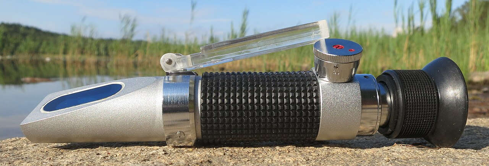

*Photo 48.2 — Portable honey refractometer. This optical instrument is designed for honey moisture measurement. The photograph identifies the equipment only: accurate results still depend on correct calibration, a clean dry prism, a representative sample, suitable temperature conditions and correct reading technique. Photo by R. Henrik Nilsson, CC BY 4.0.*

## 48.10 Calibration

Follow the instrument manufacturer's calibration procedure.

Depending on the model, calibration may use:

- a supplied reference fluid;
- a certified refractive-index standard;
- another specified calibration medium.

Do not assume distilled water is an appropriate honey-refractometer calibration standard unless the manufacturer specifically says so.

## 48.11 Automatic Temperature Compensation

ATC compensates for the instrument's temperature response within its specified range. It does not magically correct every sample problem.

For reliable readings:

- allow instrument and sample to equilibrate where recommended;
- avoid reading a hot sample on a cold prism;
- stay within the device's operating range;
- follow manufacturer instructions.

## 48.12 Cleaning the Prism

Between samples:

1. remove honey with a soft clean material;
2. use the manufacturer's permitted cleaning method;
3. avoid scratching the prism;
4. dry before the next sample;
5. prevent water droplets from diluting the next honey sample.

A wet prism can create an artificially high moisture reading.

## 48.13 Representative Sampling

The largest error may come not from the refractometer but from the sample.

A super can contain:

- wetter outer frames;
- drier central frames;
- capped and uncapped areas;
- nectar from different days;
- different floral sources.

One drop from one convenient cell may not represent the lot.

## 48.14 Frame-Level Sampling

For a questionable frame:

- select more than one area;
- include uncapped areas if they will be extracted;
- avoid cells contaminated by rain, syrup, or brood;
- compare readings.

Large variation indicates that the frame is not homogeneous.

## 48.15 Lot-Level Sampling

For a batch of supers, a better approach is to sample multiple representative frames from different boxes and positions.

The sampling plan should become more rigorous when:

- the lot is large;
- moisture is close to a legal or commercial limit;
- honey will be stored for a long period;
- multiple apiaries are blended;
- a buyer specifies a maximum.

## 48.16 Mixing and Composite Samples

A composite sample can estimate the average moisture of a blended lot, but an average can hide very wet pockets.

Before extraction, high-moisture frames may need to be segregated rather than relying on dilution by drier honey.

Do not intentionally blend non-compliant honey with compliant honey merely to meet a legal maximum.

## 48.17 Fermentation Risk Is Continuous

There is no single moisture value at which every honey suddenly changes from safe to fermenting.

Risk increases with:

- water availability;
- osmotolerant yeast numbers;
- warm storage;
- long storage;
- contamination;
- previous fermentation.

Lower moisture generally provides a larger safety margin.

## 48.18 Honey Hygroscopicity

Honey absorbs moisture from humid air.

Exposed honey can therefore become wetter after it leaves the hive.

Risk is increased by:

- uncapped supers left overnight in a damp room;
- open tanks;
- wet floors;
- washing equipment while honey is exposed;
- high relative humidity;
- condensation.

The extraction room should be dry as well as clean.

## 48.19 Harvesting in Rain

Harvesting during rain increases risk because:

- open supers can be wetted;
- humidity is high;
- transport covers drip;
- floors and equipment become wet;
- robbing behaviour may change when weather clears.

If harvest must occur, protect supers from direct water immediately.

## 48.20 Morning Versus Afternoon Harvest

Moisture distribution can change during the day as colonies receive fresh nectar.

During a strong flow, afternoon frames may contain newly collected dilute nectar even when older honey is ripe.

The best timing depends on:

- current flow;
- crop type;
- weather;
- intended lot.

Measure rather than assuming one time of day is always superior.

## 48.21 End of Flow

Waiting briefly after a nectar flow can allow bees to finish ripening remaining nectar, but waiting too long can introduce other problems:

- colonies consume surplus;
- robbing increases;
- a new floral source begins;
- weather deteriorates;
- wax moth or other storage risks arise after removal.

Harvest timing is a balance.

## 48.22 Leaving Enough Honey for the Colony

Not every stored frame is surplus.

Before harvest, estimate colony needs based on:

- season;
- climate;
- colony strength;
- brood;
- expected next forage;
- overwintering plan;
- hive type.

Taking food that must immediately be replaced with syrup can be poor management unless it serves a deliberate objective.

## 48.23 Harvest Only Broodless Honey Comb

Comb containing brood should not be extracted as ordinary food honey.

Reasons include:

- brood contamination;
- cocoons and larval material;
- higher debris load;
- possible medicine residues from brood-nest treatments;
- food-hygiene concerns.

EU definitions of comb, drained, and extracted honey specifically refer to broodless comb in relevant product categories.

## 48.24 Queen Excluders and Harvest Boundaries

Queen excluders can help keep brood out of honey supers, but they are not a substitute for inspection.

A queen may enter supers if:

- an excluder is absent;
- equipment is damaged;
- colony manipulation bypasses it;
- brood was present before placement.

Check frames before extraction.

## 48.25 Veterinary Medicine Restrictions

Before harvesting any super, verify treatment records.

Check:

- active ingredient;
- product label;
- whether supers were present;
- withdrawal period;
- treated-box restrictions;
- local legal requirements.

A honey crop must not be used to hide a treatment-record failure.

## 48.26 Pesticide or Chemical Contamination

Do not harvest honey suspected of contamination by:

- agricultural pesticides;
- fuel;
- solvents;
- cleaning chemicals;
- smoke taint;
- firefighting chemicals;
- floodwater;
- unapproved hive treatments.

Segregate the lot and seek competent food-safety or laboratory advice.

## 48.27 Smoke Use During Harvest

Smoke is useful for controlling bees but excessive smoke can contaminate honey aroma.

Use:

- clean, suitable smoker fuel;
- the minimum smoke needed;
- no painted, treated, plastic, oily, or chemically contaminated fuel;
- controlled application away from exposed honey surfaces.

## 48.28 Bee-Removal Methods

Common methods include:

- bee escapes;
- brushing;
- shaking;
- blowers;
- carefully managed repellents where legally permitted and food-safe.

No method is best for every operation.

## 48.29 Bee Escapes

A bee escape allows bees to leave a super while limiting return.

Advantages:

- quiet;
- minimal mechanical stress;
- little direct honey exposure.

Limitations:

- requires an additional apiary visit;
- performance depends on correct placement and bee-tight equipment;
- can fail if brood is present above the escape;
- supers can cool or become vulnerable if left too long.

## 48.30 Brushing Bees

Brushing works well for small numbers of frames.

Use a clean food-compatible bee brush or suitable soft tool.

Limitations include:

- labour;
- bee agitation;
- contamination if the brush contacts soil or dirty surfaces;
- risk of damaging bees.

Keep one brush dedicated to clean honey work.

## 48.31 Shaking Bees

A sharp controlled shake can remove many bees from a frame.

It is most practical when:

- comb is structurally strong;
- the frame is not excessively heavy or soft;
- weather is suitable;
- bees can return safely to the colony.

Avoid violent handling of new natural comb.

## 48.32 Bee Blowers

Commercial operators may use blowers to remove bees rapidly.

Advantages:

- speed;
- large-scale efficiency.

Risks and limitations:

- noise;
- bee injury if airflow is excessive;
- dust or exhaust contamination;
- dependence on equipment hygiene and design.

Combustion-engine exhaust must never be directed onto food-contact surfaces or honey.

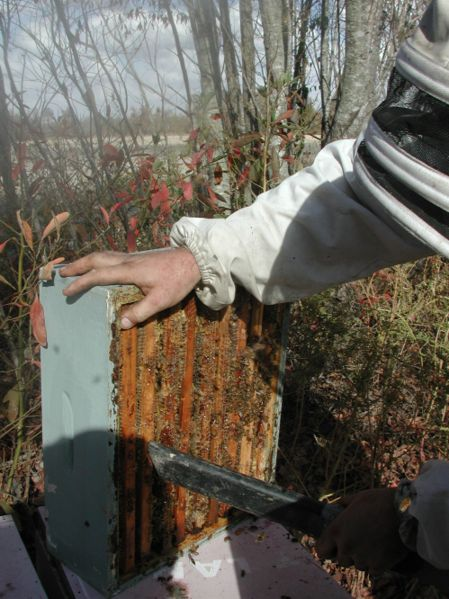

*Photo 48.3 — Bee removal from a honey super during harvest. This real field photograph shows a blower being used immediately before supers are moved for transport. It documents handling context, not the complete hygienic transport system: after bee clearance, each food super should be protected promptly with clean food-safe top and bottom covers, kept off dirty ground, protected from rain, dust, exhaust and robbing, and moved in a suitable clean vehicle. Photo by Pollinator, CC BY 2.5.*

## 48.33 Chemical Bee Repellents

Some jurisdictions permit particular bee-repellent products for harvest, while others restrict or discourage them.

Only use a product that is:

- authorised for the intended use;
- compatible with food production;
- applied exactly as directed.

Do not improvise household chemicals, solvents, or fragrances as bee repellents.

## 48.34 Harvesting Without Starting Robbing

Robbing can begin within minutes when honey is exposed during a dearth.

Prevent it by:

- keeping removed supers covered;
- closing vehicles and storage rooms;
- avoiding dripping frames;
- keeping cappings and broken comb sealed;
- shortening open-hive time;
- cleaning spills immediately.

## 48.35 Covering Supers

Use clean, food-compatible covers above and below harvested supers.

Covers protect from:

- bees;
- dust;
- road debris;
- rain;
- fuel vapour;
- animals.

Do not place food supers directly on soil, grass, vehicle floors, or dirty pallets.

## 48.36 Transport Vehicles

A honey transport vehicle should be:

- clean;
- dry;
- free from chemicals and fuel leakage;
- protected from rain;
- secured against load shift;
- separated from livestock or dirty materials.

The same van that carried pesticides, waste, or fuel may require thorough cleaning or may be unsuitable for food transport.

## 48.37 Manual Handling

A full honey super can be very heavy.

Reduce injury risk by:

- using smaller boxes where appropriate;
- lifting with stable footing;
- keeping the load close to the body;
- avoiding twisting while carrying;
- using trolleys or mechanical aids;
- working in pairs for awkward loads.

Back injuries can end a beekeeping season faster than a weak nectar flow.

## 48.38 Hive-Stand and Ground Hazards

Harvest often involves carrying heavy boxes while wearing a veil and moving among bees.

Before lifting, check:

- holes;
- loose straps;
- wet grass;
- uneven stands;
- tools on the ground;
- vehicle access;
- livestock hazards.

Clear the route first.

## 48.39 Heat Exposure During Transport

Honey supers left in a closed hot vehicle can experience high temperatures.

Excess heat can:

- soften comb;
- cause collapse;
- leak honey;
- increase quality degradation;
- intensify aroma loss.

Unload promptly into a controlled environment.

## 48.40 Cold Honey

Cold honey is highly viscous and difficult to extract.

Harvested supers can be held in a clean, dry, moderately warm environment before extraction where necessary.

Avoid excessive heat. The objective is to reduce viscosity without damaging quality.

## 48.41 Traceability Begins at the Apiary

A lot should be identifiable before supers are mixed.

Useful harvest records include:

- apiary ID;
- colony or group ID where needed;
- harvest date;
- super numbers or count;
- floral source claim if intended;
- treatment status;
- moisture sample results;
- unusual events;
- destination extraction batch.

## 48.42 Lot Definition

A lot can be defined by the operator according to a consistent traceability system, subject to legal requirements.

Possible lot boundaries include:

- one apiary and harvest date;
- one floral crop;
- one extraction run;
- one storage tank.

The larger the lot, the greater the impact if a quality problem is later found.

## 48.43 Mixing Apiaries

Combining honey from several apiaries can simplify processing but reduces traceability resolution.

Before blending, verify compatibility of:

- moisture;
- treatment history;
- floral identity claims;
- contamination status;
- legal origin labelling.

From 14 June 2026, EU rules require detailed country-of-origin information for blends placed on the market, reinforcing the importance of origin records.

## 48.44 New EU Origin-Labelling Context

Directive (EU) 2024/1438 revised EU honey-origin labelling. For blends from more than one country, countries of origin are generally required in the principal field of vision in descending order by weight, with their percentage shares, subject to defined tolerances and limited national options.

In Ireland, S.I. No. 591/2025 transposed the changes, and the new rules applied from 14 June 2026.

Apiary and supplier traceability must therefore support later label claims.

## 48.45 Food Hygiene

Once honey is removed for human consumption, food hygiene becomes central.

Key principles include:

- clean food-contact surfaces;
- potable water where water contacts food equipment;
- pest exclusion;
- personal hygiene;
- separation from chemicals;
- protection from foreign bodies;
- appropriate premises and storage.

Legal obligations vary with country and scale of operation.

## 48.46 Primary Production and Processing

Food law may distinguish primary production from later processing and packing activities.

In the EU, Regulation (EC) No 852/2004 sets general food-hygiene duties, with different provisions for primary production and later stages.

Beekeepers selling honey should determine how local authorities classify their harvesting, extraction, packing, and direct-sale activities.

## 48.47 Harvest Containers

Use containers that are:

- food-grade;
- clean;
- dry;
- odour-free;
- closable;
- suitable for honey acidity and storage.

Do not reuse unknown chemical containers even if they appear clean.

## 48.48 Broken Comb

Broken honeycomb should be collected in a clean covered food-grade container.

Separate:

- edible honey/wax intended for processing;
- brood comb;
- dirty floor debris;
- chemically contaminated material.

Do not allow broken comb to accumulate in the open apiary.

## 48.49 Wax Moth and Storage Pests

Harvested supers waiting for extraction can attract wax moths, ants, beetles, rodents, and other pests.

Rapid extraction, clean storage, secure doors, and appropriate temperature management reduce risk.

Avoid pesticide use around exposed honey unless specifically authorised for that food environment.

## 48.50 Honey Beetle Considerations

In regions with small hive beetle, harvested supers containing residual pollen or brood contamination can support beetle activity.

Extraction should not be unnecessarily delayed.

The beetle's legal status varies by region; exotic detections may require reporting.

## 48.51 Emergency: Rain-Wetted Supers

If harvested supers are directly wetted:

1. segregate them;
2. prevent water from entering more cells;
3. measure moisture after conditions stabilise;
4. do not blend blindly into a dry lot;
5. assess food contamination if water was dirty.

## 48.52 Emergency: Honey Leak in Vehicle

Stop safely and contain the spill.

Then:

- protect remaining supers;
- remove broken comb;
- prevent bee access;
- clean the vehicle before further food transport;
- investigate heat or load-shift causes.

## 48.53 Emergency: Suspected Chemical Taint

Segregate the affected lot immediately.

Do not attempt to mask odour by blending.

Record:

- source;
- chemical involved if known;
- time;
- affected supers;
- contact surfaces.

Seek competent food-safety guidance before sale or disposal.

## 48.54 Emergency: Brood Found in Harvest Supers

Segregate the frame.

Do not uncap and extract through brood.

Return appropriate brood to a colony if safe and biologically suitable, or manage according to the health situation. If disease is suspected, isolate it instead of moving it casually.

## 48.55 Harvest Decision Table

| Observation | Interpretation | Action |
|---|---|---|
| Nearly all capped, representative moisture comfortably within target | Mature crop likely | Harvest if treatment and colony-store checks pass |
| Many uncapped cells, low measured moisture across representative samples | Possibly mature but uncapped | Harvest can be considered under local quality system |
| Many uncapped cells, variable/high moisture | Uneven ripening | Delay or segregate wet frames |
| Legal maximum barely met | Legally possible in some markets but narrow stability margin | Consider further ripening/drying strategy permitted by quality system |
| Rain forecast and crop already mature | Quality/logistics risk from delay | Harvest under dry protection if feasible |
| Treatment withdrawal incomplete | Food-safety/legal restriction | Do not harvest affected honey for sale |
| Brood present in super | Not suitable for ordinary extraction | Segregate brood frame |
| Strong dearth/robbing | High harvest-risk environment | Work rapidly, cover supers, control spills |

## 48.56 Practical Harvest Procedure

### Before leaving for the apiary

- verify treatment records;
- calibrate/check refractometer;
- prepare clean covers and food-grade containers;
- label transport lots;
- prepare bee-removal equipment;
- check weather;
- prepare lifting aids.

### At the apiary

1. confirm colony identity;
2. assess crop ripeness;
3. sample moisture when required;
4. check for brood;
5. remove bees using the chosen method;
6. cover each super immediately;
7. record lot identity;
8. leave adequate colony stores;
9. clean drips and close the hive.

### At the honey room

- receive supers into a clean zone;
- protect from humidity and pests;
- record arrival;
- segregate any questionable material;
- extract promptly or store under controlled conditions.

## 48.57 Scientific Notes

### Water activity and moisture are related but not identical

Microbial stability is governed by water activity, which reflects water available to microorganisms. Moisture percentage is easier to measure routinely and correlates strongly with risk, but honey composition influences the relationship.

### Osmotolerant yeasts

Some yeasts can grow at sugar concentrations that inhibit many other microorganisms. This is why honey can ferment despite being a high-sugar food.

### Capping behaviour is biological, not regulatory

Bees cap honey according to colony conditions, not human market standards. Capping and legal moisture limits therefore overlap imperfectly.

### Hygroscopicity continues after harvest

Honey can exchange moisture with air. Open tanks, wet rooms, and humid supers can change a lot after removal from the hive.

### Traceability is a quality-control tool

Traceability is not only for recalls. It allows the beekeeper to compare apiaries, moisture, crop origin, treatments, and processing outcomes.

## 48.58 Harvest Checklist

- [ ] Colony and apiary ID confirmed.
- [ ] Treatment/withdrawal status checked.
- [ ] Brood absent from harvest frames.
- [ ] Representative moisture assessed where needed.
- [ ] Refractometer calibration/check current.
- [ ] Legal and buyer specifications known.
- [ ] Enough stores remain for the colony.
- [ ] Weather and robbing conditions acceptable.
- [ ] Clean covers ready.
- [ ] Bee-removal method food-safe and appropriate.
- [ ] Supers never placed directly on dirty ground or floors.
- [ ] Transport vehicle clean, dry, and chemical-free.
- [ ] Loads secured.
- [ ] Lot identity recorded.
- [ ] Questionable supers segregated.
- [ ] Honey room ready before supers arrive.

## Key Takeaways

- Harvesting is both an apiary operation and a food-handling operation.
- Capping is useful evidence of ripeness but not a substitute for representative moisture measurement when uncertainty matters.
- Legal moisture maxima are not universal harvest targets.
- A calibrated refractometer and representative sample are more reliable than folklore tests.
- Honey can absorb moisture from humid air after leaving the hive.
- Brood comb and treatment-restricted honey must be excluded from ordinary food extraction.
- Bee removal should be efficient, food-safe, and chosen for the scale of operation.
- Robbing prevention begins the moment honey is exposed.
- Clean, dry, covered transport protects both product and traceability.
- Lot identity should begin at the apiary, not after extraction.

## Chapter Summary

Harvest readiness is determined by ripeness, moisture, food-safety status, colony needs, and traceability—not by one visual sign. Capped honey is usually mature, but uncapped honey may be either ripe or watery. Representative refractometer measurements provide the evidence needed for borderline or commercially important decisions.

Moisture limits must be understood correctly. Current Codex and EU standards use a general maximum of 20% for most honey, with specified exceptions. A producer may choose a lower operational specification to increase storage stability. Fermentation risk is continuous and depends on moisture, yeast population, time, and temperature.

The harvest operation must also protect honey from brood material, veterinary medicines, smoke taint, pesticides, rain, fuel, dust, pests, and robbing. Supers should be covered immediately, carried on clean surfaces, transported in a suitable vehicle, and received into a dry extraction environment.

Traceability starts before extraction. Apiary, harvest date, moisture results, treatment status, and intended crop identity should follow the lot. This is increasingly important where origin claims are regulated, including the revised EU blend-origin rules applicable from 14 June 2026.

## Review Questions

1. When does honey handling become a food-safety responsibility?
2. What four questions should be answered before removing supers?
3. Why is capping useful evidence of ripeness?
4. Why is capping not a perfect moisture measurement?
5. Can uncapped honey be mature?
6. Can recently capped honey ever be wetter than expected?
7. What can the traditional shake test demonstrate?
8. What can the shake test not prove?
9. Why is honey moisture important?
10. What organisms are especially relevant to honey fermentation?
11. What signs can fermentation produce?
12. What is the difference between a legal maximum and an operational target?
13. Why might a packer choose a lower moisture specification than the legal maximum?
14. What is the general EU moisture maximum for ordinary honey under the rules applicable from 14 June 2026?
15. Which examples have higher EU moisture limits?
16. Why should the EU number not be treated as a global harvest rule?
17. What does a refractometer measure physically?
18. What must be correct for a reliable refractometer reading?
19. What is an advantage of an optical refractometer?
20. What is an advantage of a digital refractometer?
21. Why should calibration follow the manufacturer's procedure?
22. Is distilled water always the correct calibration standard?
23. What does automatic temperature compensation do?
24. What does ATC not correct?
25. Why should hot and cold sample/prism extremes be avoided?
26. How should the prism be cleaned?
27. How can residual rinse water distort the next reading?
28. Why may one drop from one cell be unrepresentative?
29. How can moisture vary within a super?
30. What should a frame-level sampling plan include?
31. When should lot-level sampling become more rigorous?
32. What is a composite sample?
33. How can an average hide wet honey?
34. Why should very wet frames be segregated?
35. Why should non-compliant honey not be intentionally diluted to meet a legal limit?
36. Is fermentation risk controlled by one sharp moisture threshold?
37. Which factors increase fermentation risk?
38. What does hygroscopic mean?
39. How can a damp honey room increase product moisture?
40. Why is rain harvest risky?
41. How can time of day influence fresh nectar in supers?
42. Why is the end of a nectar flow not automatically the exact harvest moment?
43. What can happen if harvest is delayed too long?
44. Why must colony food needs be assessed before harvest?
45. Why should brood comb not be extracted as ordinary food honey?
46. What EU honey-product definitions refer to broodless comb?
47. Can a queen excluder replace visual inspection of harvest frames?
48. What treatment information must be checked before harvesting?
49. Why can medicine restrictions apply to supers?
50. Which chemical exposures should trigger lot segregation?
51. Why can excessive smoke affect honey quality?
52. What types of smoker fuel should never be used?
53. Name four common bee-removal methods.
54. What is an advantage of a bee escape?
55. Why can a bee escape fail if brood is above it?
56. What hygiene issue applies to a bee brush?
57. Why should natural new comb be shaken cautiously?
58. What is an advantage of bee blowers?
59. What contamination risk applies to combustion-engine blowers?
60. Why should household chemicals never be improvised as bee repellents?
61. How quickly can robbing begin during dearth?
62. How can harvested supers be protected from robbers?
63. Why should supers be covered above and below?
64. Why should food supers not be placed directly on the ground?
65. What characteristics should a honey transport vehicle have?
66. Why can previous chemical cargo matter?
67. What manual-handling practices reduce back injury?
68. Why should the carrying route be cleared before lifting?
69. How can a hot vehicle damage comb and honey?
70. Why is cold honey difficult to extract?
71. What is the objective of moderate pre-extraction warming?
72. When should traceability begin?
73. Which records should follow harvested supers?
74. What is a lot?
75. Why can a very large lot increase recall impact?
76. What should be verified before mixing honey from several apiaries?
77. What changed in EU blend-origin labelling from 14 June 2026?
78. How was the 2024 EU amendment transposed in Ireland?
79. Why do origin-labelling rules make traceability more important?
80. What are the basic food-hygiene principles after harvest?
81. Why may primary production and processing have different legal requirements?
82. What qualities should a harvest container have?
83. Why must unknown chemical containers never be reused for honey?
84. How should broken comb be managed?
85. Why should harvested supers not wait unnecessarily for extraction?
86. How can small hive beetle influence post-harvest urgency?
87. What should happen to rain-wetted supers?
88. Why should wet honey not be blindly blended into a dry lot?
89. What should happen after a honey leak in a vehicle?
90. How should suspected chemical taint be handled?
91. What should happen if brood is found in a harvest super?
92. What does a legal maximum barely met tell you about storage margin?
93. Why must a harvest be delayed when a treatment withdrawal is incomplete?
94. What preparations should be made before leaving for the apiary?
95. What is the correct sequence at the apiary?
96. What should happen when supers reach the honey room?
97. What is water activity?
98. Why are osmotolerant yeasts important?
99. Why does traceability improve routine quality control as well as recalls?
100. What are the essential elements of a safe, high-quality honey harvest?

## References

- Codex Alimentarius Commission. *Standard for Honey*, CXS 12-1981, revised 1987 and 2001, amended 2019 and 2022. Current Codex text accessed 15 September 2026.
- Council Directive 2001/110/EC relating to honey, consolidated version applicable from 14 June 2026.
- Directive (EU) 2024/1438 of the European Parliament and of the Council, amending the EU “Breakfast Directives”, including honey-origin and traceability provisions.
- Food Safety Authority of Ireland. “Honey” and “Origin Labelling of Honey.” Current guidance reflecting S.I. No. 591/2025 and rules applying from 14 June 2026. Accessed 15 September 2026.
- Food Safety Authority of Ireland. “Hygiene of Foodstuffs,” current summary of Regulation (EC) No 852/2004 responsibilities. Accessed 15 September 2026.
- White, J. W. and related foundational literature on honey composition, moisture, fermentation, and quality.
- Bogdanov, S., Ruoff, K., and Persano Oddo, L. Reviews and harmonised methods for honey quality analysis.
- Graham, J. M., editor. *The Hive and the Honey Bee*. Dadant & Sons.
- National food-safety, veterinary-medicine, labelling and direct-sale authorities. Current registration, hygiene, residue, packaging and market requirements must be verified for the reader’s jurisdiction.

# Chapter 49 — Honey Extraction

## Introduction

Honey extraction is the controlled removal of honey from broodless comb while preserving both the food and the reusable wax structure. The process appears simple—uncap cells and spin the frames—but a professional extraction system is really a sequence of hygiene, temperature, mechanical, traceability, and safety decisions.

A good extraction room is organised so that material moves in one direction:

1. covered harvested supers enter a controlled receiving area;
2. questionable frames are segregated;
3. ripe broodless comb is uncapped;
4. frames are extracted without excessive comb damage;
5. honey is strained only as much as necessary for the intended product;
6. air and coarse wax are allowed to separate;
7. honey moves into clean identified tanks;
8. equipment is cleaned without introducing water or contaminants into product.

Extraction should not be confused with later processing. Warming, blending, fine filtration, controlled crystallisation, packaging, and long-term storage are treated in subsequent chapters. The goal here is to move honey from sealed comb to a clean bulk container with the least unnecessary change.

## Learning Objectives

After completing this chapter, the reader should be able to:

- design a logical one-way extraction workflow;
- distinguish clean and dirty zones in a honey room;
- inspect supers before they enter the extraction line;
- choose among knife, fork, plane, roller, and automated uncapping methods;
- explain centrifugal extraction and the differences between tangential and radial extractors;
- balance an extractor and increase speed without breaking comb;
- adapt technique for new, soft, foundationless, or partially filled comb;
- strain wax and debris without unnecessarily removing natural honey constituents;
- manage bubbles, foam, cappings, and settling;
- select appropriate food-contact equipment and clean it safely;
- maintain lot traceability and operator safety throughout extraction.

## 49.1 Extraction Begins with Room Design

The extraction room should support one-way movement from incoming supers to finished bulk honey.

A practical sequence is:

**receiving → inspection → uncapping → extraction → coarse straining → settling/bulk tank → protected storage**

Crossing dirty incoming equipment back over exposed honey increases contamination risk.

## 49.2 Clean and Dirty Zones

“Dirty” does not mean unsanitary. It means a zone with greater exposure to field debris.

### Incoming zone

Possible contaminants include:

- bees;
- propolis flakes;
- dust;
- grass;
- road debris;
- box exteriors;
- straps;
- pallet dirt.

### Clean product zone

This includes:

- uncapped honey surfaces;
- extractor interiors;
- strainers;
- pumps;
- settling tanks;
- food containers.

Keep footwear, tools, waste, and wash water from carrying contamination into the clean zone.

## 49.3 Premises

A suitable honey room should be:

- cleanable;
- dry;
- protected from insects and rodents;
- free from chemical storage;
- well lit;
- ventilated without drawing dust over exposed honey;
- supplied with suitable hand-washing arrangements;
- organised so food-contact equipment can be cleaned and dried.

Local food-premises requirements depend on jurisdiction and commercial scale.

## 49.4 Why Dryness Matters

Honey is hygroscopic and absorbs moisture from humid air.

A room can be visually clean yet unsuitable if:

- floors remain wet;
- steam is produced continuously;
- condensation drips;
- washing occurs beside open tanks;
- supers sit uncovered in high humidity.

Food hygiene for honey requires moisture control as well as surface cleanliness.

## 49.5 Receiving Supers

At arrival:

1. verify lot identity;
2. inspect covers and external cleanliness;
3. check for leaks;
4. look for brood frames mistakenly harvested;
5. segregate supers with unusual odour, contamination, or high-moisture concerns;
6. record arrival time;
7. move acceptable supers into protected storage or extraction.

Do not place incoming boxes directly on a clean uncapping table.

## 49.6 Pest Exclusion

Open honey attracts:

- bees;
- wasps;
- ants;
- flies;
- rodents;
- small hive beetles where present.

Use:

- closed doors;
- screened openings;
- rapid spill cleanup;
- covered waste;
- prompt cappings management;
- physical exclusion.

Avoid routine pesticide spraying around exposed food.

## 49.7 Personal Hygiene

Operators should:

- wash hands before food handling;
- cover wounds appropriately;
- wear clean clothing;
- avoid jewellery or objects that can fall into honey;
- keep phones and dirty tools off food-contact surfaces;
- exclude illness from food handling where required by food law.

Gloves do not replace hand hygiene.

## 49.8 Food-Contact Materials

Preferred equipment materials are smooth, durable, corrosion-resistant, and food-compatible.

Common choices include:

- food-grade stainless steel;
- certified food-grade plastics;
- suitable food-grade silicone or seals.

Avoid improvised containers made from unknown metals or plastics.

Honey is acidic enough that inappropriate metals can corrode or contaminate product.

## 49.9 Stainless Steel

Stainless steel is widely used for:

- uncapping tanks;
- extractors;
- strainers;
- pumps;
- storage tanks;
- valves.

Advantages include durability, cleanability, corrosion resistance, and food compatibility when the correct grade and fabrication are used.

Damaged welds, rough surfaces, and inaccessible seams can still harbour residues.

## 49.10 Food-Grade Plastics

Food-grade plastic can be useful for:

- buckets;
- lids;
- settling vessels;
- strainers;
- transport containers.

Inspect for:

- cracks;
- scratches;
- odour absorption;
- staining;
- deformation;
- unknown previous use.

A food-grade container can become unsuitable after contamination or severe damage.

## 49.11 Temperature Before Extraction

Warm honey flows more easily than cold honey.

The objective is to bring supers to a practical extraction temperature without prolonged or excessive heating.

Suitable conditioning depends on:

- honey type;
- room temperature;
- comb strength;
- crystallisation;
- equipment;
- extraction schedule.

Do not apply unnecessary heat simply to increase speed.

## 49.12 Heat and Honey Quality

Excessive or prolonged heat can:

- reduce enzyme activity;
- accelerate hydroxymethylfurfural formation;
- alter aroma;
- darken honey;
- soften comb;
- promote leaks.

Codex and EU standards both protect honey from processing that significantly impairs its natural quality.

Time and temperature act together: mild warming for a limited period is different from long hot storage.

## 49.13 Warming Rooms

A warming room or insulated cabinet can gently condition supers before extraction.

Good design includes:

- controlled temperature;
- air circulation;
- no direct flame;
- no exhaust contamination;
- separation from chemicals;
- temperature monitoring;
- limited residence time.

Do not use unregulated heaters capable of scorching boxes or wax.

## 49.14 Crystallised Honey in Comb

Some honeys crystallise rapidly in the comb and can become difficult or impossible to remove centrifugally.

Options depend on product and quality goals:

- harvest earlier in future flows;
- segregate frames;
- use appropriate gentle conditioning where effective;
- use the comb for other approved purposes;
- return suitable frames to colonies if biologically and legally appropriate.

Overheating comb to dissolve crystals can damage both wax and honey quality.

## 49.15 Uncapping

Extraction cannot begin while wax cappings seal the honey cells.

Uncapping should:

- open cells efficiently;
- remove minimal honey with wax;
- avoid excessive comb destruction;
- maintain operator safety;
- keep cappings clean for recovery.

## 49.16 Uncapping Knife

A long uncapping knife removes a thin layer of wax across the comb surface.

Types include:

- cold knives;
- electrically heated knives;
- steam-heated knives.

Advantages:

- fast on even comb;
- clean broad cut;
- suitable for larger operations.

Limitations:

- recessed cells remain capped;
- hot blades can overheat honey locally;
- knife injuries are possible.

## 49.17 Heated Knives

A heated knife should be hot enough to cut smoothly but not used as a tool to cook honey.

Warning signs of excessive heat include:

- smoke;
- scorched wax;
- caramelised odour;
- darkened material.

Follow the equipment manufacturer's settings and safe-handling instructions.

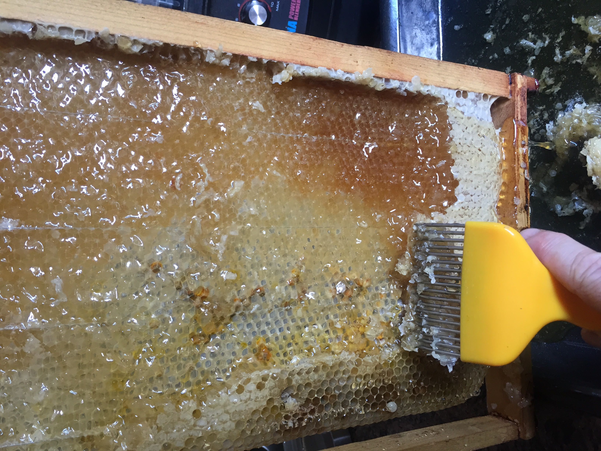

*Photo 49.2 — Uncapping detail. Cappings are removed from sealed honey cells before extraction; tools and hand position should be managed to reduce injury and contamination risk. Photo by Wyatt Tyrone Smith, CC BY-SA 4.0.*

## 49.18 Uncapping Fork

An uncapping fork lifts cappings from individual or recessed cells.

Advantages:

- inexpensive;
- precise;
- useful for uneven comb.

Limitations:

- slower;
- can dig deeply into comb;
- creates more wax fragments if used aggressively.

Forks often complement rather than replace a knife.

## 49.19 Uncapping Plane or Scraper

Planes and scrapers can remove cappings with a pulling or pushing action.

Performance depends on:

- comb flatness;
- operator technique;
- blade condition;
- temperature.

Maintain guards and safe hand position.

## 49.20 Automated Uncappers

Commercial systems may use:

- vibrating knives;
- chain flails;
- rotating blades;
- heated cutting heads;
- automatic frame feed.

They increase throughput but require:

- consistent frame dimensions;
- guarding;
- maintenance;
- cleaning access;
- lot-control procedures.

Higher speed increases the importance of pre-line inspection.

## 49.21 Cappings

Cappings contain valuable honey and clean wax.

Collect them in a food-grade system such as:

- perforated uncapping tray;
- cappings spinner;
- draining basket;
- dedicated press where appropriate.

Protect cappings from floor debris, insects, and excessive heat.

## 49.22 Cappings Honey

Honey recovered from clean cappings can be high quality when handled hygienically.

However, long warm storage of wet cappings can encourage fermentation.

Drain or process promptly.

## 49.23 Wax Recovery Boundary

Do not mix clean honey cappings with:

- brood comb;
- old dark frames;
- floor scrapings;
- chemically contaminated wax;
- propolis waste.

Different wax streams have different quality and end uses.

## 49.24 How an Extractor Works

A honey extractor uses centrifugal acceleration to move honey from open cells toward the extractor wall.

The honey then runs downward into a sump or outlet.

Extraction performance depends on:

- viscosity;
- cell orientation;
- rotational speed;
- comb strength;
- frame loading;
- balance;
- duration.

## 49.25 Tangential Extractors

In a tangential extractor, the broad face of a comb is positioned roughly toward the extractor wall.

Because honey cells slope slightly upward from the midrib, one side is generally extracted and the frame is then turned or the basket reverses.

Advantages:

- effective on viscous honey;
- good support for fragile comb in baskets.

Limitations:

- requires turning/reversing;
- slower throughput.

## 49.26 Radial Extractors

In a radial extractor, frames are arranged like spokes around the centre.

Honey can leave both sides during spinning because of cell orientation and centrifugal force.

Advantages:

- high frame capacity;
- no manual turning in normal operation;
- efficient for established comb.

Limitations:

- very viscous honey may extract slowly;
- very fragile comb can still break;
- frame size and machine geometry must match.

## 49.27 Reversible Extractors

Some machines hold frames tangentially and reverse direction automatically.

They combine strong extraction with reduced manual frame handling.

Programming must still account for comb strength and honey viscosity.

## 49.28 Manual Versus Motorised Extractors

### Manual

Advantages:

- simple;
- inexpensive;
- easy speed control by feel;
- no mains electricity at the machine.

Limitations:

- labour-intensive;
- slower;
- tiring at scale.

### Motorised

Advantages:

- repeatable speed;
- greater throughput;
- programmable cycles on advanced units.

Limitations:

- electrical and mechanical hazards;
- higher cost;
- cleaning complexity.

## 49.29 Balancing the Load

An unbalanced extractor can:

- vibrate violently;
- move across the floor;
- damage frames;
- damage bearings;
- loosen fittings;
- injure operators.

Balance frames by approximate weight and distribution around the basket.

Never rely on bolting the machine down to compensate for a severely unbalanced load.

## 49.30 Starting Slowly

Full comb contains significant mass. High speed at the start can place excessive force on wax before some honey is removed.

A safer sequence is:

1. load frames evenly;
2. begin at low speed;
3. remove part of the honey;
4. increase speed gradually;
5. turn/reverse as required;
6. finish at a speed appropriate to comb strength and machine design.

## 49.31 Tangential Extraction Sequence

For fragile tangential comb, a staged sequence may reduce breakage:

1. partially extract the first side at low/moderate speed;
2. turn the frame;
3. extract the second side more fully;
4. turn again;
5. finish the first side.

This reduces the weight pressing against the midrib while the opposite side is still full.

## 49.32 Foundationless Comb

Natural foundationless comb can be excellent for bees but requires careful extraction.

Risks increase when comb is:

- new;
- warm;
- heavily loaded;
- not attached to all frame edges;
- tilted or twisted;
- spun too fast.

Tangential support baskets can be safer for delicate comb.

## 49.33 Plastic Foundation

Plastic foundation supports the midrib strongly but can still experience wax separation or frame damage.

Inspect for:

- poorly drawn comb;
- broken lugs;
- warped plastic;
- incomplete wax adhesion.

Machine speed should match the whole frame, not only the foundation strength.

## 49.34 Wired Wax Foundation

Wire helps reinforce wax foundation.

Comb strength still depends on:

- age;
- temperature;
- attachment to frame edges;
- cell depth;
- previous damage.

Old dark comb may be mechanically strong but may not be desirable for honey-food production for other reasons.

## 49.35 Unevenly Filled Frames

Partially filled frames can unbalance the extractor even when frame numbers are symmetrical.

Pair frames by mass where practical.

A small digital platform scale can help in high-throughput or difficult balancing situations.

## 49.36 Comb Blow-Out

Comb blow-out occurs when wax tears or collapses under force.

Contributing factors include:

- excessive speed;
- full heavy comb;
- high comb temperature;
- new wax;
- weak foundation attachment;
- unbalanced machine;
- tangential force applied too aggressively.

Stop the extractor if abnormal vibration or impacts occur.

## 49.37 Recovering After Comb Breakage

1. Stop the machine and isolate power.
2. Wait for complete basket stop.
3. Remove broken comb safely.
4. Check remaining frames and basket.
5. Remove loose wax before restarting.
6. Correct balance and speed strategy.
7. Segregate contaminated honey if non-food material entered the extractor.

Never reach into a moving extractor.

## 49.38 Extractor Guards and Interlocks

Motorised extractors should use guards or lids that prevent contact with moving parts.

Where fitted, interlocks should stop or prevent rotation when the lid is opened.

Do not bypass safety switches to save time.

## 49.39 Electrical Safety

Honey rooms combine electricity with sticky surfaces and cleaning water.

Reduce risk through:

- suitable electrical installation;
- grounded/earthed equipment;
- protected sockets according to local electrical code;
- dry hands;
- intact cables;
- no wash-water spray on motors or controls;
- isolation before cleaning or maintenance.

## 49.40 Manual Extractor Safety

Manual machines also carry hazards:

- moving gears;
- spinning handles;
- sharp frame edges;
- sudden imbalance.

Use guards and keep clothing, hair, and fingers clear.

## 49.41 Extractor Outlet

Open the honey gate or pump path as needed so the extractor does not accumulate excessive honey around the basket.

Too much honey in the base can:

- contact rotating frames;
- create foam;
- increase drag;
- overflow.

Use a covered receiving vessel.

## 49.42 Coarse Straining

Freshly extracted honey may contain:

- wax particles;
- bee fragments;
- propolis flakes;
- small debris.

A coarse food-grade strainer removes obvious foreign material while retaining normal honey characteristics.

## 49.43 Straining Versus Filtered Honey

Simple straining is not necessarily the same as the legally defined category “filtered honey”.

In EU law, filtered honey refers to honey from which foreign material has been removed in a way that results in significant removal of pollen.

Do not use aggressive fine filtration unintentionally if pollen retention matters for product identity, origin verification, or legal naming.

## 49.44 Mesh Size

Choose strainer mesh according to the objective.

Too coarse leaves wax. Too fine can:

- slow flow severely;
- trap air;
- clog rapidly;
- remove more natural particles than intended.

Cold viscous honey requires more pressure or time through a fine mesh, increasing handling complexity.

## 49.45 Gravity Versus Pressure

Gravity flow is gentle but slow.

Pumps can increase throughput but must be designed for viscous food products.

Poor pumping can:

- incorporate air;
- shear crystals;
- heat honey;
- damage seals;
- create contamination points.

## 49.46 Honey Pumps

Common pump types include positive-displacement designs suitable for viscous liquids.

Select based on:

- flow rate;
- viscosity;
- cleaning access;
- food-contact certification;
- gentle handling;
- ability to avoid dead spaces.

Never use a pump previously exposed to non-food chemicals.

## 49.47 Hoses

Food-transfer hoses should be:

- food-grade;
- smooth internally;
- inspectable;
- drainable;
- protected from floor contact at open ends;
- capped when stored.

Long hoses with low points can trap old honey and wash water.

## 49.48 Air Incorporation

Air enters honey during:

- splashing;
- pumping;
- turbulent transfer;
- excessive drop height;
- stirring.

Bubbles make honey appear cloudy and contribute to surface foam.

Reduce drop height and use gentle flow.

## 49.49 Foam

Surface foam can contain:

- trapped air;
- fine wax;
- pollen;
- proteinaceous material.

It is generally removed from the surface before final packing of clear liquid honey.

Foam itself is not proof of fermentation; fermentation is associated with gas production and other changes over time.

## 49.50 Settling

Allowing extracted honey to rest in a covered tank permits:

- air bubbles to rise;
- fine wax to float;
- dense particles to settle;
- temperature to equalise.

Settling time depends on viscosity, temperature, tank depth, and particle size.

## 49.51 Tank Shape

A settling tank benefits from:

- smooth walls;
- covered top;
- accessible cleaning;
- food-grade valve;
- geometry that drains well;
- minimal dead spaces.

Conical or sloped bottoms can improve complete emptying in larger systems.

## 49.52 Honey Gates and Valves

Valves should be:

- food-grade;
- leak-free;
- easy to dismantle or clean;
- protected from floor contact;
- closed when not in use.

Threads, seals, and cavities can retain old honey.

## 49.53 Lot Segregation

Keep separate lots separate when they differ in:

- apiary origin;
- floral claim;
- country of origin;
- moisture;
- treatment status;
- contamination investigation;
- customer specification.

Do not let a shared pump or tank erase traceability accidentally.

## 49.54 Flushing Between Lots

Honey trapped in pipes and pumps can carry one lot into the next.

Where lot identity matters:

- drain equipment fully;
- use documented line-clearance procedures;
- account for unavoidable carryover;
- clean when required;
- record transitions.

Water flushing is not always appropriate between honey lots because residual water can raise moisture.

## 49.55 Water Is a Hazard in Honey Processing

Water is essential for cleaning but dangerous inside honey.

Residual water can:

- dilute honey;
- increase fermentation risk;
- support microbial growth in equipment residues;
- create false refractometer readings.

After wet cleaning, dry food-contact equipment thoroughly before use.

## 49.56 Dry Cleaning First

Before washing:

- scrape or drain bulk honey;
- recover usable product where hygienically appropriate;
- remove wax mechanically;
- wipe heavy residues.

This reduces water use and wastewater load.

## 49.57 Hot Water

Hot water can help dissolve honey residues, but excessive heat creates burn risk and steam humidity.

Use temperatures suitable for the cleaning system and equipment material.

Do not rely on “hotter is always cleaner”.

## 49.58 Detergents and Sanitisers

Use only cleaning agents suitable for food equipment and according to instructions.

Important requirements include:

- correct concentration;
- contact time;
- compatible material;
- required rinsing;
- complete drainage;
- safe storage away from honey.

Chemical odour in honey is a serious contamination failure.

## 49.59 Cleaning-In-Place Systems

Large operations may use cleaning-in-place systems for tanks, pipes, and pumps.

CIP requires validated control of:

- flow;
- temperature;
- detergent concentration;
- contact time;
- rinse quality;
- drainage;
- verification.

A poorly designed CIP system can leave water or chemical residues in dead legs.

## 49.60 Cleaning Verification

Verification can include:

- visual inspection;
- odour check;
- absence of sticky residue;
- rinse-water criteria where applicable;
- ATP or microbiological tests in more formal systems;
- documented pre-operational inspection.

Honey's low microbial risk does not justify dirty equipment.

## 49.61 Cleaning Schedule

Not every surface requires the same frequency.

Clean:

- product-contact equipment between appropriate runs;
- spills immediately;
- floors and non-food surfaces regularly;
- infrequently used tanks before use if storage contamination is possible.

Document schedules in commercial operations.

## 49.62 Wastewater

Honey-rich wash water has high organic load.

Do not discharge it in ways that:

- attract bees;
- contaminate watercourses;
- overload septic systems;
- create fermentation odour;
- violate local wastewater rules.

## 49.63 Cappings Waste and Recovery

After honey recovery, cappings wax can be:

- rendered;
- stored for later processing;
- used for high-quality wax products if uncontaminated.

Keep cappings from different contamination statuses separate.

## 49.64 Reusing Extracted Supers

Extracted comb can be returned to bees for cleaning or stored.

Returning wet supers can trigger robbing if placed carelessly.

Options include:

- placing supers back on strong colonies under controlled conditions;
- allowing colonies to clean them above appropriate hive arrangements;
- storing them directly using pest-control methods suitable for the region.

Avoid open-air “cleaning” that starts apiary-wide robbing.

## 49.65 Honey Losses

Losses occur in:

- cappings;
- extractor walls;
- pipes;
- strainers;
- tank foam;
- broken comb;
- spills.

Measure losses before buying more equipment. A simple process change may recover more honey than a larger extractor.

## 49.66 Extraction Yield

Useful production metrics include:

- kilograms of honey per super;
- kilograms per frame;
- extraction time per batch;
- cappings honey recovered;
- residual honey in comb;
- labour hours per kilogram.

Yield data help compare equipment and comb systems.

## 49.67 Residual Honey in Comb

Frames rarely leave an extractor absolutely dry.

Residual amount depends on:

- viscosity;
- extraction speed/time;
- cell angle;
- crystallisation;
- frame design;
- comb damage limits.

Trying to recover the last gram can cost more time and comb breakage than it is worth.

## 49.68 Crystallisation During Extraction

Partially crystallised honey may:

- remain in cells;
- clog strainers;
- increase pump load;
- create grainy recovered honey.

Segregate if necessary rather than forcing the entire line to operate outside its normal conditions.

## 49.69 Heather and Thixotropic Honey

Some honeys such as heather can be thixotropic or gel-like and do not extract easily by ordinary centrifuging.

Special techniques may include comb agitation or loosening methods appropriate to the honey and market.

These specialised systems require regional experience and are not equivalent to ordinary liquid-honey extraction.

## 49.70 Pressed Honey

Pressed honey is produced by pressing broodless comb, with legal definitions applying in some markets.

Pressing:

- sacrifices comb structure;
- can recover honey from comb unsuitable for centrifugal extraction;
- produces a different wax/honey workflow.

Under EU definitions, pressed honey may be obtained with or without moderate heat not exceeding the defined legal condition.

## 49.71 Drained Honey

Drained honey is obtained by draining decapped broodless combs.

It requires little mechanical equipment but is slow and may leave substantial honey in comb.

Product definitions matter if a specific legal name is used.

## 49.72 Extraction and Pollen

Normal extracted honey contains pollen and other naturally occurring particles.

Coarse straining to remove wax and foreign debris should be distinguished from processes that significantly remove pollen.

Pollen can support botanical and geographical origin assessment.

## 49.73 Foreign-Body Control

Potential foreign bodies include:

- metal fragments;
- plastic;
- wood splinters;
- brush fibres;
- glass;
- insects;
- jewellery;
- blade fragments.

Controls include:

- equipment inspection;
- guards;
- strainers;
- glass policy;
- good housekeeping;
- maintenance records.

## 49.74 Glass in the Honey Room

Broken glass is difficult to remove confidently from viscous food.

Avoid unnecessary glass objects near exposed honey.

If breakage occurs over exposed product, follow a defined contamination procedure and discard affected food where safety cannot be assured.

## 49.75 Lubricants

Bearings, gearboxes, chains, and motors may require lubrication.

Use:

- correct lubricant;
- food-grade lubricant where incidental food contact is possible;
- controlled application;
- shields against drips;
- maintenance records.

Never allow automotive grease to contact honey.

## 49.76 Fuel and Exhaust

Petrol engines, generators, and heaters can introduce:

- exhaust;
- fuel vapour;
- soot;
- carbon monoxide risk.

Keep combustion equipment outside food rooms unless specifically designed and legally approved for the installation.

## 49.77 Allergen and Ingredient Control

Pure honey contains no added ingredients under legal definitions such as the current EU honey rules.

If a facility also handles nuts, spices, dairy, or other ingredients for value-added products, prevent cross-contact with pure-honey lines and clean appropriately.

Added ingredients mean the product may no longer legally be sold simply as “honey” in some jurisdictions.

## 49.78 Traceability Through Extraction

A lot record can include:

- incoming apiary lot;
- number of supers;
- moisture result;
- extraction start/end time;
- extractor/tank ID;
- operator;
- strainer/pump path;
- destination tank;
- quantity recovered;
- deviations.

This record connects harvest to storage and packing.

## 49.79 Tank Identification

Every tank should have a unique identity or current batch label.

Do not rely on memory such as “the dark honey is in the left tank”.

Tanks can be moved, topped up, or confused.

## 49.80 Mixing Lots Intentionally

If lots are intentionally blended:

- record source lots;
- record weights or proportions;
- verify compatibility;
- create a new blend-lot identity;
- preserve origin information required by law.

The blend should be reproducible on paper even after the tank is empty.

## 49.81 Equipment Maintenance

Preventive maintenance includes:

- bearing checks;
- basket inspection;
- frame-holder inspection;
- motor/gearbox service;
- electrical-cable inspection;
- seal replacement;
- valve maintenance;
- calibration of temperature instruments where used.

Breakdowns during harvest can leave warm honey and supers waiting in poor conditions.

## 49.82 Pre-Season Dry Run

Before the first crop:

- assemble the extraction line;
- run the extractor empty;
- test interlocks;
- inspect valves;
- check pumps;
- verify scales and thermometers;
- confirm cleaning supplies;
- review traceability forms.

Discovering a failed bearing on harvest day is avoidable.

## 49.83 End-of-Day Shutdown

A safe shutdown includes:

- stop and isolate machinery;
- cover all honey;
- drain lines where appropriate;
- remove cappings waste;
- clean spills;
- clean/dry food-contact equipment according to schedule;
- protect the room from pests;
- record tank quantities and lot status.

## 49.84 Emergency: Extractor Imbalance

If violent vibration develops:

1. stop power;
2. do not hold the machine by force;
3. wait for complete stop;
4. check frame distribution and breakage;
5. reload by weight;
6. restart slowly.

## 49.85 Emergency: Foreign Object in Extractor

Stop and isolate the machine.

Determine:

- object type;
- whether it broke;
- whether fragments could enter honey;
- which lot is affected.

Segregate product until food safety is established.

## 49.86 Emergency: Water Enters Honey

If wash water, condensation, or a leaking hose enters honey:

- stop the process;
- identify affected lot;
- measure moisture;
- assess chemical/microbial contamination;
- do not simply blend the problem away.

## 49.87 Emergency: Chemical Spill

Protect people first.

Then:

- stop food handling;
- isolate affected product and equipment;
- follow chemical spill procedure;
- discard product where safety cannot be demonstrated;
- clean and verify before restarting.

## 49.88 Emergency: Power Failure

A power failure can stop:

- extractor;
- pumps;
- warming room;
- ventilation.

Secure food, close tanks, isolate equipment, and wait for safe restart. Do not manually reach into a machine that may restart automatically when power returns.

## 49.89 Extraction Decision Table

| Situation | Main concern | Response |
|---|---|---|
| Cold, very viscous ripe honey | Slow extraction | Condition gently; avoid excessive heat |
| New soft comb | Blow-out risk | Lower speed, support comb, staged extraction |
| Extractor vibrating | Imbalance/broken comb | Stop, isolate, rebalance and inspect |
| Fine strainer clogging | High wax/viscosity or mesh too fine | Improve uncapping/wax separation; choose appropriate mesh |
| Honey foaming during transfer | Excess air incorporation | Reduce drop height/turbulence and allow settling |
| Lot transition through shared pump | Traceability carryover | Drain/line-clear according to documented procedure |
| Water found in cleaned tank | Moisture/fermentation risk | Dry completely before filling |
| Unusual chemical odour | Contamination | Stop, segregate, investigate |

## 49.90 Practical Extraction Procedure

### Pre-operational

- inspect room and pest control;
- verify equipment clean and dry;
- test extractor safety systems;
- prepare lot labels;
- check strainers, tanks, valves and pumps;
- confirm questionable lots remain segregated.

### Extraction

1. bring one identified lot into the working area;
2. inspect each frame;
3. uncap cleanly;
4. collect cappings separately;
5. load extractor in balance;
6. start slowly;
7. increase speed according to comb strength;
8. turn/reverse where required;
9. drain honey through the selected coarse straining system;
10. transfer gently to the identified settling tank;
11. record quantity and deviations.

### Post-operational

- cover tank;
- remove wax waste;
- account for source lot;
- clean spills;
- clean and dry equipment;
- verify next-lot readiness.

## 49.91 Scientific Notes

### Viscosity

Honey viscosity falls strongly as temperature rises. This is why modest warming greatly changes extraction speed, but the relationship does not justify excessive heating.

### Centrifugal force

The outward acceleration in a rotating extractor rises strongly with rotational speed. A small increase in speed can produce a much larger increase in force on comb.

### Wax mechanics

New wax softens with heat and gains mechanical strength as comb ages and attaches to the frame. Frame support and extraction sequence therefore matter.

### Pollen and product identity

Pollen is a natural honey constituent and a useful origin marker. Processing that significantly removes pollen can change both analytical information and legal product category in some markets.

### Hygroscopic food processing

Honey's low water activity gives it microbial stability, but the same high sugar concentration makes it attract water from humid air. Dry-room design is therefore a product-preservation control.

## 49.92 Extraction-Room Checklist

- [ ] Incoming and clean product zones are separated logically.
- [ ] Room is dry, pest-protected, and chemical-free.
- [ ] Food-contact equipment is clean and completely dry.
- [ ] Lot IDs are prepared before uncapping.
- [ ] Brood or questionable frames are segregated.
- [ ] Warming is controlled and minimal.
- [ ] Uncapping tools are safe and clean.
- [ ] Cappings are collected in food-grade equipment.
- [ ] Extractor guards/interlocks function.
- [ ] Frames are balanced before spinning.
- [ ] Speed is increased progressively.
- [ ] Honey does not accumulate dangerously in extractor base.
- [ ] Straining is appropriate and not unnecessarily aggressive.
- [ ] Pumps/hoses are food-grade and drained.
- [ ] Tanks are covered and labelled.
- [ ] Water cannot enter exposed honey.
- [ ] Chemicals and lubricants are controlled.
- [ ] Quantity and deviations are recorded.
- [ ] Cleaning is verified before next use.
- [ ] Waste and cappings do not attract bees or pests.

## Key Takeaways

- Extraction is a one-way food-handling process from field-exposed supers to protected bulk honey.
- A clean room must also be dry because honey absorbs atmospheric moisture.
- Gentle conditioning improves flow; unnecessary prolonged heat damages quality.
- Uncapping method should match comb, scale, and operator safety.
- Extractor speed must rise progressively, especially with new or fragile comb.
- Load balance is a safety requirement, not merely a convenience.
- Coarse straining removes wax and debris; aggressive pollen-removing filtration is a different process and can affect legal product identity.
- Air, water, chemical residues, inappropriate metals, and dirty hoses are preventable contamination routes.
- Lot identity must survive pumps, tanks, and intentional blends.
- Cleaning is complete only when equipment is both clean and dry.

## Chapter Summary

Honey extraction is the mechanical centre of the honey-production chain, but its success depends more on system design than machine size. Incoming supers carry field exposure into the honey room, so workflow should move from receiving and inspection through uncapping and extraction toward increasingly protected product zones.

Honey viscosity makes temperature management important. Moderate conditioning can improve extraction, while excessive or prolonged heat can reduce enzymes, increase HMF, alter flavour, soften wax, and cause leaks. Comb strength also determines extractor technique: new or foundationless comb demands slower, staged handling, while established drawn comb usually tolerates radial extraction more easily.

The extractor converts rotational motion into centrifugal removal of honey. Balanced loading, progressive speed, guards, interlocks, and correct electrical installation protect both comb and people. After extraction, coarse straining, gentle transfer, and covered settling remove wax and air without unnecessarily altering the natural product.

Water is one of the most important hidden hazards. It is necessary for cleaning but must be completely removed before equipment returns to service. The entire line—extractor, strainers, pumps, hoses, valves, and tanks—must preserve food hygiene and lot identity so that later processing, storage, and packing begin with a clean, traceable product.

## Review Questions

1. What is the main purpose of honey extraction?
2. What is the recommended one-way workflow through an extraction room?
3. Why should incoming supers be separated from clean product areas?
4. What kinds of field debris can arrive on super exteriors?
5. Which surfaces belong to the clean product zone?
6. Why must a honey room be dry as well as clean?
7. How can wet floors affect honey quality?
8. What should be checked when supers arrive?
9. Why should questionable supers be segregated?
10. Which pests are attracted to exposed honey?
11. Why should routine pesticide spraying be avoided around exposed honey?
12. Do gloves replace hand washing?
13. What properties should food-contact materials have?
14. Why can unsuitable metals be a problem with honey?
15. Why is stainless steel widely used?
16. Can damaged stainless equipment still create hygiene problems?
17. What should be inspected on food-grade plastic containers?
18. Why can a previously safe plastic container become unsuitable?
19. Why is warm honey easier to extract?
20. What is the goal of pre-extraction conditioning?
21. What quality changes can excessive heat cause?
22. Why do time and temperature need to be considered together?
23. What features should a warming room have?
24. Why should direct flame or exhaust be avoided?
25. Why is crystallised honey difficult to extract?
26. Why is overheating comb a poor solution to crystallisation?
27. What is uncapping?
28. What should a good uncapping method achieve?
29. What are the main types of uncapping knife?
30. What is a limitation of a broad knife on uneven comb?
31. What signs indicate an uncapping knife is too hot?
32. When is an uncapping fork especially useful?
33. How can aggressive fork use damage comb?
34. What do automated uncappers require from frame dimensions?
35. Why must automated systems have guarding?
36. Why are cappings valuable?
37. How should clean cappings be collected?
38. Why can wet cappings ferment if left warm?
39. Which wax streams should not be mixed with clean cappings?
40. What physical principle does a honey extractor use?
41. Which factors influence extraction performance?
42. How are frames oriented in a tangential extractor?
43. Why must tangential frames be turned or reversed?
44. What is an advantage of tangential extraction for fragile comb?
45. How are frames arranged in a radial extractor?
46. Why can radial extraction remove honey from both sides?
47. What are the main advantages of radial machines?
48. What is a reversible extractor?
49. What is an advantage of a manual extractor?
50. What additional hazards come with a motorised extractor?
51. Why must the extractor load be balanced?
52. What damage can severe imbalance cause?
53. Why is starting slowly important?
54. What is a staged tangential extraction sequence?
55. Why is foundationless comb especially vulnerable?
56. When can support baskets help?
57. Does plastic foundation make a frame unbreakable?
58. What determines the strength of wired wax comb?
59. Why can partially filled frames create imbalance?
60. What is comb blow-out?
61. Name four causes of comb blow-out.
62. What should happen after comb breaks in the extractor?
63. Why must power be isolated before reaching into an extractor?
64. What is the purpose of lid interlocks?
65. Why should safety switches never be bypassed?
66. What electrical hazards exist in a honey room?
67. What hazards still exist on manual extractors?
68. Why should honey not accumulate around the rotating basket?
69. What material does coarse straining remove?
70. Why is simple straining not automatically “filtered honey” under EU definitions?
71. Why can significant pollen removal affect product identity?
72. How does strainer mesh size affect throughput?
73. Why does cold honey clog fine strainers more easily?
74. What are the advantages of gravity transfer?
75. What problems can poor pumping create?
76. What should be considered when choosing a honey pump?
77. Why must food hoses be drainable?
78. How can air become incorporated into honey?
79. How can air incorporation be reduced?
80. What can surface foam contain?
81. Is foam by itself proof of fermentation?
82. What does settling accomplish?
83. Which factors affect settling time?
84. What features make a good bulk tank?
85. Why can valves harbour old honey?
86. When should lots remain separate?
87. How can a shared pump create lot carryover?
88. Why is water flushing between honey lots potentially problematic?
89. Why is water a hazard inside honey-processing equipment?
90. What should be done before wet cleaning?
91. Why is hotter water not always better?
92. What controls are required when using detergents or sanitisers?
93. What is cleaning-in-place?
94. How can CIP dead legs create risk?
95. How can cleaning be verified?
96. Why is honey-rich wastewater an environmental concern?
97. Why should wet supers not be left in the open for bees to clean?
98. What information should an extraction lot record contain?
99. Why should every tank have a unique identity?
100. What are the essential controls for safe, efficient, traceable honey extraction?

## References

- Codex Alimentarius Commission. *Standard for Honey*, CXS 12-1981, current text amended through 2022. Accessed 15 September 2026.
- Council Directive 2001/110/EC relating to honey, consolidated version applicable from 14 June 2026.
- Directive (EU) 2024/1438, current amendments to EU honey definitions, origin and traceability framework.
- Food Safety Authority of Ireland. “Hygiene of Foodstuffs.” Current guidance on Regulation (EC) No 852/2004 and food-business hygiene obligations. Accessed 15 September 2026.
- Food Safety Authority of Ireland. “Honey.” Current Irish honey legislation and compositional guidance. Accessed 15 September 2026.
- Codex Alimentarius Commission. *General Principles of Food Hygiene* (CXC 1-1969), current edition, for general hygienic design and food-safety principles.
- Bogdanov, S. and collaborators. Scientific reviews and harmonised methods on honey composition, quality, heating, HMF, enzymes, filtration, and storage.
- Graham, J. M., editor. *The Hive and the Honey Bee*. Dadant & Sons.
- Current national food-premises, electrical-safety, occupational-safety, wastewater, packaging, and food-contact-material requirements must be verified for the reader’s jurisdiction.

# Chapter 50 — Honey Processing

## Introduction

Honey processing begins after extraction and ends when a stable, traceable bulk product is ready for storage, controlled crystallisation, or packaging. The central challenge is unusual: the processor is not trying to manufacture honey. The bees have already done that. The processor's job is to remove unavoidable physical debris, manage temperature and crystallisation, combine compatible lots where intended, and move the honey efficiently while changing its natural characteristics as little as possible.

This principle is reflected in major honey standards. Codex and European rules define honey as a natural product and limit additions, removals, and processing that significantly alters its essential composition or quality. Processing must therefore be purposeful rather than aggressive.

A practical processing sequence is:

1. identify and verify the extracted lot;
2. measure critical quality parameters such as moisture where required;
3. allow coarse wax and entrained air to separate;
4. strain or filter only to the degree needed for the intended product;
5. warm only when a defined technical purpose requires it;
6. blend only compatible, traceable honey lots;
7. manage crystallisation intentionally rather than accidentally;
8. transfer into clean, dry, identified storage or packing vessels;
9. document every change in lot identity.

## Learning Objectives

After completing this chapter, the reader should be able to:

- distinguish extraction, processing, storage, and packing;
- design a minimal-processing workflow for liquid honey;
- explain settling, skimming, straining, filtering, blending, and homogenisation;
- distinguish ordinary straining from legally defined filtered honey where relevant;
- warm or liquefy honey with minimum quality loss;
- explain how time and temperature affect HMF, diastase, aroma, colour, and crystallisation;
- understand moisture-management options and their legal limitations;
- blend lots without losing traceability or disguising non-compliance;
- manage pumps, valves, tanks, and food-contact materials hygienically;
- apply hazard-based quality control throughout processing.

## 50.1 Processing Should Have a Purpose

Every processing step should answer a specific question.

Examples:

- Why is the honey being warmed?
- What material is the strainer intended to remove?
- Why are two lots being blended?
- What problem will mixing solve?
- What product form is required at packing?

If a step has no defined benefit, it may add only heat, oxygen, contamination risk, labour, and cost.

## 50.2 Minimal Processing

Minimal processing does not mean no control. It means using the least intervention needed to produce a safe, stable, legally compliant product.

Typical minimal processing can include:

- coarse straining;
- settling;
- gentle transfer;
- limited warming when viscosity requires it;
- lot blending where commercially intended;
- controlled crystallisation for a defined product.

It does not justify leaving wax, fermentation, excessive moisture, or contaminants in the honey.

## 50.3 Natural Honey Constituents

Honey naturally contains more than sugars and water.

Components can include:

- organic acids;
- enzymes;
- minerals;
- amino acids;
- pollen;
- volatile aroma compounds;
- phenolic compounds;
- fine wax particles;
- colloidal material.

Processing that indiscriminately removes or damages these constituents can alter product identity and quality.

## 50.4 Settling

Freshly extracted honey often contains:

- air bubbles;
- small wax particles;
- propolis fragments;
- occasional dense debris.

When honey rests in a covered vessel:

- air rises;
- low-density wax floats;
- some dense particles settle;
- temperature becomes more uniform.

Settling is a gentle physical separation method.

## 50.5 Settling Time

The time required depends on:

- viscosity;
- temperature;
- tank depth;
- bubble size;
- particle size;
- honey composition.

Warm, low-viscosity honey settles faster than cold, viscous honey.

Do not warm unnecessarily merely to shorten a settling schedule.

## 50.6 Skimming

After settling, surface material may be removed carefully.

Surface material can contain:

- foam;
- air bubbles;
- fine wax;
- light debris.

Use clean food-contact tools and avoid repeatedly mixing the surface layer back into the tank.

## 50.7 Straining

Straining removes suspended physical particles by passing honey through a mesh or screen.

The objective is usually to remove:

- wax flakes;
- bee parts;
- wood splinters;
- coarse propolis;
- other accidental foreign material.

Straining should not automatically aim to remove pollen.

## 50.8 Filtration Terminology

“Filtering” is used casually in beekeeping, but legal terminology can be more specific.

Under current EU honey rules, “filtered honey” is honey obtained by removing foreign inorganic or organic matter in a way that results in significant removal of pollen.

Ordinary coarse straining that removes wax and debris without significant pollen removal should therefore not automatically be described as filtered honey in the legal sense.

## 50.9 Why Pollen Matters

Pollen can contribute to:

- botanical-origin assessment;
- geographical-origin evidence;
- natural product character;
- forensic traceability.

Pollen concentration does not alone prove floral origin, because pollen representation varies by plant and processing.

Nevertheless, unnecessary pollen removal can reduce analytical information.

## 50.10 Mesh Selection

Mesh should match the product objective.

A very fine screen may:

- remove more fine material;
- clog quickly;
- require warming or pressure;
- increase processing time;
- increase air incorporation.

A coarse screen may leave visible particles.

Choose the least aggressive effective separation.

## 50.11 Gravity Processing

Gravity movement is gentle and creates little mechanical shear.

Advantages include:

- low heat generation;
- low air incorporation;
- simple equipment;
- easy cleaning.

Limitations include:

- slow flow;
- dependence on elevation;
- difficulty with cold or crystallising honey.

## 50.12 Pumping

Pumps become useful when moving honey between:

- extractors;
- settling tanks;
- blending tanks;
- filters;
- storage vessels;
- filling equipment.

Select food-grade pumps designed for viscous liquids.

Excessive speed can incorporate air and increase mechanical heating.

## 50.13 Positive-Displacement Pumps

Positive-displacement pumps are commonly suitable for viscous foods.

Good design should provide:

- gentle flow;
- cleanability;
- minimal dead spaces;
- food-grade seals;
- controlled speed;
- protection against running dry if required by design.

The pump must suit the honey, not merely have a high flow rating.

## 50.14 Hoses and Pipework

Food-contact hoses and pipes should be:

- food-grade;
- smooth internally;
- drainable;
- inspectable or included in a validated cleaning system;
- protected when disconnected.

Low points can trap old honey, water, or detergent.

## 50.15 Dead Legs

A dead leg is a section of pipe or valve cavity with poor flow.

It can retain:

- old honey;
- wash water;
- cleaning chemical;
- crystals;
- fermentation residues.

Good process design minimises dead legs and allows complete drainage.

## 50.16 Warming Honey

Honey may be warmed to:

- lower viscosity;
- improve pumping;
- aid settling;
- liquefy crystals;
- facilitate blending;
- prepare for packing.

The correct question is not “How hot can honey be?” but “What is the lowest time–temperature exposure that achieves the required purpose?”

## 50.17 Time and Temperature

Quality changes accelerate with heat.

Important heat-sensitive characteristics include:

- diastase activity;
- invertase activity;
- volatile aroma compounds;
- colour;
- HMF formation.

A short controlled warming period and long hot storage are not equivalent.

## 50.18 Hydroxymethylfurfural

Hydroxymethylfurfural (HMF) forms from sugar degradation, especially with heat and acidic conditions, and also increases during prolonged storage.

Fresh properly handled honey usually has low HMF.

High HMF can indicate:

- excessive heating;
- prolonged warm storage;
- product age;
- particular processing history.

HMF is therefore both a compositional criterion and a history indicator.

## 50.19 Current EU HMF Example

Under the current EU honey composition criteria, HMF after processing/blending is generally not more than 40 mg/kg, except for honey of declared origin from regions with tropical climates and blends of these honeys, for which a higher limit applies.

This is a legal example, not a target for processors to approach deliberately.

Good processing aims to preserve the low HMF of fresh honey.

## 50.20 Diastase Activity

Diastase is an enzyme activity used as one indicator of honey freshness and heat exposure.

Under current EU rules, diastase activity is generally at least 8 on the Schade scale, with a defined lower threshold for honeys naturally low in enzymes when HMF is also very low.

Natural variation exists among floral sources, so laboratory interpretation must consider honey type.

## 50.21 Enzymes Are Not Heat Timers

A single enzyme measurement cannot reconstruct an exact heating history because starting activity differs naturally.

Enzyme loss depends on:

- floral source;
- initial activity;
- temperature;
- duration;
- storage history;
- pH.

Use quality data as evidence, not as an imaginary thermometer recording the past.

## 50.22 Direct Versus Indirect Heating

Direct high-temperature surfaces can create local overheating even when the average honey temperature appears acceptable.

Prefer systems that distribute heat evenly, such as:

- thermostatically controlled cabinets;
- jacketed tanks;
- controlled warm rooms;
- suitable heat exchangers in larger plants.

Avoid open flames and uncontrolled hot plates.

## 50.23 Tank Jackets

A jacketed tank circulates a heating or cooling medium around the vessel wall.

Advantages include:

- controlled heat transfer;
- reduced local scorching;
- compatibility with mixing.

The jacket medium must not leak into the honey.

## 50.24 Mixing While Warming

Gentle mixing can reduce temperature gradients and accelerate liquefaction.

Excessive mixing can:

- incorporate air;
- damage crystal structure;
- increase oxidation exposure;
- create foam.

Use the slowest effective mixing speed.

## 50.25 Liquefying Crystallised Honey

Crystallised honey can be liquefied by controlled warming, but the required process depends on:

- crystal size;
- glucose/water ratio;
- container size;
- honey type;
- intended final product.

Large drums heat slowly and can develop hot outer layers while the centre remains solid.

## 50.26 Drum Warming

Heating belts or cabinets can liquefy bulk honey, but poor control can produce large temperature gradients.

Monitor actual honey temperature rather than relying only on heater settings.

Rotate or mix only when equipment and hygiene systems permit.

## 50.27 Microwave Heating

Microwave energy can create uneven hot spots and is generally unsuitable for controlled commercial honey processing unless specifically engineered and validated.

A domestic microwave is not a professional bulk-honey quality-control system.

## 50.28 Blending

Blending combines two or more honey lots intentionally.

Legitimate reasons include:

- achieving consistent flavour or colour;
- meeting a customer specification;
- creating a multi-origin commercial blend;
- adjusting crystallisation behaviour;
- standardising a product line.

Every source lot must remain traceable.

## 50.29 Blending Is Not a Cure for Non-Compliance

Do not blend honey to hide:

- unauthorised residues;
- fermentation;
- chemical contamination;
- adulteration;
- unlawful origin claims;
- known non-compliance where dilution is prohibited.

A bad lot does not become good merely because it is diluted into a larger one.

## 50.30 Blend Calculation

A blend record should include:

- source lot IDs;
- source weights;
- country/apiary origin as applicable;
- key quality data;
- date;
- destination tank;
- final weight.

Where percentage origin labelling is required, the blend record should support those percentages.

## 50.31 Homogenisation

Homogenisation means making a batch uniform in properties such as:

- moisture;
- colour;
- crystal distribution;
- flavour;
- temperature.

It usually requires mixing.

Uniformity improves representative sampling but should not be used to erase traceability.

## 50.32 Mixing Design

A honey mixer should:

- move the whole batch;
- minimise air incorporation;
- avoid dead zones;
- be food-grade;
- allow cleaning;
- operate safely at high viscosity.

A small fast propeller can create a vortex without effectively mixing the bottom of a large tank.

## 50.33 Moisture Variation Within a Lot

Honey moisture can vary between:

- supers;
- frames;
- apiaries;
- layers in a tank before mixing.

Before declaring a bulk result, ensure the sampling method matches the batch condition.

## 50.34 Moisture Reduction

Some operations use controlled dehumidification or warm dry air to reduce honey moisture before or during processing.

The legal acceptability, product classification, and required method can vary by jurisdiction.

Do not assume that any technique used commercially elsewhere is automatically permitted for a product sold simply as honey in your market.

## 50.35 Never Add Water to Honey

Adding water to honey to alter viscosity, weight, or composition destroys compliance with standard honey definitions and greatly increases fermentation risk.

Water used for cleaning belongs in the cleaning system—not in the product.

## 50.36 Dehumidification Before Extraction

Some beekeepers condition uncapped honey supers in dry, controlled air before extraction.

Advantages can include:

- reducing moisture while honey remains spread over comb surface;
- avoiding direct heating of bulk honey.

Risks include:

- contamination from unfiltered air;
- overheating;
- insect access;
- excessive delay;
- uncertain legal status in some systems.

The room must be clean, food-safe, and controlled.

## 50.37 Dehumidification of Bulk Honey

Removing water from bulk honey is more difficult because water must migrate through a viscous liquid to the surface.

Systems may increase surface area through:

- thin films;
- controlled mixing;
- vacuum;
- dry-air contact.

These are processing technologies that require legal, hygienic, and quality validation.

## 50.38 Vacuum Processing

Vacuum lowers the boiling point of water and can allow moisture removal or deaeration at lower temperatures.

Potential benefits include reduced thermal exposure.

Potential risks include:

- volatile aroma loss;
- foaming;
- equipment contamination;
- excessive processing.

Vacuum does not make poor raw material acceptable automatically.

## 50.39 Deaeration

Entrained air can be removed by:

- settling;
- vacuum deaeration;
- gentle processing design.

Less air can improve clarity and filling consistency.

Avoid creating the air in the first place through splashing and high-speed pumping.

## 50.40 Crystallisation Is Natural

Many honeys crystallise because glucose becomes supersaturated.

Crystallisation rate depends on:

- glucose concentration;
- fructose concentration;
- water content;
- temperature;
- seed crystals;
- pollen and other nuclei;
- storage history.

Crystallisation is not evidence of adulteration.

## 50.41 Fine Versus Coarse Crystals

Small uniform crystals create a smooth texture. Large irregular crystals can produce a gritty texture.

Crystal size is influenced by:

- number of nucleation sites;
- temperature history;
- mixing;
- seed material;
- rate of crystal growth.

Chapter 53 covers deliberate creamed-honey production in detail.

## 50.42 Preventing Accidental Coarse Crystallisation

For clear liquid honey, processing may aim to delay visible crystallisation through:

- controlled liquefaction;
- clean containers;
- stable storage temperature;
- avoiding partial crystal remnants when a truly liquid product is intended.

No method can guarantee indefinite liquid state for every floral type without unacceptable processing.

## 50.43 Seed Crystals

A small amount of fine-crystal honey can seed controlled crystallisation.

This is desirable for creamed honey but can be undesirable in a liquid-honey line.

Keep intentional seed material separate from liquid-honey processing equipment unless the process calls for it.

## 50.44 Colour

Honey colour can change because of:

- floral source;
- storage;
- heating;
- Maillard-type reactions;
- contamination;
- blending.

Processing should not darken honey unnecessarily.

## 50.45 Aroma

Volatile compounds create much of honey's floral character.

Aroma can be lost through:

- excessive heating;
- vacuum processing;
- prolonged open-tank exposure;
- strong air movement;
- odour contamination.

Protect aroma by keeping tanks covered and processing only as much as needed.

## 50.46 Odour Absorption

Honey can acquire foreign odours from:

- fuel;
- paint;
- solvents;
- spices;
- cleaning chemicals;
- smoke;
- strong foods stored nearby.

Separate honey from odorous materials.

## 50.47 Batch Size

Large batches improve process efficiency but increase consequence if a problem occurs.

Consider:

- traceability;
- market destination;
- origin requirements;
- tank capacity;
- recall exposure;
- ability to mix uniformly.

Do not create one giant batch merely because a tank is available.

## 50.48 Representative Final Sampling

Final batch samples should be taken after the batch is sufficiently homogeneous for the parameter being tested.

A retained sample can support:

- complaint investigation;
- shelf-life comparison;
- authenticity review;
- laboratory confirmation;
- traceability.

Retention duration should match the quality system and legal requirements.

## 50.49 Sampling Valves

A tank sampling valve should be:

- food-grade;
- clean;
- representative of the bulk zone;
- flushed appropriately before sample collection where the procedure requires it.

Material trapped in a valve can differ from the tank bulk.

## 50.50 Food-Safety Hazard Thinking

A honey processor should think in hazard categories.

### Biological

- fermentation yeasts;
- pests;
- contamination from dirty equipment.

### Chemical

- veterinary residues;
- cleaning chemicals;
- lubricants;
- pesticides;
- fuel;
- adulterants.

### Physical

- glass;
- metal;
- wood;
- plastic;
- insects.

## 50.51 Honey and Pathogens

Honey's low water activity inhibits many microorganisms, but this does not make processing hygiene optional.

Special attention is needed because honey can contain bacterial spores, including *Clostridium botulinum* spores, which are particularly relevant to infant feeding advice.

Do not claim that raw or processed honey is sterile.

## 50.52 Infant Botulism Warning

Public-health authorities commonly advise that honey should not be fed to infants under 12 months because of the risk of infant botulism from naturally occurring spores.

Routine honey processing does not reliably sterilise honey of these spores.

Labelling requirements vary by jurisdiction, but beekeeper education should communicate the risk accurately.

## 50.53 HACCP Principles

Hazard Analysis and Critical Control Point thinking asks:

- What can go wrong?
- Where can it happen?
- How serious is it?
- How can it be prevented or detected?
- What limit or control is used?
- What happens if control is lost?
- How is the system verified?

Legal HACCP requirements vary by food-business category, but the reasoning is broadly useful.

## 50.54 Critical Limits Versus Quality Limits

A critical food-safety limit prevents unacceptable safety risk.

A quality limit protects product specifications such as:

- moisture target;
- colour range;
- HMF target;
- crystal size.

Do not label every commercial preference as a food-safety critical limit.

## 50.55 Cleaning Between Batches

Cleaning frequency depends on:

- allergen/ingredient use;
- lot identity;
- contamination status;
- crystallisation;
- equipment design;
- planned next product.

A clean line may sometimes be drained between compatible pure-honey lots under a documented system; other transitions require full wet cleaning.

## 50.56 Drying After Cleaning

Honey-contact equipment must be dry before production.

Residual rinse water can:

- raise moisture;
- dilute the first product;
- promote fermentation in trapped residues;
- carry detergent into honey.

A “clean but wet” tank is not ready for honey.

## 50.57 Chemical Control

Cleaning chemicals should be:

- food-industry suitable;
- stored away from honey;
- accurately diluted;
- labelled;
- used with PPE;
- rinsed when required;
- verified absent from product-contact surfaces.

Never use fragrance to hide poor cleaning odours.

## 50.58 Lubrication and Maintenance

Processing equipment requires maintenance.

Use food-grade lubricants where incidental food contact is possible.

Maintain:

- pump seals;
- mixer bearings;
- tank valves;
- temperature sensors;
- heating controls;
- gaskets;
- hoses.

A leaking seal can contaminate an entire batch.

## 50.59 Temperature Measurement

Use a suitable calibrated or verified thermometer for controlled warming.

Measure the honey, not only the room heater or water jacket.

Large vessels can have significant temperature gradients.

## 50.60 Time Recording

A temperature without duration is incomplete.

Record:

- start time;
- product temperature;
- heat-source setpoint;
- maximum product temperature where relevant;
- end time.

Time–temperature records help investigate HMF or enzyme changes later.

## 50.61 Automation

Automated processors can control:

- tank temperature;
- mixer speed;
- pump speed;
- valve routing;
- batch weights;
- alarms.

Automation reduces some human error but can repeat a programming error perfectly across a large batch.

Verification remains necessary.

## 50.62 Scales and Mass Balance

Weighing source lots and final tanks supports:

- blend calculation;
- origin percentages;
- yield tracking;
- loss detection;
- inventory control.

Unexpected mass gain can indicate scale error or unintended addition. Unexpected loss can indicate spills or transfer residues.

## 50.63 Origin Traceability

For EU honey blends under rules applicable from 14 June 2026, detailed country-of-origin information requires accurate blend records.

A processor must know:

- each source country;
- weight added;
- final blend weight;
- permitted tolerance rules;
- applicable label format.

Do not reconstruct percentages from memory after the batch has been packed.

## 50.64 Apiary-Origin Traceability

Even when the final label requires only country-level origin, more detailed internal traceability can connect quality issues to:

- specific apiary;
- floral source;
- harvest date;
- treatment record;
- moisture history.

Internal records can be more detailed than the consumer label.

## 50.65 Fraud Prevention

Honey is a high-value food vulnerable to fraud.

Processing controls should prevent:

- undeclared sugar syrup addition;
- false floral claims;
- false geographic claims;
- substitution;
- dilution;
- relabelling non-compliant product;
- undocumented blending.

Fraud prevention starts with supplier approval and mass balance.

## 50.66 Supplier Approval

When buying bulk honey, obtain appropriate documentation such as:

- supplier identity;
- lot identity;
- country of origin;
- harvest/packing information;
- certificate of analysis where required;
- residue/authenticity documentation appropriate to risk.

A cheap untraceable lot can create a much larger commercial liability.

## 50.67 Certificates of Analysis

A certificate of analysis should be linked to the correct lot and laboratory.

Review:

- methods;
- units;
- results;
- specification limits;
- date;
- sample identity;
- laboratory competence.

A certificate from a different lot is not evidence for the current batch.

## 50.68 Adulteration Detection

No single simple home test can reliably prove honey authenticity across all fraud types.

Professional authenticity investigations can use combinations of:

- stable-isotope methods;
- NMR;
- LC-MS or GC-MS profiles;
- sugar analysis;
- pollen analysis;
- DNA methods;
- trace-element patterns;
- targeted marker tests.

Interpretation requires validated reference data.

## 50.69 Do Not Use Social-Media “Purity Tests”

Common internet tests involving:

- flame;
- water spreading;
- thumb tests;
- paper absorption;
- crystallisation speed

cannot reliably distinguish authentic honey from adulterated honey.

They confuse physical properties with proof of origin.

## 50.70 Rework

Rework means returning suitable product into a later batch.

Only rework honey when:

- food safety is assured;
- legal identity remains correct;
- traceability is maintained;
- quality remains acceptable;
- the rework is recorded.

Do not rework contaminated, fermented, or adulterated honey into saleable product.

## 50.71 Baker's Honey

Some standards define baker's honey as honey suitable for industrial use or as an ingredient in foods and allow certain quality characteristics outside ordinary table-honey criteria.

It must be labelled and marketed according to the applicable legal category.

Do not relabel degraded honey as ordinary table honey.

## 50.72 Processing Decision Table

| Situation | Processing objective | Correct principle |
|---|---|---|
| Clear liquid honey with coarse wax | Remove visible debris | Coarse strain and settle |
| Cold crystallised bulk honey | Restore flow/liquid state | Controlled time–temperature liquefaction |
| Two compliant traceable lots to blend | Uniform commercial product | Weigh, record, mix gently, create new lot |
| One fermented lot | Quality failure | Segregate; do not dilute into good honey |
| Borderline HMF/diastase result | Possible heat/storage damage | Investigate history and specification; do not “process it away” |
| High moisture lot | Fermentation/legal risk | Segregate and follow lawful quality plan; do not disguise by blending |
| Air-filled honey after pumping | Clarity/filling issue | Reduce turbulence and allow settling/deaeration |
| Fine crystals needed for creamed product | Controlled crystallisation | Use validated seed/process; see Chapter 53 |

## 50.73 Practical Liquid-Honey Processing Procedure

### Before processing

- verify source lot and documentation;
- verify tank/equipment clean and dry;
- measure moisture and other required parameters;
- decide final product specification;
- prepare labels and batch sheet.

### Processing

1. transfer honey gently;
2. coarse strain as required;
3. settle and skim;
4. warm only if necessary;
5. blend only documented compatible lots;
6. mix until representative;
7. avoid unnecessary fine filtration;
8. transfer to identified storage/packing vessel;
9. collect retained sample where quality system requires it.

### After processing

- record final mass;
- record time–temperature exposure;
- record final lot identity;
- cover/seal tank;
- clean and dry equipment;
- reconcile source and final quantities.

## 50.74 Scientific Notes

### HMF kinetics

HMF formation accelerates with increasing temperature and time and is influenced by acidity and sugar composition. This makes it a cumulative history marker rather than a simple yes/no heat test.

### Enzyme variation

Diastase and invertase levels vary naturally by botanical origin. A low value can reflect source characteristics, heat, age, or combinations, which is why standards pair enzyme and HMF criteria carefully.

### Crystallisation thermodynamics

Honey is often supersaturated with glucose. Crystallisation occurs when molecules organise into a stable solid phase around nucleation sites. Temperature and water content influence both nucleation and crystal growth.

### Authenticity is multidimensional

Adulteration can involve sugar addition, origin fraud, floral misdescription, or processing that changes legal identity. No single analytical marker detects every fraud type.

### Minimal processing preserves information

Pollen, volatile compounds, enzymes, and chemical fingerprints can support origin and quality assessment. Unnecessary processing can erase useful natural signals.

## 50.75 Processing Checklist

- [ ] Source lots are fully traceable.
- [ ] Incoming quality data reviewed.
- [ ] Equipment clean and completely dry.
- [ ] Processing purpose defined.
- [ ] Moisture known where relevant.
- [ ] Warming kept to minimum effective time–temperature exposure.
- [ ] Honey temperature measured directly.
- [ ] Pumps/hoses food-grade and drained.
- [ ] Straining is no finer than necessary for product specification.
- [ ] Pollen is not unintentionally removed where product identity depends on it.
- [ ] Blend weights and origins recorded.
- [ ] Non-compliant lots are segregated, not disguised by blending.
- [ ] Air incorporation minimised.
- [ ] Cleaning chemicals controlled.
- [ ] Equipment dry after cleaning.
- [ ] Final lot uniquely identified.
- [ ] Retained sample taken where required.
- [ ] Final mass reconciled.
- [ ] Storage conditions assigned.
- [ ] Records completed before release.

## Key Takeaways

- The processor's role is to preserve honey, not manufacture it.
- Every processing step should have a defined technical or commercial purpose.
- Settling and coarse straining are gentle ways to remove air and physical debris.
- Ordinary straining should not be confused automatically with legally defined filtered honey.
- Heat exposure is a time–temperature problem; HMF rises and enzyme activity can fall as exposure increases.
- Blending requires full traceability and must never be used to hide contamination or non-compliance.
- Crystallisation is natural and can be managed rather than treated as a defect.
- Moisture-reduction technologies require legal as well as technical evaluation.
- Food-safety hazards include chemical and physical contamination even though honey has low water activity.
- Supplier approval, mass balance, laboratory analysis, and traceability are core fraud-prevention tools.

## Chapter Summary

Honey processing should be deliberately conservative. After extraction, most good honey needs only settling, appropriate straining, controlled movement, and protection from moisture and heat. More intensive operations—liquefaction, blending, dehumidification, fine filtration, or crystallisation control—should be applied only when the product and legal framework justify them.

Heat management is central. HMF increases with time and temperature, while natural enzyme activity and aroma can decline. Legal HMF and diastase limits define minimum compliance in many markets, but a high-quality processor aims to preserve the characteristics of fresh honey rather than operate near maximum allowable degradation.

Blending and homogenisation can produce consistent commercial lots, but traceability must become stronger as batch size grows. Source weights, country origins, quality data, and final tank identity should be recorded at the time of processing. Non-compliant honey must not be hidden by dilution.

Finally, authenticity and hygiene are inseparable from processing. Honey's low water activity does not make the line immune to chemical residues, foreign bodies, fraud, or spore contamination. Clean, dry equipment, supplier control, representative sampling, and minimal purposeful processing preserve both product quality and evidence of origin.

## Review Questions

1. When does honey processing begin?
2. What is the processor's primary role?
3. Why should every processing step have a defined purpose?
4. What does minimal processing mean?
5. Name five natural constituents of honey besides sugars and water.
6. What does settling remove or separate?
7. Which factors affect settling time?
8. Why should honey not be warmed simply to shorten every settling period?
9. What is skimming?
10. What is the usual objective of straining?
11. What is “filtered honey” under current EU terminology?
12. Why is coarse straining not automatically filtered honey?
13. Why does pollen matter analytically?
14. Does pollen count alone prove floral origin?
15. How should strainer mesh be selected?
16. What problems can excessively fine mesh create?
17. What are the advantages of gravity transfer?
18. When are pumps useful?
19. Why can excessive pump speed harm process quality?
20. What features should a honey pump have?
21. Why must hoses and pipes be drainable?
22. What is a dead leg?
23. What hazards can remain in a dead leg?
24. Why is honey warmed during processing?
25. What is the correct time–temperature question to ask?
26. Which honey characteristics are heat-sensitive?
27. What is HMF?
28. Which factors can increase HMF?
29. What is the general current EU HMF maximum for ordinary honey after processing/blending?
30. Why should the legal HMF maximum not be treated as a processing target?
31. What is diastase activity?
32. What is the general EU diastase criterion?
33. Why can naturally low-enzyme honeys require special interpretation?
34. Why is one enzyme result not a precise record of past heating?
35. Why can direct hot surfaces be dangerous to honey quality?
36. What are advantages of jacketed tanks?
37. Why should mixing while warming be gentle?
38. Which factors determine liquefaction requirements?
39. Why can drum warming create temperature gradients?
40. Why are domestic microwaves poor professional bulk-honey tools?
41. What is blending?
42. Give three legitimate reasons for blending honey.
43. Why must every source lot remain traceable?
44. Why must contaminated honey not be diluted into a larger lot?
45. What information belongs in a blend record?
46. What is homogenisation?
47. Why can fast mixing fail to homogenise a large tank?
48. Why can honey moisture vary within one apparent lot?
49. Why does representative sampling require sufficient mixing?
50. What legal question applies to moisture-reduction technologies?
51. Why must water never be added to honey?
52. What is one advantage of drying honey while it remains in comb?
53. What risks come with super dehumidification rooms?
54. Why is bulk-honey moisture removal more difficult?
55. What is vacuum processing?
56. What are possible disadvantages of vacuum processing?
57. What is deaeration?
58. How can air incorporation be prevented upstream?
59. Why does honey crystallise?
60. Which factors influence crystallisation rate?
61. What determines fine versus coarse crystal texture?
62. Is crystallisation evidence of adulteration?
63. How can accidental coarse crystallisation be reduced?
64. Why can no process guarantee indefinite liquid honey for every floral source without trade-offs?
65. What are seed crystals?
66. Why must creamed-honey seed be controlled around liquid-honey lines?
67. What can alter honey colour?
68. Why is aroma vulnerable during processing?
69. How can honey acquire foreign odours?
70. What trade-off comes with very large batches?
71. When should a final batch sample be collected?
72. Why are retained samples useful?
73. Why can a sampling valve give an unrepresentative sample?
74. What are the three broad food-hazard categories?
75. Name two chemical hazards in honey processing.
76. Name two physical hazards.
77. Why is honey not sterile?
78. Why should honey not be given to infants under 12 months?
79. Does ordinary honey processing reliably destroy botulism spores?
80. What questions does HACCP reasoning ask?
81. What is the difference between a critical food-safety limit and a quality limit?
82. Why can compatible honey lots sometimes use line-clearance rather than a full wash under a documented system?
83. Why must equipment be dry after wet cleaning?
84. What controls apply to cleaning chemicals?
85. Why can a leaking pump seal contaminate a batch?
86. Why should product temperature be measured rather than only heater setting?
87. Why is heating duration recorded?
88. What is one risk of automation?
89. How does mass balance support traceability?
90. Why is mass balance important for EU origin percentages?
91. Why can internal apiary traceability be more detailed than the consumer label?
92. Name four forms of honey fraud.
93. What documents can support supplier approval?
94. What should be checked on a certificate of analysis?
95. Why can no simple home test prove honey authenticity reliably?
96. Name three professional authenticity techniques.
97. Why are flame and water-spreading tests unreliable purity tests?
98. When can rework be used safely?
99. What is baker's honey in general terms?
100. What are the core principles of high-quality honey processing?

## References

- Codex Alimentarius Commission. *Standard for Honey*, CXS 12-1981, current text amended through 2022. Accessed 15 September 2026.
- Council Directive 2001/110/EC relating to honey, consolidated version applicable from 14 June 2026.
- Directive (EU) 2024/1438, including current EU honey origin and traceability amendments.
- Food Safety Authority of Ireland. “Honey,” “Origin Labelling of Honey,” and current food-hygiene guidance. Accessed 15 September 2026.
- Codex Alimentarius Commission. *General Principles of Food Hygiene*, CXC 1-1969, current edition.
- International Honey Commission. Harmonised Methods of the International Honey Commission and related validated analytical methods for honey quality.
- Bogdanov, S., Ruoff, K., and Persano Oddo, L. Scientific reviews on physicochemical methods and honey quality.
- Shapla, U. M. et al. Review literature on hydroxymethylfurfural in honey, formation, quality significance, and thermal/storage effects.
- Current national food-safety, food-contact-material, authenticity, labelling, infant-health, and business-registration authorities should be verified for the reader’s jurisdiction.

# Chapter 51 — Honey Storage

## Introduction

Honey is naturally stable, but it is not chemically frozen in time. During storage it continues to change. Crystals can form, aroma can fade, colour can darken, enzymes can lose activity, hydroxymethylfurfural (HMF) can increase, moisture can be gained from humid air, and fermentation can occur when water content and yeast conditions permit.

Good storage therefore has three objectives:

1. **protect food safety and traceability**;
2. **slow avoidable quality change**;
3. **deliver the intended product form at the intended time**.

These objectives are related but not identical. Honey can remain microbiologically low-risk while losing premium sensory or analytical quality. Conversely, an attractive clear honey can be unsuitable if it has absorbed water, contains residues, or has lost lot identity.

Storage begins the moment processing stops and includes every transition through bulk tanks, drums, buckets, intermediate containers, warehouses, vehicles, retail packs, and temperature-controlled rooms.

## Learning Objectives

After completing this chapter, the reader should be able to:

- explain why honey changes during storage despite its natural stability;
- choose suitable bulk and retail containers;
- control moisture gain through sealing and humidity management;
- explain how temperature and time influence HMF, enzymes, aroma, colour, and crystallisation;
- distinguish crystallisation, phase separation, and fermentation;
- manage headspace and condensation;
- protect honey from light, odours, chemicals, pests, and physical damage;
- organise stock rotation and traceability;
- sample stored honey without contaminating the lot;
- respond to leaking, wet, overheated, crystallised, fermented, or unidentified stock.

## 51.1 Storage Is Part of Processing History

A processor can handle honey perfectly and still lose quality through poor storage.

Common storage failures include:

- warm warehouse conditions for months;
- unsealed lids;
- damp rooms;
- exposure to direct sunlight;
- contact with strong odours;
- damaged food containers;
- poor stock rotation;
- missing lot labels;
- repeated heating and cooling.

The storage system should be designed before the honey arrives.

## 51.2 Food Safety, Quality, and Shelf Life

These terms should not be used interchangeably.

### Food safety

Concerns unacceptable hazards such as chemical contamination, foreign bodies, or unsafe handling.

### Quality

Includes flavour, aroma, colour, moisture, HMF, enzyme activity, texture, clarity, and authenticity.

### Shelf life

The period during which a defined product is expected to remain within its safety and quality specification under stated storage conditions.

There is no single universal shelf life for every honey and package.

## 51.3 Honey's Natural Stability

Honey resists growth of many microorganisms because of:

- high sugar concentration;
- low water activity;
- acidity;
- antimicrobial constituents.

However, osmotolerant yeasts can grow when moisture conditions become favourable.

Natural stability is therefore strong but not absolute.

## 51.4 Water Activity

Water activity describes the availability of water for biological and chemical processes.

It is related to moisture content but not identical to it.

Two honeys with the same percentage moisture can have slightly different water activity because sugar and solute composition differ.

Routine beekeeping commonly measures moisture because it is easier, while food laboratories may use both moisture and water activity.

## 51.5 Hygroscopicity

Honey is hygroscopic: it exchanges water with surrounding air.

When exposed to humid air it can absorb moisture. When exposed to sufficiently dry conditions it can lose moisture.

This is why:

- lids matter;
- open tank time matters;
- warehouse humidity matters;
- condensation matters;
- wet cleaning should be separated from open honey.

## 51.6 Sealing Bulk Containers

A bulk container should be closed whenever access is not required.

A good closure prevents:

- moisture exchange;
- dust;
- insects;
- odours;
- foreign objects;
- accidental mixing.

The closure itself must be food-compatible and clean.

## 51.7 Headspace

Headspace is the air volume above honey in a closed container.

Excessive headspace can increase:

- available oxygen;
- internal moisture exchange;
- condensation potential during temperature cycling;
- odour transfer if the container is not truly sealed.

Very low headspace may be operationally difficult during filling and thermal expansion.

Use an appropriate fill level for the container and process.

## 51.8 Condensation

Condensation occurs when humid air contacts a surface below its dew point.

In a honey vessel, water droplets can form on:

- lids;
- tank walls above the product;
- cold pipework.

If droplets fall into honey, local high-moisture zones can develop.

Avoid rapid movement of cold open containers into warm humid rooms.

## 51.9 Temperature Cycling

Repeated warming and cooling can:

- create condensation;
- change crystal structure;
- encourage phase separation;
- expand and contract containers;
- accelerate some chemical reactions during warm periods.

Stable conditions are generally easier to manage than large daily cycles.

## 51.10 Heat and HMF

HMF forms progressively from sugar degradation and increases more rapidly at higher temperatures.

Storage time and temperature interact.

A lot stored for a short period at moderate conditions can retain low HMF, while prolonged warm storage can push the same honey toward or beyond quality limits even without intentional processing heat.

## 51.11 Heat and Enzymes

Enzymes such as diastase and invertase can lose activity during warm storage.

Rates depend on:

- temperature;
- time;
- floral origin;
- pH;
- initial activity.

Cold or cool storage generally slows quality loss, but product-form and crystallisation goals also matter.

## 51.12 Aroma During Storage

Honey aroma comes largely from volatile compounds.

Aroma can decline through:

- heat;
- long storage;
- repeated opening;
- strong air exchange;
- oxidation;
- migration of foreign odours.

Keep containers closed and away from aromatic chemicals and foods.

## 51.13 Colour Changes

Honey may darken during storage because of:

- heat;
- time;
- Maillard-type reactions;
- oxidation;
- interaction among natural constituents.

Darkening can occur even when honey remains safe.

For premium light-colour products, colour preservation may be an important shelf-life specification.

## 51.14 Light Exposure

Direct sunlight can heat honey and promote light-related quality changes.

Clear glass shows the product attractively but offers less light protection than opaque packaging.

Store clear retail jars in cartons or away from direct sunlight before sale.

## 51.15 Storage Temperature and Product Objective

There is no single perfect storage temperature for every purpose.

The objective may be to:

- preserve fresh quality;
- delay crystallisation;
- promote controlled crystallisation;
- keep creamed honey firm;
- hold bulk honey until later liquefaction.

Choose conditions according to the product rather than one universal rule.

## 51.16 Crystallisation

Crystallisation is a normal physical process in many honeys.

It occurs when glucose separates from a supersaturated solution and forms crystals.

Rate and texture depend on:

- glucose-to-water relationship;
- fructose content;
- temperature;
- seed crystals;
- pollen and particles;
- agitation;
- storage history.

## 51.17 Crystallisation Is Not Spoilage

Properly stored crystallised honey can remain high quality.

Crystallisation does not prove:

- adulteration;
- added sugar;
- low quality;
- fermentation.

Some authentic honeys crystallise very rapidly; others remain liquid for long periods.

## 51.18 Temperature and Crystal Growth

Crystal nucleation and growth respond differently to temperature.

Intermediate cool temperatures often favour rapid crystallisation because molecular mobility remains sufficient while glucose supersaturation is strong. Very cold conditions slow molecular movement, while warm conditions can dissolve crystals.

Exact behaviour depends on honey composition.

## 51.19 Coarse Crystallisation

Large crystals can develop when:

- few nucleation sites are present;
- storage temperatures fluctuate;
- crystallisation proceeds slowly;
- partially crystallised honey is held under unfavourable conditions.

This is mainly a texture problem, not a food-safety problem.

## 51.20 Phase Separation

Partially crystallised honey can separate into:

- a lower crystal-rich phase;
- an upper more liquid phase.

The liquid phase can have a higher water content than the original average because glucose crystals exclude much of the water as they form.

This can increase fermentation risk in the upper layer.

## 51.21 Why Phase Separation Matters

A jar can appear only partly crystallised yet have a biologically important moisture redistribution.

Risk is higher when:

- initial moisture is high;
- storage is warm enough for yeast growth;
- separation persists;
- yeast contamination is present.

Do not assume average lot moisture remains equally distributed after phase separation.

## 51.22 Fermentation During Storage

Fermentation can occur when osmotolerant yeasts grow in sufficiently moist honey.

Signs include:

- gas bubbles increasing over time;
- pressure under lids;
- froth;
- sour/alcoholic odour;
- flavour change;
- thinning or separation.

Fermented honey should be segregated from normal table honey.

## 51.23 Fermentation Is Not the Same as Foam

Freshly processed honey can have a temporary layer of air bubbles and wax foam.

Fermentation is biological activity that develops over time.

To distinguish them, examine:

- odour;
- continuing gas production;
- moisture;
- storage history;
- laboratory yeast count if required.

## 51.24 Bulk Storage Tanks

Bulk tanks should be:

- food-grade;
- corrosion-resistant;
- covered;
- drainable;
- cleanable;
- dry before filling;
- uniquely identified.

Stainless steel is common for permanent processing facilities.

## 51.25 Drums

Food-grade drums are useful for transport and long-term bulk storage.

Check:

- food-contact liner/coating where applicable;
- previous use;
- cleanliness;
- dryness;
- lid/gasket condition;
- dents or corrosion;
- closure integrity.

Never use a drum of unknown chemical history.

## 51.26 Plastic Bulk Containers

Food-grade HDPE buckets and drums can be practical.

Consider:

- product temperature limits;
- odour permeability;
- scratch damage;
- UV exposure;
- stacking strength;
- lid seal.

Plastic should be food-grade for the intended use, not merely “new”.

## 51.27 Intermediate Bulk Containers

Food-compatible IBCs can handle large volumes efficiently.

Risks include:

- unknown previous cargo;
- difficult valve cleaning;
- large loss if contamination occurs;
- forklift damage;
- inadequate support under heavy honey mass.

Use only containers documented for food service and inspect valves carefully.

## 51.28 Glass Retail Containers

Glass provides:

- excellent barrier properties;
- no odour absorption;
- premium presentation.

Risks include:

- breakage;
- weight;
- light transmission;
- sharp foreign-body hazard.

Use a glass-breakage procedure in packing and storage areas.

## 51.29 Plastic Retail Containers

Food-grade plastic bottles are:

- light;
- shatter-resistant;
- convenient for squeezable products.

Consider:

- oxygen/moisture barrier properties;
- heat sensitivity;
- migration compliance;
- closure integrity;
- consumer use.

Use packaging approved for food contact and the intended shelf life.

## 51.30 Metal Containers

Appropriate coated or food-grade metal containers can be used, but honey's acidity makes material compatibility important.

Avoid prolonged contact with reactive unprotected metals such as copper or inappropriate galvanised surfaces.

Container specifications should come from the packaging supplier and applicable food-contact rules.

## 51.31 Gaskets and Seals

A container is only as good as its seal.

Inspect gaskets for:

- cracks;
- distortion;
- odour;
- missing sections;
- food-contact suitability.

Old gaskets can leak even when lids appear tight.

## 51.32 Warehouse Hygiene

A honey warehouse should be:

- dry;
- pest-controlled;
- protected from flooding;
- separated from chemicals;
- free of strong odours;
- organised for cleaning;
- managed to prevent container damage.

Food containers should be stored off dirty floors according to the facility system.

## 51.33 Pallets

Pallets allow safe movement but can bring dirt and pests.

Use:

- clean pallets suitable for food environments;
- slip sheets or barriers where required;
- sound boards with no protruding nails;
- secure stacking.

Do not use chemically contaminated pallets.

## 51.34 Stacking

Stack only within container and pallet load ratings.

Honey is dense and creates large loads.

Unsafe stacking can cause:

- drum collapse;
- bucket deformation;
- lid failure;
- worker injury;
- total batch loss.

## 51.35 Forklifts and Mechanical Handling

Forklift damage can puncture drums or IBCs.

Train operators to:

- use correct forks;
- approach squarely;
- respect weight limits;
- protect valves;
- avoid rapid turns;
- segregate damaged containers immediately.

## 51.36 Manual Handling of Buckets

Even small commercial honey containers are heavy.

Reduce injury risk with:

- smaller pack sizes where practical;
- trolleys;
- lifting aids;
- correct shelf height;
- team lifting where required.

Do not design storage so heavy buckets must routinely be lifted above shoulder height.

## 51.37 Odour Control

Honey should not be stored beside:

- fuel;
- paint;
- solvents;
- pesticides;
- strong spices;
- cleaning chemicals;
- smoke-producing equipment.

Sealed packaging reduces but does not justify poor segregation.

## 51.38 Pest Control

Warehouse pests can damage packaging even if they cannot grow in sealed honey.

Manage:

- rodents;
- ants;
- cockroaches;
- flies;
- stored-product insects.

Use an integrated pest-control programme that protects food from pesticide contamination.

## 51.39 Flood Risk

Floodwater can contaminate containers externally and may enter compromised closures.

Store valuable food stock above known flood levels where possible.

After flooding, segregate affected stock until packaging integrity and food safety are established.

## 51.40 Stock Rotation

Common systems include:

- FIFO: first in, first out;
- FEFO: first expiry or end-of-specified-life, first out.

For honey, FEFO can be useful when lots differ in:

- harvest age;
- HMF;
- enzyme activity;
- customer shelf-life requirement;
- packaging date.

## 51.41 Why Harvest Date Matters

Packing date alone does not describe honey age.

A honey harvested and stored in bulk for a year before packing is older than the same label date might suggest.

Internal records should retain harvest or source-lot age.

## 51.42 Shelf-Life Assignment

Shelf life should be based on:

- legal requirements;
- product specification;
- packaging barrier;
- storage conditions;
- historical stability data;
- laboratory results where appropriate.

Do not copy another producer's date without understanding their product and conditions.

## 51.43 Best-Before Versus Safety Expiry

Many shelf-stable foods use a best-before concept focused on quality rather than an acute safety cut-off.

Exact date-marking law depends on jurisdiction and product.

The operator must follow current food-labelling rules rather than invent terminology.

## 51.44 Retained Samples

Keep representative retained samples when appropriate to the business scale and quality system.

They can support investigation of:

- crystallisation complaints;
- fermentation;
- colour changes;
- foreign odour;
- HMF/diastase disputes;
- authenticity;
- packaging failures.

Store retained samples under defined conditions.

## 51.45 Sampling Stored Tanks

Before sampling:

- identify the tank;
- decide whether the lot is homogeneous;
- inspect for phase separation;
- clean the sampling point;
- flush stagnant valve material where the procedure requires it;
- use a clean labelled container.

A sample from the top may not represent a separated tank.

## 51.46 Sampling Drums

A single drum can differ from another drum in the same shipment.

Sampling plans for commercial lots should define:

- number of containers;
- random or risk-based selection;
- top/middle/bottom approach where relevant;
- composite versus individual testing.

Follow buyer, laboratory, or regulatory sampling protocols.

## 51.47 Tank Homogeneity

Bulk honey can stratify by:

- temperature;
- crystals;
- moisture;
- source lots;
- density differences.

Gentle mixing may be needed before a representative quality sample.

Mixing itself can incorporate air, so use controlled equipment.

## 51.48 Monitoring Storage Temperature

A simple minimum–maximum thermometer or data logger can reveal conditions that a single spot reading misses.

Monitor especially:

- summer heat;
- direct sunlight zones;
- warming rooms;
- cold-storage transitions.

The hottest point in a warehouse can be much warmer than the average.

## 51.49 Temperature Mapping

Larger warehouses can map temperature at different heights and locations.

Warm zones may occur:

- near roofs;
- near heaters;
- near sun-facing walls;
- above machinery.

Place sensitive premium stock accordingly.

## 51.50 Cold Storage

Cool storage slows many chemical reactions and can preserve aroma and enzyme activity.

However, cool conditions can also influence crystallisation.

The correct choice depends on whether the objective is long-term bulk preservation, liquid retail presentation, or controlled crystallisation.

## 51.51 Freezing

Very low-temperature storage can greatly slow chemical change and crystal growth and is used in some specialised research or product systems.

Commercial practicality depends on:

- energy cost;
- container suitability;
- thawing procedure;
- condensation control;
- intended product.

Freezing should not be presented as necessary for ordinary honey storage.

## 51.52 Thawing Cold Honey

When cold containers enter warm humid air, condensation can form externally and under lids if opened too soon.

Allow sealed containers to equilibrate appropriately before opening where practical.

Protect labels and cartons from condensation damage.

## 51.53 Repeated Liquefaction

Repeated cycles of crystallisation and warming increase cumulative heat exposure.

Better approaches include:

- choosing suitable storage conditions;
- processing only the quantity needed;
- packing sizes that match demand;
- managing crystallisation intentionally.

Do not repeatedly heat an entire bulk tank for small orders.

## 51.54 Small-Batch Warming

Warming only the amount required for immediate packing can reduce cumulative heat exposure to the remaining stock.

This requires good lot control so partial withdrawals remain traceable.

## 51.55 Crystallised Bulk Drums

Crystallised drums are difficult to empty.

Plan storage with future processing in mind:

- suitable container geometry;
- warming access;
- manageable batch size;
- traceable drum IDs.

Do not use destructive uncontrolled heat to accelerate liquefaction.

## 51.56 Creamed Honey Storage

Creamed honey requires stable conditions that preserve fine crystal structure.

Excessive warmth can partially melt crystals and later produce coarse recrystallisation or separation.

Chapter 53 covers creamed-honey production in detail.

## 51.57 Comb Honey Storage

Comb honey requires special protection from:

- wax moths;
- physical damage;
- heat that softens wax;
- moisture;
- odours.

Chapter 54 covers comb honey production and product-specific handling.

## 51.58 Foreign-Body Risk During Storage

Packaging can introduce physical hazards through:

- broken glass;
- metal clips;
- pallet splinters;
- damaged plastic;
- loose closure parts.

Inspect damaged cases before release.

## 51.59 Container Corrosion

Corrosion can cause:

- leaks;
- metal contamination;
- closure failure.

Investigate the cause rather than simply transferring honey and reusing the same storage method.

## 51.60 Bulging Containers

Bulging lids or containers can indicate:

- fermentation gas;
- thermal expansion;
- overfilling;
- container deformation.

Segregate and investigate. Do not open a pressurised container toward the face.

## 51.61 Leaking Containers

A leaking container creates both product loss and contamination risk.

Response:

1. segregate the unit;
2. identify lot;
3. protect surrounding stock;
4. transfer product only if food safety can be maintained;
5. document quantity and new container identity;
6. clean the spill.

## 51.62 Damaged Labels

Loss of a label is a traceability failure even if the honey looks perfect.

If identity cannot be reliably reconstructed from controlled records, quarantine the container until disposition is decided.

Never guess lot identity based on colour.

## 51.63 Unknown Stock

Unidentified honey should not enter saleable inventory automatically.

Potential problems include unknown:

- origin;
- age;
- treatment history;
- moisture;
- authenticity;
- allergen/ingredient status if the facility handles flavoured products.

Identity is a quality parameter.

## 51.64 Chemical Exposure in Warehouse

If pesticides, solvents, or cleaners spill near honey:

- stop movement through the area;
- protect people;
- identify exposed containers;
- assess packaging permeability and direct contact;
- segregate affected stock;
- seek food-safety advice where necessary.

Do not rely only on whether an odour is detectable.

## 51.65 Smoke and Fire

Smoke can taint honey even when containers survive a fire.

Firefighting water and chemicals can also contaminate packaging.

After a warehouse fire, affected stock requires formal assessment rather than visual release.

## 51.66 Power Failure

A power failure can affect temperature-controlled storage.

Record:

- duration;
- maximum/minimum temperatures;
- affected product;
- whether condensation occurred.

Honey is usually less temperature-sensitive than many foods, but premium quality specifications can still be affected.

## 51.67 Inventory Control

A storage record should include:

- lot ID;
- product type;
- source;
- harvest/processing date;
- container count;
- net mass;
- storage location;
- quality status;
- release/hold status;
- best-before or internal review date where applicable.

## 51.68 Warehouse Location Coding

Use shelf, bay, pallet, or tank identifiers.

A system such as `A-03-02` is more reliable than “back corner near the door”.

Location coding speeds recalls and stock rotation.

## 51.69 Quarantine Area

Designate an area for stock that is:

- awaiting laboratory results;
- damaged;
- returned;
- suspected of contamination;
- unidentified;
- outside specification.

Quarantined honey should not be accidentally packed.

## 51.70 Release Status

Use a clear status such as:

- HOLD;
- RELEASED;
- REJECTED;
- REWORK ELIGIBLE.

Physical or digital controls should make status visible.

Do not rely on staff memory.

## 51.71 Returns

Returned honey requires evaluation because storage history outside your control is unknown.

Assess:

- seal integrity;
- temperature abuse;
- contamination;
- tampering;
- age;
- lot identity.

Do not automatically pour returns back into production.

## 51.72 Complaint Samples

When investigating a complaint, compare:

- customer sample;
- retained sample;
- other packs from same lot;
- storage history;
- laboratory data.

One photograph is rarely sufficient to diagnose fermentation or adulteration.

## 51.73 Shelf-Life Verification

A shelf-life programme can monitor products over time for:

- moisture;
- HMF;
- diastase;
- colour;
- sensory quality;
- crystallisation;
- phase separation;
- packaging integrity.

The chosen tests should match product claims and risks.

## 51.74 Accelerated Storage Studies

Warm storage can accelerate some reactions and is used in research or development to compare products.

However, accelerated studies require validated models before they can predict real shelf life accurately.

Do not simply multiply “one week warm” into an arbitrary number of months at room temperature.

## 51.75 Quality Specification

A storage specification can include:

- acceptable temperature range;
- container type;
- moisture maximum;
- target HMF at release;
- crystallisation form;
- sensory criteria;
- origin/lot requirements.

Specifications should be realistic and measurable.

## 51.76 Decision Table

| Storage observation | Main concern | Response |
|---|---|---|
| Clear sealed honey, stable cool storage | Normal | Continue stock rotation and monitoring |
| Fine uniform crystallisation | Natural physical change | Release if product specification permits |
| Coarse crystals but normal aroma | Texture quality issue | Segregate by product specification; controlled liquefaction/rework if suitable |
| Liquid layer over crystal layer | Phase separation | Measure moisture by phase/lot and assess fermentation risk |
| Gas/froth plus alcoholic odour | Fermentation likely | Segregate; do not release as ordinary table honey |
| High warehouse temperature history | HMF/enzyme quality risk | Review duration; test if needed |
| Container with unknown lot | Traceability failure | Quarantine until identity resolved |
| Chemical spill nearby | Possible contamination | Segregate and assess formally |

## 51.77 Practical Bulk-Storage Procedure

### Before filling

- verify container food suitability;
- inspect condition;
- ensure clean and fully dry;
- assign lot/container ID;
- confirm destination storage conditions.

### Filling

1. transfer honey gently;
2. avoid unnecessary air;
3. leave appropriate headspace;
4. close immediately;
5. clean exterior spills;
6. apply durable lot label;
7. record net mass and location.

### During storage

- monitor temperature;
- inspect closures and leaks;
- rotate stock;
- maintain pest control;
- review quality status.

### Before release

- verify lot identity;
- inspect product/packaging;
- confirm required test status;
- update inventory.

## 51.78 Scientific Notes

### Reaction kinetics

Chemical quality loss generally accelerates as temperature rises. Different reactions have different activation energies, so one universal time–temperature conversion cannot predict every quality change.

### Glass transition and crystallisation

Honey is a concentrated sugar matrix whose physical state depends on temperature and water. Changes in molecular mobility influence crystal nucleation and growth.

### Water redistribution during crystallisation

Glucose crystals contain much less water than the surrounding liquid phase, so the residual liquid becomes relatively wetter. This explains why phase-separated honey can ferment even when the original average moisture seemed acceptable.

### Packaging is part of the food system

Barrier properties, closure integrity, headspace, and light transmission influence product stability. Storage science therefore includes both honey and package.

### Shelf life is specification-dependent

The point at which a premium varietal honey loses its desired aroma may occur long before it becomes unsafe. Shelf life must therefore be tied to defined acceptance criteria.

## 51.79 Storage Checklist

- [ ] Container is food-grade and appropriate for honey.
- [ ] Previous use is known.
- [ ] Container is clean and completely dry.
- [ ] Closure/gasket inspected.
- [ ] Lot ID applied before storage.
- [ ] Net mass recorded.
- [ ] Warehouse is dry and pest-controlled.
- [ ] Honey is segregated from chemicals and strong odours.
- [ ] Temperature is monitored where quality requires it.
- [ ] Direct sunlight is prevented.
- [ ] Pallets and stacking are safe.
- [ ] Stock rotation system is active.
- [ ] Harvest/source age remains traceable.
- [ ] Quarantine area is defined.
- [ ] Unknown or damaged stock is held, not guessed.
- [ ] Retained samples are stored where appropriate.
- [ ] Phase separation and fermentation signs are checked.
- [ ] Containers are inspected for leaks/bulging/corrosion.
- [ ] Release status is visible.
- [ ] Shelf-life assumptions are supported by evidence.

## Key Takeaways

- Honey is stable but continues to change chemically and physically during storage.
- Food safety, quality, and shelf life are related but distinct concepts.
- Sealed containers and dry storage protect honey from moisture gain.
- Temperature and time jointly influence HMF formation, enzyme loss, aroma, and colour.
- Crystallisation is natural; phase separation can create a wetter liquid layer with greater fermentation risk.
- Containers must be food-compatible, clean, dry, sealed, and fully traceable.
- Stable temperature reduces condensation and unpredictable crystal changes.
- Stock rotation should consider harvest age, not only packing date.
- Unknown, damaged, chemically exposed, or fermenting stock belongs in quarantine until evaluated.
- Shelf life must be defined by measurable product specifications rather than copied from another producer.

## Chapter Summary

Honey storage is active quality management. The product's low water activity provides excellent natural stability, but time, temperature, moisture exchange, crystallisation, packaging, light, and odour exposure continue to influence quality after processing.

Temperature is especially important because warm storage accelerates HMF formation, enzyme loss, aroma decline, and colour change. Cool storage slows many chemical reactions but may encourage crystallisation depending on the temperature range and honey composition. The correct storage condition therefore depends on the intended product form.

Crystallisation itself is not spoilage. A more serious condition is phase separation, where a relatively wet liquid layer forms above a crystal-rich layer and can become more vulnerable to fermentation. Moisture, gas production, aroma, and storage history help distinguish normal physical change from microbial spoilage.

Finally, storage is a traceability system. Every tank, drum, bucket, or retail case must retain a lot identity, location, status, and history. Containers of unknown origin, damaged seals, chemical exposure, or unexplained pressure must be quarantined rather than guessed into the food chain.

## Review Questions

1. Why does honey continue to change during storage?
2. What are the three main objectives of honey storage?
3. What is the difference between food safety and quality?
4. What is shelf life?
5. Why is there no universal shelf life for all honey?
6. Which properties give honey natural microbial stability?
7. Which microorganisms can still ferment sufficiently moist honey?
8. What is water activity?
9. How does water activity differ from moisture percentage?
10. What does hygroscopic mean?
11. Why should bulk containers remain closed?
12. What can a good lid prevent?
13. What is headspace?
14. How can excessive headspace influence storage?
15. What is condensation?
16. How can condensation contaminate honey with water?
17. Why can moving cold containers into warm humid air be problematic?
18. What effects can temperature cycling have?
19. How does warm storage affect HMF?
20. Why do time and temperature need to be considered together?
21. How does storage heat affect enzymes?
22. Why do floral origin and initial enzyme activity matter?
23. How can aroma decline during storage?
24. Why can honey darken over time?
25. Why should clear jars be protected from direct sunlight?
26. Is there one ideal storage temperature for every honey product?
27. What is crystallisation?
28. Which factors affect crystallisation rate?
29. Does crystallisation prove honey is adulterated?
30. Why do different honeys crystallise at different rates?
31. How do temperature and molecular mobility influence crystals?
32. What conditions can lead to coarse crystals?
33. What is phase separation?
34. Why can the liquid layer become wetter during crystallisation?
35. Why can phase separation increase fermentation risk?
36. What are common signs of fermentation?
37. How is temporary processing foam different from fermentation?
38. What qualities should a bulk tank have?
39. What should be checked before using a food drum?
40. Why must previous drum use be known?
41. What should be considered with plastic bulk containers?
42. What risks apply to IBCs?
43. What are advantages of glass retail packaging?
44. What is the main physical hazard associated with glass?
45. What factors matter for plastic retail packages?
46. Why is metal compatibility important with honey?
47. What should be inspected on gaskets?
48. What makes a good honey warehouse?
49. Why can pallets be a contamination source?
50. Why must stacking limits be respected?
51. What damage can forklifts cause to honey containers?
52. How can bucket-storage design reduce lifting injury?
53. Which strong odours should be kept away from honey?
54. How can warehouse pest control avoid contaminating food?
55. Why is flood risk important?
56. What is FIFO?
57. What is FEFO?
58. Why can FEFO be better when honey lots have different quality histories?
59. Why should harvest date remain in internal records?
60. What evidence should support shelf-life assignment?
61. What is the difference between best-before and a safety expiry concept?
62. Why are retained samples useful?
63. How should a stored tank be sampled?
64. Why might a top sample misrepresent a phase-separated tank?
65. Why can different drums from one shipment differ?
66. What should a commercial drum-sampling plan define?
67. How can bulk honey stratify?
68. Why can mixing be necessary before quality sampling?
69. What can a temperature data logger reveal?
70. Why can warehouse roof zones be warmer than the average?
71. What is temperature mapping?
72. How can cool storage preserve quality?
73. Why can cool storage also change crystallisation behaviour?
74. Is freezing necessary for ordinary honey storage?
75. What problem can occur when cold honey is opened in warm humid air?
76. Why should repeated liquefaction cycles be avoided?
77. What is an advantage of small-batch warming?
78. Why should future liquefaction be considered when choosing bulk containers?
79. How should creamed honey storage differ from generic liquid-honey storage?
80. What additional risks apply to comb honey?
81. Which foreign bodies can enter through damaged packaging?
82. What does container corrosion threaten?
83. What can cause bulging containers?
84. How should a pressurised container be handled?
85. What should happen after a container leak?
86. Why is a missing lot label a serious problem?
87. Can colour reliably identify an unknown lot?
88. What information is unknown in unlabelled honey?
89. How should warehouse chemical exposure be handled?
90. Why can fire smoke make honey unsuitable even inside surviving packages?
91. What should be recorded after a temperature-control power failure?
92. What fields belong in storage inventory records?
93. Why is warehouse location coding useful?
94. What belongs in a quarantine area?
95. What do HOLD, RELEASED, and REJECTED statuses accomplish?
96. Why should customer returns not automatically re-enter production?
97. How can retained samples support complaint investigation?
98. What can a shelf-life verification programme measure?
99. Why are accelerated warm-storage studies not automatically equivalent to real shelf life?
100. What are the core controls in a professional honey-storage programme?

## References

- Codex Alimentarius Commission. *Standard for Honey*, CXS 12-1981, current text amended through 2022. Accessed 15 September 2026.
- Council Directive 2001/110/EC relating to honey, consolidated version applicable from 14 June 2026.
- Food Safety Authority of Ireland. Current honey and food-hygiene guidance. Accessed 15 September 2026.
- International Honey Commission. Harmonised analytical methods and quality references for honey.
- Bogdanov, S., Ruoff, K., and Persano Oddo, L. Reviews of honey physicochemical quality and analytical methods.
- Shapla, U. M. et al. Review literature on HMF formation and honey quality during heating and storage.
- Scientific literature on honey crystallisation, water activity, phase separation, osmotolerant yeasts, and temperature-dependent quality change.
- Current national food-contact-material, packaging, warehouse, labelling, occupational-safety, and shelf-life requirements must be verified for the reader’s jurisdiction.

# Chapter 52 — Comb Honey Production

## Introduction

Comb honey is honey sold in the beeswax cells in which the colony stored and ripened it. It is one of the least mechanically processed hive foods and one of the most demanding products to make consistently well.

The beekeeper is asking the colony to produce three saleable qualities at the same time: mature honey, tender new wax, and an attractive finished presentation. That combination changes the production strategy. A colony that produces an excellent crop for extraction may still produce poor section honey if it builds slowly, swarms, stains finished cappings, stores pollen in the saleable comb, or fails to complete retail units before the nectar flow ends.

Comb honey therefore depends more strongly than ordinary extracted-honey production on timing. The colony must be exceptionally strong before the main flow, have a good queen, have damaging Varroa pressure controlled, possess enough young wax-producing bees, and receive the comb-honey super when nectar intake is accelerating. Strong swarm-management preparation is essential because the biological conditions that favour rapid comb construction also favour swarming.

Current European honey rules define comb honey as honey stored by bees in the cells of freshly built broodless combs, or thin comb foundation made solely of beeswax, and sold in sealed whole combs or sections. Other jurisdictions use their own legal wording. Whatever the market, the practical principle is the same: edible comb should be fresh, clean, broodless, food-safe, mature, and traceable.

This chapter focuses on producing the crop in the hive. Chapter 48 covers general harvest controls, Chapter 54 covers wax processing after removal from the hive, and Chapter 55 examines beeswax as a product and raw material.

## Learning Objectives

After completing this chapter, the reader should be able to:

- define comb honey and distinguish section, round, frame, cut-comb, and chunk-honey systems;
- explain why saleable comb must be freshly built and broodless;
- select colonies suitable for comb-honey production;
- prepare the worker population several weeks before the main flow;
- manage queen condition, Varroa, nutrition, and swarm pressure before adding comb-honey supers;
- choose thin beeswax foundation, starter strips, or foundationless systems appropriately;
- understand how hive level, spacing, temperature, and section geometry influence comb construction;
- time super placement using nectar-flow evidence rather than fixed calendar dates;
- recognise finished, unfinished, stained, pollen-filled, cross-combed, and heat-damaged sections;
- assess ripeness without assuming that capping appearance is an exact moisture test;
- remove, grade, cut, package, and protect comb honey hygienically;
- manage wax-moth, small-hive-beetle, heat, moisture, odour, and traceability risks;
- evaluate the economics of marketable sections rather than honey mass alone.

## 52.1 What Makes Comb Honey Different?

In extracted-honey production, the wax comb is primarily reusable production equipment. In comb-honey production, the wax itself becomes part of the retail product.

That means the beekeeper must protect:

- honey maturity;
- wax tenderness;
- capping appearance;
- absence of brood history;
- absence of treatment contamination;
- straightness and structural integrity;
- food hygiene;
- visual grade.

Comb honey is therefore both an apicultural crop and a presentation crop.

## 52.2 Main Product Forms

Common forms include:

- square or rectangular sections;
- round or cassette sections;
- entire shallow frames sold as whole comb;
- cut comb placed into retail trays or boxes;
- chunk honey, where pieces of broodless comb are packed with liquid honey when permitted and correctly labelled.

Each form has different labour, completion, packaging, and grading requirements.

## 52.3 Section Systems

A section super divides the available space into small consumer-sized units.

Advantages include:

- attractive intact cappings;
- no post-harvest cutting for the main unit;
- uniform retail presentation;
- easy individual grading.

Disadvantages include:

- many edges and corners that bees may leave unfinished;
- greater equipment cost;
- strong dependence on a rapid flow;
- a high proportion of incomplete units in a weak year.

## 52.4 Round or Cassette Systems

Round systems use preformed rings or cassettes that guide comb construction.

They can simplify retail presentation, but performance depends on:

- correct assembly;
- colony strength;
- correct super placement;
- bee acceptance of the material;
- flow intensity;
- completion of outer units as well as central units.

Reusable food-contact parts must be cleaned and replaced when damaged.

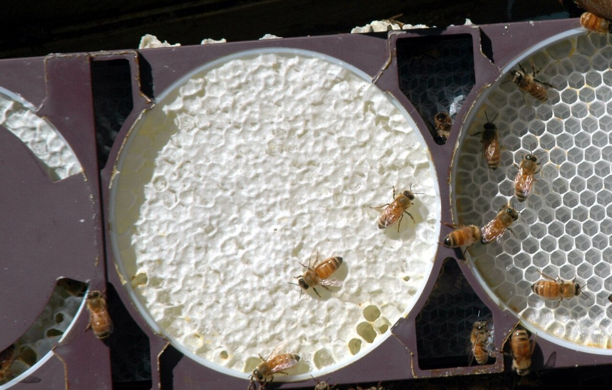

*Photo 52.1 — Comb-honey completion. The centre round is fully built and capped, while the adjacent section is still unfinished. This side-by-side appearance helps explain why section honey is graded by completion and presentation rather than by total honey mass alone. Public-domain photograph by Migco.*

## 52.5 Cut Comb

Cut comb is produced on a larger frame and divided after harvest.

Advantages include:

- fewer internal section boundaries for bees to finish;
- simpler hive equipment;
- flexible retail sizes;
- easier conversion of partly irregular comb into saleable pieces.

Challenges include:

- sticky cutting operations;
- exposed edges that leak;
- need for drainage before packing;
- variable piece weight;
- greater need for hygienic cutting surfaces.

## 52.6 Fresh Broodless Comb

Fresh comb is essential because brood use changes wax permanently.

Brood comb accumulates:

- cocoon layers;
- larval residues;
- propolis;
- pollen residues;
- darker pigments;
- potentially more lipophilic treatment residues.

A brood frame does not become premium edible comb merely because the brood has emerged.

## 52.7 Brood Exclusion

Saleable comb-honey supers should remain broodless.

A queen excluder can help, but it is not the only management method and it does not remove the need to inspect the crop.

If brood appears in a section intended for sale as comb honey, that section should be excluded from the comb-honey product stream.

## 52.8 Colony Selection

The best production colonies are usually:

- very populous;
- queenright;
- rapidly growing before the flow;
- healthy;
- low in damaging Varroa pressure;
- well supplied with young adult workers;
- not already committed to swarming.

Weak colonies commonly produce unfinished, propolised, or irregular sections.

## 52.9 Population Must Peak at the Right Time

A worker requires about three weeks from egg to emergence and additional time before becoming a typical forager.

Therefore, colony preparation begins several weeks before the expected crop.

A colony that becomes strong after the main flow cannot recover lost production time.

## 52.10 Young Bees and Wax Production

Young adult workers are especially important wax producers.

Comb construction is favoured by:

- strong nectar intake;
- warm hive conditions;
- a high population;
- many young workers;
- a clear need for additional comb.

Comb honey therefore benefits from both a large field force and a large internal workforce.

## 52.11 Queen Performance

A failing queen can limit the workforce long before the crop begins.

Before production, examine:

- brood pattern;
- brood quantity;
- queen age and history;
- supersedure signs;
- colony growth rate.

Replacing a poor queen during the main flow is usually too late to restore maximum production that season.

## 52.12 Varroa Control Before the Crop

High Varroa pressure can shorten worker lifespan and reduce colony population just when maximum labour is required.

Comb-honey colonies should enter production with Varroa managed according to current local guidance.

Any treatment must also comply with honey-super, residue, and withdrawal restrictions. Because consumers eat the wax as well as the honey, wax-contaminating treatments deserve particular attention.

## 52.13 Feeding Before Production

Supplemental feed can support colony buildup when natural stores are inadequate, but feeding must stop or be managed so that feed syrup cannot enter the marketable honey crop.

Never create a floral-origin claim on comb that could contain stored feeding syrup.

Records should distinguish colony-support feeding from natural crop production.

## 52.14 Swarming Is the Major Biological Threat

Comb-honey production requires exactly the conditions that often increase swarming:

- high population;
- strong nectar flow;
- many young bees;
- rapid comb occupation;
- limited space.

A swarm removes a large fraction of the workforce and can leave expensive sections unfinished.

## 52.15 Swarm Prevention Must Begin Early

Useful measures include:

- maintaining adequate brood-nest space;
- avoiding severe congestion before the flow;
- using proven local pre-swarm manipulations;
- selecting less swarm-prone stock;
- making planned splits early enough for production colonies to recover;
- monitoring queen cells at appropriate intervals.

Repeatedly dismantling colonies during peak flow can also reduce production. Preparation is better than constant reaction.

## 52.16 Nectar Flow Requirements

A concentrated strong flow is ideal because bees must build and fill new wax rapidly.

Strong flows encourage:

- wax secretion;
- rapid cell building;
- fast filling;
- ripening;
- clean new cappings.

Weak intermittent flows often result in incomplete sections and heavy propolisation.

## 52.17 Use Phenology, Not a Fixed Date

Super timing should use:

- flowering stage;
- weather;
- scale-hive weight gain;
- fresh nectar in the colony;
- increasing white-wax production;
- local historical records.

A date that worked last year can be wrong after a cold spring, drought, or unusually early bloom.

## 52.18 When to Add the Comb-Honey Super

Add the super when the colony is strong and a useful flow is beginning or imminent.

Too early:

- bees may ignore the equipment;
- propolis can accumulate;
- the colony must heat unused volume;
- sections can become travel-stained before filling.

Too late:

- nectar backfills the brood nest;
- swarm pressure rises;
- peak flow is lost before cells are available.

## 52.19 Drawn Comb Is Usually Not the Saleable Product

Premium comb honey should generally be built as fresh comb for that crop.

Old drawn comb can be used elsewhere in the hive for management, but placing old brood or heavily stained drawn comb in the saleable section defeats the purpose of the product.

## 52.20 Thin Beeswax Foundation

Very thin foundation can guide construction while leaving only a small amount of pre-manufactured wax in the edible comb.

It should be:

- genuine beeswax where required by product definition;
- clean;
- free of strong foreign odours;
- appropriately thin;
- protected from heat and contamination.

## 52.21 Foundation Authenticity

Beeswax foundation can be adulterated with paraffin, stearin, or other materials.

Possible consequences include:

- altered comb strength;
- poor acceptance;
- abnormal sagging;
- misleading product identity.

Use trusted foundation and consider laboratory verification when commercial risk justifies it.

## 52.22 Starter Strips

A starter strip provides a small guide from which bees build most of the comb naturally.

Advantages include:

- tender newly secreted wax;
- reduced purchased foundation;
- natural comb construction.

Risks include:

- cross-comb;
- curved comb;
- weak attachment;
- uneven filling.

## 52.23 Foundationless Guides

Foundationless systems can produce excellent edible comb but require good equipment geometry and hive levelling.

Fresh unsupported comb is mechanically delicate, especially when warm and full of honey.

## 52.24 Hive Level

Bees use gravity during comb construction.

If a hive is badly tilted relative to the intended comb plane, natural comb can drift away from guides and cross neighbouring spaces.

Level the hive appropriately before foundationless construction begins.

## 52.25 Correct Spacing

Spacing determines bee passage and comb thickness.

Poor spacing can create:

- bulged comb;
- brace comb;
- irregular thickness;
- cross-comb;
- unfinished corners.

Use the dimensions intended for the section or frame system.

## 52.26 Section Geometry

Bees often begin building in the warm central area and finish outer units later.

Corners and narrow spaces are more likely to remain incomplete.

A beekeeper should evaluate not only total super weight but the percentage of units reaching marketable completion.

## 52.27 Occupation of the Super

Signs of useful occupation include:

- bees covering most units;
- white wax appearing at edges;
- fresh nectar in newly built cells;
- rapid increase in super weight.

A few bees exploring the super does not mean production has truly started.

## 52.28 Avoid Over-Inspection

Comb-honey colonies need enough inspection to manage swarming and space, but excessive manipulation:

- breaks wax;
- chills brood;
- interrupts foraging;
- crushes bees;
- damages cappings.

Use focused inspections with a defined purpose.

## 52.29 Super Position

Some systems place new comb-honey supers above existing supers, while others position them closer to the brood nest to encourage occupation.

The best method depends on hive design, colony strength, and local experience.

Any manipulation should avoid splitting brood or creating temperature stress.

## 52.30 White Wax as a Flow Indicator

Fresh white wax often accompanies strong incoming nectar and active construction.

It is a useful field sign but can also be stimulated by feeding, so interpret it with crop history and records.

## 52.31 Unfinished Sections

Common reasons for incomplete sections include:

- flow ended;
- colony too weak;
- swarming;
- queen failure;
- poor super timing;
- excessive number of units;
- cold weather;
- section geometry;
- low bee acceptance.

Diagnose the cause rather than assuming the colony was simply “lazy”.

## 52.32 Travel Stain

Travel stain is discoloration of cappings caused by bees walking repeatedly over completed comb.

It increases when finished sections remain on a populous hive too long.

Harvest promptly once the crop is mature and removal conditions are suitable.

## 52.33 Propolis Staining

Bees may propolise section edges when nectar intake is weak or when gaps invite sealing.

Heavy propolis reduces visual grade and increases cleaning labour.

Rapid completion during a strong flow is the best preventive strategy.

## 52.34 Pollen in Saleable Comb

A small amount of pollen is natural in the hive, but pollen-packed cells reduce the expected comb-honey presentation and chewing quality.

Strong nectar flows generally encourage nectar storage over pollen storage in dedicated honey supers.

## 52.35 Capping Appearance

Cappings can appear:

- white and dry, with an air space beneath;
- translucent or wet-looking, where wax contacts honey;
- mixed.

Genetics and geometry influence capping appearance.

White cappings are often preferred commercially but are not a purity test.

## 52.36 Capping Completeness

A premium section is usually nearly completely filled and capped.

Incomplete capping reduces visual grade and increases uncertainty about ripeness.

However, capping percentage alone is not an exact moisture measurement.

## 52.37 Honey Moisture

Comb honey is still honey and must meet applicable compositional and stability requirements.

If weather has been humid, the flow was interrupted, or many cells remain uncapped, use a representative quality-control strategy rather than guessing.

## 52.38 Representative Moisture Sampling

Because destructive sampling damages a retail section, operators can use:

- companion frames from the same super and period;
- edge or lower-grade sections;
- cut-comb offcuts;
- retained samples from representative units.

The method should be documented so the sample can reasonably represent the lot.

## 52.39 Legal Limits Are Not Harvest Targets

Current EU rules generally use a maximum moisture of 20% for ordinary honey, with named exceptions.

That is a legal compositional example, not a recommendation that every comb-honey lot should be harvested at 20%.

Lower moisture often gives a larger fermentation-safety margin.

## 52.40 Removing Bees

Methods include:

- bee escapes;
- gentle brushing;
- carefully controlled shaking;
- clean blowers in larger operations.

Comb-honey wax is fragile, so the least damaging effective method should be chosen.

## 52.41 Bee Escapes

Bee escapes can remove most bees without direct mechanical disturbance.

They work best when:

- the super contains no brood;
- equipment is bee-tight;
- timing is appropriate;
- the crop will not be left exposed to pests or heat for too long.

## 52.42 Brushing

Use a clean soft brush dedicated to food-honey work.

A brush that contacts soil, dirty floors, fuel, or chemicals should not immediately return to food contact.

## 52.43 Shaking

A strong frame can sometimes be shaken to remove bees, but new natural comb can tear under sudden acceleration.

Consider:

- comb age;
- temperature;
- attachment;
- honey weight;
- frame design.

## 52.44 Blowers

Blowers can increase harvest speed but must deliver clean air.

Avoid:

- combustion exhaust;
- floor dust;
- excessive pressure;
- capping damage.

## 52.45 Smoke

Use the minimum clean smoke necessary.

Because comb wax is eaten, smoke taint and soot are particularly undesirable.

Never use painted, treated, plastic, oily, or chemically contaminated smoker fuel.

## 52.46 Handling Fresh Comb

Fresh filled comb is heavy and soft.

Handle:

- upright where possible;
- by rigid section edges;
- with clean hands or appropriate gloves;
- away from direct sun and heat;
- in covered food-grade trays.

## 52.47 Heat Damage

Beeswax softens well below its full melting point.

A hot closed vehicle can cause:

- sagging;
- cell rupture;
- leakage;
- total comb collapse.

Protect the crop during transport.

## 52.48 Grading

Grade criteria can include:

- degree of fill;
- capping completeness;
- capping cleanliness;
- travel stain;
- comb straightness;
- pollen/propolis;
- leakage;
- section weight;
- foreign material.

Use written criteria when more than one person grades the crop.

## 52.49 Premium Grade

A premium unit usually has:

- near-complete filling;
- attractive intact cappings;
- tender new wax;
- no brood history;
- little staining;
- no leakage;
- acceptable net quantity;
- good sensory quality.

Commercial buyer standards may be stricter.

## 52.50 Lower Grades

Sound but incomplete product may be suitable for:

- cut comb;
- chunk honey;
- direct sale under truthful grading;
- extraction where the equipment/system permits.

Do not misrepresent lower-grade sections as premium.

## 52.51 Cutting Comb

For cut comb:

1. work on a clean food-grade surface;
2. use a clean sharp cutter;
3. cut when wax is firm but not brittle;
4. minimise crushing;
5. weigh pieces;
6. drain edges under protected conditions;
7. pack promptly.

## 52.52 Water and Cutting Tools

Warm water can help clean sticky cutting tools, but the tool must be dried before returning to the product.

Water introduced at cut edges can increase local moisture and microbial risk.

## 52.53 Net Quantity

Comb honey is a variable-density natural product.

Use a verified scale for packing rather than estimating mass from dimensions.

Follow current legal-metrology requirements in the market of sale.

## 52.54 Packaging

Packaging should protect against:

- crushing;
- leakage;
- insects;
- dust;
- odours;
- moisture exchange;
- rough transport.

Use materials approved for food contact.

## 52.55 Clear Packaging

Clear packs display the comb attractively but expose it to light and solar heating.

Store clear packs in cartons or protected shelves away from direct sunlight and hot windows.

## 52.56 Lot Traceability

Each retail lot should connect to:

- apiary;
- harvest date;
- section or frame batch;
- treatment status;
- quality/moisture records;
- packing date.

Traceability should begin at harvest, not after the labels are printed.

## 52.57 Wax Moth Risk

Wax moth larvae prefer comb containing pollen and brood residues, but clean comb can still be damaged when eggs or larvae are present and conditions are favourable.

Comb honey must be protected using food-safe physical or officially authorised methods.

## 52.58 Freezing as Physical Pest Control

Freezing can kill wax-moth life stages when the actual product reaches a sufficiently low temperature for sufficient time.

Do not rely only on the freezer dial or a folklore duration. Package size, product starting temperature, freezer performance, and air circulation influence exposure.

## 52.59 Thawing Frozen Comb

Condensation is the main handling risk.

Allow sealed packages to equilibrate appropriately before opening so moisture is less likely to condense directly on the product.

Very cold wax can also be brittle.

## 52.60 Small Hive Beetle

In regions where small hive beetle is established, unprotected comb honey can be damaged by beetle activity, especially when pollen is present or processing is delayed.

Where the beetle is exotic or regulated, detection can require official reporting rather than routine pest control.

## 52.61 Other Storage Pests

Protect packaged product from:

- ants;
- rodents;
- wasps;
- cockroaches;
- stored-product insects.

Use exclusion and hygiene rather than contaminating exposed food with pesticides.

## 52.62 Odour Absorption

Wax and honey can retain foreign odours.

Keep comb honey away from:

- fuel;
- paint;
- solvents;
- pesticides;
- smoke;
- strong spices and fragrances.

## 52.63 Crystallisation in Comb

Honey can crystallise naturally inside the cells.

This is not spoilage, but it may alter consumer preference and texture.

Do not overheat comb to restore liquidity; wax can collapse before crystals fully dissolve.

## 52.64 Floral Source and Crystallisation

Rapid-crystallising floral sources can be difficult to sell as clear comb honey.

The same source may be excellent for creamed honey.

Local knowledge of the crop's physical behaviour should influence product choice.

## 52.65 Chunk Honey

Chunk honey combines pieces of fresh broodless comb with liquid honey where permitted.

Both components must be:

- safe;
- traceable;
- compliant;
- correctly labelled.

The liquid portion cannot be used to hide defective comb.

## 52.66 Foundation Residues

Consumers eat wax in comb honey, so source wax deserves extra attention.

Recycled foundation can carry:

- acaricide residues;
- agricultural pesticide residues;
- adulterant waxes.

Freshly built comb does not guarantee clean chemistry if the foundation itself is poor quality.

## 52.67 Product Claims

Claims such as:

- organic;
- monofloral;
- local;
- raw;
- protected geographical origin

must satisfy the same evidence and legal requirements as extracted honey, plus comb-specific product conditions where applicable.

## 52.68 Sensory Evaluation

Assess:

- honey aroma;
- honey flavour;
- wax tenderness;
- capping cleanliness;
- mouthfeel;
- foreign odour;
- crystallisation;
- fermentation signs.

The wax should support rather than dominate the eating experience.

## 52.69 Consumer Education

Consumers unfamiliar with comb honey may not know the wax is edible.

Accurate instructions can explain that the comb can be chewed or swallowed and that natural crystallisation may occur.

Avoid unsupported health claims.

## 52.70 Production Economics

Comb honey often commands a premium price but also produces higher grading losses.

Track:

- number of sections placed;
- percentage completely marketable;
- downgraded units;
- labour hours;
- packaging cost;
- foundation/section cost;
- average retail weight;
- selling price.

## 52.71 Why Honey Mass Is Not Enough

A super can be heavy while many individual sections remain only partly completed.

For section systems, the key economic metric is the proportion of retail units that reach the target grade.

## 52.72 When the Flow Ends Early

If sections remain unfinished:

- assess whether another flow is imminent;
- protect against robbing;
- consider converting suitable material to cut comb;
- extract suitable framed product where possible;
- return non-saleable food to colonies when appropriate;
- downgrade honestly.

Do not leave weak unfinished supers indefinitely.

## 52.73 Emergency: Comb Collapse

If heat damages the crop:

1. cool boxes promptly without contaminating food;
2. segregate leaking units;
3. protect from bees and pests;
4. salvage only hygienically sound product;
5. investigate transport or storage temperature.

## 52.74 Emergency: Fermentation Suspected

Hold the lot and assess:

- moisture;
- odour;
- gas formation;
- phase separation;
- storage temperature.

Do not blend defective comb honey into fresh product.

## 52.75 Emergency: Storage Pest Found

If wax moth or beetle activity is discovered:

- isolate the stock;
- identify the pest;
- inspect adjacent lots;
- use validated food-safe physical control or official guidance;
- dispose of damaged material appropriately.

## 52.76 Decision Table

| Observation | Likely interpretation | Response |
|---|---|---|
| Rapid white-wax building and weight gain | Strong flow and good occupation | Maintain space and swarm surveillance |
| Centre sections full, outer sections empty | Colony/flow/geometry limitation | Assess whether more time is economically justified |
| Brood in saleable unit | Product identity failure | Remove from comb-honey product stream |
| Heavy travel stain | Finished sections remained on colony too long | Downgrade if needed; harvest future mature sections sooner |
| Many uncapped cells, high moisture | Incomplete ripening | Delay or segregate |
| Cross-comb | Level/guide/spacing problem | Correct equipment before next production round |
| Soft sagging wax | Heat exposure | Cool and segregate damaged units |
| Wax moth evidence | Storage-pest exposure | Isolate and apply validated food-safe control |

## 52.77 Practical Production Programme

### Four to six weeks before the expected flow

- identify strongest colonies;
- evaluate queen performance;
- monitor/manage Varroa;
- ensure adequate stores and brood space;
- prepare swarm-control plan;
- assemble section/cut-comb equipment;
- verify foundation quality.

### At flow onset

- confirm fresh nectar and rising weight;
- place comb-honey supers;
- ensure colonies occupy them rapidly;
- monitor swarm condition;
- avoid unnecessary disturbance.

### During the flow

- watch section completion;
- add or rearrange space only when needed;
- maintain broodless product zone;
- remove finished mature units when appropriate.

### After harvest

- remove bees gently;
- cover product immediately;
- transport cool and upright;
- grade and segregate;
- cut/drain where applicable;
- apply validated storage-pest protection;
- package, label, and store under stable conditions.

## 52.78 Scientific Notes

### Wax production is metabolically expensive

The colony converts carbohydrate energy into both wax and stored honey. For that reason, a colony given drawn comb can often store more immediately extractable honey than one required to build an equivalent new comb crop.

### Section geometry is behavioural engineering

Bees respond to gap size, warmth, airflow, edges, and colony traffic. Section design therefore influences construction behaviour, not merely retail shape.

### Beeswax softens before melting

Fresh comb can deform under honey load at temperatures far below the complete melting point of bulk beeswax. Mechanical stability is a temperature-dependent property.

### Capping phenotype varies

Dry and wet capping patterns are influenced partly by genetics and cell geometry. Capping appearance should not be interpreted as direct evidence of purity or exact moisture.

### Pest-control exposure must reach the pest

For freezer treatment, the relevant measurement is the temperature/time achieved inside the product, not just the appliance setting.

## 52.79 Comb-Honey Checklist

- [ ] Production colony strong and queenright.
- [ ] Varroa pressure managed before food-super restrictions apply.
- [ ] Main nectar flow expected or confirmed.
- [ ] Swarm plan active.
- [ ] Saleable comb will be fresh and broodless.
- [ ] Foundation/starter material suitable and traceable.
- [ ] Hive properly levelled and section spacing correct.
- [ ] Super added before severe congestion but not excessively early.
- [ ] Bees occupying units rapidly.
- [ ] Brood excluded from crop.
- [ ] Moisture/ripeness assessed by representative method.
- [ ] Completed sections removed before avoidable staining.
- [ ] Bee-removal method gentle and clean.
- [ ] Product protected from heat during transport.
- [ ] Grading criteria documented.
- [ ] Cut comb handled on food-grade surfaces.
- [ ] Storage-pest method validated and food-safe.
- [ ] Lot identity retained through packing.
- [ ] Final product protected from odour, moisture, heat, and pests.
- [ ] Completion percentage and true production economics recorded.

## Key Takeaways

- Comb honey requires mature honey, tender new wax, and attractive presentation at the same time.
- Fresh broodless comb is the fundamental product requirement.
- Very strong colonies and a strong concentrated nectar flow are the foundation of reliable production.
- Worker population and swarm control must be prepared weeks before the crop.
- Thin beeswax foundation, starter strips, and foundationless guides all require good source control and geometry.
- Capping appearance is useful for grading but is not an exact moisture or purity test.
- Unfinished retail sections are one of the largest economic risks.
- Fresh comb is vulnerable to heat, rough handling, odour, and storage pests.
- Freezing is a useful physical pest-control tool only when the actual product exposure is validated.
- The correct performance measure is marketable units and quality, not only total honey weight.

## Chapter Summary

Comb-honey production is the deliberate creation of a finished food package inside the colony. The bees must build new wax, fill it with natural nectar, ripen the honey, and cap it before the flow ends. That makes strong colony preparation and accurate timing more important than in ordinary extracted-honey production.

Production starts weeks before the super is added. Queen performance, worker population, Varroa management, brood space, and swarm prevention determine whether the colony can exploit the crop. At flow onset, thin foundation, starter strips, or foundationless systems can be used to produce new broodless comb, but hive level, spacing, and section geometry must guide construction.

The beekeeper then manages completion rather than simply weight. Finished sections should be mature, clean, straight, attractive, and harvested before avoidable travel stain. Moisture remains a real quality parameter and should be assessed representatively where uncertainty exists.

After harvest, comb honey requires gentle handling and strong environmental control. Fresh wax softens with heat, absorbs odours, and can be attacked by storage pests. Food-safe packaging, validated pest-control methods, traceability, and honest grading preserve the premium value created by the colony.

## Review Questions

1. What is comb honey?
2. Why is comb honey both a honey product and a wax product?
3. What does the current EU definition emphasise about saleable comb?
4. Why must premium comb honey be broodless?
5. Name four common comb-honey product forms.
6. What is section comb honey?
7. What is one major advantage of section systems?
8. What is one major disadvantage?
9. What is cut comb?
10. Why may cut comb be easier for colonies to complete than many small sections?
11. Why is fresh wax preferred?
12. What remains in comb after brood emerges?
13. Why does brood history matter even without visible brood?
14. How can a queen excluder help?
15. Why is an excluder not sufficient by itself?
16. What colony characteristics favour comb-honey production?
17. Why do weak colonies often produce poor sections?
18. Why must population development begin weeks before the flow?
19. Which workers are especially important for wax secretion?
20. What conditions favour wax construction?
21. Why is queen performance important before the crop?
22. Why is Varroa control linked to honey yield?
23. Why are treatment restrictions especially relevant to edible wax?
24. How can supplemental feeding contaminate product identity?
25. Why is swarming a major comb-honey risk?
26. Which comb-honey conditions also favour swarming?
27. Why should swarm prevention begin before the main flow?
28. What type of nectar flow is best for comb honey?
29. Why are weak intermittent flows difficult?
30. Which observations help predict flow onset?
31. What can happen if the super is placed too early?
32. What can happen if it is placed too late?
33. Why is old drawn brood comb unsuitable as the saleable product?
34. What qualities should thin foundation have?
35. Why does foundation authenticity matter?
36. Which adulterants can occur in beeswax foundation?
37. What is a starter strip?
38. What are its advantages?
39. What are its risks?
40. Why is foundationless comb mechanically delicate?
41. Why should the hive be level?
42. How can spacing affect comb shape?
43. Why do centre sections often finish first?
44. Why should completion percentage be tracked?
45. What signs show genuine super occupation?
46. Why can over-inspection reduce production?
47. Why is fresh white wax only a supporting flow indicator?
48. Name four causes of unfinished sections.
49. What is travel stain?
50. Why should mature finished sections not remain on colonies unnecessarily?
51. Why can propolis reduce section grade?
52. Why are pollen-filled cells undesirable in premium comb honey?
53. What are dry cappings?
54. What are wet cappings?
55. Does white capping prove low moisture?
56. Why does capping completeness matter commercially?
57. Why is capping percentage not an exact moisture test?
58. How can moisture be assessed without destroying every retail unit?
59. What is the general current EU moisture maximum for ordinary honey?
60. Why is that value not a universal harvest target?
61. Name three bee-removal methods.
62. When are bee escapes especially useful?
63. Why must food brushes remain clean?
64. Why can shaking fresh comb be dangerous?
65. What contamination risk applies to blowers?
66. Why should smoker fuel be clean?
67. How should filled fresh comb be handled?
68. Why can a hot vehicle destroy comb honey?
69. What factors belong in a grading system?
70. What commonly defines premium grade?
71. What can be done with lower-grade but sound comb?
72. Why should cut-comb pieces be weighed?
73. Why must cutting tools be dried after washing?
74. Why should cut edges be allowed to drain under protected conditions?
75. What should packaging protect against?
76. What trade-off comes with clear packaging?
77. What records should lot identity connect?
78. Why can wax moth still damage apparently clean comb?
79. Why can freezing be useful?
80. Why is freezer setpoint alone inadequate validation?
81. What is the main thawing risk?
82. How can small hive beetle affect stored comb honey?
83. What changes if small hive beetle is exotic locally?
84. Why should pesticides not be sprayed around exposed comb honey?
85. Why is odour segregation important?
86. Is crystallisation in comb automatically spoilage?
87. Why can floral source determine suitability for clear comb honey?
88. What is chunk honey?
89. Why does recycled foundation deserve residue scrutiny?
90. Which specialty claims require separate evidence?
91. What should sensory evaluation include?
92. Why can consumer education improve comb-honey use?
93. Which economic records should be kept?
94. Why can a heavy super still be economically poor?
95. What options exist when the flow ends before sections finish?
96. What should happen after heat-induced comb collapse?
97. What should happen if fermentation is suspected?
98. What should happen if a storage pest is found?
99. Why is section geometry considered behavioural engineering?
100. What combination of colony biology, flow timing, food quality, and grading makes comb-honey production profitable?

## References

- Council Directive 2001/110/EC relating to honey, consolidated version applicable from 14 June 2026, including the definition of comb honey.
- Codex Alimentarius Commission. *Standard for Honey*, CXS 12-1981, current text amended through 2022.
- University and cooperative-extension guidance on section comb, cut comb, swarm management, colony preparation, wax-moth control, and honey handling.
- Graham, J. M., editor. *The Hive and the Honey Bee*. Dadant & Sons.
- Scientific literature on wax production, comb mechanics, beeswax adulteration, residue accumulation, honey moisture, and stored-comb pests.
- Current national food-hygiene, veterinary-medicine, food-contact-material, legal-metrology, labelling, organic/certification, and regulated-pest requirements must be checked for the target market.

# Chapter 53 — Creamed Honey

## Introduction

Creamed honey is honey in which crystallisation has been deliberately controlled to create a stable, smooth, spreadable texture. It is also called soft-set, set, spun, or crystallised honey in different markets, although local terminology and legal expectations vary.

The product is not created by adding cream. Its texture comes from a very large number of fine glucose crystals distributed throughout the honey. The processor encourages many small crystals to form while preventing a small number of crystals from growing large and gritty.

This makes creamed honey a crystallisation-management problem rather than a whipping problem. Air is not the desired structure. In fact, excessive air incorporation can create foam, pale streaks, poor filling, and unstable appearance.

The classic Dyce process established the basic commercial principle: begin with sound honey, eliminate uncontrolled coarse crystals, introduce a fine-crystal seed, mix it uniformly, fill the product, and hold it under conditions that favour fine controlled crystallisation. Modern processors adapt the exact seed ratio, temperature profile, equipment, and timing to the honey type and production scale.

## Learning Objectives

After completing this chapter, the reader should be able to:

- explain why honey crystallises;
- distinguish nucleation from crystal growth;
- explain why many small crystals create smooth texture;
- distinguish creamed honey from whipped honey and coarse natural crystallisation;
- select suitable base honey and seed honey;
- prepare base honey without unnecessary heat damage;
- mix seed without entraining excessive air;
- manage filling, setting, and storage conditions;
- diagnose gritty texture, phase separation, streaking, foam, and fermentation;
- maintain traceability and truthful product labelling when flavours or other ingredients are added.

## 53.1 Why Honey Crystallises

Honey is a concentrated sugar solution. In many honeys, the amount of glucose dissolved in the available water exceeds the stable equilibrium concentration.

The solution is therefore supersaturated.

Under suitable conditions, glucose molecules organise into solid crystals and water remains concentrated in the liquid phase.

## 53.2 Glucose and Fructose

Glucose crystallises much more readily than fructose.

Honey rich in glucose relative to water generally crystallises faster than honey with:

- relatively more fructose;
- more water;
- fewer crystal nuclei.

Botanical origin strongly influences sugar composition and therefore crystallisation behaviour.

## 53.3 Nucleation

Nucleation is the formation of stable crystal-starting points.

Nuclei can arise from:

- microscopic glucose crystals;
- pollen;
- wax particles;
- container surfaces;
- existing crystallised honey.

A creamed-honey process intentionally introduces many fine nuclei so crystal growth is divided among them.

## 53.4 Crystal Growth

Once nuclei exist, glucose molecules add to their surfaces.

If only a few nuclei are present, each can grow large.

If many fine nuclei are distributed through the honey, available glucose is shared among many crystals and the final texture can remain fine and smooth.

## 53.5 Smooth Versus Gritty Texture

A smooth creamed honey contains crystals small enough that the tongue perceives a uniform creamy mass rather than individual grains.

Grittiness can result from:

- seed crystals that are too coarse;
- incomplete mixing;
- slow uncontrolled nucleation;
- temperature fluctuations;
- partial melting and recrystallisation;
- addition of coarse crystallised honey.

Texture is therefore a process history.

## 53.6 Creamed Honey Is Not Whipped Honey

Whipped honey contains intentionally incorporated air.

Creamed honey derives structure from fine crystals.

Excess air in creamed honey can cause:

- foam;
- low-density appearance;
- bubbles on jar walls;
- oxidation exposure;
- inaccurate fill by volume;
- pale streaks.

Mix to distribute crystals, not to whip air into the product.

## 53.7 Naturally Crystallised Honey

Natural crystallisation can produce excellent honey, but texture is less controlled.

It may be:

- fine and smooth;
- coarse and gritty;
- layered;
- partially liquid.

Creamed honey converts this naturally variable process into a repeatable product specification.

## 53.8 The Dyce Principle

The process developed by Elton J. Dyce formalised controlled honey crystallisation.

The essential principles are:

1. start with mature, stable honey;
2. remove unwanted coarse crystals or fully liquefy them;
3. cool the honey to a temperature suitable for adding seed without melting it;
4. add fine seed crystals;
5. mix uniformly with minimal air;
6. fill containers;
7. hold under conditions favouring fine crystallisation;
8. store to preserve the finished crystal structure.

Exact commercial settings are not universal.

## 53.9 Historical Dyce Parameters

Classic descriptions often use a seed addition of approximately 10% and a setting environment near 14°C.

These values are useful historical starting points, not laws of honey processing.

Different honeys, crystal sizes, room controls, batch sizes, and desired firmness may perform better under different validated settings.

## 53.10 Selecting the Base Honey

Good base honey should be:

- fully mature;
- within moisture specification;
- free from fermentation;
- free from chemical or smoke taint;
- traceable;
- suitable in flavour and colour for the intended product;
- compliant with applicable compositional standards.

Creaming cannot repair defective honey.

## 53.11 Moisture and Creamed Honey

Crystallisation moves glucose into a solid phase and leaves relatively more water in the remaining liquid fraction.

If starting moisture is high, this redistribution can increase fermentation risk.

Therefore, moisture control is especially important in crystallised products.

## 53.12 Do Not Use Creaming to Hide High Moisture

A thick texture can make a wet honey appear stable.

Texture does not cancel:

- fermentation risk;
- legal moisture limits;
- poor harvest practice.

Measure moisture before processing.

## 53.13 Choosing Floral Types

Some honeys crystallise readily and make good creamed-honey bases.

Others resist crystallisation or set very slowly because of their sugar balance.

Blending can modify crystallisation behaviour, but any blend must remain traceable and meet origin-labelling requirements.

## 53.14 Flavour Selection

The creaming process can soften the sensory perception of some honeys because texture changes how aroma and sweetness are released in the mouth.

Select a base honey whose flavour remains pleasant when served cool and spreadable.

## 53.15 Seed Honey

Seed honey is a fine-crystallised honey used to introduce a large number of crystal nuclei.

Good seed should be:

- extremely fine textured;
- free from coarse grains;
- food-safe;
- low enough in moisture;
- fresh and free from fermentation;
- compatible with the desired flavour.

## 53.16 Seed Crystal Size

Crystal size in the seed strongly influences final texture.

If seed contains coarse crystals, those crystals can continue growing in the batch.

Examine seed:

- sensorially between tongue and palate;
- visually where possible;
- microscopically in quality-control systems when required.

Seed should feel smooth, not sandy.

## 53.17 Producing Seed

Seed can be produced from a previous successful batch or by controlled fine crystallisation.

A processor should maintain:

- seed lot identity;
- moisture record;
- age;
- storage condition;
- sensory quality.

Do not maintain an indefinite “mother seed” without hygiene and quality control.

## 53.18 Purchased Seed

Commercial fine seed can improve consistency, but verify:

- supplier;
- ingredient/product identity;
- moisture;
- origin implications;
- flavour compatibility;
- microbiological/quality status where appropriate.

## 53.19 Seed Storage

Seed should be stored so crystals do not partially melt and regrow coarsely.

Temperature fluctuation is especially undesirable.

Protect seed from:

- moisture;
- odours;
- contamination;
- heat;
- unrecorded mixing.

## 53.20 Preparing the Base Honey

If the base honey already contains uncontrolled crystals, they can compete with the seed.

Preparation may require controlled liquefaction before cooling to the seeding range.

The objective is to remove coarse crystal memory while preserving honey quality.

## 53.21 Liquefaction

Liquefaction should use the minimum effective time–temperature exposure.

Large containers must be warmed evenly.

Avoid:

- scorching at tank walls;
- prolonged holding after liquefaction;
- repeated heating cycles;
- adding seed while the honey is still hot enough to dissolve it.

## 53.22 Not Every Crystal Must Be Destroyed in Every Process

Some modern processes use controlled existing fine crystals rather than complete liquefaction.

The principle is consistency: the processor must know what crystal population is entering the batch.

An uncontrolled mix of fine and coarse crystals creates unpredictable texture.

## 53.23 Cooling Before Seeding

Honey must be cool enough that seed crystals survive.

If seed is added to honey that is too warm:

- fine crystals dissolve;
- nucleation density falls;
- later crystals grow larger;
- setting slows.

Temperature should be measured in the product, not inferred from room temperature alone.

## 53.24 Seed Percentage

More seed provides more nuclei but also increases:

- seed requirement;
- viscosity;
- mixing load;
- flavour contribution from the seed.

Too little seed can produce slower setting and coarser texture.

Processors should validate a ratio for their honey and equipment rather than assuming one percentage is universally optimal.

## 53.25 Weigh Seed and Base Honey

Use mass rather than estimated volume for repeatable batches.

Record:

- base honey mass;
- seed mass;
- calculated percentage;
- batch total.

A weighing record improves consistency and traceability.

## 53.26 Incorporating Seed

A practical method is to first blend seed into a smaller quantity of base honey to create a pumpable, uniform premix.

The premix can then be distributed into the main batch.

This reduces the risk of seed lumps.

## 53.27 Mixing

Mixing should distribute nuclei throughout the tank.

Good mixing is:

- slow;
- thorough;
- low-air;
- mechanically gentle;
- long enough to eliminate streaks.

Fast agitation is not better if it creates a vortex and foam.

## 53.28 Tank Geometry

Tall narrow tanks and wide shallow tanks mix differently.

Potential dead zones occur:

- near bottom corners;
- under impellers;
- around valves;
- at surface edges.

Validate mixing using texture consistency across the batch.

## 53.29 Scraping Tank Walls

Crystals or unmixed honey can remain on tank walls.

If scraping is required, use clean food-grade tools and avoid introducing dried old material from previous batches.

## 53.30 Air Incorporation

Air can enter through:

- high-speed mixers;
- vortex formation;
- splashing during transfer;
- high drop heights;
- pumping leaks.

Reduce air before the batch becomes too viscous to release bubbles.

## 53.31 Deaeration Before Filling

After mixing, a brief controlled rest can allow larger bubbles to rise before filling.

The rest must not be so long or warm that crystallisation begins unevenly in the tank.

## 53.32 Filling

Fill while the seeded honey is fluid enough to move predictably but before major setting occurs.

Avoid:

- excessive drop height;
- partial jars waiting warm for long periods;
- contaminated lids;
- inconsistent net weight.

## 53.33 Package Size and Setting

Large containers crystallise differently from small retail jars because of:

- thermal mass;
- cooling rate;
- internal temperature gradient.

Validate setting conditions for the actual package size.

## 53.34 Setting Temperature

Controlled crystallisation often performs well in a cool environment that favours nucleation and fine crystal development.

Classic recommendations near the mid-teens Celsius are common, but exact performance depends on honey composition and process.

The important requirement is stable, validated conditions rather than a universal single number.

## 53.35 Temperature Uniformity

A setting room can have warmer zones near:

- ceiling;
- doors;
- lights;
- refrigeration discharge;
- exterior walls.

Map room temperature when consistency matters.

## 53.36 Setting Time

Setting can take days rather than hours.

Time depends on:

- seed concentration;
- seed crystal size;
- honey composition;
- temperature;
- jar size;
- prior thermal history.

Do not judge the process too early.

## 53.37 Finished Texture

A good product is commonly:

- smooth;
- uniform;
- spreadable;
- free of coarse grains;
- free of liquid separation;
- free of large air pockets.

Desired firmness can vary by market.

## 53.38 Firmness

Firmness depends on:

- proportion of glucose crystallised;
- water content;
- temperature;
- crystal network;
- floral composition.

A product can have fine crystals but still be too hard or too soft for the intended use.

## 53.39 Product Temperature at Evaluation

Texture changes with temperature.

Evaluate finished samples at a defined temperature so batches can be compared fairly.

A jar sampled cold directly from the setting room can feel firmer than the same jar at retail room temperature.

## 53.40 Gritty Product

Common causes include:

- coarse seed;
- too little seed;
- incomplete liquefaction of old coarse crystals;
- slow uncontrolled cooling;
- warm storage after setting;
- temperature cycling.

Correct the cause rather than merely increasing mixing speed.

## 53.41 Soft Product

Possible causes include:

- floral type with low glucose tendency;
- insufficient crystallisation time;
- warm storage;
- high moisture;
- low seed level;
- seed partially dissolved.

Measure moisture before assuming a texture problem only.

## 53.42 Overly Hard Product

Possible causes include:

- honey naturally high in glucose;
- low moisture;
- very high crystalline fraction;
- storage too cold;
- excessively long set under certain conditions.

A hard product can still be chemically high quality but fail consumer texture expectations.

## 53.43 Phase Separation

A liquid layer can form above or within crystallised honey.

Causes include:

- high moisture;
- incomplete crystallisation;
- temperature fluctuation;
- partial melting;
- unsuitable honey composition.

The liquid fraction can become wetter and more fermentation-prone.

## 53.44 Fermentation

Creamed texture can hide early gas bubbles.

Warning signs include:

- swelling lids;
- tunnels or pockets of gas;
- sour/alcoholic aroma;
- wet separated layer;
- froth.

Segregate suspect product immediately.

## 53.45 White Streaks and Frosting

Pale streaks near jar walls can arise from microscopic air spaces and crystal structure pulling away from the container.

This may be a visual defect without being spoilage.

Process and storage conditions influence its severity.

## 53.46 Surface Bloom

A lighter surface can develop through:

- air incorporation;
- fine crystals;
- drying at the surface;
- temperature gradients.

Inspect aroma and structure before assuming mould or fermentation.

## 53.47 Large Air Bubbles

Large bubbles usually indicate process aeration rather than desirable texture.

Reduce by:

- slower mixing;
- lower drop height;
- correct pump sealing;
- short settling before filling.

## 53.48 Reworking Gritty Honey

If the product is otherwise safe and legally compliant, it may be possible to re-liquefy and process again.

Consider:

- cumulative heat exposure;
- HMF/diastase impact;
- labour;
- lot identity;
- whether the defect will recur.

Repeated heating is not a free correction.

## 53.49 Reworking Fermented Honey

Fermented honey should not be reworked into ordinary creamed table honey.

Follow legal options for downgrade, industrial use, disposal, or another permitted product category.

Do not hide fermentation with flavouring.

## 53.50 Storage of Finished Creamed Honey

Store under conditions that preserve crystal structure.

Avoid:

- high heat;
- direct sunlight;
- repeated warm/cold cycling;
- moisture exposure;
- strong odours.

A stable moderate/cool environment is generally preferable.

## 53.51 Partial Melting

If finished creamed honey becomes too warm, some crystals can melt.

On cooling, remaining crystals may act as uneven nuclei and produce:

- coarse grains;
- separation;
- streaks.

Temperature abuse can therefore permanently alter texture.

## 53.52 Cold Storage

Very cold storage can increase firmness and alter consumer usability.

If cold storage is used for quality preservation, validate the return to sale temperature without condensation or texture damage.

## 53.53 Consumer Storage Instructions

Instructions should match the product.

Possible advice can include:

- keep tightly closed;
- store away from heat and direct sunlight;
- natural texture variation may occur.

Do not make unsupported medical or preservation claims.

## 53.54 Adding Flavours

Some producers add:

- cinnamon;
- cocoa;
- fruit powders;
- nuts;
- essential flavour ingredients;
- other foods.

Once ingredients are added, the product may no longer legally be sold simply as “honey”.

Check food-labelling, allergen, ingredient, and composition rules.

## 53.55 Water-Containing Flavour Ingredients

Fresh fruit, liquid extracts, or other high-moisture ingredients can raise water activity and create fermentation or pathogen concerns not present in plain honey.

Do not add ingredients without a validated food-safety formulation.

## 53.56 Dry Flavour Ingredients

Dry powders can still introduce:

- spores;
- allergens;
- foreign bodies;
- flavour variability;
- moisture.

Use food-grade ingredients from controlled suppliers.

## 53.57 Allergen Management

Nuts, milk powders, sesame, and other ingredients may introduce regulated allergens.

Allergen control requires:

- supplier specifications;
- separate storage;
- label declaration;
- cleaning validation;
- cross-contact prevention.

Plain honey and flavoured products should not share uncontrolled equipment.

## 53.58 Ingredient Traceability

A flavoured creamed-honey lot should record:

- honey lot;
- seed lot;
- ingredient lot;
- ingredient weight;
- final batch weight;
- label version.

Traceability must extend beyond the honey.

## 53.59 Colour Uniformity

Creamed honey appears lighter than the same honey in liquid form because crystals scatter light.

This is a physical optical effect, not evidence that colour has been chemically removed.

## 53.60 Sensory Evaluation

Evaluate:

- crystal smoothness;
- spreadability;
- sweetness;
- aroma;
- aftertaste;
- airiness;
- phase separation;
- visual uniformity.

Use the same serving temperature for comparisons.

## 53.61 Batch Records

Record:

- base honey lot;
- moisture;
- liquefaction time/temperature;
- seed lot;
- seed percentage;
- mix time/speed;
- fill date;
- setting temperature/time;
- final texture result;
- storage location.

These records make texture reproducible.

## 53.62 Retained Samples

Keep samples from representative batches to compare:

- crystal size;
- separation;
- flavour;
- firmness;
- storage stability.

A jar photographed only on packing day cannot reveal later texture stability.

## 53.63 Scaling Up

A process that works in a 10 kg bucket may fail in a 500 kg tank because:

- mixing geometry changes;
- cooling slows;
- heat gradients increase;
- filling takes longer;
- seed distribution becomes harder.

Scale-up requires validation, not simple multiplication.

## 53.64 Small-Scale Production

Small batches offer advantages:

- easy temperature control;
- lower recall exposure;
- manual texture assessment;
- faster mixing.

But manual methods can vary from batch to batch unless weighing and recording are disciplined.

## 53.65 Commercial Production

Larger systems benefit from:

- jacketed tanks;
- slow mixers;
- controlled rooms;
- metered pumps;
- automated fillers;
- temperature logging.

Equipment should be designed to handle increasing viscosity as crystallisation begins.

## 53.66 Pumping Seeded Honey

Seeded honey becomes progressively harder to pump.

Plan pipe diameter, pump type, valve design, and fill schedule before setting begins.

Avoid long narrow hoses that trap thick product.

## 53.67 Filling Machines

Fillers must handle suspended fine crystals without:

- crushing seals;
- introducing air;
- heating excessively;
- losing weight accuracy.

Cleanable food-grade positive-displacement systems are common.

## 53.68 Net Quantity

Creamed honey can trap air, affecting volume without adding mass.

Pack by verified net mass according to legal metrology rules.

Do not estimate weight from jar fill height alone.

## 53.69 Label Identity

Names such as creamed, soft-set, set, or spun may be accepted differently by market.

The base product remains honey when no unauthorised ingredients are added and applicable standards are met.

When other ingredients are added, use the legally correct composite-food name.

## 53.70 Quality Release

Before release, check:

- lot identity;
- net weight;
- seal;
- texture;
- moisture/specification;
- sensory quality;
- separation;
- label correctness.

Do not release a lot simply because it has completed the expected number of setting days.

## 53.71 Decision Table

| Observation | Likely cause | Response |
|---|---|---|
| Smooth fine set | Controlled nucleation successful | Maintain stable storage |
| Sandy/gritty texture | Coarse seed, too few nuclei, old crystals or temperature issue | Review seed and thermal history |
| Still liquid after expected setting time | Seed dissolved, low seed, honey composition or warm setting | Verify temperature, seed, composition and time |
| Very hard set | High glucose/low moisture/high crystal fraction | Adjust validated formulation/process for future batches |
| Liquid layer | Phase separation | Check moisture, temperature history and fermentation |
| Foam/bubbles immediately after filling | Air incorporation | Reduce mixer/pump turbulence |
| Gas tunnels/off-odour later | Fermentation | Hold/reject ordinary table-honey use |
| White jar-wall streaks without off-odour | Crystal/air interface defect possible | Evaluate sensory and storage stability |

## 53.72 Practical Creamed-Honey Procedure

### Preparation

- select compliant base honey;
- measure moisture;
- inspect seed quality;
- clean and dry equipment;
- define batch size and records.

### Base preparation

1. liquefy uncontrolled coarse crystals only as much as necessary;
2. cool base honey to the validated seeding range;
3. verify temperature in the product.

### Seeding and mixing

4. weigh base and seed;
5. prepare a seed premix if helpful;
6. incorporate seed gently;
7. mix until uniform without whipping air;
8. rest briefly if needed to release bubbles.

### Filling and setting

9. fill clean containers promptly;
10. close and identify lot;
11. move to stable validated setting conditions;
12. inspect representative jars during development;
13. release only after texture and quality checks.

## 53.73 Scientific Notes

### Supersaturation

Glucose concentration in honey often exceeds its equilibrium solubility. The liquid persists temporarily because crystal formation requires nucleation and molecular organisation.

### Nucleation density controls texture

Many nuclei divide the available glucose among many growing crystals. This reduces final crystal size and produces smooth texture.

### Temperature affects two competing processes

Lower temperature can increase supersaturation but reduce molecular movement. Warmer temperature increases movement but can dissolve crystals. The fastest and finest setting occurs in an intermediate range that depends on composition.

### Crystallisation redistributes water

Glucose crystals contain little water, leaving the remaining liquid fraction wetter. This explains why wet honey can become more fermentation-prone during crystallisation.

### Light scattering

The pale appearance of creamed honey is largely due to crystal surfaces scattering light rather than a loss of pigments.

## 53.74 Creamed-Honey Checklist

- [ ] Base honey is legally compliant and sensory-sound.
- [ ] Moisture measured.
- [ ] No fermentation or chemical taint.
- [ ] Uncontrolled coarse crystals addressed.
- [ ] Seed is fine, smooth, traceable, and stable.
- [ ] Seed/base masses weighed accurately.
- [ ] Product temperature measured before seeding.
- [ ] Seed is not added while base honey is hot enough to dissolve it.
- [ ] Mixing is thorough but low-air.
- [ ] Tank dead zones checked.
- [ ] Containers clean and dry.
- [ ] Filling completed before excessive thickening.
- [ ] Setting temperature stable.
- [ ] Representative jars inspected.
- [ ] Final product free of grit, separation and fermentation.
- [ ] Flavoured products use validated ingredients and correct labelling.
- [ ] Allergens controlled where applicable.
- [ ] Lot and seed records complete.
- [ ] Retained sample stored.
- [ ] Finished product protected from heat cycling.

## Key Takeaways

- Creamed honey is controlled crystallised honey, not honey with cream and not merely whipped honey.
- Smooth texture comes from many fine glucose crystals.
- Seed crystal quality is one of the most important determinants of final texture.
- Classic Dyce parameters are useful reference points, not universal immutable settings.
- Base honey must already meet moisture, safety, and quality requirements.
- High-moisture honey becomes particularly risky because crystallisation can leave a wetter liquid phase.
- Seed must be added after base honey is cool enough to preserve fine crystals.
- Mixing must distribute seed without incorporating excessive air.
- Setting and storage temperature stability are essential for fine texture.
- Flavoured products introduce ingredient, allergen, water-activity, and legal-labelling responsibilities beyond plain honey.

## Chapter Summary

Creamed honey is produced by directing a natural physical process. Honey that is supersaturated with glucose will eventually crystallise, but uncontrolled crystallisation can produce coarse grains and separation. The processor creates a fine, stable product by distributing a large number of very small seed crystals throughout sound base honey and then allowing those crystals to grow under controlled conditions.

The classic Dyce process provides the foundation, but no single seed percentage or temperature is universally correct. Honey composition, moisture, crystal size, batch volume, mixer geometry, package size, and room stability all affect the final result. Process validation and records are therefore more valuable than memorising one recipe.

Quality starts before seeding. Fermented, wet, overheated, contaminated, or poorly flavoured honey cannot be rescued by creaming. Controlled liquefaction should remove unwanted coarse crystals without unnecessary heat, and seed should be added only after the base is cool enough not to dissolve it.

The finished product must remain stable through distribution. Heat cycling can partially melt fine crystals and cause later coarse recrystallisation or phase separation. Good creamed honey is smooth, uniform, properly labelled, traceable, and deliberately designed for its storage and consumer use.

## Review Questions

1. What is creamed honey?
2. Does creamed honey contain dairy cream by definition?
3. What creates the texture of creamed honey?
4. Why is creamed honey different from whipped honey?
5. What is sugar supersaturation?
6. Which major honey sugar crystallises most readily?
7. How does fructose affect crystallisation tendency?
8. What is nucleation?
9. What can act as a crystal nucleus in honey?
10. Why do many nuclei produce smaller crystals?
11. What causes a gritty texture?
12. Why can coarse seed produce coarse final honey?
13. Can naturally crystallised honey be smooth?
14. What does controlled processing add to natural crystallisation?
15. What are the main principles of the Dyce process?
16. Why should historical Dyce temperatures and seed percentages not be treated as universal laws?
17. What qualities should base honey have?
18. Why is moisture especially important in creamed honey?
19. How does glucose crystallisation redistribute water?
20. Can creaming make high-moisture honey safe?
21. Why do different floral honeys crystallise at different rates?
22. What is seed honey?
23. What makes good seed honey?
24. Why is seed crystal size critical?
25. How can seed texture be assessed practically?
26. Why should seed lot identity be recorded?
27. What can happen to seed during poor warm storage?
28. Why might purchased seed be useful?
29. What should be verified about purchased seed?
30. Why are coarse crystals in base honey a problem?
31. What is the goal of liquefaction before seeding?
32. Why should liquefaction use minimum effective heat?
33. What happens if seed is added to honey that is too warm?
34. Why must product temperature be measured directly?
35. How does seed percentage affect nucleation?
36. Why should base and seed be weighed rather than estimated by volume?
37. What is a seed premix?
38. How can a premix improve distribution?
39. What are the characteristics of good mixing?
40. Why is high-speed mixing undesirable?
41. What are tank dead zones?
42. Why can wall scraping create hygiene issues?
43. How does air enter a creamed-honey batch?
44. Why is excessive air undesirable?
45. Why might a short rest before filling help?
46. When should seeded honey be filled?
47. Why can package size influence setting?
48. Why are stable cool setting conditions useful?
49. Why should a single setting temperature not be presented as universal?
50. Which zones in a setting room may be warmer?
51. What determines setting time?
52. What are typical characteristics of a good finished product?
53. What determines firmness?
54. Why must texture be compared at a defined temperature?
55. What are common causes of gritty product?
56. What can cause a batch to remain soft?
57. Why should moisture be checked when product stays soft?
58. What can make creamed honey excessively hard?
59. What is phase separation?
60. Why can a separated liquid layer ferment more easily?
61. What signs suggest fermentation in creamed honey?
62. What can cause pale streaks at jar walls?
63. Are pale streaks automatically spoilage?
64. How can process aeration be reduced?
65. When can gritty honey be reworked?
66. What quality cost comes with repeated reheating?
67. Why should fermented honey not be reworked into ordinary table honey?
68. How should finished creamed honey be stored?
69. What happens when fine crystals partially melt?
70. Why can temperature cycling create later grit?
71. How can very cold storage affect consumer texture?
72. What storage advice can be given to consumers?
73. What changes legally when flavour ingredients are added?
74. Why are fresh fruit or liquid ingredients high-risk additions?
75. What hazards can dry powders introduce?
76. Why does allergen management matter in flavoured products?
77. Which batch records are needed for added ingredients?
78. Why does creamed honey often appear paler than liquid honey?
79. What should sensory evaluation include?
80. Why must serving temperature be standardised in comparisons?
81. Which processing records make texture reproducible?
82. Why are retained samples useful?
83. Why can a process fail when scaled from a bucket to a large tank?
84. What are the advantages of small-batch production?
85. What controls become important in commercial-scale production?
86. Why does seeded honey become difficult to pump?
87. What should be considered in pipe and pump design?
88. What must a filling machine handle correctly?
89. Why should creamed honey be packed by net mass rather than fill height?
90. How may market terminology for creamed honey vary?
91. What checks should occur before batch release?
92. What likely causes a sandy texture?
93. What should be checked if honey remains liquid?
94. What should be done with a batch showing gas tunnels and off-odour?
95. What is the correct sequence for preparing base honey?
96. What is the correct sequence for seeding and mixing?
97. Why does nucleation density control crystal size?
98. Why does temperature influence both supersaturation and molecular mobility?
99. Why is pale colour in creamed honey largely an optical effect?
100. What are the core controls required to make repeatable, high-quality creamed honey?

## References

- Dyce, E. J. Foundational controlled-crystallisation work on finely granulated/creamed honey.
- Cornell University and US extension literature describing the Dyce process and controlled honey crystallisation.
- University extension and apicultural processing references on honey granulation, seeding, temperature management, and soft-set honey.
- Codex Alimentarius Commission. *Standard for Honey*, CXS 12-1981, current text amended through 2022.
- Council Directive 2001/110/EC relating to honey, consolidated version applicable from 14 June 2026.
- Food Safety Authority of Ireland. Current food hygiene, ingredient, allergen, and honey-labelling guidance. Accessed 15 September 2026.
- Scientific literature on glucose supersaturation, honey crystallisation kinetics, phase separation, moisture redistribution, and controlled crystallisation.
- Current national food-labelling, allergen, metrology, additive, ingredient, and product-naming requirements must be verified for the target market.

# Chapter 54 — Wax Processing

## Introduction

Wax processing is the controlled conversion of cappings, retired comb, and other suitable beeswax-bearing material into clean, traceable wax for an intended use. It is not simply “melt everything and pour a block”. The quality of the final wax depends heavily on the source material, treatment history, disease status, temperature control, separation method, filtration, storage, and the decision about what the wax will be used for afterwards.

Fresh cappings wax, light honey-super wax, and old brood-comb wax are not equivalent raw materials. Cappings are usually pale and low in brood debris. Old brood comb contains repeated cocoon layers, propolis, pollen residues, larval material, and often a longer history of exposure to lipophilic veterinary medicines or environmental pesticides. Melting and filtering remove many physical contaminants, but they do not automatically remove wax-soluble chemical residues or guarantee destruction of highly resistant disease agents.

Wax processing also carries unusual safety hazards. Beeswax softens and melts at relatively modest temperatures, but it is combustible when overheated. Molten wax sticks to skin and causes severe burns. Water introduced into very hot wax can flash to steam and cause violent splashing. Steam renderers can become pressure hazards if improperly sealed or modified. Good processing therefore relies on purpose-built equipment, controlled indirect heat, direct temperature monitoring, stable work surfaces, ventilation, appropriate personal protective equipment, and a planned fire response.

This chapter focuses on processing wax safely and efficiently. Chapter 55 examines beeswax itself—its biology, composition, quality, residues, adulteration, and end uses.

## Learning Objectives

After completing this chapter, the reader should be able to:

- separate cappings, honey-super wax, brood-comb wax, and suspect material before processing;
- explain why source history affects the value and suitability of rendered wax;
- recover residual honey from clean cappings before rendering where appropriate;
- compare solar, water, steam, and controlled dry/indirect rendering principles;
- process wax without unsafe open-flame or improvised pressure methods;
- separate wax from water, honey, slumgum, propolis, and coarse debris;
- use coarse and fine filtration appropriately;
- minimise unnecessary thermal exposure and repeated remelting;
- mould, cool, clean, weigh, label, and store wax lots;
- understand why clean-looking wax can still contain chemical residues or adulterants;
- use mass balance to evaluate rendering efficiency;
- manage wastewater, slumgum, and diseased/contaminated material responsibly;
- distinguish apiary-rendered wax from specification-controlled food-additive, cosmetic, pharmaceutical, or foundation wax.

## 54.1 Start With Source Separation

The most effective quality-control decision occurs before melting.

Separate at least:

- clean cappings wax;
- light honey-super comb;
- old brood comb;
- propolis-rich scrapings;
- floor/debris wax;
- wax from unknown treatment history;
- disease-suspect comb;
- wax already mixed with craft additives or foreign waxes.

Once these streams are melted together, it is difficult or impossible to recreate the original quality separation.

## 54.2 Cappings Wax

Cappings are newly secreted wax used to seal ripe honey.

Advantages of keeping this stream separate include:

- pale colour;
- relatively little cocoon debris;
- lower propolis load;
- pleasant aroma;
- easier filtration;
- higher value for premium uses when residue history is acceptable.

Cappings should be collected hygienically during honey processing.

## 54.3 Recover Honey First

Clean cappings can contain a substantial amount of honey.

Before rendering, suitable cappings can be:

- drained;
- spun in a cappings spinner;
- pressed in food-compatible equipment.

Recovering honey first reduces sticky rendering waste and increases total crop yield.

Fermented, dirty, or chemically suspect cappings should remain segregated.

## 54.4 Light Honey-Super Comb

Comb used only for honey storage can be a valuable wax source when retired.

Compared with cappings, it may contain more:

- propolis;
- pollen traces;
- dust;
- accumulated pesticide residues;
- wax from earlier foundation.

Keep source records when the wax is intended for foundation or high-value products.

## 54.5 Brood Comb

Old brood comb is a different processing material.

Repeated brood cycles add:

- cocoon layers;
- pupal skins;
- larval residues;
- pollen;
- propolis;
- dirt.

The apparent mass and volume of a dark brood frame can therefore greatly exceed the amount of recoverable beeswax.

## 54.6 Slumgum

Slumgum is the solid residue left after wax is removed from comb debris.

It may contain:

- cocoons;
- propolis;
- pollen;
- dead brood material;
- wood fibres;
- dirt;
- residual wax;
- pesticide residues.

It should be contained so that bees, rodents, and pests cannot redistribute it.

## 54.7 Disease Status Comes Before Rendering

Comb from colonies with suspected regulated disease should not be sent casually into the wax-processing stream.

American foulbrood is especially important because *Paenibacillus larvae* spores are highly persistent. Ordinary wax melting should not be assumed to fulfil official disease-control requirements.

Follow competent-authority instructions for suspect or confirmed disease material.

## 54.8 Treatment History Matters

Many acaricides and pesticides are lipophilic and partition into wax.

Repeated treatment and wax recycling can create a chemical history that survives ordinary rendering.

Record, where relevant:

- active ingredients used;
- approximate treatment periods;
- whether wax came from brood or honey supers;
- whether foundation was purchased or recycled.

## 54.9 Environmental Residues

Wax can also accumulate pesticides from agricultural landscapes.

Recent research continues to show that beeswax can act as a long-term sink for lipophilic compounds and that commercial foundation may contain residues not obvious from appearance.

Rendering is not a substitute for residue testing when the intended market requires chemical assurance.

## 54.10 Rendering Defined

Rendering uses controlled heat and physical separation to recover wax from wax-bearing material.

Common methods include:

- solar melting;
- hot-water rendering;
- steam rendering;
- indirect dry melting;
- commercial pressing or centrifugal separation.

The correct method depends on scale, source material, safety, and required purity.

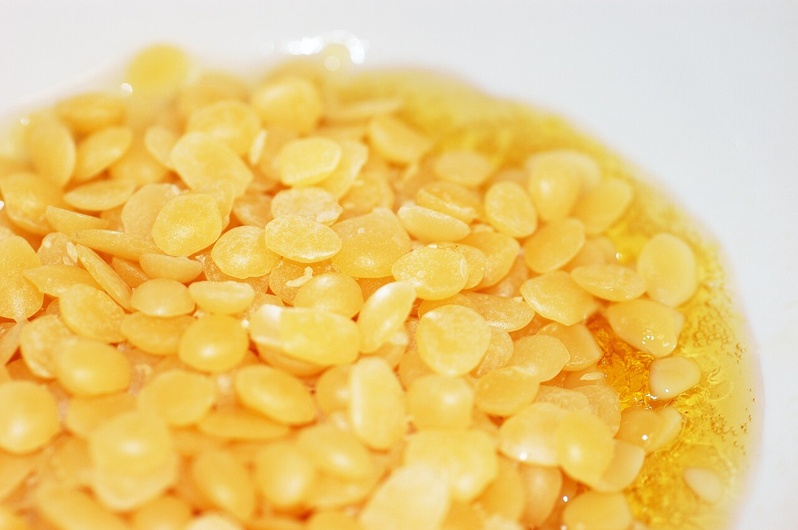

*Photo 54.1 — Beeswax during melting. This real close-up shows solid wax transitioning into liquid wax. It illustrates the rendering stage, not source segregation: cappings, honey-super wax, old brood comb, and suspect material should be separated before melting as described earlier in this chapter. Use controlled, appropriate heating rather than unsafe open flame. Photo by Simon A. Eugster, CC BY-SA 3.0.*

## 54.11 Beeswax Softens Before It Fully Melts

Natural beeswax generally melts in the low-to-mid 60s °C range, but it becomes mechanically soft well before complete melting.

This matters because:

- full comb can sag in hot transport;
- wax can smear through filters;
- moulded blocks can deform;
- high heat is unnecessary for basic separation.

Use only the heat needed for the process.

## 54.12 Avoid Uncontrolled Direct Flame

A pan of beeswax on an open flame is a preventable fire hazard.

Direct hot surfaces can create local overheating even when most wax appears normal.

Prefer:

- solar systems;
- water baths;
- thermostatically controlled indirect heat;
- purpose-built steam equipment;
- jacketed vessels for larger operations.

Never leave molten wax heating unattended.

## 54.13 Solar Wax Melters

A solar melter uses sunlight inside a glazed insulated enclosure.

Typical workflow:

1. wax-bearing material is placed on a mesh or tray;
2. solar heat softens and melts wax;
3. liquid wax drains away from debris;
4. wax collects in a protected container.

Advantages:

- low energy cost;
- no direct flame;
- simple construction principle.

Limitations:

- weather dependence;
- variable temperature;
- limited throughput;
- incomplete recovery from heavy brood debris.

## 54.14 Solar-Melter Safety

A solar melter can become extremely hot.

Place it:

- on a stable surface;
- away from dry combustible vegetation;
- away from children and animals;
- where hot runoff cannot cause injury;
- where insects cannot contaminate clean wax.

Do not assume “solar” means risk-free.

## 54.15 Hot-Water Rendering

Wax can be melted with water in a suitable vessel.

After melting and settling:

- wax floats;
- water remains below;
- heavy debris settles;
- lighter debris can remain attached to the underside of the wax cake.

The wax cake is removed after cooling and the dirty underside can be scraped before a second purification melt if required.

## 54.16 Why Wax Floats

Beeswax is less dense than water.

This physical difference makes water separation useful.

However, water rendering does not remove compounds that prefer the wax phase, such as many lipophilic pesticide residues.

## 54.17 Water Quality

If wax is intended for sensitive uses, processing water should be suitable for the operation.

Poor-quality water can introduce:

- minerals;
- odour;
- dirt;
- chemical contaminants.

Do not use unknown contaminated water merely because it will later be separated.

## 54.18 Control the Heat

In water rendering, the goal is to melt wax and separate debris—not to boil the wax indefinitely.

Prolonged high heat can:

- darken wax;
- change aroma;
- increase fire risk after water boils away;
- waste energy.

Monitor the process.

## 54.19 Steam Rendering

Steam renderers can process large quantities of brood comb efficiently.

Steam penetrates comb and transfers heat rapidly, allowing wax to drain away from solid residue.

Advantages include:

- good throughput;
- less need to immerse debris in water;
- useful recovery from old comb.

Main hazards are hot steam, hot condensate, burns, and pressure if equipment is misused.

## 54.20 Never Improvise a Pressure Vessel

A steam melter must be designed to vent safely.

Do not:

- block vents;
- clamp a non-rated vessel closed;
- modify pressure-relief devices;
- use damaged hoses or fittings;
- apply pressure beyond the equipment rating.

A sealed heated vessel can fail violently.

## 54.21 Indirect Dry Melting

Dry melting avoids adding water but requires careful temperature control.

Suitable equipment can include:

- thermostatically controlled wax melters;
- jacketed tanks;
- double-wall vessels.

Risks increase if wax contacts a very hot surface directly.

## 54.22 Water Bath Principle

A water bath separates the wax vessel from the hottest part of the heat source.

This reduces local overheating but does not eliminate risk.

Prevent:

- the water bath boiling dry;
- water splashing into overheated wax;
- unstable stacked vessels;
- electrical equipment contacting water.

## 54.23 Water Added to Very Hot Wax Is Dangerous

Water can sink below molten wax and flash to steam when heated.

Rapid steam expansion can throw hot wax out of the vessel.

Never add water as an improvised way to cool dangerously hot molten wax.

## 54.24 Fire Hazard

Beeswax is combustible.

Warning signs of overheating include:

- smoke;
- sharp burnt odour;
- rapid darkening;
- abnormal bubbling not caused by water separation.

The safe response is to stop heating when this can be done without danger and follow the pre-planned fire procedure.

## 54.25 Fire Extinguishing Must Be Planned in Advance

The appropriate extinguisher and method depend on local fire rules, electrical equipment, and processing setup.

Water can spread hot burning wax and cause violent splashing.

Arrange suitable fire-control equipment and training before processing begins rather than improvising during a fire.

## 54.26 Burn Prevention

Molten wax sticks to skin and continues transferring heat.

Useful controls include:

- heat-resistant gloves suitable for the task;
- long sleeves and apron;
- eye protection where splashing is possible;
- stable shoes and dry floors;
- handled pouring vessels;
- uncluttered work areas.

## 54.27 Ventilation

Heating wax, propolis, brood residues, or contaminated comb can release vapours and odours.

Use suitable ventilation.

Combustion heaters or generators must not create carbon-monoxide or exhaust hazards in enclosed processing rooms.

## 54.28 Pre-Sorting Raw Comb

Before rendering:

- remove wires or hardware if the equipment requires it;
- remove obviously non-wax waste;
- segregate suspicious chemical contamination;
- identify disease-suspect material;
- keep clean wax separate from brood waste.

Pre-sorting reduces contamination and processing load.

## 54.29 Coarse Filtration

Molten wax can be passed through a heat-resistant coarse filter to remove:

- cocoon masses;
- wood;
- bee parts;
- propolis lumps;
- large debris.

Filter media must tolerate the temperature and must not shed fibres into the wax.

## 54.30 Fine Filtration

Finer filtration can improve appearance and reduce small particles.

It does **not** reliably remove:

- dissolved acaricides;
- many agricultural pesticides;
- paraffin adulteration;
- stearin adulteration;
- other wax-soluble contaminants.

Visual cleanliness is not chemical purity.

## 54.31 Filter Temperature

If wax cools too much during filtration, it can solidify and block the filter.

If overheated, safety and quality risks rise.

Use a controlled process that keeps wax only as fluid as needed.

## 54.32 Settling Molten Wax

Holding filtered molten wax briefly in a controlled vessel can allow:

- residual water to separate;
- dense particles to settle;
- air to escape.

Avoid long hot holding periods.

## 54.33 Re-Melting

A second melt can improve physical cleanliness after a first rough rendering.

Repeated remelting has costs:

- energy;
- labour;
- fire exposure;
- darkening risk;
- contamination opportunities.

Use only the number of cycles required by the intended specification.

## 54.34 Wax Presses

Purpose-built presses can recover wax from hot slumgum.

Risks include:

- hot material;
- mechanical pinch points;
- unstable pressure;
- hot liquid discharge.

Use guarded equipment intended for the task. Do not improvise unstable presses around hot wax.

## 54.35 Centrifugal Wax Recovery

Some commercial systems use centrifugation to separate molten wax from debris.

They can improve throughput, but require:

- balance;
- guarding;
- heat control;
- maintenance;
- safe cleaning.

The same rotating-equipment principles used for honey extractors apply even more strongly when hot material is involved.

## 54.36 Moulding

Filtered molten wax can be poured into clean, heat-resistant moulds.

Prepare the moulding area before moving hot wax.

The mould should be:

- stable;
- dry;
- clean;
- compatible with hot wax;
- placed where it can cool undisturbed.

## 54.37 Why Moulds Must Be Dry

Water droplets in contact with hot wax can cause spattering.

Dry moulds also reduce surface defects and contamination.

Do not rinse a mould and immediately fill it while water remains.

## 54.38 Cooling and Shrinkage

Beeswax contracts during cooling.

A depression often forms in the upper surface or centre of a block.

This is normal shrinkage and is not proof of adulteration.

## 54.39 Slow Versus Rapid Cooling

Cooling rate influences block appearance and internal stress.

For ordinary blocks, the main goals are:

- safe solidification;
- easy release;
- minimal contamination;
- consistent identification.

Do not handle a block as fully solid simply because the outer surface has hardened.

## 54.40 Cleaning the Block

After water rendering, the underside of a wax cake may carry a layer of dark debris.

Once fully cool, this layer can be scraped away before the wax is graded or remelted.

Keep scrapings out of premium wax streams.

## 54.41 Standard Block Size

Standardising block mass can simplify:

- inventory;
- sales;
- remelting;
- sampling;
- lot control.

Very large blocks are harder to sample representatively and slower to remelt.

## 54.42 Weighing and Mass Balance

Record:

- starting mass of cappings/comb;
- honey recovered;
- final wax mass;
- slumgum/waste mass where practical;
- water losses/additions where relevant.

Mass balance helps evaluate process efficiency and detect unexpected losses.

## 54.43 Cappings Yield

Cappings typically give a relatively high wax yield because they contain little brood debris.

The exact yield varies with how much honey has already been removed and how deeply cappings were cut.

## 54.44 Brood-Comb Yield

Old brood comb can yield much less wax than its visual volume suggests.

Cocoons and propolis can dominate the remaining mass.

Do not judge equipment efficiency by comparing brood-comb volume with cappings volume.

## 54.45 When Another Rendering Cycle Is Not Worthwhile

After most wax has been recovered, a second or third processing cycle can consume more labour and energy than the value of the additional wax.

Measure yield rather than processing indefinitely.

## 54.46 Slumgum Disposal

Disposal must consider:

- disease status;
- pesticide contamination;
- local waste law;
- risk of attracting bees;
- rodent/pest access.

Do not dump hive residues where robbers can spread material among colonies.

## 54.47 Rendering Wastewater

Wax-rendering water can contain:

- sugar;
- pollen;
- propolis;
- brood residues;
- wax particles;
- pesticides.

It can have a high organic load.

Do not discharge it carelessly into streams, soil near wells, or places where bees can collect it.

## 54.48 Cleaning Processing Equipment

Where safe and compatible with the equipment:

1. allow equipment to cool to a safe working state;
2. mechanically scrape bulk wax;
3. use controlled warming only where necessary;
4. wash according to the material and intended end use;
5. dry thoroughly;
6. inspect before reuse.

Avoid aggressive industrial solvents that create worker, fire, or residue hazards.

## 54.49 Dedicated Equipment

For higher-value wax programmes, consider separate equipment for:

- clean cappings;
- brood-comb wax;
- craft wax containing fragrance/colour;
- food/cosmetic specification material.

Physical separation reduces cross-contamination and record confusion.

## 54.50 Temperature Measurement

Use a suitable thermometer or controlled system.

Do not estimate wax temperature by:

- hand proximity;
- colour;
- smoke;
- heater setting alone.

Direct measurement improves both safety and repeatability.

## 54.51 Record the Process

Useful batch records include:

- source stream;
- source apiary;
- treatment/disease notes;
- rendering method;
- date;
- maximum or operating temperature where relevant;
- filtration stages;
- final mass;
- intended destination.

## 54.52 Lot Identity

Every finished wax block or group of blocks should be linked to a lot.

A simple label can include:

- wax type;
- batch number;
- rendering date;
- mass;
- intended use.

Do not rely on block colour to reconstruct identity later.

## 54.53 Storage of Finished Wax

Store processed wax:

- clean;
- dry;
- cool;
- away from sunlight;
- away from dust;
- away from fuel, solvents, paint, pesticides, and fragrances;
- protected from rodents.

Beeswax readily retains odours.

## 54.54 Wax Moth After Rendering

Wax moth larvae primarily exploit comb residues—especially brood cocoons, pollen, and debris—rather than clean purified wax.

Well-filtered blocks are therefore less attractive than dirty stored comb.

Incomplete rendering can leave enough residue to support pests.

## 54.55 Reprocessing Stored Blocks

Before remelting an old wax block, verify:

- lot identity;
- storage condition;
- odour;
- visible contamination;
- destination use.

Unknown old wax should not automatically enter premium foundation or food/cosmetic streams.

## 54.56 Wax for Foundation

Wax intended for foundation should be evaluated for:

- authenticity;
- residue history;
- disease-control requirements;
- mechanical quality;
- cleanliness.

Rendering alone does not provide all these assurances.

## 54.57 Disease-Control Processing Is Separate

Commercial processors may use validated temperature/pressure or other methods for disease-risk control.

A home melter should not be assumed equivalent.

Where official rules apply, use the approved process and documentation.

## 54.58 Wax for Food-Related Use

In the European Union, beeswax used as the food additive E901 is subject to defined identity and purity specifications under Regulation (EU) No 231/2012.

Those specifications describe a controlled material, not every block produced by melting apiary comb.

Food-additive use can therefore require additional purification, testing, and food-business controls.

## 54.59 Wax for Cosmetics

Cosmetic manufacturers may require:

- contaminant specifications;
- identity/purity data;
- consistent colour and odour;
- microbiological/processing controls;
- supplier quality documents.

Apiary-rendered wax is a raw material, not automatically cosmetic-grade material.

## 54.60 Wax for Candles and Crafts

Candle wax may tolerate broader colour variation, but contamination still affects:

- odour;
- flame behaviour;
- wick performance;
- smoke;
- safety.

Once fragrance, pigments, paraffin, or craft additives are added, keep that wax out of pure beeswax streams unless the identity is controlled and declared.

## 54.61 Adulteration Can Enter During Recycling

Purchased blocks or recycled foundation can contain cheaper foreign waxes.

Common adulterants include:

- paraffin;
- microcrystalline wax;
- stearin or stearic-acid-rich materials;
- other vegetable or animal waxes.

Melting adulterated wax does not restore authenticity.

## 54.62 Home Purity Tests Are Limited

Colour, smell, brittleness, floating, flame behaviour, and melting point may reveal gross abnormalities but cannot reliably detect all adulteration.

Laboratory methods can include:

- FTIR/ATR spectroscopy;
- differential scanning calorimetry;
- gas chromatography;
- acid, ester, and saponification values;
- multivariate chemical fingerprinting.

## 54.63 Why Melting Point Alone Fails

Foreign wax mixtures can be formulated with melting ranges overlapping genuine beeswax.

Recent analytical work continues to show that spectroscopic and multivariate approaches provide stronger discrimination than a single physical measurement.

## 54.64 Residue Testing

Wax laboratories can test for:

- in-hive acaricides;
- agricultural pesticides;
- selected combustion contaminants;
- metals or other contaminants depending on use.

A 2026 review of pesticide contamination in apicultural products reinforces that wax is a long-term sink for lipophilic residues.

## 54.65 Sampling Wax

A surface shaving from one block may not represent a blended batch.

A sampling plan should consider:

- number of blocks;
- block size;
- whether sources were mixed;
- top/middle/bottom representation;
- composite versus individual analysis.

Follow the laboratory's instructions.

## 54.66 Emergency: Wax Begins Smoking

If wax begins smoking or overheating:

- stop heat if this can be done safely;
- keep people clear;
- do not add water;
- follow the planned fire procedure;
- call emergency services if the situation is not controlled safely.

Do not continue processing overheated wax for a sensitive product without assessing contamination/quality.

## 54.67 Emergency: Steam Equipment Behaves Abnormally

If pressure, blocked flow, or unusual noise occurs:

- stop energy input if safe;
- do not open a pressurised vessel;
- clear the area;
- allow equipment to return to a safe condition;
- inspect before reuse.

## 54.68 Emergency: Dirty Water Enters Premium Wax

Segregate the lot.

Identify whether the contamination is:

- biological;
- chemical;
- mineral;
- simply clean process water.

Do not assume another melt removes chemical contamination.

## 54.69 Emergency: Unknown Wax Added to a Pure Batch

Stop blending and quarantine the batch.

Reconstruct:

- source identity;
- quantity added;
- potential adulterants;
- intended use.

Test where required. Dilution does not restore authenticity.

## 54.70 Emergency: Disease-Suspect Comb Found Mid-Batch

Stop and identify the disease concern.

Segregate unprocessed material and do not distribute processed wax until competent-authority guidance clarifies disposition.

## 54.71 Decision Table

| Material or event | Main concern | Response principle |
|---|---|---|
| Clean fresh cappings | Premium physical quality | Keep separate; recover honey; render gently |
| Old dark brood comb | Low wax fraction, debris, residue history | Render separately; destination based on quality evidence |
| Unknown treatment history | Chemical uncertainty | Exclude from premium use until assessed |
| AFB-suspect comb | Persistent disease hazard | Follow official disease-control requirements |
| Strong fuel/chemical odour | Chemical contamination | Segregate; do not mask by remelting |
| Filtered wax still fails residue test | Dissolved chemical contamination | Physical filtration is insufficient; downgrade/reject as appropriate |
| Melter smoking | Fire/overheating hazard | Stop heat safely; follow fire plan |
| Unidentified wax block enters batch | Authenticity/traceability failure | Stop, quarantine, investigate/test |

## 54.72 Practical Cappings-Wax Procedure

### Preparation

- identify cappings lot;
- drain/spin recoverable honey;
- inspect for contamination;
- prepare clean rendering equipment;
- confirm fire controls, PPE, and moulds.

### Rendering

1. use a controlled solar, water, steam, or indirect-heat method;
2. melt only as much as required for separation;
3. coarse-filter physical debris;
4. allow water/debris separation where relevant;
5. avoid prolonged overheating;
6. pour into dry clean moulds.

### Finishing

7. cool completely;
8. remove underside debris;
9. remelt/filter only if specification requires it;
10. weigh and label blocks;
11. store clean, cool, dry, and odour-free.

## 54.73 Practical Brood-Wax Procedure

- verify disease status first;
- keep separate from cappings;
- use equipment designed for heavy debris;
- recover wax by steam/water/press method appropriate to the operation;
- handle slumgum as potentially contaminated organic waste;
- record treatment history where known;
- determine end use only after quality/residue considerations.

Do not automatically route brood wax into food, cosmetic, or premium foundation products.

## 54.74 Processing Checklist

- [ ] Wax source stream identified.
- [ ] Disease status considered.
- [ ] Treatment/residue history reviewed for premium uses.
- [ ] Cappings kept separate from brood wax.
- [ ] Recoverable honey removed hygienically first.
- [ ] Rendering equipment stable and purpose-built.
- [ ] Open flame avoided around molten wax.
- [ ] Steam equipment vented and unmodified.
- [ ] Temperature measured.
- [ ] PPE ready.
- [ ] Fire response planned.
- [ ] Molten wax never left unattended.
- [ ] Filter media safe at process temperature.
- [ ] Repeated heating minimised.
- [ ] Moulds clean and dry.
- [ ] Blocks fully cooled before handling.
- [ ] Finished lots weighed and labelled.
- [ ] Unknown wax excluded from premium blends.
- [ ] Waste and wastewater controlled.
- [ ] End-use specification verified before sale or reuse.

## Key Takeaways

- Wax quality is easiest to preserve by separating source streams before melting.
- Cappings wax and old brood-comb wax are fundamentally different raw materials.
- Rendering removes physical debris but does not automatically remove wax-soluble chemical residues or resolve regulated disease hazards.
- Solar, water, steam, and indirect-heat methods each have specific strengths and safety limitations.
- Open flames, unattended heating, blocked steam vents, and water added to overheated wax are avoidable high-risk practices.
- Fine filtration improves appearance but is not proof of chemical purity.
- Mass balance helps determine whether repeated recovery cycles are economically worthwhile.
- Finished wax must remain traceable by source and batch.
- Adulterated or chemically contaminated wax remains adulterated/contaminated after ordinary remelting.
- Food-additive, cosmetic, candle, foundation, and craft uses can require very different specifications.

## Chapter Summary

Wax processing is controlled separation, not magical purification. The first and most important step is to preserve the identity of the source material. Clean cappings, light honey comb, and old brood comb differ markedly in wax fraction, debris, residue history, and commercial value.

Solar melters provide simple low-energy recovery, water rendering exploits the lower density of wax, and steam systems offer efficient processing of heavy brood material. All methods require temperature control. Wax is combustible, steam can create pressure hazards, and hot wax can cause severe burns. Purpose-built equipment, direct measurement, PPE, ventilation, supervision, and planned fire controls are essential.

After melting, coarse and fine filtration remove particles, while settling separates water and dense debris. These steps improve physical quality but cannot be relied upon to remove lipophilic pesticides, acaricides, or foreign wax adulterants. Laboratory analysis and traceability are required where chemical purity matters.

Finally, the intended destination determines whether the wax is fit for use. Foundation, candles, cosmetics, and EU E901 food-additive beeswax do not share one universal specification. A professional wax operation therefore processes safely, records sources, tests where necessary, and keeps high-quality streams from being diluted by unknown material.

## Review Questions

1. What is wax rendering?
2. Why should wax streams be separated before melting?
3. Which main source streams should be kept separate?
4. Why is cappings wax often high value?
5. Why should recoverable honey be removed before rendering clean cappings?
6. What makes honey-super wax different from cappings wax?
7. What accumulates in old brood comb?
8. Why can a dark brood frame contain relatively little recoverable wax?
9. What is slumgum?
10. Why should slumgum be contained?
11. Why must disease status be checked before rendering?
12. Why is AFB especially important in wax handling?
13. Why does ordinary melting not automatically satisfy AFB control?
14. How can Varroa treatments enter beeswax?
15. Why can environmental pesticides be present in wax?
16. What does lipophilic mean?
17. What are the major rendering methods?
18. Why does beeswax softness matter before the melting point is reached?
19. Why is an open-flame pan a poor wax melter?
20. What is the principle of a solar wax melter?
21. What are two advantages of solar rendering?
22. What are two limitations?
23. Why can a solar melter still cause burns?
24. How does water rendering separate wax?
25. Why does wax float on water?
26. Does water rendering remove lipophilic residues?
27. Why does processing-water quality matter?
28. Why should water rendering not be boiled indefinitely?
29. How does steam rendering work?
30. What are the main steam-rendering hazards?
31. Why must steam equipment remain vented?
32. Why should an improvised sealed vessel never be heated?
33. What is indirect dry melting?
34. How does a water bath reduce local overheating?
35. What can happen if water is added to very hot wax?
36. Why is beeswax a fire hazard?
37. Why can water worsen a molten-wax fire?
38. Why must fire response be planned in advance?
39. Why are molten-wax burns serious?
40. What PPE is useful?
41. Why is ventilation needed?
42. What should be removed during pre-sorting?
43. What does coarse filtration remove?
44. What does fine filtration remove?
45. What does fine filtration fail to remove?
46. Why must filtration temperature be controlled?
47. What does molten-wax settling accomplish?
48. Why should repeated remelting be minimised?
49. What is the purpose of a wax press?
50. What hazards accompany pressing hot slumgum?
51. What controls apply to centrifugal wax recovery?
52. Why must moulds be clean and dry?
53. Why does wax shrink during cooling?
54. Why should a block not be handled based only on a hard surface skin?
55. What is the dirty underside of a wax cake?
56. Why can standard block size be useful?
57. What should a wax mass balance record?
58. Why is cappings yield usually higher than brood-comb yield?
59. When can further rendering become uneconomic?
60. How should slumgum disposal account for disease?
61. Why is rendering wastewater environmentally important?
62. What is a good sequence for cleaning wax equipment?
63. Why can dedicated equipment preserve high-quality streams?
64. Why should wax temperature be measured directly?
65. Which batch records are useful?
66. Why must every finished lot have an identity?
67. How should finished wax be stored?
68. Why is clean rendered wax less attractive to wax moth than dirty brood comb?
69. What should be checked before remelting old stored wax?
70. What quality questions apply to foundation wax?
71. Why is home melting not the same as validated disease sterilisation?
72. What is E901?
73. Why does an apiary wax block not automatically meet E901 specifications?
74. Why can cosmetic manufacturers require additional data?
75. What can contaminated candle wax do to burning quality?
76. How can adulteration enter through recycled foundation?
77. Name three common beeswax adulterants.
78. Why does melting adulterated wax not restore authenticity?
79. Why are colour and smell weak authenticity tests?
80. Why is melting point alone insufficient?
81. What can FTIR/ATR contribute?
82. What can differential scanning calorimetry contribute?
83. What can chromatography contribute?
84. Why does a 2026 pesticide review describe wax as a long-term residue sink?
85. Which residues might a laboratory test?
86. Why can one surface shaving fail to represent a blended batch?
87. What should a wax sampling plan consider?
88. What should happen if wax begins smoking?
89. Why should water not be added during an overheating event?
90. What should happen if steam equipment behaves abnormally?
91. What should happen if dirty water enters premium wax?
92. What should happen if unknown wax enters a pure batch?
93. What should happen if disease-suspect comb is found mid-process?
94. What is the correct response to strong fuel odour in wax?
95. Why does a clear-looking filtered block not prove chemical purity?
96. What are the main steps in a cappings-wax process?
97. What additional concerns apply to brood wax?
98. Why should end use be defined before grading the wax?
99. What is the main difference between physical cleanliness and chemical purity?
100. What combination of source control, safe heat, separation, records, and testing makes wax processing professional?

## References

- European Commission. Commission Regulation (EU) No 231/2012 laying down specifications for food additives, including E901 beeswax, current consolidated text. Accessed September 2026.
- Chatzipanagis, K., Omar, J., and Boix Sanfeliu, A. “Assessment of Beeswax Adulteration by Paraffin and Stearic Acid Using ATR-IR Spectroscopy and Multivariate Statistics—An Analytical Method to Detect Fraud.” *Foods* 13(2), 2024, 245. DOI: 10.3390/foods13020245.
- Benito-Murcia, M. et al. “Pesticide residues in beeswax from Western Spain: Toxicological risk for bee health and beekeeping productivity.” *Environmental Toxicology and Pharmacology* 117, 2025, 104744.
- “Pesticide contamination in apicultural products: An updated and comprehensive review of analytical methods, occurrence, and safety concerns.” *Trends in Environmental Analytical Chemistry* 49, 2026, e00300.
- Végh, R. et al. “Pesticide residues in bee bread, propolis, beeswax and royal jelly – A review of the literature and dietary risk assessment.” *Food and Chemical Toxicology* 176, 2023, 113806.
- Bogdanov, S. and related scientific reviews on beeswax composition, quality, residues, adulteration, and processing.
- FAO. *Value-added Products from Beekeeping* and practical references on beeswax rendering and product use.
- Current national fire-safety, occupational-safety, environmental-waste, animal-health, cosmetic, food-additive, and food-contact requirements must be checked for the intended process and jurisdiction.

# Chapter 55 — Beeswax

## Introduction

Beeswax is not simply “old comb melted into a block”. It is a biological material produced by worker honey bees, modified in the colony, and then further shaped by its history of brood rearing, propolis contact, pollen, honey, veterinary medicines, environmental contaminants, rendering, heating, filtration, and storage.

That history determines what the recovered wax is suitable for.

Fresh cappings wax can be pale, clean, and valuable. Old brood comb may yield less wax and contain cocoons, propolis, larval residues, and higher concentrations of lipophilic contaminants. Wax recovered from an unknown disease or treatment history must not automatically be treated as food-, cosmetic-, candle-, or foundation-grade merely because it has been melted and filtered.

Beeswax is also a hot-process material with real hazards. Molten wax can cause serious burns, is combustible, and can ignite if overheated or exposed to flame. Safe rendering therefore uses controlled heat, stable equipment, ventilation, dry working areas, and appropriate fire precautions rather than direct uncontrolled flames.

This chapter covers wax biology, source separation, rendering, filtration, moulding, storage, quality, residues, adulteration, and product-use decisions.

## Learning Objectives

After completing this chapter, the reader should be able to:

- explain how worker bees produce wax scales;
- describe major components and physical properties of beeswax;
- distinguish cappings wax, honey-super wax, and brood-comb wax;
- explain why comb age and treatment history affect wax quality;
- select safe solar, water, or steam rendering principles;
- separate wax from honey, water, slumgum, and debris;
- filter and mould wax without unnecessary overheating;
- recognise fire, burn, pressure, and contamination hazards;
- store wax to protect colour, odour, identity, and cleanliness;
- select wax streams for foundation, candles, cosmetics, polish, or specialised food uses appropriately;
- understand how lipophilic pesticides and acaricides can accumulate in recycled wax;
- recognise beeswax adulteration and the limits of simple home tests;
- explain why food-additive specifications such as EU E901 apply to a defined purified material, not automatically to all apiary-rendered wax.

## 55.1 Where Beeswax Comes From

Worker honey bees secrete wax from specialised glands on the underside of the abdomen.

The wax emerges as small translucent scales. Workers manipulate these scales with their legs and mouthparts, soften and mix them with colony materials, and use them to build and repair comb.

Wax production is especially associated with well-fed young adult workers and strong colony growth.

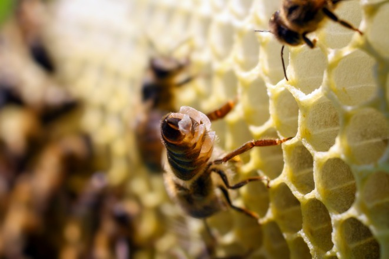

*Photo 55.1 — Beeswax scales on a worker. Freshly secreted translucent wax scales are visible at the abdominal wax glands before workers manipulate the wax for comb construction. Photograph by Richard Odemer. Source: Odemer et al., “Honey Bee Colony Health in Thiamethoxam-Treated Sugar Beet Fields: A Field-Based Case Study,” Ecology and Evolution 15 (2025), CC BY 4.0.*

## 55.2 Wax-Producing Workers

Wax-gland development is strongest during a particular period of worker life, although colony needs can alter task schedules.

Wax production depends on:

- worker age structure;
- carbohydrate availability;
- colony temperature;
- nectar flow;
- need for new comb;
- population strength.

Bees do not produce wax at a constant fixed rate throughout the year.

## 55.3 Energy Cost

Wax construction requires substantial metabolic energy.

This helps explain why colonies supplied with drawn comb can often store surplus nectar faster than colonies that must first build large amounts of new comb.

Comb, however, is reusable biological infrastructure and has value far beyond the sugar consumed to make it.

## 55.4 Fresh Wax Colour

New wax scales are nearly colourless to pale white.

Comb becomes yellow, tan, brown, or darker through contact with:

- pollen pigments;
- propolis;
- honey;
- brood cocoons;
- larval residues;
- dust;
- smoke;
- age.

Dark colour alone does not identify one specific contaminant.

## 55.5 Chemical Composition

Beeswax is a complex mixture containing mainly:

- esters;
- hydrocarbons;
- free fatty acids;
- fatty alcohols;
- minor compounds.

Its exact composition varies with bee population, geography, age, and analytical method.

This chemical complexity is why authentic beeswax is better described by a profile of characteristics than by one single melting point.

## 55.6 Melting Behaviour

Natural beeswax softens progressively and generally melts in the low-to-mid 60s °C range, with variation among samples and methods.

The material softens substantially before it becomes completely liquid.

This has practical consequences for:

- comb transport;
- candle making;
- foundation manufacture;
- rendering;
- fire safety.

## 55.7 Melting Point Is Not an Authenticity Test

Paraffin, stearin, microcrystalline waxes, and mixtures can be formulated so that simple melting behaviour overlaps with genuine beeswax.

A plausible melting point therefore does not prove authenticity.

Professional verification can require several chemical and thermal methods.

## 55.8 Density and Buoyancy

Molten beeswax is less dense than water and normally floats when wax and water are melted together.

This property is useful during water rendering because debris can settle below the wax while a wax layer solidifies above.

It does not mean water rendering removes every dissolved or lipophilic contaminant.

## 55.9 Source Streams Should Be Separated

A practical wax operation should separate at least:

- cappings wax;
- light honey-super comb;
- brood-comb wax;
- floor scrapings/propolis-rich waste;
- diseased or chemically suspect material.

Mixing all sources into one melter destroys useful quality information.

## 55.10 Cappings Wax

Cappings wax is often the cleanest apiary wax stream because it is newly produced to seal mature honey.

It commonly has:

- pale colour;
- pleasant honey aroma;
- low brood debris;
- high value for candles, cosmetics, and premium wax products when contamination history is acceptable.

It should still be traceable and hygienically handled.

## 55.11 Honey-Super Comb Wax

Light comb used only for honey storage can provide relatively clean wax when retired.

Compared with cappings it may contain more:

- propolis;
- pollen traces;
- environmental debris;
- treatment residues depending on hive history.

Its quality should be assessed rather than assumed.

## 55.12 Brood-Comb Wax

Old brood comb contains layers of cocoons and larval material in every repeatedly used cell.

As brood cycles accumulate:

- comb darkens;
- cell interiors become lined with cocoons;
- wax percentage of total comb mass decreases;
- debris and propolis increase;
- lipophilic residues can accumulate.

Brood-comb rendering therefore produces a different raw wax stream from cappings.

## 55.13 Why Old Brood Comb Yields Less Wax

A dark brood frame may look massive but much of that mass is not beeswax.

It can include:

- cocoons;
- pupal skins;
- larval faecal material;
- pollen;
- propolis;
- hive debris.

The solid waste left after rendering is often called slumgum.

## 55.14 Slumgum

Slumgum is the residue remaining after wax has been removed from old comb or cappings.

It can contain:

- cocoons;
- propolis;
- pollen;
- dead brood material;
- dirt;
- residual wax;
- contaminants.

Handle it so bees, rodents, and pests cannot spread it back into apiaries or food areas.

## 55.15 Disease History Matters

Wax and comb from colonies affected by regulated brood disease require disease-specific handling.

Melting should not be assumed to eliminate every biological hazard. In particular, American foulbrood control is based on competent-authority requirements because *Paenibacillus larvae* spores are highly persistent.

Do not render or redistribute disease-suspect comb contrary to official instructions.

## 55.16 Veterinary-Medicine History Matters

Many Varroa-control active ingredients are lipophilic and can partition into beeswax.

Repeated colony treatment and wax recycling can therefore create a residue history that is not obvious from appearance.

Keep treatment records linked to wax streams where premium food/cosmetic/foundation uses are intended.

## 55.17 Environmental Pesticides

Wax can also contain residues originating outside the hive through contaminated nectar, pollen, dust, or bee contact.

Residue interpretation requires:

- compound identity;
- concentration;
- intended wax use;
- legal requirements;
- exposure context.

One detected residue does not by itself identify the source.

## 55.18 Lipophilic Accumulation

Lipophilic compounds prefer fatty/waxy phases over water.

Because brood comb can remain in colonies for years, wax can act as a long-term reservoir for some chemicals.

This is one reason routine comb renewal and residue-aware wax sourcing matter.

## 55.19 Residues Can Re-Expose Bees

Contaminated recycled wax can reintroduce chemicals into new foundation.

Potential consequences include exposure of:

- larvae;
- queens;
- workers;
- wax-consuming products.

Recycling is not automatically a detoxification process.

## 55.20 Foundation Wax Quality

Foundation should be evaluated for:

- authenticity;
- residue history;
- mechanical quality;
- cleanliness;
- odour;
- disease-control compliance.

A visually attractive sheet can still contain adulterants or residues.

## 55.21 Rendering Defined

Rendering separates beeswax from comb, cappings, honey, water, and solid debris by controlled melting and physical separation.

Common approaches include:

- solar melting;
- hot-water rendering;
- steam rendering;
- commercial pressing/centrifugal systems.

No method converts contaminated raw material automatically into high-purity wax.

## 55.22 Separate Honey Before Rendering

Cappings can contain substantial recoverable honey.

Drain or spin edible honey from clean cappings before rendering when hygienically appropriate.

Benefits include:

- less sticky rendering;
- lower wastewater load;
- better honey recovery;
- cleaner wax.

Fermented or contaminated cappings require separate handling.

## 55.23 Solar Wax Melter

A solar melter uses sunlight in an insulated glazed enclosure to warm comb and drain molten wax.

Advantages:

- no direct flame;
- low energy cost;
- simple operation.

Limitations:

- weather dependence;
- slow throughput;
- variable temperature;
- possible overheating in poorly controlled designs;
- incomplete wax recovery from brood debris.

## 55.24 Solar-Melter Placement

Place a solar melter on a stable, non-combustible or appropriately protected surface away from children, animals, dry vegetation, and vehicle traffic.

The interior and collection vessel can become dangerously hot.

Treat it as hot processing equipment, not as a harmless box in the sun.

## 55.25 Hot-Water Rendering

In water rendering, wax-bearing material is heated with water until wax melts and separates.

After cooling:

- wax solidifies above;
- water remains below;
- dense debris settles or becomes trapped beneath the wax.

The wax often requires further cleaning.

## 55.26 Water Quality

Water used in processing wax intended for sensitive food/cosmetic uses should be suitable for the process and free of objectionable contamination.

Minerals and impurities can affect appearance and downstream use.

Do not use chemically contaminated water simply because the wax will later be remelted.

## 55.27 Steam Rendering

Steam systems transfer heat efficiently into comb and can recover wax from brood frames and large batches.

Advantages include:

- higher throughput;
- separation of wax from solid debris;
- reduced need for comb immersion.

Risks include:

- burns;
- hot condensate;
- pressure hazards in improperly designed equipment.

Use purpose-built vented equipment according to manufacturer instructions.

## 55.28 Never Seal a Steam Melter Incorrectly

Heating a closed vessel can create dangerous pressure.

Do not improvise pressure vessels, block vents, or modify safety devices.

Commercial steam equipment should be operated within its rated design and inspected for safe venting before use.

## 55.29 Dry Heat

Directly heating wax without water can be efficient in controlled equipment but increases the risk of local overheating and fire.

Never melt beeswax in an unattended pan over an open flame.

Use controlled indirect heat and equipment suitable for combustible hot wax.

## 55.30 Water Baths and Indirect Heat

Indirect heating can reduce local overheating by separating the wax vessel from the hottest heat source.

Even with indirect heat:

- monitor temperature;
- prevent the vessel from boiling dry;
- avoid water entering molten wax unpredictably;
- keep the area supervised.

## 55.31 Wax and Water Do Not Mix Safely When Mismanaged

Water trapped under or introduced into very hot molten wax can boil violently and cause splashing.

Keep equipment dry when using dry-melt systems and follow the design instructions for water-based systems.

Never pour water into a vessel of overheated molten wax as an improvised cooling method.

## 55.32 Fire Hazard

Beeswax is combustible.

Risk increases when:

- wax is overheated;
- open flame is present;
- spills reach a heat source;
- vapours/smoke develop;
- processing is unattended.

Rendering areas need suitable fire planning based on local fire-safety guidance.

## 55.33 Wax-Fire Response

Do not treat a molten-wax fire like an ordinary water spill.

Water can spread burning hot wax and cause violent splashing.

Use the fire-control method specified for the equipment and local fire code, evacuate when necessary, and call emergency services for uncontrolled fire.

Training and an appropriate extinguisher should be arranged before rendering begins.

## 55.34 Hot-Wax Burns

Molten wax can adhere to skin and continue transferring heat.

Prevent burns with:

- heat-resistant gloves appropriate to the task;
- long sleeves/apron;
- eye protection where splashing is possible;
- stable containers;
- uncluttered floors.

For burns, stop exposure, use current first-aid guidance for cooling, and seek medical attention for serious injuries.

## 55.35 Ventilation

Overheated wax, propolis, debris, and contaminated comb can release fumes and odours.

Render in a well-ventilated area suitable for the process.

Do not use indoor combustion heaters in ways that create carbon-monoxide or exhaust hazards.

## 55.36 First Filtration

Molten wax can be passed through a coarse filter to remove:

- cocoons;
- propolis lumps;
- wood fragments;
- bee parts;
- large debris.

Filter material must tolerate hot wax safely and should not shed fibres into the product.

## 55.37 Fine Filtration

A second finer filtration can improve appearance for premium wax.

Finer filtration does not remove dissolved pesticide residues or many wax-soluble adulterants.

Visual clarity is not chemical purity.

## 55.38 Settling Molten Wax

Holding molten wax under controlled conditions can allow denser debris and water to separate.

Avoid prolonged unnecessary heat.

The goal is physical separation without damaging colour or aroma.

## 55.39 Re-Melting

Multiple clean-up melts may improve physical cleanliness.

Each heating cycle adds:

- energy use;
- thermal exposure;
- burn/fire opportunity;
- handling contamination risk.

Use as few cycles as necessary.

## 55.40 Wax Colour

Wax colour can range naturally from pale cream to yellow, orange, brown, and darker shades.

Colour is influenced by source materials and processing.

A darker wax is not automatically fake, and a pale wax is not automatically pure.

## 55.41 Odour

High-quality beeswax usually has a characteristic mild honey/propolis aroma.

Off-odours can originate from:

- smoke;
- chemicals;
- fuel;
- mouldy comb;
- overheated wax;
- foreign waxes.

Odour is a useful screen but not a complete purity test.

## 55.42 Sunlight and Colour Lightening

Exposure to light can gradually lighten some beeswax pigments.

This is different from chemical bleaching.

Prolonged exposure can also alter aroma and create contamination risks if wax is left uncovered outdoors.

## 55.43 Chemical Bleaching

Industrial wax purification can use chemical or adsorptive methods under controlled specifications.

This handbook does not provide home chemical-bleaching recipes because residues, reaction control, worker exposure, and final-use specifications require professional validation.

## 55.44 Moulding Blocks

Molten filtered wax can be poured into clean heat-resistant moulds.

Good practice includes:

- stable level surface;
- appropriate PPE;
- moulds suitable for hot wax;
- controlled pouring;
- cooling without disturbance;
- lot identification.

## 55.45 Shrinkage During Cooling

Beeswax contracts as it cools.

A depression can form in the top or centre of a block.

This is normal physical shrinkage and does not prove the wax is adulterated.

## 55.46 Removing the Dirty Underside

After water rendering, a darker layer of debris may remain attached to the underside of the wax cake.

It can be scraped away after cooling before another purification melt.

Keep scrapings out of premium clean wax streams.

## 55.47 Block Size

Large blocks are efficient to store but slow to remelt and difficult to sample representatively.

Smaller blocks are easier to:

- weigh;
- grade;
- sell;
- remelt;
- trace.

Choose a standard size suited to later use.

## 55.48 Labelling Wax Lots

Each wax lot should record:

- source apiary or operation;
- wax stream (cappings, honey comb, brood comb);
- rendering date;
- treatment/residue information where relevant;
- disease status restrictions;
- batch mass;
- intended use.

A block without history should be treated as unknown material.

## 55.49 Storage

Store wax:

- clean;
- dry;
- cool;
- protected from dust;
- separated from chemicals and odours;
- protected from rodents and wax moth where comb fragments remain.

Solid pure wax itself is less attractive to wax moth than comb containing brood residues, but contaminated wax stores can still attract pests.

## 55.50 Dust Protection

Wax surfaces can trap dust and fibres.

Use:

- clean boxes;
- food-compatible wrapping when required by end use;
- covered shelving;
- closed storage rooms.

Do not store premium wax directly on workshop floors.

## 55.51 Odour Protection

Beeswax absorbs and retains odours.

Keep it away from:

- petrol/diesel;
- paint;
- solvents;
- pesticides;
- fragrances;
- smoke;
- strong foods.

Odour contamination can make wax unsuitable for candles, cosmetics, or food contact.

## 55.52 Rodent Protection

Rodents can gnaw wax blocks and packaging and contaminate surfaces with urine or faeces.

Use physical exclusion and hygienic pest control.

Do not place toxic bait where it can contaminate wax directly.

## 55.53 Wax Moth and Stored Wax

Wax moth larvae primarily feed on comb residues rather than pure refined wax.

Poorly rendered blocks containing cocoons or pollen are therefore more vulnerable than clean cappings wax.

Complete debris separation reduces pest attraction.

## 55.54 Reuse for Foundation

Rendering old comb into foundation closes the wax cycle but can also recycle:

- acaricide residues;
- pesticides;
- adulterants;
- disease-associated material.

A foundation programme should therefore control incoming wax quality, not simply melt everything together.

## 55.55 Foundation Sterilisation

Commercial wax processors may use validated heat/pressure or other processes for specific disease-control purposes.

A home melting pot should not be assumed to provide equivalent sterilisation.

For regulated disease, follow competent-authority requirements.

## 55.56 Candle Wax

Beeswax is valued in candles for:

- colour;
- aroma;
- high-quality appearance;
- clean solid texture.

Candle performance depends on:

- wax purity;
- wick size;
- candle diameter;
- additives;
- container design.

Fire-safety testing is essential for commercial candles.

## 55.57 Candle Additives

Adding oils, fragrances, colourants, or other waxes changes burning behaviour.

Commercial candle formulations require their own safety and labelling controls.

Do not assume an additive safe in cosmetics or food is safe to burn and inhale.

## 55.58 Cosmetics

Beeswax is widely used to structure products such as:

- balms;
- salves;
- creams;
- lip products;
- sticks.

Cosmetic use requires:

- suitable raw-material quality;
- contamination control;
- legal cosmetic-safety assessment;
- ingredient labelling;
- good manufacturing practice where applicable.

Apiary-rendered wax is not automatically cosmetic grade.

## 55.59 Food Uses

Purified beeswax is used in some food-contact and food-additive applications, including glazing/coating functions in jurisdictions where authorised.

Food use requires a defined specification and compliance with applicable food-additive rules.

Do not assume candle-grade or brood-comb wax meets those requirements.

## 55.60 EU E901 Example

In the European Union, beeswax is authorised as food additive **E901** for specified uses and is subject to identity and purity specifications under EU food-additive legislation.

Those specifications cover a defined material and analytical characteristics.

A beekeeper's rendered wax block does not become E901 merely because its biological origin is beeswax.

## 55.61 Food-Additive Specification Versus Apiary Wax

To supply wax into a regulated food-additive chain, the operator may need evidence regarding:

- identity;
- purity;
- contaminants;
- acid/ester and related specification values;
- processing conditions;
- traceability;
- food-business requirements.

Use a competent processor/laboratory and the current applicable legal specification.

## 55.62 Polish and Wood Products

Beeswax is used in:

- furniture polish;
- leather care;
- wood finishes;
- lubricating waxes.

These products may contain solvents or other ingredients and should be manufactured separately from food/cosmetic wax operations.

## 55.63 Art and Encaustic Use

Artists use beeswax in encaustic painting and modelling.

Heating art wax can create fumes and fire hazards, especially when pigments, resins, or additives are present.

Use ventilation and material-specific safety information.

## 55.64 Craft Versus Food-Grade Segregation

Once wax has been blended with:

- fragrance;
- pigments;
- non-food oils;
- paraffin;
- unknown recycled candles;

it should not return to a pure food/cosmetic/foundation wax stream without a validated process and legal basis.

Segregate streams physically and by records.

## 55.65 Adulteration

Beeswax is economically attractive and can be adulterated intentionally or unintentionally.

Common foreign waxes include:

- paraffin;
- microcrystalline wax;
- stearin/stearic materials;
- other animal or vegetable waxes.

Adulteration changes physical and chemical properties.

## 55.66 Paraffin Adulteration

Paraffin is a petroleum-derived mixture of hydrocarbons.

When added to beeswax it can alter:

- mechanical strength;
- melting behaviour;
- crystal structure;
- foundation acceptance;
- combustion properties.

Low or moderate adulteration may not be obvious by eye.

## 55.67 Stearin/Stearic Adulteration

Stearin or stearic-acid-rich material can substantially change wax properties.

Research has associated some adulterated foundation with poor comb stability or abnormal brood-comb behaviour.

Source control is more reliable than visual inspection alone.

## 55.68 Why Home Tests Are Limited

Tests based only on:

- smell;
- colour;
- hand feel;
- brittleness;
- floating;
- melting point;
- flame appearance

cannot quantify or rule out all adulterants reliably.

They may flag gross abnormalities but are not definitive authenticity tests.

## 55.69 Fourier-Transform Infrared Spectroscopy

FTIR measures characteristic infrared absorption patterns of chemical bonds.

It can help distinguish authentic beeswax from adulterated material when interpreted against validated reference data.

Mixture detection limits depend on method and adulterant.

## 55.70 Differential Scanning Calorimetry

DSC measures heat-flow changes as wax melts and crystallises.

Adulteration can change the thermal profile.

DSC is useful because it evaluates more than one nominal melting temperature.

## 55.71 Gas Chromatography

Gas chromatographic methods can separate and quantify wax components such as hydrocarbons, esters, or fatty-acid-related compounds.

These methods can provide detailed authenticity evidence but require specialised laboratories.

## 55.72 Acid and Ester Values

Classical wax quality specifications use analytical values related to free acids and esters.

Adulterants can change these values.

Because natural variability exists, results should be compared with the correct specification and method rather than interpreted in isolation.

## 55.73 Saponification and Other Classical Indices

Saponification, ester, acid, and related indices have long been used to characterise waxes.

Modern authenticity work often combines them with instrumental techniques.

A multi-parameter profile is stronger than one simple test.

## 55.74 Residue Testing

Laboratories can test wax for:

- acaricides;
- agricultural pesticides;
- PAHs or combustion-related contaminants where relevant;
- heavy metals or other contaminants depending on use.

Select the panel according to risk and intended market.

## 55.75 Sampling Wax Blocks

A surface shaving may not represent a large wax block if multiple sources were poorly mixed.

A sampling plan should consider:

- block size;
- number of blocks;
- source batches;
- top/middle/bottom representation;
- composite versus individual testing.

Laboratory instructions should be followed.

## 55.76 Representative Sampling After Blending

If wax from many sources is blended, sample after the batch is sufficiently homogeneous.

Record source weights so mass balance can reconstruct the blend.

A laboratory result does not replace origin traceability.

## 55.77 Certificate of Analysis

A wax CoA can include:

- identity tests;
- physical/chemical specification values;
- adulteration screen;
- residues;
- contaminants;
- lot ID;
- methods;
- laboratory identity.

Review whether the tests are relevant to the intended use.

## 55.78 Sensory Grading

Sensory grading can describe:

- colour;
- odour;
- cleanliness;
- surface appearance;
- visible debris.

It is useful for sorting lots but should not be marketed as proof of chemical purity.

## 55.79 Commercial Grading

Buyers may grade wax by:

- cappings versus brood source;
- colour;
- cleanliness;
- residue status;
- adulteration test;
- block form;
- certification.

Ask for the buyer's specification before rendering large mixed batches.

## 55.80 Mass Balance

Track:

- incoming comb/cappings mass;
- honey recovered;
- wax recovered;
- slumgum/waste;
- final wax mass.

Mass balance helps compare rendering efficiency and can reveal unexpected losses.

## 55.81 Wax Yield

Yield varies strongly by source.

Cappings usually provide a high proportion of recoverable wax relative to debris. Old brood comb can give a surprisingly low wax yield because of cocoon accumulation.

Do not judge rendering performance only by the starting visual volume of comb.

## 55.82 Pressing Slumgum

Commercial or purpose-built wax presses can recover additional wax from hot debris.

Pressing involves hot material and mechanical force.

Use guarded equipment designed for the purpose and avoid improvised methods that expose hands to hot wax or unstable loads.

## 55.83 Re-Rendering Slumgum

Repeated processing may recover small additional amounts of wax, but labour and energy can exceed the value recovered.

More heat also increases safety exposure.

Measure yield before assuming another cycle is worthwhile.

## 55.84 Waste Disposal

Dispose of slumgum and contaminated debris according to:

- disease-control rules;
- local waste law;
- pesticide/chemical contamination status.

Do not dump attractive hive residues where they can trigger robbing or spread disease.

## 55.85 Wastewater

Wax rendering water can contain:

- honey/sugars;
- organic debris;
- propolis;
- residues;
- high biological oxygen demand.

Manage wastewater so it does not contaminate watercourses, attract bees, or overload wastewater systems.

## 55.86 Cleaning Wax Equipment

Allow equipment to cool to a safe working state before cleaning unless the manufacturer's method specifies otherwise.

Remove bulk wax mechanically where possible before using hot water or cleaners.

Keep craft chemicals away from food/cosmetic wax tools.

## 55.87 Dedicated Equipment

Where practical, dedicate or clearly segregate equipment for:

- clean cappings wax;
- brood wax;
- candle/craft wax;
- food/cosmetic wax processing.

This reduces cross-contamination and traceability confusion.

## 55.88 Thermometers

Use a suitable thermometer where process temperature matters.

Do not rely on:

- smoke appearance;
- wax colour;
- hand proximity;
- heater setting alone.

Measure the material or process medium as required by the equipment.

## 55.89 Unattended Heating

Never leave molten wax heating unattended.

Many serious incidents begin when a small heating task is left while the operator works elsewhere.

Build the process so supervision is practical.

## 55.90 Emergency: Overheating or Smoke

If wax begins smoking or the system behaves abnormally:

- stop heating if this can be done safely;
- keep people away;
- follow the equipment/fire plan;
- do not add water to hot molten wax;
- call emergency services if fire is not immediately controlled by trained means.

Discard wax contaminated by fire-fighting chemicals unless suitability can be demonstrated.

## 55.91 Emergency: Water Contamination

If dirty or chemically contaminated water enters a premium wax batch:

- segregate the lot;
- identify the contaminant;
- do not assume another melt removes it;
- seek laboratory or competent advice for high-value/end-use material.

## 55.92 Emergency: Unknown Wax Added

If an unidentified wax block enters a known pure batch:

- stop blending;
- quarantine affected material;
- reconstruct records;
- test where necessary.

Do not continue and hope that dilution makes authenticity irrelevant.

## 55.93 Emergency: Disease-Suspect Comb

If disease-suspect comb is discovered in a rendering batch:

- stop processing where safe;
- segregate remaining source material;
- identify the disease concern;
- follow competent-authority requirements.

Do not distribute the resulting wax or equipment until disposition is clear.

## 55.94 Decision Table

| Wax/source finding | Main concern | Response principle |
|---|---|---|
| Clean fresh cappings | High-value wax stream | Keep separate and render gently |
| Old dark brood comb | Debris/residue history | Render separately; assess intended use |
| Unknown treatment history | Chemical uncertainty | Keep out of premium food/cosmetic/foundation stream until assessed |
| AFB-suspect comb | Regulated disease hazard | Follow competent-authority instructions; do not assume melting solves it |
| Strong fuel/chemical odour | Contamination | Segregate/reject for sensitive uses |
| Unusual brittle/soft foundation | Possible formulation/adulteration issue | Investigate supplier and test if important |
| Smoke from melter | Overheating/fire danger | Stop heat safely and follow fire plan |
| Clean-looking block with no records | Traceability failure | Treat as unknown quality, not premium-certified wax |

## 55.95 Practical Cappings-Wax Procedure

### Preparation

- identify cappings lot;
- recover edible honey first where appropriate;
- inspect for contamination;
- prepare clean rendering and moulding equipment;
- establish heat/fire controls and PPE.

### Rendering

1. use a controlled solar, water, steam, or indirect-heat method appropriate to the equipment;
2. melt only as much as needed for separation;
3. filter coarse debris;
4. allow water/debris separation where the method uses water;
5. avoid unnecessary prolonged heating;
6. transfer carefully into clean moulds.

### Finishing

7. cool undisturbed;
8. remove dirty underside if present;
9. re-filter/re-melt only if required;
10. weigh and label blocks;
11. store clean, dry, cool, and odour-free.

## 55.96 Practical Brood-Wax Procedure

Brood wax should be managed as a lower-purity source stream.

- confirm disease status before processing;
- keep separate from cappings wax;
- use purpose-built rendering capable of handling heavy debris;
- remove slumgum safely;
- assess residues and destination use;
- do not automatically route into cosmetic, food, or premium foundation products.

## 55.97 Scientific Notes

### Wax is a chemical reservoir

Because many pesticides are lipophilic and comb persists for years, beeswax integrates exposure over time differently from honey. A colony's wax residue profile can therefore reflect historical as well as recent treatments.

### Adulteration changes mechanics

Adding foreign waxes changes molecular composition and crystal behaviour. Foundation failures can therefore be a materials-science problem rather than poor bee behaviour alone.

### Rendering is separation, not purification of everything

Melting and filtration efficiently remove many physical contaminants but do not necessarily remove wax-soluble chemicals or guarantee destruction of resistant disease agents.

### Source separation preserves value

Cappings, honey-comb wax, and brood wax differ substantially in colour, debris, and contamination probability. Separating them before rendering is more effective than attempting to recreate quality after they are mixed.

### Specifications are end-use dependent

Wax acceptable for a rustic candle may not meet cosmetic, pharmaceutical, food-additive, or foundation requirements. “Beeswax” identifies biological origin, not automatic fitness for every use.

## 55.98 Beeswax Checklist

- [ ] Wax source stream identified.
- [ ] Disease status considered before rendering.
- [ ] Treatment/residue history reviewed for premium uses.
- [ ] Cappings wax kept separate from brood-comb wax.
- [ ] Recoverable honey removed hygienically first where appropriate.
- [ ] Rendering equipment stable and purpose-built.
- [ ] Open flame avoided around molten wax.
- [ ] Steam equipment properly vented and unmodified.
- [ ] Temperature monitored.
- [ ] PPE prepared for hot wax/splash risk.
- [ ] Fire plan and suitable extinguisher arranged according to local guidance.
- [ ] Molten wax never left unattended.
- [ ] Filtration material suitable for hot wax.
- [ ] Unnecessary repeated heating avoided.
- [ ] Blocks cooled, cleaned, weighed, and labelled.
- [ ] Wax stored away from dust, pests, chemicals, and odours.
- [ ] Unknown wax excluded from certified/premium blends.
- [ ] Adulteration testing used where commercial risk justifies it.
- [ ] End-use specification checked before sale.
- [ ] Waste/slumgum/water handled without disease or environmental spread.

## Key Takeaways

- Beeswax quality begins with source separation before rendering.
- Fresh cappings wax, honey-super wax, and old brood-comb wax are not equivalent raw materials.
- Brood comb accumulates cocoons, debris, propolis, and potentially lipophilic residues over time.
- Rendering removes physical debris but does not automatically remove wax-soluble chemicals or solve regulated disease hazards.
- Molten wax is combustible and can cause severe burns; controlled indirect heat, ventilation, PPE, and fire planning are essential.
- Water must be managed carefully because adding water to overheated molten wax can cause dangerous splashing.
- Wax appearance, smell, brittleness, or melting point alone cannot prove authenticity.
- Paraffin, stearin, and other foreign waxes can require laboratory methods such as FTIR, DSC, chromatography, and classical wax indices for detection.
- EU E901 is a defined food-additive specification; ordinary rendered apiary wax does not automatically meet it.
- Traceability, residue history, authenticity, and end-use specification determine whether a wax lot is suitable for foundation, candles, cosmetics, or food-related uses.

## Chapter Summary

Beeswax is a valuable biological material whose quality records the history of the comb from which it came. Newly produced cappings wax can be pale and clean, while brood comb progressively accumulates cocoons, propolis, debris, and potentially lipophilic treatment residues. These streams should be separated before rendering because quality lost through mixing is difficult to restore later.

Rendering is primarily a physical separation process. Solar, water, steam, and controlled indirect-heat systems can recover wax efficiently when matched to the raw material. Filtration removes particles and settling separates water and dense debris, but neither process should be assumed to remove dissolved pesticides, foreign waxes, or every disease hazard.

Safety is central. Molten wax burns skin, can ignite when overheated, and behaves dangerously if water is introduced into very hot wax. Steam equipment can create pressure hazards if improperly modified. Purpose-built equipment, direct temperature measurement, ventilation, PPE, supervision, and a pre-planned fire response are essential.

Finally, the intended use determines the specification. Rustic candle wax, foundation wax, cosmetic raw material, and regulated food-additive beeswax are not interchangeable quality categories. A high-value wax operation therefore relies on source traceability, contamination control, laboratory testing where needed, and honest grading rather than assuming every yellow block is equivalent pure beeswax.

## Review Questions

1. Which worker bees produce beeswax?
2. Where are the wax glands located?
3. In what form does new wax emerge from the bee?
4. Which colony conditions favour wax production?
5. Why is wax production energetically expensive?
6. What colour are fresh wax scales?
7. What materials can darken comb over time?
8. What are the major chemical groups in beeswax?
9. Why is beeswax better described by a property profile than one melting point?
10. In what approximate temperature range does natural beeswax generally melt?
11. Why can comb soften before fully melting?
12. Why is melting point alone a poor authenticity test?
13. Why does molten wax float on water?
14. Does water rendering remove every wax-soluble contaminant?
15. Which main wax streams should be kept separate?
16. Why is cappings wax often the highest-value apiary wax?
17. How does light honey-super wax differ from cappings wax?
18. What accumulates in repeatedly used brood comb?
19. Why can old dark brood comb yield surprisingly little wax?
20. What is slumgum?
21. Why must disease history be checked before rendering comb?
22. Why does melting not automatically make AFB-suspect material safe?
23. How can Varroa treatments enter beeswax?
24. Why can environmental pesticides occur in wax?
25. What does lipophilic mean in the context of residues?
26. How can contaminated recycled wax re-expose bees?
27. Which qualities should be checked in foundation wax?
28. What is rendering?
29. Name four general wax-rendering approaches.
30. Why should honey be recovered from clean cappings before rendering?
31. How does a solar wax melter work?
32. What are its main limitations?
33. Why should a solar melter still be treated as hot-processing equipment?
34. What happens during hot-water rendering?
35. Why does processing-water quality matter for sensitive end uses?
36. What are the advantages of steam rendering?
37. What major hazard is created by improperly sealed steam equipment?
38. Why should vents and safety devices never be blocked?
39. Why is dry direct heating of wax higher risk?
40. Why is indirect heating usually safer than an open flame?
41. Why can water entering overheated molten wax cause violent splashing?
42. Should water be poured into hot wax to cool it quickly?
43. Why is beeswax a fire hazard?
44. Why can water be dangerous on a molten-wax fire?
45. What safety planning should exist before rendering begins?
46. Why are molten-wax burns especially serious?
47. What PPE can reduce hot-wax injury?
48. Why is ventilation important during rendering?
49. What does coarse wax filtration remove?
50. What can fine filtration not remove reliably?
51. Why can molten-wax settling improve cleanliness?
52. What is the disadvantage of unnecessary repeated remelting?
53. Why does wax colour vary naturally?
54. Does pale colour prove chemical purity?
55. What can an off-odour indicate?
56. How can sunlight change wax colour?
57. Why does this handbook avoid home chemical-bleaching recipes?
58. Why does wax shrink during cooling?
59. What is the dirty underside of a rendered wax cake?
60. What are advantages of standardised smaller wax blocks?
61. Which records should follow a wax lot?
62. Why should wax be stored away from strong odours?
63. How can rodents contaminate stored wax?
64. What does wax moth primarily feed on in old comb?
65. Why is clean refined wax less attractive to wax moth than dirty brood comb?
66. What can be recycled back into foundation besides desired beeswax?
67. Why is home melting not equivalent to commercial sterilisation?
68. What determines candle performance besides beeswax quality?
69. Why can candle additives require separate safety testing?
70. Why is apiary-rendered wax not automatically cosmetic grade?
71. What controls are relevant to cosmetic beeswax use?
72. What is E901 in the European Union?
73. Why does an apiary wax block not automatically meet E901 specifications?
74. What evidence may be needed for regulated food-additive wax?
75. Why should polish/craft production be separated from food/cosmetic wax streams?
76. What is beeswax adulteration?
77. Name three common foreign materials used to adulterate beeswax.
78. How can paraffin alter beeswax properties?
79. How can stearin/stearic adulteration affect foundation?
80. Why are smell, colour, brittleness, or floating tests insufficient to prove authenticity?
81. What does FTIR measure?
82. How can DSC help detect adulteration?
83. What can gas chromatography reveal about wax composition?
84. What are acid and ester values?
85. Why is a multi-parameter authenticity profile stronger than one index?
86. What kinds of residues can laboratories test in wax?
87. Why can a surface shaving fail to represent a large wax block?
88. What should a wax sampling plan consider?
89. Why should source weights be recorded when wax lots are blended?
90. What information can appear on a beeswax certificate of analysis?
91. What can sensory grading tell a buyer?
92. Why is sensory grading not proof of chemical purity?
93. What does wax mass balance measure?
94. Why is brood-comb wax yield often lower than expected?
95. Why should wax presses be purpose-built and guarded?
96. Why can repeated slumgum rendering be uneconomic?
97. How should disease- or chemical-contaminated waste be disposed of?
98. Why is rendering wastewater an environmental concern?
99. What should be done if an unidentified wax block enters a known pure batch?
100. What are the core controls that make a beeswax operation safe, traceable, and suitable for its intended end use?

## References

- European Commission. Commission Regulation (EU) No 231/2012 laying down specifications for food additives, including beeswax (E901), current consolidated text.
- European Food Safety Authority. Re-evaluation of beeswax (E901) as a food additive and related safety/specification literature.
- Bogdanov, S. *Beeswax: Quality Issues Today* and related scientific reviews on beeswax composition, residues, quality, and adulteration.
- FAO. *Value-added Products from Beekeeping* and related practical references on beeswax harvesting, rendering, and uses.
- Scientific literature on pesticide and acaricide residues in beeswax and recycled foundation.
- Scientific literature on beeswax adulteration with paraffin, stearin/stearic materials, and analytical detection using FTIR, DSC, chromatography, and classical wax indices.
- Graham, J. M., editor. *The Hive and the Honey Bee*. Dadant & Sons.
- Current national fire-safety, occupational-safety, cosmetic, candle, food-additive, food-contact, environmental-waste, veterinary-medicine, and regulated-disease requirements must be verified for the intended wax use and jurisdiction.

# Chapter 56 — Pollen

## Introduction

Pollen is the principal protein-rich food collected by honey bees. For the colony, it is not a luxury product: it supplies amino acids, lipids, vitamins, minerals, sterols, and other compounds needed for brood rearing, gland development, immune function, and the production of brood food by nurse bees.

For the beekeeper, pollen can also become a marketable hive product when pellets are removed from returning foragers with a pollen trap. This creates an immediate biological trade-off. Every gram harvested for sale is a gram that does not enter the colony. A well-managed pollen operation therefore balances commercial collection against the colony's own nutritional requirements.

Bee pollen is also much more perishable than ripe honey. Fresh pollen can contain enough water to support microbial growth. It can be contaminated by soil, insects, pesticides, mycotoxin-producing fungi, heavy metals, pyrrolizidine alkaloids from certain plants, or cleaning failures. It can also cause serious allergic reactions in susceptible consumers, including people with pollen allergy or sensitivity to bee products.

ISO 24382:2023 provides an international specification framework for bee pollen, including quality requirements, analytical methods, packaging, labelling, storage, and transport. It applies to bee pollen collected at hive entrances as well as dried, frozen, and freeze-dried bee pollen. A further ISO project on bee-pollen production was in final-draft development in 2026, reflecting increasing emphasis on hygiene, traceability, and controlled processing.

This chapter covers colony biology, trap management, food safety, preservation, quality control, storage, and truthful marketing. It does not treat bee pollen as a medicine, and it does not replace local food-law or allergen requirements.

## Learning Objectives

After completing this chapter, the reader should be able to:

- explain the role of pollen in honey bee nutrition;
- distinguish floral pollen, bee-collected pollen pellets, and bee bread;
- understand why pollen composition varies strongly by botanical and geographical origin;
- choose colonies suitable for pollen collection;
- install and manage pollen traps without chronically depriving the colony;
- recognise signs that trapping should be reduced or stopped;
- collect pellets hygienically and prevent soil, insect, water, and hive-debris contamination;
- preserve fresh pollen rapidly by freezing, drying, or validated freeze-drying systems;
- understand the importance of moisture and water activity;
- control mould, yeast, bacterial, mycotoxin, pesticide, heavy-metal, and plant-toxin risks;
- recognise allergy and anaphylaxis risk;
- grade, sample, test, package, store, and trace pollen lots;
- distinguish nutritional composition research from authorised human-health claims.

## 56.1 What Is Pollen?

Pollen grains are the male reproductive structures produced by seed plants.

They contain plant genetic material and a nutrient-rich cellular package that can include:

- proteins;
- amino acids;
- carbohydrates;
- lipids;
- sterols;
- minerals;
- vitamins;
- carotenoids;
- phenolic compounds.

Composition differs dramatically between plant species.

## 56.2 Why Bees Need Pollen

Adult worker bees require pollen particularly during nursing and gland development.

Pollen supports:

- hypopharyngeal gland development;
- brood-food production;
- fat-body condition;
- immune function;
- tissue growth;
- longevity under some conditions;
- colony brood-rearing capacity.

A colony with abundant honey but inadequate pollen can still suffer nutritional stress.

## 56.3 Nectar and Pollen Are Different Resources

Nectar and honey mainly provide carbohydrate energy.

Pollen provides much of the protein, amino acids, lipids, sterols, minerals, and micronutrients needed for growth and brood care.

Strong colonies need both.

## 56.4 Pollen Collectors

Foragers collect pollen by:

1. contacting anthers;
2. grooming pollen from body hairs;
3. moistening and compacting grains;
4. packing them into the corbiculae, or pollen baskets, on the hind legs;
5. returning to the colony.

The visible coloured pellets are therefore bee-formed loads, not untouched loose flower pollen.

## 56.5 Why Pollen Pellets Have Different Colours

Pellet colour reflects botanical source and can range through:

- cream;
- yellow;
- orange;
- red;
- green;
- brown;
- grey;
- purple or nearly black tones.

Colour is useful for sorting and observation but does not prove botanical identity on its own.

## 56.6 Botanical Diversity

A pollen lot may be:

- dominated by one plant source;
- mixed from several major sources;
- highly diverse.

The nutritional composition of bee pollen can vary widely with botanical origin, region, season, weather, and bee species.

Avoid publishing one average nutrient table as though every pollen lot has the same composition.

## 56.7 Pollen and Bee Bread

Bee pollen is the pellet collected from returning foragers before it is stored in comb.

Bee bread is pollen deposited in cells and modified through:

- packing;
- addition of nectar/honey;
- glandular secretions;
- time in the colony;
- microbial and biochemical changes.

The two products are related but not identical.

## 56.8 Colony Pollen Stores

Workers store pollen mainly around brood areas where nurse bees can access it.

A colony with expanding brood can consume pollen quickly.

Before harvesting pollen commercially, inspect whether the colony has adequate natural intake and stored reserves.

## 56.9 Pollen Dearth

A pollen dearth can occur even when nectar is available.

Possible signs include:

- reduced pollen traffic;
- shrinking pollen stores;
- reduced brood rearing;
- larvae receiving less food;
- increased collection of poor or unusual pollen sources.

Pollen traps should be reduced or removed during shortage.

## 56.10 What a Pollen Trap Does

A pollen trap forces returning foragers through openings that remove part of the pollen loads from their hind legs.

The pellets fall into a collection drawer or tray.

A good trap should remove only a proportion of incoming pollen and allow:

- normal bee passage;
- drone movement or an alternative drone exit where required by design;
- ventilation;
- hygienic collection;
- rapid drawer removal.

## 56.11 Trap Types

Common designs include:

- bottom-mounted traps;
- entrance traps;
- top traps;
- built-in hive-floor systems.

Each differs in:

- efficiency;
- weather protection;
- ease of cleaning;
- disruption to traffic;
- risk of debris contamination.

## 56.12 Trap Efficiency

A trap should not aim to remove every pollen pellet.

Excessive removal can deprive the colony of protein.

Efficiency depends on:

- hole geometry;
- bee size;
- pollen-pellet size;
- traffic level;
- trap cleanliness;
- colony behaviour.

## 56.13 Over-Harvesting

Continuous heavy trapping can reduce pollen available for:

- nurse bees;
- brood food;
- young-worker development;
- colony growth.

Possible consequences include smaller brood area and reduced colony resilience.

Commercial harvest must never be managed as though the colony's biological needs are irrelevant.

## 56.14 Which Colonies Are Suitable?

Choose colonies that are:

- strong;
- healthy;
- queenright;
- actively receiving pollen;
- not severely stressed by Varroa or disease;
- not short of stored food;
- not recovering from a split or queen failure unless adequately strong.

## 56.15 When Not to Trap

Reduce or stop trapping when:

- pollen intake falls sharply;
- brood is expanding faster than reserves;
- weather prevents foraging;
- a colony is weakened;
- queen problems occur;
- disease requires attention;
- major pesticide exposure is suspected;
- the product cannot be collected and preserved hygienically.

## 56.16 Intermittent Trapping

Many operators use intermittent rather than constant trapping.

Potential advantages include:

- allowing colony stores to recover;
- reducing nutritional stress;
- adjusting to pollen-flow peaks;
- reducing labour during poor weather.

The best schedule depends on local flora, colony condition, and trap efficiency.

## 56.17 Pollen Flow Is Not a Fixed Calendar

Use:

- direct entrance observation;
- trap yield;
- floral phenology;
- colony pollen stores;
- brood area;
- weather.

A calendar date alone is not enough.

## 56.18 Installing a Trap

A new trap can temporarily disrupt returning bees.

Introduce it when weather and colony condition are favourable.

Check:

- entrance access;
- ventilation;
- trapped drones;
- abnormal crowding;
- whether bees learn the new route.

## 56.19 Drone Access

Some trap designs can obstruct drones because drones are larger than workers.

Use the manufacturer's design correctly and provide intended exits where necessary.

Do not create a traffic blockage that overheats or destabilises the colony.

## 56.20 Collection Drawers

Drawers should be:

- food-compatible;
- clean;
- dry;
- protected from rain;
- protected from ants and rodents;
- easy to remove without spilling.

Wood or mesh parts should not shed contaminants into the food product.

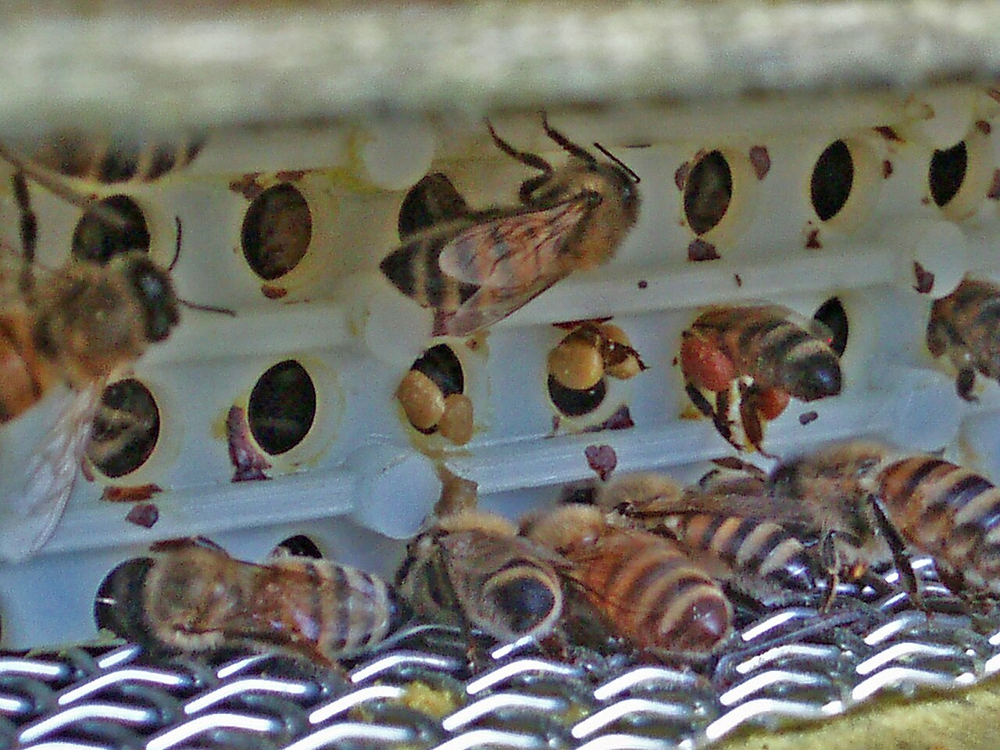

*Photo 56.1 — Pollen trap in use. Returning workers pass through the trap openings while detached corbicular pollen pellets are visible on the collection surface. A trap should remove only part of the incoming pollen and must be kept clean, dry and free of traffic blockage. Photo by Matteo Giusti (Matteogiusti), CC BY-SA 3.0.*

## 56.21 Collect Frequently

Fresh pollen is moist and biologically active.

Leaving it in a warm humid trap drawer can allow:

- mould growth;
- yeast growth;
- insect contamination;
- fermentation;
- quality loss.

Collection frequency should increase in warm or humid weather.

## 56.22 Rain and Wet Pollen

Water entering a trap can rapidly damage product quality.

Wet pollen should not simply be mixed with a dry lot.

Segregate it and evaluate whether it can be safely processed under the quality system.

## 56.23 Soil and Dust Contamination

Entrance-mounted traps can be exposed to:

- soil;
- mud;
- grass debris;
- road dust;
- vehicle emissions.

Apiary siting and trap design influence food safety.

## 56.24 Dead Bees and Hive Debris

Raw pollen may contain:

- bee legs or wings;
- wax fragments;
- propolis;
- brood debris;
- wood fragments;
- other insects.

Physical cleaning is required before sale.

## 56.25 Ants and Other Insects

Pollen is highly attractive to other insects.

Use:

- clean stands;
- physical barriers;
- frequent collection;
- covered transport.

Avoid pesticide contamination of the food product.

## 56.26 Initial Reception

At collection:

1. identify apiary and colony/group;
2. record date/time;
3. weigh or estimate yield;
4. inspect for water, mould, foreign matter, and odour;
5. transfer promptly to a clean closed container;
6. begin preservation quickly.

## 56.27 Fresh Pollen Is Perishable

Unlike honey, fresh pollen can contain sufficient moisture for active microbial growth.

It should not be held for long periods at room temperature unless a validated process demonstrates safety and quality.

Rapid chilling, freezing, drying, or freeze-drying is central to pollen preservation.

## 56.28 Freezing

Freezing is one of the simplest ways to preserve fresh pollen.

Advantages include:

- rapid slowing of microbial activity;
- good retention of colour and aroma;
- minimal heat exposure.

Requirements include:

- rapid freezing after collection;
- clean packaging;
- stable freezer temperature;
- controlled thawing.

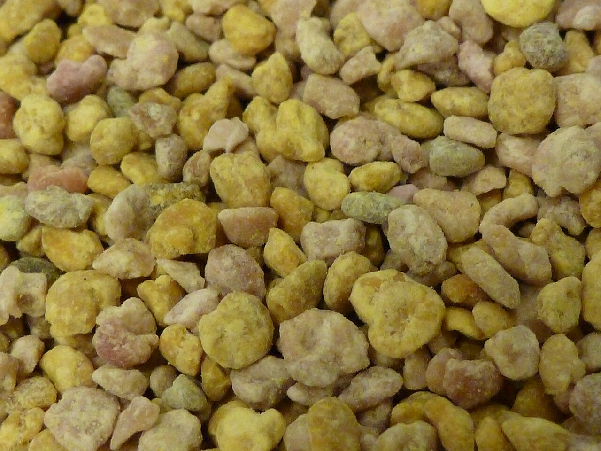

*Photo 56.2 — Frozen bee-collected pollen pellets. Freezing can preserve fresh pollen with little heat exposure when the product is collected hygienically and frozen promptly. These are bee-collected pollen pellets, not bee bread stored and modified inside comb cells. Photo by Matteo Giusti (Matteogiusti), CC BY-SA 3.0.*

## 56.29 Cold Chain

Frozen pollen remains a frozen food ingredient/product.

The cold chain should be maintained through:

- storage;
- transport;
- wholesale handling;
- retail if sold frozen.

Repeated thaw/refreeze cycles can damage quality and increase condensation.

## 56.30 Thawing

Condensation can wet pollen when cold containers are opened in humid air.

Where appropriate, allow sealed packages to equilibrate before opening.

Once thawed, manage pollen according to its validated storage life rather than assuming it is shelf-stable.

## 56.31 Drying

Drying reduces moisture and water activity so microbial growth becomes less likely and ambient storage becomes more practical.

Quality depends on:

- air temperature;
- relative humidity;
- airflow;
- bed depth;
- initial moisture;
- drying time.

## 56.32 Avoid Excessive Drying Heat

High temperature can damage:

- aroma;
- colour;
- vitamins;
- enzymes;
- heat-sensitive bioactive compounds.

Use the lowest validated temperature/time combination that achieves the intended stability.

## 56.33 Air Quality During Drying

Drying air contacts a food product directly.

It should be protected from:

- dust;
- combustion exhaust;
- chemical odours;
- insects;
- excessive humidity.

Do not use unfiltered smoky workshop air for premium food pollen.

## 56.34 Drying Uniformity

Deep layers can dry unevenly.

Wet pockets can remain beneath apparently dry surface pellets.

Controls can include:

- shallow bed depth;
- gentle turning;
- uniform airflow;
- representative moisture testing.

## 56.35 Freeze-Drying

Freeze-drying removes water under vacuum from frozen material.

Potential advantages:

- strong preservation of colour and structure;
- low thermal exposure;
- high-value product format.

Disadvantages include:

- expensive equipment;
- long cycles;
- need for packaging with good moisture barrier;
- process validation.

## 56.36 ISO 24382:2023

ISO 24382:2023 establishes an international specification framework for bee pollen.

Its scope includes:

- hive-collected pollen pellets;
- dried bee pollen;
- frozen bee pollen;
- freeze-dried bee pollen.

It also addresses analytical methods, packaging, marking, labelling, storage, and transportation.

## 56.37 ISO Bee-Pollen Production Work in 2026

In 2026, ISO/FDIS 25097 on bee pollen production was under development at the final-draft stage.

Its scope addresses production-chain controls such as:

- harvesting;
- processing;
- packaging;
- labelling;
- storage;
- transportation;
- traceability.

A draft standard is not yet the same as a published mandatory legal rule, but it is useful evidence of emerging good-practice direction.

## 56.38 Moisture

Moisture content is a core quality parameter for dried pollen.

High moisture increases risk of:

- mould;
- yeast growth;
- quality loss;
- clumping;
- mycotoxin development if toxigenic fungi grow.

Use a validated method and applicable specification.

## 56.39 Water Activity

Water activity indicates how much water is available to microorganisms.

It can be more directly related to microbial stability than total moisture percentage.

Two pollen samples with similar moisture can have somewhat different water activity depending on composition.

## 56.40 Why Moisture Alone Is Not Enough

A sample can pass a moisture target yet still have problems from:

- heavy initial contamination;
- previous mould growth;
- mycotoxins already produced;
- poor packaging;
- uneven wet pockets.

Quality control must consider the whole process history.

## 56.41 Cleaning and Sorting

Dry or frozen pollen can be cleaned by combinations of:

- sieving;
- aspiration/air separation;
- manual inspection;
- magnets or metal control where appropriate;
- optical sorting in larger systems.

The method should remove foreign material without contaminating or excessively damaging pellets.

## 56.42 Colour Sorting

Colour separation can create visually uniform lots or support botanical studies.

However, pellet colour does not always correspond to one plant species.

Use microscopic or molecular botanical identification for defensible origin claims.

## 56.43 Palynology

Microscopic pollen analysis can identify plant taxa based on grain morphology.

It is useful for:

- botanical profiling;
- geographical clues;
- quality characterisation.

Expertise and reference collections are required.

## 56.44 DNA Methods

DNA metabarcoding can complement microscopy by detecting plant DNA signatures.

Limitations include:

- DNA extraction bias;
- incomplete reference databases;
- sequence abundance not equalling nutrient contribution;
- processing effects.

Use as one tool, not universal truth.

## 56.45 Nutritional Composition

Bee pollen can contain substantial amounts of:

- protein;
- carbohydrates;
- lipids;
- fibre;
- minerals;
- phenolics.

Published reviews show very wide concentration ranges because botanical origin strongly changes composition.

Do not promise one fixed nutrient value unless the lot is actually analysed.

## 56.46 Protein

Protein content can differ markedly between pollen sources.

Protein percentage also does not describe amino-acid balance completely.

For bee nutrition and human food composition, both quantity and composition matter.

## 56.47 Lipids and Sterols

Pollen supplies essential fatty acids and sterols important to bees.

Sterols are particularly relevant because honey bees cannot synthesise all sterol structures they require from simple carbohydrate feed.

This is one reason sugar syrup cannot replace pollen nutritionally.

## 56.48 Minerals and Micronutrients

Mineral content reflects:

- plant species;
- soil;
- geography;
- environmental contamination.

High mineral content is not automatically beneficial if toxic metals are present.

## 56.49 Phenolic Compounds

Pollen contains plant phenolics with measurable antioxidant activity in laboratory assays.

Laboratory antioxidant activity is not equivalent to a clinically proven human-health effect.

Marketing claims must follow applicable law.

## 56.50 Microbial Hazards

Potential microbial hazards include:

- moulds;
- yeasts;
- environmental bacteria;
- contamination introduced during handling.

Fresh pollen's moisture makes rapid preservation essential.

## 56.51 Mould

Mould growth can occur when pollen remains warm and moist.

Visible mould is a rejection sign for ordinary food product.

Do not attempt to rescue visibly mouldy pollen merely by drying it later.

## 56.52 Mycotoxins

Some moulds can produce mycotoxins.

Mycotoxins can remain even if the fungus is later killed or the product is dried.

This is why prevention is more reliable than trying to “sterilise” poor pollen after spoilage.

## 56.53 Current Research on Pesticides and Mycotoxins

A 2024 analytical review reported that numerous pesticide compounds and several mycotoxins have been detected in bee-pollen studies worldwide and highlighted continuing regulatory gaps for pollen as a specific commodity.

The practical lesson is not that every pollen lot is dangerous. It is that risk-based monitoring and clean sourcing are necessary for serious commercial production.

## 56.54 Pesticide Residues

Pollen can concentrate pesticide exposure because foragers collect directly from plant reproductive structures.

Residues may include:

- insecticides;
- fungicides;
- herbicides;
- acaricides from hive treatments.

Risk depends on compound, concentration, market, and applicable limits.

## 56.55 Apiary Siting and Pesticide Risk

Before commercial pollen collection, consider:

- nearby intensive crops;
- known spray programmes;
- industrial sites;
- road traffic;
- contaminated land.

Communication with growers can reduce avoidable exposure but cannot guarantee residue-free pollen.

## 56.56 Heavy Metals

Pollen can contain metals from environmental sources.

Commercial testing may include:

- lead;
- cadmium;
- arsenic;
- mercury or other market-specific elements.

Sampling and legal interpretation should use accredited methods where required.

## 56.57 Pyrrolizidine Alkaloids

Certain plants naturally produce pyrrolizidine alkaloids, some of which are hepatotoxic.

Bee pollen can collect these plant compounds when bees forage on relevant species.

Botanical knowledge and contaminant testing can therefore be important even when no pesticide contamination exists.

## 56.58 Natural Toxins Are Still Toxins

A contaminant does not become harmless because it originated from a plant.

Risk assessment should treat:

- plant alkaloids;
- mycotoxins;
- allergens;
- pesticides

according to evidence and dose, not “natural versus synthetic” labels.

## 56.59 Allergy Risk

Bee pollen can trigger allergic reactions in susceptible people.

Potentially affected consumers include some people with:

- seasonal pollen allergy;
- asthma;
- sensitivity to bee products;
- previous unexplained reactions to supplements.

## 56.60 Anaphylaxis

Severe allergic reactions can include:

- breathing difficulty;
- throat/tongue swelling;
- widespread hives;
- dizziness;
- collapse.

These are medical emergencies.

A bee-pollen product should never be marketed as harmless to allergic consumers simply because it is a natural food.

## 56.61 Allergen Labelling

Specific legal labelling requirements vary.

Even where bee pollen is not one of the standard mandatory allergen list items, producers should use truthful safety information and comply with supplement/food rules applicable to the market.

Do not invent medically reassuring statements such as “safe for pollen allergy”.

## 56.62 Children and Vulnerable Consumers

Supplement products may require special caution for:

- children;
- pregnant people;
- people taking medicines;
- people with allergies.

Health advice belongs to competent healthcare guidance, not unqualified product marketing.

## 56.63 Bee Pollen Is Not a Medicine

Research investigates potential biological effects of pollen extracts and nutrients.

That does not automatically authorise claims that bee pollen:

- cures allergy;
- treats cancer;
- prevents infection;
- detoxifies the body;
- replaces prescribed medicine.

Claims must match evidence and law.

## 56.64 Food Versus Food Supplement

Depending on jurisdiction and presentation, bee pollen may be sold as:

- food;
- food supplement;
- ingredient in another food.

The legal category affects:

- labelling;
- claims;
- serving information;
- food-business obligations.

## 56.65 Bee Bread

Bee bread differs from trap-collected pollen.

Harvesting it generally requires removal from comb and can interfere with colony stores.

It also has a different composition, moisture profile, and microbiological history.

Do not label bee bread simply as ordinary pollen pellets.

## 56.66 Bee Bread Collection

Commercial bee-bread collection should consider:

- colony nutritional needs;
- brood-comb hygiene;
- treatment history;
- cell contamination;
- extraction method;
- preservation.

Old brood comb introduces quality issues not present in clean trap pollen.

## 56.67 Sensory Quality

Assess:

- colour diversity;
- floral aroma;
- sweetness/bitterness;
- texture;
- rancidity;
- musty odour;
- mould odour.

Strong musty, fermented, chemical, or rancid notes are defects.

## 56.68 Rancidity

Pollen lipids can oxidise.

Warm storage, oxygen, light, and time can produce rancid flavours.

Low-moisture stability does not prevent oxidative quality loss indefinitely.

## 56.69 Packaging

Packaging should protect pollen from:

- moisture;
- oxygen where relevant;
- light;
- insects;
- odours;
- physical damage.

Barrier requirements differ for dried, frozen, and freeze-dried products.

## 56.70 Packaging Dried Pollen

Dried pollen should enter packaging only after:

- cooling to appropriate temperature;
- representative moisture/water-activity verification;
- cleaning;
- lot identification.

Warm product sealed too early can create condensation.

## 56.71 Packaging Frozen Pollen

Frozen packs should tolerate freezer temperature without cracking or losing seal integrity.

The pack should also support cold-chain traceability.

## 56.72 Freeze-Dried Pollen Packaging

Freeze-dried pollen is highly sensitive to moisture uptake.

Use a strong moisture barrier and close containers promptly after processing.

Poor packaging can undo an expensive freeze-drying process.

## 56.73 Storage of Dried Pollen

Store dried pollen:

- cool;
- dry;
- dark;
- protected from pests;
- away from strong odours.

Do not place it beside fuels, cleaning chemicals, or aromatic foods.

## 56.74 Storage of Frozen Pollen

Maintain the defined frozen storage condition.

Use temperature monitoring appropriate to the operation.

Document excursions and evaluate them rather than ignoring them.

## 56.75 Shelf Life

Shelf life depends on:

- processing method;
- moisture/water activity;
- oxygen exposure;
- temperature;
- packaging;
- microbial load;
- lipid oxidation;
- market specification.

Do not copy a universal date from another producer.

## 56.76 Lot Definition

A lot can be based on:

- apiary;
- harvest date;
- harvest period;
- botanical source;
- processing batch.

The definition should be consistent and support recall or investigation.

## 56.77 Traceability Records

Record:

- apiary;
- hive group;
- collection date;
- trap type;
- raw mass;
- weather/rain event if relevant;
- preservation start time;
- drying/freezing batch;
- processing conditions;
- final mass;
- packaging lot;
- laboratory results.

## 56.78 Supplier Approval

If purchasing pollen, request information on:

- country and region;
- collection method;
- drying/freezing method;
- pesticide controls;
- contaminant testing;
- microbiology;
- botanical claims;
- storage history.

Untraceable pollen should not enter a premium supply chain automatically.

## 56.79 Quality Testing

A commercial testing plan can include:

- moisture;
- water activity;
- microbiological counts;
- pesticides;
- mycotoxins;
- toxic elements;
- pyrrolizidine alkaloids where risk justifies;
- botanical analysis;
- nutrient composition for label claims.

## 56.80 Certificate of Analysis

A CoA should be linked to the actual lot.

Review:

- sample identity;
- method;
- units;
- result;
- specification;
- detection/quantification limits where relevant;
- laboratory competence.

A certificate from another lot proves nothing about the current lot.

## 56.81 Sampling

Pollen is heterogeneous.

Pellets of different colours and plant sources can segregate in a container.

Representative sampling may require:

- mixing;
- multiple increments;
- sampling from different depths;
- composite sample preparation.

## 56.82 Retained Samples

Retained samples support:

- complaint investigation;
- residue disputes;
- shelf-life review;
- botanical verification;
- microbial comparison.

Store them under defined conditions that reflect the product or quality system.

## 56.83 Foreign-Body Control

Potential physical contaminants include:

- bee parts;
- wood;
- metal;
- plastic;
- stones;
- plant debris;
- insect fragments.

Cleaning equipment should remove them without creating new contamination.

## 56.84 Metal Detection and Magnets

Large commercial operations may use magnets or metal detection where risk assessment supports it.

These systems do not replace good equipment maintenance and visual cleaning.

## 56.85 Decision Table

| Observation | Main concern | Response |
|---|---|---|
| Strong pollen flow, colony stores adequate | Good collection opportunity | Trap under monitored schedule |
| Brood expanding, pollen stores falling | Colony nutritional risk | Reduce/stop trapping |
| Wet pollen in drawer | Microbial risk | Segregate; preserve/process under validated plan |
| Musty or mouldy odour | Spoilage | Reject ordinary food use; investigate cause |
| High pesticide-residue risk area | Chemical hazard | Increase testing/avoid commercial collection |
| Dried pollen reabsorbs moisture | Shelf-life risk | Review packaging and storage humidity |
| Consumer with pollen allergy asks if product is safe | Allergy uncertainty | Do not reassure; advise appropriate medical caution |
| CoA not linked to lot | Traceability failure | Do not use as evidence for release |

## 56.86 Practical Collection Procedure

### Before trapping

- select strong healthy colony;
- inspect pollen stores and brood demand;
- review nearby pesticide risk;
- clean trap and drawer;
- prepare food-grade collection containers.

### During trapping

1. install trap correctly;
2. verify traffic and drone access;
3. collect frequently;
4. protect product from rain and insects;
5. inspect colony stores regularly;
6. pause trapping when nutrition or weather deteriorates.

### At collection

7. identify lot;
8. inspect raw pollen;
9. remove obvious foreign bodies;
10. transfer promptly to preservation step;
11. document time from collection to freezing/drying.

## 56.87 Practical Drying Framework

- clean/sort raw pollen;
- load shallow uniform layers;
- use clean controlled air;
- monitor product temperature and humidity;
- turn or redistribute if required by validated process;
- verify final moisture/water activity representatively;
- cool before packaging;
- pack in a strong moisture barrier;
- retain sample and records.

## 56.88 Practical Frozen-Pollen Framework

- collect hygienically;
- clean/sort promptly;
- divide into manageable food-grade packs;
- freeze rapidly;
- maintain cold chain;
- label lot and harvest date;
- manage condensation during thawing;
- avoid repeated thaw/refreeze cycles.

## 56.89 Scientific Notes

### Botanical origin drives composition

Published composition ranges are broad because pollen from different plants contains different proportions of protein, lipids, minerals, and phytochemicals. “Bee pollen” is not one nutritionally uniform substance.

### Colony nutrition depends on quality as well as quantity

A large mass of low-diversity or nutritionally incomplete pollen may not be equivalent to a diverse supply with balanced amino acids and sterols.

### Drying is a preservation trade-off

Removing water improves microbial stability, but excessive heat can degrade sensory and nutritional qualities. A good process balances both objectives.

### Mycotoxin prevention is upstream

Once a toxigenic mould has grown and produced a stable toxin, killing the mould later does not necessarily remove the toxin. Rapid clean preservation is therefore more effective than late salvage.

### Allergy risk is biological, not marketing-dependent

Pollen is designed by plants to carry proteins and other biologically active molecules. Consumer hypersensitivity must therefore be taken seriously even when the product is minimally processed.

## 56.90 Bee-Pollen Checklist

- [ ] Colony strong and healthy.
- [ ] Pollen stores adequate.
- [ ] Brood demand considered.
- [ ] Trap clean, dry, and correctly fitted.
- [ ] Drone/traffic route checked.
- [ ] Pesticide-risk environment reviewed.
- [ ] Collection frequency appropriate to weather.
- [ ] Wet or mouldy product segregated.
- [ ] Raw pollen protected from soil and insects.
- [ ] Lot identified at collection.
- [ ] Preservation begins promptly.
- [ ] Drying air clean and controlled, if drying.
- [ ] Final moisture/water activity verified where required.
- [ ] Frozen product cold chain controlled, if freezing.
- [ ] Packaging appropriate to product form.
- [ ] Storage cool/dry/dark or frozen as specified.
- [ ] Residue/contaminant testing matched to risk.
- [ ] Allergy warnings/claims reviewed for legal market.
- [ ] CoA linked to exact lot.
- [ ] Retained sample and traceability record complete.

## Key Takeaways

- Pollen is essential colony nutrition, so commercial trapping must never be managed independently of brood demand and colony stores.
- Bee pollen pellets differ from bee bread.
- Botanical origin drives large differences in nutrient composition and colour.
- Fresh pollen is perishable and should be preserved quickly.
- Freezing, drying, and freeze-drying are different preservation systems with different costs and quality effects.
- Moisture and water activity are central to microbial stability.
- Mould, mycotoxins, pesticides, heavy metals, pyrrolizidine alkaloids, and foreign bodies are legitimate food-safety hazards.
- ISO 24382:2023 provides a current international specification framework for bee pollen.
- Bee pollen can cause serious allergic reactions, including anaphylaxis, in susceptible consumers.
- Nutritional and laboratory bioactivity data do not authorise unsupported therapeutic claims.

## Chapter Summary

Bee pollen production begins with a biological constraint: pollen is the colony's primary protein-rich food. A trap that increases human harvest decreases pollen reaching the hive. Responsible production therefore starts with strong colonies, adequate pollen stores, active forage, and a trapping schedule that can be reduced immediately when colony need increases.

Once pollen reaches the collection drawer, the challenge becomes food preservation. Fresh pellets are moist and can deteriorate rapidly. Hygienic collection, rapid freezing or controlled drying, representative moisture or water-activity testing, clean packaging, and appropriate storage are essential.

Quality cannot be judged only by colourful appearance. Bee pollen can carry environmental pesticides, toxic elements, moulds, mycotoxins, natural plant alkaloids, and physical debris. Botanical origin also changes nutrient composition so strongly that one generic nutrient claim should not be applied to every lot without evidence.

Finally, pollen is an allergenic biological material. A professional producer treats allergy information, traceability, contaminant testing, and truthful health claims as part of product quality. ISO 24382:2023 provides a useful international framework, while local food and supplement laws determine the actual commercial obligations.

## Review Questions

1. What is pollen biologically?
2. Why do honey bee colonies need pollen?
3. How does pollen differ nutritionally from nectar?
4. How do foragers form pollen pellets?
5. What are corbiculae?
6. Why do pollen pellets vary in colour?
7. Does pellet colour prove botanical identity?
8. Why is bee pollen composition highly variable?
9. What is bee bread?
10. How does bee bread differ from trap-collected pollen?
11. Where do bees store pollen in the hive?
12. What is a pollen dearth?
13. Which colony signs can indicate declining pollen availability?
14. What does a pollen trap do?
15. Why should a trap remove only part of incoming pollen?
16. Name three pollen-trap designs.
17. Which factors influence trapping efficiency?
18. Why is over-harvesting harmful?
19. Which colonies are suitable for pollen production?
20. When should trapping be reduced or stopped?
21. What is one advantage of intermittent trapping?
22. Why should trapping not follow only a calendar?
23. What should be checked after installing a trap?
24. Why can drones be a problem with some trap designs?
25. What qualities should a collection drawer have?
26. Why must pollen be collected frequently?
27. What should happen to rain-wetted pollen?
28. How can entrance traps collect soil or road contamination?
29. Which foreign materials can occur in raw pollen?
30. How can ants contaminate the crop?
31. What should be recorded at raw-pollen reception?
32. Why is fresh pollen more perishable than honey?
33. What are the main preservation options?
34. What are the main advantages of freezing?
35. What is meant by cold chain?
36. Why are repeated thaw/refreeze cycles undesirable?
37. What is the main condensation risk during thawing?
38. How does drying preserve pollen?
39. Which process variables control drying?
40. Why can excessive heat reduce quality?
41. Why must drying air be clean?
42. How can a deep pollen bed dry unevenly?
43. What is freeze-drying?
44. What are the main advantages and disadvantages of freeze-drying?
45. What does ISO 24382:2023 cover?
46. Which pollen product forms are within its scope?
47. What was the status of ISO/FDIS 25097 in 2026?
48. Why is a draft standard not the same as binding law?
49. Why is moisture important in dried pollen?
50. What is water activity?
51. Why can water activity be more directly related to microbial stability than total moisture?
52. Why can a lot pass a moisture target and still be unsafe?
53. Which cleaning methods can remove physical debris?
54. Why is colour sorting not enough for botanical claims?
55. What is palynology?
56. What can DNA metabarcoding contribute?
57. Why does sequence abundance not equal nutrient contribution?
58. Why should one fixed nutrient table not be used for every pollen lot?
59. Why is protein percentage alone incomplete information?
60. Why are pollen sterols important to bees?
61. Can sugar syrup replace pollen nutritionally?
62. Why can high mineral content also indicate contamination?
63. What do antioxidant assays measure?
64. Why do antioxidant assays not prove clinical benefit?
65. What microbial hazards can occur in pollen?
66. What should happen to visibly mouldy pollen?
67. What are mycotoxins?
68. Why does killing mould not necessarily remove mycotoxins?
69. What did the 2024 review highlight about pesticide and mycotoxin findings in bee pollen?
70. Why can pollen concentrate pesticide exposure?
71. How can apiary siting affect residue risk?
72. Which heavy metals can be relevant?
73. What are pyrrolizidine alkaloids?
74. Why can natural plant toxins be a food-safety concern?
75. Who may be at higher risk of bee-pollen allergy?
76. What are signs of anaphylaxis?
77. How should severe allergy symptoms be treated?
78. Why should a seller not promise that bee pollen is safe for pollen-allergic consumers?
79. Why is bee pollen not automatically a medicine?
80. How can legal status vary between food and supplement markets?
81. Why is bee bread a separate product category?
82. What quality issues arise from collecting bee bread from brood comb?
83. What sensory defects can indicate poor pollen quality?
84. What is rancidity?
85. Which storage conditions accelerate lipid oxidation?
86. What should packaging protect dried pollen from?
87. Why can warm product sealed too soon condense?
88. Why does freeze-dried pollen need a strong moisture barrier?
89. Why is shelf life product-specific?
90. How can a pollen lot be defined?
91. Which records support traceability?
92. What should be checked when buying pollen from another supplier?
93. What can a commercial quality-testing plan include?
94. What should be reviewed on a certificate of analysis?
95. Why is representative sampling difficult in multi-coloured pollen?
96. What are retained samples useful for?
97. Why should foreign-body control not rely on one machine alone?
98. What are the main steps in a practical collection procedure?
99. What is the central biological trade-off in commercial pollen harvesting?
100. What combination of colony management, rapid preservation, contaminant control, and truthful marketing defines professional bee-pollen production?

## References

- ISO 24382:2023. *Bee pollen — Specifications*. International Organization for Standardization. Published October 2023.
- ISO/FDIS 25097. *Bee pollen production*. Final Draft International Standard under development in 2026; verify publication status before final book release.
- Thakur, M., and Nanda, V. “Composition and functionality of bee pollen: A review.” *Trends in Food Science & Technology* 98, 2020, 82–106.
- Végh and related food-safety literature on bee-pollen contaminants, including pesticides, toxic elements, moulds, mycotoxins, and pyrrolizidine alkaloids.
- “Food safety hazards of bee pollen – A review.” *Trends in Food Science & Technology*, current review literature on chemical and microbiological hazards.
- “Unveiling bee pollen's contamination with pesticides and mycotoxins: Current analytical procedures, results and regulation.” *Trends in Analytical Chemistry* 180, 2024, 117935.
- Scientific literature on bee pollen and bee bread composition, palynology, DNA metabarcoding, drying, freeze-drying, storage, and allergy.
- Current national food, supplement, contaminant, pesticide-residue, allergen, labelling, food-hygiene, and occupational-safety requirements must be verified for the target market.

# Chapter 57 — Propolis

## Introduction

Propolis is a resin-rich material produced when honey bees collect plant exudates and combine them with wax and bee secretions. Colonies use it to seal cracks, reduce unwanted openings, reinforce rough surfaces, encapsulate objects that cannot be removed, and modify the biological environment of the nest.

For the beekeeper, propolis is both a colony material and a possible commercial product. Those two roles should not be confused. Resin scraped from a dirty hive corner can contain paint, wood fibres, wax, dead insects, veterinary-treatment residues, dust, or chemicals from unsuitable construction materials. A premium food, supplement, cosmetic, or research-grade propolis supply therefore begins with controlled collection, not with indiscriminate scraping.

Propolis is chemically diverse. Different plants, climates, seasons, and bee populations produce different mixtures of phenolic compounds, aromatic esters, terpenes, waxes, and volatile substances. Poplar-type propolis from temperate regions, Brazilian green propolis, Brazilian red propolis, Mediterranean propolis, and other regional types can differ greatly. Colour alone cannot establish identity or quality.

ISO 24381:2023 provides a current international specification for raw bee propolis, including quality requirements, analytical methods, packaging, marking, labelling, storage, and transport. In 2026, a separate ISO project for propolis extracts remained under development, so extract processors should not treat that draft as a final published standard.

This chapter covers collection, raw-material quality, cleaning, storage, extraction principles, contamination control, analytical characterisation, allergy risk, truthful marketing, and the distinction between laboratory bioactivity and authorised health or medicinal claims.

## Learning Objectives

After completing this chapter, the reader should be able to:

- explain the biological origin and colony functions of propolis;
- understand why geography and botanical source strongly influence composition;
- distinguish controlled trap-collected propolis from higher-risk scrapings;
- prevent contamination from paint, treated timber, pesticides, hive medicines, fuel, and debris;
- use cold handling to collect and clean raw propolis;
- grade, sample, package, store, and trace raw material;
- explain how ethanol, water, glycerol, and other permitted extraction systems select different chemical fractions;
- understand fire and solvent-safety requirements for alcohol extraction;
- distinguish raw propolis, liquid extract, dry extract, and formulated product;
- understand the uses and limitations of total-phenolic, flavonoid, chromatographic, spectroscopic, residue, and contaminant tests;
- recognise allergic contact dermatitis and hypersensitivity risk;
- separate in-vitro activity, animal research, human clinical evidence, health claims, and medicinal claims;
- identify the regulatory differences among foods, supplements, cosmetics, medicines, and veterinary products.

## 57.1 What Is Propolis?

Propolis is a bee-processed plant-resin material.

Its composition generally includes varying proportions of:

- plant resins;
- wax;
- phenolic compounds;
- flavonoids;
- phenolic acids and esters;
- terpenes;
- volatile compounds;
- pollen and minor biological material.

There is no single universal propolis formula.

## 57.2 Resin Sources

Bees collect resin from sources such as:

- leaf buds;
- bark wounds;
- plant exudates;
- resinous leaf surfaces;
- stems and protective plant coatings.

Common source genera differ regionally and can include *Populus*, *Betula*, *Baccharis*, *Clusia*, conifers, and many other plants.

## 57.3 Colony Uses

Bees use propolis to:

- seal cracks;
- narrow entrances;
- stabilise hive surfaces;
- reduce unwanted airflow;
- reinforce comb attachments;
- smooth cavity walls;
- encapsulate foreign objects too large to remove.

These functions are structural and biological.

## 57.4 Propolis Envelope

In natural cavities, some colonies coat extensive internal surfaces with a thin resin layer often described as a propolis envelope.

Research indicates that such resin-rich nest surfaces can influence microbial exposure and colony immune activity.

This is an example of social immunity, not proof that propolis prevents every disease.

## 57.5 Colony Differences

Propolis use differs among colonies because of:

- genetics;
- plant-resin availability;
- hive design;
- season;
- colony condition;
- local climate.

Some colonies seal equipment heavily, while others collect little resin.

## 57.6 Seasonal Variation

Raw material harvested in spring can differ from material from late summer because resin sources change.

Weather also influences resin collection through:

- temperature;
- rainfall;
- drought;
- plant injury;
- bud development.

Lot identity should therefore include harvest period.

## 57.7 Geographical Variation

Different landscapes produce different propolis chemistry.

A dark brown European propolis and a green Brazilian propolis may both be authentic despite very different chemical fingerprints.

Do not use one regional reference profile as the only definition of genuine propolis worldwide.

## 57.8 Recognised Propolis Types

Research and trade commonly refer to types such as:

- poplar-type propolis;
- Brazilian green propolis;
- Brazilian red propolis;
- Mediterranean propolis;
- tropical or region-specific resin types.

These names should be supported by source and chemical evidence.

## 57.9 Colour Is Not a Purity Test

Raw propolis can be:

- yellow;
- green;
- red;
- brown;
- very dark brown or nearly black.

Colour depends on resin source, oxidation, wax, debris, and age.

A green colour alone does not prove Brazilian green propolis.

## 57.10 Aroma

Good raw propolis often has a strong resinous or balsamic aroma.

Foreign odours can suggest contamination from:

- fuel;
- smoke;
- solvents;
- paint;
- mould;
- cleaning chemicals.

Sensory inspection is useful but not definitive.

## 57.11 Why Random Scraping Is Risky

Scraping hive surfaces can collect:

- paint chips;
- wood fibres;
- metal corrosion products;
- old wax;
- dead insects;
- dust;
- veterinary-treatment residues;
- residues from timber preservatives.

Commercial human-use propolis should ideally come from controlled collection surfaces.

## 57.12 Propolis Traps

Propolis traps are flexible grids or perforated sheets placed where bees are stimulated to fill narrow gaps with resin.

Advantages include:

- cleaner collection;
- less wood and paint contamination;
- easier removal;
- improved standardisation;
- clearer traceability.

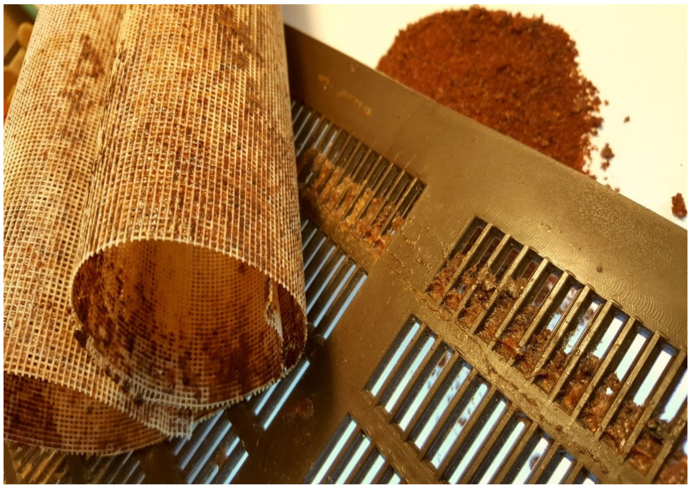

*Photo 57.1 — Propolis collector traps and harvested raw propolis. Flexible or perforated collection surfaces give bees controlled gaps to fill with resin, helping separate commercial trap propolis from indiscriminate hive scrapings. Source: Šuran et al., Figure 1, Molecules 26 (2021), 2930, CC BY 4.0.*

## 57.13 Trap Materials

Trap material should be:

- suitable for contact with the intended product;
- free from objectionable odours;
- flexible where bending release is required;
- durable;
- cleanable;
- traceable to a known material.

Unknown recycled plastic is unsuitable for a premium food/supplement supply chain.

## 57.14 Trap Placement

Traps are commonly placed above the brood nest or beneath the hive cover where small gaps, light, or airflow stimulate sealing.

Placement should not create harmful drafts or expose the colony to rain simply to increase propolis yield.

## 57.15 Do Not Strip the Whole Colony

Propolis is useful to the bees.

Repeated aggressive scraping of all resin surfaces can:

- damage the nest envelope;
- expose rough wood;
- stress colony repair behaviour;
- contaminate the product with old hive material.

Use planned traps rather than stripping every surface.

## 57.16 Cold Makes Propolis Brittle

Warm propolis is sticky. Cold propolis becomes brittle.

This allows a filled flexible trap to be chilled or frozen and flexed so fragments release.

The important principle is brittle separation; exact freezing duration depends on trap and equipment.

## 57.17 Condensation Control

Frozen traps entering warm humid air can collect water.

Condensation can:

- wet the propolis;
- promote contamination;
- complicate storage;
- increase clumping.

Handle cold material in a clean dry workflow and keep collected propolis protected.

## 57.18 Scraped Propolis Grades

Scraped material can still be usable when it comes from known clean untreated surfaces.

Grade separately by:

- source surface;
- age;
- waxiness;
- visible debris;
- treatment history;
- contamination risk.

Do not hide scrapings inside a premium trap-propolis lot.

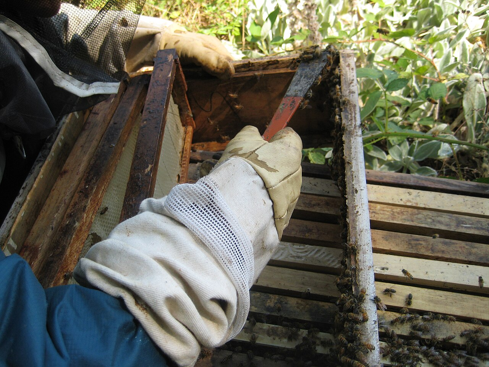

*Photo 57.2 — Scraped propolis source context. Scraping can recover usable propolis from known clean untreated hive surfaces, but the collection method does not itself establish a premium grade. Keep scraped material separate from trap-collected propolis and assess source surface, waxiness, visible debris, treatment history and contamination risk. Photo by fishermansdaughter, CC BY 2.0.*

## 57.19 Painted Hives

Avoid human-use propolis from interfaces where resin has contacted unsuitable paint.

Paint can introduce:

- pigment;
- binder;
- flakes;
- solvents or degradation products.

The safest control is appropriate hive construction and dedicated collection surfaces.

## 57.20 Treated Timber

Wood preservatives can contaminate propolis scraped from treated lumber.

Record hive materials and avoid harvesting human-use product from chemically treated internal surfaces unless the material is specifically suitable and the risk is controlled.

## 57.21 Veterinary Medicines

Hive treatments can contaminate propolis or nearby wax and surfaces.

Review:

- active ingredient;
- placement;
- treatment period;
- product label;
- withdrawal or hive-product restrictions.

Do not assume rules written only around honey are automatically sufficient for propolis.

## 57.22 Environmental Pesticides

Resins collected from plant surfaces can carry environmental pesticide residues.

Commercial testing becomes more important when apiaries are near:

- intensive crops;
- industrial areas;
- high-traffic roads;
- known contaminated sites.

## 57.23 Heavy Metals

Propolis can also reflect environmental metal exposure.

Depending on market and product type, tests may include:

- lead;
- cadmium;
- arsenic;
- mercury or other relevant elements.

## 57.24 ISO 24381:2023

ISO 24381:2023 applies to raw propolis from *Apis mellifera* hives.

It covers quality requirements and analytical approaches as well as:

- packaging;
- marking;
- labelling;
- storage;
- transportation.

It is a useful international quality framework, while local food or supplement laws determine legal market requirements.

## 57.25 Propolis Extract Standard Development

A separate ISO project for propolis extracts remained under development in 2026.

This matters because raw-propolis specifications cannot automatically be applied to every liquid or dry extract.

Final publication status should be rechecked before the book goes to press.

## 57.26 Raw Propolis Reception

On collection:

1. identify apiary and harvest period;
2. weigh material;
3. inspect aroma and foreign matter;
4. protect from floor contact;
5. separate grades;
6. cool or freeze where used for cleaning;
7. store in a clean closed container.

## 57.27 Cold Sorting

Cold brittle propolis can be manually sorted to remove:

- wood;
- dead insects;
- plastic;
- stones;
- large wax pieces;
- obvious hive debris.

Use clean surfaces and tools.

## 57.28 Sieving

Cold ground propolis can be sieved for particle-size consistency.

Sieving improves physical cleanliness but cannot remove:

- pesticide residues;
- heavy metals;
- dissolved foreign resins;
- chemical adulterants.

## 57.29 Wax Content

Wax is a natural component of propolis, but very high wax content can dilute resin-rich constituents.

Wax proportion depends on:

- colony behaviour;
- trap design;
- scraping method;
- season.

Commercial buyers may specify limits or extractable-matter criteria.

## 57.30 Grinding

Cold propolis is easier to grind than warm material.

Grinding increases extraction surface area but also increases:

- dust;
- oxidation exposure;
- contact-allergy exposure;
- contamination opportunities.

Process only what can be protected promptly.

## 57.31 Worker Exposure

Propolis can cause allergic contact dermatitis.

Occupational controls can include:

- gloves appropriate to the task;
- protective clothing;
- dust control;
- good hand hygiene;
- avoiding contaminated work surfaces.

Persistent rash or breathing symptoms require medical/occupational assessment.

## 57.32 Storage of Raw Propolis

Store raw propolis:

- cool;
- dry;
- dark;
- sealed;
- away from odours;
- labelled by lot.

Warm storage can accelerate oxidation and loss of volatile compounds.

## 57.33 Frozen Storage

Freezing can preserve raw material for later processing.

Before opening frozen containers in humid air, manage condensation so water does not wet the product.

## 57.34 What Is a Propolis Extract?

Extraction transfers soluble compounds from raw propolis into a solvent or carrier.

The result depends on:

- solvent identity;
- solvent concentration;
- raw-propolis composition;
- particle size;
- time;
- temperature;
- mixing;
- filtration.

There is no universal “propolis extract”.

## 57.35 Ethanol Extraction

Ethanol dissolves many resinous phenolic compounds and is widely used in research and commercial products.

Commercial processing must control:

- alcohol grade;
- concentration;
- flammability;
- ventilation;
- vessel compatibility;
- residual alcohol;
- legal product category.

This handbook does not provide a medicinal tincture recipe.

## 57.36 Ethanol Is a Fire Hazard

Ethanol vapour is flammable.

Controls include:

- no ignition sources;
- suitable ventilation;
- closed compatible containers;
- compliant flammable-liquid storage;
- spill-control procedures;
- workplace fire assessment.

Never heat an open ethanol-propolis mixture over a flame.

## 57.37 Water Extraction

Water extracts a different chemical fraction from ethanol.

Benefits can include alcohol-free formulations.

Challenges include:

- greater microbial-growth potential;
- shorter unpreserved shelf life;
- different extractable compounds;
- formulation complexity.

A water extract needs a validated preservation and shelf-life system.

## 57.38 Glycerol and Other Carriers

Glycerol, glycols, oils, and other permitted carriers may be used in particular foods, cosmetics, or formulations.

Each changes:

- extraction selectivity;
- viscosity;
- taste;
- microbial stability;
- legal category.

Only materials suitable for the intended product should be used.

## 57.39 Solvent Choice Changes the Product

Two extracts from the same raw propolis can have very different compositions when different solvents are used.

Therefore, a research result from an ethanol extract cannot automatically be assigned to a water extract, oil extract, or raw propolis.

## 57.40 Extraction Ratio

An extract may be described using:

- raw propolis mass to solvent volume;
- dry extract percentage;
- marker concentration;
- final solids.

A label such as “30% propolis” is ambiguous unless the calculation basis is defined.

## 57.41 Extraction Time

Longer extraction can improve recovery up to a point.

Eventually, gains may become small while:

- oxidation increases;
- contamination opportunities increase;
- production time rises.

Validate rather than copy arbitrary durations.

## 57.42 Extraction Temperature

Moderate warmth can speed mass transfer but also increases:

- volatile loss;
- oxidation;
- solvent-vapour risk.

Use controlled validated temperatures appropriate to the product.

## 57.43 Filtration of Extracts

After extraction, insoluble wax and debris are removed by settling or filtration.

Filter media must be compatible with the solvent and final product.

Do not use materials that shed fibres or dissolve in alcohol.

## 57.44 Concentrating Extracts

Commercial processors may remove solvent using:

- vacuum systems;
- controlled evaporation;
- solvent-recovery equipment.

This requires engineering controls for:

- flammable vapour;
- temperature;
- residual solvent;
- operator exposure.

## 57.45 Dry Propolis Extracts

Dry extracts can be produced using specialised techniques such as:

- spray drying;
- freeze drying;
- carrier-assisted drying.

The carrier becomes part of the final formulation and must be declared where required.

## 57.46 Standardisation

Because raw propolis varies naturally, processors may standardise extracts to:

- dry solids;
- total phenolics;
- total flavonoids;
- selected botanical markers;
- defined chemical fingerprints.

Standardisation improves batch consistency but does not prove clinical efficacy.

## 57.47 Total Phenolic Tests

Total-phenolic assays estimate a broad chemical class.

Results depend on:

- assay method;
- reference compound;
- solvent;
- matrix.

Compare batches only under a consistent validated method.

## 57.48 Total Flavonoid Tests

Total-flavonoid assays are useful for routine comparison but do not measure every biologically relevant compound equally.

They should not be used as a universal potency score.

## 57.49 HPLC and LC-MS

Chromatographic methods can measure individual phenolics and botanical markers.

Uses include:

- batch comparison;
- authenticity work;
- origin characterisation;
- stability studies;
- research.

## 57.50 GC-MS

Gas chromatography–mass spectrometry can characterise volatile or derivatised components.

It can help investigate:

- aroma chemistry;
- botanical type;
- contamination;
- unusual composition.

## 57.51 FTIR and NMR

Spectroscopic methods create chemical fingerprints.

Combined with chemometrics, they can support:

- classification;
- adulteration detection;
- batch comparison;
- origin studies.

Good reference databases are essential.

## 57.52 Antioxidant Assays

DPPH, ABTS, FRAP, and similar assays measure chemical antioxidant behaviour under laboratory conditions.

They do not establish that a consumer product prevents or treats disease.

## 57.53 Antimicrobial Assays

Propolis extracts can inhibit microorganisms in laboratory tests.

Results depend on:

- propolis source;
- extraction system;
- concentration;
- test organism;
- assay method.

An inhibition zone is not a clinical treatment approval.

## 57.54 Evidence Levels

Keep these levels separate:

1. chemical composition;
2. in-vitro biological activity;
3. animal research;
4. human clinical evidence;
5. authorised food health claim;
6. authorised medicinal indication.

Skipping levels creates misleading marketing.

## 57.55 Allergy and Contact Dermatitis

Propolis is a recognised contact allergen.

Symptoms can include:

- local itching;
- redness;
- rash;
- swelling;
- eczema-like dermatitis.

Some individuals can also experience more severe hypersensitivity.

## 57.56 Cross-Reactivity

People sensitive to certain balsams, fragrances, or plant resins may react to related propolis constituents.

A “natural” label does not mean non-allergenic.

## 57.57 Food Supplement Products

Where propolis is marketed as a food supplement, rules can cover:

- permitted ingredients;
- contaminants;
- labelling;
- serving directions;
- claims;
- food-business registration.

Requirements vary by jurisdiction.

## 57.58 EU Health Claims

EU food health claims are governed by specific legislation and authorised claim lists.

Research suggesting biological activity does not allow a seller to invent an unapproved claim such as “prevents infection” or “treats inflammation”.

## 57.59 Medicinal Claims

A product presented as treating or preventing disease may fall within medicinal-product law.

That can require:

- formal authorisation;
- evidence of efficacy;
- quality control;
- manufacturing standards;
- safety monitoring.

## 57.60 Cosmetic Products

Propolis is used in:

- balms;
- creams;
- soaps;
- oral-care products;
- deodorising products.

Cosmetics require their own safety assessment and permitted cosmetic claims.

Topical use does not eliminate allergy risk.

## 57.61 Oral-Care Products

Mouthwashes, sprays, toothpastes, and lozenges may contain propolis.

Formulation must consider:

- allergy;
- solvent concentration;
- flavour;
- microbiological stability;
- age suitability;
- permitted claims.

## 57.62 Veterinary and Bee-Health Products

Research investigates propolis in animal-health and colony-health applications.

A product intended to treat animal disease can be subject to veterinary-medicine law.

Experimental propolis should not replace statutory AFB, EFB, or Varroa control.

## 57.63 Adulteration

Propolis may be diluted or substituted with:

- excessive beeswax;
- undeclared plant resin;
- fillers;
- colourants;
- low-grade scrapings.

Authentication combines chemistry with source traceability.

## 57.64 Plant Resin Is Not Automatically Propolis

Propolis is a bee-processed hive product.

Resin collected directly from a plant by a person is not equivalent unless the product is truthfully described as plant resin.

## 57.65 Excess Wax

Some wax is normal.

Excess wax can lower the concentration of resin-derived extractables.

Commercial quality systems may measure:

- wax fraction;
- extractable matter;
- marker compounds.

## 57.66 Pesticide Testing

Residue testing is particularly relevant for propolis because bees collect resins from exposed plant surfaces.

A 2026 review of apicultural-product contamination notes that propolis, pollen, and wax can carry pesticide mixtures that require matrix-specific analytical methods.

## 57.67 Heavy-Metal Testing

Environmental risk may justify analysis for toxic elements.

Interpret results under the applicable food, supplement, or cosmetic standard.

## 57.68 Microbiology

Raw propolis has antimicrobial activity but should not be assumed sterile.

Water-containing finished products especially require microbiological control.

## 57.69 Moisture

Unexpected water in raw propolis can arise from:

- condensation;
- wet storage;
- washing;
- poor packaging.

Water changes handling and can increase microbial risk.

## 57.70 Foreign Bodies

Exclude:

- glass;
- metal;
- plastic;
- wood;
- dead insects;
- stones;
- excessive dirt.

Trap design and cold sorting are the first barriers.

## 57.71 Lot Definition

A lot can be based on:

- apiary;
- harvest period;
- botanical region;
- collection method;
- grade;
- processing batch.

Define it consistently.

## 57.72 Traceability

Record:

- apiary/location;
- collection date;
- trap type;
- hive construction/treatment notes;
- raw mass;
- grade;
- storage condition;
- extraction batch;
- solvent/carrier lot;
- final product lot.

## 57.73 Supplier Approval

When buying propolis, request:

- origin;
- collection method;
- botanical claim evidence;
- residue testing;
- contaminant testing;
- adulteration controls;
- storage history.

## 57.74 Certificate of Analysis

Possible CoA items include:

- moisture;
- wax;
- extractable matter;
- total phenolics/flavonoids;
- marker compounds;
- chromatographic fingerprint;
- pesticides;
- heavy metals;
- microbiology;
- residual solvent;
- lot identity.

## 57.75 Sensory Grading

Raw propolis can be graded by:

- colour;
- aroma;
- visible cleanliness;
- waxiness;
- debris;
- consistency at a defined temperature.

Sensory grading cannot prove botanical origin or chemical purity.

## 57.76 Botanical-Origin Claims

A named propolis type should be supported by several kinds of evidence:

- geographical source;
- local vegetation;
- marker compounds;
- chromatographic/spectroscopic profile;
- supplier traceability.

## 57.77 Geographical Claims

Chemical composition can support but not always uniquely determine a country or region.

Similar resin plants can grow across borders.

Documented chain of origin remains essential.

## 57.78 Packaging Raw Propolis

Packaging should protect against:

- moisture;
- light;
- odours;
- foreign material;
- pest access.

Use clean compatible containers.

## 57.79 Packaging Extracts

Container compatibility depends on solvent.

For example:

- ethanol can interact with some plastics and seals;
- oils can extract packaging compounds;
- water extracts can support microbes.

Validate the package with the formulation.

## 57.80 Light Protection

Light can affect sensitive phenolics and volatile compounds.

Amber or opaque packaging is often used for extracts, but packaging choice should be supported by stability data.

## 57.81 Headspace and Oxidation

Large headspace increases oxygen available for oxidation.

Balance practical fill requirements with product stability.

## 57.82 Stability Studies

A commercial propolis product needs evidence that it remains within specification over its declared shelf life.

Monitor relevant attributes such as:

- appearance;
- aroma;
- marker compounds;
- microbiology;
- phase separation;
- alcohol content;
- packaging integrity.

## 57.83 Retained Samples

Retained samples can support:

- complaints;
- fingerprint comparison;
- residue investigation;
- supplier disputes;
- stability studies.

Keep raw and finished samples where appropriate.

## 57.84 Scale-Up

A small jar extraction does not scale linearly to a large tank.

Scale changes:

- mixing;
- heat transfer;
- filtration;
- flammable-vapour inventory;
- cleaning;
- worker exposure.

Engineering controls become increasingly important.

## 57.85 Cleaning Sticky Resin Equipment

Design equipment so it can be cleaned without unapproved industrial solvents.

Cleaning method must match:

- food/cosmetic requirements;
- solvent fire safety;
- wastewater rules;
- equipment material.

## 57.86 Waste Solvent

Solvent waste must be collected and managed under local flammable/hazardous-waste rules.

Do not pour ethanol-rich extraction waste into soil or drains.

## 57.87 Decision Table

| Finding | Main concern | Response |
|---|---|---|
| Clean trap propolis from known hives | Strong raw-material candidate | Sort, label, store cool/dry, test to specification |
| Paint/wood fragments in scrapings | Physical/chemical contamination | Downgrade/reject for human-use material |
| Fuel/solvent odour | Chemical contamination | Segregate; do not mask through extraction |
| High wax content | Dilution/collection issue | Grade separately and measure extractable matter if required |
| “Green propolis” claimed only by colour | Unsupported identity | Verify source and chemical markers |
| Water extract without preservation data | Microbial shelf-life risk | Hold until stability validated |
| Worker develops rash | Possible contact allergy | Stop exposure and seek medical/occupational advice |
| Strong in-vitro antimicrobial result | Research evidence only | Do not convert automatically into medicinal marketing |

## 57.88 Practical Raw-Propolis Procedure

### Before collection

- use clean dedicated traps;
- review hive materials and treatments;
- assign apiary/harvest identity;
- avoid stripping essential nest resin.

### Harvest

1. remove filled trap hygienically;
2. protect from soil and dust;
3. chill/freeze as appropriate;
4. flex trap to release brittle resin;
5. manage condensation;
6. keep apiaries/grades separate.

### Cleaning and storage

7. sort cold material;
8. remove foreign bodies;
9. sieve/grind only if needed;
10. weigh and label;
11. store cool, dry, dark, and sealed;
12. retain sample/test to specification.

## 57.89 Commercial Extraction-Control Framework

Define:

- raw-propolis lot;
- solvent/carrier grade;
- raw-to-solvent or dry-extract basis;
- extraction time;
- extraction temperature;
- filtration;
- residual solvent/alcohol target;
- microbiological controls;
- marker/standardisation criteria;
- package;
- shelf-life evidence;
- permitted claims.

This framework is safer and more reproducible than copying one internet tincture recipe.

## 57.90 Scientific Notes

### Propolis is chemically plural

“Propolis” describes a bee-made material, not one fixed chemical formula. Botanical ecology shapes the dominant phenolics, terpenes, and other compounds.

### Extraction is selective

Solvent polarity and processing conditions determine which compounds move into the extract. Different extracts are genuinely different chemical products.

### In-vitro activity is not clinical efficacy

Laboratory assays do not establish absorption, effective human dose, long-term safety, or disease-treatment benefit.

### The nest environment is part of social immunity

Resin use appears to alter microbial exposure and immune activity at colony level, demonstrating that nest architecture can be biologically functional.

### Authentication requires reference data

Spectroscopic and chromatographic classification depends on authentic reference samples. A machine-learning model cannot classify origins that are absent or poorly represented in its reference set reliably.

## 57.91 Propolis Checklist

- [ ] Collection surface suitable for end use.
- [ ] Trap-collected and scraped material separated.
- [ ] No paint/treated-wood contamination.
- [ ] Hive-treatment history reviewed.
- [ ] Apiary and harvest period recorded.
- [ ] Raw material protected from floor/dust contact.
- [ ] Chilling/freezing managed without uncontrolled condensation.
- [ ] Foreign bodies removed.
- [ ] Raw lot weighed and labelled.
- [ ] Storage cool, dry, dark, and odour-free.
- [ ] Worker allergy/dermatitis risk controlled.
- [ ] Extraction solvent/carrier legally suitable.
- [ ] Flammable-solvent controls implemented where relevant.
- [ ] Water products have microbiological preservation validation.
- [ ] Extraction ratio basis clearly defined.
- [ ] Marker/quality methods validated.
- [ ] Pesticide/heavy-metal testing matches risk.
- [ ] Botanical/geographical claims supported.
- [ ] Health/medical claims legally reviewed.
- [ ] Final product traceability and stability records complete.

## Key Takeaways

- Propolis is a chemically variable bee-made resin, not one standard substance.
- Dedicated traps generally produce cleaner commercial raw material than random hive scrapings.
- Paint, treated timber, hive medicines, environmental pollutants, wax, and debris can contaminate propolis.
- Cold handling makes propolis easier to separate but condensation must be controlled.
- ISO 24381:2023 provides a current specification framework for raw propolis.
- Ethanol, water, glycerol, oil, and other extraction systems produce chemically different extracts.
- A propolis-extract ISO project was still under development in 2026 and should not be misrepresented as a final published standard.
- Propolis can cause allergic contact dermatitis and other hypersensitivity reactions.
- Laboratory antioxidant or antimicrobial activity is not an authorised medical claim.
- Strong propolis quality control combines source traceability, clean collection, defined processing, chemical/contaminant testing, and truthful marketing.

## Chapter Summary

Propolis quality begins in the apiary. Because bees collect exposed plant resins and apply them to hive surfaces, uncontrolled scraping can mix valuable resin with paint, wood, wax, medicines, dust, or environmental contaminants. Dedicated traps provide a much cleaner and more traceable raw material.

Cold handling exploits propolis brittleness and makes harvesting and sorting easier. Clean material should then be protected from heat, moisture, light, and foreign odours. ISO 24381:2023 provides an international framework for raw propolis quality, but a raw-material standard does not automatically define finished extracts.

Extraction is selective. Ethanol, water, glycerol, oils, and other carriers dissolve different compounds and create different safety and shelf-life problems. Commercial processing therefore requires a defined raw-material ratio, solvent grade, extraction method, filtration, residual-solvent or microbiological control, packaging, and stability programme.

Finally, propolis is biologically active but also allergenic. Laboratory antimicrobial and antioxidant results are useful scientific evidence, yet they do not authorise disease-treatment claims. A professional product separates research from claims, chemistry from clinical efficacy, and raw-material quality from finished-product regulation.

## Review Questions

1. What is propolis?
2. Which broad materials make up propolis?
3. Where do bees obtain resin?
4. Name four colony uses of propolis.
5. What is a propolis envelope?
6. What is social immunity?
7. Does propolis prevent every bee disease?
8. Why do colonies differ in resin collection?
9. How does season affect propolis?
10. Why does geographical origin affect chemical composition?
11. Name three recognised propolis types.
12. Why is colour not a purity test?
13. What can foreign odour indicate?
14. Why is random hive scraping risky?
15. What is a propolis trap?
16. What are the main advantages of a trap?
17. What qualities should trap materials have?
18. Why should trap placement not create harmful drafts?
19. Why should a colony not be stripped of all propolis?
20. Why does freezing help harvest propolis?
21. What condensation risk follows freezing?
22. Can scraped propolis ever be usable?
23. Why should scrapings and trap propolis be graded separately?
24. Why are painted surfaces a contamination risk?
25. Why is treated timber a risk?
26. How can veterinary medicines affect propolis?
27. How can environmental pesticides enter propolis?
28. Which heavy metals may be relevant?
29. What does ISO 24381:2023 cover?
30. Does it automatically define all propolis extracts?
31. What was the status of the separate propolis-extract ISO project in 2026?
32. What should happen when raw propolis is received?
33. Why is cold sorting useful?
34. What can sieving remove?
35. What can sieving not remove?
36. Why does wax content matter?
37. Why is cold propolis easier to grind?
38. What risks increase after grinding?
39. What occupational allergy is associated with propolis?
40. How should persistent worker rash be handled?
41. How should raw propolis be stored?
42. What is a propolis extract?
43. Which variables determine extract composition?
44. Why is ethanol commonly used?
45. What is the principal hazard of ethanol extraction?
46. Why should open ethanol mixtures never be heated over flame?
47. How does water extraction differ?
48. Why do water extracts require microbial attention?
49. What other carriers may be used?
50. Why does solvent choice change the product?
51. Why can “30% propolis” be ambiguous?
52. How does extraction time affect recovery?
53. Why is hotter extraction not automatically better?
54. What does filtration remove after extraction?
55. Why does concentrating an ethanol extract require engineering controls?
56. What is a dry propolis extract?
57. What is standardisation?
58. What can total-phenolic tests show?
59. Why are total-flavonoid results method-dependent?
60. What can HPLC or LC-MS contribute?
61. What can GC-MS contribute?
62. How can FTIR or NMR support authentication?
63. What does an antioxidant assay measure?
64. Why does it not prove clinical benefit?
65. What does an in-vitro antimicrobial test show?
66. Why does it not authorise treatment claims?
67. What six evidence levels should be kept separate?
68. Why can propolis cause dermatitis?
69. Why does “natural” not mean non-allergenic?
70. What rules can apply to food supplements?
71. Why are EU food health claims restricted?
72. What can make a propolis product a medicinal product?
73. What additional controls apply to cosmetics?
74. Why can topical propolis still cause allergy?
75. Why should experimental propolis not replace bee-disease control?
76. How can propolis be adulterated?
77. Is plant resin collected directly by a person automatically propolis?
78. Why can excess wax be considered dilution?
79. Why is pesticide testing relevant?
80. Why is raw propolis not assumed sterile?
81. How can moisture enter raw propolis?
82. Which foreign bodies should be excluded?
83. How can a lot be defined?
84. Which records support traceability?
85. What should be checked when buying propolis?
86. What can a CoA contain?
87. What can sensory grading establish?
88. Why can sensory grading not prove origin?
89. How should a named botanical propolis type be supported?
90. Why can chemistry alone fail to prove national origin?
91. Why does packaging need to match the solvent?
92. Why can light protection improve stability?
93. Why is headspace relevant?
94. What should a stability study monitor?
95. Why are retained samples useful?
96. Why is commercial scale-up more than multiplying a small recipe?
97. Which worker-safety hazards arise in propolis processing?
98. Why must solvent waste be controlled?
99. What is the central difference between laboratory bioactivity and authorised health claims?
100. What combination of collection control, chemical characterisation, safety, and truthful claims defines professional propolis production?

## References

- ISO 24381:2023. *Bee propolis — Specifications*. International Organization for Standardization, 2023.
- ISO/CD 13508. *Propolis extracts — Specifications*. Under development in 2026; publication status must be rechecked before final release.
- Bankova, V. and collaborators. Foundational and current reviews on propolis chemistry, botanical origin, standardisation, and biological activity.
- Current scientific literature on chromatographic and spectroscopic propolis fingerprinting, chemometrics, antimicrobial/antioxidant assays, and authenticity.
- “Pesticide contamination in apicultural products: An updated and comprehensive review of analytical methods, occurrence, and safety concerns.” *Trends in Environmental Analytical Chemistry* 49, 2026, e00300.
- Regulation (EC) No 1924/2006 and the current EU Register of nutrition and health claims for foods.
- Current EU and national food-supplement, cosmetic, medicinal-product, veterinary-medicine, contaminant, pesticide, flammable-liquid, workplace-safety, labelling, and waste requirements.
- FAO. *Value-added Products from Beekeeping* and relevant practical propolis-production references.
- Current medical and occupational literature on propolis allergy and allergic contact dermatitis.

# Chapter 58 — Royal Jelly

## Introduction

Royal jelly is a nutrient-rich glandular secretion produced by young worker honey bees. Nurse bees secrete it principally from the hypopharyngeal and mandibular glands and use it as brood food. All very young larvae receive glandular food, but queen-destined larvae are provisioned continuously with abundant royal jelly throughout their development.

Commercial royal-jelly production uses the colony's queen-rearing biology. Beekeepers present strong nurse-rich colonies with many artificial queen cups containing very young larvae. Workers respond by provisioning those cells heavily. The beekeeper harvests the royal jelly before the developing queen larvae consume too much of it, removes the larvae, and collects the product under hygienic conditions.

This is a specialised production system. It requires exceptionally strong colonies, large populations of young nurse bees, adequate pollen and carbohydrate nutrition, precise grafting or larval-transfer timing, hygienic tools, rapid chilling, strong traceability, and disciplined cold-chain control. It can also impose significant biological cost on the colony if production is pushed without regard to nutrition, brood balance, queen status, or workforce replacement.

Royal jelly is highly perishable compared with honey. Storage and processing can alter proteins, volatile compounds, enzyme activity, colour, viscosity, and other quality markers. ISO 12824:2016 remains the current international royal-jelly specification and includes sanitary, organoleptic, chemical, packaging, storage, and transport requirements. ISO 24364:2023 separately addresses royal-jelly production conditions, process management, storage, and transport.

The characteristic fatty acid 10-hydroxy-2-decenoic acid (10-HDA) is useful for identity and quality control, but current evidence shows it is too stable to function as a complete freshness indicator. Major royal-jelly proteins, volatile profiles, Maillard-reaction markers, enzyme activity, and other molecular changes can reveal deterioration that 10-HDA alone misses.

This chapter therefore treats royal jelly as a perishable biological food product rather than as a mystical hive medicine. Scientific research on biological activity is discussed separately from authorised human-health claims.

## Learning Objectives

After completing this chapter, the reader should be able to:

- explain how nurse bees produce and use royal jelly;
- describe why continuous royal-jelly feeding contributes to queen development;
- prepare strong colonies for commercial royal-jelly production;
- understand starter, cell-builder, and finisher principles without relying on one rigid production recipe;
- select and transfer appropriately young larvae;
- recognise how nurse-bee population, pollen, carbohydrate supply, temperature, and colony state affect yield;
- harvest royal jelly at the appropriate developmental stage;
- remove larvae and collect product hygienically;
- establish an immediate cold chain;
- explain the roles and limitations of 10-HDA, proteins, sugars, moisture, acidity, and other quality markers;
- recognise adulteration and contamination risks;
- distinguish fresh, frozen, freeze-dried, and formulated products;
- understand allergy and anaphylaxis risk;
- separate research evidence from food, supplement, cosmetic, and medicinal claims;
- apply ISO 12824:2016 and ISO 24364:2023 as current international reference frameworks.

## 58.1 What Is Royal Jelly?

Royal jelly is an acidic, creamy, whitish to pale-yellow secretion produced by worker bees.

It contains varying proportions of:

- water;
- proteins;
- sugars;
- lipids;
- characteristic fatty acids;
- minerals;
- vitamins and micronutrients;
- minor bioactive compounds.

Its exact composition varies with bee genetics, colony nutrition, geography, season, harvest timing, and storage history.

## 58.2 The Nurse Bee

Young adult workers develop highly active hypopharyngeal glands used to produce brood food.

Their nutritional condition strongly influences gland development.

A colony short of pollen can have:

- fewer well-developed nurse glands;
- reduced brood-food output;
- weaker larval provisioning;
- lower royal-jelly yield.

## 58.3 Hypopharyngeal and Mandibular Glands

Royal jelly is not produced by one single gland.

Important contributions come from:

- hypopharyngeal glands;
- mandibular glands;
- associated worker secretions.

These secretions combine with nutrients processed by nurse bees to form larval food.

## 58.4 Queen and Worker Nutrition

Caste development depends on genetics shared by female larvae plus major differences in feeding and developmental environment.

Queen-destined larvae receive abundant royal jelly continuously.

Worker-destined larvae transition to a different brood-food composition during development.

Royal jelly is therefore part of a complex developmental system rather than a simple “queen hormone”.

## 58.5 Why Queen Larvae Receive So Much Jelly

Queen cells contain far more food than a larva can consume immediately.

This surplus allows commercial collection.

The beekeeper harvests the excess before the larva becomes too advanced and consumes more of the provision.

## 58.6 Royal Jelly Production Uses Queen-Rearing Biology

Commercial production normally uses:

- queen cups;
- very young larvae;
- nurse-rich cell-building colonies;
- controlled queenright or queenless arrangements depending on system;
- repeated cell cycles.

The biological principle is consistent even though exact hive configurations differ.

## 58.7 Starter and Finisher Concepts

Some systems use a queenless starter to stimulate rapid queen-cell acceptance and later move accepted cells to a queenright finisher.

Other systems use specialised queenright cell-building colonies throughout.

The important requirements are:

- abundant nurse bees;
- strong queen-rearing stimulus;
- adequate food;
- temperature stability;
- sufficient cell space.

## 58.8 No One Universal Production Hive

Commercial systems vary with:

- climate;
- bee stock;
- hive type;
- labour;
- target yield;
- queen-production practices.

This handbook teaches production principles rather than prescribing one fixed arrangement as globally optimal.

## 58.9 Colony Strength

Royal-jelly colonies should be exceptionally strong.

Useful characteristics include:

- dense adult population;
- abundant young nurse bees;
- strong brood-rearing capacity;
- good queen history or controlled queenless condition as required by the system;
- low damaging Varroa pressure;
- no serious brood disease;
- abundant pollen and carbohydrate resources.

## 58.10 Nurse-Bee Density

A high ratio of nurse bees to grafted cells supports heavy provisioning.

Too many grafted cells relative to nurse capacity can reduce:

- cell acceptance;
- jelly volume per cell;
- consistency among cells.

More cups do not automatically mean more marketable yield.

## 58.11 Pollen Nutrition

Pollen supplies the protein, amino acids, lipids, and sterols needed for nurse-gland function.

Before and during production, assess:

- natural pollen flow;
- stored bee bread;
- colony brood demand;
- supplemental feed quality where lawful and necessary.

Sugar syrup cannot replace pollen nutritionally.

## 58.12 Carbohydrate Supply

Royal-jelly production also requires substantial energy.

Colonies need adequate carbohydrate from:

- natural nectar;
- stored honey;
- appropriate supplemental feed when necessary.

Feeding practices must avoid contaminating other marketable hive products and must comply with local rules.

## 58.13 Water

Nurse bees require water for brood rearing and glandular secretion.

Provide access to a safe water source, especially during hot or dry conditions.

Contaminated water can expose colonies to pesticides, pathogens, or industrial pollutants.

## 58.14 Varroa and Production Colonies

High Varroa pressure damages developing workers and reduces adult longevity.

Royal-jelly production depends on a dense population of physiologically capable young workers.

Monitor and manage Varroa before intensive production according to current authorised guidance.

## 58.15 Brood Disease

Do not use colonies showing suspicious foulbrood, severe viral disease, or other serious health problems as royal-jelly production units.

Disease can:

- reduce nurse population;
- contaminate equipment;
- spread through brood transfer;
- compromise product hygiene.

## 58.16 Genetics

Bee stocks differ in:

- queen-cell acceptance;
- nurse behaviour;
- royal-jelly provisioning;
- propolisation;
- temperament;
- disease resistance.

Selection can improve production, but high yield should not replace health or manageable behaviour as breeding goals.

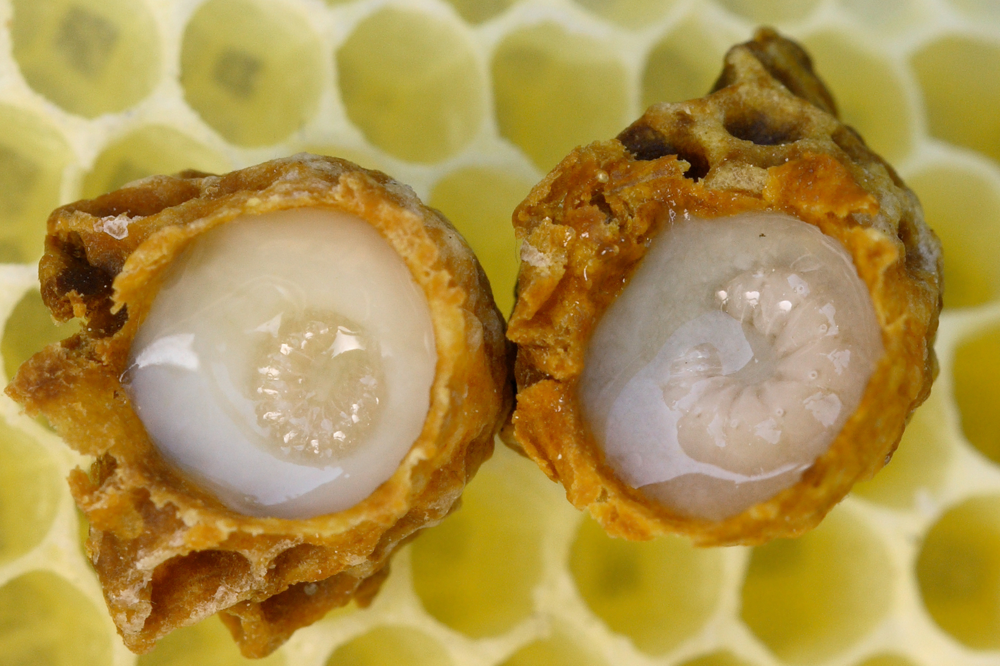

*Photo 58.1 — Royal jelly in queen cells. The opened cells show queen larvae surrounded by royal jelly, illustrating the biological system used in commercial royal-jelly production. Photo by Waugsberg, CC BY-SA 3.0.*

## 58.17 Production Cycles

Commercial royal-jelly production repeats a short queen-cell provisioning cycle.

A cycle broadly includes:

1. prepare the cell-building colony;
2. provide cups with very young larvae;
3. allow nurse bees to provision accepted cells;
4. harvest before queen larvae become too advanced;
5. reset the system for the next cycle.

Exact timing should follow validated local production protocols and larval development rather than arbitrary clock time alone.

## 58.18 Queen Cups

Queen cups can be made from:

- beeswax;
- suitable reusable plastic;
- other food-/apiary-compatible materials designed for queen rearing.

They must be:

- clean;
- free of chemical odour;
- correctly sized;
- securely mounted;
- traceable within the production system where needed.

## 58.19 Reusable Cups

Reusable plastic cups should be cleaned between cycles according to validated hygiene practice.

Discard cups that are:

- cracked;
- scratched excessively;
- chemically tainted;
- difficult to clean.

## 58.20 Grafting

Grafting transfers a very young worker larva into a queen cup.

Success depends on:

- selecting the correct larval age;
- gentle handling;
- avoiding desiccation;
- controlling exposure time;
- protecting larvae from direct sun and wind;
- maintaining hygienic tools.

## 58.21 Larval Age

Very young larvae are generally preferred because they are at an early developmental stage suitable for queen-cell acceptance and heavy provisioning.

Older larvae reduce the biological quality of queen rearing and can change royal-jelly yield and cell development.

## 58.22 Do Not Let Larvae Dry

Larvae are tiny and vulnerable to desiccation.

During grafting:

- work in shade;
- minimise time outside the colony;
- avoid hot dry wind;
- prepare equipment before opening brood frames.

## 58.23 Grafting Tools

Grafting tools should be:

- clean;
- smooth;
- suitable for delicate larvae;
- free from rust, grease, and cleaning residues.

A tool that falls onto a dirty floor should be cleaned before reuse.

## 58.24 Priming Cups

Some production systems use a small quantity of suitable royal jelly or diluted material in cups before grafting; others graft dry.

Practices vary.

Any priming material must be hygienic, traceable, and compatible with the production protocol.

## 58.25 Acceptance Rate

Acceptance is the proportion of grafted cups that workers begin treating as queen cells.

Low acceptance can result from:

- larvae too old or damaged;
- poor colony preparation;
- insufficient nurse bees;
- queen influence in the wrong area;
- poor nutrition;
- temperature stress;
- excessive disturbance.

## 58.26 Yield Per Cell

Jelly quantity varies among accepted cells.

Factors include:

- nurse density;
- larval age;
- bee stock;
- pollen flow;
- carbohydrate supply;
- cycle timing;
- cell position.

Evaluate both total yield and consistency.

## 58.27 Harvest Timing

Royal jelly should be harvested at a stage when:

- nurse bees have deposited abundant food;
- the larva is still small enough that much of the food remains;
- product quality is maintained.

If harvest is too late, the larva consumes more jelly and developmental changes progress.

## 58.28 Why Exact Timing Is Process-Specific

Published systems often cite particular hour ranges after grafting.

Actual optimal harvest depends on:

- larval age at grafting;
- colony temperature;
- bee stock;
- production protocol;
- acceptance timing.

Use developmental stage and validated operation procedures rather than assuming one universal number.

## 58.29 Removing the Larva

Before collecting royal jelly, the queen larva is removed from the cell.

Use clean dedicated tools and avoid:

- crushing the larva into the product;
- damaging cup material;
- introducing brood debris.

Larvae should be managed according to the operation's ethical, biological, and waste procedures.

## 58.30 Collection Tools

Small-scale collection may use:

- clean spatulas;
- suction devices;
- purpose-built collection pumps.

All food-contact components should be:

- cleanable;
- compatible with acidic royal jelly;
- free from lubricants and residues;
- protected from environmental dust.

## 58.31 Manual Collection

Manual spatula collection provides close visual control but is labour-intensive.

Risks include:

- prolonged warm exposure;
- inconsistent recovery;
- repeated hand/tool contact;
- foreign-body contamination.

Organise the work before cells leave the colony.

## 58.32 Suction Collection

Purpose-built suction systems increase throughput.

They must avoid:

- lubricant contamination;
- dirty tubing;
- inaccessible dead spaces;
- excessive air exposure;
- mixing unidentified batches.

Use food-compatible tubing and cleaning procedures.

## 58.33 Royal Jelly Is Acidic

Its natural acidity affects material compatibility.

Avoid reactive metals or unknown containers.

Food-grade stainless steel, suitable glass, and approved food-grade polymers are commonly used depending on the process.

## 58.34 Immediate Cooling

Royal jelly begins changing after harvest.

Minimise time at warm ambient temperature.

A professional workflow should move the product rapidly from:

**cell → clean container → chilled environment → controlled storage**

## 58.35 Cold Chain

The cold chain includes:

- apiary harvest;
- temporary storage;
- transport;
- processing;
- bulk storage;
- distribution.

One long uncontrolled warm period can outweigh careful cooling elsewhere.

## 58.36 Refrigerated Storage

Refrigeration slows deterioration but does not stop it completely.

Temperature limits and shelf-life claims should be supported by:

- applicable standard;
- product specification;
- stability data;
- packaging system.

## 58.37 Frozen Storage

Freezing greatly slows many chemical and enzymatic changes and is widely used for longer preservation.

Controls include:

- rapid freezing;
- stable temperature;
- closed moisture-resistant packaging;
- avoidance of repeated thaw/refreeze cycles.

## 58.38 Thawing

Thaw only what is needed where possible.

Repeated thawing can create:

- condensation;
- temperature abuse;
- microbial opportunities;
- cumulative quality deterioration.

## 58.39 Light Exposure

Royal jelly should be protected from unnecessary light.

Recent research indicates that light exposure can alter volatile profiles and freshness characteristics even when some conventional chemical markers remain relatively stable.

Use opaque or light-protective packaging when justified by the product system.

## 58.40 Freeze-Drying

Freeze-drying can create a stable lightweight powder by removing water under vacuum from frozen royal jelly.

Advantages include:

- low thermal exposure;
- reduced transport weight;
- improved dry-product stability.

Challenges include:

- expensive equipment;
- moisture-sensitive powder;
- oxidation;
- need for accurate reconstitution or dosage claims.

## 58.41 Spray Drying and Other Drying Methods

Other drying systems can be used industrially, often with carriers.

They can introduce:

- thermal stress;
- carrier ingredients;
- altered flavour;
- changed product identity.

Any added carrier must be declared and legally appropriate.

## 58.42 ISO 12824:2016

ISO 12824:2016 remains current as of 2026.

It specifies:

- production and sanitary requirements;
- organoleptic tests;
- chemical quality tests;
- transport;
- storage;
- packaging;
- marking.

It applies to royal-jelly production and trade links and does not cover mixed foods containing royal jelly in the same way as pure royal jelly.

## 58.43 ISO 24364:2023

ISO 24364:2023 addresses royal-jelly production itself, including:

- production conditions;
- process management;
- storage;
- transportation.

Together with ISO 12824, it provides a stronger production-and-quality framework than relying on traditional recipes alone.

## 58.44 Sensory Characteristics

Fresh royal jelly is typically:

- creamy or gelatinous;
- whitish to pale yellow;
- acidic/tart;
- pungent or characteristic in aroma.

Strong fermentation, putrid odour, chemical taint, or unusual separation requires investigation.

## 58.45 Moisture

Royal jelly contains a high proportion of water compared with honey.

This is one reason it is perishable.

Moisture is also important for detecting dilution or concentration changes.

## 58.46 Protein

Major royal-jelly proteins (MRJPs) make up a substantial fraction of royal-jelly protein.

Proteins can deteriorate during storage through:

- denaturation;
- hydrolysis;
- oxidation;
- deamidation;
- aggregation.

Current research increasingly evaluates these changes as freshness markers.

## 58.47 Major Royal Jelly Proteins

MRJP1 and other MRJPs are important both biologically and analytically.

Recent storage research has reported changes in MRJP-derived peptide patterns during deterioration.

These emerging markers may complement conventional quality testing.

## 58.48 10-HDA

10-hydroxy-2-decenoic acid is a characteristic royal-jelly fatty acid.

It is useful for:

- identity;
- composition control;
- batch comparison;
- some adulteration investigations.

It should not be treated as the sole freshness indicator.

## 58.49 Why 10-HDA Alone Is Not Enough

10-HDA is relatively stable under many storage conditions.

A product can undergo:

- protein deterioration;
- volatile loss;
- Maillard reactions;
- enzyme changes

while 10-HDA changes only modestly.

Quality control should use multiple indicators.

## 58.50 Sugars

Royal jelly contains sugars such as:

- glucose;
- fructose;
- smaller quantities of other carbohydrates.

Unusual sugar profiles can indicate:

- feeding effects;
- adulteration;
- formulation;
- analytical variation.

## 58.51 Lactose as an Adulteration Clue

Recent compositional research has highlighted lactose as a possible indicator of certain forms of adulteration because lactose is not expected as a normal major royal-jelly sugar.

One marker alone should still be interpreted within a complete laboratory investigation.

## 58.52 pH and Free Acidity

Royal jelly is naturally acidic.

pH and acidity can support:

- identity;
- quality assessment;
- fermentation investigation;
- batch comparison.

They do not establish freshness alone.

## 58.53 Mineral Profile

Minerals can support composition and authenticity assessment.

Recent research has explored mineral patterns as complementary indicators where conventional markers alone are insufficient.

Environmental contamination must also be considered.

## 58.54 Volatile Compounds

Volatile compounds influence royal jelly's characteristic aroma.

Light, oxygen, temperature, and storage duration can change these profiles.

Emerging volatile markers can provide information about early deterioration.

## 58.55 Freshness Is Multidimensional

No single test should define freshness.

Useful evidence may include:

- sensory quality;
- storage history;
- 10-HDA;
- MRJPs or peptide markers;
- enzyme activity;
- colour;
- volatiles;
- Maillard products;
- microbiology.

## 58.56 Microbiology

Royal jelly has acidic and antimicrobial characteristics but is not automatically sterile.

Contamination can enter through:

- tools;
- cups;
- hands;
- collection tubing;
- containers;
- air/dust;
- water.

Hygiene and cold storage remain essential.

## 58.57 Water Used in Production

Any water contacting food-contact surfaces should meet applicable food-hygiene requirements.

Residual rinse water must not dilute royal jelly.

Equipment should be clean and dry before use unless a validated wet process requires otherwise.

## 58.58 Pesticide Residues

Royal jelly can contain environmental or in-hive residues, though secretion and colony processing differ from direct pollen or wax exposure.

Risk-based testing may be appropriate for:

- intensive agricultural regions;
- export markets;
- premium specifications.

## 58.59 Veterinary Medicine Residues

Hive-treatment history should be recorded.

Do not assume that a treatment safe for one hive product automatically creates no residue concern in royal jelly.

Follow current product labels and market residue rules.

## 58.60 Heavy Metals and Environmental Contamination

Royal jelly can be tested for elements such as:

- lead;
- cadmium;
- arsenic;
- mercury

where regulation or buyer specification requires it.

Apiary siting reduces but does not eliminate environmental risk.

## 58.61 Adulteration

Royal jelly can be adulterated by addition of:

- water;
- honey or sugar syrups;
- milk-derived components;
- starches or fillers;
- synthetic or isolated compounds intended to manipulate a marker.

Authenticity requires more than one measurement.

## 58.62 Why One Marker Can Be Manipulated

If buyers judge quality only by one compound such as 10-HDA, an adulterator may try to manipulate that marker while the bulk composition remains abnormal.

A stronger system combines:

- full composition;
- protein profile;
- sugar profile;
- mineral profile;
- marker compounds;
- traceability.

## 58.63 Laboratory Methods

Methods can include:

- HPLC/LC methods for 10-HDA and sugars;
- protein analysis;
- LC-MS/MS peptidomics;
- spectroscopy;
- mineral analysis;
- microbiological tests;
- residue analysis;
- volatile profiling.

## 58.64 Certificate of Analysis

A royal-jelly CoA can include:

- lot identity;
- moisture;
- protein;
- sugars;
- 10-HDA;
- pH/acidity;
- microbiology;
- contaminants/residues;
- method references.

The certificate must correspond to the actual lot.

## 58.65 Sampling

Royal jelly can separate or vary within a large batch.

Representative sampling may require:

- controlled mixing;
- multiple sample increments;
- clean chilled utensils;
- rapid return to cold storage.

Sampling itself should not create a warm-exposure event.

## 58.66 Packaging

Packaging should be:

- food-compatible;
- acid-resistant;
- well sealed;
- moisture protective;
- light protective where required;
- suitable for refrigeration or freezing.

## 58.67 Small Retail Packs

Small packs reduce repeated opening of a larger container.

Advantages include:

- less oxygen exposure;
- fewer contamination events;
- easier portion control.

Disadvantages include higher packaging cost and more filling operations.

## 58.68 Headspace

Large headspace increases oxygen available for oxidation.

Fill levels should be controlled without creating leakage or freezing-expansion problems.

## 58.69 Traceability

Record:

- apiary;
- production colony/group;
- graft date;
- harvest date/time;
- cycle/batch;
- raw mass;
- first cooling time;
- storage temperature;
- processing/packing lot;
- laboratory results.

## 58.70 Why First Cooling Time Matters

A lot harvested at 10:00 but not chilled until 17:00 has a different quality history from a lot chilled at 10:20, even if both later spend months frozen.

Time to cooling should be a controlled production variable.

## 58.71 Cold-Chain Monitoring

Use temperature monitoring appropriate to the business scale.

Possible tools include:

- calibrated thermometers;
- min/max devices;
- data loggers;
- shipment temperature indicators.

## 58.72 Temperature Excursions

If cold storage fails, record:

- duration;
- maximum temperature;
- package condition;
- whether product thawed;
- lot identity.

Evaluate the lot rather than automatically assuming it is unchanged.

## 58.73 Shelf Life

Shelf life depends on:

- product form;
- temperature;
- packaging;
- initial quality;
- microbial control;
- light exposure;
- target specification.

Do not copy another producer's date without stability evidence.

## 58.74 Retained Samples

Retain representative samples where appropriate.

They can support:

- freshness comparison;
- complaint investigation;
- adulteration disputes;
- stability studies;
- laboratory retesting.

## 58.75 Allergy Risk

Royal jelly can cause allergic reactions, including serious reactions in susceptible people.

Risk may be higher in some individuals with:

- asthma;
- atopy;
- bee-product allergy;
- previous unexplained supplement reactions.

## 58.76 Anaphylaxis

Potential signs include:

- breathing difficulty;
- throat or tongue swelling;
- widespread hives;
- dizziness;
- collapse.

Anaphylaxis is a medical emergency.

Do not market royal jelly as universally safe because it is natural.

## 58.77 Food and Supplement Regulation

Royal jelly may be marketed as:

- food;
- food supplement;
- ingredient in another food;
- freeze-dried ingredient.

Legal category affects:

- claims;
- labelling;
- dosage presentation;
- business registration;
- contaminant rules.

## 58.78 Cosmetics

Royal jelly appears in some cosmetic formulations.

Cosmetic use requires:

- ingredient safety;
- microbiological stability;
- compatible preservatives;
- cosmetic claims rather than unapproved medical claims;
- allergen risk assessment.

## 58.79 Medicinal Claims

Claims that a royal-jelly product treats or prevents disease can bring it within medicinal-product law.

Scientific studies do not automatically create marketing authorisation.

## 58.80 Health Claims

Nutritional or health claims must be authorised in the target market.

Do not claim, without lawful support, that royal jelly:

- prevents cancer;
- treats infertility;
- cures infection;
- reverses ageing;
- replaces prescribed medicine.

## 58.81 Colony Welfare

Repeated royal-jelly cycles demand significant nurse-bee labour and nutrition.

Monitor:

- colony weight;
- brood area;
- adult population;
- queen condition;
- pollen stores;
- Varroa;
- temperament.

A production colony should not be driven into chronic nutritional stress.

## 58.82 Rotation and Recovery

Large operations may rotate or rest cell-building colonies so that workforce and brood balance recover.

Exact schedules vary.

The principle is to manage the colony as livestock, not as an unlimited secretion machine.

## 58.83 Product Yield Metrics

Track:

- grafts placed;
- acceptance percentage;
- accepted cells harvested;
- total royal-jelly mass;
- average mass per accepted cell;
- labour time;
- rejected product;
- colony health changes.

## 58.84 Economics

Royal jelly is labour-intensive.

Costs include:

- grafting labour;
- specialised colonies;
- cups/frames;
- collection labour;
- refrigeration/freezing;
- testing;
- packaging;
- cold-chain distribution.

High selling price does not guarantee high net profit.

## 58.85 Decision Table

| Observation | Main concern | Response |
|---|---|---|
| Strong nurse population and abundant pollen | Good production capacity | Proceed with controlled cell load |
| Low cell acceptance | Larval age/handling or colony-preparation problem | Review grafting and nurse conditions |
| Small jelly volume in many cells | Nurse capacity/nutrition/cell load problem | Reduce load or strengthen nutrition/colony |
| Product left warm after harvest | Freshness loss | Chill immediately; document excursion and assess lot |
| Normal 10-HDA but poor storage history | Freshness uncertainty | Use broader quality markers; do not rely on 10-HDA alone |
| Unusual sugar/lactose profile | Possible adulteration | Hold lot and investigate with laboratory/traceability |
| Consumer reports breathing difficulty | Possible anaphylaxis | Emergency medical response; do not offer product advice as treatment |
| Product marketed with disease-treatment claim | Regulatory risk | Remove/review claim under applicable law |

## 58.86 Practical Production Procedure

### Colony preparation

- select strong healthy nurse-rich colony;
- confirm adequate pollen/honey/feed;
- manage Varroa;
- prepare queen-cell production arrangement;
- clean cups, grafting tools, and collection equipment.

### Grafting and provisioning

1. select appropriately young larvae;
2. transfer gently and rapidly;
3. return graft frame promptly to cell builder;
4. verify acceptance;
5. monitor colony nutrition and condition;
6. allow cells to receive heavy royal-jelly provisioning.

### Harvest

7. remove cells at the validated developmental stage;
8. remove larvae cleanly;
9. collect royal jelly with food-compatible tools;
10. place immediately in labelled clean containers;
11. chill rapidly;
12. record harvest and first-cooling time.

### Storage/packing

13. maintain validated refrigeration/freezing;
14. sample/test as required;
15. fill compatible light-protective packaging;
16. maintain cold chain through distribution;
17. retain batch and temperature records.

## 58.87 Practical Hygiene Checklist

- [ ] Food-contact cups/tools clean.
- [ ] Grafting tools free from rust/grease.
- [ ] Collection tubing clean and drainable.
- [ ] Hands/gloves hygienic.
- [ ] Product protected from dust and sun.
- [ ] No brood debris mixed into product.
- [ ] Containers food-grade and acid-compatible.
- [ ] Cooling available before harvesting begins.
- [ ] Water/cleaning chemicals excluded from product.
- [ ] Lot labels applied immediately.

## 58.88 Scientific Notes

### Caste development is nutritional and epigenetic

Queen and worker females share the same basic genome. Differences in larval diet and developmental regulation contribute to very different adult phenotypes.

### Royal-jelly proteins are dynamic quality markers

MRJPs can degrade, aggregate, oxidise, or hydrolyse during storage. Modern peptidomic work is identifying changes that may reveal freshness more sensitively than 10-HDA alone.

### 10-HDA is characteristic but stable

Its relative chemical stability makes it useful for identity and composition, but weak as a sole early-warning freshness marker.

### Light can matter

Volatile-profile studies indicate that light exposure can contribute to flavour/aroma deterioration even before conventional markers show dramatic change.

### Cold slows, but does not reverse, history

Freezing cannot undo degradation that occurred during hours or days of poor handling before the product was frozen.

## 58.89 Royal-Jelly Checklist

- [ ] Production colony strong, healthy, nurse-rich.
- [ ] Adequate pollen and carbohydrate resources.
- [ ] Varroa managed.
- [ ] Correct queen-cell production configuration.
- [ ] Very young larvae selected.
- [ ] Larvae protected from desiccation.
- [ ] Cups and tools hygienic.
- [ ] Cell load matches nurse capacity.
- [ ] Harvest stage validated.
- [ ] Larvae removed cleanly.
- [ ] Product collected with food-compatible equipment.
- [ ] First cooling occurs promptly and is recorded.
- [ ] Cold chain maintained.
- [ ] Product protected from light.
- [ ] 10-HDA not used as the sole freshness marker.
- [ ] Quality testing matches market/specification.
- [ ] Adulteration/contaminant risk assessed.
- [ ] Allergy risk communicated appropriately.
- [ ] Health/medical claims legally reviewed.
- [ ] Traceability and retained sample complete.

## Key Takeaways

- Royal jelly is a glandular brood food produced by nurse bees, not a form of honey.
- Commercial production uses queen-rearing biology and demands strong nurse-rich colonies.
- Cell load must match the colony's biological capacity.
- Larval age, nutrition, temperature, and timing strongly influence yield.
- Royal jelly is highly perishable and should be cooled rapidly after collection.
- ISO 12824:2016 remains the current international specification, while ISO 24364:2023 addresses production.
- 10-HDA is valuable for identity and composition but is not a complete freshness marker.
- MRJP/peptide, volatile, enzyme, sensory, and other markers can reveal deterioration missed by 10-HDA alone.
- Royal jelly can cause serious allergic reactions, including anaphylaxis.
- Research on biological activity does not authorise unsupported disease-treatment claims.

## Chapter Summary

Royal-jelly production transforms queen-rearing biology into a highly controlled food-production system. Young larvae are transferred into queen cups, strong nurse-rich colonies provision the cells heavily, and the beekeeper harvests the excess jelly before the larvae consume it. Success depends on colony health, pollen nutrition, nurse density, correct larval age, and precise workflow.

The product is much less stable than honey. Its high water content and complex proteins make it vulnerable to temperature, light, oxidation, enzymatic change, and microbial contamination. The cold chain therefore begins at the apiary, not at the warehouse.

Modern quality control also requires a more sophisticated view of freshness. 10-HDA remains a valuable characteristic compound, but recent evidence shows that royal-jelly proteins and volatile profiles can deteriorate while 10-HDA remains relatively stable. ISO 12824:2016 and ISO 24364:2023 provide current specification and production frameworks, while advanced laboratory methods add information about proteins, sugars, residues, contaminants, and adulteration.

Finally, royal jelly is biologically active and allergenic. Scientific studies should be described accurately without being converted into unauthorised health or medicinal claims. Professional production therefore combines colony welfare, hygiene, rapid cooling, laboratory evidence, traceability, and regulatory discipline.

## Review Questions

1. What is royal jelly?
2. Which worker glands contribute to royal-jelly production?
3. Which bees primarily produce royal jelly?
4. What role does pollen nutrition play in nurse-gland development?
5. Why can a honey-rich colony still be nutritionally unsuitable for royal-jelly production?
6. How does queen-larva feeding differ from worker-larva feeding?
7. Is royal jelly simply a “queen hormone”?
8. Why is excess royal jelly available for commercial harvest?
9. What biological system does commercial production imitate?
10. What is the purpose of queen cups?
11. What is a starter colony?
12. What is a finisher colony?
13. Why is there no one universal production-hive design?
14. What colony characteristics are required for high yield?
15. Why is nurse-bee density important?
16. Why can too many grafted cells reduce yield per cell?
17. What does pollen provide to production colonies?
18. Can sugar syrup replace pollen?
19. Why is carbohydrate supply still necessary?
20. Why do nurse bees need safe water?
21. How can Varroa reduce royal-jelly productivity?
22. Why should diseased colonies not be used?
23. How can genetics influence production?
24. What are the broad steps of a production cycle?
25. What qualities should queen cups have?
26. Why should damaged reusable cups be discarded?
27. What is grafting?
28. Why is larval age important?
29. Why must grafted larvae not dry out?
30. Which environmental factors can desiccate larvae?
31. What should a grafting tool be like?
32. What is cup priming?
33. Why must priming material be traceable and hygienic?
34. What is acceptance rate?
35. Name four causes of low acceptance.
36. Which factors influence royal-jelly yield per cell?
37. Why does harvest timing matter?
38. Why is one fixed hour count not universal?
39. Why must larvae be removed before collection?
40. What contamination can occur if larvae are crushed into the product?
41. Which tools can collect royal jelly?
42. What are the main limitations of manual collection?
43. What controls apply to suction systems?
44. Why does royal-jelly acidity matter for equipment materials?
45. Why should cooling begin immediately?
46. What is the royal-jelly cold chain?
47. Does refrigeration stop all deterioration?
48. What are the main advantages of freezing?
49. Why should repeated thaw/refreeze cycles be avoided?
50. Why is light exposure relevant?
51. What is freeze-drying?
52. What are its benefits and costs?
53. What can spray drying change?
54. What does ISO 12824:2016 cover?
55. Is ISO 12824:2016 still current in 2026?
56. What does ISO 24364:2023 cover?
57. What are typical sensory characteristics of fresh royal jelly?
58. Why is royal jelly more perishable than honey?
59. What are MRJPs?
60. How can proteins change during storage?
61. What is 10-HDA?
62. Why is 10-HDA useful?
63. Why is it not a sufficient freshness marker alone?
64. What other freshness evidence can be used?
65. Which sugars commonly occur in royal jelly?
66. Why can lactose be an adulteration clue?
67. What can pH and acidity contribute to quality control?
68. How can mineral profiles support authenticity work?
69. Why are volatile compounds important?
70. Why is freshness multidimensional?
71. Is royal jelly sterile?
72. Which handling routes can introduce microbes?
73. Why must cleaning water be controlled?
74. Why can pesticide testing be relevant?
75. Why should hive-treatment records be retained?
76. Which heavy metals may be tested?
77. How can royal jelly be adulterated?
78. Why is one-marker quality control vulnerable to fraud?
79. Name four laboratory methods relevant to royal jelly.
80. What can a certificate of analysis include?
81. Why must sampling be performed quickly and hygienically?
82. What qualities should packaging have?
83. What is one advantage of small retail packs?
84. Why is headspace relevant?
85. Which records support traceability?
86. Why should first-cooling time be recorded?
87. How can cold-chain temperatures be monitored?
88. What should happen after a temperature excursion?
89. Why is shelf life product-specific?
90. What are retained samples useful for?
91. Who can be at increased risk of royal-jelly allergy?
92. What are signs of anaphylaxis?
93. How should anaphylaxis be treated?
94. How can legal category vary between food, supplement, and cosmetic uses?
95. Why can a medicinal claim change regulatory requirements?
96. Why are unsupported health claims inappropriate?
97. How can repeated production cycles affect colony welfare?
98. Which production metrics should a beekeeper record?
99. Why can high selling price still produce poor profitability?
100. What combination of colony biology, hygiene, cold chain, analytical control, and truthful claims defines professional royal-jelly production?

## References

- ISO 12824:2016. *Royal jelly — Specifications*. International Organization for Standardization. Confirmed current after 2021 review; status current in 2026.
- ISO 24364:2023. *Royal jelly production*. International Organization for Standardization, 2023.
- Zhang, Y. et al. “Monitoring and Maintaining the Freshness of Royal Jelly: A Review of Analytical Approaches and Preservation Technologies.” *Foods* 14(24), 2025, 4300. DOI: 10.3390/foods14244300.
- “Exploration of quality deterioration mechanisms of royal jelly proteins during storage by LC-MS/MS-based peptidomics.” *Journal of Food Composition and Analysis* 140, 2025, 107202.
- “Variation in chemical composition of fresh and commercial Royal Jelly associated with international standards.” *Journal of Food Composition and Analysis* 138, 2025, 107017.
- Foundational and current literature on 10-HDA, major royal-jelly proteins, royal-jelly chemistry, caste development, and storage stability.
- “Underexplored food safety hazards of beekeeping products: Key knowledge gaps and suggestions for future research.” *Comprehensive Reviews in Food Science and Food Safety* 23(5), 2024, e13404.
- Current medical literature on royal-jelly allergy and anaphylaxis.
- Current national food, food-supplement, cosmetic, medicinal-product, contaminant, pesticide-residue, allergen, food-hygiene, labelling, and cold-chain requirements must be verified for the target market.

# Chapter 59 — Bee Venom

## Introduction

Honey bee venom, often called apitoxin, is a complex defensive secretion delivered through the sting apparatus of worker bees and queens. It contains peptides, enzymes, amines, and other small molecules. Major components include melittin, phospholipase A2, apamin, and several additional peptides and proteins whose proportions can vary with bee genetics, season, geography, colony condition, collection method, and storage.

Bee venom is unlike most other hive products because its defining biological function is to injure a perceived threat. That makes safety inseparable from production. Collection can increase defensive behaviour, expose workers and bystanders to stings, and generate a dry concentrated allergenic material that can contact skin, eyes, or airways. Severe Hymenoptera-venom allergy can cause life-threatening anaphylaxis.

Professional venom collection commonly uses purpose-built electrical collection equipment that stimulates workers to sting a collection membrane or glass surface. In many systems the sting does not remain embedded, allowing the worker to survive. The venom dries on the collection surface and is later recovered under controlled conditions. This handbook explains the principle, operational safeguards, quality control, and product handling; it does not provide instructions for constructing improvised high-voltage equipment.

Bee venom is also a medically important allergen. This must be distinguished from commercial apitoxin as a raw hive product. Venom immunotherapy for people with clinically significant Hymenoptera venom allergy uses standardised medicinal preparations under specialist medical supervision. It is not equivalent to deliberate bee stinging, raw venom injection, home “bee venom therapy”, or unregulated pharmacopuncture.

At the time of this 2026 edition, the quality references used here rely on peer-reviewed analytical standardisation work, good-manufacturing-practice principles, and national analytical methods rather than a single dedicated published ISO bee-venom product specification. Recent 2026 research is particularly important because it shows that melittin concentration alone can conceal substantial variation in phospholipase A2, moisture, and the wider biochemical profile. A serious quality system must therefore be multicomponent and traceable.

## Learning Objectives

After completing this chapter, the reader should be able to:

- explain the biological role of the honey bee venom apparatus;
- identify the principal biochemical classes in bee venom;
- understand the importance of melittin, phospholipase A2, apamin, and other components without reducing quality to one marker;
- distinguish raw bee venom from pharmaceutical allergen preparations and venom immunotherapy;
- describe the principle of professional electrical venom collection without constructing unsafe equipment;
- select a safe apiary and colony for collection;
- protect workers, bystanders, livestock, and neighbouring property from increased defensive activity;
- manage sting and anaphylaxis risks;
- collect, recover, dry, package, and store venom while controlling glass, dust, moisture, and biological contamination;
- understand occupational sensitisation and inhalation hazards;
- sample and characterise venom with chromatographic, enzymatic, protein, moisture, and contaminant methods;
- explain why melittin alone is not a complete quality specification;
- manage colony welfare and recovery between collection sessions;
- distinguish research on bee venom from authorised medicinal claims.

## 59.1 The Venom Apparatus

Worker honey bees possess a sting apparatus at the end of the abdomen.

It includes:

- the sting shaft and associated lancets;
- venom gland;
- venom reservoir;
- muscular and supporting structures.

When a worker stings, venom is delivered through the sting system into the target.

## 59.2 Worker and Queen Stings

Worker stings are strongly barbed and can remain embedded in elastic vertebrate skin, often causing the worker's death after the sting apparatus tears away.

Queen stings are less strongly barbed and are used mainly in queen-to-queen conflict rather than routine colony defence.

Commercial venom collection is based on workers.

## 59.3 Why Bees Produce Venom

Venom is a defensive adaptation.

It helps protect the colony against:

- vertebrate predators;
- competing insects;
- direct physical disturbance.

Alarm pheromones and social recruitment can amplify defence far beyond one individual sting.

## 59.4 Venom Is a Complex Mixture

Honey bee venom contains:

- peptides;
- enzymes;
- proteins;
- biogenic amines;
- small molecules.

The relative abundance of components varies naturally.

This variation matters for both biological activity and allergenicity.

## 59.5 Melittin

Melittin is a major peptide component of honey bee venom.

It is strongly membrane-active and contributes substantially to:

- pain;
- cell-membrane disruption;
- local inflammatory effects.

Because it is abundant and analytically accessible, melittin is often used as a quality marker.

## 59.6 Melittin Is Not the Whole Product

A batch with an apparently normal melittin value can still differ substantially in:

- phospholipase A2;
- apamin;
- moisture;
- minor peptides;
- enzymatic activity;
- degradation state.

A 2026 multibatch study demonstrated this “melittin-equivalence” problem and argued for multivariate quality assessment rather than one-marker standardisation.

## 59.7 Phospholipase A2

Phospholipase A2 (PLA2) is an enzymatic venom component and a major honey bee venom allergen, commonly designated Api m 1 in allergy diagnostics.

Its biological significance means a quality system concerned with allergenic or pharmaceutical material should not ignore it simply because melittin is easier to measure.

## 59.8 Apamin

Apamin is a small neuroactive peptide found in honey bee venom.

It blocks certain calcium-activated potassium channels and is important in research.

Its concentration is lower than melittin but remains relevant to chemical characterisation.

## 59.9 Other Components

Other constituents can include:

- mast-cell-degranulating peptide;
- adolapin;
- hyaluronidase;
- acid phosphatase;
- phosphatases and minor enzymes;
- histamine and other amines;
- additional allergenic proteins.

Venom quality cannot be represented fully by one percentage number.

## 59.10 Venom Allergens

Several venom proteins are recognised allergens.

Important diagnostic allergens include:

- phospholipase A2;
- hyaluronidase;
- acid phosphatase;
- other identified Api m components.

Allergen composition is central to medical venom products and occupational risk.

## 59.11 Sting Reactions

A sting can cause:

- immediate pain;
- redness;
- swelling;
- itching;
- a large local reaction;
- systemic allergy;
- anaphylaxis.

Reaction severity cannot be predicted simply from the number of previous uneventful stings.

## 59.12 Anaphylaxis

Anaphylaxis can include:

- breathing difficulty;
- throat or tongue swelling;
- wheeze;
- widespread hives;
- vomiting;
- dizziness;
- low blood pressure;
- collapse.

It is a medical emergency.

Call emergency medical services and follow the affected person's prescribed emergency plan.

## 59.13 Venom Immunotherapy Is Medical Treatment

Venom immunotherapy is an evidence-based allergy treatment using standardised venom preparations in a controlled medical programme.

It is used to reduce the risk of future systemic sting reactions in appropriately diagnosed patients.

It is not the same as raw apitoxin collection or deliberate unregulated bee stinging.

## 59.14 Do Not Self-Treat Venom Allergy

A beekeeper with systemic sting reactions should seek specialist medical assessment.

Do not attempt to “desensitise” yourself by intentionally receiving more stings or handling raw venom.

Such exposure can cause a severe reaction.

## 59.15 Occupational Sensitisation

Repeated exposure can sensitise some workers over time.

Risk is relevant to:

- beekeepers;
- venom collectors;
- processing staff;
- laboratory workers.

A person who previously tolerated stings can later develop allergy.

## 59.16 Pre-Collection Risk Assessment

Before collecting venom, assess:

- worker sting-allergy history;
- public access;
- neighbours;
- livestock/pets;
- colony temperament;
- weather;
- electrical equipment condition;
- emergency communications;
- vehicle access.

## 59.17 Site Selection

Venom collection should not be performed where increased defensive activity can expose:

- public footpaths;
- schools;
- neighbouring gardens;
- livestock pens;
- busy roads;
- unprotected workers.

Select a controlled site with sufficient separation.

## 59.18 Weather and Defensive Behaviour

Colony response can become more defensive during:

- cool weather;
- stormy conditions;
- dearth;
- queenlessness;
- predator pressure;
- repeated disturbance.

Do not assume a collection protocol safe on one calm day will be equally safe under all conditions.

## 59.19 Colony Temperament

Avoid using unusually defensive colonies simply because they sting collection equipment aggressively.

Commercial production must balance yield with:

- worker safety;
- neighbourhood safety;
- colony welfare;
- manageable genetics.

## 59.20 Colony Health

Production colonies should be:

- strong;
- queenright;
- healthy;
- nutritionally adequate;
- monitored for Varroa;
- free from serious brood disease.

Do not intensively stimulate collapsing colonies.

## 59.21 Principle of Electrical Venom Collection

Professional collection devices use controlled electrical stimulation across a grid or collection surface.

Workers contacting the system are stimulated to sting a membrane or glass collection area.

Venom is deposited on the surface and dries.

The device should be purpose-built, guarded, and operated according to the manufacturer's instructions.

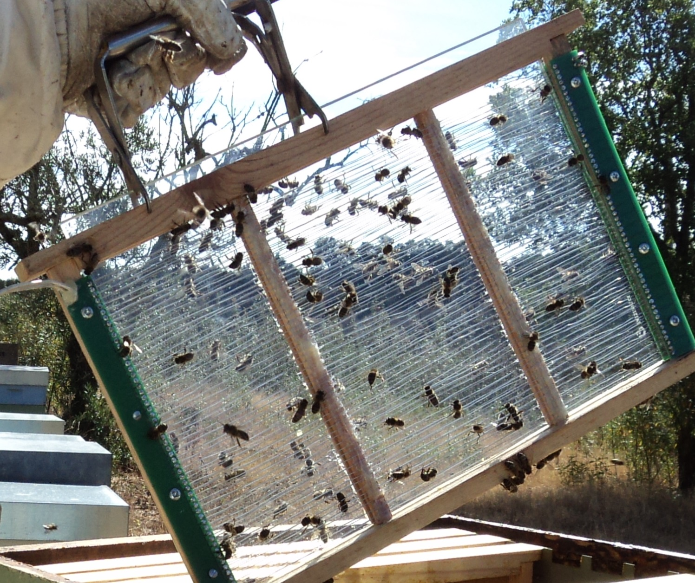

*Photo 59.1 — Purpose-built venom collection equipment in real field use. The photograph shows one intensive collector-frame design being removed from a hive. It demonstrates the physical scale and field context of professional collection equipment without endorsing one model or providing electrical-construction instructions. Use purpose-built, guarded equipment according to its validated operating instructions and local safety requirements. Source: Serrinha, Correia & Marques, Journal of Open Innovation 5 (2019), Figure 6, CC BY 4.0.*

## 59.22 Why This Book Does Not Provide a DIY Circuit

Improvised electrical collectors can create:

- shock hazards;
- fire hazards;
- battery short circuits;
- excessive bee stimulation;
- unpredictable output;
- poor electrical insulation.

Use compliant commercial equipment or professionally engineered systems rather than copying an unverified circuit.

## 59.23 Collection Surface

Common collection systems use glass or another compatible non-reactive surface beneath/within the stimulation grid.

Requirements include:

- chemical cleanliness;
- smooth surface;
- easy recovery;
- resistance to corrosion;
- control of breakage and fragments.

## 59.24 Glass Safety

Glass collection plates create a physical hazard.

Inspect for:

- chips;
- cracks;
- edge damage.

If breakage occurs, treat surrounding venom as potentially contaminated with glass and do not release it without a validated foreign-body-control process.

## 59.25 Membrane Systems

Some collectors use thin membranes so bees sting through the material and venom reaches the plate below.

The membrane can reduce direct contamination but must be:

- suitable for the system;
- clean;
- free from additives that contaminate venom;
- replaced when damaged.

## 59.26 Collection Does Not Remove Every Sting

Many electrical collectors are designed so the worker stings a surface without leaving the sting apparatus behind.

This allows survival of many participating workers.

However, collection still imposes behavioural and energetic stress and can injure some bees.

## 59.27 Bee Welfare

Monitor colonies for:

- excessive agitation;
- prolonged defensive behaviour;
- abnormal mortality;
- queen disturbance;
- reduced foraging;
- weakened colony condition.

Collection frequency should be adjusted to avoid chronic stress.

## 59.28 Recovery Periods

Repeated continuous stimulation can maintain a colony in a defensive state.

Professional operations should use validated collection intervals and rest periods appropriate to:

- colony strength;
- season;
- weather;
- equipment;
- observed recovery.

Do not maximise session frequency solely by short-term venom yield.

## 59.29 Bystander Exclusion

During collection:

- restrict access;
- post warning signs where appropriate;
- keep unprotected people away;
- control pets/livestock;
- avoid unnecessary vehicle movement near colonies.

## 59.30 Protective Clothing

Collectors should use normal appropriate bee PPE and process-specific protection.

Depending on the operation, this can include:

- veil;
- suit/jacket;
- gloves;
- closed footwear;
- eye protection during dry-venom recovery;
- respiratory/dust controls if risk assessment requires them.

## 59.31 Dry Venom Is a Concentrated Allergen

Once dried, venom can become fine flakes or powder.

This can contact:

- skin;
- eyes;
- mucous membranes;
- respiratory tract.

Avoid creating airborne dust.

## 59.32 Venom Recovery

After the collection surface is removed and bees are no longer present, dried venom can be recovered under controlled clean conditions using purpose-built scraping/recovery tools.

The goal is to minimise:

- dust;
- glass fragments;
- environmental debris;
- hand contact;
- cross-lot mixing.

## 59.33 Scraping Tools

Use tools that are:

- clean;
- non-rusting;
- dedicated to venom;
- easy to inspect;
- compatible with the collection surface.

Damaged blades can create metal or glass contamination.

## 59.34 Eye Protection

Dry venom particles can irritate or sensitise eyes.

Eye protection is advisable during scraping or any step likely to release particles.

Do not blow venom dust from surfaces with compressed air.

## 59.35 Respiratory Exposure

Avoid inhaling dried venom powder.

Controls can include:

- low-dust scraping methods;
- local containment;
- suitable ventilation that does not spread powder;
- task-appropriate respiratory protection after formal risk assessment.

## 59.36 Skin Contact

Raw venom on broken or sensitised skin can cause reactions.

Use appropriate gloves and avoid touching the face or eyes during processing.

Wash exposed skin according to workplace procedures.

## 59.37 No Food or Drink in Processing Area

Venom processing should be separated from:

- eating;
- drinking;
- smoking/vaping;
- food preparation.

This reduces accidental ingestion and surface contamination.

## 59.38 Batch Identity

A venom batch should record:

- apiary;
- colony/group;
- date;
- collection device;
- session duration per validated SOP;
- weather;
- raw dry mass;
- operator;
- storage container;
- processing/analysis lot.

## 59.39 Collection Yield

Yield depends on:

- colony population;
- genetics;
- season;
- equipment;
- stimulation protocol;
- collection duration;
- prior collection frequency;
- temperature and weather.

Compare yield together with colony condition.

## 59.40 Colour and Appearance

Dried bee venom is often described as a pale or off-white to light-yellow material, but colour varies with:

- collection surface;
- contamination;
- oxidation;
- storage;
- bee/source differences.

Colour alone is not a purity test.

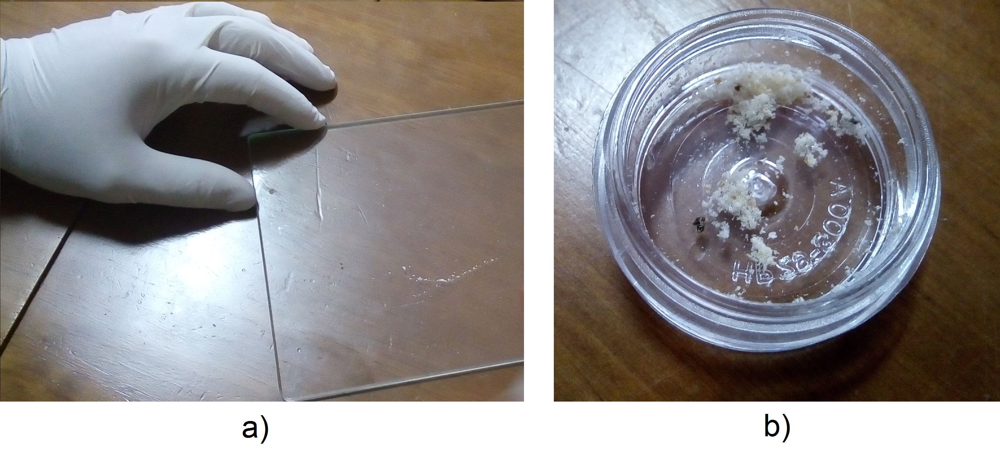

*Photo 59.2 — Actual dry bee-venom recovery and intermediate sample. Left: removal of dried material from a glass collection surface; right: a small quantity of the collected material in an intermediate container. The photograph documents appearance and recovery context, not chemical purity, analytical identity, allergen safety or suitability for medical use. Source: Serrinha, Correia & Marques, Journal of Open Innovation 5 (2019), Figure 5, CC BY 4.0.*

## 59.41 Moisture

Dry venom quality is influenced by residual moisture.

Excess moisture can contribute to:

- protein degradation;
- clumping;
- microbial growth in contaminated material;
- analytical instability.

Use a validated moisture method and specification where relevant.

## 59.42 Hygroscopic Handling

Dry biological powders can absorb moisture from humid air.

Keep containers open only as long as necessary during recovery and weighing.

## 59.43 Light and Oxidation

Protect venom from unnecessary light and oxygen exposure.

Sensitive peptides and enzymes can change during poor storage.

Use compatible tightly sealed containers.

## 59.44 Temperature

Low-temperature storage is commonly used to preserve biological activity and protein/peptide integrity.

Exact conditions should be based on:

- intended product;
- buyer specification;
- analytical stability data;
- pharmaceutical requirements where applicable.

## 59.45 Avoid Repeated Temperature Cycling

Repeated warming and cooling can introduce:

- condensation;
- moisture uptake;
- protein degradation;
- handling contamination.

Remove only the amount required for work when possible.

## 59.46 Packaging

Primary containers should be:

- chemically compatible;
- tightly sealed;
- low moisture-permeability;
- clean;
- clearly labelled;
- suitable for intended storage temperature.

## 59.47 Small Containers

Dividing a bulk lot into smaller validated containers can reduce repeated opening of the main lot.

It also increases filling and labelling work.

## 59.48 Melittin as a Quality Marker

Melittin is useful because it is abundant and can be measured by chromatographic methods.

It can support:

- identity;
- batch comparison;
- degradation studies;
- buyer specifications.

It should not be treated as a complete quality certificate.

## 59.49 The Melittin-Equivalence Problem

A 2026 study of multiple venom batches found that samples with similar melittin could differ substantially in:

- phospholipase A2;
- moisture;
- multicomponent chemical profile.

This means a single-marker specification can miss differences important to safety, allergenicity, and function.

## 59.50 Phospholipase A2 Measurement

PLA2 can be assessed through:

- chromatographic concentration;
- enzymatic activity;
- immunological methods in specialised contexts.

Chemical quantity and enzyme activity are related but not identical measurements.

## 59.51 Apamin Measurement

Apamin can be quantified chromatographically.

Because concentrations are lower than melittin, analytical sensitivity and reference standards matter.

## 59.52 HPLC

High-performance liquid chromatography is widely used for venom component analysis.

A validated method should define:

- standards;
- column/system;
- detection;
- calibration;
- precision;
- accuracy;
- recovery;
- detection/quantification limits.

## 59.53 LC-MS and Proteomics

Mass spectrometry can characterise a wider range of peptides and proteins.

Uses include:

- identity;
- contamination detection;
- proteomic fingerprinting;
- research on geographic/genetic variation.

## 59.54 Capillary Electrophoresis

Capillary-electrophoresis methods have also been developed for venom peptides and enzymes.

They provide an alternative or complementary separation technology to HPLC.

## 59.55 Multivariate Quality Assessment

A stronger specification can combine:

- melittin;
- PLA2;
- apamin;
- moisture;
- other peptides/proteins;
- enzymatic activity;
- contamination data;
- batch traceability.

Chemometrics can help compare complex profiles without reducing the product to one marker.

## 59.56 National Analytical Standards

Some countries publish specific methods for venom analysis. For example, China's GB/T 40486-2021 provides an HPLC method for determining melittin in dried bee-venom powder.

Such standards are useful analytical references but should not be misrepresented as global product specifications.

## 59.57 No Universal Composition Number

Published venom composition percentages vary because of:

- bee subspecies/population;
- season;
- analytical method;
- collection method;
- storage;
- sample preparation.

Use validated lot-specific analysis for commercial specifications.

## 59.58 Microbiological Quality

Dry venom is not automatically sterile.

Microbial contamination can enter through:

- dirty collection surfaces;
- dust;
- tools;
- containers;
- hands;
- moisture exposure.

Pharmaceutical or research products can require much stricter microbiological limits.

## 59.59 Foreign Bodies

Potential foreign material includes:

- glass;
- metal;
- bee parts;
- dust;
- fibres;
- membrane fragments.

Foreign-body control should be designed into collection and recovery.

## 59.60 Pesticide and Environmental Contamination

Venom itself is glandularly produced, but processing and colony exposure can still create contamination concerns.

Risk-based testing can include:

- pesticides;
- heavy metals;
- environmental pollutants;
- cleaning residues.

## 59.61 Cleaning the Collection Device

Clean according to manufacturer or validated SOP.

Requirements include:

- complete removal of old venom;
- no detergent residue;
- no corroded electrical contacts contaminating product;
- complete drying before use;
- inspection of glass/membranes.

## 59.62 Do Not Wash Product Off the Plate for Raw-Powder Production

Raw dried-venom production relies on controlled recovery from the collection surface.

Adding unvalidated water or solvent changes the product form, stability, and analytical basis.

## 59.63 Cross-Lot Carryover

Residual venom from one collection can enter the next batch.

When lot identity matters, cleaning and line clearance should be documented.

## 59.64 Supplier Approval

If buying venom, request:

- bee species/source;
- country/region;
- collection method;
- melittin and multicomponent analysis;
- moisture;
- microbiology where relevant;
- storage history;
- contaminant testing;
- lot identity.

## 59.65 Certificate of Analysis

A CoA can include:

- melittin;
- PLA2 content/activity;
- apamin;
- moisture;
- protein profile;
- microbiology;
- heavy metals;
- residues;
- appearance;
- lot identity;
- analytical methods.

## 59.66 Sampling

Dry venom powder may not be perfectly homogeneous if material from multiple plates or colonies is blended.

A sampling plan should define:

- lot size;
- number of increments;
- mixing procedure;
- sample container;
- temperature/moisture protection.

## 59.67 Retained Samples

Retained samples can support:

- identity confirmation;
- stability review;
- complaint investigation;
- analytical disputes;
- research comparison.

## 59.68 Adulteration

Possible fraud includes:

- dilution with foreign powders;
- addition of isolated melittin to manipulate one marker;
- substitution with non-honey-bee material;
- false country/source claims;
- blending undeclared low-grade batches.

Multicomponent fingerprints and traceability reduce this risk.

## 59.69 Why High Melittin Does Not Prove Authenticity

A product can be manipulated to contain a target amount of melittin while lacking the broader authentic venom profile.

Identity should include multiple natural constituents and provenance.

## 59.70 Bee Venom as Pharmaceutical Starting Material

Venom can be a starting material for regulated pharmaceutical, diagnostic, research, or immunotherapy products.

Such uses require much stricter controls than ordinary hive-product trade, including:

- GMP where applicable;
- standardised raw material;
- validated purification;
- sterility/endotoxin controls for injectable products;
- regulatory authorisation.

## 59.71 Raw Venom Is Not an Injectable Medicine

A dry venom powder harvested from hive collectors should never be assumed safe for injection.

Injectable medicines require specialised manufacture, dose control, sterility, formulation, and clinical oversight.

## 59.72 Bee Venom Therapy Claims

Research investigates venom components in areas including:

- inflammation;
- pain;
- neuroscience;
- cancer biology;
- antimicrobial effects.

Laboratory or animal findings do not authorise self-treatment or unregulated injection/stinging protocols.

## 59.73 Venom Acupuncture and Pharmacopuncture

These practices exist in some medical traditions and research settings.

Their regulation and evidence base differ by country.

They should not be performed by beekeepers using raw collected venom as a home medical product.

## 59.74 Venom Immunotherapy

Venom immunotherapy is a distinct, evidence-based allergy treatment administered by trained healthcare professionals using standardised allergen products.

EAACI guidance identifies it as the only treatment that prevents future systemic sting reactions in appropriately selected venom-allergic patients.

## 59.75 Adrenaline/Epinephrine Auto-Injectors

People prescribed an adrenaline auto-injector should follow their medical emergency plan and training.

A beekeeper should not prescribe, share, or improvise medication for another person.

Call emergency medical services for suspected anaphylaxis.

## 59.76 Emergency Plan at the Apiary

Before venom collection begins, establish:

- exact site/access information;
- mobile phone coverage;
- emergency contact procedure;
- first-aid supplies;
- worker medical disclosures managed appropriately;
- route for emergency vehicles.

## 59.77 Multiple Stings

Large numbers of stings can cause toxic systemic effects even in people without IgE-mediated allergy.

Seek urgent medical care for:

- numerous stings;
- stings in mouth/throat;
- systemic symptoms;
- vulnerable individuals.

## 59.78 Stingers in Skin

For ordinary bee stings, remove a retained sting promptly using a practical method that does not delay removal.

The priority is speed of removal rather than a prolonged debate about scraping versus pinching.

Then monitor for systemic symptoms.

## 59.79 Collection Near Other Apiary Work

Venom collection can make colonies more defensive temporarily.

Avoid scheduling it immediately before:

- public demonstrations;
- beginner training;
- queen-handling sessions;
- other tasks requiring unusually calm colonies.

## 59.80 Apiary Signage and Neighbours

Where collection changes local sting risk, use appropriate warning and communication under local land-use and safety requirements.

Good neighbour relations are part of risk management.

## 59.81 Electrical Inspection

Before each collection session, inspect commercial equipment for:

- damaged insulation;
- exposed conductors;
- cracked housings;
- wet electrical connections;
- damaged batteries/chargers;
- broken collection plates.

Do not operate damaged equipment.

## 59.82 Wet Conditions

Electric collection equipment should not be operated outside its rated environmental conditions.

Rain and wet surfaces can increase electrical risk and alter colony behaviour.

Follow manufacturer guidance.

## 59.83 Battery Safety

Use the battery type and charger specified for the equipment.

Incorrect charging or damaged batteries can cause:

- fire;
- overheating;
- leakage;
- electric faults.

## 59.84 Maintenance

Keep maintenance records for:

- collector unit;
- leads;
- plates;
- protective grids;
- batteries;
- cleaning.

Retire damaged components rather than improvising repairs in the field.

## 59.85 Colony Recovery Monitoring

After collection, observe:

- entrance behaviour;
- defensive response;
- mortality;
- foraging recovery;
- queen status if concern arises.

Collection should not be treated as finished merely because the plate was removed.

## 59.86 Production Metrics

Useful records include:

- venom mass per session;
- venom mass per colony/group;
- collection time;
- component profile;
- colony mortality/stress observations;
- labour time;
- rejected batches.

## 59.87 Economics

Bee venom is a low-volume, high-value product but requires substantial costs for:

- safe collection equipment;
- PPE;
- controlled processing;
- laboratory testing;
- cold/dry storage;
- legal compliance;
- specialised buyers.

High advertised retail prices do not represent what every beekeeper can realistically obtain for raw venom.

## 59.88 Market Verification

Before investing heavily, verify:

- legitimate buyer;
- required specification;
- minimum lot size;
- analytical requirements;
- country/import rules;
- product liability;
- contract price.

Do not produce a hazardous specialised material first and search for a buyer afterwards.

## 59.89 Decision Table

| Observation | Main concern | Response |
|---|---|---|
| Calm strong healthy colony, controlled site | Suitable candidate | Collect under validated SOP and monitor recovery |
| Public/livestock activity nearby | Bystander sting risk | Do not collect until exclusion/siting is controlled |
| Damaged electrical insulation | Shock/fire risk | Remove equipment from service |
| Collector causes prolonged extreme aggression | Colony/welfare/safety problem | Stop session and review protocol/equipment |
| Powder becomes airborne during scraping | Allergen exposure | Stop and improve containment/PPE/process |
| Similar melittin but very different PLA2/moisture | Quality inconsistency | Use multicomponent specification |
| Consumer asks to inject raw venom | Severe medical risk | Do not provide medical-use instructions; refer to qualified care |
| Worker shows systemic allergic symptoms | Possible anaphylaxis | Emergency medical response immediately |

## 59.90 Practical Professional Collection Framework

### Before collection

- select strong healthy manageable colonies;
- choose controlled site;
- exclude bystanders/livestock;
- confirm emergency plan;
- inspect commercial collector, wiring, battery, and plate;
- prepare clean labelled product containers and PPE.

### Collection

1. install collector according to manufacturer/SOP;
2. operate only within rated conditions;
3. observe colony behaviour continuously;
4. stop if aggression, weather, equipment, or bystander risk becomes unacceptable;
5. remove collector safely after the validated session;
6. allow colonies to recover.

### Venom recovery

7. move collection plate to controlled clean area;
8. wear suitable eye/skin/dust protection;
9. recover dried venom with low-dust dedicated tools;
10. prevent glass/metal contamination;
11. weigh and label batch;
12. seal promptly against moisture;
13. transfer to validated cold/dry storage;
14. clean and inspect equipment before next lot.

## 59.91 Quality-Control Framework

For each commercial batch, define:

- bee/source identity;
- collection method;
- appearance;
- moisture;
- melittin;
- PLA2 content/activity;
- apamin or wider peptide profile where required;
- microbiology/foreign matter;
- contaminants;
- storage conditions;
- analytical method;
- retained sample.

## 59.92 Scientific Notes

### Venom is multicomponent by design

Natural defensive function depends on interacting peptides and enzymes. Quality systems based only on abundance of the largest peptide can miss meaningful biological variation.

### Allergenicity and “potency” are not the same thing

PLA2 is both biologically active and a major allergen. A batch cannot be judged simply as stronger or weaker from melittin alone.

### Geography and season matter

Bee populations, forage environment, age structure, and collection season can influence venom profiles. Standardisation therefore requires batch analysis and provenance.

### Medical venom products are manufactured products

Allergen extracts, antivenom antigens, and investigational purified components require controlled purification and GMP-type systems beyond apiary collection.

### Sensitisation can develop over time

Allergic status is not fixed. Repeated occupational exposure can change risk, reinforcing the need for medical assessment after systemic reactions.

## 59.93 Bee-Venom Checklist

- [ ] Buyer/specification confirmed before production.
- [ ] Strong healthy manageable colonies selected.
- [ ] Public/livestock exclusion controlled.
- [ ] Worker allergy history/emergency plan addressed appropriately.
- [ ] Commercial/professionally engineered collector used.
- [ ] Electrical insulation and battery checked.
- [ ] Weather within equipment rating.
- [ ] PPE appropriate for stings and dry venom.
- [ ] Colony behaviour monitored during session.
- [ ] Recovery period provided.
- [ ] Collection plates intact and clean.
- [ ] Glass/metal foreign-body control active.
- [ ] Dry venom handled with low-dust method.
- [ ] Skin/eye/inhalation exposure minimised.
- [ ] Batch labelled immediately.
- [ ] Moisture exposure controlled.
- [ ] Storage condition validated.
- [ ] Quality specification uses more than melittin alone where intended use requires it.
- [ ] Raw venom never represented as an injectable medicine.
- [ ] Medical/therapeutic claims reviewed by competent regulatory framework.

## Key Takeaways

- Honey bee venom is a complex defensive secretion containing peptides, enzymes, proteins, and small molecules.
- Melittin is important but does not represent the whole venom quality profile.
- Phospholipase A2 is a major venom enzyme and a major allergen.
- Recent 2026 evidence shows batches with similar melittin can differ substantially in PLA2, moisture, and broader chemistry.
- Professional venom collection requires purpose-built electrical equipment and controlled apiary access; this book does not recommend DIY high-voltage construction.
- Dry venom is a concentrated occupational allergen and should be handled with skin, eye, and dust controls.
- Collection can increase colony defensiveness, so bee welfare, recovery, and bystander safety are central production variables.
- Venom immunotherapy is a regulated specialist medical treatment and is not equivalent to raw venom or deliberate bee stinging.
- Raw apiary venom is not an injectable medicine.
- A professional product requires multicomponent analysis, traceability, controlled storage, safe collection, and legitimate market specifications.

## Chapter Summary

Bee-venom production is a specialised field in which biological, occupational, electrical, and medical hazards overlap. The product is generated by the colony's defensive system, and collection deliberately stimulates that system. Safe production therefore begins with controlled siting, manageable colonies, exclusion of bystanders, appropriate PPE, an emergency plan, and professionally engineered collection equipment.

The recovered product is a concentrated allergenic biological material. Dry flakes or powder must be protected from moisture, foreign bodies, light, and uncontrolled contact with skin, eyes, and airways. Batch identity and storage history are essential.

Analytically, modern evidence argues against reducing quality to melittin alone. Melittin is useful, but phospholipase A2, apamin, moisture, enzymatic activity, minor components, contaminants, and multivariate chemical profiles can all matter. The 2026 “melittin-equivalence” research demonstrates why two nominally similar lots can be substantially different products.

Finally, commercial venom must remain separate from medical practice. Venom immunotherapy uses standardised medicinal allergens under specialist supervision and is an evidence-based treatment for appropriate venom-allergic patients. Raw collected apitoxin, home injections, or intentional stinging are not substitutes. Professional bee-venom production therefore depends on safety, multicomponent quality control, colony welfare, traceability, and strict boundaries around medical claims.

## Review Questions

1. What is bee venom?
2. What are the main anatomical parts of the worker sting apparatus?
3. Why do worker bees often die after stinging vertebrate skin?
4. How does a queen sting differ functionally?
5. What is the biological purpose of venom?
6. Name four major bee-venom components.
7. What is melittin?
8. Why is melittin commonly measured?
9. Why is melittin not a complete quality specification?
10. What is phospholipase A2?
11. Why is PLA2 important in allergy?
12. What is apamin?
13. Name three other venom components.
14. What can a normal local sting reaction look like?
15. What is anaphylaxis?
16. Name four anaphylaxis warning signs.
17. What should happen when anaphylaxis is suspected?
18. What is venom immunotherapy?
19. Who should administer venom immunotherapy?
20. Why is raw bee venom not equivalent to immunotherapy?
21. Why should a beekeeper not self-desensitise by intentional stings?
22. What is occupational sensitisation?
23. Can allergy develop after years of tolerated stings?
24. What belongs in a pre-collection risk assessment?
25. Which sites are unsuitable for venom collection?
26. How can weather influence defensive behaviour?
27. Why should exceptionally defensive colonies not be selected only for yield?
28. Which colony-health criteria matter?
29. What is the general principle of electrical venom collection?
30. Why does this handbook avoid DIY collector circuitry?
31. What qualities should the collection surface have?
32. What risk is created by cracked glass?
33. What is a collection membrane?
34. Why can many workers survive electrical collection?
35. Does survival mean collection is stress-free?
36. Which colony-welfare signs should be monitored?
37. Why are recovery periods important?
38. How should bystanders be excluded?
39. Which PPE can be relevant?
40. Why is dried venom an occupational hazard?
41. How can dry venom expose the respiratory tract?
42. What is the goal during venom recovery from the plate?
43. What qualities should scraping tools have?
44. Why is eye protection important?
45. Why should compressed air not be used to blow venom dust?
46. Why should skin contact be minimised?
47. Why should food and drink be excluded from processing areas?
48. Which fields belong in a venom batch record?
49. Which variables influence collection yield?
50. Is venom colour a purity test?
51. Why is residual moisture important?
52. How can dry venom absorb atmospheric moisture?
53. Why protect venom from light and oxygen?
54. Why can low-temperature storage be useful?
55. Why should repeated temperature cycling be avoided?
56. What qualities should primary packaging have?
57. What is one advantage of smaller containers?
58. What can melittin analysis establish?
59. What is the melittin-equivalence problem?
60. Why should PLA2 be measured in some specifications?
61. What is the difference between PLA2 content and enzymatic activity?
62. How can apamin be measured?
63. What does HPLC contribute?
64. What is required for a validated HPLC method?
65. What can LC-MS/proteomics contribute?
66. What can capillary electrophoresis contribute?
67. What is multivariate quality assessment?
68. Which variables can belong in a multicomponent specification?
69. What is GB/T 40486-2021 an example of?
70. Why should a national analytical method not be called a global product standard?
71. Why is there no one universal natural venom composition percentage?
72. Is dry venom sterile?
73. Which foreign bodies can contaminate venom?
74. How can environmental contamination enter a batch?
75. What should cleaning of a collector accomplish?
76. Why should detergent residue be avoided?
77. Why should raw powder not be casually washed off the plate with water?
78. What is cross-lot carryover?
79. What should be checked when buying venom from a supplier?
80. What can a venom CoA contain?
81. Why can a blended powder require multiple sample increments?
82. What are retained samples useful for?
83. How can bee venom be adulterated?
84. Why does high melittin not prove authenticity?
85. What additional requirements apply to pharmaceutical starting material?
86. Why is raw apiary venom not injectable medicine?
87. Why do laboratory cancer or anti-inflammatory studies not authorise self-treatment?
88. What is the difference between pharmacopuncture research and beekeeper practice?
89. What does EAACI identify as the preventive treatment for future systemic sting reactions in appropriate patients?
90. What should a person with a prescribed adrenaline auto-injector follow?
91. Why can many stings be medically dangerous even without allergy?
92. What is the priority when a bee sting remains in the skin?
93. Why should venom collection not precede a public apiary demonstration?
94. What should be inspected electrically before a session?
95. Why should equipment not be used in unapproved wet conditions?
96. Why must battery type and charger match the equipment?
97. What should be monitored after collection ends?
98. Which economic costs make bee-venom production specialised?
99. Why should a buyer and specification be confirmed before investing in production?
100. What combination of safety, colony welfare, multicomponent analysis, and medical-boundary discipline defines professional bee-venom production?

## References

- European Academy of Allergy and Clinical Immunology (EAACI). *Guidelines on allergen immunotherapy: Hymenoptera venom allergy*. *Allergy* 73(4), 2018, 744–764; current EAACI reference resource accessed September 2026.
- “Chemometric-based analytical standardization of bee venom: Resolving the melittin-equivalence paradox through multivariate quality assurance.” *Journal of Chromatography B*, 2026, 125207. DOI: 10.1016/j.jchromb.2026.125207.
- “Standardized guidelines for Africanized honeybee venom production needed for development of new apilic antivenom.” 2024 peer-reviewed production/standardisation guidance indexed in PubMed.
- “New CZE-DAD method for honeybee venom analysis and standardization of the product.” *Analytical and Bioanalytical Chemistry*, 2011, with HPLC/capillary-electrophoresis analytical framework for major venom components.
- GB/T 40486-2021. *Determination of melittin content in bee venom powder — High performance liquid chromatography*. Current Chinese national analytical method, implemented 2022.
- Current proteomic, chromatographic, allergen, melittin, phospholipase A2, apamin, and bee-venom composition literature.
- Current national occupational-safety, electrical-equipment, product-liability, medicinal-product, allergen-immunotherapy, pharmaceutical-GMP, laboratory, and transport requirements must be verified for the intended market and use.
